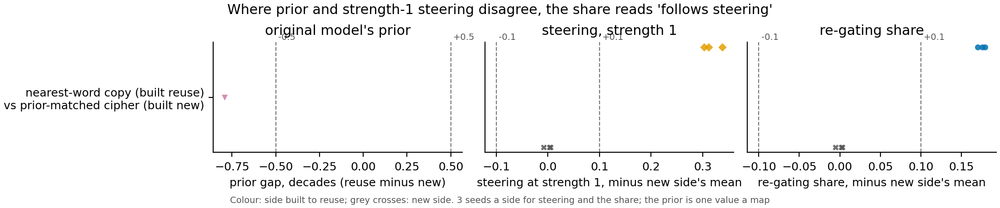

# When the prior and steering disagree, which one does the share follow?

*Cell P2.32, compare-lead, E199, 2026-11-17. One cluster job on an L40, $0. Sides are named as each was built; no
verdict on reuse is given, since the definition is under revision. Plan:
`reports/plans/2026-11-17_plan_p2-32-disagreeing-pairs.md`.*

## The answer

We built one pair of fine-tunes of the 67M model on which the original model's prior and steering point opposite ways.
On that pair the share sides with steering, not with the prior: the side built to reuse reads higher on both. So the
share can disagree with the prior. It does not yet add anything over steering, because on this one pair it agrees with
steering. Mapping keys to the most common words failed to build a pair: no word is likely after every key.

## What we were trying to test

The **share** is the part of a fine-tune's gain that comes from changing only which subcomponents Γ switches on. The gain
is the rise in the trained answer's log-odds; a share of 0 means none of it, 1 all of it. The **prior** is how likely the
original model already finds the trained answer, in decades. **Steering** adds the fine-tune's mean activation change to
the original model at strength 1 and reads how much of the gain that recovers. A **gap** is the side built to reuse minus
the side built new.

On the nine pairs built before, the prior and steering always agreed, so nothing could say which of them the share
tracks. An earlier attempt could not give a key-unrelated answer a prior high enough to pull them apart. This run tried
two other shapes, each against a saved partner from earlier runs:

- **Frequent-word maps**, built new. Each of 128 keys is assigned at random one of the 16, 32 or 64 words the model finds
  most likely after every key. The hope: generic words give a high prior, while several keys per word keep steering low.
  The partner is the copy task, built reuse.
- **Nearest-word copy**, built reuse. Each key maps to the token whose input embedding is nearest its own, such as
  " After" to " after". The hope: repeating a near-copy is unusual text, so its prior is low, while the copy-like change
  steers well. The partner is a cipher whose prior was matched to copy's, built new.

A construction counts as a pair only if the prior gap is at least 0.5 decades one way and steering separates the sides
the other way. Steering separates when its gap is at least 0.1 and larger than the spread within either side, over
three seeds a side. The prior half was checked from the original model alone, with 0.6 decades of margin, before any
fine-tune. Constructions that missed it were never trained.

## What we expected

We expected a pair to be built, most likely the 64-word map, and leaned that the share would follow steering. That lean
came from earlier maps with no key-to-answer link, which all read a share well under copy's. The rival was that the share
follows the prior.

## What we observed

**Reading it.** On the one pair built, the share follows steering. The left panel shows the prior gap at -0.79 decades:
the original model finds the cipher's answers more likely than the nearest-word copy's, past the dashed 0.5 bar. The
middle panel shows steering on the other side: each nearest-word fine-tune sits 0.30 to 0.34 above the cipher's mean, a
gap of 0.32. The right panel shows the share on the same side as steering, with a gap of 0.175 against a spread
of 0.009 within a side. Grey crosses are the cipher's seeds, near zero by construction.

The raw values: the nearest-word copy's prior is 6.0e-6 against the cipher's 3.7e-5. Its steering reads 0.42 to 0.45
against the cipher's 0.11 to 0.12. Its share reads 0.55 to 0.56 against the cipher's 0.37 to 0.38. The copy task reads
a share of 0.77, so the nearest-word copy sits between copy and the cipher. Every nearest-word fine-tune learned the
task, with a gain near 16.

**Why the frequent-word maps failed.** Their priors were not high. Against a bar of 2.35e-4, the 16-word map reached only
1.3e-4. The 32-word and 64-word maps reached 6.6e-5 and 3.8e-5, near or below copy's 5.9e-5. Only two words, " and" and " in", are likely
after most keys, with median probabilities of 0.005 and 0.003. Every other word reads a median of 1.9e-4 or less, so the
answer position after a key does not favour common words. Adding more words lowered the prior instead of raising it.

## What we learned

The share is not a function of the prior: on a pair where the prior points to the side built new, the share points the
other way. But on direction it still says what steering at strength 1 says. For part 2 of the paper this is one example
where the prior alone would mislead and the share would not. It is not yet an example where the share tells us something
the cheaper steering reading misses.

## How compelling is the evidence

One pair, one construction, three seeds a side. The calls are clear: both separations are well past their bars and their
within-side spreads. But the nearest-word copy carries its own confound: it is a near-copy, so its share may simply sit
between copy's and the cipher's because it is copy-like. The seeds vary the fine-tune, not the map. Every stage-0
control passed: the zero update read zero through both readers, the saved priors, shares and steering readings
reproduced, and one refit matched.

## Surprises

The frequent-word maps' priors fell as words were added, and the 64-word map's prior was below copy's. We had expected
3e-4 or more. The nearest-word copy's share sat well under copy's.

## What next

- A second construction that separates the prior from steering would test whether the share's agreement with steering
  holds beyond near-copies. Needs a new cell.
- A pair where steering and the share disagree is the case that would show the share adding something over steering.
  None has been built.

## Scorecard

| id | claim | rule | read | as leaned |
|---|---|---|---|---|
| P1 | a pair is built | first construction reading "opposite" in stage 1 | the nearest-word copy against the prior-matched cipher | yes |
| P2 | the pair is the 64-word map | first construction tried passes | the 64-word map missed its prior bar | no |
| P3 | the share follows steering | reuse side at least 0.1 higher and past the spread | gap 0.175, spread 0.009 | yes |

## Departures from the literature

The frequent-word map gives several keys the same answer, so unlike every earlier cipher it is not one-to-one. It was
never trained. The nearest-word map uses the model's own input embeddings to define "same word"; no source does this.

## Not run

- Any verdict on reuse or new.
- Constructions after the first that passed; the frequent-word maps, which missed their prior bar, were never trained.
- Steering at a searched strength; neuron readings, the untrained decomposition and update size on the new pair.
- A second nearest-word map or a second partner; the same pair on Qwen3-1.7B.

## Provenance

Results `experiments/disagreeing_pairs2/results/stage0.json`, `stage1.json`, `stage2.json`; filed rule
`results/predictions.json`. Slurm job 60915, debug QoS, one L40, about two minutes of compute, $0. Log
`cluster/logs/commute-disagreeing-pairs2-60915.out` in the compare-lead clone. Figure by `plot.py` from `stage2.json`.
