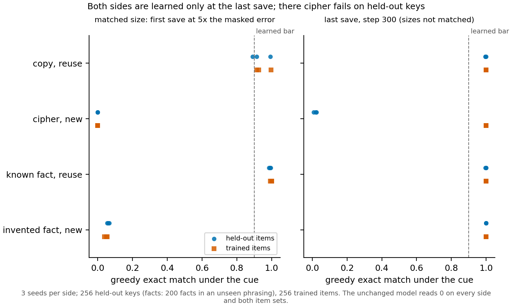

# A library of Qwen3-1.7B fine-tunes whose answer, reused or new, is known by construction

## The answer

We fine-tuned Qwen3-1.7B on two built pairs and two shuffled-answer twins, three seeds each, and saved every update. On the
copy and cipher pair the labels hold: once both sides answer every trained item, copying carries to unseen words and the
cipher does not. The catch is size. At the sizes matched for comparison the new sides have not learned their task yet.
Where both sides have learned it, the new side's weight change is about twice the reused side's. Only the gold twin
pairs two learned updates at a matched size.

## What was built

Each built pair trains the same inputs to two targets. One side asks for something the unchanged model can already do
when told how; the other asks for something it cannot do at all. In the copy and cipher pair the input is a word after a
fixed cue: the reuse side returns the word, and the new side returns it through a fixed letter substitution. In the facts
pair the reuse side answers questions about real facts the model knows, and the new side answers the same kind of
question about invented people. Before training, a capacity check confirmed the split. Asked with an instruction and three
worked examples, the unchanged model copied 255 of 256 held-out words and ciphered none. It answered 192 of 200 known facts
and 5 of 200 invented ones.

A twin is a supervised task trained once with its real answers and once with the answers moved to other prompts by a
seeded shuffle. The shuffled side keeps the format of the data and loses the content. We have twins for two tasks: gold
solutions to grade-school maths problems, and the answer template an earlier experiment trained.

Each update was saved at two matched sizes and at its last step. The size is the output change: the KL divergence from the
unchanged model to the fine-tuned one, on 128 rows of the side's own training text. Its unit is the masked error, the KL
between the unchanged model and its decomposition read with the decomposition's own masks on the same rows. A side was
saved at the first step reaching 5 and 15 times its masked error. Both sides of a pair are then matched in output change,
not in weight change. Accuracy on built sides is greedy exact match after the cue. Held out means 256 unseen words for
copy and cipher. For the facts pair it means the same 200 facts asked in a phrasing never trained.

The built pairs come from the third run, at a peak learning rate of 1e-5 with a cosine schedule and 300 steps. The twins
come from the second run, at 100 steps, with peaks of 1e-5 for gold and 1e-6 for the template. The second run's built
sides used a peak of 2e-6 and did not learn their new sides; the third run replaced them. So the twins and the built
pairs were trained to different recipes.

## Do the built pairs behave as built?

**Reading it.** Yes for copy and cipher, at the last save. The right panel shows that every side answers its trained
items, while held-out accuracy splits the copy pair. Copy reads 1.00 on unseen words on every seed, and cipher reads
0.01–0.02. That gap of 0.97–0.99 is far above the filed bar of 0.3, so the cipher's letter map was memorised word by word,
not learned as a rule. The facts pair does not split this way: both sides read about 1.00 on the unseen phrasing. That
held-out set is new wording of trained facts, so it tests recall across phrasings, not reuse.

The left panel shows the problem for comparisons. At the first matched size, copy and known facts are already learned,
while cipher reads 0 and invented facts read 0.04–0.05 on trained items. Cipher still reads 0 at the 15x save, between
steps 33 and 51. Invented facts reach 0.87–0.98 there, one seed under the learned bar of 0.9.

## The library

Prior is the unchanged model's mean log-probability per answer token of the trained answers. Each save cell gives the step,
the weight change $|\delta W|$ as a Frobenius norm over all trained matrices, and the held-out and trained-item readings. In the
last-save cell the output change is given as a multiple of the side's masked error. Ranges are over seeds 0–2. Built sides read
exact match. The gold twin reads gold loss in nats per token, where lower is better. The template twin reads the rate of
answers in the trained format. "Not reached" means no step reached that size.

| pair: side | run and recipe | seeds fit | prior, nats per token | unchanged model, held out | 5x save | 15x save | last save |
|---|---|---|---|---|---|---|---|
| copy/cipher: **copy**, reuse | run 3, peak 1e-5, 300 steps | 3 of 3 | -17.2 | 0 | step 7–8; \|δW\| 0.17–0.22; held 0.89–0.99; trained 0.91–1.00 | step 12–16; \|δW\| 0.40–0.56; held 1.00; trained 1.00 | step 300; \|δW\| 2.12–2.44; KL 26.4–30.7× floor; held 1.00; trained 1.00 |
| copy/cipher: **cipher**, new | run 3, peak 1e-5, 300 steps | 3 of 3 | -16.2 | 0 | step 13; \|δW\| 0.49–0.50; held 0; trained 0 | step 33–51; \|δW\| 1.63–2.35; held 0; trained 0 | step 300; \|δW\| 5.01–5.09; KL 26.2–33.5× floor; held 0.01–0.02; trained 1.00 |
| facts: **known**, reuse | run 3, peak 1e-5, 300 steps | 3 of 3 | -7.1 | 0 | step 12–13; \|δW\| 0.42–0.47; held 0.98–0.99; trained 0.99–1.00 | step 27–31; \|δW\| 1.11–1.25; held 0.98–0.99; trained 0.99–1.00 | step 300; \|δW\| 1.78–1.97; KL 12.8–16.8× floor; held 0.99–1.00; trained 1.00 |
| facts: **invented**, new | run 3, peak 1e-5, 300 steps | 3 of 3 | -6.8 | 0 | step 18–19; \|δW\| 0.85–0.91; held 0.06–0.07; trained 0.04–0.05 | step 49–69; \|δW\| 2.67–3.21; held 0.86–0.98; trained 0.87–0.98 | step 300; \|δW\| 3.99–4.08; KL 17.7–18.3× floor; held 1.00; trained 1.00 |
| gold twin: **gold** | run 2, peak 1e-5, 100 steps | 3 of 3 | -2.6 to -2.3 | 2.50 | step 12; \|δW\| 1.03; held 0.58; trained 0.54–0.60 | not reached | step 100; \|δW\| 2.85–2.87; KL 7.4–7.6× floor; held 0.51; trained 0.46–0.54 |
| gold twin: **gold, shuffled** | run 2, peak 1e-5, 100 steps | 3 of 3 | -2.8 to -2.7 | 2.50 | step 10; \|δW\| 0.84; held 0.75–0.79; trained 1.16–1.17 | not reached | step 100; \|δW\| 2.95–2.97; KL 9.2–9.4× floor; held 0.81–0.83; trained 1.02–1.03 |
| template twin: **template** | run 2, peak 1e-6, 100 steps | 0 of 3 | -1.1 to -1.0 | 0 | not reached | not reached | step 100; \|δW\| 0.49; KL 2.8–2.9× floor; held 0.93; trained 0.92–0.95 |
| template twin: **template, shuffled** | run 2, peak 1e-6, 100 steps | 0 of 3 | -1.9 to -1.8 | 0 | not reached | not reached | step 100; \|δW\| 0.61; KL 4.2–4.3× floor; held 0.34–0.63; trained 0.48–0.72 |

## Which pairs are fit to read

The filed rule calls a pair fit to read at a seed on three conditions. Both sides are learned at the last save. The pair
is matched at one size or more. And it passed its capacity check. Copy and cipher and the facts pair pass on all three seeds, and
so does the gold twin. The template twin fails on every seed. Neither of its sides reached even the 5x size in 100 steps,
and the shuffled side's trained format rate stayed under its learned bar. The rule's wording hides one thing a reader of
these updates must know. It checks learning at the last save and matching at the 5x and 15x saves, and for the built pairs
those are different states. At the matched 5x save, and for cipher also at 15x, the new side has not learned its answers
yet. A matched-size built pair therefore sets a learned reuse update beside a new update that has only started. At the
last save both sides are learned, but the sizes are not matched: cipher's weight change is about twice copy's, and invented
facts' about twice known facts'. The gold twin is the one pair with two learned updates at a matched size. There the
shuffled answers still cut held-out gold loss from 2.50 to 0.81–0.83. The real answers reach 0.51, so much of what the
gold update learns is format. The second run's built sides failed their learning check and are not in the library:
cipher read 0 on trained items and invented facts 0.67–0.69 at step 100.

## Surprises

None against the filed predictions. What the plan did not foresee is the order of events: the built pairs reach their
matched sizes before their new sides learn, so matching and learning fall on different saves.

## Departures from the literature

The built recipe follows LLaMA-Factory's documented full fine-tuning setting for Qwen in learning rate, schedule and
warm-up ratio. It trains 300 steps rather than the gold arm's 100. The second run's new sides were still learning when its
schedule ended. Otherwise none.

## Scorecard

| id | claim | rule | read | verdict |
|---|---|---|---|---|
| learned | each built side learns its trained items at step 300 | trained exact match at or above 0.9 | 1.00 on all twelve side-seeds | holds |
| copy_held | copy carries to unseen words | copy held-out hits at least 231 of 256 at the last save | 1.00 on all three seeds | holds |
| rival a against b | cipher is memorised, not learned as a rule | copy minus cipher held-out above 0.3 at the last save | 0.97–0.99 | rival a, 3 of 3 seeds |

## Not run

- No decomposition reading of any of these updates: that waits for the 11-18 gate.
- The saved states are on W&B only, as artifacts `p35r3-<side>-s<seed>-<size>` for the third run; none has been pulled back.
- The template twin was not refilled at a recipe that reaches a matched size.
- No arm at a peak of 2e-5, which might bring the new sides to a learned state at a matched size.

## Provenance

Third run, E165: `experiments/qwen_pair_library/results/library_run3/<side>_s<seed>.json` and `table.json`; card
`experiments/qwen_pair_library/card_run3.md`; rules `results/predictions_run3.json`. Second run, E164:
`results/library/<arm>_s<seed>.json` and `table.json`. Capacity check `results/capacity.json`; masked errors
`results/floors.json`, decomposition p-9707d6ff. Figure `experiments/qwen_pair_library/plot.py`.
