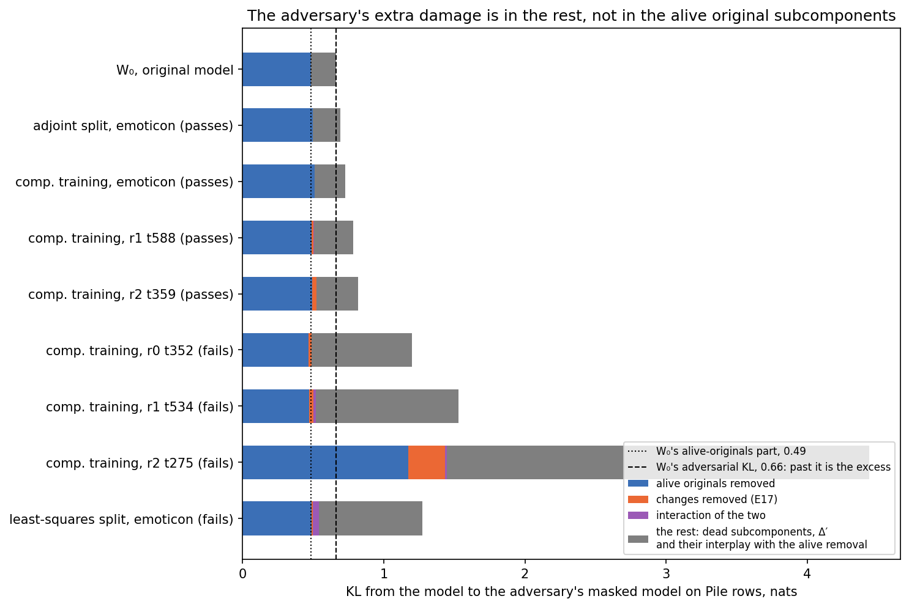
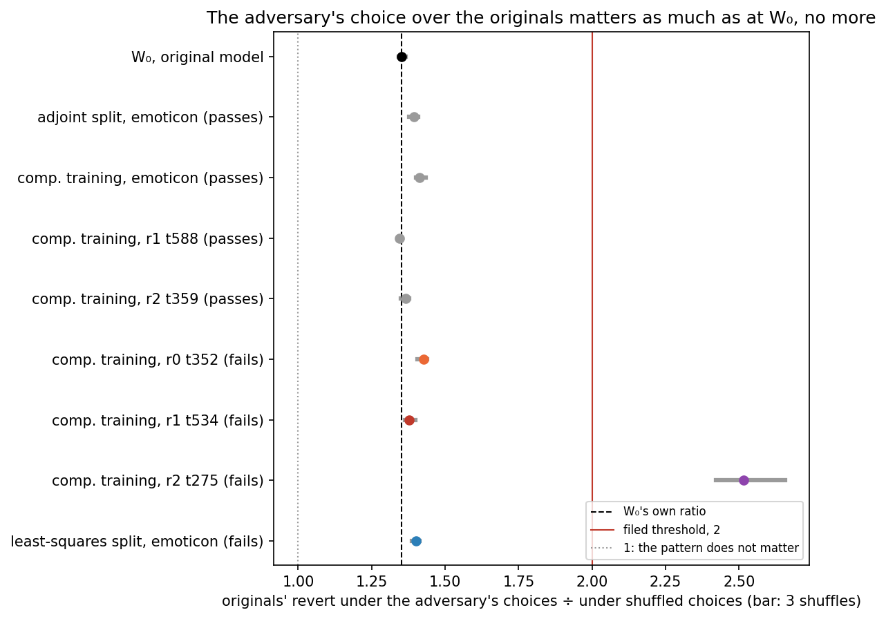
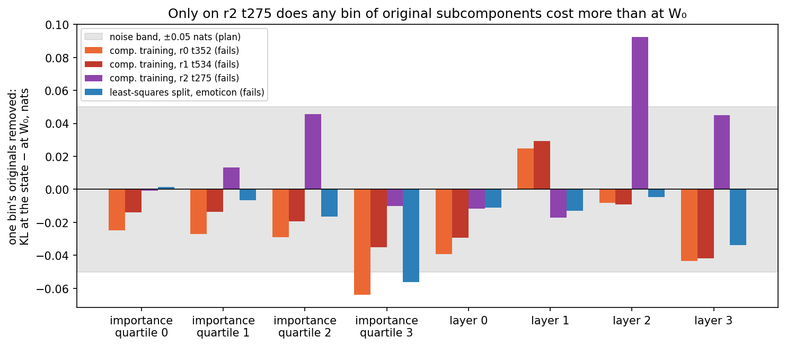
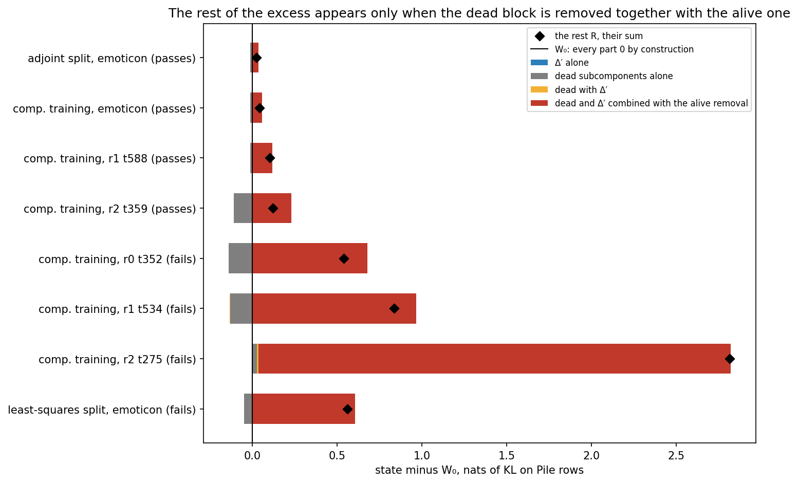
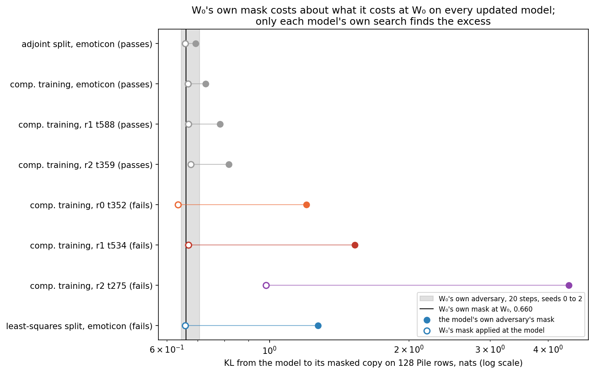
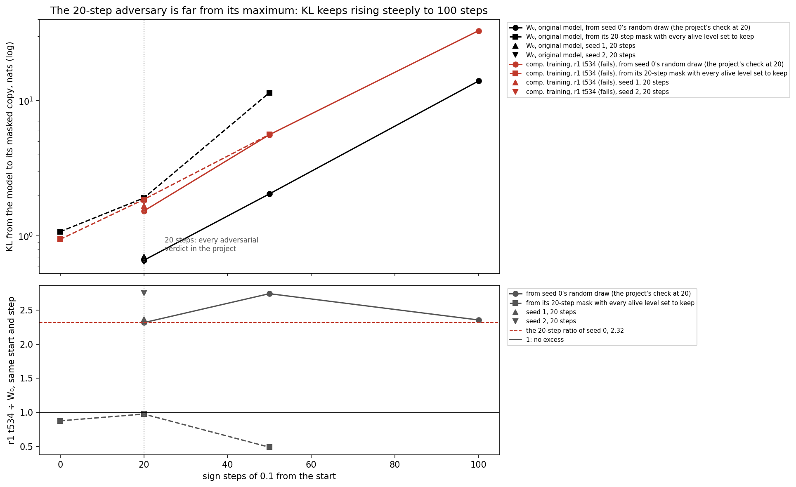

# Analysis: is the adversary's extra damage in the original subcomponents? No (E20)

*2026-10-21, writing agent. Plan: `reports/2026-10-21_plan_cancellation-complement.md`. Notebook:
`notebooks/E20_cancellation_complement.ipynb`. Predictions: `experiments/cancellation_complement/results/predictions.json`,
filed before the run and not edited. Follows E17, `reports/2026-10-21_analysis_cancellation.md`. Vocabulary: `GOALS.md` →
Terms. Status: run in full on the MATS cluster; the gate and the control passed; all three predictions failed*.

We measured whether VPD's adversarial check gets its extra damage on updated models from the original subcomponents.
On three of the four failing models it does not: removing them costs the same as at the original model. The damage sits
mostly in the mask on dead subcomponents and on weights outside the decomposition, which the update never touched.

## The answer

No. The previous experiment inferred that the adversary's extra damage on updated models came from its mask on the
original subcomponents. We measured that directly. On three of the four failing models, removing the adversary's share
of the original subcomponents costs no more than at the original model. On the fourth it carries a fifth of the excess.
Most of the excess sits in the adversary's mask on the dead subcomponents and on Δ, alone or combined with the rest of
its mask. Which of those it is has not been measured.

## The question

VPD writes each weight matrix as a sum of rank-one subcomponents $u_c v_c^\top$ plus Δ, the part they leave over. About
9,900 subcomponents are alive: Γ rates them important somewhere on the original model's text. The rest are dead. The
adversarial check keeps at least the importance $g_c(x)$ of each subcomponent. Above that floor it picks a level $a_c$
that hurts the output most, keeping $g_c + (1-g_c)\,a_c$. It keeps a level $a_\Delta$ of Δ, one number per matrix with
no floor. In code, `sources[k]` holds $C + 1$ levels per matrix, with Δ's last.

E17 removed the adversary's fraction $(1-g_c)(1-a_c)$ of each change $d_c = u'_c v'^\top_c - u_c v_c^\top$ and found it
explains at most 17% of the excess. On the failing states it explains under a tenth. Its section 4 inferred that the rest came
from the same fraction of the original subcomponents. This run measures that, and the answer decides where to look
next. If the originals carry it, Γ's importance around them is stale and a Γ that sees the updated model is the fix. If
they do not, the damage lies elsewhere in the mask.

## What we did

Eight states were rebuilt by `commute.saved_states` from E11's saved files, exactly as in E17. Each was read under its
own adversary on the first 128 rows of Pile validation text. Component training ran to step 10 on six tasks. Emoticon,
r1 t588 and r2 t359 pass the adversarial check; r0 t352, r1 t534 and r2 t275 fail it. The emoticon fine-tune's least-squares
split, which fails, and its scaled adjoint split, which passes. The original model $W_0$ under its own adversary is the
reference. The adversary is E17's: 20 sign steps of 0.1, seed 0, one source vector per matrix over all rows.

The code is `cancel.Remover`. It puts a forward hook on every decomposed matrix. The hook subtracts chosen fractions of
four blocks of that matrix's output. The blocks are the alive original subcomponents, the alive updated subcomponents,
the dead subcomponents, and Δ′, the state's Δ. The adversary's masked model removes exactly the fraction $(1-g)(1-a)$ of the alive updated and the dead
subcomponents, and $1 - a_\Delta$ of Δ′.

Symbols, each a mean KL in nats from the model to a copy with something removed, in fp32:

- $F$: the adversary's full mask.
- $F_o$: the adversary's fraction of each alive original subcomponent only, the changes kept.
- $F_d$: the same fraction of each change only, the originals kept; E17's measurement.
- $F_b$: the same fraction of each alive updated subcomponent, originals and changes together.
- $X = F(\text{state}) - F(W_0)$, the excess, splits exactly as $X = O + F_d + I + R$.
- $O = F_o(\text{state}) - F_o(W_0)$, the originals' part; at $W_0$ the changes are zero, so $F_b = F_o$ there.
- $I = F_b - F_o - F_d$, how the two halves combine.
- $R = [F - F_b](\text{state}) - [F - F_o](W_0)$: what the dead and Δ′ blocks add, alone and combined with the alive
  removal. A remainder of measured quantities, not a revert of its own.

Two further readings. The adversary's levels shuffled among the alive subcomponents of each matrix, three draws, with
$F_o$ recomputed: does the pattern over the originals matter? And $F_o$ restricted to one bin of originals: a quarter of
the alive subcomponents by mean importance at $W_0$, or one layer. The per-bin excess $e_b$ is the state minus $W_0$.

**Gate.** On the first batch at every model, the hooks at the adversary's fractions must reproduce its masked model.
The tolerance is 1e-4 nats, in fp32. At zero weight they must reproduce the model. Read: at most 3.7e-9 nats, and 0. At $W_0$
the changes' revert read 0 and $F_b = F_o$ exactly. **Control.** Component training's emoticon state was read before any scored state. Its changes' revert and its bf16
adversary KL reproduced E17's values, both with ratio 1.00.

## What we expected, and why

- **The originals carry the excess**: $O \ge X/2$ on each failing state. Moderate confidence: E17's changes carried at
  most 7% there, and the changes are small beside the originals. The named risk was the rest.
- **The adversary's pattern over the originals matters**: $F_o$ at least twice its shuffled mean on each failing state.
  Turning every maskable subcomponent down together costs a fiftieth of the adversary's mask, as
  `reports/2026-10-20_analysis_adversarial-vs-stochastic.md` found.
- **The least important originals carry it**. The two lowest importance quarters should hold at least half of the
  positive per-bin excess. That should hold on three of the four failing states. Low confidence.

## What we observed

### 1. Where does the adversary's extra damage come from?

**Reading it.** Not from the original subcomponents: the grey rest grows and the blue part does not. Each bar is one
model's adversarial KL, cut into its four parts. The dotted and dashed lines carry the original model's two boundaries
down every row. On three of the four failing states the blue segment ends on the dotted line. Removing the adversary's
share of the original subcomponents costs what it costs at the original model, even slightly less. The grey segment is
0.17 nats at the original model. On those three states it is 0.7 to 1.0 nats. Component training on r2 t275, the largest
update, is the exception. There the originals' part grows by 0.69 nats, a fifth of the excess, and the rest still holds
2.8 nats. The passing states have the same shape at a smaller size.

| model | adversary KL, bf16 | F, fp32 | F_o | F_d | F_b | F − F_b | F_o shuffled, mean (range) | gate, nats |
|---|---|---|---|---|---|---|---|---|
| W₀, original model | 0.661 | 0.660 | 0.487 | 0.0000 | 0.487 | 0.174 | 0.360 (0.357 to 0.363) | 2.6e-09 |
| adjoint split, emoticon | 0.692 | 0.693 | 0.498 | 0.0008 | 0.497 | 0.196 | 0.357 (0.353 to 0.361) | 1.8e-09 |
| component training, emoticon | 0.729 | 0.728 | 0.509 | 0.0015 | 0.511 | 0.217 | 0.361 (0.355 to 0.364) | 4.0e-10 |
| component training, r1 t588 | 0.782 | 0.782 | 0.490 | 0.0130 | 0.504 | 0.278 | 0.365 (0.362 to 0.366) | -2.1e-09 |
| component training, r2 t359 | 0.818 | 0.817 | 0.495 | 0.0265 | 0.523 | 0.294 | 0.363 (0.359 to 0.367) | 8.7e-10 |
| component training, r0 t352 | 1.201 | 1.202 | 0.465 | 0.0274 | 0.490 | 0.712 | 0.326 (0.323 to 0.331) | -3.7e-09 |
| component training, r1 t534 | 1.528 | 1.529 | 0.470 | 0.0343 | 0.520 | 1.008 | 0.341 (0.336 to 0.345) | -2.6e-09 |
| component training, r2 t275 | 4.446 | 4.437 | 1.174 | 0.2597 | 1.446 | 2.991 | 0.467 (0.442 to 0.485) | 2.4e-09 |
| least-squares split, emoticon | 1.277 | 1.275 | 0.491 | 0.0083 | 0.542 | 0.732 | 0.350 (0.348 to 0.354) | 1.1e-09 |

| model | X | O | F_d | I | R | O ÷ X | R ÷ X |
|---|---|---|---|---|---|---|---|
| adjoint split, emoticon | 0.033 | 0.011 | 0.0008 | -0.0010 | 0.022 | 0.33 | 0.68 |
| component training, emoticon | 0.068 | 0.023 | 0.0015 | 0.0005 | 0.043 | 0.33 | 0.64 |
| component training, r1 t588 | 0.122 | 0.004 | 0.0130 | 0.0010 | 0.104 | 0.03 | 0.86 |
| component training, r2 t359 | 0.157 | 0.008 | 0.0265 | 0.0012 | 0.121 | 0.05 | 0.77 |
| component training, r0 t352 | 0.541 | -0.022 | 0.0274 | -0.0028 | 0.538 | -0.04 | 0.99 |
| component training, r1 t534 | 0.868 | -0.017 | 0.0343 | 0.0162 | 0.835 | -0.02 | 0.96 |
| component training, r2 t275 | 3.777 | 0.687 | 0.2597 | 0.0128 | 2.817 | 0.18 | 0.75 |
| least-squares split, emoticon | 0.614 | 0.004 | 0.0083 | 0.0428 | 0.559 | 0.01 | 0.91 |

The fp32 total and the bf16 adversary KL agree within 0.01 nats on every model, as the plan expected.

### 2. Does the adversary's choice over the originals matter more after the update?

**Reading it.** It matters, but no more after the update than before. The adversary's levels cost 1.34 to 1.43 times
shuffled ones on seven of the eight states. The original model reads 1.35, the dashed line. We predicted at least 2 on
the failing states, so this failed. A pattern that is ordinary at the original model cannot explain an excess.
Component training on r2 t275 again stands apart at 2.5; there even shuffled levels cost more than at the original model.

### 3. Which original subcomponents does the updated model lean on?

**Reading it.** None, outside r2 t275. Almost every bar is inside the plan's noise band of 0.05 nats, and most are below
zero. The lowest importance quarter, where we expected the excess, reads −0.025 to 0.001 nats on the failing states. On
r2 t275, layer 2 reads 0.09, the one bar clearly above the band. With no excess in the originals on three states, there
was nothing for the bins to locate.

Per-bin excess $e_b$ in nats, with the original model's per-bin $F_o$ for scale.

| bin | W₀'s F_o in bin | r0 t352 | r1 t534 | r2 t275 | least-squares |
|---|---|---|---|---|---|
| importance quarter 0, lowest | 0.194 | -0.025 | -0.014 | -0.001 | +0.001 |
| importance quarter 1 | 0.232 | -0.027 | -0.014 | +0.013 | -0.007 |
| importance quarter 2 | 0.289 | -0.029 | -0.019 | +0.045 | -0.016 |
| importance quarter 3 | 0.626 | -0.064 | -0.035 | -0.010 | -0.056 |
| layer 0 | 0.451 | -0.039 | -0.029 | -0.012 | -0.011 |
| layer 1 | 0.286 | +0.025 | +0.029 | -0.017 | -0.013 |
| layer 2 | 0.373 | -0.008 | -0.009 | +0.092 | -0.005 |
| layer 3 | 0.267 | -0.044 | -0.042 | +0.045 | -0.034 |

Mean fraction of each bin the adversary removes. Reported, not scored.

| bin | W₀ | r0 t352 | r1 t534 | r2 t275 | least-squares |
|---|---|---|---|---|---|
| importance quarter 0 | 0.633 | 0.592 | 0.612 | 0.571 | 0.630 |
| importance quarter 1 | 0.542 | 0.530 | 0.547 | 0.519 | 0.536 |
| importance quarter 2 | 0.497 | 0.474 | 0.473 | 0.465 | 0.470 |
| importance quarter 3 | 0.535 | 0.500 | 0.487 | 0.445 | 0.488 |
| layer 0 | 0.610 | 0.598 | 0.621 | 0.579 | 0.651 |
| layer 1 | 0.548 | 0.414 | 0.520 | 0.429 | 0.509 |
| layer 2 | 0.539 | 0.514 | 0.513 | 0.503 | 0.513 |
| layer 3 | 0.498 | 0.480 | 0.447 | 0.433 | 0.421 |

The lowest quarter is removed most, as expected. The states sit within 0.1 of the original model in every bin but one.
The exception is layer 1 on r0 t352 and on r2 t275, where the adversary removes less.

## What this means for E17's write-up and the research log

E17's section 4, "What that leaves", names the adversary's mask on the original subcomponents as the rest of the
excess. It says the updated model leans on them more. It marks this as an inference. This run refutes the inference on three of the
four failing states, and finds a fifth of the excess there on the fourth. E17's own measurements stand: the changes do
not cancel, and the changes' revert carries under a tenth of the excess. Its report and notebook carry a dated note
pointing here.

In the research log the same inference appears in several places, queued in `docs/research_log/PENDING.md`. Q6's status
says the rest "is inferred ... to come from the original subcomponents". The main-line card's claim says "what it breaks
is the original subcomponents the released Γ rates unimportant". The claims-table row on the original subcomponents is
marked open, inferred as the remainder. E17's card, A1's Moved on, the What's-next card and the retired-claims entry
repeat it. Each should now say that the excess sits in the mask on the dead subcomponents and Δ′, split between them not yet
measured. The claims-table row becomes refuted, except for a fifth of the excess on r2 t275.

## What we learned

The adversary's extra damage on updated models is not in the alive subcomponents. It is not in their changes, nor in
the originals, nor in how the two combine. It sits in the mask on the dead subcomponents and on Δ′, or in how that mask
combines with the rest. For component training, Δ′ and the dead subcomponents are exactly the original model's weights.
So the updated model is more sensitive to removing weights the update did not change. Stale importance around the
originals was an argument for a Γ that sees the updated model. This run removes that argument, though not the refit.
The brittleness question of `GOALS.md` moves to the part of the model outside the alive subcomponents.

## How compelling is the evidence

The split into four parts is exact by definition. The gate shows the hooks reproduce the adversary's own masked
model to a few billionths of a nat. So $R$ is a measured total minus measured reverts, not an estimate. The control
reproduced E17 exactly. There is one adversary seed and one update seed per state. E11's seed floor, about 0.05 nats at
the original model, is small beside the rest's growth of 0.5 to 2.8 nats on the failing states. The shuffled draws
spread by at most 0.04 nats.

Blind spots. Pile text only, never the trigger. $R$ lumps three things: the dead subcomponents, Δ′, and how they combine
with the alive removal. Each model is read under its own adversary, so $O$ compares two different masks; that is what
$X$ is made of, not a fixed-mask dependence. The bins use the original model's importance, and KL does not add across
bins.

## Surprises

**Something unexpected happened that I cannot explain yet.** All three filed predictions failed. The excess was
predicted to sit mostly in the original subcomponents. On three of the four failing states their part is zero within
noise, slightly negative. Almost all of it sits instead in the mask on the dead subcomponents and Δ′. For component
training those are the same weights as in the original model. This refutes the inference in E17's section 4, and the
research log's sentences that say the adversary breaks the original subcomponents.

Two smaller ones. The adversary removes slightly less of the alive subcomponents at the failing states than at the
original model, most in layer 1. And at the original model, removing the adversary's share of only the top importance
quarter costs 0.63 nats. Removing its share of every original at once costs less, 0.49. Removals in different bins partly
offset each other in the output. That does not change any part above, but per-bin numbers cannot be summed.

## What next

**Split the rest, in the same hooks.** The cheapest test that separates $R$'s parts uses the four blocks that
`state_blocks` already builds. The run switched on only the first two.

What the code shows. In `gamma.pgd_sources` and `cancel.cache_adversary`, the masked forward keeps $g + (1-g)a$ of
every subcomponent, alive or dead, and $a_\Delta$ of Δ′. Here `sources[k]` has length $C + 1$, Δ's level last, shared
over all rows. For component training, `Offsets.delta_w` saves a weight change that is exactly the sum of the changes.
And `components_with` replaces alive columns only, so the dead subcomponents are never edited. So Δ′ equals the original
model's Δ up to fp32 rounding, and the dead block is the same matrices too. The same holds for the scaled adjoint state.
For the least-squares split, `split.split_state` moves the part of the update outside the subcomponents into Δ′. There
the adversary can remove part of the update itself.

How an unchanged Δ can cost more to mask at the state. Candidate readings, none verified, each with the number that
separates it:

1. **The adversary removes more.** It sets $a_\Delta$, or the dead levels, lower at the state. Separating number: $1 -
   a_\Delta$ per matrix and the dead block's mean removed fraction, state against $W_0$. This run discarded the sources,
   so it cannot say.
2. **The same removal costs more.** The update changed the inputs reaching those matrices, or what later layers do with
   their output. Then removing the same $\Delta' x$ moves the output further. Separating number: Δ′ alone removed at
   $W_0$'s level $a_\Delta$, at the state against at $W_0$. If it rises with the levels fixed, this reading holds.
3. **The dead subcomponents carry more.** Their read vectors pick up more of the shifted inputs, or Γ gives them less
   importance there. Separating number: the dead block alone, at the state against at $W_0$, and its mean removed
   fraction.
4. **Only together.** Neither block costs more alone; the excess appears only when they are removed with the alive
   subcomponents. Separating number: $F$ minus $F_b$ minus the dead-and-Δ′ revert, at the state against at $W_0$.

The test. Three more reverts per model, at the state and at $W_0$. The dead block alone at the adversary's fractions
$(1-g)(1-a)$; Δ′ alone at $1 - a_\Delta$; and both. Then $R$ splits exactly into Δ′ alone, dead alone, their
interaction, and their interaction with the alive removal, which is reading 4. Add the fixed-level Δ′ revert from
reading 2, using $W_0$'s sources, and save every model's sources, a few kilobytes. One code change is needed.
`cache_adversary` keeps $g$ on the alive subcomponents only. It must also keep $g$ at the dead positions. About four more hooked passes per model, roughly 15 s each; one `debug` job of about ten
minutes, no cost. What it decides: if Δ′ alone is large, the adversary's unfloored level on Δ is what breaks. If the
dead block is large, Γ's importance on the shifted inputs is. If the interaction is large, the excess is a joint
effect, as E15's first stage saw for the alive subcomponents.

**Bring E17 and the log into line**, through the queued `PENDING.md` line: done in this round as dated notes and one
queue line.

## Scorecard (as filed)

| id | claim | rule | read | verdict |
|---|---|---|---|---|
| G1 | the hooks reproduce the adversary's masked model | ≤ 1e-4 nats; ≤ 1e-6 at zero weight; at W₀ F_d ≤ 1e-6 and F_b = F_o | ≤ 3.7e-9; 0; 0 and equal | pass |
| C0 | reproduces E17 | F_d and the bf16 adversary KL within 25% of 0.00149 and 0.7286 | ratios 1.00 and 1.00 | pass |
| P1 | the originals carry the excess | O ≥ 0.5 X on each scored state | O ÷ X −0.04, −0.02, 0.18, 0.01 | **fail** (predicted pass) |
| P2 | the adversary's pattern over the originals matters | F_o ≥ 2 × shuffled mean on each scored state | 1.43, 1.38, 2.52, 1.40; W₀ 1.35 | **fail** (predicted pass) |
| P3 | the low-importance originals carry it | lowest two quarters ≥ half of Σ max(e_b, 0), on ≥ 3 of 4 | no positive bin, no positive bin, 0.23, 1.00 | **fail** (predicted pass) |

Scored states in the order r0 t352, r1 t534, r2 t275, least-squares split. P3's one pass, the least-squares split,
rests on a single positive bin at 0.001 nats, inside the noise. "No positive bin" scores as a miss.

## Not run

- Separate reverts of the dead subcomponents and of Δ′; the adversary's sources were not saved.
- The state's adversary applied at $W_0$, and $W_0$'s at the state.
- The do-nothing state; the gauge-mixed control; a second adversary seed; a second update seed.
- The trigger windows; a per-matrix revert; interactions between bins.

## Provenance

Results `experiments/cancellation_complement/results/complement.json`, sha256 `a9e6f5da2232ea28…`; log
`results/large/full.log`, timestamps in UTC. MATS cluster, one L40, `debug` QoS, job 28206, 476 s, 2026-10-21 16:13 to
16:21 BST, $0. Script `cluster/cancellation_complement.sbatch`. Code `src/commute/cancel.py`, complement section;
`src/commute/saved_states.py`; `experiments/cancellation_complement/run.py`. Figures by
`experiments/cancellation_complement/plot.py`, rewritten for this report from the JSON only. They are
`decomposition.png`, `pattern.png` and `bins.png`.

## Hand-off

Next, through `/design`, in approved class 1, a GPU pass of the existing hooks on saved states: the split of the rest
above. Files to hand over: this report, `src/commute/cancel.py`, `experiments/cancellation_complement/run.py`.

## Amendment 1 (2026-10-21): where in the rest is the excess?

*Writing agent. Plan: `reports/2026-10-21_plan_cancellation-complement.md` → "Amendment 1". Predictions:
`experiments/cancellation_complement/results/predictions_amend1.json`, filed before the run. Figure:
`figures/rest_split.png` from `plot.py`, JSON only. The original predictions and scorecard above stand.*

We removed the adversary's share of the dead subcomponents and of Δ′ on their own, and together, at every model. Neither
costs more at the updated models than at the original, and Δ′ alone costs almost nothing anywhere. The whole excess
appears only when they are removed together with the alive subcomponents. So the brittleness is a joint effect of the
adversary's mask, not a property of any one block.

### The answer

The excess lives in the interaction between removing the alive subcomponents and removing the dead ones. Removing the
adversary's share of Δ′ alone costs under a hundredth of a nat on every model. Removing its share of the dead
subcomponents alone costs about one nat everywhere, slightly less after the update. At the original model the alive and
dead removals largely offset each other. At the failing models much of that offset is gone, and that loss is the
excess. Against our prediction, the adversary also removes less of the dead block after the update, not the same.

### What was run

The same run as E20: the original model $W_0$ first, the same eight models and 128 Pile rows, the same adversary,
every E20 number recomputed. The new reverts keep the alive subcomponents whole and remove, in nats of KL:

- $F_{dead}$: the adversary's fraction $(1-g)(1-a)$ of each dead subcomponent.
- $F_{dense}$: the fraction $1 - a_\Delta$ of Δ′, per matrix.
- $F_{rest}$: both.
- The same two blocks at $W_0$'s levels $a$, with the model's own $g$, to tell a changed level from a changed cost.

E20's rest $R$ splits exactly into four parts, each the state minus $W_0$:

- $D$, Δ′ alone: the change in $F_{dense}$.
- $K$, the dead block alone: the change in $F_{dead}$.
- $P$, how those two combine: the change in $F_{rest} - F_{dense} - F_{dead}$.
- $J$, how the rest combines with the alive removal: the change in $F_{all} - F_{both} - F_{rest}$. Here $F_{all}$ is
  the adversary's whole mask and $F_{both}$ its removal of the alive block.
 The adversary's levels were saved for every model. **Gates.** E20's numbers repeated to the last digit. The hooks with every block removed matched the adversary's masked
model within 1.1e-7 nats. At $W_0$ the fixed-level arms equalled the own-level ones.

### Where in the rest is the excess?

**Reading it.** Only in the interaction with the alive removal: the red segments carry everything. Each row is one
model's rest, its parts measured against the original model, the zero line. On every model the red part is at least 0.99 of the
rest. The dead block alone, in grey, sits slightly left of zero: it costs less after the update.
Δ′ alone and dead-with-Δ′ are too small to see. On the four failing models the interaction is 1.0 to 1.3 times the rest; the full table is below. The passing models show the same shape at a tenth of the size.

### What the interaction is, at the original model

At $W_0$ removing the dead block alone costs 1.07 nats, and the alive block alone 0.49. Removing both, the adversary's
own mask, costs only 0.66. So the two removals offset each other by 0.90 nats. At the failing models that offset shrinks
or turns positive, and the excess is that change. One consequence is checked directly from the numbers. Keeping every
alive subcomponent whole is an allowed choice for the adversary. With its own dead and Δ′ levels, that choice costs
1.08 nats at $W_0$, more than the 0.66 its search returned. The same holds at every passing model: 0.97 to 1.06 against
0.69 to 0.82. At the failing models the search's own mask costs more than that choice.

| model | adversary's mask | alive block | dead alone | Δ′ alone | dead and Δ′ | how the rest combines with the alive | removed of Δ′, mean | removed of dead, mean | dead at W₀'s levels | Δ′ at W₀'s levels |
|---|---|---|---|---|---|---|---|---|---|---|
| W₀, original | 0.660 | 0.487 | 1.070 | 0.0068 | 1.075 | −0.902 | 0.46 | 0.62 | 1.070 | 0.0068 |
| adjoint split, emoticon | 0.693 | 0.497 | 1.057 | 0.0077 | 1.062 | −0.867 | 0.48 | 0.62 | 1.059 | 0.0067 |
| comp. training, emoticon | 0.728 | 0.511 | 1.057 | 0.0070 | 1.062 | −0.845 | 0.48 | 0.61 | 1.066 | 0.0068 |
| comp. training, r1 t588 | 0.782 | 0.504 | 1.056 | 0.0069 | 1.062 | −0.784 | 0.38 | 0.58 | 1.075 | 0.0069 |
| comp. training, r2 t359 | 0.817 | 0.523 | 0.962 | 0.0053 | 0.969 | −0.675 | 0.48 | 0.53 | 1.039 | 0.0066 |
| comp. training, r0 t352 | 1.202 | 0.490 | 0.931 | 0.0065 | 0.935 | −0.224 | 0.26 | 0.53 | 1.011 | 0.0066 |
| comp. training, r1 t534 | 1.529 | 0.520 | 0.939 | 0.0073 | 0.943 | +0.065 | 0.36 | 0.52 | 1.025 | 0.0066 |
| comp. training, r2 t275 | 4.437 | 1.446 | 1.097 | 0.0017 | 1.105 | +1.885 | 0.56 | 0.43 | 1.087 | 0.0066 |
| least-squares split, emoticon | 1.275 | 0.542 | 1.024 | 0.0053 | 1.029 | −0.296 | 0.42 | 0.56 | 1.066 | 0.0081 |

All in nats except the two "removed" columns, which are fractions. The alive block is $F_{orig}$ at $W_0$, $F_{both}$
elsewhere. "Removed of dead" equals the mean of $1 - a$ over dead subcomponents to five digits, so Γ rates them near 0.

| model | rest R | Δ′ alone, D | dead alone, K | dead with Δ′, P | with the alive, J | J ÷ R | D at W₀'s levels | K at W₀'s levels | change in removed Δ′ | change in removed dead |
|---|---|---|---|---|---|---|---|---|---|---|
| adjoint split, emoticon | 0.022 | +0.0010 | −0.013 | −0.0005 | +0.035 | 1.58 | −0.0001 | −0.011 | +0.01 | −0.00 |
| comp. training, emoticon | 0.043 | +0.0003 | −0.014 | −0.0001 | +0.057 | 1.31 | +0.0000 | −0.004 | +0.02 | −0.02 |
| comp. training, r1 t588 | 0.104 | +0.0001 | −0.014 | +0.0004 | +0.117 | 1.13 | +0.0001 | +0.005 | −0.08 | −0.04 |
| comp. training, r2 t359 | 0.121 | −0.0015 | −0.108 | +0.0029 | +0.227 | 1.88 | −0.0002 | −0.031 | +0.02 | −0.10 |
| comp. training, r0 t352 | 0.538 | −0.0003 | −0.139 | −0.0004 | +0.678 | 1.26 | −0.0002 | −0.059 | −0.20 | −0.10 |
| comp. training, r1 t534 | 0.835 | +0.0005 | −0.131 | −0.0015 | +0.967 | 1.16 | −0.0002 | −0.045 | −0.10 | −0.11 |
| comp. training, r2 t275 | 2.817 | −0.0051 | +0.027 | +0.0079 | +2.787 | 0.99 | −0.0002 | +0.017 | +0.10 | −0.19 |
| least-squares split, emoticon | 0.559 | −0.0015 | −0.046 | +0.0010 | +0.606 | 1.08 | +0.0013 | −0.004 | −0.05 | −0.06 |

The adversary's level on Δ′ is 0 or 1 in most matrices: it keeps Δ′ whole or removes it. A mean change of 0.1 is
about two of the 24 matrices switching.

### Candidate readings, none verified

Each is consistent with the numbers above; the number that would separate them has not been measured.

1. **The search, not the model.** The adversary is 20 sign steps. At the original and passing models it stops where
   its alive levels undo much of its dead levels' damage. A choice it could have made, keeping the alive block whole,
   costs 1.08 nats against its 0.66. At the failing models it stops elsewhere. Then the excess partly measures where
   a short search lands. Separating number: a stronger adversary's KL at $W_0$, with more steps or restarts, or
   started from the alive-whole choice. If it rises to about 1.1 nats, the reference is understated. Against that
   reference the excess on r0 t352 falls from 0.54 to about 0.13 nats. On r1 t534 it falls from 0.87 to about 0.45. The excess on r2 t275 stays large.
2. **The same mask costs more.** The update changed how the alive and dead removals combine in the output. Then the
   original model's own mask would also cost more at the updated model. Separating number: $W_0$'s saved levels for
   every block applied at the state, minus $W_0$'s 0.66. If it carries half the excess or more, the model changed; if
   it is near 0, the state's adversary found a different mask.
3. **The offset is between particular blocks.** The dead and alive subcomponents may write along shared directions,
   so that removing both cancels. The update would move the alive ones off them. Separating number: per matrix, the
   overlap of the output changes from the alive removal and from the dead removal. It is read at $W_0$ and at the
   state. A drop at the failing models, in the layers where the offset is lost, supports this.

The first two readings can both hold in part, and the third is one mechanism for the second. The levels' shift, the adversary removing less
of the dead block after the update, fits readings 1 and 2 alike and does not separate them.

### Surprises

**Something unexpected happened that I cannot explain.** We predicted the adversary's levels on Δ′ and the dead
subcomponents would not move after the update. On three of the four failing models they moved by more than 0.1. It
removes less of the dead block, by 0.10 to 0.19. On two models it also removes less of Δ′, by 0.10 and 0.20; on r2
t275 it removes 0.10 more. Yet its mask does more damage, by 0.5 to
3.8 nats. The opposite sign was the risk: a level shift that removed more would have explained the excess directly. Here
it removes less and still hurts more, so the extra damage cannot be that the adversary took more of these weights.
Which of the readings above explains it has not been measured.

Two smaller ones:

- **The adversary's search is beaten by a choice it could have made.** At the original model, keeping the alive
  block whole raises its KL from 0.66 to 1.08 nats. This bears on every adversarial reference in the project,
  including E15's comparison of two attackers.
- The original model's mean removed fraction of Δ′ is 0.46, not at least 0.8 as the plan expected. The adversary keeps
  Δ′ whole in about half the matrices.

### What next

1. **Apply the original model's levels at the updated models**, every block, from the saved sources. It separates
   reading 1 from 2 directly, in one hooked pass per model. One debug job of a few minutes, no new code beyond loading
   two sources.
2. **A stronger adversary at the original model and at r1 t534**: 200 steps, a few restarts, one started from the
   alive-whole choice. If the original model's maximum rises near 1.1 nats, the adversarial floor used throughout the
   project is understated. Then the faithfulness verdicts should be reread against it.
3. Only if reading 2 survives: the per-matrix overlap of reading 3.

### Scorecard (as filed)

| id | claim in words | rule | read | verdict |
|---|---|---|---|---|
| G1 | the hooks reproduce the adversary's masked model | as E20, per model | as E20 | pass |
| G2 | the run repeats E20 and the new cache is right | E20's three totals within 0.001 relative; all blocks via hooks within 1e-4 nats; at W₀ fixed = own levels within 1e-6 | relative 0.0; ≤ 1.1e-7; equal | pass |
| P4 | the excess appears only jointly with the alive removal | J ≥ 0.5 R on ≥ 3 of 4 scored states | J ÷ R 1.26, 1.16, 0.99, 1.08 | **pass** |
| P5 | the adversary's levels on Δ′ and dead are unchanged | both mean changes within 0.1, on ≥ 3 of 4 | r0 t352 Δ′ −0.20; r1 t534 dead −0.11; r2 t275 dead −0.19; least-squares −0.05, −0.06 | **fail**: 1 of 4 |
| reported | W₀ removes most of Δ′ | W₀'s mean 1 − a_Δ ≥ 0.8 | 0.46 | not as expected |

Scored states in the order r0 t352, r1 t534, r2 t275, least-squares split. On r1 t534 and r2 t275 the Δ′ change sits
at the bar and passes; the dead change fails.

### Not run

- The original model's levels applied at the updated models for every block; only Δ′ and dead were fixed, singly.
- A fixed-level arm for the alive removal; a stronger or second adversary; a second update seed.
- Per-matrix reverts of Δ′; the trigger windows; the do-nothing state.

### Provenance

- Results: `experiments/cancellation_complement/results/complement_amend1.json`, sha256
  `75c9f8b9df780acd643818eef105d4a0d169caef694acda942efd65231ae9e9d`. Log: `results/large/amend1.log`. The adversary's
  sources, per model: `results/large/sources/`.
- Predictions: `results/predictions_amend1.json`, sha256 `bf9fa742cbe90938…`, filed before the run.
- Code: `run.py` sha256 `640ae7a17b1939f6…`, stage `amend1`; `src/commute/cancel.py` `90144481ff4d6687…`, functions
  `rest_arm`, `levels`, `all_blocks_arm`. Uncommitted on top of `cdd9b42`.
- Compute: MATS cluster, one L40, debug queue, job 28251, 531 s, $0. Script
  `cluster/cancellation_complement_amend1.sbatch`.

## Amendment 2 (2026-10-21): the original model's mask at the updated models, and a stronger adversary

*Writing agent. Plan: `reports/2026-10-21_plan_cancellation-complement.md` → "Amendment 2". Predictions:
`experiments/cancellation_complement/results/predictions_amend2.json`, filed before either run. Figures:
`figures/amend2_w0_mask.png` and `figures/amend2_steps.png` from `plot.py`, JSON only. The earlier predictions and
scorecards above stand.*

We applied the original model's own adversarial mask to each updated model, and ran the adversary for longer at the
original model and at one failing model. The original mask costs about the same everywhere, so each failing model's
own search found a different mask. Far more important, the adversary behind every faithfulness verdict in this
project is nowhere near its maximum after its twenty steps. Those verdicts read a fixed-budget search, not a worst case.

### Something unexpected happened

**Something unexpected happened that I cannot explain.** We predicted a longer search would raise the original model's
adversarial KL from 0.66 to about 1.1 nats. After 100 sign steps it read 14 nats. The failing model read 33. Neither
curve has levelled off: between the last two checkpoints the KL rose about sixfold on both. The project's adversarial check, `faithfulness.pile_faithfulness`, stops after 20
steps. So does every adversarial number in this report, in E17, and in the Γ refit. Every adversarial pass or fail in the
project has therefore compared two short searches. Each sits far below what the same adversary reaches when run longer. Which of those verdicts would change against a stronger adversary has not been measured. The list of claims
that rest on it is below, not re-judged.

### The answer

The original model's mask, applied unchanged at each updated model, costs about what it costs at the original. On
every model it carries between minus a twentieth and a tenth of the excess. So the failing models' excess comes from
their own adversary finding a different mask, not from the same mask doing more harm. Separately, the adversary is
far from converged at 20 steps. From a random start, the failing model's KL stays about twice the original's at every
budget tried. From a start that keeps every alive subcomponent whole, it is no higher than the original's.

### What was run

Two cluster jobs on the same eight models and 128 Pile rows as Amendment 1, every KL in fp32.

- **The original model's mask at each model.** Amendment 1 saved each model's 20-step adversary levels $a$. Here the
  original model's saved levels were applied at each updated model, with that model's own importance $g$, so the
  mask keeps $g_c + (1-g_c)\,a_c$ of subcomponent $c$. The share is the KL this costs above 0.660, divided by the
  model's excess $X$. A share of 1 would mean the same mask accounts for the whole excess; 0 means none of it.
- **A longer search** at the original model and at component training on r1 t534, a failing model. It is the same
  adversary, sign steps of 0.1 on one level per subcomponent shared across all rows, read at checkpoints. Seed 0 ran
  to 100 steps, and two more seeds ran 20. A fourth run started from the model's 20-step mask with every alive level
  set to keep. Amendment 1 found that choice costs more than the search's own. It ran 50 steps from there.

**Controls.** The original model's saved levels at the original model reproduced Amendment 1's 0.6603625 exactly. Each
model's own saved levels reproduced its Amendment 1 value exactly. The longer search reproduced its 20-step values at seed 0
and the alive-whole starting values, within 7e-8 nats.

### Does the original model's mask cost more at the updated models?

**Reading it.** No. Each open circle, the original model's mask at that model, sits on or near the black line at
0.660. The filled circles, each model's own adversary, sit far to the right on the four failing models. On three of
them the open circle lies inside the grey band, the spread of the original model's adversary over three seeds. On r2
t275 the original mask costs 0.98 nats, a third of a nat more than at the original model. Against that model's excess
of 3.8 nats, this is still under a tenth.

| model | own mask, nats | original model's mask, nats | excess $X$ | original mask's extra cost | share of $X$ |
|---|---|---|---|---|---|
| W₀, original | 0.6604 | 0.6604 | 0 | 0 | — |
| adjoint split, emoticon | 0.6931 | 0.6576 | 0.033 | −0.003 | −0.09 |
| comp. training, emoticon | 0.7281 | 0.6669 | 0.068 | +0.007 | +0.10 |
| comp. training, r1 t588 | 0.7819 | 0.6676 | 0.122 | +0.007 | +0.06 |
| comp. training, r2 t359 | 0.8173 | 0.6767 | 0.157 | +0.016 | +0.10 |
| comp. training, r0 t352 | 1.2015 | 0.6345 | 0.541 | −0.026 | −0.05 |
| comp. training, r1 t534 | 1.5288 | 0.6686 | 0.868 | +0.008 | +0.01 |
| comp. training, r2 t275 | 4.4372 | 0.9834 | 3.777 | +0.323 | +0.09 |
| least-squares split, emoticon | 1.2746 | 0.6578 | 0.614 | −0.003 | −0.00 |

The passing models have excesses under 0.16 nats, so their shares are unstable and were not scored.

### Is the 20-step adversary near its maximum?

**Reading it.** No, far from it. In the top panel every run climbs steeply on the log scale and none flattens. From
seed 0's random start the original model goes from 0.66 nats at 20 steps to 14 at 100. The failing model goes
from 1.5 to 33. At 20 steps the three seeds agree within a tenth of a nat at the original model. The short search
is repeatable; it is just short. The bottom panel divides the failing model by the original at the same start
and step. From the random starts it reads 2.3 to 2.7 at every step. From the alive-whole start it reads below 1
at every step: there, the original model is hurt as much or more.

| run | model | 0 steps | 20 steps | 50 steps | 100 steps |
|---|---|---|---|---|---|
| seed 0, random start | W₀ | — | 0.660 | 2.044 | 13.975 |
| seed 0, random start | r1 t534 | — | 1.529 | 5.600 | 32.901 |
| alive-whole start | W₀ | 1.075 | 1.907 | 11.447 | not run |
| alive-whole start | r1 t534 | 0.943 | 1.862 | 5.623 | not run |
| seed 1, random start | W₀ / r1 t534 | — | 0.706 / 1.669 | not run | not run |
| seed 2, random start | W₀ / r1 t534 | — | 0.645 / 1.772 | not run | not run |

KL in nats from the model to its masked copy, fp32. Ratios of r1 t534 to W₀ at matched start and step:

| start | 0 | 20 | 50 | 100 |
|---|---|---|---|---|
| seed 0 | — | 2.32 | 2.74 | 2.35 |
| seed 1 | — | 2.36 | — | — |
| seed 2 | — | 2.75 | — | — |
| alive-whole | 0.88 | 0.98 | 0.49 | — |

The filed score takes the largest KL over every checkpoint of 20 steps or more. Both maxima are seed 0 at 100 steps:
13.98 at the original model and 32.90 at r1 t534. Their difference is 18.9 nats, 21.8 times the 20-step excess. Their ratio, 2.35, is close to the 20-step ratio of 2.32. That closeness comes from one pair of models, one
seed and an unconverged search, and the alive-whole start gives ratios from 0.49 to 0.98. It does not show that the
ratio is stable across budgets.

At 14 and 33 nats the masked model's predictions no longer resemble the model's. A converged adversary may break every
model so completely that the comparison between models carries little information. That is a question for the
choice below, not a finding.

### Which claims rest on the 20-step adversary

Listed from the research log's claims table and `experiments/TRIED.md`, not re-judged. The code defaults to 20 steps
in three places. `faithfulness.pile_faithfulness` is called through `harness.pile_ratios` and `harness.pgd_floor`.
`local_faith.local_faithfulness` is the task-local version. `gamma.pgd_sources` is the same adversary with its levels
kept, run at 20 steps in E15, E17 and E20. This run used
`gamma.pgd_sources` on one block of 128 rows in fp32; the harness averages the same form over blocks of 128 rows.

- **Experiments whose verdicts read it**, 17: E1, E2, E4, E5, E7, E8, E9, E10, E11, E13, E14, E15, E16, E17, E18,
  E19, E20. E5's task-local adversary was already reported-only for lack of power. E18 reads only the adversary's
  turned-down share, unscored. Also the optimiser follow-ups now running through the same harness: `sgd_faith`,
  `sgd_finetune`, `sgd_kv`, `sgd_ladder`, `sgd_ladder_long`, `sgd_matched`.
- **Claims-table rows that rest on it wholly or in part**, 18 of the table's rows.

  1. the least-squares split of a finished fine-tune is adversarially fragile;
  2. Adam component training keeps the decomposition faithful on Pile;
  3. a split LoRA survives the adversary where a split fine-tune does not;
  4. sparse component training stays faithful on Pile;
  5. the task-local adversary has no power;
  6. adversarial ratios cannot be compared across GPUs;
  7. the adversary's excess is not cancellation across the changed subcomponents;
  8. the excess does not come from the original subcomponents;
  9. the excess is the interaction of the alive and dead removals;
  10. the adversary's levels on Δ and the dead subcomponents move after the update;
  11. the frozen Γ's stale importance is not the split fine-tune's fragility;
  12. refitting Γ alone makes the split fine-tune faithful, open;
  13. a warm-started refit does not leave the unchanged model at the floor;
  14. the refit objective does not penalise what the harness's attacker measures;
  15. the do-nothing reference fails the check for Adam fine-tunes;
  16. the scaled adjoint split keeps the decomposition at the floor;
  17. on emoticon no split keeps behaviour, the adversarial floor and Δ fixed, while component training does;
  18. the step-by-step split, in its adversarial reading at step 1000.
  A nineteenth row, that the 20-step adversary finds a near-worst mask at the original model, is the one this
  amendment measures directly.
- **Research log summaries that quote it**: the Overview's first two results and five sub-question statuses, Q1, Q3,
  Q4, Q6 and Q11. The Checks section's pass line and seed floor are 20-step numbers too.

### Surprises

- **The adversary is far from converged**, above. It opens this amendment.
- **The original model's mask transfers, and costs nothing extra.** That was predicted, at low confidence. The
  narrow exception is r2 t275, where the same mask costs a third of a nat more, a tenth of that model's excess.
- **The ratio depends on the start.** From a random start the failing model reads over twice the original model at
  every step tried. From the alive-whole start it reads below the original, so no excess. Not predicted; one pair of
  models.

### What next

The choice below is the user's; the options are listed, none is recommended.

1. **Keep the 20-step adversary as a fixed-budget probe, and say so.** Every verdict stays as it is. "Adversarially
   faithful" is reworded as "within the floor of a 20-step search". No compute. It cannot say whether a model is
   robust to a determined adversary, which is what VPD's check is read as.
2. **Measure the ratio's stability across budgets and starts on a few states.** For example the original model with two
   passing and two failing states, up to 200 steps, with three seeds and the alive-whole start. One or two debug
   jobs, $0. If the pass and fail order holds at every budget, the 20-step verdicts
   keep their meaning as rankings; if it does not, they need rereading.
3. **Converge the adversary**, with a decaying step size run to a plateau, and reread the verdicts against the
   converged reference. Needs a convergence rule and new code in `faithfulness.py`. A converged adversary may push
   every model to tens of nats, so it may also need a new pass line.

Reading 3 from Amendment 1, the per-matrix overlap of the alive and dead removals, was conditional on the same mask
costing more. That did not happen, so it is not proposed.

### Scorecard (as filed)

| id | claim in words | rule | read | verdict |
|---|---|---|---|---|
| C1 | the original model's saved levels reproduce its Amendment 1 value | within 1e-6 nats of 0.660363 | difference 0.0 | pass |
| G3 | each model's own saved levels reproduce its Amendment 1 value | within 1e-4 nats, every state | 0.0 on all eight | pass |
| C2 | the longer search reproduces the 20-step and alive-whole values | seed 0 at 20 within 1e-3 relative; alive-whole at 0 within 1e-4 nats; W₀ first | 0.0 and 0.0 relative; −3.3e-9 and 6.3e-8 nats | pass |
| P6 | the same mask costs more at the updated model | share ≥ 0.5 on ≥ 3 of r0 t352, r1 t534, r2 t275, least-squares | −0.05, +0.01, +0.09, −0.00 | **fail**, 0 of 4, as predicted |
| P7 | the original model's adversarial floor is understated | largest KL over checkpoints of ≥ 20 steps ≥ 1.0 nats | 13.98 | **pass**, predicted pass; far beyond the expected 1.1 |
| P8 | the excess is partly the search | X_strong ≤ 0.6 × X20 = 0.521 | X_strong 18.93, 21.8 × X20 | **fail**, predicted pass |
| reported | random starts stay near 0.66 at the original model | largest KL from random starts < 1.0 | 13.98 | not as expected |

### Not run

- The longer search on the other failing models, on the passing models, on the do-nothing state, or past 100 steps.
- A step-size schedule, per-row levels, or any adversary form other than the authors' sign steps.
- The original model's removed fraction, its $g$ as well as its $a$, at the updated models; the original model's levels
  per block.
- The harness's bf16 check at more steps; a second block of rows; the trigger windows.
- Amendment 1's reading 3, the per-matrix overlap.

### Provenance

- Results: `experiments/cancellation_complement/results/complement_amend2_fixed.json`, sha256
  `04283877fc109e7aab2e759d09da417c79e94cbb4ceecb9bc7ee0f54134a769f`;
  `complement_amend2_strong.json`, sha256 `3896b799139be95d1801dff99062c03a6b13de9332f9ff22a8ceaf605ac436fe`.
  Logs: `results/large/amend2_fixed.log`, `results/large/amend2_strong.log`; saved levels at every checkpoint,
  16 files: `results/large/sources_amend2/`. Cluster logs `cluster/logs/commute-complement-a2-fixed-28306.out`,
  `commute-complement-a2-strong-28307.out`.
- Predictions: `results/predictions_amend2.json`, sha256 `61c40e29f5f60f70…`, filed before either run.
- Code: `run.py` sha256 `beca7fb3a2bee517…`, stages `amend2_fixed` and `amend2_strong`; `src/commute/cancel.py`
  `32e2730a9e34d122…`, `masked_kl`, `alive_whole`; `src/commute/gamma.py` `b8ddcaf477b40720…`,
  `pgd_sources(init=...)`. Uncommitted on top of `cdd9b42`.
- Compute: MATS cluster, one L40, debug queue, $0. Job 28306, 101 s; job 28307, 628 s. Scripts
  `cluster/cancellation_complement_amend2_fixed.sbatch`, `cluster/cancellation_complement_amend2_strong.sbatch`.

## Amendment 3 (2026-10-22): the verdicts at larger budgets, with the step size the VPD paper recommends

*Lead session. Plan: `reports/2026-10-21_plan_cancellation-complement.md` → "Amendment 3". Predictions:
`experiments/cancellation_complement/results/predictions_amend3.json`, filed before the run. Results:
`results/complement_amend3.json` (merged from four shard files), cluster jobs 29200, 29218, 29219, 29220, $0. Source of
the step-size rule: `reports/2026-10-22_review_vpd-adversary-convergence.md`.*

We reran the adversary for 20, 40, 80 and 160 steps, with the step size shrunk as the steps grow, as the VPD paper's
appendix recommends. Run that way, the damage it finds barely grows: on the original model from 0.66 to 0.71 nats.
Every updated model's ratio to the original stays within a tenth of its 20-step value, so every verdict read at 20
steps reads the same at 160.

### The answer

The verdicts stand. Amendment 2's runaway rise came mostly from keeping the step size at 0.1 while running more steps,
against the paper's rule that steps times step size stay near 2. With that rule, a search eight times longer finds
only 7% more damage on the original model, and the ratios that make the verdicts move by 1% to 10%.

### What we observed

KL of the masked model from the unmasked one, in nats, and its ratio to the original model's (seed 0) at the same
budget.

| model | KL at 20 | KL at 160 | ratio at 20 | ratio at 40 | ratio at 80 | ratio at 160 |
|---|---|---|---|---|---|---|
| original, seed 0 | 0.660 | 0.709 | 1 | 1 | 1 | 1 |
| original, seed 1 | 0.706 | 0.857 | — | — | — | — |
| adjoint split, emoticon | 0.693 | 0.742 | 1.05 | 1.05 | 1.04 | 1.05 |
| comp. training, r0 t352 | 1.202 | 1.316 | 1.82 | 1.85 | 1.85 | 1.86 |
| comp. training, r1 t534 | 1.529 | 1.674 | 2.32 | 2.35 | 2.35 | 2.36 |
| comp. training, r2 t275 | 4.437 | 4.717 | 6.72 | 6.72 | 6.67 | 6.66 |
| least-squares split, emoticon | 1.275 | 1.509 | 1.93 | 2.04 | 2.10 | 2.13 |

**Reading it.** Every row is nearly flat. The passing state stays at 1.05, and the failing states keep their order and
size. Only the least-squares split drifts upward, by a tenth, and it fails more clearly with a longer search.

**One caution.** The original model's two seeds drift apart with budget: 0.05 nats apart at 20 steps, 0.15 at 160.
The ratios divide by seed 0 only. Divided by seed 1 instead, every ratio at 160 falls by about a sixth: r0 t352 reads
1.54 and the adjoint split 0.87. The verdicts still hold, but r0 t352 would sit near the 1.5 line. Updated models were
run with one seed each.

### What changes

- Amendment 2's headline ("the adversary behind every verdict is far from converged") is too strong. It holds for a
  fixed step of 0.1. With the paper's step-size rule the search levels off near where 20 steps leave it, on every
  model tried. Amendment 2's numbers stand; their reading changes.
- The list of claims Amendment 2 flagged as resting on an unconverged search can be cleared. Across 20 to 160 steps,
  with the paper's rule, each verdict reads the same.
- This does not show the masks found are the worst possible. A different search (per-row masks, restarts) could find
  more. It shows the verdicts do not depend on the budget within the paper's own recipe.

### Scorecard (as filed)

| id | rule | result |
|---|---|---|
| C3 | 20 steps reproduce Amendment 1's KL within 1e-3 relative, per model | pass, exact on all six |
| P9 | failing states keep a ratio ≥ 1.5 at 40, 80, 160 on ≥ 3 of 4 | pass, 4 of 4 |
| P10 | adjoint split keeps a ratio ≤ 1.241 at 40, 80, 160 | pass (1.04 to 1.05) |
| P11 | ratio's largest over smallest across budgets ≤ 1.5 on ≥ 3 of 4 | pass (1.01 to 1.10) |

### Not run

- Budgets past 160; a second seed on the updated models.
- Another kind of adversary: per-row masks, restarts, or the alive-whole start under the paper's step rule.
- The other passing states, and Amendment 2's fixed-0.1 runs repeated on more models.
