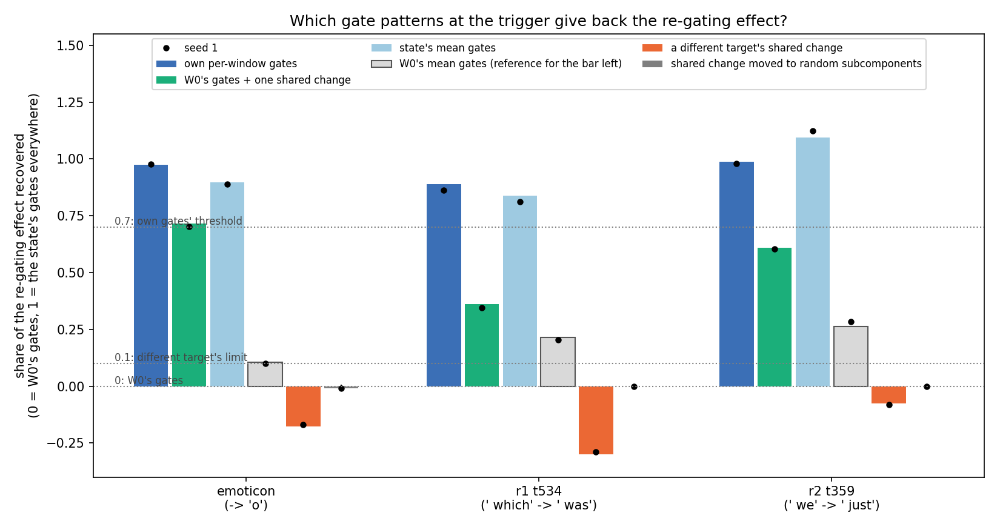
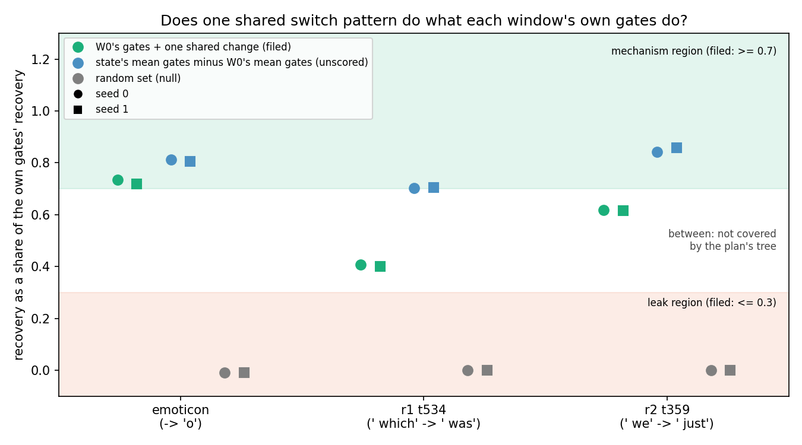
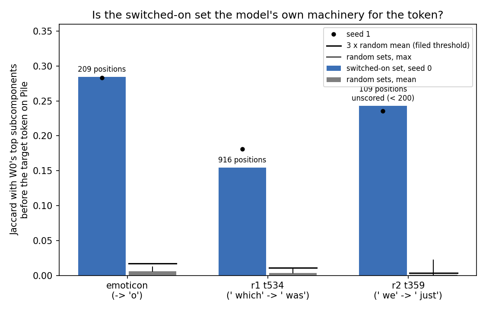
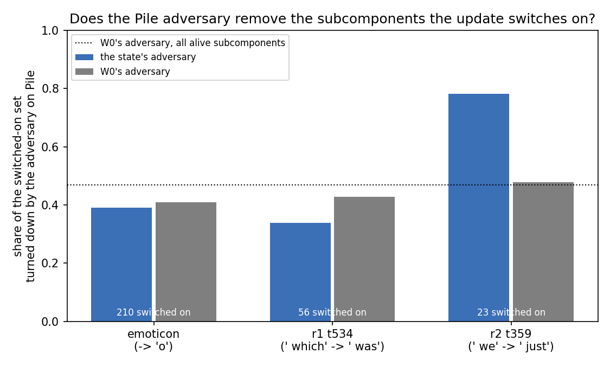
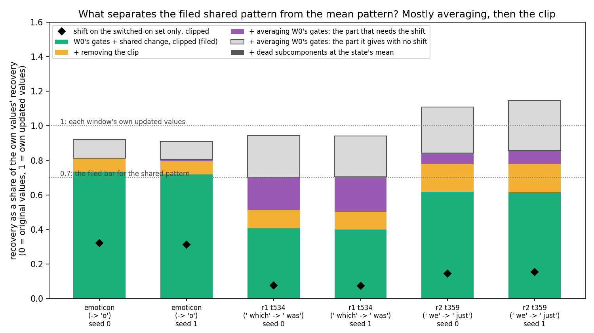
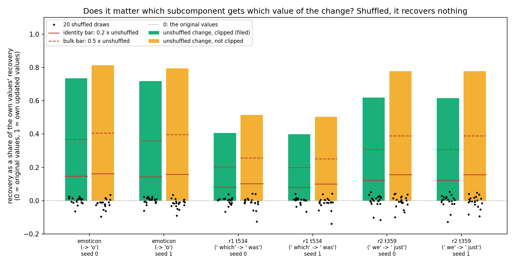
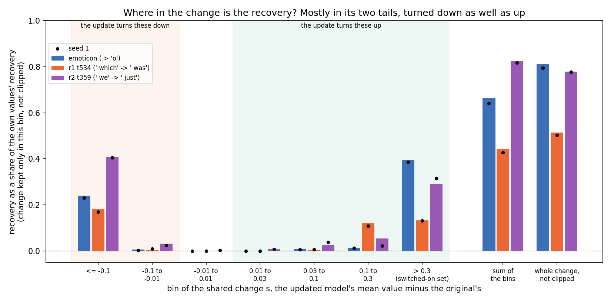
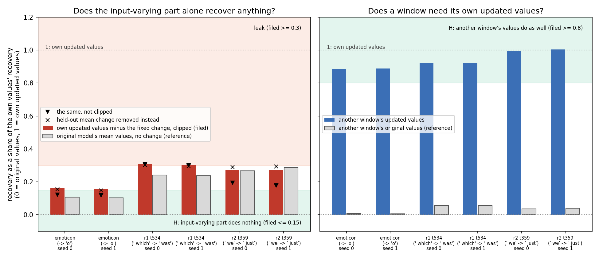
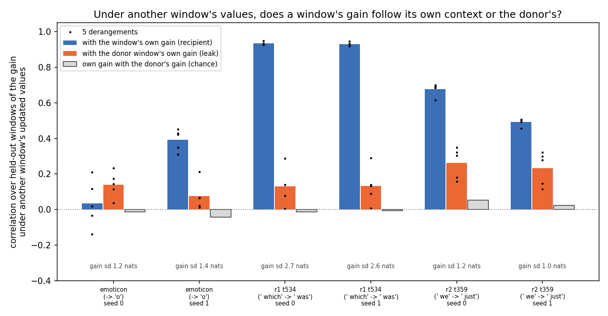
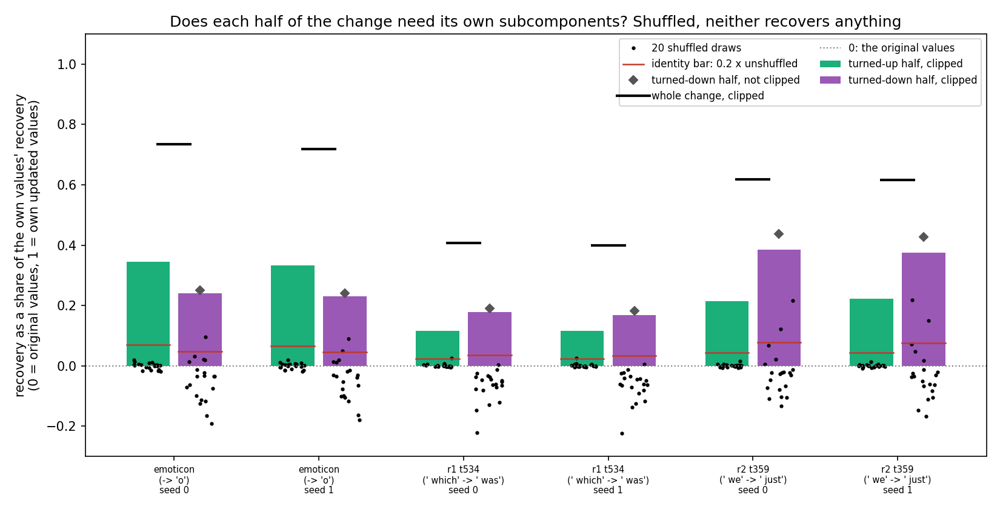

# Is the switching effect a fixed pattern, or a side channel for the updated model? (E18, analysis)

*2026-10-21, writing agent. Plan and build notes: `reports/2026-10-21_plan_regating-leak.md`. Notebook:
`notebooks/E18_regating_leak.ipynb`. Code: `experiments/regating_leak/run.py`, figures from `plot.py`. Words as in
`GOALS.md` → Terms. The plan's "re-gating share" is called the switching effect here.*

We fine-tuned the model on three tasks and replaced the frozen importance function's new values by one fixed pattern
shared by every input. Such a pattern brings most of the behaviour back on all three tasks, but the exact pattern we
filed as the test cleared its bar only on the emoticon task. The "reveal" reading in `GOALS.md` survives this control
in substance, while the filed test's miss on the word tasks falls outside the plan's decision tree.

## The answer

Mostly a mechanism, but the filed test did not show it on the two word tasks. One fixed pattern of importance values,
the same for every input, gives back most of the switching effect on all three tasks. Random and wrong-target patterns
give back none. But the filed version of the pattern, a fixed change added to each input's original values, cleared
the bar only on the emoticon task. On the word tasks it landed between the mechanism bar and the leak bar, a region the
plan's decision tree does not cover.

## What we were trying to test

**The setup.** Earlier runs found that after a fine-tune on a narrow behaviour, much of the gain appears even with
the subcomponents left exactly as they were. The importance function Γ, frozen, reads the updated
model's activations and switches on subcomponents that were off before. Call the resulting gain the *switching
effect*. It is measured on the CI-masked model, the original subcomponents multiplied by Γ's importance values, with Δ
left out. Its size is the rise in the masked model's target log-odds at the trigger position when Γ reads the updated
model instead of the original. As a share of the fine-tune's whole gain it is 0.60 on emoticon. On the two word tasks
it is 0.75 and 0.28.

**The worry.** Γ produces thousands of values per input position, and each is a function of the updated model's
residual stream. A large switching effect could mean the update makes Γ switch on a fixed, reusable set of existing
subcomponents. That is the *mechanism* reading. It could also mean that the values smuggle input-specific information
from the updated model into the masked forward. Then the original subcomponents reproduce the behaviour only when fed
each input's own values. That is the *leak* reading. Under a leak, the project's main finding is a property of how Γ is
wired, and the line of work built on it would be dropped.

**The test.** At the trigger position only, we replace Γ's values by a test pattern and keep the original model's
values everywhere else. *Recovery* is the share of the switching effect the pattern gives back: 0 means the original
model's values, 1 means the updated model's values everywhere. The patterns:

- **Own values.** The updated model's values for each input. The ceiling: how much of the effect sits at the trigger.
- **Shared change.** Each input's original values plus one fixed change per matrix, clipped to the range 0 to 1. The
  change is the mean, over the 365 to 400 training windows, of the updated minus the original values. This is the
  filed test: it contains no input-specific information from the updated model.
- **Mean values.** The updated model's mean values over the training windows, identical for every input. Unscored.
  Its reference is the same pattern built from the original model's mean values. That reference is not zero:
  removing the original model's own input-to-input variation already moves the output.
- **Different target.** The shared change of a fine-tune to a different token, ` http`, at the same trigger. It rules
  out the possibility that any shared change of this size raises the target.
- **Random set.** The shared change's values moved onto a random set of the same size per matrix. It rules out that
  switching on that many subcomponents helps, whichever they are. Twenty draws.

All patterns are read on 73 to 106 held-out windows per task. The *switched-on set* is the alive subcomponents whose
shared change exceeds 0.3. Last, we compare that set with the subcomponents the original model switches on before the target token in Pile
text. A random set's overlap is the null.

**Tasks and states.** Three tasks, two fine-tune seeds each, ten Adam steps, the weight change placed in Δ:

| task | what is learned | windows | share of gain from switching |
|---|---|---|---|
| emoticon | after ` :)`, predict `o`; every window is similar | 365 train, 73 held out | 0.60 |
| r1_t534_v369 | after ` which`, predict ` was`; varied Pile contexts | 400, 100 | 0.75 |
| r2_t359_v816 | after ` we`, predict ` just`; varied Pile contexts | 394, 106 | 0.28 |

## What we expected, and why

- The trigger position should carry almost all the effect, because the gain is read there. Filed: own values recover
  at least 0.7 on every task and seed.
- The decisive one. Under the mechanism reading a fixed change should do what each input's own values do. Filed: the
  shared change recovers at least 0.7 of what the own values recover, with the random set at most 0.1. A ratio at most
  0.3 was filed as the leak reading. Expected to pass on emoticon with confidence and on the word tasks with low
  confidence, because their contexts vary.
- A different target's shared change should not raise this target: at most 0.1 on every task.
- The switched-on set should overlap the original model's own subcomponents for the token at least three times more
  than a random set does.

## What we observed

### Does the apparatus reproduce earlier runs?

Yes. The switching share on each task matched the earlier runs' value to within 0.001; the full table is below. Feeding the original model's own values through both pattern builders gave recovery 0 exactly.

### Is the effect at the trigger position?

**Reading it.** Yes: the updated model's values at the trigger alone give back 0.86 to 0.99 of the switching effect on
every task and seed. In the figure the dark blue bars sit at or near 1, against 0 for the original values. Everything
below can therefore be read as a share of the trigger position's effect.

### Does one shared pattern do what each input's own values do?

**Reading it.** On emoticon yes, narrowly; on the two word tasks the filed test fails. The green points are the shared
change's recovery divided by the own values' recovery. Emoticon sits just inside the mechanism region at 0.72 and
0.73. The first word task reads 0.40 and the second 0.62. The two seeds agree within 0.01. Neither is in the leak
region below 0.3, so the result is neither reading as filed. The random set, in grey, gives back nothing on every task,
so the switched-on set's identity matters.

The blue points are the unscored mean-values pattern, minus its reference, as the same share. They sit at 0.70 to 0.86
on every task, above the green points everywhere. Both patterns are fixed: neither contains any input-specific
information from the updated model.

**How the two fixed patterns differ, from the code.** Symbols:

- $g_0(x)$: the original model's values at input $x$.
- $m_0$, $m_1$: the original and updated models' mean values over the training windows.
- $s = m_1 - m_0$: the shared change, on alive subcomponents.

The shared pattern is $\mathrm{clip}(g_0(x) + s)$. The mean pattern is
$m_1 = m_0 + s$, and its reference is $m_0$. Without the clip, the shared pattern equals the mean pattern plus the
original model's own deviation $g_0(x) - m_0$. So the two differ in exactly two ways: the clip, and the original
model's input-to-input variation. Dead subcomponents also differ: the shared pattern keeps their original values, the mean pattern
uses their mean. Their size was not checked.

**What it argues.** A leak, as the plan defined it, needs input-specific information from the updated model; a fixed
pattern should then fail. The mean pattern is fixed and recovers 0.81 to 1.12 of the switching effect. Its reference recovers
0.10 to 0.28. That argues against a leak. Two caveats. First, subtracting the reference assumes the two
effects add, which was not tested. Second, the reference is far from zero, so the original model's own variation matters to the output. That
variation is exactly what the shared pattern keeps. Whether the clip or that variation lowers the shared pattern is not
known. Neither was isolated, and the run kept no per-window values to check the clip offline.

### Is the pattern specific to the task?

**Reading it.** Yes, and more than expected. The orange bars in the recovery figure show a fine-tune to ` http` at the
same trigger. Its shared change does not raise this task's target; it lowers it, by 0.07 to 0.30 of the switching
effect. The ` http` fine-tunes learned their own target, at 0.99 held-out probability. Their switched-on sets overlap
the task's own by only 0.02 to 0.05. One possible reason for the negative sign is that switching on subcomponents for a
competing token takes probability from this one; it was not checked.

### Is the switched-on set the model's own machinery for the token?

**Reading it.** Yes, far above chance on every task. The switched-on set shares 0.15 to 0.28 of its union with the
subcomponents the original model switches on before the same token in Pile text. Random sets of the same size share at
most 0.024. The second word task had only 109 such Pile positions, under the 200 the plan required, so its value is
reported and not scored. The overlap is far above chance but partial: fewer than half of the switched-on subcomponents are among the
model's usual ones for the token.

### Does the Pile adversary remove the switched-on set? (unscored)

**Reading it.** Only on the second word task. Its updated model's adversary turns down 18 of the 23 switched-on
subcomponents, where the original model's adversary turns down 11. On emoticon and the first word task it turns down a third to two fifths. That is at or below the original's rate. The second task's set is
small, so this is one task and a few subcomponents.

### Full table

Recovery as a share of the switching effect; seeds 0 and 1.

| task | seed | own | shared | shared ÷ own | mean | mean ref. | (mean − ref.) ÷ own | different target | random mean | random max |
|---|---|---|---|---|---|---|---|---|---|---|
| emoticon | 0 | 0.973 | 0.715 | 0.735 | 0.896 | 0.105 | 0.813 | −0.177 | −0.009 | 0.004 |
| emoticon | 1 | 0.978 | 0.702 | 0.718 | 0.889 | 0.101 | 0.806 | −0.170 | −0.009 | 0.002 |
| r1_t534 | 0 | 0.890 | 0.362 | 0.407 | 0.839 | 0.214 | 0.702 | −0.301 | −0.001 | 0.003 |
| r1_t534 | 1 | 0.863 | 0.345 | 0.399 | 0.813 | 0.205 | 0.704 | −0.288 | −0.001 | 0.005 |
| r2_t359 | 0 | 0.987 | 0.610 | 0.618 | 1.095 | 0.263 | 0.843 | −0.075 | 0.000 | 0.007 |
| r2_t359 | 1 | 0.981 | 0.603 | 0.615 | 1.124 | 0.283 | 0.857 | −0.080 | −0.001 | 0.003 |

| task | seed | gain, nats | switching effect, nats | switching share | switched-on set | by layer 0/1/2/3 |
|---|---|---|---|---|---|---|
| emoticon | 0 | 13.43 | 8.02 | 0.597 | 210 | 35/5/43/127 |
| emoticon | 1 | 13.69 | 8.35 | 0.610 | 213 | 38/5/43/127 |
| r1_t534 | 0 | 10.33 | 7.70 | 0.746 | 56 | 5/3/9/39 |
| r1_t534 | 1 | 10.87 | 8.05 | 0.741 | 62 | 5/3/10/44 |
| r2_t359 | 0 | 12.53 | 3.55 | 0.284 | 23 | 3/1/6/13 |
| r2_t359 | 1 | 12.19 | 3.30 | 0.271 | 21 | 3/0/7/11 |

| task | overlap of the set, seed 0 vs 1 | with the ` http` set | ` http` held-out P | Pile positions | overlap with own machinery s0 / s1 | random mean / max |
|---|---|---|---|---|---|---|
| emoticon | 0.958 | 0.053 | 0.998 | 209 | 0.284 / 0.283 | 0.006 / 0.012 |
| r1_t534 | 0.903 | 0.026 | 0.994 | 916 | 0.155 / 0.181 | 0.004 / 0.009 |
| r2_t359 | 0.833 | 0.016 | 0.988 | 109 | 0.243 / 0.235 | 0.001 / 0.022 |

| state | adversary KL on Pile | turned down: switched-on set | same set, original's adversary | all alive |
|---|---|---|---|---|
| original | 2.139 | — | — | 0.469 |
| emoticon | 2.120 | 0.390 | 0.410 | 0.480 |
| r1_t534 | 2.010 | 0.339 | 0.429 | 0.487 |
| r2_t359 | 2.273 | 0.783 | 0.478 | 0.494 |

## What we learned

One fixed pattern of importance values, chosen from training windows, brings most of the behaviour back on held-out
windows. So most of the switching effect does not need input-specific information, provided the reference subtraction
is fair. The pattern is specific to the target token and partly overlaps the model's own subcomponents for it. The
"reveal" reading in `GOALS.md` survives this control in substance. Unresolved: why adding the fixed change on top of
each input's own values does worse on the word tasks than replacing them outright.

## How compelling is the evidence

Three tasks, two seeds each; the two seeds agree within 0.03 on every number. The random and wrong-target nulls sit
near or below zero. The argument from the mean pattern rests on subtracting a reference far from zero, which assumes the
effects add. Everything is read at the trigger position on 73 to 106 held-out windows per task. Nothing here says
whether the decomposition stays faithful elsewhere; the Pile adversary numbers are unscored.

## Which branch of the decision tree

The plan's tree has three branches. Mechanism: the shared pattern passes and the different target passes. Leak: the
shared pattern fails on the tasks with varied contexts. Mixed: it passes on emoticon and fails on the word tasks.

The data meet the mixed branch's condition word for word: a pass on emoticon, a fail on both word tasks. But the
tree's words do not separate the branches cleanly. "Fails on the tasks with varied contexts" is the leak branch's
condition and is also true here. The tree assumed a fail meant the leak region. The filed prediction defines the leak
reading as a ratio of at most 0.3, and the word tasks read 0.40 and 0.62. So the data fall in the gap between the two
filed bars, which no branch of the tree interprets.

The mixed branch's interpretation, that the switching pattern is a mechanism only where contexts are alike, is not
supported by the unscored mean pattern. That fixed pattern reaches 0.70 and 0.85 of the own values on the two word
tasks. The tree therefore does not decide this result. Neither the leak branch's action, dropping the line, nor the
mechanism branch's action, going on to the per-step version, follows from the filed rules alone. That call is the
user's.

## Surprises

- **The filed shared-pattern test missed on both word tasks, in a band the plan did not interpret.** It
  was predicted to pass there with low confidence. It is a miss, not a reversal into the leak reading.
- **A different target's shared change pushes this target down,** by 0.07 to 0.30 of the switching effect, where the
  plan expected about zero. The filed bar, at most 0.1, passes. The sign shows the different-target pattern is not
  inert in the masked model.
- **A fixed mean pattern does better than the filed shared pattern on every task.** On the second word task it
  even exceeds the own values, at 1.10 and 1.12. The original model's mean values alone already give 0.10 to 0.28.
- **The Pile adversary turns down most of the second word task's switched-on set:** 18 of 23 subcomponents. The
  original model's adversary turns down 11. The other two tasks show no such excess.
- The emoticon pass is narrow, 0.72 against a bar of 0.7 on seed 1.

## What next

1. **Split the shared pattern's shortfall into the clip and the original model's variation.** Rerun the patterns without the clip. Then add the shared change only on the switched-on set. A few minutes on the cluster's
   debug queue. If the clip explains the word tasks' gap, the miss is a property of the pattern's construction and
   the mechanism reading stands. If the original model's variation does, the switching pattern interacts with the
   input, which bears on how fixed the mechanism is.
2. **Read the different target's pattern at ` http`.** If it raises ` http` while lowering this target, the negative sign is competition between the tokens. If not, the
   sign needs another explanation.
3. **Tie the second word task's adversary result to the complement revert,** E20, already built: the switched-on
   subcomponents there are the ones the adversary removes.

## Scorecard

| id | claim in words | rule | read | verdict |
|---|---|---|---|---|
| G1 | the apparatus reproduces earlier runs | switching share within 0.05 of 0.5965 on emoticon, within 0.1 of 0.7461 and 0.2844 on the word tasks; gain ≥ 1; the original's values recover 0 to 1e-6 | 0.597, 0.746, 0.284; gains 13.4, 10.3, 12.5; recovery 0 exactly | pass |
| P1 | the trigger position carries the effect | own values ≥ 0.7 on every task and seed | 0.86 to 0.99 | pass |
| P2 | a shared pattern carries it | shared ÷ own ≥ 0.7 on every task and seed, random mean ≤ 0.1; leak if ≤ 0.3 | emoticon 0.73, 0.72; r1_t534 0.41, 0.40; r2_t359 0.62, 0.62; random ≤ 0.000 mean | **fail**: emoticon mechanism, both word tasks between |
| P3 | the pattern is the task's | different target ≤ 0.1 on every task and seed | −0.30 to −0.07 | pass |
| P4 | the set is the model's own machinery | overlap ≥ 3 × random mean, seed 0, tasks with ≥ 200 Pile positions | emoticon 0.284 vs 0.006; r1_t534 0.155 vs 0.004; r2_t359 0.243 vs 0.001 with 109 positions, unscored | pass on the two scorable tasks |

All six task-seed states were scorable: gain at least 1 nat and switching effect at least 0.5 nats.

## Not run

- The shared pattern without the clip, or added only on the switched-on set. It would separate the two ways it
  differs from the mean pattern.
- A random-set null for the mean pattern; only its original-model reference was run.
- The different target's pattern read at its own token.
- An additivity check for subtracting the mean pattern's reference.
- Enough Pile positions for the second word task's overlap: 109 of 600 rows, under the 200 required.
- By design: the key-to-value tasks, component-training states, the per-step version along training, and the
  mask-capacity test.

## Provenance

- Results: `experiments/regating_leak/results/regating_leak.json`, sha256
  `595be251d2be440c6424a3d863c3c770b736059d3f15e150855a5888237dc463`. Log: `results/large/full.log`. Shared changes per
  task and seed: `results/large/<task>_s<seed>_shift.pt`.
- Predictions: `results/predictions.json`, sha256 `f24fb6c52e5e9682…`, filed before the run.
- Code: `run.py` sha256 `96645b7f623355d3…`, uncommitted edits on top of `cdd9b42`; `src/commute/recruit.py`
  `f4b12787d64cc068…`; `src/commute/local_faith.py` `bb8a3d524a5a05e3…`. Figures: `plot.py`, JSON only.
- Compute: MATS cluster, job 28204, one L40, debug queue, 139 s, $0. 2026-10-21 16:10 to 16:12 BST; the log's stamps
  read 15:10 to 15:12.

## Amendment 1 (2026-10-21): why the filed shared pattern falls short of the mean pattern

*Writing agent. Plan: `reports/2026-10-21_plan_regating-leak.md` → "Amendment 1". Predictions:
`experiments/regating_leak/results/predictions_amend1.json`, filed before the run. Figure: `figures/amend1.png` from
`plot.py`, JSON only. E18's own predictions and scorecard above stand unedited.*

We built intermediate patterns between the filed shared pattern and the mean pattern, each differing from its
neighbour in one way. Most of the gap is the original model's own input-to-input variation. A fifth to a third is the
clip, and none is the dead subcomponents. No pattern here uses the updated model's per-input values. So the gap is
about how a fixed change meets the original values, which argues for the mechanism reading.

### The answer

The filed pattern falls short mainly because it keeps each input's own original values and adds the change on top.
Replacing those values by their average recovers much more, and about half of that rise happens even with no change at
all. The rest is the change working better on the average than on each input's own values, plus the clip. A single
fixed change, blind to the input, recovers about three quarters of the effect or more on every task. That is net of its
no-change reference. Whether that settles the main line is the user's call.

### What was run

Each pattern replaces Γ's values at the trigger position only, on E18's held-out windows. Recovery is read as a share
of what each input's own updated values recover: 0 means the original values, 1 means the own updated values. The
symbols:

- $g_0(x)$: the original model's values at input $x$; $m_0$ their mean over the training windows.
- $s$: the shared change, the updated model's mean minus $m_0$, on alive subcomponents; 0 on dead ones.
- $m_1$: the updated model's mean values, so $m_1 = m_0 + s$ on alive subcomponents.

The path from the filed pattern to the mean pattern, one difference per step:

| pattern | values at the trigger | differs from the row above by |
|---|---|---|
| shared, filed | $\mathrm{clip}(g_0(x) + s)$ | — |
| no clip | $g_0(x) + s$, may leave 0 to 1 | the clip |
| mean plus change | $m_0 + s$, the same for every input | the original model's input-to-input variation |
| mean, E18 | $m_1$ | dead subcomponents at the updated mean, not the original mean |

Two more patterns. The *no-change mean* $m_0$ is the third row with $s = 0$: what averaging the original values does
alone. The *switched-on set only* adds $s$ only where it exceeds 0.3, clipped, the set E18's random null and overlap
used. Seed 1 was retrained with the same seed. The gate checked the filed and mean patterns against E18 and the no-clip
pattern with no change; all passed, to 0.00 and 0.0 exactly.

### What lowers the filed pattern?

**Reading it.** Averaging the original values, not the clip or the dead subcomponents. Each bar climbs from the filed
pattern's recovery, in green, to the mean pattern's, at the top. On the word tasks the original model's own variation
is 67% to 81% of that gap. The clip is 19% to 33% and the dead subcomponents nothing. The variation step splits in two.
The light grey part, 44% to 54% of the gap, is what averaging gives with no change at all. The purple part is what
averaging adds to the change's own effect. It is about a third of the gap on the first word task and about a seventh on
the second. Emoticon has a small gap, and there the clip and the no-change part share it almost evenly.

**What it argues.** Every pattern on the path is fixed: none reads the updated model on the held-out input. The mean-plus-change pattern minus its no-change reference recovers 0.70 to 0.86 of the own values,
on every task and seed. The no-clip pattern, the change added to each input's own values, recovers 0.50 to 0.81 with a
reference of exactly 0. So a fixed change carries at least half of the effect on every task. It carries 0.70 or more
on a uniform background. So the filed test's miss on the word tasks comes from how the change meets each input's original values. It does not
come from information the updated model holds about the input. This is the mechanism reading; it is pending
the user's confirmation, and the user decides the main line.

### Is the switched-on set what carries the change?

**Reading it.** No: the black diamonds sit far below the green bars. On the first word task the change on the switched-on set alone
recovers 0.07, against 0.40 for the whole change. The second word task reads 0.15 against 0.62, and emoticon 0.32
against 0.73. So most of the filed pattern's recovery comes from the many alive subcomponents with a change under 0.3.
The few that E18 called switched on carry the smaller part. Whether those small changes act together or through a few larger ones was
not measured.

### Full table

Recovery as a share of the own values; the gap is mean minus shared; shares of the gap sum to 1.

| task | seed | shared | no clip | mean + change | mean | no-change mean | set only | gap | clip | variation | of which no change | dead |
|---|---|---|---|---|---|---|---|---|---|---|---|---|
| emoticon | 0 | 0.735 | 0.813 | 0.921 | 0.920 | 0.108 | 0.321 | 0.186 | 0.42 | 0.58 | 0.58 | −0.00 |
| emoticon | 1 | 0.718 | 0.795 | 0.909 | 0.909 | 0.103 | 0.313 | 0.190 | 0.40 | 0.60 | 0.54 | −0.00 |
| r1_t534 | 0 | 0.407 | 0.514 | 0.943 | 0.943 | 0.241 | 0.075 | 0.536 | 0.20 | 0.80 | 0.45 | 0.00 |
| r1_t534 | 1 | 0.399 | 0.503 | 0.942 | 0.942 | 0.238 | 0.075 | 0.543 | 0.19 | 0.81 | 0.44 | 0.00 |
| r2_t359 | 0 | 0.618 | 0.778 | 1.109 | 1.109 | 0.267 | 0.145 | 0.491 | 0.33 | 0.67 | 0.54 | 0.00 |
| r2_t359 | 1 | 0.615 | 0.778 | 1.146 | 1.146 | 0.289 | 0.155 | 0.531 | 0.31 | 0.69 | 0.54 | −0.00 |

| | emoticon | r1_t534 | r2_t359 |
|---|---|---|---|
| switched-on set, seeds 0 / 1 | 210 / 213 | 56 / 62 | 23 / 21 |
 The gate's
repeats matched E18 to the last digit; the run is deterministic.

### Surprises

- **The switched-on set carries a minority of the filed pattern's recovery.** It is under a fifth on the first word
  task and a quarter on the second. The plan reported this expecting the set alone within 0.1 of the whole change. E18's random
  null moved only the set's values. So that null tests the set's part, and the larger part has no null yet. E18's
  overlap with the model's own subcomponents for the token was also read on that set.
- On the second word task the change interacts with the original model's variation less than guessed. It reads
  about 0.14 of the gap, against more than 0.2 predicted with low confidence. The first word task reads about 0.36.
- The clip's share on the second word task, about 0.32, is just outside the predicted band of 0 to 0.2. The scored
  reading is unaffected.

### What next

1. **A random null for the whole change.** Shuffle the change across each matrix's alive subcomponents, every entry,
   twenty draws. If it recovers near 0, the identity of the many small entries matters and the mechanism reading holds
   for the bulk. If it recovers a sizeable share, part of the effect is just "shift many values up". A few minutes on
   the debug queue, the same code.
2. **Where in the change the recovery sits.** The no-clip pattern restricted to bins of the change's size. If a few
   hundred mid-size entries carry it, the overlap test should be redone on them.

### Scorecard (as filed)

| id | claim in words | rule | read | verdict |
|---|---|---|---|---|
| A1_repeat | the apparatus repeats E18 | G1 as E18; shared and mean within 0.02 of E18; no clip with no change recovers within 1e-6 of 0 | differences 0.000; 0.0 | pass |
| A1_P1 | the original model's variation lowers the filed pattern | on states with gap ≥ 0.3, the reading is each part with share ≥ 0.5; predicted variation on both word tasks | variation 0.80, 0.81, 0.67, 0.69; clip 0.20, 0.19, 0.33, 0.31; dead 0.00 | **pass** |
| reported | the switched-on set carries the change | set only within 0.1 of shared | 0.07 vs 0.41; 0.07 vs 0.40; 0.15 vs 0.62; 0.16 vs 0.62 | not as expected |
| reported | the change interacts with the variation | variation minus its no-change part > 0.2 | 0.35, 0.37, 0.13, 0.15 | first word task only |

### Not run

- A random null for the whole change; only the switched-on set's values were moved in E18.
- A no-clip pattern on the mean background, to check whether the clip and the variation interact.
- Any other order of the path; with interactions, the shares depend on it.
- The trigger position only, as E18; no Pile stages.

### Provenance

- Results: `experiments/regating_leak/results/regating_leak_amend1.json`, sha256
  `af5222ee9540222a59b2ef18bd1962e61d66885a333a4230ebd5f93e2b3553b2`. Log: `results/large/full.log`.
- Predictions: `results/predictions_amend1.json`, sha256 `c13729dfe28abd82…`, filed before the run.
- Code: `run.py` sha256 `73397a29980db56c…`, functions `a1_gate`, `a1_arms`, `a1_score`; `recruit.added`. Uncommitted
  on top of `cdd9b42`.
- Compute: MATS cluster, debug queue, one L40. Job 28250 crashed in scoring, with the score called inside the per-task
  loop. The score was moved after the loop with no measurement changed. Rerun job 28260, 39 s, reproduced the gates
  exactly. $0.

## Amendment 2 (2026-10-21): does the identity of the whole change matter?

*Writing agent. Plan: `reports/2026-10-21_plan_regating-leak.md` → "Amendment 2". Predictions:
`experiments/regating_leak/results/predictions_amend2.json`, filed before the run. Figures: `figures/amend2_null.png`
and `figures/amend2_bins.png` from `plot.py`, JSON only. E18's and Amendment 1's predictions and scorecards above stand
unedited. Context: `reports/2026-10-21_decision_mechanism-reading.md`. The user does not back the mechanism reading.
It is the leading hypothesis H, with three parts, and this run bears on one of them.*

We shuffled the shared change among each matrix's alive subcomponents, keeping its values, and read the recovery
again. Shuffled, the change gives back nothing on every task and seed, so which subcomponent gets which value is what
carries it. A surprise: a large part of the recovery sits in the subcomponents the update turns down, which no earlier
test of this experiment looked at.

### The answer

Identity matters. Moved at random among the same matrix's alive subcomponents, the shared change gives back about
nothing. Unshuffled, it gives back 0.40 to 0.81 of the effect. This is the second part of the hypothesis,
that the change is specific to which subcomponents receive it, surviving a test it could have failed. It does not
establish the hypothesis: the other two parts are untested here. The unexpected part is where the recovery sits. The
subcomponents the update turns down carry about as much as the ones it switches on.

### What was run

The hypothesis under test, from the decision report: after a narrow fine-tune, one change to Γ's importance values
carries the switching effect at the trigger. The change is, first, the same for every input. Second, it is specific
to which existing subcomponents receive it. Third, it is enough on its own. This run tests the second part only.

The symbols, as in Amendment 1:

- $g_0(x)$: the original model's importance values at input $x$, at the trigger position.
- $s$: the shared change, the updated model's mean values minus the original model's, on alive subcomponents; 0 on
  dead ones.
- $s_\pi$: the same values of $s$ randomly reassigned among each matrix's alive subcomponents; twenty draws.

*Recovery* is read as in Amendment 1, as a share of what each input's own updated values recover at the trigger. Zero
means the original values; one means the own updated values. Patterns, at the trigger only, on 73 to 106 held-out
windows per task:

| pattern | values at the trigger | what it tests |
|---|---|---|
| shared, filed | $\mathrm{clip}(g_0(x) + s)$ | Amendment 1's, repeated as the gate |
| no clip | $g_0(x) + s$ | Amendment 1's, repeated |
| shared, shuffled | $\mathrm{clip}(g_0(x) + s_\pi)$ | does the clipped change need its own subcomponents? |
| no clip, shuffled | $g_0(x) + s_\pi$ | the same without the clip; harsher, since a negative value moved onto an off subcomponent flips its sign |
| one bin | $g_0(x) + s$ with $s$ kept only where it falls in one size bin | where in the change the recovery sits; reported, not scored |

The shuffle keeps each matrix's values and their sum. A recovery that needs only "these values somewhere in this
matrix" survives it. One that needs the values on particular subcomponents does not. The filed rule: the
shuffled mean over twenty draws, divided by the unshuffled recovery, at most 0.2 reads *identity*. At least 0.5 reads
*bulk*. Both predictions said identity, with medium-high confidence for the clipped pattern and medium for the
unclipped one.

The gate repeated Amendment 1's own, clipped and unclipped recoveries on every task and seed, identical to six digits.
Seed 1 was retrained with the same seed. Every state had a switching effect of 3.3 nats or more, above the 0.5-nat bar.

### Does it matter which subcomponent gets which value?

**Reading it.** Yes: shuffled, the change recovers nothing on every task and seed. The bars are the unshuffled change,
green clipped and yellow unclipped. The black dots are the twenty shuffled draws for each bar. They scatter around zero,
far below the solid red line, the identity bar at a fifth of the unshuffled recovery. The shuffled mean is between
−0.005 and +0.003 of the unshuffled recovery for the clipped pattern. Unclipped it is between −0.026 and −0.007,
slightly negative as the plan expected from sign flips. The spread over draws is 0.02 to 0.04. The single highest draw
on any state is 0.054, against an identity bar of at least 0.08.

### Where in the change is the recovery?

**Reading it.** Mostly in the two tails of the change, and the lower tail is as large as the upper one. Each bar keeps
the unclipped change only in one bin of its size and reads the recovery. The left bin holds the 73 to 243 subcomponents
per task whose value the update lowers by more than 0.1. It recovers 0.24 on emoticon and 0.18 on the first word task.
On the second word task it recovers 0.41. The right bin, the switched-on set, recovers 0.40, 0.13 and 0.29. So on both
word tasks the turned-down subcomponents carry more than the switched-on ones. The 8,700 to 9,400 entries near zero
carry nothing. The middle bins carry little, except on the first word task, where the 0.1 to 0.3 bin recovers 0.12.

The bins do not add up exactly to the whole unclipped change, at the right of the figure. On emoticon they sum to 0.66
against 0.81, and on the first word task 0.44 against 0.51. On the second word task they sum to 0.82 against 0.78. So
the bins interact, mildly. One caveat matters for the left bin: unclipped, a lowered value can go below zero and flip
its subcomponent's sign, which the clipped pattern cannot do. How much of the left bin's recovery comes from such
sign flips was not measured.

### Full table

Recovery as a share of the own values; twenty shuffled draws per pattern.

| task | seed | shared | shuffled mean | sd | min | max | ratio | no clip | shuffled mean | sd | min | max | ratio |
|---|---|---|---|---|---|---|---|---|---|---|---|---|---|
| emoticon | 0 | 0.735 | 0.002 | 0.021 | −0.064 | 0.026 | 0.003 | 0.813 | −0.017 | 0.029 | −0.096 | 0.036 | −0.021 |
| emoticon | 1 | 0.718 | 0.002 | 0.020 | −0.061 | 0.025 | 0.003 | 0.795 | −0.016 | 0.027 | −0.089 | 0.034 | −0.020 |
| r1_t534 | 0 | 0.407 | −0.001 | 0.022 | −0.065 | 0.039 | −0.004 | 0.514 | −0.012 | 0.036 | −0.126 | 0.042 | −0.023 |
| r1_t534 | 1 | 0.399 | −0.001 | 0.022 | −0.065 | 0.040 | −0.004 | 0.503 | −0.013 | 0.039 | −0.138 | 0.043 | −0.026 |
| r2_t359 | 0 | 0.618 | −0.003 | 0.040 | −0.115 | 0.051 | −0.005 | 0.778 | −0.006 | 0.037 | −0.099 | 0.043 | −0.007 |
| r2_t359 | 1 | 0.615 | −0.003 | 0.041 | −0.128 | 0.054 | −0.005 | 0.778 | −0.006 | 0.037 | −0.093 | 0.048 | −0.008 |

Recovery of the unclipped change kept in one bin of $s$; the last two columns are the sum over bins and the whole
unclipped change.

| task | seed | ≤ −0.1 | −0.1 to −0.01 | −0.01 to 0.01 | 0.01 to 0.03 | 0.03 to 0.1 | 0.1 to 0.3 | > 0.3 | sum | whole |
|---|---|---|---|---|---|---|---|---|---|---|
| emoticon | 0 | 0.241 | 0.006 | −0.000 | −0.000 | 0.008 | 0.012 | 0.396 | 0.663 | 0.813 |
| emoticon | 1 | 0.231 | 0.003 | −0.000 | 0.001 | 0.007 | 0.013 | 0.386 | 0.641 | 0.795 |
| r1_t534 | 0 | 0.180 | 0.005 | −0.000 | 0.000 | 0.004 | 0.120 | 0.133 | 0.442 | 0.514 |
| r1_t534 | 1 | 0.170 | 0.010 | 0.000 | 0.000 | 0.006 | 0.110 | 0.132 | 0.428 | 0.503 |
| r2_t359 | 0 | 0.409 | 0.032 | 0.002 | 0.009 | 0.025 | 0.055 | 0.292 | 0.824 | 0.778 |
| r2_t359 | 1 | 0.406 | 0.024 | 0.003 | 0.008 | 0.038 | 0.023 | 0.315 | 0.817 | 0.778 |

Bin sizes on seed 0, entries and the sum of $s$ over them; seed 1 is within a few entries.

| task | ≤ −0.1 | −0.1 to −0.01 | −0.01 to 0.01 | 0.01 to 0.03 | 0.03 to 0.1 | 0.1 to 0.3 | > 0.3 |
|---|---|---|---|---|---|---|---|
| emoticon | 243, −90.9 | 379, −13.8 | 8,701, −1.1 | 116, 2.1 | 134, 7.6 | 98, 17.2 | 210, 147.7 |
| r1_t534 | 134, −31.3 | 512, −17.7 | 9,017, −2.6 | 60, 1.0 | 49, 2.8 | 53, 10.1 | 56, 32.8 |
| r2_t359 | 73, −18.2 | 318, −10.8 | 9,335, −2.3 | 37, 0.7 | 46, 2.7 | 49, 8.3 | 23, 10.2 |

### What it means for the hypothesis

The second part of H, that the change is specific to which subcomponents receive it, now has a test it could have
failed and did not. A shift of the same values per matrix, put on the wrong subcomponents, does nothing. That rules out
the bulk reading, in which the update works by raising many values in a matrix regardless of which. It says nothing
about the first part, that one change serves every input, beyond what Amendment 1 showed. It says nothing about the
third part, that the input-varying part of the updated values adds nothing. H stays a leading hypothesis, not a
finding.

The bins change what "specific subcomponents" means. E18 framed the effect as Γ switching on a set of existing
subcomponents, and tested that set's overlap with the model's own machinery for the token. Half or more of the
unclipped recovery on the word tasks comes instead from subcomponents the update turns down. That part has had no
overlap test and no null of its own.

### How compelling is the evidence

Three tasks, two seeds each, twenty draws per state; the seeds agree within 0.02 everywhere. The shuffled means sit
within one spread of zero, and the identity bar is at least twice the highest single draw. The shuffle stays within
each matrix, so it cannot say whether the split of the change across layers matters. It also mixes signs, so a
sign-preserving shuffle would be a sharper test of identity. The bins are unclipped and unscored, and read at the
trigger position only.

### Surprises

- **The subcomponents the update turns down carry a large share of the recovery,** which E18 never examined. Kept
  alone, the entries the update lowers by more than 0.1 recover 0.24 of 0.81 on emoticon. They recover 0.18 of 0.51 on
  the first word task and 0.41 of 0.78 on the second. On both word tasks that exceeds the switched-on set's 0.13 and
  0.29. E18's framing, its random null and its overlap test all looked only at the switched-on set. The plan's
  low-confidence guess named the negative bins, but expected the mid-size positive bins to matter as well; they
  carry little except on the first word task.
- The bins do not add up exactly: their sum falls short of the whole change on two tasks and exceeds it on the third.

### What next

1. **The turned-down set's overlap with the model's own machinery.** Are the subcomponents the update lowers the ones
   the original model uses for competing tokens at the trigger? If they are, the effect is "switch on the target's
   subcomponents and switch off its competitors'". If they overlap no better than random, the turned-down half has no
   interpretation yet.
2. **The bins with the clip, and a sign-preserving shuffle.** If the turned-down bin's recovery survives the clip, it
   is not a sign-flip artefact. If a shuffle within each sign also recovers nothing, identity matters beyond the sign.
3. **The first and third parts of H,** as planned in Amendment 3; this run does not bear on them.

### Scorecard (as filed)

| id | claim in words | rule | read | verdict |
|---|---|---|---|---|
| A2_repeat | the apparatus repeats Amendment 1 | G1 as E18; own, shared and no clip within 1e-6 of Amendment 1 on every task and seed | identical; G1 0.597, 0.746, 0.284 | pass |
| A2_P1 | the clipped change needs its own subcomponents | shuffled mean ÷ unshuffled ≤ 0.2 on every state with switching effect ≥ 0.5 nats; ≥ 0.5 reads bulk | 0.003, 0.003, −0.004, −0.004, −0.005, −0.005 | **pass**, identity |
| A2_P2 | the unclipped change needs its own subcomponents | as A2_P1, no clip | −0.021, −0.020, −0.023, −0.026, −0.007, −0.008 | **pass**, identity |
| reported | where the recovery sits | low-confidence guess: the negative and mid-size bins carry more than the switched-on set's bin | negative bin 0.24, 0.18, 0.41 against the top bin's 0.40, 0.13, 0.29; mid bins ≤ 0.06 except 0.11 to 0.12 on the first word task | negative half as guessed; mid half not |

### Not run

- A sign-preserving shuffle, positive values among positive slots and negative among negative.
- A shuffle across matrices; the run cannot say whether the split across layers matters.
- The shuffle on the mean background, $m_0 + s_\pi$.
- The bins of the clipped pattern; the turned-down bin's share from sign flips is unknown.
- An overlap test or a random null for the turned-down set.
- The first and third parts of H; the trigger position only; no Pile stages.

### Provenance

- Results: `experiments/regating_leak/results/regating_leak_amend2.json`, sha256
  `37c0225d49d80f99939f4bd75c0add1ec3ff21801b1f804b7785b888de0c9ee1`. Log: `results/large/full.log`, the lines tagged
  A2; `cluster/logs/commute-regating-amend2-28302.out`.
- Predictions: `results/predictions_amend2.json`, sha256 `08e7f423f0824e36…`, filed before the run.
- Code: `run.py` sha256 `d60a1f2ebe121d52…`, functions `a2_gate`, `a2_arms`, `a2_bins`, `spread`, `a2_score`;
  `src/commute/recruit.py` `e47b375cfcdd7dff…`, `shuffled` and `in_range`. Uncommitted on top of `cdd9b42`. Figures:
  `plot.py`, `amend2_null` and `amend2_bins`, JSON only.
- Compute: MATS cluster, job 28302, debug queue, one L40, 88 s, $0. The log's stamps read 18:37 to 18:38.

## Amendment 3 (2026-10-21): tests the hypothesis could fail

> **A filed prediction failed.** The updated model's own values with the fixed change removed still give back 0.16
> of the effect on emoticon, 0.27 on the second word task and 0.30 to 0.31 on the first, where the filed rule called
> 0.3 a leak. The plan's decision tree sends this to the user before anything else is run. The failure sits beside two
> passing tests that point the other way, and that tension is not resolved here.

*Writing agent. Plan: `reports/2026-10-21_plan_regating-leak.md` → "Amendment 3". Predictions:
`experiments/regating_leak/results/predictions_amend3.json`, filed before the run. Figures: `figures/amend3_tests.png`,
`figures/amend3_donor.png` and `figures/amend3_halves.png` from `plot.py`, JSON only. Earlier predictions and
scorecards above stand unedited. Context: `reports/2026-10-21_decision_mechanism-reading.md`; the user does not back
the mechanism reading.*

We ran five tests, each one the hypothesis could fail. The updated model's per-input values, stripped of the fixed
change, still give back up to a third of the effect, so the filed claim that they add nothing failed. Yet a window
does almost as well with another window's values, and its gain follows its own context, so whatever the remainder
carries need not come from the same input.

### The answer

The hypothesis has three parts, and this run tested each. The change is the same for every input, it is specific to
which subcomponents receive it, and it is enough on its own. The first two survived tests they could have failed.
Another window's updated values give back 0.89 to 1.00 of the effect, and both halves of the change, shuffled,
give back nothing. The third part failed as filed. The input-varying part alone gives back 0.16 to 0.31, against a
filed bar of 0.15. Why it does so, while another window's values do nearly as well, is open.

### What was run

The hypothesis H, from the decision report: after a narrow fine-tune, the switching effect at the trigger is carried
by one change to Γ's importance values. First, that change is the same for every input.
Second, it is specific to which existing subcomponents receive it. Third, it is enough on its own. A leak is the
failure of the third part: the part of the updated values that varies with the input would then carry some of the
effect.

The symbols:

- $g_0(x)$, $g_1(x)$: the original and the updated model's importance values at the trigger of held-out window $x$.
- $m_0$, $m_1$: their means over the training windows.
- $s = m_1 - m_0$: the fixed change, on alive subcomponents; its positive entries form the turned-up half, its
  negative entries the turned-down half.
- $\pi$: a derangement, which gives each window another window's values; five draws.

*Recovery* is read as in Amendments 1 and 2. Zero means the original values at the trigger, one means each window's
own updated values. Every pattern sits at the trigger only, on 73 to 106 held-out windows per task, three tasks, two
seeds.

| test | values at the trigger | part of H it could fail | H says | fails if |
|---|---|---|---|---|
| remainder alone | $\mathrm{clip}(g_1(x) - s)$ | third | ≤ 0.15 | ≥ 0.3 reads a leak |
| another window's values | $g_1(\pi(x))$; reference $g_0(\pi(x))$ | first | ≥ 0.8 | ≤ 0.5 |
| whose gain it follows | per window, the gain under $g_1(\pi(x))$ correlated with its own gain and with the donor's | first and third | own ≥ donor | donor exceeds own by 0.2 |
| turned-down half | $\mathrm{clip}(g_0(x) + s^-)$, against $s^-$ shuffled among the subcomponents on enough to be turned down | second | shuffled ÷ unshuffled ≤ 0.2 | ≥ 0.5 |
| turned-up half | $\mathrm{clip}(g_0(x) + s^+)$, against $s^+$ shuffled among alive subcomponents | second | ≤ 0.2 | ≥ 0.5 |

The donor test is the sharpest leak test. Suppose the remainder carries "how strongly to predict the target here".
Under another window's values, a window's gain would then follow the donor's own gain, not its own. Under H it
follows its own context.

Some numbers are reported, not scored. They are the remainder unclipped, and with the held-out mean change removed
instead; the halves unclipped; the change's effect on three backgrounds; and the change on Pile positions away from any
trigger. Expected
values for each are in the predictions file.

The gate repeated Amendment 2's own, shared and unclipped recoveries on every task and seed, identical to six
digits. The per-window gains used by the donor test average to the same recovery as the masked evaluation, exactly.
Every state had a switching effect of 3.3 nats or more.

### Does the input-varying part alone recover anything?

**Reading it.** Yes, and the filed prediction failed. The red bars in the left panel keep each window's own updated
values and remove the fixed change. They give back 0.16 on emoticon and 0.27 on the second word task, both above the
green band where H sits. On the first word task they give back 0.31 and 0.30, at the edge of the orange leak band.
Unclipped, and with the held-out mean change removed instead, the remainder reads about the same. The one exception is
the second word task unclipped, at 0.18 to 0.19.

The grey bars matter for what the failure means. They are the original model's mean values for every window, with no
change at all. They give back about 0.1 on emoticon, 0.24 on the first word task and 0.27 to 0.29 on the second.
So the remainder recovers only 0.05 to 0.07 more than plain averaging on emoticon and on the first word task. On the
second word task it recovers no more.

### Does a window need its own updated values?

**Reading it.** No. In the right panel of the same figure, each window receives another window's updated values. They
give back 0.89 on emoticon, 0.92 on the first word task and 0.99 to 1.00 on the second. All six states are above the
filed bar of 0.8. Mismatching the original values the same way gives back 0.01 to 0.06, so mismatching alone costs
nothing here. At most a tenth of the effect needs the window's own updated values.

### Under another window's values, does the gain follow its own context or the donor's?

**Reading it.** Its own context, on five of six states. The blue bars correlate each window's gain under another
window's values with its own gain, and read 0.39 to 0.93. The orange bars correlate it with the donor's own gain, and
read 0.08 to 0.26. The grey bars are chance, between −0.04 and 0.05. On the first word task the gain follows the
recipient almost perfectly, 0.93 against 0.13. Emoticon seed 0 reads neither: 0.04 against 0.14. The emoticon windows
are alike, with a spread of gains of 1.2 nats, so this test has little to grip there. No state reads "donor".

### Does each half of the change need its own subcomponents?

**Reading it.** Yes, both halves. The green bars keep only the turned-up half of the change, and the purple bars only
the turned-down half. Shuffled, the turned-up half gives back at most 0.009 of its unshuffled recovery. The turned-down
half, shuffled among the subcomponents on enough to be turned down, does worse than nothing. Its shuffled recovery is
0.06 to 0.41 of its unshuffled recovery, but negative.

The grey diamonds answer Amendment 2's open caveat. Unclipped, a lowered value can go below zero and flip its
subcomponent's sign. With the clip, the turned-down half keeps 0.89 to 0.98 of its unclipped recovery. So its share is
a switch-off, not a sign-flip artefact.

The halves add up on the second word task: 0.61 against 0.62 for the whole clipped change. They fall short on emoticon,
0.59 against 0.73, and on the first word task, 0.30 against 0.41.

### Does the change mean "predict the target", or "predict it here"?

Reported, no figure. We placed the clipped change at the middle of 64 Pile rows, away from any trigger. On emoticon
it raises the target by 1.1 nats, a fifth of its effect at the trigger. On the two word tasks it slightly lowers the
target, by 0.15 to 0.49 nats. So on the word tasks the change works only in its context.

### Do the change's effects add?

Reported, no figure. The plan reads the fixed change's effect on three backgrounds. One is no per-window variation,
net of its no-change reference. One is the original model's variation, and one is the updated model's own. On emoticon
these read 0.81, 0.81 and 0.88; on the second word task 0.84, 0.78 and 0.81. Both agree within the plan's 0.1. On the
first word task they read 0.70, 0.51 and 0.69, which do not agree. There, by the plan's rule, only numbers with no
reference subtraction are quoted.

### Full table

Recovery as a share of the own values' recovery. Remainder is $\mathrm{clip}(g_1(x) - s)$; "mean, no change" is $m_0$
for every window.

| task | seed | remainder | unclipped | held-out mean removed | mean, no change | other window | other window, original | own gain | donor gain | chance | gain sd, nats |
|---|---|---|---|---|---|---|---|---|---|---|---|
| emoticon | 0 | 0.164 | 0.122 | 0.155 | 0.108 | 0.887 | 0.007 | 0.035 | 0.141 | −0.012 | 1.23 |
| emoticon | 1 | 0.158 | 0.119 | 0.147 | 0.103 | 0.888 | 0.007 | 0.392 | 0.076 | −0.042 | 1.35 |
| r1_t534 | 0 | 0.311 | 0.307 | 0.304 | 0.241 | 0.921 | 0.057 | 0.933 | 0.130 | −0.012 | 2.65 |
| r1_t534 | 1 | 0.303 | 0.301 | 0.295 | 0.238 | 0.920 | 0.057 | 0.930 | 0.132 | −0.005 | 2.63 |
| r2_t359 | 0 | 0.273 | 0.194 | 0.290 | 0.267 | 0.993 | 0.037 | 0.676 | 0.263 | 0.053 | 1.18 |
| r2_t359 | 1 | 0.270 | 0.178 | 0.294 | 0.289 | 1.004 | 0.040 | 0.492 | 0.232 | 0.024 | 0.99 |

The halves, clipped unless marked; ratio is the shuffled mean over 20 draws divided by the unshuffled recovery.
Survival is the clipped turned-down recovery divided by the unclipped one. Pool is the subcomponents on enough to be
turned down, with the strongly turned-down ones among them.

| task | seed | up | up unclipped | up ratio | down | down unclipped | survival | down ratio | strong / pool | sum of halves | whole |
|---|---|---|---|---|---|---|---|---|---|---|---|
| emoticon | 0 | 0.344 | 0.435 | −0.002 | 0.244 | 0.251 | 0.975 | −0.208 | 243 / 385 | 0.589 | 0.735 |
| emoticon | 1 | 0.333 | 0.421 | −0.002 | 0.235 | 0.241 | 0.976 | −0.204 | 242 / 385 | 0.568 | 0.718 |
| r1_t534 | 0 | 0.116 | 0.258 | 0.009 | 0.182 | 0.190 | 0.959 | −0.385 | 134 / 239 | 0.299 | 0.407 |
| r1_t534 | 1 | 0.116 | 0.254 | 0.009 | 0.172 | 0.181 | 0.949 | −0.409 | 132 / 239 | 0.288 | 0.399 |
| r2_t359 | 0 | 0.215 | 0.380 | 0.003 | 0.392 | 0.437 | 0.898 | −0.057 | 73 / 238 | 0.607 | 0.618 |
| r2_t359 | 1 | 0.222 | 0.389 | 0.001 | 0.379 | 0.427 | 0.889 | −0.068 | 74 / 238 | 0.601 | 0.615 |

The change's effect on three backgrounds, and off the trigger.

| task | seed | no variation, net | original variation | updated variation | Pile, nats | Pile ÷ trigger |
|---|---|---|---|---|---|---|
| emoticon | 0 | 0.813 | 0.813 | 0.878 | +1.09 | 0.19 |
| emoticon | 1 | 0.806 | 0.795 | 0.881 | +1.13 | 0.19 |
| r1_t534 | 0 | 0.702 | 0.514 | 0.693 | −0.28 | −0.10 |
| r1_t534 | 1 | 0.704 | 0.503 | 0.699 | −0.49 | −0.18 |
| r2_t359 | 0 | 0.843 | 0.778 | 0.806 | −0.15 | −0.07 |
| r2_t359 | 1 | 0.857 | 0.778 | 0.822 | −0.15 | −0.08 |

### What it means for the hypothesis

The first part, the same change for every input, survived a test it could have failed. Another window's values do 0.89 to
1.00 as well as the own ones. Under them, the gain follows the recipient's context, not the donor's. The second part,
specific to which subcomponents receive it, survived for each half separately. The turned-down half is a real
switch-off, not a sign flip. The third part, enough on its own, failed as filed. On the first word task it landed in the leak
band. H is not established, and as filed it is now contradicted on one of its three parts.

The tension is this. The remainder test says the input-varying part does something on its own, about 0.3 of the
effect on the first word task. The mismatch and donor tests say that part need not come from the same input.

One candidate reading, **unverified**: the remainder carries no input-specific information. It carries instead a
change in the shape of the variation that all inputs share. Or it carries only the effect of replacing the original
model's own per-window values. Two comparisons point that way. Averaging the original values with no change already
gives back 0.24 on the first word task, and the remainder adds only 0.07 to that. On the second word task averaging
gives back 0.27 to 0.29, and the remainder adds nothing. Neither comparison tests the reading.

The number that would separate the readings is the remainder taken from another window. That is,
$\mathrm{clip}(g_1(\pi(x)) - s)$ placed on window $x$. If it recovers about what the own remainder does, near 0.3 on
the first word task, the remainder carries nothing specific to its input. That would narrow the third part to "no input-specific
part", which this run's other tests support. If it falls to the no-change average or below, the remainder carries
something tied to its own window, a leak in the filed sense. This run does not resolve it, and the choice goes to
the user.

### How compelling is the evidence

Three tasks, two seeds each; the seeds agree within 0.02 on every unshuffled recovery. The remainder's failure is the
same on both seeds and both remainder variants. On the first word task it sits only 0.003 to 0.011 above the leak line,
so "leak band" there is at the edge. The donor test has little grip on emoticon, where gains vary by about 1.2 nats.
Its chance level is within 0.05 of zero. The turned-down shuffle has less power on emoticon and the first word task.
There the strongly turned-down subcomponents fill 56 to 63 percent of the pool they are shuffled within. It still drove
recovery below zero. The background test failed on the first word task, so its net mean-pattern number, 0.70, should
not be quoted. Everything is read at the trigger position, Pile aside, on one model.

### Surprises

- **A filed prediction failed.** The remainder test predicted the input-varying part alone gives back at most 0.15
  on every state. It gave back 0.16 on emoticon, 0.27 on the second word task and 0.30 to 0.31 on the first. On emoticon
  the miss is narrow. On the word tasks it is not, and the plan's medium-low confidence there named the risk.
- The remainder recovers about what the original model's averaged values recover with no change, on two of three
  tasks. That was not predicted. It is the basis of the candidate reading above, and it is unverified.
- The turned-down half keeps 0.89 to 0.98 of its recovery under the clip, above the guessed 0.5 to 0.9.
- On the first word task the change's effect depends on its background: 0.51 on the original variation, 0.69 to 0.70
  on the other two.

### What next

1. **The remainder from another window,** $\mathrm{clip}(g_1(\pi(x)) - s)$ on window $x$. Near the own remainder: the third part narrows to "no input-specific part". Near the no-change average or below: a leak tied to the window. Minutes on the
   cluster's debug queue, once the user has seen this result.
2. **The turned-down set's overlap with the original model's subcomponents for competing tokens,** still untested.
   It is now known to be a switch-off carried by specific subcomponents.
3. **Why the halves fall short of the whole on emoticon and the first word task,** by 0.14 and 0.11. Only if the
   remainder test leaves H standing.

### Scorecard (as filed)

| id | claim in words | rule | read | verdict |
|---|---|---|---|---|
| A3_repeat | the apparatus repeats Amendment 2 | G1 as E18; own, shared, no clip within 1e-6 of Amendment 2 | identical; G1 0.597, 0.746, 0.284 | pass |
| A3_P1 | the input-varying part alone recovers nothing | remainder ≤ 0.15 on every state; ≥ 0.3 reads leak | 0.164, 0.158 between; 0.311, 0.303 leak; 0.273, 0.270 between | **fail** |
| A3_P2 | another window's values do as well | ≥ 0.8 on every state with its reference ≤ 0.2 | 0.887, 0.888, 0.921, 0.920, 0.993, 1.004; reference 0.007 to 0.057 | **pass** |
| A3_P3 | the gain follows the recipient, not the donor | no state with donor − own ≥ 0.2 | donor − own 0.11, −0.32, −0.80, −0.80, −0.41, −0.26 | **pass**, emoticon seed 0 neither |
| A3_P4 | the turned-down half needs its own subcomponents | shuffled ÷ unshuffled ≤ 0.2 where unshuffled ≥ 0.1 | −0.208, −0.204, −0.385, −0.409, −0.057, −0.068 | **pass** |
| A3_P5 | the turned-up half needs its own subcomponents | the same | −0.002, −0.002, 0.009, 0.009, 0.003, 0.001 | **pass** |
| reported | the change off the trigger | guess Pile ÷ trigger ≤ 0.3 | 0.19 on emoticon; −0.07 to −0.18 on the word tasks | as guessed |
| reported | survival of the turned-down half under the clip | guess 0.5 to 0.9 | 0.89 to 0.98 | at or above the guess |
| reported | the change's effect on three backgrounds | agree within 0.1 | emoticon and second word task yes; first word task 0.70, 0.51, 0.69 no | additive on two of three |

### Not run

- The remainder from another window, the number that separates the readings above.
- A planted-leak positive control for the donor test.
- A sign-kept shuffle across matrices; the split of the change across layers is untested.
- The turned-down set's overlap with competing tokens' subcomponents.
- Other positions of the task windows; Pile rows stand in.
- The per-step version along training; one model, three tasks.

### Provenance

- Results: `experiments/regating_leak/results/regating_leak_amend3.json`, sha256
  `0cb13499ad792fbf36c5fbc0e34645ba348ccddbf8c15eaa9fe5e66e34571a69`. Log: `results/large/full.log`, the lines tagged
  A3; `cluster/logs/commute-regating-amend3-28308.out`.
- Predictions: `results/predictions_amend3.json`, sha256 `58b1c9e006fd31af…`, filed before the run.
- Code: `run.py` sha256 `1043ed30f244772d…`, `--amend3`; `src/commute/recruit.py` `074391c7a697ae48…`;
  `src/commute/local_faith.py` `2c737a9109aac9af…`. Uncommitted on top of `cdd9b42`. Figures: `plot.py`,
  `amend3_tests`, `amend3_donor` and `amend3_halves`, JSON only.
- Compute: MATS cluster, job 28308, debug queue, one L40, 79 s, $0. The log's stamps read 18:52 to 18:53.

## Amendment 4 (2026-10-22): does the leftover carry anything from its own input?

*Lead session. Plan: `reports/2026-10-21_plan_regating-leak.md` → "Amendment 4" (user's choice B). Predictions:
`experiments/regating_leak/results/predictions_amend4.json`, filed before the run. Results:
`results/regating_leak_amend4.json`, cluster job 29210, 52 s, $0. Amendment 3's failed prediction stays failed.*

We gave each input the leftover from another input: its updated importance values with the fixed change removed. The
borrowed leftover recovers 82 to 96% as much as the input's own, so the filed test passed: the leftover carries
little that is specific to its input. What the leftover recovers is mostly what any averaged-looking pattern recovers,
with a small input-specific part of about three to five hundredths of the effect on two of the three tasks.

### The answer

Mostly no. The filed rule asked for a borrowed leftover to recover at least 0.8 of the own leftover's recovery on every
task and seed. It did, at 0.82 to 0.96. Two tasks sat just over the line (0.82 to 0.84) and, without the clip to
[0, 1], all but one state fall to 0.78 to 0.79, in the band between the two readings. So the leftover is not empty. On
emoticon and the first word task, about 0.03 to 0.05 of the effect does need the input's own leftover.

### What we observed

Recovery as a share of the full switching effect. "Own" is the input's own leftover (Amendment 3's), "borrowed" is
another input's leftover (mean over five reshufflings, spread under 0.01), and "averaged" is the original model's
mean importance values for every input, with no change at all.

| task | seed | own | borrowed | averaged | D | own, unclipped | borrowed, unclipped | D unclipped |
|---|---|---|---|---|---|---|---|---|
| emoticon | 0 | 0.164 | 0.134 | 0.108 | 0.82 | 0.122 | 0.096 | 0.78 |
| emoticon | 1 | 0.159 | 0.130 | 0.103 | 0.82 | 0.119 | 0.093 | 0.78 |
| r1_t534 | 0 | 0.311 | 0.258 | 0.241 | 0.83 | 0.307 | 0.241 | 0.78 |
| r1_t534 | 1 | 0.303 | 0.253 | 0.238 | 0.84 | 0.301 | 0.237 | 0.79 |
| r2_t359 | 0 | 0.273 | 0.251 | 0.267 | 0.92 | 0.194 | 0.166 | 0.85 |
| r2_t359 | 1 | 0.270 | 0.260 | 0.289 | 0.96 | 0.178 | 0.157 | 0.88 |

**Reading it.** The borrowed leftover lands close to the averaged pattern: 0.03 above it on emoticon, 0.01 to 0.02 above
on the first word task, and 0.02 to 0.03 below on the second. So most of what Amendment 3's leftover recovered is
what replacing an input's values with a typical pattern recovers, not information about that input. The rest, own
minus borrowed, is 0.03 on emoticon, 0.05 on the first word task and 0.01 to 0.02 on the second.

### What it means for the hypothesis

Part (c) of H, "the fixed change is enough on its own", failed as filed in Amendment 3 and stays failed. This run
says what the failure consists of: mostly a baseline that the 0.15 bar did not account for, and a small input-specific
part, about 0.01 to 0.05 of the effect. The fixed change carries most of the effect (Amendments 1 and 2: 0.70 to 0.86
net of reference). An honest restatement is "one fixed change carries most of the switching effect, and inputs' own
variation adds a few hundredths". Whether that restatement is adopted is the user's call.

### Scorecard (as filed)

| id | rule | result |
|---|---|---|
| A4 gate | G1, Amendment 2's and Amendment 3's numbers reproduced within 1e-6 | pass, exact |
| A4_P1 | D ≥ 0.8 on every task and seed | pass (0.82 to 0.96); unclipped, reported only, 0.78 to 0.88 |

### Not run

- The leftover with the fixed change present (only alone).
- Borrowing from similar inputs only (nearest neighbours), which would test whether the small own part is shared by
  similar inputs.
- Other tasks, and the do-nothing placement only.
