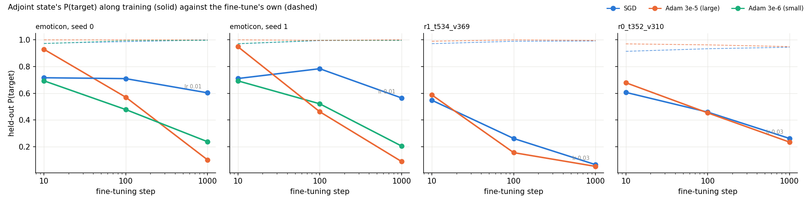
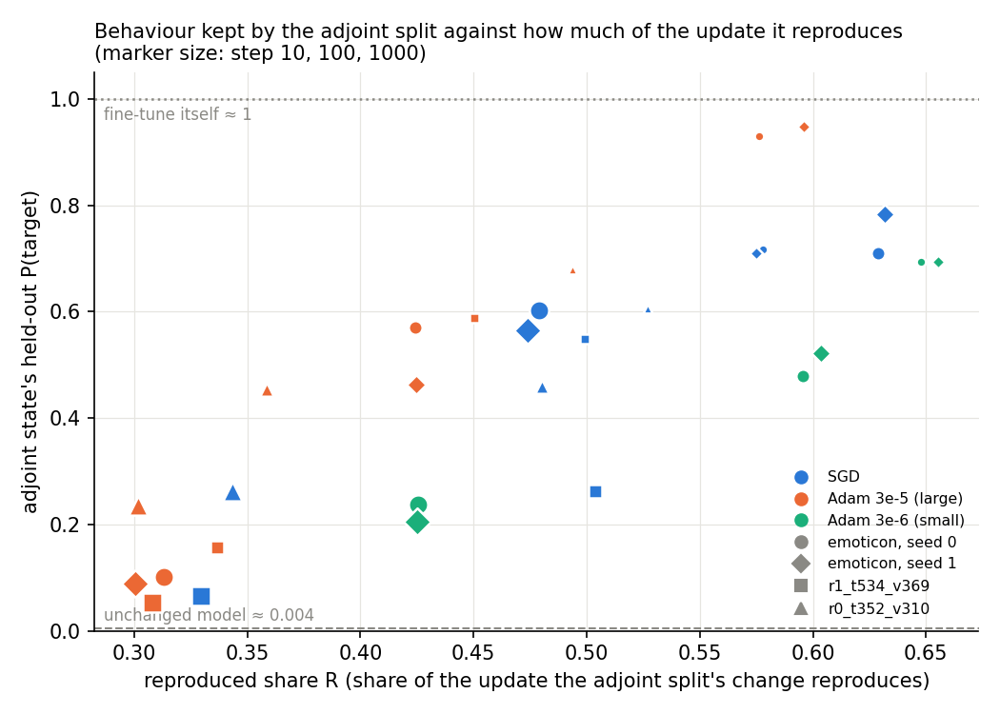
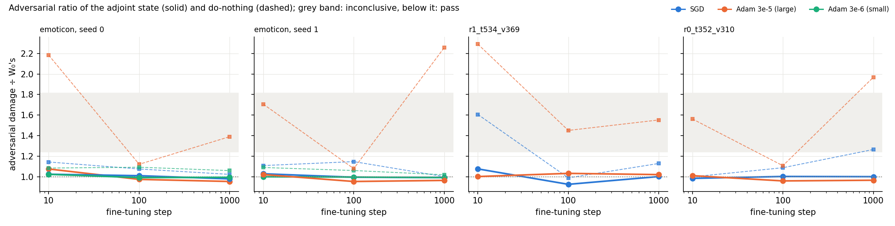
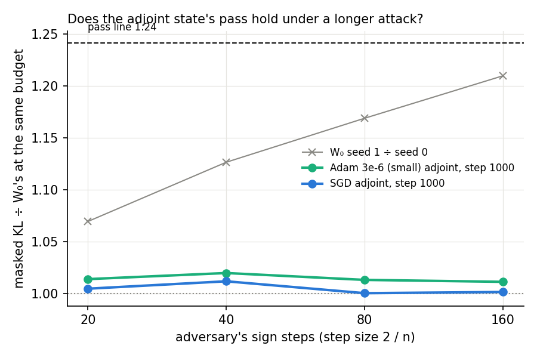
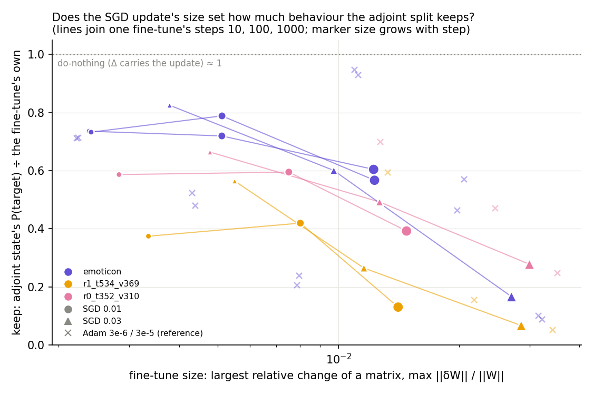

# Analysis: does the adjoint split of a plain-SGD fine-tune keep the behaviour? On emoticon only (E31)

*2026-10-22, E31 agent. Plan: `reports/2026-10-22_plan_adjoint-sgd.md` and its Agent notes. Experiment
`experiments/adjoint_sgd`. Every number below is read from `results/adjoint_sgd.json`, which merges the shard files
`results/adjoint_sgd_{A,B,C,D,E}.json`. The figures come from `plot.py`, which reads only that file. Vocabulary:
`GOALS.md` → Terms.*

**In plain words.** We fine-tuned the model with plain SGD and with Adam on three tasks, and wrote each update onto
the existing subcomponents with the adjoint split. On the emoticon task the SGD update kept most of its behaviour on a
second seed and stayed faithful, but on the two other tasks it lost the behaviour as fast as the large Adam update.
For `GOALS.md`, this split of an SGD fine-tune meets the weak version on one task only, for reasons not yet known.

> **Something unexpected happened that I cannot explain.** We predicted that on the two new tasks the SGD update's
> adjoint split would keep at least half the behaviour at step 1000, well above the large Adam update's. It kept 0.07
> on one task and 0.26 on the other, against 0.05 and 0.23 for Adam. The SGD rate on those tasks was three times the
> emoticon rate, so task and rate are confounded here.

## The answer

On emoticon, the SGD fine-tune's adjoint state held its target probability near 0.57 at step 1000 on a second seed. The
small Adam fine-tune fell to 0.21 there, so E22's surprise replicates on that task. On the two other tasks the SGD state
fell to 0.07 and 0.26, no better than the large Adam state. Every adjoint state passed the adversarial check with Δ
fixed, and the SGD state's pass held under an eight-times-longer attack. The reproduced share did not explain the emoticon
difference: SGD and small Adam reproduced about the same share of their updates.

## What we were trying to test

The model is the released 67M Pile model with its VPD decomposition. Γ and Δ stay frozen throughout. Each fine-tune
trains all 24 decomposed matrices for 1000 steps with the arm-A loss: cross-entropy on the target token at the trigger
plus KL to the original model elsewhere. Its update $\delta W$ is read at steps 10, 100 and 1000.

Each update is written onto the subcomponents in two ways:

- **Do-nothing**: the whole $\delta W$ goes into Δ. The reference.
- **Adjoint split**: each subcomponent's write vector moves by $\delta W V$ and its read vector by $\delta W^\top U$, so the
  weight change is $K(\delta W) = UU^\top\delta W + \delta W VV^\top$, scaled per matrix by the $c$ that best matches
  $\delta W$ on the data. Δ does not change. The question is how much behaviour survives that rewrite.

Per state we read four things:

- **Held-out P(target)** at the trigger. The fine-tune itself reads about 1; the unchanged model reads about 0.004.
- **Adversarial ratio**: the damage a 20-step adversary finds on Pile text, divided by the same job's unchanged model.
  It reads 1 for the unchanged model. On the L40 a ratio at or below 1.24 is a pass.
- **Δ's share** of the update's energy. The adjoint split should read 0, which checks that the measurement reads 0.
- **Reproduced share** $R$: the fraction of the update's input-weighted energy that $cK(\delta W)$ reproduces, pooled over
  matrices. It reads 1 when the split's change equals the update and 0 when it reproduces none of it.

The arms:

- **Emoticon, seed 0**: Adam at 3e-5, SGD at 0.01 and Adam at 3e-6, rerun first as the control. They had to match E22's
  target probabilities within 0.05, and the large Adam update's $R$ had to match E14's within 0.03.
- **Emoticon, seed 1**: the same three. This rules out a lucky batch order.
- **r1_t534_v369 and r0_t352_v310**: SGD at the rate E4's rule picks on step 10, and Adam at 3e-5. This asks whether the
  effect belongs to the optimiser or to the emoticon task. The rule picked 0.03 on both tasks, because 0.01 reached
  only 0.84 at step 10 there.
- **Budget sweep**: the SGD and small Adam emoticon states at step 1000 under 20, 40, 80 and 160 adversary steps. This
  asks whether the 20-step pass is an artefact of a short attack.

## What we expected, and why

E22 found that the SGD emoticon state kept 0.61 at step 1000 while the small Adam state fell to 0.24. We expected the
second seed to repeat that. We also expected the other tasks to show it, with medium-low confidence, on the view that it
is a property of the optimiser. The proposed mechanism: one plain SGD step's adjoint split is exactly one
component-training step, so an SGD update should be mostly reproducible by the adjoint split. Adam rescales each
coordinate, so it should not be. That predicted a reproduced share of at least 0.8 for every SGD update, above every Adam
update on the same task. It also predicted that kept behaviour would rank with the reproduced share. Finally we
expected the longer attack to find no more damage than on the unchanged model, as it did for the large Adam state.

## What we observed

### Does the SGD state keep the behaviour on a second seed and on other tasks?

**Reading it.** On emoticon, yes; on the other two tasks, no. In the two left panels the blue SGD line ends at 0.60
and 0.57 at step 1000. The green small-Adam line ends at 0.24 and 0.21, and the orange large-Adam line at 0.10 and 0.09.
In the two right panels the blue line falls with the orange one, to 0.07 against 0.05 on r1 and 0.26 against 0.23
on r0. The dashed lines show the fine-tunes themselves near 0.95 to 1 throughout, so the behaviour is lost in the
split, not in training. The SGD rate on those two tasks was 0.03, and the update grew to about the large Adam update's
size by step 1000. So this run cannot say whether the task or the larger rate removed the effect.

| step 1000 | emoticon s0 | emoticon s1 | r1_t534_v369 | r0_t352_v310 |
|---|---|---|---|---|
| SGD adjoint P(target) | 0.60 | 0.57 | 0.07 | 0.26 |
| Adam 3e-6 adjoint | 0.24 | 0.21 | — | — |
| Adam 3e-5 adjoint | 0.10 | 0.09 | 0.05 | 0.23 |
| SGD update size | 0.0122 | 0.0123 | 0.0286 | 0.0300 |
| Adam 3e-5 update size | 0.0315 | 0.0322 | 0.0342 | 0.0352 |

The size is the largest matrix's relative change, $\max_k \|\delta W_k\| / \|W_k\|$.

### Is the reproduced share what separates them?

**Reading it.** No. The reproduced share falls along training for every update, and kept behaviour falls with it. That
is why the two rank together across all 30 states, with a rank correlation of 0.81. But the share never reaches 0.8
for any update; SGD's sits between 0.33 and 0.63. At a fixed step it does not separate SGD from small Adam on emoticon.
At step 1000 SGD reproduces 0.48 and small Adam 0.43, yet SGD keeps 0.60 and Adam 0.24; at step 10 small Adam
reproduces more. Within a single step the rank correlation is 0.62 to 0.69, about the same as the correlation of kept
behaviour with a smaller update size. So the share tracks training length, not the optimiser difference.

The share also reads below 1 for an update lying wholly inside the subcomponents' spans, because $K$ counts the block
inside both spans twice and $c$ is one number per matrix. It is therefore not the outside share that E22 reported at
0.03 to 0.06 for SGD.

### Do the adjoint states stay faithful, and does that survive a longer attack?

**Reading it.** Yes. Every one of the 30 adjoint states read between 0.93 and 1.08, inside the pass region on every
task and step. Do-nothing read up to 2.29 for the large Adam update. Δ's share stayed below 1e-4 in every
adjoint state, so Δ did not absorb the update.

**Reading it.** The SGD emoticon state's pass holds under a longer attack. At 20 to 160 adversary steps its damage was
1.00 to 1.01 times the unchanged model's at the same budget. The unchanged model's second adversary seed reads 1.07
to 1.21 times its first, so the SGD state sits well inside the attack's own noise. The small Adam state's ratio
stays between 1.01 and 1.02 under every longer attack. That is also inside the attack's own noise, which reads
1.13 to 1.21 at those budgets. No prediction reads this number, so it is reported, not scored.

## What we learned

The adjoint split of a plain-SGD fine-tune keeps the emoticon behaviour on two seeds while staying faithful with Δ
fixed. On two other single-token tasks, at the SGD rate the selection rule chose there, it loses the behaviour as the
large Adam update does. So the 2026-10-21 decision's move-back condition is met on one task only, and the main-line
decision should not move on this evidence. The proposed mechanism fails as stated: the reproduced share is not higher
for SGD and does not separate SGD from small Adam at matched steps.

## How compelling is the evidence

- Three tasks, all single-token trigger and target; two seeds on emoticon, one elsewhere.
- Target probability is read on held-out windows at the trigger only. Off-target damage is covered only by the
  adversarial ratio.
- The adversarial verdict is one 20-step adversary family, extended to 160 steps for one state. The unchanged model's
  floor reads 0.21 on this card.
- The other-task comparison confounds task with SGD rate: 0.03 there, 0.01 on emoticon.
- Kept behaviour and reproduced share are correlated readings; neither was intervened on.

## Surprises

- **The other-task prediction reversed.** SGD's adjoint state kept 0.07 and 0.26, about the large Adam update's 0.05
  and 0.23, against a predicted at least 0.5 and 0.2 above Adam. The cause is not known; task and rate are confounded.
- The reproduced share of SGD updates is far below the predicted 0.8 and no higher than Adam's at step 10.

## What next

1. SGD at 0.01 on r1_t534_v369 and r0_t352_v310 for 1000 steps, adjoint split at each step. If it keeps at least half
   the behaviour, the effect belongs to the rate or update size; if not, to the task.
2. More single-token tasks at emoticon's SGD rate, to see how often the effect appears at all.
3. A measure of what distinguishes the emoticon SGD update from small Adam's at step 1000, since the reproduced share
   does not.

## Scorecard

| id | claim | rule | read | verdict |
|---|---|---|---|---|
| G0 | unchanged model at its known values | `w0_check` per job | floor 0.209 in all five jobs | pass |
| G1 | reproduce E22 on emoticon seed 0 | adjoint P within 0.05 of E22 at each step | Adam 3e-5 0.93/0.57/0.10; SGD 0.72/0.71/0.60; Adam 3e-6 0.69/0.48/0.24 | pass |
| G2 | large Adam R reproduces E14 | within 0.03 of 0.58/0.42/0.31 | 0.576/0.424/0.313 | pass |
| C_delta | Δ share reads 0 | every adjoint state ≤ 1e-3 | max 9.9e-5 | pass |
| C_budget_w0 | budget sweep's W0 at E20's value | 20 steps within 5% of 0.6604 | 0.6604 | pass |
| P1 | seed 1 SGD keeps; small Adam ≥ 0.2 lower | SGD P ≥ 0.5, Δ ≤ 1e-3, pass; Adam ≤ SGD − 0.2 | SGD 0.565, pass, Δ 7e-7; Adam 0.205 | **pass** |
| P2 | SGD keeps on r1 and r0, ≥ 0.2 above Adam 3e-5 | per task SGD P ≥ 0.5 and ≥ Adam + 0.2 | r1 0.066 vs 0.053; r0 0.262 vs 0.235 | **fail ("neither")** |
| P3a | SGD R ≥ 0.8 everywhere, above every Adam R | each SGD state | SGD R 0.33–0.63; below Adam 3e-6 at step 10 | **fail** |
| P3b | kept ratio ranks with R | Spearman ≥ 0.7 over all states | 0.81, n = 30 | **pass** |
| P4 | SGD state's pass holds at longer budgets | ratio ≤ 1.241 at 40/80/160 | 1.012 / 1.000 / 1.001 | **pass** |

P3b passes as filed, but the within-step correlation of 0.62 to 0.69 shows it mostly reflects training length.

### All states (adjoint P(target), R, adversarial ratio of adjoint and do-nothing)

| state | step | size | R | adjoint P | adjoint ratio | do-nothing ratio |
|---|---|---|---|---|---|---|
| emoticon s0 Adam 3e-5 | 10 / 100 / 1000 | 0.011 / 0.021 / 0.031 | 0.58 / 0.42 / 0.31 | 0.93 / 0.57 / 0.10 | 1.08 / 0.98 / 0.95 | 2.18 / 1.12 / 1.39 |
| emoticon s0 SGD 0.01 | | 0.002 / 0.005 / 0.012 | 0.58 / 0.63 / 0.48 | 0.72 / 0.71 / 0.60 | 1.03 / 1.01 / 0.98 | 1.14 / 1.08 / 1.02 |
| emoticon s0 Adam 3e-6 | | 0.002 / 0.004 / 0.008 | 0.65 / 0.60 / 0.43 | 0.69 / 0.48 / 0.24 | 1.02 / 0.99 / 0.99 | 1.09 / 1.09 / 1.06 |
| emoticon s1 SGD 0.01 | | 0.002 / 0.005 / 0.012 | 0.57 / 0.63 / 0.47 | 0.71 / 0.78 / 0.56 | 1.03 / 1.00 / 0.99 | 1.11 / 1.15 / 1.00 |
| emoticon s1 Adam 3e-6 | | 0.002 / 0.004 / 0.008 | 0.66 / 0.60 / 0.42 | 0.69 / 0.52 / 0.21 | 1.00 / 1.00 / 0.99 | 1.09 / 1.06 / 1.02 |
| emoticon s1 Adam 3e-5 | | 0.011 / 0.020 / 0.032 | 0.60 / 0.42 / 0.30 | 0.95 / 0.46 / 0.09 | 1.02 / 0.95 / 0.97 | 1.71 / 1.08 / 2.26 |
| r1 SGD 0.03 | | 0.006 / 0.012 / 0.029 | 0.50 / 0.50 / 0.33 | 0.55 / 0.26 / 0.07 | 1.08 / 0.93 / 1.00 | 1.61 / 0.99 / 1.13 |
| r1 Adam 3e-5 | | 0.013 / 0.022 / 0.034 | 0.45 / 0.34 / 0.31 | 0.59 / 0.16 / 0.05 | 1.00 / 1.03 / 1.02 | 2.29 / 1.45 / 1.55 |
| r0 SGD 0.03 | | 0.005 / 0.013 / 0.030 | 0.53 / 0.48 / 0.34 | 0.61 / 0.46 / 0.26 | 0.99 / 1.00 / 1.00 | 1.00 / 1.09 / 1.27 |
| r0 Adam 3e-5 | | 0.013 / 0.025 / 0.035 | 0.49 / 0.36 / 0.30 | 0.68 / 0.45 / 0.23 | 1.01 / 0.96 / 0.97 | 1.56 / 1.11 / 1.97 |

SGD rate grids at step 10, P(target) and KL elsewhere: r1 0.01 → 0.84 / 0.23, 0.03 → 0.97 / 0.14; r0 0.01 → 0.84 /
0.16, 0.03 → 0.91 / 0.08. Budget sweep KL, unchanged model seed 0: 0.660 / 0.682 / 0.701 / 0.709; SGD state: 0.663 /
0.690 / 0.701 / 0.709. The budget job retrained the SGD and small Adam emoticon fine-tunes; their step-1000 P(target),
KL elsewhere and size match shard A's to the printed precision.

## Not run

- SGD at 0.01 on r1 and r0; SGD with momentum; more seeds on r1 and r0; other task families; adversaries beyond the
  sign-step family; the strong version.

## Provenance

- MATS cluster, `debug` QoS, one L40 per job, $0. Jobs: A 29503 (2817 s), B 29565 (3041 s), C 29566 (2173 s),
  D 29567 (2158 s), E 29568 (crashed after about 28 min). Rerun of E: 29596, finished in about 39 min. The earlier RunPod attempt
  finished only its W₀ control on an H100 (`results/adjoint_sgd_pod_w0only.json`); remote-kernels did not connect this session.
- Code: `experiments/adjoint_sgd/run.py`, which gained `shard` and `merge` stages for this run; `split.reproduced_share`. Codex adversarial review run before
  the jobs; its one finding was fixed: the other-task scoring counted a task with no valid SGD rate as scored.
- Files: `results/adjoint_sgd_{A,B,C,D,E}.json`, `results/adjoint_sgd_E_crashed29568.json`, `results/adjoint_sgd.json`
  (sha256 7752c540…), logs `results/large/full_{A..E}.log`, `cluster/logs/commute-adjoint-sgd-*.out`.

---

## Amendment 1: is it the task or the SGD rate?

*2026-10-23, analysis agent. Plan: `reports/2026-10-22_plan_adjoint-sgd.md` → "Amendment 1"; predictions filed in
`results/predictions_amend1.json` before the run. Numbers come from `results/adjoint_sgd_amend1.json` for the three new
fine-tunes and from `results/adjoint_sgd.json` for E31's. The figure is `size.png` from `plot.py`, which reads only those two files.*

**In plain words.** E31 left the task and the SGD learning rate tangled, so we swapped them: word tasks at the slow
rate, emoticon at the fast one. Neither alone decides what the adjoint split keeps; it keeps less as the update grows,
and at one update size the tasks still differ widely. For `GOALS.md`, this split of an SGD fine-tune keeps behaviour
only while the update is small, by a task-dependent margin, so it does not meet the weak version in general.

> **Both filed predictions missed.** We predicted that the task alone sets the outcome. On the word tasks at the slower
> rate we expected the split to keep no more than before. One task did; the other kept somewhat more, so the rule scores
> the pair "mixed". On emoticon at the faster rate we expected it to keep at least half the behaviour. It kept 0.17,
> which the rule scores as "rate". Neither prediction is re-filed or softened below.

### The answer

The adjoint split keeps less behaviour the larger the SGD update grows, on every task. Emoticon at the faster rate
reached a two-times-larger update by step 1000 and kept 0.17 instead of 0.60. Its own step-100 state, at the size the
slower run reaches at step 1000, kept the same 0.60. But size is not the whole story. At about the same size the three
tasks kept 0.60, 0.39 and 0.13. This is a reading from one seed per new fine-tune, not a finding.

### What we were trying to test

The setup is E31's, unchanged. Each fine-tune trains all 24 decomposed matrices with plain SGD for 1000 steps on one
task, with the arm-A loss. Γ and Δ stay frozen. At steps 10, 100 and 1000 the update $\delta W$ is written onto the
subcomponents by the scaled adjoint split, and Δ does not change.

Two numbers are read per state:

- **Keep**: the adjoint state's held-out P(target) at the trigger divided by the fine-tune's own at the same step. It
  reads about 1 for do-nothing, which leaves the whole update in Δ, and near 0 if the split loses the behaviour.
- **Update size**: the largest relative change of any matrix, $\max_k \|\delta W_k\| / \|W_k\|$. It is reported, not scored.

E31 had emoticon at SGD 0.01 and the two word tasks, r1_t534_v369 and r0_t352_v310, at 0.03. This amendment adds the
other two corners: both word tasks at 0.01 and emoticon at 0.03. The word-task corners ask whether a slower rate brings
the behaviour back there. The emoticon corner asks whether a faster rate removes it on the task where it was seen.

Each job first checked the unchanged model against its known values. It then retrained the 10-step fine-tune, which
had to match E31's earlier reading within 0.01. Both passed in all three jobs. Every fine-tune reached P(target) of at
least 0.92 by step 1000, so every corner was scorable.

### What we expected, and why

We predicted "task" for both, from a path argument. SGD at a third of the rate for 1000 steps travels roughly as far
as the faster rate does in its first 330 steps. There E31's faster runs had already fallen to about 0.16 and 0.38. So
we expected the word tasks at 0.01 to keep no more than 0.17 and 0.38. For emoticon at 0.03 the same argument says 1000
steps is like 3000 at the slower rate, and the slower run's keep fell only slowly. So we expected it to keep at least 0.5.

### What we observed

#### Does the update's size set how much the split keeps?

**Reading it.** Within a task, mostly yes; across tasks, no. Each line is one fine-tune's steps 10, 100 and 1000, coloured
by task, with circles for SGD 0.01 and triangles for 0.03. Above a size of about 0.005, the circles and triangles of
one colour fall on one downward curve. Emoticon at 0.03 kept 0.60 at step 100, where its size matched the slower run's
step 1000, which also kept 0.60. It then fell to 0.17 as its update kept growing. At a size near 0.013 the three
colours sit far apart, emoticon near 0.6, r0 near 0.4 and r1 near 0.13. The faint crosses are E31's Adam updates and do
not follow the SGD curves. Adam 3e-5 kept 0.93 on emoticon at a size where SGD kept 0.6. So size orders SGD states
within a task only.

| step 1000 | emoticon | r0_t352_v310 | r1_t534_v369 |
|---|---|---|---|
| SGD 0.01: keep / size | 0.60 / 0.012 (seed 1: 0.57 / 0.012) | **0.39 / 0.015** | **0.13 / 0.014** |
| SGD 0.03: keep / size | **0.17 / 0.027** | 0.28 / 0.030 | 0.07 / 0.029 |
| fine-tune P(target), 0.01 / 0.03 | 0.998 / 0.999 | 0.928 / 0.944 | 0.983 / 0.991 |

Bold cells are new in this amendment. The rest are E31's.

#### Does the adjoint split stay faithful in the new corners?

Yes. Every new adjoint state passed the adversarial check, with ratios to the unchanged model between 0.93 and 1.33.
The highest was r1_t534_v369's step-10 state at 1.33. At steps 100 and 1000 every state read 0.93 to 1.00. Δ's share of
the update stayed below 7e-5 in every adjoint state, so Δ did not absorb it.

### What we learned

The adjoint split of an SGD fine-tune keeps the behaviour only while the update is small. How small depends on the task.
Emoticon still keeps about 0.6 at a size near 0.012, where r1_t534_v369 is already down to 0.13. E31's emoticon
result is therefore partly a small-update result, and the word-task failure is partly a large-update one. Neither
reading meets the weak version of `GOALS.md` in general, since the fine-tunes it should cover grow past these sizes.

### How compelling is the evidence

- One seed per new fine-tune. The only seed-to-seed spread measured is emoticon's 0.04 at SGD 0.01.
- Size is the largest matrix's relative change. A pooled or per-layer size might order the states differently.
- Each size has one state per fine-tune, read at one step. No two rates were stopped at the same size, so
  "size, not path" is read off the figure, not tested.
- Adam states do not follow the SGD curves, so size alone is not a sufficient summary of an update.
- The three jobs ran on an L40S, not the planned L40. The unchanged model's two adversary seeds differed by 0.05 there,
  against 0.21 on the L40. The 10-step gate reproduced E31 within 0.001 on every task.
- P(target) is read only at the trigger, and damage elsewhere only through the 20-step adversary.

### Surprises

- **Both filed predictions missed.** The task-alone prediction failed in both directions. Emoticon lost its behaviour at
  the faster rate, and r0_t352_v310 kept more at the slower rate, 0.39 against 0.28.
- r1_t534_v369's step-10 state at 0.01 read 1.33 on the adversarial check. It passes on this card's floor but would be
  inconclusive on the L40's wider one.

### What next

1. A size-matched comparison: two rates stopped at the same update size on one task, two seeds each. If keep matches,
   size is the variable; if not, the path matters.
2. Keep against size on two or three more tasks at SGD 0.01, read at more steps. This tells whether emoticon's level is
   typical or an outlier.
3. Something that tells the tasks apart at matched size, such as how many subcomponents the fine-tune switches on.

### Scorecard

| id | claim | rule | read | verdict |
|---|---|---|---|---|
| G0 | unchanged model at its known values | `w0_check`, each job | pass in all three; floor 0.046 | pass |
| A1_G1 | 10-step fine-tune reproduces E31 | P(target), KL elsewhere within 0.01 | r1 0.837 / 0.228; r0 0.843 / 0.158; emo 0.995 / 0.037 | pass |
| C_delta | Δ share reads 0 | every adjoint state ≤ 1e-3 | max 6.7e-5 | pass |
| A1 | word tasks at 0.01 keep no more than at 0.03 ("task") | per task: rate if ≥ 0.5 and ≥ 0.03 keep + 0.2; task if ≤ 0.03 keep + 0.1; else partial | r1 0.130 vs ≤ 0.167 → task; r0 0.392 vs ≤ 0.378 → partial | **mixed: missed** |
| A2 | emoticon at 0.03 keeps ≥ 0.5 ("task") | rate if ≤ 0.404; task if ≥ 0.5; else partial | 0.166 | **rate: missed** |

All step-1000 adjoint verdicts pass; fine-tune P(target) at step 1000 is 0.983, 0.928 and 0.999.

#### All new states

| cell | step | size | fine-tune P | adjoint P | keep | R | adjoint ratio | do-nothing ratio |
|---|---|---|---|---|---|---|---|---|
| r1_t534_v369 SGD 0.01 | 10 / 100 / 1000 | 0.003 / 0.008 / 0.014 | 0.84 / 0.99 / 0.98 | 0.31 / 0.41 / 0.13 | 0.37 / 0.42 / 0.13 | 0.47 / 0.56 / 0.45 | 1.33 / 0.94 / 0.97 | 2.56 / 0.98 / 0.96 |
| r0_t352_v310 SGD 0.01 | | 0.003 / 0.008 / 0.015 | 0.84 / 0.91 / 0.93 | 0.49 / 0.54 / 0.36 | 0.59 / 0.60 / 0.39 | 0.50 / 0.55 / 0.45 | 1.08 / 0.97 / 0.98 | 1.76 / 1.05 / 1.02 |
| emoticon SGD 0.03 | | 0.004 / 0.010 / 0.027 | 1.00 / 0.99 / 1.00 | 0.82 / 0.60 / 0.17 | 0.83 / 0.60 / 0.17 | 0.58 / 0.59 / 0.33 | 1.01 / 1.00 / 0.93 | 1.03 / 1.08 / 1.03 |

The pass line on this card is 1.43 and the fail line 1.57, from the same-job floor of 0.046.

### Not run

- More seeds on any corner; a size-matched pair of rates; other rates; more tasks.
- SGD with momentum; smaller-rate Adam on the word tasks; a pooled update size; the strong version.

### Provenance

- RunPod, one L40S, the three corners in sequence, $1.01. The cluster `debug` queue did not start r1 within 10 minutes,
  so job 30502 was cancelled. Each corner took about 1000 s.
- Code: `run.py amend1 <cell>` and `amend1_merge`, calling E31's `arm()` unchanged; `plot.py` → `fig_size`.
- Files: `results/adjoint_sgd_amend1_{r1,r0,emo}.json`, merged `results/adjoint_sgd_amend1.json` (sha256 a0b36394…);
  logs `results/large/full_amend1_{r1,r0,emo}.log` and `results/large/pod_stage_amend1_{r1,r0,emo}.log`.
