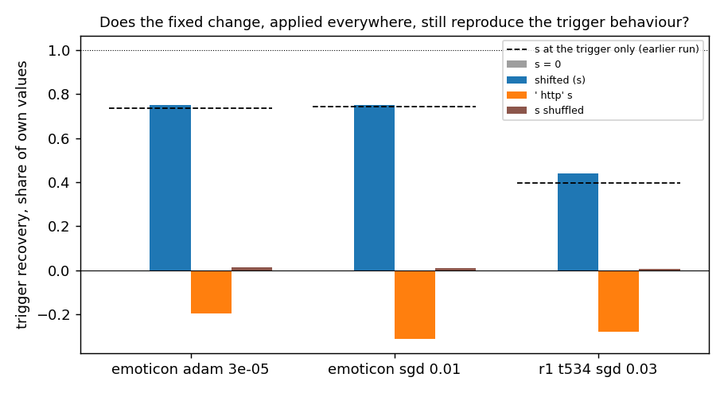
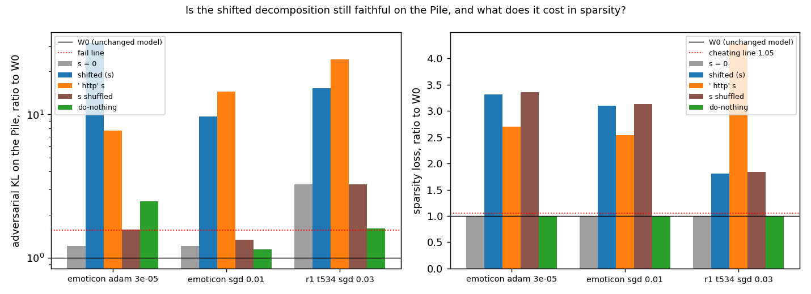
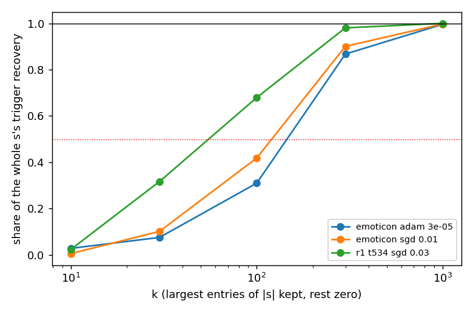
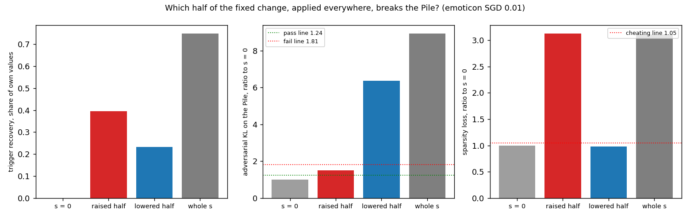

# Analysis: can one fixed change to Γ's values, applied everywhere, serve as the map? (E30)

*2026-10-22, commute line. Plan: `reports/2026-10-22_plan_commute-second-line.md`, Item D reading (i) and the E30 agent
note. Predictions: `experiments/gamma_shift_map/results/predictions.json`, filed 13:37 before any run (sha256
f8e38622…, unchanged) and scored as filed. Results: `experiments/gamma_shift_map/results/gamma_shift_map.json`; figures
in `experiments/gamma_shift_map/figures/`. Provenance at the end.*

We kept every subcomponent and Δ as they are for the unchanged model, and added one fixed change to Γ's values at
every position, the change the fine-tune makes at its trigger. At the trigger this reproduces the new behaviour as
well as applying the change there alone did. On ordinary text the decomposition stops being faithful: an adversary
finds five to twenty-six times the damage it finds without the change, and the sparsity cost roughly triples. So a
single input-independent change is not a map; the change has to depend on the input.

## What we were trying to test

The fixed-shift hypothesis says a small fine-tune mostly changes which subcomponents Γ switches on at the trigger, and
that this change is about the same on every trigger window. If so, the simplest map from the old decomposition to one
of the fine-tuned model leaves the subcomponents and Δ alone and adds that change to Γ's output. This experiment
builds that map and scores it the way any map is scored: against the fine-tuned model's outputs on the Pile.

The model is the released VPD decomposition of the 67M model, where each of the 24 decomposed matrices is
$W_0 = \sum_c u_c v_c^\top + \Delta$ and Γ gives each subcomponent a causal-importance value in $[0, 1]$ at each
position. The symbols used below:

- $s$: the fixed change, one number per alive subcomponent. It is the mean of Γ's values at the trigger over the task's
  training windows under the fine-tuned model, minus the same mean under the unchanged model.
- $\Gamma'(x) = \mathrm{clip}(\Gamma(x) + s, 0, 1)$: the shifted values, at every position, with Γ reading the
  unchanged model's activations.
- $D'$: the decomposition with the unchanged subcomponents, the unchanged Δ, and $\Gamma'$. Its weights still sum to
  $W_0$; only which subcomponents are on changes.

Three ten-step fine-tunes of all 24 matrices were regenerated exactly as in the earlier trigger-only run. Two are on
the emoticon task, one with plain SGD at rate 0.01 and one with Adam at 3e-5. The third is on the word task r1, which
maps one token to another, with SGD at 0.03. Each has a null fine-tune to the token ` http` by the same optimiser and rate.

Per update the Pile harness scored five arms against the fine-tuned model's outputs:

1. **No change**, $s = 0$: the old decomposition read against the new model. The reference every other arm is divided by.
2. **The shifted decomposition** with the task's $s$: the map under test.
3. **The null's change**, $s$ from the ` http` fine-tune: rules out "any change of this size from any fine-tune does the
   same".
4. **The change shuffled** among each matrix's alive subcomponents: the same values in the wrong places, which rules
   out "it is just the amount of change".
5. **Do-nothing**, $\delta W$ left in Δ with Γ reading the fine-tuned model: the ordinary reference from earlier runs.

The numbers read on 256 Pile rows are the four KL divergences from the fine-tuned model's outputs, each as a ratio to
the unchanged model's own reading. The **CI-masked** KL multiplies each subcomponent by its value. The **stochastic**
KL draws masks between the value and 1. The **adversarial** KL lets a 20-step search pick the masks in that range that
do the most damage. The **sparsity loss** is VPD's penalty on the values. A ratio of 1 means as faithful and as sparse
as the unchanged decomposition is for the unchanged model. The adversarial ratio passes at or below $1.5/(1+f)$ and
fails above $1.5(1+f)$, where $f = 0.035$ is the spread of three adversary seeds on the unchanged model in this job.
A sparsity ratio above 1.05 reads as cheating: faithfulness bought by switching more subcomponents on.

On the task's held-out windows we also read the **trigger recovery**: how much of the fine-tune's gain in the target
token's log-odds at the trigger the unchanged weights recover under the new values, as a share of what the fine-tuned
model's own values recover. 0 is nothing, 1 is as much as the own values.

Before any of this, two controls ran. The new scoring path at $s = 0$ against a copy of the unchanged model had to
reproduce the ordinary harness to 1e-4. Each regenerated fine-tune had to reproduce the earlier run's trigger readings
within 0.05.

## What we expected, and why

- At the trigger, applying the change everywhere would recover about what applying it at the trigger alone did: at least
  0.6 on both emoticon updates and within 0.1 of the earlier figures 0.74, 0.74 and 0.40. The other positions of a
  window were not expected to move the trigger's log-odds much.
- On the Pile, the CI-masked KL would rise above the no-change reference on every update, since the earlier run found
  the change also moves the target away from the trigger.
- No direction was filed for the adversarial verdict. Raising a value narrows the adversary's range, lowering it widens
  the range, so either could win. The lean was "cheating" on every update: every raised value is charged at every
  Pile position.
- The null's change would recover at most 0.1 at the trigger.
- No direction for whether the top 100 entries of $|s|$ carry half of its effect; the lean was that many small entries
  act together on emoticon.

## What we observed

### Does the change, applied everywhere, still reproduce the trigger behaviour?

**Reading it.** Yes. The shifted decomposition recovers 0.75 of the own values' effect on both emoticon updates and
0.44 on r1, each within 0.05 of the trigger-only figure drawn as the dashed line. The null's change pushes the target
down, by 0.20 to 0.31, and the shuffled change does nothing, within 0.012 of zero. So the fixed change is task-specific
at the trigger, and spreading it to the other window positions costs nothing there.

| update | no change | shifted | null's change | shuffled | trigger only, earlier run |
|---|---|---|---|---|---|
| emoticon SGD 0.01 | 0 | 0.748 | −0.310 | 0.010 | 0.741 |
| emoticon Adam 3e-5 | 0 | 0.750 | −0.197 | 0.012 | 0.737 |
| r1 SGD 0.03 | 0 | 0.438 | −0.278 | 0.006 | 0.397 |

### Is the shifted decomposition still faithful on the Pile?

**Reading it.** No. The blue bars show the adversary finding 10 to 32 times the unchanged model's damage under the
shifted decomposition, far above the fail line at 1.55. With no change, the grey bars, it finds 1.2 times on emoticon
and 3.2 on r1. The sparsity loss is 1.8 to 3.3 times the unchanged model's. The null's change fails just as badly. The shuffled change costs the same sparsity as the
real one but barely moves the adversary: 1.3, 1.6 and 3.3. So the damage is not the amount of change; it depends on
which subcomponents the change lands on, and a fine-tune's change, the task's or the null's, lands on ones the
adversary can use. Each arm ran one adversary seed, but the two halves of the Pile rows agree within 10% on every
failing reading, far inside these gaps.

The CI-masked and stochastic KLs move much less. The table gives each arm divided by the no-change arm.

| update | CI-masked, shifted | CI-masked, null's | stochastic, shifted | adversarial, shifted | adversarial, null's | sparsity, shifted |
|---|---|---|---|---|---|---|
| emoticon SGD 0.01 | 1.12 | 1.14 | 1.09 | 8.0 | 12.0 | 3.10 |
| emoticon Adam 3e-5 | 1.33 | 1.15 | 1.19 | 26.1 | 6.4 | 3.32 |
| r1 SGD 0.03 | 0.97 | 1.56 | 0.98 | 4.7 | 7.5 | 1.81 |

All arms as ratios to the unchanged model, from `score.ratios`:

| update | arm | CI-masked | stochastic | adversarial | unmasked | sparsity |
|---|---|---|---|---|---|---|
| emoticon SGD 0.01 | no change | 1.02 | 1.03 | 1.21 | 1.63 | 1.00 |
| | shifted | 1.15 | 1.12 | 9.65 | 1.63 | 3.10 |
| | null's change | 1.16 | 1.12 | 14.47 | 1.63 | 2.54 |
| | shuffled | 1.06 | 1.04 | 1.34 | 1.63 | 3.13 |
| | do-nothing | 1.00 | 1.01 | 1.14 | 1.63 | 1.00 |
| emoticon Adam 3e-5 | no change | 1.05 | 1.06 | 1.21 | 2.86 | 1.00 |
| | shifted | 1.39 | 1.25 | 31.51 | 2.86 | 3.32 |
| | null's change | 1.21 | 1.16 | 7.68 | 2.86 | 2.70 |
| | shuffled | 1.10 | 1.08 | 1.58 | 2.86 | 3.36 |
| | do-nothing | 1.00 | 1.00 | 2.49 | 2.86 | 1.00 |
| r1 SGD 0.03 | no change | 1.27 | 1.34 | 3.24 | 9.89 | 1.00 |
| | shifted | 1.23 | 1.31 | 15.29 | 9.89 | 1.81 |
| | null's change | 1.98 | 1.66 | 24.29 | 9.89 | 4.28 |
| | shuffled | 1.27 | 1.35 | 3.27 | 9.89 | 1.85 |
| | do-nothing | 1.02 | 1.00 | 1.61 | 9.89 | 1.00 |

The unmasked column is equal across arms by construction, since all masks at 1 ignore Γ; it is the fine-tune's own
movement on the Pile, 0.02 to 0.12 nats against the unchanged model's 0.012. Do-nothing passes on emoticon SGD, as in
earlier runs, and fails on the other two. The no-change arm fails on r1, where the fine-tune moves the Pile most.

### How many entries of the change carry its effect at the trigger?

**Reading it.** A few hundred of the 9,881 alive subcomponents. Keeping only the 100 largest entries of $|s|$ gives 0.42
and 0.31 of the whole change's recovery on the two emoticon updates, so there many smaller entries act together. On
r1 the top 100 give 0.68. The top 300 give 0.87 to 0.98 everywhere. The breakdown matches the earlier trigger-only
run. On emoticon about 500 entries exceed 0.1. Layer 3 holds about 0.59 of the change's size and most of its effect.
The raised half recovers about 0.35 to 0.4 and the lowered half about 0.24. The null's change has about as many
large entries, 430 to 560 above 0.1. The size of an entry hardly predicts its subcomponent's write strength along
$\delta W$: rank correlation 0.10 to 0.22.

## What we learned

The fixed-shift hypothesis holds where it was measured: one task-specific change to Γ's values reproduces most of the
behaviour at the trigger, even when it is applied at every position of a window. As a map for the commute question it
fails. Applied to all text, the same change leaves a decomposition that an adversary breaks five to twenty-six times
more easily than with no change, and that pays two to three times the sparsity. For the weak version of Q1 this closes
the simplest frozen-subcomponent map. The change must be conditioned on the input, which points to reading (ii), a
change applied only where something read off $\delta W$ says the trigger is, or to updating Γ itself, as E15 tried.

## How compelling is the evidence

Strong for the failure, narrow in scope. The adversarial gaps are tens of times the unchanged model's seed spread of
3.5%, and the controls held exactly: the new path at $s = 0$ matched the ordinary harness with zero difference, and all
three fine-tunes reproduced the earlier run's trigger readings with zero difference. One training seed, three updates
on two tasks, ten fine-tuning steps, one 67M model, 256 Pile rows, one adversary seed per arm and a 20-step adversary.
The measurement is blind to where on the Pile the damage sits and to why the real change opens the adversary when the
shuffled one does not.

## Surprises

- **The adversary's damage was far larger than anything planned for, and the shuffle's far smaller.** The filed
  reasoning treated the adversarial reading as two-sided and expected the sparsity charge to be the cost. Instead the
  same values in shuffled places cost the same sparsity but left the adversary near the no-change level, so the damage
  comes from where a fine-tune's change lands. One candidate, untested: the lowered entries sit on subcomponents that
  are on at many Pile positions, so lowering them everywhere lets the adversary switch them off, while shuffled lowered
  entries mostly land on subcomponents already at 0.
- **On r1 the CI-masked KL went slightly down, not up**, by 3% against a 2% threshold. A narrow miss of the filed
  direction on one update.
- **The null's change harms the CI-masked reading about as much as the task's**, 1.14 to 1.56 times the no-change arm.
  The predicted harm is real on emoticon but is not specific to the task.

## What next

1. Apply only the raised half, then only the lowered half, of $s$ everywhere, on emoticon SGD: about 8 min on a 4090.
   If the lowered half alone produces the adversarial damage, the candidate above holds and a map could raise values
   everywhere but lower them only at the trigger.
2. Reading (ii): apply $s$ only at positions where the fine-tuned model's own values differ from the unchanged model's
   by more than a threshold. If that passes on the Pile, the map needs $\delta W$ only to find where to apply a fixed
   change. If it fails, the commute line's frozen-subcomponent maps are exhausted and Γ itself must change.
3. Nothing here changes the re-gating line's next step.

## Scorecard

| id | claim | rule | read | verdict |
|---|---|---|---|---|
| C1 | the new path at $s = 0$ reproduces the ordinary harness | every KL and sparsity within 1e-4 relative; W₀ check passes | 0.0 on all five; W₀ check pass, floor 0.035 | pass |
| G1 | regenerated fine-tunes match the earlier run | r and shared recovery within 0.05 | difference 0.0 on all three | pass |
| P1 | the change applied everywhere keeps the trigger recovery | ≥ 0.6 on emoticon and within 0.1 of the earlier figure on all | 0.748, 0.750, 0.438 vs 0.741, 0.737, 0.397 | pass |
| P2 | applied everywhere it harms the Pile's CI-masked KL | shifted ÷ no change − 1 > 0.02 on every update | +0.12, +0.33, −0.03; null's +0.14, +0.15, +0.56 | fail, r1 reads "less" |
| P3 | adversarial verdict and sparsity, two-sided | verdict of shifted ÷ no change against f = 0.035; sparsity > 1.05 is cheating | 8.0, 26.1, 4.7, all fail; sparsity 3.10, 3.32, 1.81 | cheating on all three, as leaned |
| P4 | the null's change does not recover the trigger | ≤ 0.1 on each update whose null learned | −0.31, −0.20, −0.28; nulls at P 0.96–1.00 | pass |
| P5 | a few large entries or many small ones | top 100 of $\lvert s \rvert$ give ≥ 0.5 of the whole recovery | 0.42, 0.31, 0.68 | many small on emoticon, a few larger on r1 |

Order in every row: emoticon SGD 0.01, emoticon Adam 3e-5, r1 SGD 0.03.

## Not run

- The raised and lowered halves of $s$ applied separately on the Pile.
- Readings (ii) and (iii) of the plan: the change applied only where the trigger is, and the change added on top of
  do-nothing.
- Where on the Pile the adversarial damage sits: per-row or per-token readings were not saved.
- A longer adversary, more adversary seeds per arm, a second training seed, later fine-tuning steps, other tasks, the
  larger model.

## Provenance

- Scored run: RunPod RTX 4090, 2,347 s, all stages in one job, exit 0; log `results/run3.log`, full log
  `results/large/full3.log`, the three $s$ tensors in `results/large/*_shift.pt`. Results sha256 2c795e2d…. No commute
  pod was alive afterwards; cost not recorded per run, about $0.5 at 4090 rates.
- Two earlier attempts stopped at the first control and are kept as `results/large/attempt1_crashed_c1.json` and
  `attempt2_stopped_c1.json`. The first, on an RTX 5090, crashed: the $s = 0$ control built the zero weight update
  with Γ's shapes, fixed in `run.py` by building it from the weights. The second, on a 4090, resumed the 5090's stored
  readings of the unchanged model and missed the 1e-4 match by up to 1%; the third ran from scratch on one card and
  matched exactly.
- Code: `experiments/gamma_shift_map/run.py`, `src/commute/shifted_harness.py`, `src/commute/shift_readout.py`;
  `plot.py` gained `trigger.png` and `adversarial.png` for this report.

## Amendment 1: the raised and the lowered half of the change, each applied everywhere (2026-10-23)

*Plan and design check: `reports/2026-10-22_plan_commute-second-line.md` → "Amendment 1 to E30". Code
`experiments/gamma_shift_map/halves.py`; predictions `results/predictions_amend1.json` (filed 2026-10-22 19:17);
results `results/gamma_shift_map_amend1.json`; figure from `plot.py`.*

We split the fixed change into the entries that raise Γ's values and the entries that lower them, and applied each half
alone at every position on the emoticon SGD fine-tune. The lowered half carries most of the damage on ordinary text,
and the raised half costs as much sparsity as the whole change. So "raise everywhere, lower only at the trigger" is not
a usable map, and the commute line's next candidate is the change applied only where the trigger is.

**What was tested.** The candidate map from the section above keeps U, V and Δ as released and raises Γ's values at
every position but lowers them only at the trigger. On the Pile, where the trigger almost never occurs, that map is the
raised half applied everywhere. So the run reads four arms on 256 Pile rows against W₀ + δW: no change, the raised half,
the lowered half, and the whole change as the positive control, which failed 8 times over in E30. Every number is a
ratio to the no-change arm in the same job.

**What we expected.** Masks range from Γ's value up to 1, so lowering values widens the adversary's room and raising
narrows it. We expected the lowered half to fail at least as badly as the whole change, the raised half to pass, and
the raised half to cost about three times the sparsity, since it is charged at every Pile position.

**Reading it.** The lowered half fails: the adversary finds 6.4 times the no-change damage, against 8.9 for the whole
change, and its sparsity is unchanged. The raised half's adversarial ratio is 1.49, between the pass line at 1.24 and
the fail line at 1.81, so its verdict is inconclusive; the lines are wide because the W₀ floor on an L40 is 0.21. Its
sparsity is 3.13 times, the cheating reading, and it alone keeps 0.39 of the trigger behaviour, as at the trigger only
in E30. The whole change failed again, so the test had power.

| arm | trigger recovery | adversarial | CI-masked | stochastic | sparsity |
|---|---|---|---|---|---|
| no change | 0.00 | 1.00 | 1.00 | 1.00 | 1.00 |
| raised half | 0.39 | 1.49 | 0.98 | 1.00 | 3.13 |
| lowered half | 0.23 | 6.36 | 1.13 | 1.08 | 0.98 |
| whole change | 0.75 | 8.93 | 1.12 | 1.09 | 3.11 |

**What we learned.** No fixed change applied everywhere is a map here. The raised half pays the full sparsity cost at
every position, so the "raise everywhere" route fails on that alone, whatever its adversarial verdict. The lowered half
is where the adversary gains its room. Both routes the plan wrote for this case lead to the same next step: apply the
change only where the trigger is.

**How compelling.** One fine-tune, one training seed, one adversary seed per arm, 256 Pile rows, the 67M model. The
adversarial readings vary by about a fifth across adversary seeds at W₀ (0.69 to 0.84 nats), wider than on a 4090.

**Surprises.** The containment argument broke both ways by more than that spread. The lowered half's range contains the
whole change's, yet it read 0.71 of the whole change's damage. The raised half's range is inside the no-change arm's,
yet it read 1.49 times. The 20-step adversary is only an approximation, and these numbers do not say why it misses.
The lowered entries open 2.9 times as much of Γ's range on the Pile as shuffled lowered entries, just under the filed
3.0; the premise that they sit on subcomponents that are often on held weakly.

**What next.** (1) Reading (ii): apply the change only at positions where the fine-tuned model's own values move. If
that passes on the Pile, the map needs δW only to find where to switch; if it fails, maps that keep the subcomponents
frozen are exhausted on this test. (2) If the raised half's adversarial verdict matters for any later reading, repeat
that arm on a 4090 with three adversary seeds, where the lines are about 1.45 and 1.55.

**Scorecard.**

| id | claim | rule | read | verdict |
|---|---|---|---|---|
| C1 | the new path at no change reproduces the ordinary harness | five readings within 1e-4 relative; W₀ check passes | 0.0 on all five; floor 0.21 | pass |
| G1 | the regenerated fine-tune matches E30 | r and recoveries within 0.05 | differences ≤ 0.002 | pass |
| P1 | the lowered half fails and the raised half passes | each half ÷ no change against 1.5/(1 + f) and 1.5(1 + f) | lowered 6.36 fail; raised 1.49 between the lines | inconclusive (leaned "lowered half") |
| P2 | each half's recovery everywhere matches its trigger-only figure | within 0.1 | differences 0.0001 and 0.011 | pass |
| P3 | the raised half costs sparsity | ratio > 1.05 is cheating | 3.13 | cheating, as leaned |
| P4 | lowered entries open several times what shuffled ones do | ratio ≥ 3.0 | 2.91 | premise fails, narrowly |

The filed route for an inconclusive P1 is "stop and report".

**Not run.** More adversary seeds or a longer adversary per arm; a 4090 repeat with the narrower lines; the halves on
the Adam and r1 fine-tunes; reading (ii); reading (iii), the change added on top of do-nothing.

**Provenance.** MATS cluster L40, debug QoS, job 30462, 1,217 s, exit normal, $0. An earlier cluster submission (30424)
waited 10 minutes for a GPU and was cancelled; the RunPod fallback lost its connection before set-up and was deleted
unused (about $0.20). Results sha256 9dd110d9…; full log `results/large/full_amend1.log` (9b8dc8dc…). The Codex
adversarial review did not run (usage limit); the author re-read the code.
