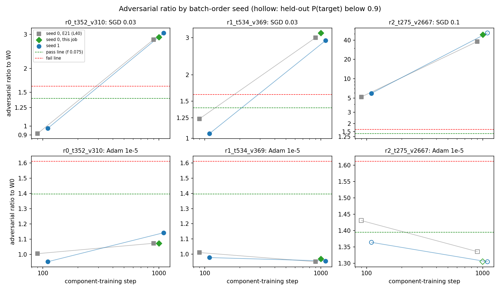

# Analysis: do the ladder verdicts for SGD and Adam component training survive a second batch order? Yes (E26)

## The answer

Yes. We retrained component training on three ladder tasks with a second order of training batches. The pattern seen with the first order came back on both tasks where it was claimed. Adam at a rate of 1e-5 stays at the unchanged model's floor at steps 100 and 1000. Plain SGD passes at step 100 and fails at step 1000, reading about three times the floor. On the rare-target task neither optimiser keeps the target and stays faithful, as before. The one-seed finding is a property of the recipe, not of the batch order.

## What we were trying to test

E21 trained component training on ladder tasks: the alive subcomponents' read and write vectors move, while Γ and Δ stay frozen. It used one batch order, seed 0. With free offsets that start at zero, the batch order is the only randomness in training. So a second batch order is the cheapest test of whether a verdict belongs to the recipe or to one run.

Per task, two arms were trained for 1000 steps with E21's loss, batch and clipping. One was plain SGD at the rate E21 chose for the task: 0.03 on r0 and r1, 0.1 on r2. The other was Adam at 1e-5. The tasks are `r0_t352_v310`, `r1_t534_v369` and `r2_t275_v2667`, three triggers with increasingly rare targets.

Each state was read through the Pile harness. The adversarial ratio is the KL a 20-step mask adversary reaches at the trained state, over what it reaches at the unchanged model $W_0$. It reads 1 if nothing changed. The noise floor $f$ is how far $W_0$'s own reading moves across three adversary seeds in the same job: 0.075 here. A state passes at or below $1.5/(1+f)$, which is 1.40. It fails at or above $1.5(1+f)$, which is 1.61. It also needs held-out P(target) of at least 0.9, or it reads "below P 0.9".

Two controls ran first. The unchanged model went through the harness first, to check that it read its known values. Then the seed-0 arms were regenerated on this card and scored at step 1000. Each had to land within 25% of E21's ratio, with the same verdict, before the seed-1 readings would count.

## What we expected, and why

The predictions were filed two-sided. For Adam, the question was whether its passes on r0 and r1 at steps 100 and 1000 would come back, or were one lucky order. For SGD, the question was whether its step-1000 fails on r0 and r1 would come back, or were noise. On r2 we expected nothing to pass at step 1000. With the first order, Adam lost its hold on the target there and SGD failed outright.

## What we observed

### 1. Does a second batch order change any verdict on r0 and r1?

**Reading it.** No verdict changed on r0 or r1. Blue circles are the second order and grey squares the first, from E21. Green diamonds are the first order regenerated in this job. On both tasks Adam's blue points sit at or below 1.14, under the pass line, at both steps. SGD's blue points pass at step 100, at 0.97 and 1.05. By step 1000 they climb to 3.06 and 2.91, well over the fail line. SGD's step-1000 fail is therefore a property of SGD at this rate, not of one run. The grey points were read against E21's own floor of 0.21, so their dashed lines sat lower. That does not change any verdict here.

| task | update | order | step | adversarial ratio | stochastic ratio | P(target) | damage elsewhere | size of change | verdict |
|---|---|---|---|---|---|---|---|---|---|
| r0 | SGD 0.03 | 0, this job | 1000 | 2.905 | 0.995 | 0.962 | 0.029 | 0.0171 | fail |
| r0 | SGD 0.03 | 1 | 100 | 0.974 | 1.012 | 0.943 | 0.050 | 0.0087 | pass |
| r0 | SGD 0.03 | 1 | 1000 | 3.055 | 0.954 | 0.961 | 0.027 | 0.0167 | fail |
| r0 | Adam 1e-5 | 0, this job | 1000 | 1.072 | 0.970 | 0.925 | 0.024 | 0.0176 | pass |
| r0 | Adam 1e-5 | 1 | 100 | 0.951 | 0.997 | 0.951 | 0.031 | 0.0117 | pass |
| r0 | Adam 1e-5 | 1 | 1000 | 1.142 | 0.968 | 0.920 | 0.023 | 0.0174 | pass |
| r1 | SGD 0.03 | 0, this job | 1000 | 3.161 | 0.978 | 0.990 | 0.045 | 0.0171 | fail |
| r1 | SGD 0.03 | 1 | 100 | 1.054 | 1.021 | 0.996 | 0.051 | 0.0075 | pass |
| r1 | SGD 0.03 | 1 | 1000 | 2.909 | 1.017 | 0.991 | 0.045 | 0.0172 | fail |
| r1 | Adam 1e-5 | 0, this job | 1000 | 0.969 | 0.971 | 0.992 | 0.031 | 0.0185 | pass |
| r1 | Adam 1e-5 | 1 | 100 | 0.977 | 0.989 | 0.995 | 0.030 | 0.0127 | pass |
| r1 | Adam 1e-5 | 1 | 1000 | 0.955 | 0.971 | 0.991 | 0.031 | 0.0185 | pass |

Damage elsewhere is held-out KL off the trigger, in nats. The task limits are 0.209 on r0 and 0.243 on r1, and every state stays well under them. Size of change is the largest $\|\delta W\|/\|W_0\|$ over the 24 matrices. At step 1000 both optimisers sit at about 0.017 to 0.019, as they did with the first order. The stochastic ratio stays between 0.95 and 1.02 everywhere, so random masks do not see the difference. Only the adversary does.

### 2. On the rare-target task, does a second order find a clean pass?

**Reading it.** No. The right-hand column of the figure shows it, with hollow markers where P(target) fell below 0.9. Adam's ratio stays low, 1.36 at step 100 and 1.31 at step 1000. But it loses the target, with P(target) at 0.90 and then 0.80. The first order lost it the same way. SGD at 0.1 reads 5.9 at step 100, a fail. At step 1000 it reads 52, with P(target) just under the line at 0.892. On this task the two optimisers fail in different ways, and the second order changes neither.

| update | order | step | adversarial ratio | stochastic ratio | P(target) | damage elsewhere | size of change | verdict |
|---|---|---|---|---|---|---|---|---|
| SGD 0.1 | 0, this job | 1000 | 48.77 | 1.142 | 0.902 | 0.096 | 0.0546 | fail |
| SGD 0.1 | 1 | 100 | 5.919 | 1.226 | 0.955 | 0.205 | 0.0223 | fail |
| SGD 0.1 | 1 | 1000 | 51.66 | 1.094 | 0.892 | 0.103 | 0.0545 | below P 0.9 |
| Adam 1e-5 | 0, this job | 1000 | 1.305 | 1.073 | 0.784 | 0.056 | 0.0197 | below P 0.9 |
| Adam 1e-5 | 1 | 100 | 1.364 | 1.078 | 0.895 | 0.055 | 0.0138 | below P 0.9 |
| Adam 1e-5 | 1 | 1000 | 1.305 | 1.072 | 0.796 | 0.059 | 0.0196 | below P 0.9 |

### 3. Did the controls hold?

The unchanged model read its known values. Its adversarial KL was 1.3% off the reference of 0.69, its CI-masked KL 0.05% off, and its floor 0.075. On r0 and r1, the first order regenerated on the H100 reproduced E21's step-1000 ratios within 0.1% to 5.4%, with the same verdicts. On r2, Adam reproduced within 2.3%. SGD read 48.8 against E21's 38.0. That is 28% higher, outside the tolerance. The verdict there, fail, is the same, and r2's gate was filed as reported, not gated. One held-out reading moved more than the others. On r1, SGD's P(target) at step 1000 was 0.990 here against 0.922 on the L40. SGD's path on this card is not the L40's to the last digit, though its verdict is.

The first pod was killed partway through r1 at a usage-limit halt, so r1 was rerun in full on a second pod. The four seed-1 states of r1 came out bit-identical on the two H100 pods, by sha256. Training on this card is deterministic for a given batch order.

## What we learned

The condition for moving back to the commute line, as the re-gating decision wrote it, is now met at two batch orders. That condition asks for a map at the floor while the behaviour holds at steps 100 and 1000. Adam component training meets it on r0 and r1. Whether Q1 returns to first place is the user's decision. SGD's step-1000 fail on the same tasks is not seed noise. Why SGD fails where Adam passes at the same size of change stays open. The other session's excess decomposition, which runs on exactly these states, is the next reading for it. On the rare-target task, neither optimiser at these rates gives a faithful state that keeps the target.

## How compelling is the evidence

Two batch orders, three tasks and one card, with one adversary seed per updated state. Every verdict is a reading of the 20-step adversary, which E20 showed is far from converged; these are fixed-budget readings. The H100's floor is narrower than the L40's, 0.075 against 0.21, so the pass line sits higher here: 1.40 against 1.24. Every r0 and r1 state is far from both lines; the closest is Adam on r0 at step 1000, at 1.14. The measurement is blind to the trigger itself, and P(target) covers that. Damage elsewhere is reported beside each verdict.

## Surprises

None that reverse a prediction. Two small ones. SGD on r2 at step 1000 now sits just below the target line, at 0.892 against 0.919 on the L40. Its verdict code changed from fail to "below P 0.9". Its ratio of 52 would fail anyway. The seed-0 SGD state on r2 read 28% above E21's, the only gate reading outside tolerance; the task's gate was not binding.

## What next

- Item B, why SGD fails at step 1000 where Adam passes: read the other session's excess decomposition on these states. If one small set of subcomponents carries the SGD excess, the concentration story holds. If the excess sits in the interaction between alive and dead subcomponents, it does not.
- Take the move-back condition to the user. It is met at two orders on r0 and r1, and the user decides whether Q1 returns to first place.
- A stronger or longer adversary on the step-1000 states, since every verdict here is the 20-step adversary's.

## Scorecard

| id | claim in words | rule | read | verdict |
|---|---|---|---|---|
| C1 | the unchanged model reads its known values | `faith_score.w0_check` | PGD KL +1.3% of 0.69, CI-masked +0.05% of 0.348, floor 0.075 | pass |
| G1 r0 | seed 0 regenerated reproduces E21 at step 1000 | PGD within 25%, same verdict | SGD 2.905 vs 2.824, +2.9%, fail = fail; Adam 1.072 vs 1.072, −0.1%, pass = pass | pass |
| G1 r1 | same | same | SGD 3.161 vs 3.000, +5.4%, fail = fail; Adam 0.969 vs 0.950, +2.0%, pass = pass | pass |
| G1 r2 | same, reported, not gated | same | SGD 48.77 vs 38.03, +28%, fail = fail; Adam 1.305 vs 1.336, −2.3%, below P = below P | fail, not binding |
| P1 | Adam 1e-5 at order 1 passes at steps 100 and 1000 on r0 and r1 | `state_verdict` on four states; replicates / one-seed pass / unresolved | pass, pass, pass, pass | replicates |
| P2 | SGD 0.03 at order 1 fails at step 1000 on r0 and r1 | `state_verdict` on two states; replicates / seed noise / unresolved | fail at 3.055, fail at 2.909 | replicates |
| P3 | on r2, some order-1 arm passes at step 1000 | `state_verdict`; yes / no, expected no | SGD below P 0.9, ratio 51.7; Adam below P 0.9, ratio 1.31 | no, as expected |

## Not run

- A third batch order, or more adversary seeds per updated state.
- Emoticon, Adam 3e-6 and the do-nothing arm at the second order; the plan dropped them.
- The seed-0 states at step 100 through the harness; only step 1000 served as the gate.
- An L40 run of the second order, to read it against E21's own floor.
- Any converged or longer adversary on these states.

## Provenance

- Code `experiments/ladder_second_seed/run.py`, `plot.py`; shared rule `faith_score.state_verdict`. Predictions `experiments/ladder_second_seed/results/predictions.json`, filed 2026-10-22 13:11 before any run. Scorecard as computed `results/scorecard.json`.
- Results: `results/ladder_second_seed_{r0_t352_v310,r1_t534_v369,r2_t275_v2667}.json`. Seed-1 states as bf16 offsets in `results/large/<task>/`, with r1's second-pod copies in `results/large/r1_t534_v369_rerun/`. Logs: `results/large/run_pod1.log` and `run.log`. The killed first-pod r1 record is in `results/large/r1_t534_v369_killed_run.json`.
- Pod 1: RunPod H100 80GB, r0 complete in 643 s, and killed during r1 at 12:47 at a usage-limit halt. Its runner stopped before reporting the pod id and cost. The log spans 12:23 to 12:47, so the cost was roughly $2 to $3.
- Pod 2: machine 01M5HZC1F1G1XBSVV3H6JFCQYH, RunPod q32vgwqzalhgc1, H100 80GB SECURE at $3.99/h. run.py took 25 min for r1 and r2, plus W₀ in 227 s, and the pod cost $3.43. sha256 was verified on both sides, and the pod was terminated at 15:56.
- Figure: `experiments/ladder_second_seed/figures/seeds.png`.
