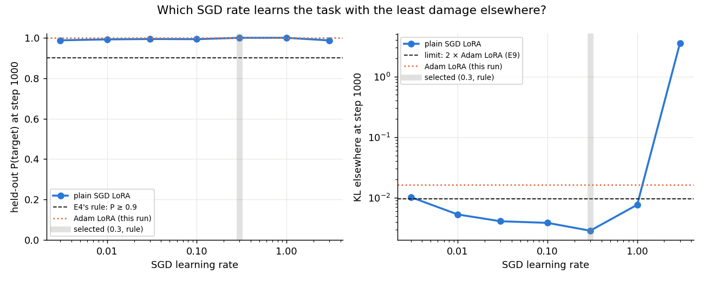
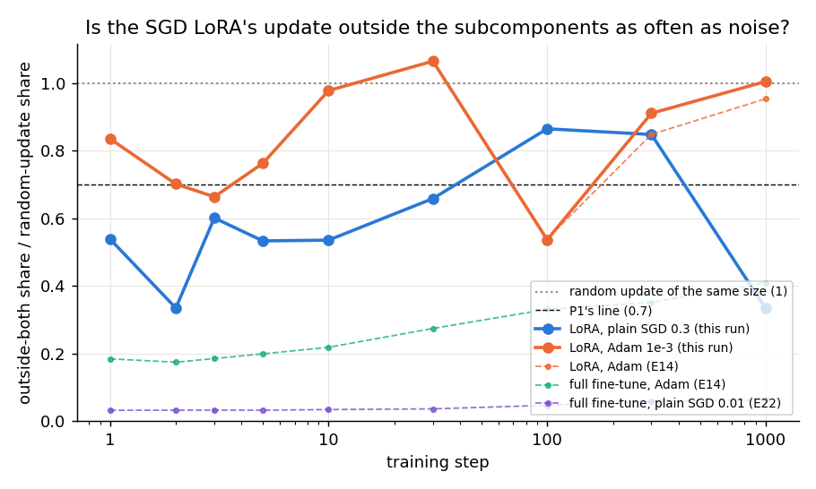
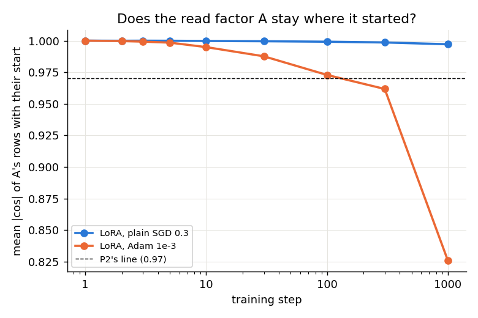
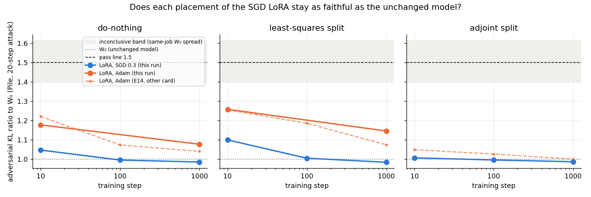

# Analysis: is the LoRA's "outside like noise" reading the LoRA's or Adam's? (E27)

*2026-10-22, E27 agent. Plan: `reports/2026-10-22_plan_commute-second-line.md`, Item C and the E27 agent note.
Predictions: `experiments/lora_sgd/results/predictions.json`, filed 13:15 before the run and scored as filed. Results:
`experiments/lora_sgd/results/lora_sgd.json`; figures in `experiments/lora_sgd/figures/`. Provenance at the end.*

We trained the same rank-8 LoRA on all 24 decomposed matrices with plain SGD instead of Adam and put it through the
split table and the faithfulness checks. The SGD LoRA sits outside the subcomponents less often than noise does.
It sits outside far more often than a full fine-tune, and it dips well below the Adam LoRA at two of five checkpoints. Every placement of it stays as
faithful as the unchanged model. So the LoRA's outside share comes mostly from its random read factor, not from Adam,
and no LoRA verdict so far is an optimiser artefact.

## What we were trying to test

Every LoRA in this project was trained with Adam. A LoRA writes its update as $\delta W = BA$, with $B$ starting at zero
and the read factor $A$ starting as a random matrix. Earlier runs found that the LoRA's update lies outside the
subcomponents' read and write directions about as often as a random update of the same size does. A full fine-tune lies
well inside. Two things could cause the LoRA's reading. The read factor $A$ could stay near its random start, so the
update reads its input along random directions. Or Adam could spread the update, since it rescales every coordinate
on its own. A plain SGD fine-tune is far more inside than an Adam one, so the second cause was a live possibility.

The model is the released VPD decomposition of the 67M model, with Γ and Δ frozen. The task is the emoticon task: the
model learns to answer a trigger with the letter o. Each of the 24 decomposed matrices is $W = UV^\top + \Delta$.

The run had four stages, each written to disk as it finished.

1. The unchanged model under the adversarial Pile check with three adversary seeds, to fix the noise floor.
2. The Adam LoRA regenerated with the old recipe, at learning rate 1e-3 and seed 0 for 1000 steps. It had to reproduce
   its earlier readings before anything else ran, which checks that the apparatus still reads the same on this card.
3. Plain SGD on the same LoRA at seven learning rates from 0.003 to 3, each for 1000 steps. The rule picks the rate
   that reaches a held-out target probability of 0.9 with the least damage elsewhere. Damage elsewhere is the KL
   divergence from the original model on the other positions. The limit was twice the old Adam LoRA's.
4. The selected SGD LoRA at nine checkpoints from step 1 to 1000, and three placements of it at steps 10, 100 and 1000.

The main number is the **outside-both ratio**. For each matrix, take the update's effect on the real inputs, $\|\delta W\,\Sigma^{1/2}\|^2$.
It is cut by whether its output lies in the span of the subcomponents' write directions.
It is cut again by whether its input is predictable from what the subcomponents read. "Outside both" is the share no first-order move
of the subcomponents can produce. Dividing by the same share for a random update gives a ratio that reads 1 for noise
and 0 for an update the subcomponents could produce entirely.

The three placements are **do-nothing**, where $\delta W$ lands in Δ, the **least-squares split**, which moves each
subcomponent by the least-norm $(dU, dV)$ with $dU V^\top + U dV^\top \approx \delta W$, and the scaled **adjoint
split**, which moves them by $c\,(\delta W V, \delta W^\top U)$ and leaves Δ untouched. Each placement is scored by the
adversarial Pile ratio to the unchanged model. It passes at or below $1.5/(1+f)$, where $f = 0.075$ is the unchanged
model's spread over adversary seeds in this job, so the pass line is 1.40.

## What we expected, and why

- The outside-both ratio would stay at or above 0.7 from step 10, near noise as for Adam. The reasoning: $A$ barely
  moves under either optimiser, so the update keeps reading along random directions.
- The read factor would stay within a few degrees of its start: mean $|\cos|$ with its start of at least 0.97 at step
  1000. Under SGD, $A$'s gradient is proportional to $B$, which starts at zero.
- The do-nothing and least-squares placements would pass at all three steps, as Adam's did.
- No direction was filed for the share of the update the least-squares split leaves in Δ. Adam's reads 0.54 at step 1000.

## What we observed

### Which SGD rate learns the task?

**Reading it.** Every rate from 0.003 to 3 learns the task by step 1000, and rate 0.3 does it with the least damage
elsewhere. Its held-out target probability is 0.9998 and its KL elsewhere 0.0029, below the old Adam LoRA's 0.0048.
The rule picked it without a fallback. Only rate 3 blows up, with KL elsewhere of 3.6. Rate 0.3 is also the fast one:
it reaches 0.99 by step 10, where 0.003 is at 0.02.

### Does the SGD LoRA sit outside the subcomponents like noise?

**Reading it.** Partly: the SGD LoRA sits between noise and a full fine-tune, nearer noise. Its ratio reads 0.54 at
step 10, rises to 0.87 at step 100, and drops to 0.33 at step 1000. The Adam LoRA in the same job reads 0.98 at step 10
and 1.01 at step 1000. The plain SGD full fine-tune reads 0.03 to 0.06 at every step, ten times lower. So swapping Adam
for SGD lowers the LoRA's ratio by about a factor of two at some steps, while swapping the LoRA for a full fine-tune
lowers it by a factor of ten. The filed rule, at least 0.7 at every step from 10, fails at three of five checkpoints.
The Adam LoRA's own series also dips, to 0.54 at step 100, so a single checkpoint below 0.7 says little. The drop at
step 1000 is the largest; the per-matrix rows that would show which matrices carry it were not saved.

### Does the read factor stay where it started?

**Reading it.** Yes. Under SGD the rows of $A$ keep a mean $|\cos|$ of 0.997 with their start at step 1000, so they
moved by about four degrees. Under Adam they reach 0.83 in this job. This fits the reading that a LoRA's outside share
comes from its read side staying random. It does not explain the SGD LoRA's lower ratio, which must come from where
$B$ writes, since $A$ moved even less than Adam's.

### Does each placement stay as faithful as the unchanged model?

**Reading it.** Yes, every placement passes at every step, and the SGD LoRA sits closer to the unchanged model than
the Adam one. Against a pass line of 1.40, the do-nothing placement reads between 0.99 and 1.05 at the three steps.
The least-squares split reads between 0.98 and 1.10. The Adam LoRA in the same job reads 1.18 and 1.26 at step 10.
The adjoint split leaves Δ unchanged to six decimals, as it must. It keeps less of the behaviour as training goes on:
the target probability falls from 0.56 to 0.20. The least-squares split leaves 0.37 of the update's energy in Δ at step
1000, against Adam's 0.54.

## What we learned

The LoRA's place beside noise in the split table is mostly the LoRA's own doing. Its read factor stays where it was
drawn under either optimiser, and the SGD LoRA stays about ten times further outside than an SGD full fine-tune. Adam
does push the LoRA further outside than SGD does, by up to a factor of two at some steps. That effect is on the write
factor, since the read factor barely moved. For the commute question, the earlier LoRA rows of the split table stand
as properties of the update type, with the caveat that their exact level depends on the optimiser. A LoRA trained with
either optimiser can be left in Δ or split without leaving the faithfulness floor.

## How compelling is the evidence

One training seed and one task. The outside-both ratio is pooled by update energy over the 20 matrices whose
subcomponents do not span a whole side, so a few matrices can move it. It swings between neighbouring checkpoints for
both optimisers, by up to 0.5 for SGD and 0.5 for Adam, which is larger than the gap between the two optimisers at most
steps. The faithfulness verdicts use the unchanged model's spread over three adversary seeds on this card, 0.075, and
a 20-step attack on Pile; that attack barely sees the trigger. The control that the block code reads 1 for random
updates held at every row, and the regenerated Adam LoRA reproduced its earlier readings at steps 10 and 1000.

## Surprises

- The SGD LoRA's outside-both ratio drops to 0.33 at step 1000, below every Adam LoRA reading, after reading 0.85 at
  step 300. I cannot say which matrices carry the drop; the per-matrix rows were not saved.
- The regenerated Adam LoRA matched the old one at step 10 but drifted by step 1000, though it passed every check
  filed for it. Its largest relative weight change is 0.12 against the old 0.09.
  Its read factor's $|\cos|$ with the start is 0.83 against 0.90, and its KL elsewhere 0.016 against 0.005. The rate rule's limit used the old 0.005; with this
  job's Adam value the same rate would be chosen, since 0.3 has the least KL of every rate.

## What next

- Save the per-matrix block rows of the SGD LoRA at steps 300 and 1000, a few minutes on any card, to see whether the
  drop to 0.33 is one or two matrices. If it is one matrix, the SGD/Adam gap is a pooling effect, not an optimiser one.
- A second training seed for both LoRAs. If the SGD series stays between 0.3 and 0.9 with Adam's near 1, the
  optimiser effect on the write factor is real; if the two overlap, there is no optimiser effect to explain.

## Scorecard

| id | claim | rule | read | verdict |
|---|---|---|---|---|
| C1 | the unchanged model reads its known values | `w0_check` | PGD 0.699, floor 0.075 | pass |
| G1 | the regenerated Adam LoRA reproduces E9/E14 | PGD ratios within 0.209 relative of 1.17/1.04 and 1.26/1.07; outside-both within 0.1 of 0.979 at step 10; P ≥ 0.99 at 1000 | 1.18/1.08, 1.26/1.15; 0.979; 0.9999 | pass |
| rate | E4's rule at step 1000 | P ≥ 0.9, KL ≤ 0.0095, least KL | 0.3: P 0.9998, KL 0.0029 | selected by the rule, not flagged |
| P1 | the SGD LoRA's update is outside like noise | outside-both ÷ null ≥ 0.7 at every checkpoint from 10 | 0.54, 0.66, 0.87, 0.85, 0.33 | miss, outcome "mixed" (no step below 0.3; 1000 at 0.33) |
| P2 | the read factor stays at its start | mean \|cos\| ≥ 0.97 at 1000 | 0.997 | pass |
| P3 | do-nothing and least-squares placements pass | all six `verdict` = pass | 1.05/1.00/0.99 and 1.10/1.01/0.98 | pass |
| P4 | Δ's share under least squares at 1000, SGD vs Adam | two-sided, ±0.1 | 0.37 vs 0.54 in-job (E14 0.54) | "lower" |
| C2 | random draws read 1 in the block code | 0.85–1.15 every row | all within | pass |
| C3 | the adjoint split keeps Δ | Δ change ≤ 0.01 | at most 2e-6 | pass |
| G2 | least-squares placement is the update at the trigger | P equal to 1e-3, shares sum to 1 | all five states | pass |

## Full tables

The series, pooled over the 20 non-saturated matrices.

| step | SGD outside-both ÷ null | Adam (this job) | SGD rescaling ÷ null | SGD \|cos\| of A | SGD P(target) | SGD KL elsewhere | SGD rel. change |
|---|---|---|---|---|---|---|---|
| 1 | 0.539 | 0.836 | 1.54 | 1.0000 | 0.406 | 0.017 | 0.015 |
| 2 | 0.335 | 0.702 | 2.17 | 0.9999 | 0.997 | 0.168 | 0.024 |
| 3 | 0.602 | 0.664 | 1.17 | 1.0000 | 0.665 | 0.009 | 0.020 |
| 5 | 0.534 | 0.763 | 1.20 | 0.9999 | 0.955 | 0.014 | 0.025 |
| 10 | 0.536 | 0.979 | 0.97 | 0.9998 | 0.993 | 0.012 | 0.032 |
| 30 | 0.659 | 1.066 | 0.91 | 0.9996 | 0.971 | 0.007 | 0.039 |
| 100 | 0.865 | 0.537 | 0.78 | 0.9992 | 0.992 | 0.004 | 0.038 |
| 300 | 0.849 | 0.911 | 0.77 | 0.9986 | 0.990 | 0.004 | 0.042 |
| 1000 | 0.333 | 1.005 | 1.21 | 0.9972 | 1.000 | 0.003 | 0.034 |

The placements: adversarial and stochastic Pile ratios to the unchanged model, held-out target probability, and the
share of $\|\delta W\|^2$ left in Δ.

| LoRA | step | placement | adversarial | stochastic | P(target) | Δ share | verdict |
|---|---|---|---|---|---|---|---|
| Adam | 10 | do-nothing | 1.177 | 1.009 | 0.999 | 1 | pass |
| Adam | 10 | least squares | 1.258 | 1.010 | 0.999 | 0.410 | pass |
| Adam | 1000 | do-nothing | 1.077 | 1.004 | 1.000 | 1 | pass |
| Adam | 1000 | least squares | 1.146 | 1.005 | 1.000 | 0.542 | pass |
| SGD 0.3 | 10 | do-nothing | 1.047 | 1.004 | 0.993 | 1 | pass |
| SGD 0.3 | 10 | least squares | 1.100 | 1.004 | 0.993 | 0.234 | pass |
| SGD 0.3 | 10 | adjoint | 1.007 | 1.001 | 0.558 | 0.000 | pass |
| SGD 0.3 | 100 | do-nothing | 0.996 | 1.001 | 0.991 | 1 | pass |
| SGD 0.3 | 100 | least squares | 1.005 | 1.000 | 0.991 | 0.256 | pass |
| SGD 0.3 | 100 | adjoint | 0.996 | 0.999 | 0.401 | 0.000 | pass |
| SGD 0.3 | 1000 | do-nothing | 0.985 | 1.003 | 1.000 | 1 | pass |
| SGD 0.3 | 1000 | least squares | 0.984 | 1.003 | 1.000 | 0.366 | pass |
| SGD 0.3 | 1000 | adjoint | 0.987 | 1.000 | 0.195 | 0.000 | pass |

The rate grid at step 1000.

| rate | P(target) | KL elsewhere | rel. change | P(target) at step 10 |
|---|---|---|---|---|
| 0.003 | 0.987 | 0.0102 | 0.021 | 0.016 |
| 0.01 | 0.992 | 0.0053 | 0.025 | 0.049 |
| 0.03 | 0.994 | 0.0041 | 0.031 | 0.644 |
| 0.1 | 0.993 | 0.0039 | 0.040 | 0.983 |
| 0.3 | 0.9998 | 0.0029 | 0.034 | 0.993 |
| 1 | 0.9998 | 0.0077 | 0.071 | 0.234 |
| 3 | 0.987 | 3.56 | 11.0 | 0.995 |

## Not run

- The per-matrix block rows: computed but not saved, so the step-1000 drop cannot be assigned to matrices.
- The Adam LoRA's placements at step 100 and its adjoint placements; E14's are on the figure from another card.
- A second training seed, another task, SGD with momentum, or another rank.
- The SGD LoRA's off-target damage beyond KL elsewhere, and any stronger adversary than the 20-step attack.

## Provenance

Results `experiments/lora_sgd/results/lora_sgd.json`, 1439 s of run, from the pod's final write at 13:03 UTC; the pod log
`results/large/pod_scored.log` ends with the same score. LoRA factors `results/large/factors_{adam,sgd}.pt`, log
`results/large/full.log`. RunPod secure cloud, NVIDIA H100 80GB HBM3, machine `11a4986f`; its notebook is
`remote-kernels/20261022-132446_lora_sgd_11a4986f_8d9b01e7.ipynb`. The pod-runner stopped on a usage limit before it
reported; the files were downloaded into a nested directory and moved into place by the E27 agent, and no commute pod
was alive at 15:05 (coordinator, runpodctl). Cost was not recorded; pod time was about 1 to 1.2 h at H100 secure rates,
roughly $3 to $4, inside the $8 cap. Predictions `results/predictions.json`, sha256 4a2175b4…, identical on the pod.
