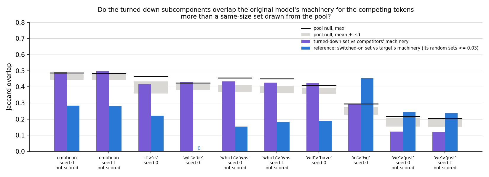
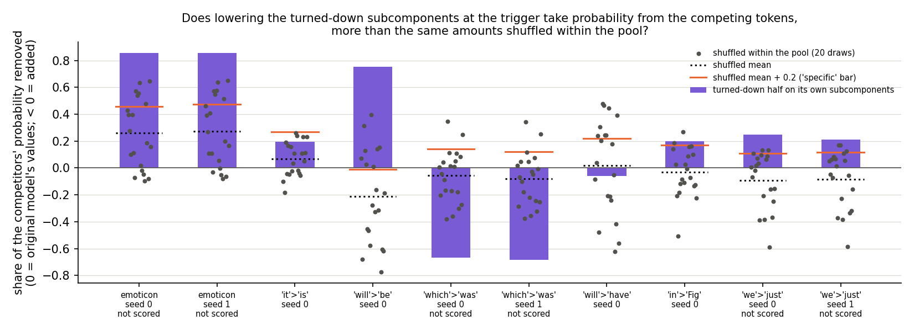

# Are the subcomponents a fine-tune turns down the original model's machinery for the competing tokens? (E29, analysis)

*2026-10-22, coding agent. Plan: `reports/2026-10-22_plan_regating-down.md`. Code: `experiments/regating_down/run.py`,
shared steps in `src/commute/turned_down.py`, figures from `plot.py`. Notebook: `notebooks/E29_regating_down.ipynb`.
Words as in `GOALS.md` → Terms.*

We took the subcomponents that a narrow fine-tune turns down at the trigger and read them at the original weights. They
overlap the original model's machinery for the task's competing tokens no more than random sets of the same size from
the subcomponents that were on. For `GOALS.md`, the turned-down half of the fixed change is not, as a rule, "switch off
the competitors". The working hypothesis gains no mechanism sentence from this run.

## The answer

No, not as a rule. The subcomponents a fine-tune turns down at the trigger are tested against the original model's
machinery for the competing tokens. They overlap it no more than a same-size set drawn from the subcomponents that
were on. Lowering them does take
most of the competitors' probability on two tasks, more than the same amounts placed elsewhere. On one task it pushes
probability toward the competitors instead. So "switch off the competitors" is not a general description of the
turned-down half, and the working hypothesis gains no mechanism sentence.

## What we were trying to test

**The setup.** A narrow fine-tune teaches the model to predict a target token after a trigger, such as ` be` after
` will`. The fine-tune's weight change δW goes into Δ, and Γ is frozen.
It then reads the updated model's activations and
changes the causal importance of existing subcomponents at the trigger. Earlier work found that one *fixed change* $s$
carries most of that effect. It is the updated model's importance values minus the original model's, averaged over the
training windows: one number per subcomponent, the same for every input. Its positive part switches subcomponents
on; its negative part $s^-$ turns subcomponents down. Shuffled among the subcomponents that were on, the turned-down
half gives back less than nothing. So which subcomponents it lowers matters; this run asks what they are.

**The sets.**
- The *pool*: alive subcomponents whose mean importance at the trigger under the original model, $m_0$, is at least
  0.1. Only these can be turned down.
- The *turned-down set*: pool members with $s \le -0.1$.
- The *switched-on set*: subcomponents with $s > 0.3$.
- The *competing tokens*: the five tokens of largest mean next-token probability at the trigger under the original
  model, on held-out windows, the target excluded. This definition is new in this run.
- The *machinery* for a token set: the subcomponents most important in Pile text just before one of those tokens,
  compared with all positions. We keep as many as the set it is compared with, from the pool for the
  competitors and from all alive subcomponents for the target.

**Two questions, both at the original weights.**
1. *Overlap.* The Jaccard overlap $J$ of the turned-down set with the competitors' machinery: 0 is no shared member, 1
   is identical. The null is 20 random sets of the same size per matrix drawn from the pool. Because the turned-down
   set fills half or more of the pool on some tasks, the null itself is high, 0.18 to 0.46. We therefore also read
   $\kappa = (J - \text{null mean}) / (1 - \text{null mean})$, the share of the way from chance to identical.
2. *Function.* At the trigger only, we replace Γ's values $g_0$ by $\mathrm{clip}(g_0 + s^-)$ and read the CI-masked
   model's probability on the five competitors. The *drop* is the share of the competitors'
   probability this removes. Zero means nothing moved and one means all of it is gone. Below zero, it rose. The comparison is the same values of
   $s^-$ shuffled within each matrix's pool, 20 draws. This asks whether the amounts need their own subcomponents to
   take mass from the competitors.

**The control, run first and alone.** The switched-on set's overlap with the target's machinery must reproduce E18's
three values on the seed-0 states. A failure would have stopped the job. With it, lowering the turned-down set must
raise the target as much as E18 found.

**The states.** E18's three tasks with two seeds each, and four new word tasks saved by E28 with one seed. Ten states
in all, seven tasks, one 67M model.

## What we expected, and why

We expected the turned-down set to be the competitors' machinery, with low to medium confidence. The turned-down half is
specific, and it is a real switch-off, not a sign flip. The obvious reading is that the update clears the way for the
target by turning off what predicts the alternatives. The worry was that it might be the model's generic machinery for
"a function word comes next" instead.

We expected lowering the set to take mass from the competitors, more than the shuffled amounts. Shuffled, the target
falls, so we expected the shuffled drop to sit at or below zero.

## What we observed

### Does the apparatus reproduce earlier work?

Yes, exactly. On the three seed-0 states, the switched-on set's overlap with the target's machinery equals E18's values
to four decimals. Lowering the turned-down set raised the target's log-odds by the same
share of the switching effect as E18 found, within 0.001 on all three. Every state's lowered pattern raised the target.

### Does the turned-down set overlap the competitors' machinery more than chance?

**Reading it.** No. The purple bars are the turned-down set's overlap with the competitors' machinery. Each sits at or
just above the grey band of random pool draws. At most it clears the black line, the largest of 20 draws, by a hair. The
share of the way from chance to identical is between −0.07 and 0.08 on every state. The filed bar for "the competitors'
machinery" was 0.15, and no state reaches it. The blue bars are the reference: the switched-on set against the target's
machinery reads 0.15 to 0.45, where random sets read at most 0.03. So the same contrast finds the target's machinery
in the switched-on set, and finds nothing special in the turned-down set. On the word task ` we`→` just` the
turned-down set overlaps the competitors' machinery less than random sets do.

| state | competitors, original model's mean probability | pool | turned down | $J$ | null mean | null sd | null max | κ | reading |
|---|---|---|---|---|---|---|---|---|---|
| emoticon `o`, seed 0 | `D` 0.170, `P` 0.125, `/` 0.056, `)` 0.053, `-)` 0.051 | 385 | 243 | 0.491 | 0.462 | 0.017 | 0.486 | 0.054 | not scored |
| emoticon `o`, seed 1 | as above | 385 | 242 | 0.499 | 0.460 | 0.019 | 0.485 | 0.071 | not scored |
| ` it`→` is` | ` was` 0.077, `'s` 0.053, `’` 0.050, `.` 0.040, `,` 0.026 | 203 | 112 | 0.418 | 0.397 | 0.037 | 0.464 | 0.035 | no better than the pool |
| ` will`→` be` | ` not` 0.040, ` have` 0.034, ` also` 0.016, ` need` 0.014, ` take` 0.013 | 225 | 136 | 0.432 | 0.399 | 0.018 | 0.424 | 0.054 | between |
| ` which`→` was`, seed 0 | ` is` 0.157, ` the` 0.057, ` are` 0.049, ` can` 0.026, ` has` 0.022 | 238 | 134 | 0.433 | 0.391 | 0.022 | 0.457 | 0.070 | not scored |
| ` which`→` was`, seed 1 | as above | 238 | 132 | 0.427 | 0.384 | 0.022 | 0.451 | 0.069 | not scored |
| ` will`→` have` | ` be` 0.253, ` not` 0.040, ` also` 0.016, ` need` 0.014, ` take` 0.013 | 225 | 124 | 0.425 | 0.375 | 0.020 | 0.409 | 0.080 | between |
| ` in`→` Fig` | ` the` 0.257, ` a` 0.037, ` this` 0.015, ` accordance` 0.010, ` order` 0.008 | 249 | 103 | 0.296 | 0.252 | 0.024 | 0.296 | 0.058 | no better than the pool |
| ` we`→` just`, seed 0 | ` have` 0.093, ` can` 0.063, ` are` 0.053, ` will` 0.035, ` were` 0.025 | 238 | 73 | 0.123 | 0.181 | 0.027 | 0.217 | −0.071 | not scored |
| ` we`→` just`, seed 1 | as above | 238 | 74 | 0.121 | 0.177 | 0.027 | 0.203 | −0.067 | not scored |

The crossed overlaps, reported and not scored. "Positions" counts the Pile positions whose next token is a competitor,
and those whose next token is the target. The switched-on set has its own size; its random sets read at most 0.024.

| state | switched on | positions, competitors | positions, target | turned-down vs target's machinery | switched-on vs competitors' machinery | switched-on vs target's machinery |
|---|---|---|---|---|---|---|
| emoticon, seed 0 | 210 | 3,597 | 209 | 0.002 | 0.046 | 0.284 |
| emoticon, seed 1 | 213 | 3,597 | 209 | 0.002 | 0.044 | 0.279 |
| ` it`→` is` | 33 | 21,036 | 1,959 | 0.058 | 0.082 | 0.222 |
| ` will`→` be` | 10 | 1,451 | 943 | 0.021 | 0.036 | 0.000 |
| ` which`→` was`, seed 0 | 56 | 11,730 | 916 | 0.050 | 0.073 | 0.155 |
| ` which`→` was`, seed 1 | 62 | 11,730 | 916 | 0.060 | 0.072 | 0.181 |
| ` will`→` have` | 41 | 1,901 | 493 | 0.051 | 0.107 | 0.188 |
| ` in`→` Fig` | 85 | 11,913 | 7 | 0.022 | 0.106 | 0.453 |
| ` we`→` just`, seed 0 | 23 | 2,474 | 109 | 0.021 | 0.067 | 0.243 |
| ` we`→` just`, seed 1 | 21 | 2,474 | 109 | 0.022 | 0.056 | 0.235 |

The turned-down set by layer. Most of it is in the last layer on every state.

| state | layer 0 | layer 1 | layer 2 | layer 3 |
|---|---|---|---|---|
| emoticon, seeds 0 / 1 | 45 / 47 | 15 / 14 | 58 / 58 | 125 / 123 |
| ` it`→` is` | 18 | 2 | 20 | 72 |
| ` will`→` be` | 15 | 6 | 23 | 92 |
| ` which`→` was`, seeds 0 / 1 | 30 / 27 | 5 / 5 | 18 / 17 | 81 / 83 |
| ` will`→` have` | 15 | 7 | 23 | 79 |
| ` in`→` Fig` | 11 | 7 | 22 | 63 |
| ` we`→` just`, seeds 0 / 1 | 10 / 11 | 4 / 4 | 11 / 13 | 48 / 46 |

### Does lowering the turned-down set take probability from the competitors?

**Reading it.** On some tasks, and on one it does the opposite. The purple bars are the share of the competitors'
probability removed by lowering the turned-down set at the trigger. The dotted black line is the same amounts shuffled
within the pool, and the orange line is the filed "specific" bar, 0.2 above it. On emoticon the lowering removes 86%
of the competitors' probability, against 26% shuffled. On ` will`→` be` it removes 76%, where the shuffled amounts add
21%. On ` we`→` just`, ` in`→` Fig` and ` it`→` is` it removes 20 to 25%. On ` which`→` was` it adds 67% to the
competitors' probability, and on ` will`→` have` 6%. The shuffled draws spread widely, from about −0.8 to 0.65.
So single draws say little, and the mean of the draws is the comparison.

| state | drop | shuffled mean | shuffled sd | difference | reading |
|---|---|---|---|---|---|
| emoticon, seed 0 | 0.858 | 0.259 | 0.263 | 0.599 | not scored |
| emoticon, seed 1 | 0.855 | 0.273 | 0.261 | 0.583 | not scored |
| ` it`→` is` | 0.196 | 0.069 | 0.130 | 0.127 | between |
| ` will`→` be` | 0.756 | −0.210 | 0.352 | 0.965 | switches off competitors specifically |
| ` which`→` was`, seed 0 | −0.666 | −0.057 | 0.196 | −0.609 | not scored |
| ` which`→` was`, seed 1 | −0.682 | −0.079 | 0.199 | −0.603 | not scored |
| ` will`→` have` | −0.058 | 0.018 | 0.355 | −0.076 | between |
| ` in`→` Fig` | 0.201 | −0.031 | 0.183 | 0.232 | switches off competitors specifically |
| ` we`→` just`, seed 0 | 0.246 | −0.092 | 0.211 | 0.338 | not scored |
| ` we`→` just`, seed 1 | 0.210 | −0.083 | 0.218 | 0.293 | not scored |

### Where does the probability go?

Reported, no figure. The table gives the CI-masked model's mean probability at the trigger on three groups: the target,
the five competitors, and everything else. Each is read under the original values and under the lowered pattern. On emoticon the competitors'
loss goes mostly to other tokens: they fall from 0.36 to 0.05, and the target gains only 0.03. On ` will`→` be` the
target takes it all and more: it rises from 0.26 to 0.88, and the other tokens fall by 0.54. On ` which`→` was` the
other tokens fall by 0.33, and the competitors and the target share it.

| state | target | competitors | rest | target log-odds gain, nats |
|---|---|---|---|---|
| emoticon, seed 0 | 0.004 → 0.032 | 0.361 → 0.051 | 0.634 → 0.917 | 1.91 |
| emoticon, seed 1 | 0.004 → 0.033 | 0.361 → 0.052 | 0.634 → 0.915 | 1.92 |
| ` it`→` is` | 0.194 → 0.435 | 0.258 → 0.207 | 0.548 → 0.357 | 1.49 |
| ` will`→` be` | 0.262 → 0.884 | 0.110 → 0.027 | 0.628 → 0.089 | 4.26 |
| ` which`→` was`, seed 0 | 0.034 → 0.112 | 0.379 → 0.631 | 0.587 → 0.256 | 1.26 |
| ` which`→` was`, seed 1 | 0.034 → 0.115 | 0.379 → 0.637 | 0.587 → 0.247 | 1.20 |
| ` will`→` have` | 0.036 → 0.261 | 0.336 → 0.355 | 0.628 → 0.384 | 2.28 |
| ` in`→` Fig` | 0.002 → 0.003 | 0.324 → 0.259 | 0.674 → 0.739 | 1.05 |
| ` we`→` just`, seed 0 | 0.003 → 0.010 | 0.263 → 0.198 | 0.734 → 0.792 | 1.37 |
| ` we`→` just`, seed 1 | 0.003 → 0.008 | 0.263 → 0.208 | 0.734 → 0.784 | 1.23 |

The lowered pattern's gain as a share of the switching effect, seed 0, against E18's value.

| task | this run | E18 |
|---|---|---|
| emoticon | 0.2379 | 0.2378 |
| ` which`→` was` | 0.1631 | 0.1624 |
| ` we`→` just` | 0.3869 | 0.3870 |

### Why six of the ten states are not scored

The filed rule scores a state only if its saved fixed change matches the mean importance computed in this job. The
test is that $s + m_0$, the updated model's mean importance implied by the saved change, is at least $-10^{-4}$ on
every alive subcomponent. On E18's six saved changes the lowest value is −0.0008 on emoticon.
It is −0.0005 on ` which`→` was` and −0.0002 on ` we`→` just`. E28's four saved changes read exactly 0. So all six E18 states read "not
scored" on both predictions, although both controls reproduced E18 on them. Their numbers are reported above and not
scored. By the same rules they would read "between" on overlap for emoticon and "no better than the pool" for the two
word tasks. On function they would read "specifically" for emoticon and ` we`→` just`, and "between" for
` which`→` was`.

## What we learned

The turned-down set is not the original model's machinery for the competing tokens, by this definition of machinery,
on any of the seven tasks. Its overlap is what any same-size draw from the subcomponents that were on would give.
Lowering it takes most of the competitors' probability on emoticon and ` will`→` be`, and a fifth on three word tasks.
On ` which`→` was` it moves probability toward the competitors. For the working hypothesis this is the plan's "mixed"
branch. The turned-down half's job is not "switch off the competitors" in general, and no mechanism sentence is added.

## How compelling is the evidence

- **The overlap null is strong; the overlap rule is narrow.** The random pool draws vary by 0.02 to 0.04. The same
  contrast finds the target's machinery in the switched-on set far above chance. But "machinery" is the
  next-token Pile contrast, which E6 found weak. A different definition could find structure this one misses.
- **The competitor definition decides every number.** The original model's five most likely tokens may include ones
  the fine-tune never fought, such as ` the` for ` in`→` Fig`. The fine-tune's own losers
  were not tried.
- **Seeds agree.** The two seeds of each E18 task agree within 0.01 on overlap and within 0.04 on the drop.
- **Function is read at the trigger only,** with Γ's values elsewhere unchanged, on held-out windows, at the original
  weights, on one 67M model.
- **The shuffled draws spread widely,** with a standard deviation of 0.13 to 0.36. The filed 0.2 bar on the difference
  is about one draw's spread, but five times the spread of a 20-draw mean.
- **Six of ten states are formally unscored** because of a matching tolerance of $10^{-4}$, though their controls
  reproduce E18 to three decimals.

## Surprises

- **Lowering the turned-down set on ` which`→` was` adds two thirds to the competitors' probability,** on both seeds.
  We expected a drop. The top competitor there is ` is`, the present tense of the target ` was`. The run does not say
  why, and the filed rule reads it as "between", so the rule cannot tell this reversal from a weak effect.
- **On ` will`→` be` the switched-on set shares no member with the target's machinery.** None of its ten
  subcomponents is among the ten with the largest Pile contrast for ` be`. Its overlap with the target's machinery is exactly 0, while the lowered pattern gives the
  largest target gain in the run.
- **` will`→` be` and ` will`→` have` share the trigger and four of five competitors;** each target is the other's
  competitor. Yet lowering removes 76% of the competitors' probability on the first and adds 6% on the second.
- **The six E18 states were unscored** by a tolerance their controls show to be harmless.

## What next

1. **The fine-tune's own losers as competitors.** Take the five tokens whose probability the fine-tune lowers most at
   the trigger. If their machinery overlaps the turned-down set above the pool, the mechanism sentence comes back.
   If not, the turned-down half is generic for this model.
2. **Why ` which`→` was` pushes toward its competitors.** Read the per-competitor change under the lowered pattern. If
   all of it goes to ` is`, lowering clears a shared tense machinery rather than one token's.
3. **Nothing changes in the main line.** The plan's tree says "mixed: report, no action". The next main-line step is
   faithfulness under Γ's switching, or the same reads on the larger model.

## Scorecard

Filed in `experiments/regating_down/results/predictions.json` before the run; scored on the four E28 states only.

| id | claim in words | rule | read | verdict |
|---|---|---|---|---|
| control | the switched-on set's overlap with the target's machinery reproduces E18 on seed 0 | within 0.02 of 0.2844, 0.1546, 0.2432 | 0.2844, 0.1546, 0.2432 | pass |
| control | lowering the turned-down set reproduces E18's gain on seed 0 | within 0.02 of 0.238, 0.162, 0.387 | 0.238, 0.163, 0.387 | pass |
| P1_overlap | the turned-down set is the competitors' machinery on most states | $J$ > null max and κ ≥ 0.15; $J$ ≤ null max reads pool | ` it`→` is` pool, ` will`→` be` between, ` will`→` have` between, ` in`→` Fig` pool | **fail**: no state reads the competitors' machinery |
| P2_function | lowering it removes competitors' probability specifically on most states | difference ≥ 0.2 with drop > 0; within ±0.05 generic | ` will`→` be` specific, ` in`→` Fig` specific, ` it`→` is` between, ` will`→` have` between | **mixed**: two of four specific |
| scorable | the saved change matches the in-job mean importance | $\min(s + m_0) \ge -10^{-4}$ on alive | E18 states −0.0008 to −0.0002; E28 states 0 | six E18 states unscored |

## Not run

- The switched-on half's function at the original weights; that is the recovery already measured.
- The key-value tasks: each window has its own target, so "competitors" needs another definition.
- Other competitor definitions, such as the fine-tune's own losers, or another count than five.
- Positions other than the trigger, and Pile text away from it.
- A per-competitor breakdown of the moved probability.
- The larger model.

## Provenance

- Results: `experiments/regating_down/results/regating_down.json`, log `results/large/full.log`; predictions
  `results/predictions.json`, filed 2026-10-22 13:22 before the run. Figures `experiments/regating_down/figures/
  {overlap,function}.png`.
- `plot.py` changed after the run, labels only. Titles are questions and tasks are named by their words. The shuffled
  mean is drawn and the zero line is explained on the axis. No number changed.
- Run: RunPod RTX 4090 Secure at $0.89/h, machine 01M5HSJZ32NQ3GAV8EM4A5BR4A reused from E28; the run took 99 s,
  about $0.04; pod terminated.
- sha256: `regating_down.json` 8200edfcc4482c5f873463117777ba01b3a4546d56b6cfd32d47d7740f43d51a, `full.log`
  18e55c3a70dbf23397b287ed50771c2d91a70050a2ed359aea8d63608d16bddf.

Hand-off: a new session takes the main line's next step from `reports/2026-10-22_decision_working-hypothesis-and-two-lines.md`, with this report's "What next" item 1 as an optional side read.
