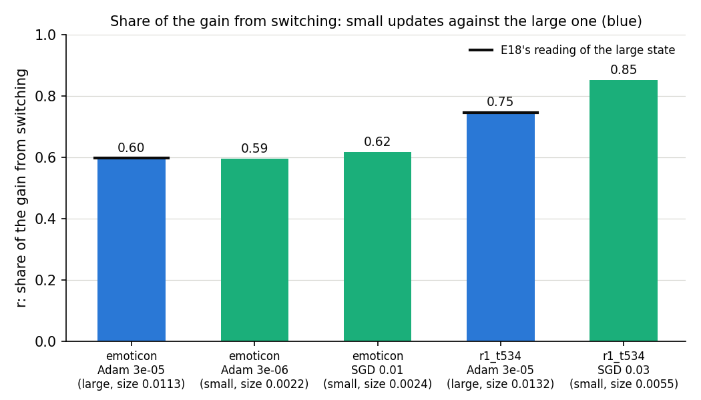
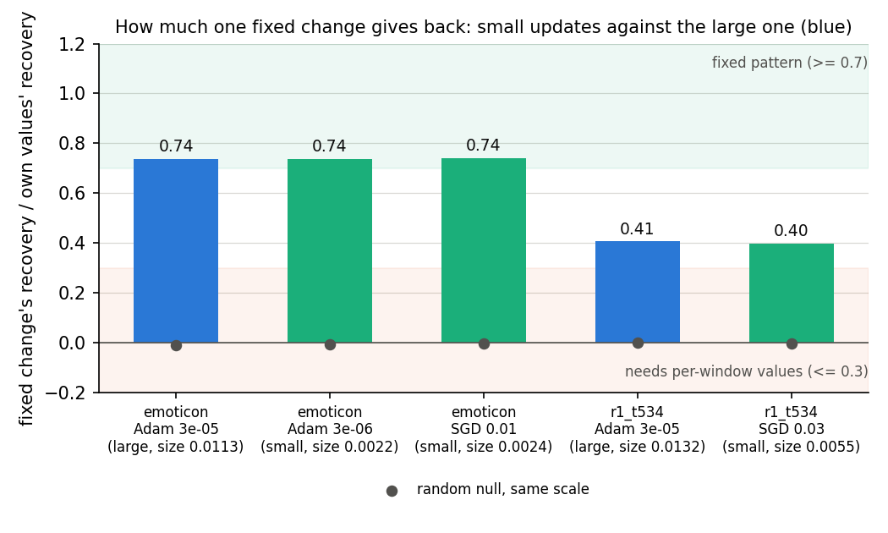
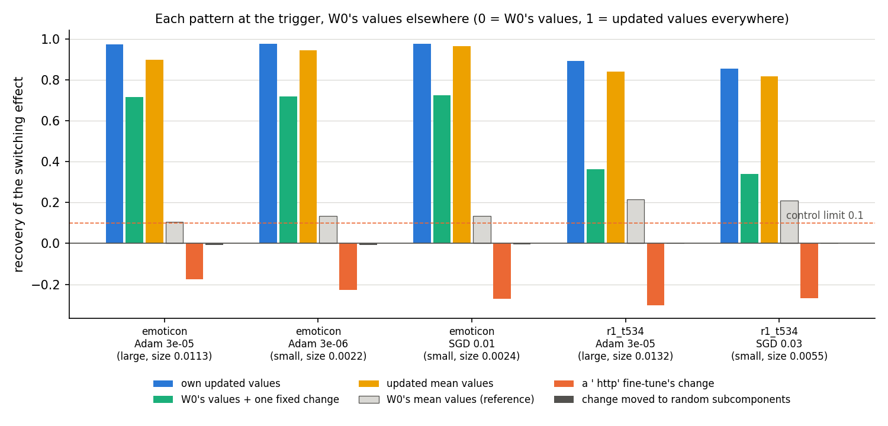

# Does one fixed change of importance values carry a small update's behaviour too? (E24, analysis)

*2026-10-22, coding agent. Plan: `reports/2026-10-22_plan_small-update-reruns.md` → E24 and its Agent notes; the
definitions are E18's (`reports/2026-10-21_plan_regating-leak.md`). Code: `experiments/regating_small/run.py`, shared
steps in `src/commute/regating.py`, figures from `plot.py`. Words as in `GOALS.md` → Terms.*

We repeated E18's test on two small emoticon fine-tunes, one by plain SGD and one by Adam at a tenth of the usual rate.
Both behave exactly like the large fine-tune: Γ switching subcomponents on carries the same share of the gain, and one
fixed change of Γ's values gives back the same 0.74 of the effect. For `GOALS.md`, the fixed-pattern reading of E18 is
not a large-update artefact on this task.

## The answer

Yes, as much as for the large update, on the emoticon task. Two small fine-tunes, about a fifth of the large one's
size, get about 60% of their gain from Γ switching existing subcomponents on, the same share as the large one. One
fixed change of Γ's values, added to the original model's values for every input, gives back three quarters of that
effect for all three. On a word task with varied contexts the fixed change gives back 0.40 for a smaller SGD update,
again equal to the large one there.

## What we were trying to test

**The setup.** A fine-tune changes the weights by δW. In the *do-nothing* state δW goes into Δ and the subcomponents
stay as released. The importance function Γ is frozen but reads the updated model's activations, so it switches some
existing subcomponents on at the trigger. The *switching effect* is the rise in the CI-masked model's target log-odds
at the trigger when Γ reads the updated model instead of the original; Δ is left out of the masked model. Its share
of the fine-tune's whole gain is $r$: 0 means switching does nothing, 1 means it gives the whole gain.

**The worry, from E18.** E18 found $r$ near 0.6 on emoticon and asked whether the switching is one fixed pattern, the
same for every input, or whether each input's own values carry input-specific information from the updated model.
It read this on the large Adam fine-tune only. The scope review of 2026-10-22 noted that the small fine-tunes of E21
pass the adversarial checks the large one fails, so the mechanism reading had never been read on an update that stays
faithful.

**The test.** At the trigger position only, Γ's values are replaced by a test pattern; everywhere else the original
model's values stay. *Recovery* is the share of the switching effect the pattern gives back: 0 is the original
model's values, 1 is the updated model's values at every position. The patterns:

- **Own values**: each input's updated values. The ceiling for anything placed at the trigger.
- **Fixed change**: each input's original values plus one change per matrix, the mean over the training windows of
  updated minus original values, clipped to the range 0 to 1. It holds no input-specific information from the
  updated model. The scored number is its recovery divided by the own values' recovery.
- **Mean values**: the updated model's mean values over the training windows, the same for every input. Its reference
  is the original model's mean values, which is not 0.
- **Different target**: the fixed change of a fine-tune to ` http`, by the same optimiser and rate. It rules out that
  any change of this size raises the target.
- **Random set**: the fixed change's values on its strongly switched-on subcomponents moved to a random set of the same
  size per matrix, twenty draws. It rules out that switching on that many subcomponents helps, whichever they are.

**States.** Ten-step fine-tunes of all 24 decomposed matrices, seed 0, on emoticon: Adam at rate 3e-5, the large one
of E14 to E18, size 0.0113; SGD at 0.01, size 0.0024; Adam at 3e-6, size 0.0022. Size is the largest relative change
of a matrix. The two small ones are E21's matched pair. The word task `r1_t534_v369` asks for ` was` after ` which` in varied Pile contexts. There E4's rate rule picked SGD at
0.03 from five rates. Its size is 0.0055, half the large one's 0.0132, so it is only moderately small. All read on 73 or 100 held-out windows.

## What we expected, and why

- The share $r$ of the small updates should match the large one's within 0.1. E21 had already read 0.62 and 0.59 for
  them, so this was close to a reproduction.
- The fixed change was filed two-sided. If the fixed pattern is the mechanism, it should give back at least 0.7 of the
  own values' recovery, as for the large update. If a small update's behaviour needs each input's own values, it
  should give back 0.3 or less. The lean was the first, with medium-low confidence: the large state sat just over
  the bar, at 0.73 in E18.
- On the word task the small SGD state should read like its large twin, which E18 put between the bars at 0.41.
- The different target's change should give back at most 0.1 everywhere, as in E18.

## What we observed

### Does the apparatus reproduce E18?

Yes. The regenerated large emoticon state read $r$ 0.597 against E18's 0.597, and its own-values, fixed-change and
mean-values recoveries within 0.002 of E18's. On the word task the large state matched E18 within 0.001. The original
model's values, fed through the pattern builders, gave back exactly 0. The small states reproduced E21's held-out
probability of the target and $r$ within 0.001. Everything ran on a single 4090 in one job.

### Do small updates get as much of their gain from switching?

**Reading it.** Yes. The blue bar is the large emoticon state at 0.60, on E18's line. The two small emoticon states
read 0.59 and 0.62. On the word task the small SGD state reads 0.85, above the large one's 0.75. So switching
carries at least as much of a small update's gain as of a large one's. The word-task difference was not predicted; it
is one seed.

### Does one fixed change give back as much for a small update?

**Reading it.** Yes, to two decimals. On emoticon the fixed change gives back 0.74 of the own values' recovery for the
large state and for both small ones, inside the filed "fixed pattern" region. On the word task it gives back 0.41 for
the large state and 0.40 for the small SGD state, between the two filed regions, as E18 found for the large one. The
grey dots, the random sets, sit at 0 on every state, so which subcomponents receive the change matters for small
updates too. The update's size moves neither number.

### Do the controls separate patterns?

**Reading it.** Yes. The orange bars, a ` http` fine-tune's change at the same trigger, give back −0.17 to −0.30 on
all five states: a wrong target's change lowers this target. Each null fine-tune learned its target, with held-out
probability 0.77 to 1.00. The own values give back 0.85 to 0.98, so nearly all the effect sits at the trigger. The
mean values give back 0.82 to 0.96 against their reference of 0.10 to 0.21, the same picture as E18.

The switched-on set, subcomponents whose fixed change exceeds 0.3, is smaller for the small updates: 154 and 170 on
emoticon against 210. It overlaps the large state's set with Jaccard 0.70 and 0.77. Its overlap with the subcomponents
the original model switches on before the target in Pile text is 0.27 against 0.28 for the large state, with a
random set at 0.002 to 0.006.

## What we learned

The fixed-pattern reading of the switching effect does not depend on the update's size or optimiser on these two
tasks. A small SGD or Adam update, which stays adversarially faithful, switches on mostly the same existing
subcomponents as the large one, and one fixed change carries the same three quarters of the effect. Whatever E18
concluded about the large update, mechanism on emoticon and between the bars on the word task, holds unchanged for the
updates that pass. The scope review's row 11 moves from "untested beyond" to "holds for small updates on two tasks".

## How compelling is the evidence

Strong for what it measures, narrow in scope. The readings are deterministic given the state, and E18's two seeds
differed by 0.02 at most; the small states differ from the large by under 0.01. One training seed per state, two
tasks, held-out trigger windows only. The test is blind to anything off the trigger position and to the Pile. It
also assumes that adding one change to each input's original values is the right model of a fixed pattern. E18's
amendments found that the original model's input-to-input variation lowers that number on the word tasks. That
finding was not re-read here. The word task's small update is only half the large one's size.

## Surprises

None against the filed predictions. Not predicted: on the word task the small SGD update gets more of its gain from
switching, 0.85 against 0.75. One state; not followed up.

## What next

1. E18's amendments 3 and 4, the remainder and donor tests that H can fail, on the small states: the scope review's
   claim is now that the small updates read like the large one, so this is only worth running if H's status changes.
2. A second seed of the word-task SGD state, if the 0.85 against 0.75 difference in the switching share matters for
   the larger-model plan.

## Scorecard

| id | claim | rule | read | verdict |
|---|---|---|---|---|
| G1 | large emoticon state reproduces E18 | r within 0.05, recoveries within 0.02, W₀'s values 0 | r diff −0.0007; recoveries ≤ 0.002; 0 exactly | pass |
| G2 | small states reproduce E21 | P(o) within 0.01, r within 0.05 | ≤ 0.0006 both | pass |
| G3 | large word-task state reproduces E18 | r within 0.1, recoveries within 0.02 | ≤ 0.001 | pass |
| P1 | small states' switching share as the large one's | \|r_small − r_large\| ≤ 0.1 | 0.616, 0.595 vs 0.596 | pass |
| P2 | a fixed change carries the small updates' effect | fixed change ÷ own values ≥ 0.7, random ≤ 0.1, both | 0.741, 0.737; random −0.004, −0.007 | pass |
| P2x | word-task small state reads as its large twin | same reading | 0.397 vs 0.407, both "between" | pass |
| C | wrong-target change gives back ≤ 0.1 | every state, null learned | −0.17 to −0.30, nulls 0.77–1.00 | pass |

Word-task SGD rate grid at step 10; the rule needs P ≥ 0.9 and KL elsewhere ≤ 0.243, and picks 0.03:

| rate | 0.001 | 0.003 | 0.01 | 0.03 | 0.1 |
|---|---|---|---|---|---|
| held-out P(` was`) | 0.05 | 0.15 | 0.84 | 0.97 | 0.99 |
| KL elsewhere | 0.004 | 0.038 | 0.227 | 0.145 | 0.222 |

Full table, recoveries as shares of the switching effect:

| state | size | r | own | fixed | mean | mean ref | wrong target | random | switched-on |
|---|---|---|---|---|---|---|---|---|---|
| emoticon Adam 3e-5 | 0.0113 | 0.597 | 0.973 | 0.717 | 0.897 | 0.105 | −0.174 | −0.008 | 210 |
| emoticon SGD 0.01 | 0.0024 | 0.616 | 0.977 | 0.724 | 0.965 | 0.135 | −0.271 | −0.004 | 154 |
| emoticon Adam 3e-6 | 0.0022 | 0.595 | 0.976 | 0.719 | 0.945 | 0.133 | −0.226 | −0.007 | 170 |
| r1_t534 Adam 3e-5 | 0.0132 | 0.746 | 0.891 | 0.362 | 0.840 | 0.215 | −0.301 | −0.001 | 56 |
| r1_t534 SGD 0.03 | 0.0055 | 0.850 | 0.853 | 0.338 | 0.817 | 0.209 | −0.267 | −0.001 | 55 |

## Not run

- E18's amendments 1 to 4 on the small states: the clip and variation split, the whole-change shuffle, the remainder and the donor tests.
- A second training seed of any state; `r2_t359_v816`; the Pile adversary's turned-down share.
- A word-task small update as small as the emoticon ones: E4's rule picked 0.03, half the large size.

## Provenance

- Results: `experiments/regating_small/results/regating_small.json`, log `results/large/full.log`, saved fixed changes
  `results/large/*_shift.pt`; predictions `results/predictions.json`, filed before the run.
- Run: RunPod pod 01M5HPDY7YTB5W96RBEA4HEJC7, RTX 4090 Secure at $0.89/h, about 14 min up, about $0.20; the run itself
  143 s. Cluster debug job 29308 waited 10 min without starting and was cancelled.
- sha256: `regating_small.json` 73b32bfc313f4d5751350d3a7e260eb9ae6ae8696b32d3d9419d8404ee456f29, `full.log`
  952c68b50bf774c43caead6c14540b493edfeb0838537fe4ba346b9693cd3001; inputs alive.pt 49746222…, windows.pt c19a880c…,
  windows_r1_t534_v369.pt e38bc9b9…, identical on pod and laptop.
