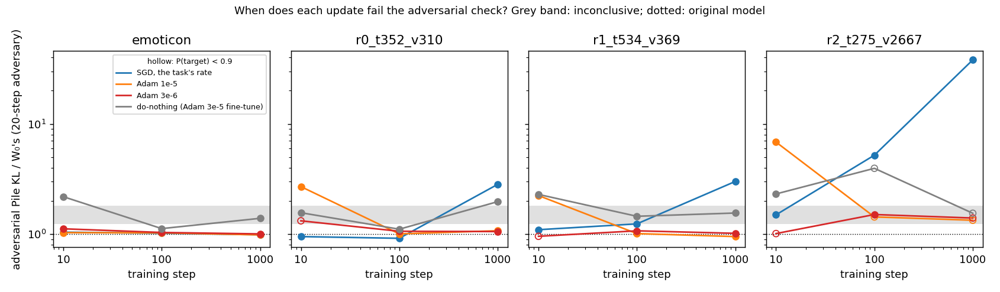
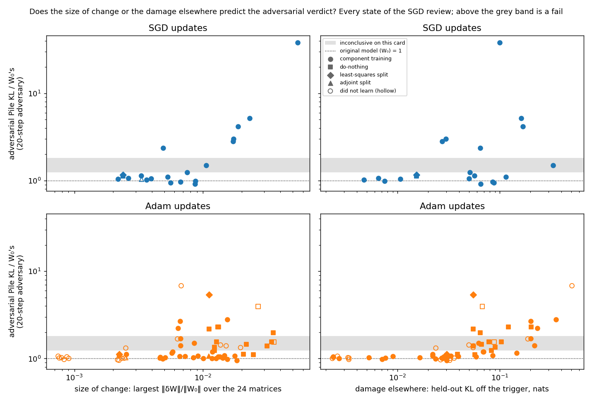
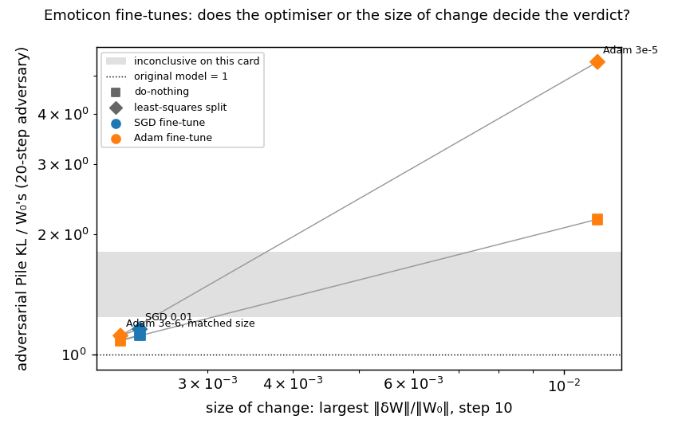
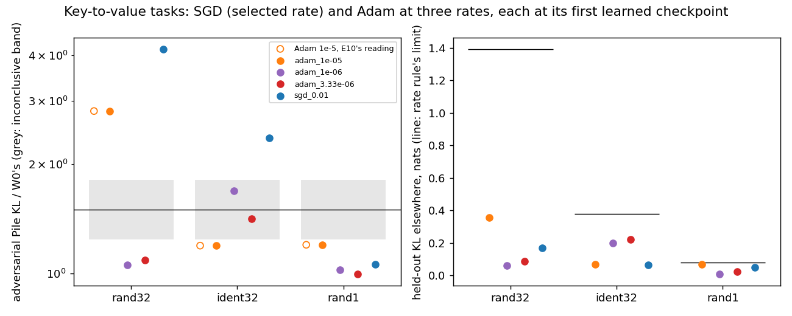
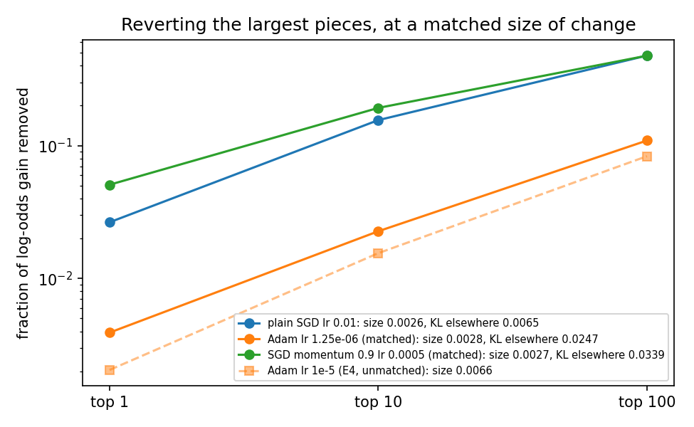

# Analysis: does SGD or Adam decide which updates stay adversarially faithful? Neither alone (E21)

*2026-10-22, writing agent. Brief: `reports/2026-10-21_plan_sgd-analysis-handoff.md`, with its "Verification against
the JSONs" section taking precedence over the text above it. Experiments: `experiments/sgd_faith`, `sgd_matched`,
`sgd_finetune`, `sgd_ladder`, `sgd_ladder_long`, `sgd_kv`, all run 2026-10-21 on the MATS cluster's L40. Every number
below was re-read from the result JSONs. Figures come from `plot.py` in the experiment directories and read JSON only.
Vocabulary: `GOALS.md` → Terms. No GPU job was run for this report.*

**In plain words.** We trained small changes into the decomposition with SGD and with Adam, on several tasks and for
several lengths of training, and ran the project's adversarial test on each. Adam failed only while it was still
damaging the model's other predictions, and SGD failed once its change grew large, even where Adam passed at the same
size. For `GOALS.md`, the failures that the current claim rests on look like properties of particular updates, not of
the maps.

> **Read every verdict below as a fixed-budget reading.** The adversarial test searches for the worst mask for twenty
> steps and stops. Yesterday's longer search showed that this search is nowhere near its maximum. At the original
> model it finds 0.66 nats of damage after twenty steps. After a hundred steps it finds about 14, and is still rising.
> The source is `reports/2026-10-21_analysis_cancellation-complement.md` → Amendment 2. So a "pass" here means one
> short search found about as much damage on the updated model as on the original. A "fail" means it found much more.
> Whether any verdict survives a longer search has not been measured. The VPD paper reports the same rise with steps
> and reads its own faithfulness at a fixed short budget: `reports/2026-10-22_review_vpd-adversary-convergence.md`.

## The answer

Neither the optimiser nor the size of change decides the verdict on its own. Adam's component training failed only
while it was still damaging the model's other predictions. Once that damage faded, the same runs passed, even as the
change kept growing. For SGD's component training, the verdict followed the size of change. Small
changes passed and large ones failed, including where Adam passed at the same size. Small fine-tunes passed whichever optimiser made
them. All of this is one seed and a short adversary.

## What we were trying to test

The project's current claim says that no map with Γ frozen keeps the decomposition adversarially faithful. Its
component-training evidence came from Adam at one rate, picked on the emoticon task, after an earlier run wrongly
concluded that SGD never learns cleanly. Six runs asked whether those failures belong to Adam, to its rate, or to the
maps themselves.

The model is the released 67M Pile model with its VPD decomposition. Γ and Δ stay frozen in every run. Each task
teaches the model to put a chosen target token after a trigger:

- **emoticon**, the easiest, where every earlier map already passed;
- **three ladder tasks** from an earlier experiment. Two have common target tokens and are called r0 and r1 below. One
  has a rare target and is called r2. Adam at 1e-5 had failed all three;
- **three key-to-value tasks**: one key mapped to one value, 32 keys mapped to themselves, and 32 keys mapped to random
  values. The last is a behaviour the model lacks, and Adam at 1e-5 failed it.

Three kinds of update were scored. Component training trains the alive subcomponents' read and write vectors with the
optimiser. A full fine-tune was either left entirely in Δ, the do-nothing reference, or written onto the subcomponents
by the least-squares split or the scaled adjoint split. The arms were plain SGD at a rate chosen per task by the
project's rule and Adam at the old rate of 1e-5. Beside them ran Adam at a third or a tenth of that rate, and, on
emoticon, SGD with momentum.

Each state got three numbers.

- **The adversarial ratio.** The adversarial-mask KL on 256 Pile rows, divided by the same at the original model in
  the same job. The original reads 1. The original's own spread over three adversary seeds is 0.21. So a ratio up to 1.24
  is a pass and one of 1.81 or more a fail. Anything between is inconclusive on this card.
- **Size of change.** The largest relative weight change over the 24 matrices, $\max_k \|\delta W_k\| / \|W_{0,k}\|$.
  The original reads 0.
- **Damage elsewhere.** The KL in nats between the updated and original models' predictions at every held-out position
  except the trigger. The original reads 0.

A state also has to have learned the task: the held-out probability of the target reaches 0.9 on the ladder and
emoticon. The key-to-value runs filed a line of 0.5.

## What we expected, and why

- **SGD keeps the step-10 passes at steps 100 and 1000.** No direction was filed. A pass would have met the condition
  under which the commute question returns to first place.
- **Lower-rate Adam learns the failing tasks and passes.** If so, Adam's failures are its step size, not the optimiser.
- **SGD does less damage elsewhere than Adam at 1e-5.** Its step-10 change was smaller on emoticon.
- **A small SGD fine-tune's least-squares split still fails.** Adam's fails at 5.41, and the split had failed on every
  fine-tune so far.
- **At a matched size, Adam's change is still more spread out than SGD's.** Adam rescales every coordinate
  separately, so its change spreads onto directions the gradient barely touches.

## What we observed

### 1. Does the verdict depend on how long the update trains?

**Reading it.** Yes, and the two optimisers move in opposite directions. On r0 and r1, Adam at 1e-5 fails at step 10
and passes at steps 100 and 1000. SGD passes at steps 10 and 100 and fails at step 1000. On emoticon every component
training passes at every step. On the rare-target task r2 nothing passes cleanly. SGD fails at steps 100 and 1000, and
Adam mostly loses its hold on the target. The do-nothing reference traces a U. It fails or is inconclusive at step 10,
passes on emoticon and r0 at step 100, and drifts back up by step 1000. SGD on r1 at step 100 reads 1.237,
just under the 1.24 line.

| task | update | step | adversarial ratio | verdict | P(target) | damage elsewhere | size of change |
|---|---|---|---|---|---|---|---|
| emoticon | SGD 0.01 | 10 | 1.04 | pass | 0.98 | 0.011 | 0.0022 |
| emoticon | SGD 0.01 | 100 | 1.02 | pass | 0.99 | 0.005 | 0.0036 |
| emoticon | SGD 0.01 | 1000 | 0.99 | pass | 1.00 | 0.007 | 0.0088 |
| emoticon | Adam 1e-5 | 10 | 1.03 | pass | 1.00 | 0.017 | 0.0051 |
| emoticon | Adam 1e-5 | 100 | 1.03 | pass | 0.99 | 0.005 | 0.0084 |
| emoticon | Adam 1e-5 | 1000 | 0.98 | pass | 1.00 | 0.007 | 0.0155 |
| emoticon | Adam 3e-6 | 10 | 1.12 | pass | 0.95 | 0.022 | 0.0025 |
| emoticon | Adam 3e-6 | 100 | 1.03 | pass | 0.99 | 0.002 | 0.0047 |
| emoticon | Adam 3e-6 | 1000 | 1.00 | pass | 0.99 | 0.003 | 0.0100 |
| emoticon | do-nothing, Adam 3e-5 fine-tune | 10 | 2.18 | fail | 1.00 | 0.055 | 0.0112 |
| emoticon | do-nothing, Adam 3e-5 fine-tune | 100 | 1.12 | pass | 1.00 | 0.039 | 0.0206 |
| emoticon | do-nothing, Adam 3e-5 fine-tune | 1000 | 1.39 | inconclusive | 1.00 | 0.055 | 0.0315 |
| r0 | SGD 0.03 | 10 | 0.95 | pass | 0.94 | 0.087 | 0.0056 |
| r0 | SGD 0.03 | 100 | 0.92 | pass | 0.98 | 0.065 | 0.0087 |
| r0 | SGD 0.03 | 1000 | 2.82 | fail | 0.96 | 0.027 | 0.0171 |
| r0 | Adam 1e-5 | 10 | 2.70 | fail | 0.96 | 0.201 | 0.0066 |
| r0 | Adam 1e-5 | 100 | 1.00 | pass | 0.95 | 0.030 | 0.0118 |
| r0 | Adam 1e-5 | 1000 | 1.07 | pass | 0.92 | 0.022 | 0.0177 |
| r0 | Adam 3e-6 | 10 | 1.32 | did not learn | 0.43 | 0.024 | 0.0025 |
| r0 | Adam 3e-6 | 100 | 1.06 | pass | 0.95 | 0.039 | 0.0073 |
| r0 | Adam 3e-6 | 1000 | 1.05 | pass | 0.91 | 0.029 | 0.0131 |
| r0 | do-nothing, Adam 3e-5 fine-tune | 10 | 1.56 | inconclusive | 0.97 | 0.104 | 0.0127 |
| r0 | do-nothing, Adam 3e-5 fine-tune | 100 | 1.11 | pass | 0.96 | 0.057 | 0.0246 |
| r0 | do-nothing, Adam 3e-5 fine-tune | 1000 | 1.97 | fail | 0.95 | 0.065 | 0.0352 |
| r1 | SGD 0.03 | 10 | 1.10 | pass | 0.98 | 0.115 | 0.0053 |
| r1 | SGD 0.03 | 100 | 1.237 | pass, near the line | 0.99 | 0.051 | 0.0075 |
| r1 | SGD 0.03 | 1000 | 3.00 | fail | 0.92 | 0.030 | 0.0172 |
| r1 | Adam 1e-5 | 10 | 2.24 | fail | 0.98 | 0.233 | 0.0064 |
| r1 | Adam 1e-5 | 100 | 1.01 | pass | 0.99 | 0.028 | 0.0127 |
| r1 | Adam 1e-5 | 1000 | 0.95 | pass | 0.99 | 0.030 | 0.0184 |
| r1 | Adam 3e-6 | 10 | 0.95 | did not learn | 0.24 | 0.032 | 0.0022 |
| r1 | Adam 3e-6 | 100 | 1.07 | pass | 0.99 | 0.033 | 0.0092 |
| r1 | Adam 3e-6 | 1000 | 1.02 | pass | 0.99 | 0.027 | 0.0142 |
| r1 | do-nothing, Adam 3e-5 fine-tune | 10 | 2.29 | fail | 0.99 | 0.122 | 0.0132 |
| r1 | do-nothing, Adam 3e-5 fine-tune | 100 | 1.45 | inconclusive | 1.00 | 0.066 | 0.0218 |
| r1 | do-nothing, Adam 3e-5 fine-tune | 1000 | 1.55 | inconclusive | 0.99 | 0.078 | 0.0342 |
| r2 | SGD 0.1 | 10 | 1.50 | inconclusive | 1.00 | 0.332 | 0.0106 |
| r2 | SGD 0.1 | 100 | 5.20 | fail | 0.93 | 0.162 | 0.0231 |
| r2 | SGD 0.1 | 1000 | 38.03 | fail | 0.92 | 0.100 | 0.0546 |
| r2 | Adam 1e-5 | 10 | 6.83 | did not learn: damage over the task's limit of 0.41 | 0.97 | 0.510 | 0.0068 |
| r2 | Adam 1e-5 | 100 | 1.43 | P below 0.9 | 0.88 | 0.050 | 0.0137 |
| r2 | Adam 1e-5 | 1000 | 1.34 | P below 0.9 | 0.78 | 0.055 | 0.0196 |
| r2 | Adam 3e-6 | 10 | 1.01 | did not learn | 0.08 | 0.036 | 0.0024 |
| r2 | Adam 3e-6 | 100 | 1.50 | inconclusive | 0.92 | 0.062 | 0.0085 |
| r2 | Adam 3e-6 | 1000 | 1.40 | P below 0.9 | 0.77 | 0.055 | 0.0151 |
| r2 | do-nothing, Adam 3e-5 fine-tune | 10 | 2.31 | fail | 0.97 | 0.203 | 0.0130 |
| r2 | do-nothing, Adam 3e-5 fine-tune | 100 | 3.95 | P below 0.9 | 0.85 | 0.068 | 0.0269 |
| r2 | do-nothing, Adam 3e-5 fine-tune | 1000 | 1.54 | P below 0.9 | 0.82 | 0.088 | 0.0356 |

Step 10 comes from the step-10 run's job, and the later steps from the long run's. The long run reproduced step 10
first, and every gate held. Task names in full: r0 is `r0_t352_v310`, r1 `r1_t534_v369`, r2 `r2_t275_v2667`. The step-10
run also covered `r1_t588_v452` and `r2_t359_v816`; its full table is in `experiments/sgd_ladder/results/sgd_ladder.json`.

### 2. Do size of change or damage elsewhere separate the passes from the fails?

**Reading it.** Not across all states, but within each optimiser's component training, one of them does. The figure
plots every state scored in the six runs, 84 in all. Among the SGD updates in the top row, every change larger than
0.009 with a clear verdict fails, and all but one smaller change passes. Damage elsewhere orders the SGD states poorly: SGD on r0 and r1 at
step 1000 fails with almost none. Among Adam's component-training states in the bottom row, the three fails are the
three with damage elsewhere of 0.2 nats or more. They are Adam at 1e-5 at its first learned checkpoint on r0, r1 and the
random key-to-value task. Adam passes at sizes up to 0.018, beyond where SGD already fails. The Adam fine-tune states
fit neither rule: the emoticon do-nothing fails at step 10 with damage of only 0.055.

The caveat is real. These cuts were chosen after looking, on 25 Adam and 17 SGD component-training states. Adam's rule
rests on three fails, all from one rate at its first learned checkpoint, so it may just mean "Adam 1e-5 early". Step
and damage cannot be told apart there.

Best single cut, for learned states with a decisive verdict. "Errors" counts states on the wrong side; calling every
state a pass makes as many errors as there are fails.

| states | n | fails | size: errors | damage elsewhere: errors | step: errors |
|---|---|---|---|---|---|
| all | 55 | 14 | 12, cut 0.0146 | 8 of 54, cut 0.087 | 14 |
| SGD component training | 17 | 6 | **1**, cut 0.0088 | 4, cut 0.087 | 4, cut 30 |
| Adam component training | 25 | 3 | 3 | **0**, cut 0.147 | 3 |
| Adam, every kind | 36 | 8 | 7 | 4 of 35 | 8 |

| | pass: size | fail: size | pass: damage | fail: damage |
|---|---|---|---|---|
| SGD component training | 0.0022 to 0.0088 | 0.0049 to 0.0546 | 0.005 to 0.115 | 0.027 to 0.169 |
| Adam component training | 0.0025 to 0.0184 | 0.0064 to 0.0154 | 0.002 to 0.147 | 0.201 to 0.355 |

The one SGD exception is the 32-key copy task. There SGD fails at 2.37 with a change of 0.0049. The adjoint split's
damage elsewhere was not recorded, so its two states appear only in the size panels.

**Trajectory.** The question was whether damage early in training explains failures later. It does not. SGD reaches its
highest damage on r0 and r1 at step 10 and passes there. It fails at step 1000 with little damage left. Adam 1e-5 on r0
and r1 passes at step 100 after damage of 0.2 nats at step 10. For Adam the verdict tracks the damage at the
moment of measurement, not the damage it went through.

### 3. On emoticon fine-tunes, is it the optimiser or the size?

**Reading it.** The size. An SGD fine-tune at rate 0.01 and an Adam fine-tune at 3e-6 were trained to the same size of
change at step 10. Under do-nothing they read 1.12 and 1.08, both passes. Under the least-squares split they read 1.16
and 1.12, also passes. The Adam fine-tune at 3e-5 is about 4.7 times larger. It fails both, at 2.18 and 5.41. The adjoint
split passes for all three but keeps only part of the behaviour. Under it the target's probability falls to 0.71 for
SGD and 0.69 for the matched Adam.

Where the update sits does depend on the optimiser. The outside share is the input-weighted energy of the update outside
every subcomponent's read and write spaces, over the same for a random update. It reads 0.034 for SGD and 0.218 for the
large Adam fine-tune. The matched Adam reads 0.157, between the two. So the matched Adam puts nearly as much of its
change outside the subcomponents as the large one does, and still passes. On this task, the share left outside does not
decide the verdict.

| fine-tune | size | damage | do-nothing | least squares | adjoint, P(target) | outside share |
|---|---|---|---|---|---|---|
| SGD 0.01 | 0.0024 | 0.015 | 1.12 | 1.16 | 1.03, 0.71 | 0.034 |
| Adam 3e-6, matched | 0.0022 | 0.030 | 1.08 | 1.12 | 1.02, 0.69 | 0.157 |
| Adam 3e-5 | 0.0112 | 0.055 | 2.18 | 5.41 | 1.08, 0.93 | 0.218 |

Stochastic-mask ratios are between 0.99 and 1.01 for every state in this table.

### 4. Was the failure on a behaviour the model lacks an Adam artefact?

**Reading it.** It was Adam's rate, not Adam. On the 32 random key-value pairs, Adam at 1e-5 fails at 2.81. Adam at a
third and a tenth of that rate learns the same task and passes, at 1.09 and 1.05. SGD learns it and fails at 4.16. On
the copy task Adam at 1e-5 passes at 1.19. Its two lower rates read inconclusive, and SGD fails at 2.37. On the single
pair every arm passes. Each arm is scored at its first checkpoint where the target's probability reaches 0.5. Several
were caught in the middle of learning, where damage elsewhere peaks. SGD on the random task had damage of 0.64 at step
30. At its scored step it was down to 0.17.

| task | arm | scored step | P(target) | damage | size | adversarial ratio | verdict |
|---|---|---|---|---|---|---|---|
| 32 random pairs | SGD 0.01 | 100 | 0.88 | 0.169 | 0.0188 | 4.16 | fail |
| 32 random pairs | Adam 1e-5 | 30 | 0.85 | 0.355 | 0.0154 | 2.81 | fail |
| 32 random pairs | Adam 3.33e-6 | 100 | 0.91 | 0.086 | 0.0146 | 1.09 | pass |
| 32 random pairs | Adam 1e-6 | 300 | 0.89 | 0.059 | 0.0135 | 1.05 | pass |
| 32 copies | SGD 0.003 | 100 | 0.92 | 0.065 | 0.0049 | 2.37 | fail |
| 32 copies | Adam 1e-5 | 30 | 0.97 | 0.069 | 0.0118 | 1.19 | pass |
| 32 copies | Adam 3.33e-6 | 30 | 0.62 | 0.220 | 0.0067 | 1.42 | inconclusive |
| 32 copies | Adam 1e-6 | 100 | 0.90 | 0.201 | 0.0067 | 1.69 | inconclusive |
| 1 pair | SGD 0.03 | 10 | 1.00 | 0.050 | 0.0040 | 1.06 | pass |
| 1 pair | Adam 1e-5 | 10 | 1.00 | 0.069 | 0.0058 | 1.20 | pass |
| 1 pair | Adam 3.33e-6 | 30 | 1.00 | 0.024 | 0.0049 | 0.99 | pass |
| 1 pair | Adam 1e-6 | 100 | 1.00 | 0.008 | 0.0046 | 1.02 | pass |

### 5. At a matched size, how differently do the two optimisers spread the change?

**Reading it.** Adam spreads its change about seven times more thinly, and does more damage. This is emoticon
component training at step 30, every arm matched to SGD's size of change. Reverting the ten subcomponents whose single reversal
costs the target most removes 0.156 of SGD's gain and 0.023 of Adam's. Adam reaches the same gain, about 1.07 times
SGD's, with 3.8 times its damage elsewhere. SGD with momentum stays as concentrated as plain SGD but does 5.2 times its
damage. So concentration and damage elsewhere are separate properties: momentum has SGD's one and Adam's other.

The same SGD emoticon state, without the matching, passes every Pile check at step 30. Its stochastic, adversarial and
CI-masked ratios are all between 1.00 and 1.07. At the trigger, the CI-masked model keeps 0.71 of the target probability
with Γ reading the updated activations. With Γ reading the original activations it keeps 0.01. The changed subcomponents
at their original importances carry 0.07 of the gain.

## What we learned

The adversarial failures that the current claim cites do not show that maps with Γ frozen fail. At this budget,
component training passes on r0 and r1 at steps 100 and 1000 when Adam runs it. A small fine-tune passes under the
least-squares split whichever optimiser made it. The decision of 2026-10-21 named a condition for moving the commute question back: a
map at the floor that keeps the behaviour at steps 100 and 1000. Adam's component training meets it on emoticon, r0
and r1. It
is not met on r2, where no arm passes cleanly. Moving the main line is the user's decision. What predicts a fail
differs by optimiser: damage elsewhere for Adam, size for SGD, and a fixed short adversary reads both.

## How compelling is the evidence

- **The adversary is the main limit.** Every verdict uses the twenty-step search. A longer search could reorder the SGD
  and Adam states at step 1000, which differ by a factor of about three at this budget.
- **One training seed and one adversary seed per state.** The state-level spread was not measured here. Two verdicts sit
  within 0.01 of a band edge: SGD on r1 at step 100, and the do-nothing reference on `r1_t588_v452` at step 10.
- **Tasks.** Emoticon, five ladder tasks at step 10, three of them to step 1000, and three key-to-value tasks. One model.
- **Post-hoc cuts.** The size and damage rules in section 2 were found on the same states they describe.
- **Blind spots.** The Pile check sees about three trigger positions in 131k, so it is blind to the trigger. Damage
  elsewhere is blind to the decomposition.

## Surprises

- **A filed prediction reversed.** We predicted that the SGD fine-tune's least-squares split would fail like Adam's. It
  passed at 1.16. The matched Adam fine-tune passed too, so the reversal belongs to the size of change.
- **SGD gets worse with training where Adam gets better.** This was a two-sided question, so nothing was reversed. SGD
  fails on r0 and r1 at step 1000, at the same size where Adam 1e-5 passes. We cannot explain it. Nothing measured here
  distinguishes the two step-1000 states except the optimiser.
- **The do-nothing reference follows Adam's step-10 pattern.** The Adam fine-tune left in Δ fails early and passes
  at step 100 on emoticon and r0. So the step-10 fail also appears without any map, in the fine-tune itself.
- Narrow misses: SGD's trigger-local share read 0.71 against a line of 0.8. Its direct share read 0.07 against 0.1.

## What next

1. **Run a longer adversary on the step-1000 states.** Take SGD and Adam 1e-5 at step 1000 on r0 and r1, beside the
   original. Use a search that follows the VPD paper's rule linking steps to step size. A budget sweep with that rule is
   already running on the older Adam failures, `reports/2026-10-21_plan_cancellation-complement.md` → Amendment 3. It
   does not include any state from these runs. If SGD still reads well above
   Adam, the late SGD fail is real. If the ratios converge, every verdict here is an artefact of the budget.
2. **Test the two rules on new states.** Train SGD on r0 to step 1000 at a rate that keeps its change under 0.009.
   Read Adam 1e-5 on r0 between steps 20 and 50, while its damage falls through 0.15. A rule that fails here is dropped.
3. **The main line.** Whether the commute question returns to first place is for the user, after item 1.

## Scorecard

| run | id | claim in words | rule | read | verdict |
|---|---|---|---|---|---|
| sgd_faith | C1 | Adam reference reproduces | Pile ratios ≤ 1.5, trigger shares at known values | all within | pass |
| sgd_faith | P1 | SGD emoticon state passes the Pile checks | stochastic, adversarial, CI-masked ≤ 1.5 | 1.007, 1.065, 1.005 | pass |
| sgd_faith | P2 | SGD keeps the behaviour inside the switched-on subcomponents | trigger share, Γ on new activations ≥ 0.8 | 0.710 | miss |
| sgd_faith | P3 | the behaviour still needs Γ's switching | trigger share, Γ on original activations < 0.5 | 0.010 | pass |
| sgd_faith | P4 | SGD's changed subcomponents carry a tenth | direct share > 0.1 | 0.072 | miss |
| sgd_matched | P1 | Adam more diffuse at matched size, top 10 | Adam / SGD < 0.33 | 0.146 | pass |
| sgd_matched | P2 | same at top 100 | Adam / SGD < 0.5 | 0.229 | pass |
| sgd_matched | P3 | Adam buys less gain per change | gain Adam / SGD < 0.75; fail ≥ 1 | 1.075 | miss |
| sgd_matched | P4 | Adam no more damage at matched size | damage Adam / SGD < 1.5 | 3.81 | miss |
| sgd_matched | P5 | momentum concentrates like SGD | top-10 ratio in [0.5, 2] | 1.24 | pass |
| sgd_matched | P6 | momentum damage like SGD's | ratio in [0.5, 2]; fail outside [0.33, 3] | 5.22 | miss |
| sgd_finetune | R1 | some SGD fine-tune rate learns cleanly | rate rule at step 10 | 0.01 | pass |
| sgd_finetune | P1 | SGD leaves less outside both spaces | SGD / Adam outside share ≤ 0.8 | 0.157 | pass |
| sgd_finetune | P2 | SGD least-squares split fails | adversarial verdict fail | 1.16, pass | **reversed** |
| sgd_finetune | P3 | SGD adjoint split passes | both verdicts pass | 1.03, 1.00 | pass |
| sgd_finetune | P4 | SGD component training passes and learns | both pass, P ≥ 0.9 | 1.04, 1.01, P 0.98 | pass |
| sgd_finetune | P5 | SGD component training ≈ its adjoint split | cosine ≥ 0.9 and above Adam's | 0.957 vs 0.452 | pass, exploratory: no positive control |
| sgd_finetune | A1 | matched Adam, do-nothing | fail → optimiser, pass → size | 1.08 | pass: size |
| sgd_finetune | A2 | matched Adam, least squares | as A1 | 1.12 | pass: size |
| sgd_finetune | A3 | matched Adam outside share | ≤ 1.25× SGD's → size; ≥ 0.8× Adam 3e-5's → optimiser | 0.157: 4.6× SGD, 0.72× Adam | between |
| sgd_ladder | Q1 | some new arm passes a task Adam 1e-5 failed | two-sided | SGD passes r0, r1; r2 inconclusive | yes |
| sgd_ladder | P2 | the rate rule finds an SGD rate on every task | all six | all six | pass |
| sgd_ladder | P3 | SGD less damage than Adam 1e-5 where SGD learned | all six | all six; r2 0.33 vs 0.51 | pass |
| sgd_ladder_long | Q1 | SGD passes r0 and r1 at steps 100 and 1000 | four states pass | 100 pass; 1000 fail at 2.82, 3.00 | no |
| sgd_ladder_long | Q2 | Adam 3e-6 learns and passes | first learned step and verdict | r0, r1: step 100, pass; r2: step 100, inconclusive at 1.505 | as read |
| sgd_kv | Q1 | some new arm learns 32 random pairs and passes | two-sided | Adam 3.33e-6 1.09, Adam 1e-6 1.05 | yes: Adam's rate |
| sgd_kv | P2 | SGD rate found on every task | all three | all three | pass |
| sgd_kv | P3 | SGD less damage than Adam 1e-5 | all three | all three; copy task narrowly, 0.065 vs 0.070 | pass |

Every gate and control held: the original model reproduced in every job, each reference state reproduced its earlier
reading, and the known failing states failed again.

## The hand-off's open issues

- **The slow bases step in job 28268** took 2772 s, against about 10 s in every other job. The log confirms it, and it
  did not recur in the rerun. Cause unknown; most likely the node.
- **Two held-out target probabilities on the step-10 run.** Both are the mean on the same windows, by two code paths. They
  agree within 0.005 except at low P. Not chased further; no verdict depends on it.
- **Size of change on the key-to-value tasks** was recorded after all, and is in section 4's table.
- **The key-to-value rate rule** used a damage limit of 1.39 nats on the random task, which barely constrained SGD.
- **`faith_score` and `sgd_faith`** still duplicate the scoring. Left alone, as the hand-off allows.
- **Stale `lift.py` and `pullback.py` on the cluster.** Nothing imports them; untouched.

## What contradicts the hand-off

- It said SGD fails the copy task "where Adam passed". Only Adam at 1e-5 passed. Adam's two lower rates read
  inconclusive at 1.42 and 1.69.
- It framed the open question as size against optimiser. Within each optimiser's component training a single cut
  nearly separates the verdicts, but the cut is on size for SGD and on damage elsewhere for Adam. "Size does not carry
  over to the cipher" holds across optimisers. Within SGD, size predicts the cipher too, except on the copy task.
- It called Adam's step-10 failure a transient. Confirmed, and the do-nothing fine-tune shows the same pattern.

## Not run

- A longer or converged adversary on any state here. This is the gap that most limits every verdict.
- A second training seed, and more adversary seeds, for any state.
- An H100 re-read of the near-line verdicts: Adam 3e-6 on r2 at step 100, SGD on r1 at step 100, SGD on r2 at step 10.
- Damage elsewhere of the adjoint-split states.
- Prospective tests of the size rule for SGD and the damage rule for Adam.
- Item 6 of the SGD review: the cancellation statistics on SGD states. Its states are saved under each run's
  `results/large/`. Items 8 and 9 of the review.
- Steps beyond 300 on the key-to-value tasks, and steps beyond 10 for the fine-tune splits.
- Any measurement that tells SGD's step-1000 state from Adam's on r0 and r1 beyond the Pile check.

## Provenance

- Results: `experiments/sgd_faith/results/sgd_faith.json`; `experiments/sgd_matched/results/sgd_matched.json` and
  `sgd_matched_amend1.json`; `experiments/sgd_finetune/results/{rate,split,adam_matched}.json`;
  `experiments/sgd_ladder/results/sgd_ladder.json`, merged from six shards;
  `experiments/sgd_ladder_long/results/sgd_ladder_long_{emoticon,r0_t352_v310,r1_t534_v369,r2_t275_v2667}.json`;
  `experiments/sgd_kv/results/sgd_kv.json`, merged from three shards. Predictions: each directory's
  `results/predictions*.json`, filed before the runs and unedited.
- Figures: `experiments/sgd_ladder_long/figures/{steps,size_damage}.png` from `experiments/sgd_ladder_long/plot.py`,
  which also prints section 2's cuts; `experiments/sgd_finetune/figures/matched.png` from `experiments/sgd_finetune/plot.py`;
  `experiments/sgd_kv/figures/kv.png`, drawn by that run; `experiments/sgd_matched/figures/concentration_amend1.png`
  from `experiments/sgd_matched/plot.py --suffix _amend1`.
- Compute: MATS cluster, NVIDIA L40. Jobs: 28182, 28188, 28189, 28193, 28198, 28199, 28203, 28205, 28224 to 28228,
  28244, 28245, 28249, 28259, 28266, 28267, 28285; 28268 was cancelled. Same-job original-model adversarial spread 0.2088
  in every job, checked by `plot.py`. Cost $0.
