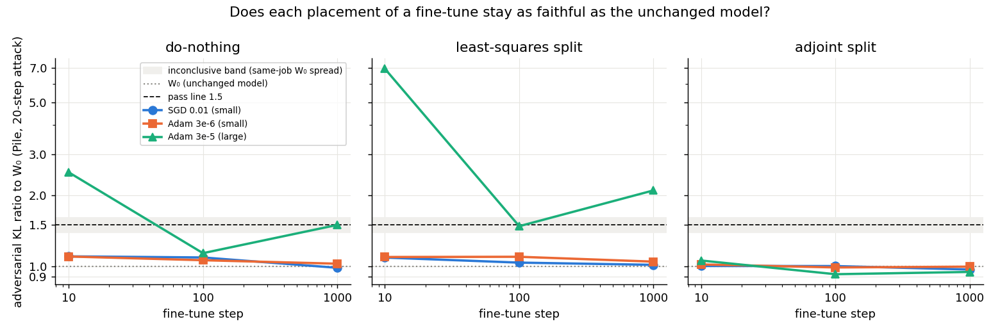
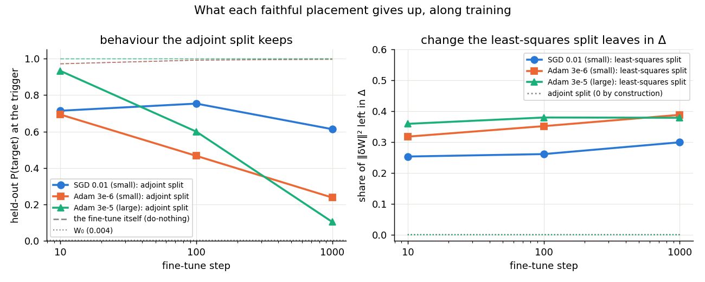
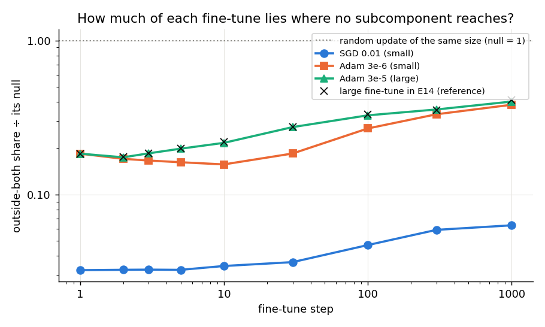
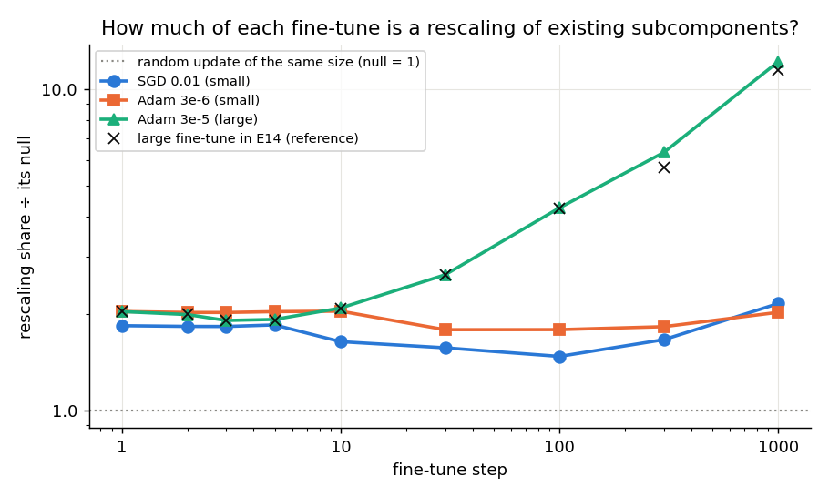

# Analysis: do small fine-tunes stay faithful when placed at later steps? Yes, at every step (E22)

*2026-10-22, E22 agent. Plan: `reports/2026-10-22_plan_small-update-reruns.md` → E22 and its Agent notes. Experiment
`experiments/small_finetune_splits` (parents E14 part 1 and E16). Every number below is read from
`results/small_finetune_splits.json`; the figures come from `plot.py`, which reads only that file. Vocabulary: `GOALS.md` →
Terms.*

**In plain words.** We fine-tuned the model three ways on one task, two small updates and one large one, and placed
each update into the decomposition at three points along a thousand steps of training. The small updates stayed as
faithful as the unchanged model at every step, even after they had grown larger than the large update that fails.
For `GOALS.md`, the failures of the frozen-Γ maps on fine-tunes belong to one Adam update, not to fine-tunes in general.

> **Every verdict here is a 20-step-adversary reading,** as in E14 to E21. A pass means one short search found
> about as much damage on the updated model as on the unchanged one. Whether it survives a longer search is not
> measured here; E20 Amendment 3 reads that on the large update only.

## The answer

The two small fine-tunes passed the adversarial test at steps 100 and 1000. That held whether the update was left in
Δ or split over the subcomponents by least squares. At step 1000 the SGD update had grown past the size at which the
large Adam update fails at step 10, and it still passed. So size alone does not decide the verdict. Two things did not
change with the update. The least-squares split leaves a quarter to two-fifths of the change in Δ at every step. The
adjoint split keeps Δ fixed but loses behaviour. One surprise: SGD's adjoint split kept most of the behaviour all the way.

## What we were trying to test

The scope review (`reports/2026-10-22_review_large-update-scope.md`) found that most of the claims from E14 to E20
rest on one update, a full Adam fine-tune at rate 3e-5 read at step 10. E21 showed that two smaller fine-tunes pass at
step 10. This run asks whether that is a property of their size or only of step 10.

The model is the released 67M Pile model with its VPD decomposition; Γ and Δ stay frozen. All three fine-tunes train
all 24 decomposed matrices on the emoticon task, seed 0, for 1000 steps:

- **SGD at rate 0.01** and **Adam at rate 3e-6**: E21's matched small pair, both moving the largest matrix by about
  0.24% of its norm at step 10.
- **Adam at rate 3e-5**: the large reference, about 1.1% at step 10. It reruns E16 on the same kind of card.

Each update is placed three ways at steps 10, 100 and 1000:

- **Do-nothing**: the whole change $\delta W$ goes into Δ and the subcomponents stay as they were.
- **Least-squares split**: the least-norm change of the subcomponents with $dU V^\top + U dV^\top \approx \delta W$;
  what no subcomponent can express goes to Δ, so the model's weights equal the fine-tuned ones.
- **Adjoint split**: $dU = c\,\delta W V$, $dV = c\,\delta W^\top U$ with one scale $c$ per matrix; Δ stays fixed,
  and the model's weights move only by what the subcomponents carry.

Each placed state is read four ways. The **adversarial ratio** is the damage a 20-step attack on the subcomponent
masks finds on 256 Pile rows, divided by the same at the unchanged model $W_0$. It reads 1 if nothing changed. The
**share of the change left in Δ** reads 0 if the subcomponents carry the whole change and 1 for do-nothing. The
**held-out probability of the target token** at the trigger reads about 1 for the fine-tune itself and 0.004 at $W_0$.

Along all nine checkpoints we also read two properties of the update itself, as E14 did. The **outside-both share** is
the part of $\delta W$'s input-weighted energy that no first-order change of the subcomponents can reproduce. We
divide it by the same share for a random update of equal size, so below 1 means the update avoids that region. The **rescaling share**
is the part reproduced by only rescaling existing subcomponents, again divided by its random-update value.

The unchanged model ran first and alone, under two attack seeds. The two seeds differed by 7.5%, which sets the
verdict band: a ratio of 1.40 or less passes, 1.61 or more fails, and between is inconclusive.

## What we expected, and why

- **Small updates pass later too.** The large update's do-nothing state passes from step 100 on, and the small
  ones pass at step 10. If the SGD update grew past E21's size cut of 0.009 and failed, that would be the size story.
  If it passed, the step story.
- **The adjoint split passes everywhere, keeps Δ fixed, and its behaviour fades with step**, as it did for the large
  update in E16.
- **SGD's update stays further from the outside-both region than the large Adam one at every checkpoint**, as E21
  saw at step 10, 0.034 against 0.218.
- **Whether SGD's rescaling share climbs** as the large update's does, two-sided: no direction was filed.

## What we observed

### Does each placement of a small fine-tune stay faithful at later steps?

**Reading it.** Yes. Every small-update state sits between 0.98 and 1.10, near the unchanged model's line and well
under the inconclusive band, at all three steps. The large update fails at step 10, with 2.52 left in Δ and 6.96
split by least squares. Its least-squares state still fails at step 1000 with 2.11, and its do-nothing state lands on
the line at 1.50. The SGD update at step 1000 has a size of 0.0122, larger than the large update's 0.0113 at step 10.
It reads 0.98 left in Δ and 1.01 split. So a large change is not enough to fail; what the large Adam update does
differently is not its size alone. Every adjoint state passes, the large one included.

| fine-tune | step | size | do-nothing | least squares | adjoint |
|---|---|---|---|---|---|
| SGD 0.01 | 10 | 0.0024 | 1.10 | 1.09 | 1.00 |
| SGD 0.01 | 100 | 0.0051 | 1.09 | 1.04 | 1.00 |
| SGD 0.01 | 1000 | 0.0122 | 0.98 | 1.01 | 0.97 |
| Adam 3e-6 | 10 | 0.0022 | 1.10 | 1.09 | 1.02 |
| Adam 3e-6 | 100 | 0.0044 | 1.06 | 1.10 | 0.99 |
| Adam 3e-6 | 1000 | 0.0079 | 1.02 | 1.05 | 0.99 |
| Adam 3e-5 | 10 | 0.0113 | 2.52 fail | 6.96 fail | 1.06 |
| Adam 3e-5 | 100 | 0.0222 | 1.14 | 1.48 inconclusive | 0.92 |
| Adam 3e-5 | 1000 | 0.0321 | 1.50 inconclusive | 2.11 fail | 0.95 |

*Size: the largest $\|\delta W\| / \|W_0\|$ over the 24 matrices. Ratios: adversarial damage over the unchanged
model's. The stochastic-mask ratios sit between 0.92 and 1.01 for every state.*

### What does each faithful placement give up?

**Reading it.** No placement keeps all three things for any of these updates. The least-squares split keeps the
behaviour but leaves 0.25 to 0.30 of the change in Δ for SGD and 0.32 to 0.39 for Adam 3e-6, rising slowly with step.
The adjoint split leaves Δ untouched, at a measured share below one in a million, but loses behaviour. For both Adam
updates the loss grows with training: the target probability falls from 0.69 to 0.24 for the small one and from 0.93
to 0.10 for the large one. For SGD it does not. It reads 0.71, then 0.75, then 0.61, against 0.97 to 1.00 for the
fine-tune itself. The filed prediction said it would fall at each step. It rose from step 10 to 100, so that
prediction failed. The SGD adjoint state at step 1000 keeps three-fifths of the behaviour with Δ fixed and the
adversarial ratio at 0.97. That is the closest any frozen-Γ placement of a fine-tune has come to all three.

| fine-tune | step | target prob., adjoint | share in Δ, least squares |
|---|---|---|---|
| SGD 0.01 | 10 / 100 / 1000 | 0.71 / 0.75 / 0.61 | 0.25 / 0.26 / 0.30 |
| Adam 3e-6 | 10 / 100 / 1000 | 0.69 / 0.47 / 0.24 | 0.32 / 0.35 / 0.39 |
| Adam 3e-5 | 10 / 100 / 1000 | 0.93 / 0.60 / 0.10 | 0.36 / 0.38 / 0.38 |

### How much of each update lies where no subcomponent reaches?

**Reading it.** The SGD update stays far from that region at every checkpoint. Its outside-both share is 3% to 6% of
a random update's, against 17% to 40% for the large Adam update. A random update would read 1. The small Adam update
starts where the large one does, then dips, and by step 1000 it reaches 0.38, close to the large one's 0.40. So the
rise along training is an Adam property at both sizes, not a large-update one. SGD's share also doubles, but from a
level ten times lower. The large update reproduces E14's series to within 0.01 at every checkpoint, the crosses.
Random updates read 1.01 to 1.02 of the exact null, the check that the block code is right.

### How much of each update is a rescaling of existing subcomponents?

**Reading it.** Only the large update's rescaling share climbs. It goes from 2.1 times the random value at step 10 to
12.2 at step 1000, a factor of 5.8, as in E14. The small Adam update stays flat near 2. The SGD update dips from 1.6
to 1.5 by step 100, then ends at 2.2, a climb of 1.3 overall. So the claim that the rescaling share grows with
training holds for the large Adam update only. For every update the share stays a small fraction of the change. At
step 1000 it is 4.8% for the large update and under 1% for both small ones.

## What we learned

The fine-tune leg of the headline claim, that no frozen-Γ map keeps a fine-tune adversarially faithful, rests on the
large Adam update alone. Two small updates pass under every placement at every step, one of them at a larger size
than the failing one. What does hold for every update is a trade-off. Least squares pays for faithfulness and
behaviour with Δ. The adjoint split pays for faithfulness and a fixed Δ with behaviour. For SGD the adjoint split loses
far less, so the weak version of the goal looks closest to reach for an SGD fine-tune. The outside-both share and the
rescaling share are properties of the optimiser and of the large rate, not of fine-tuning as such.

## How compelling is the evidence

- **One task, one training seed, one attack budget.** Emoticon only; seed 0; the 20-step attack. E20 Amendment 2
  showed the attack is far from its maximum, so a pass is a short-search pass.
- **The card.** An H100, whose seed spread here was 7.5% against the L40's 21%. The narrower band made the verdicts
  stricter, not looser. The small updates' step-10 readings reproduce E21's L40 values within 0.07, and the large
  update reproduces E16's H100 values to three digits.
- **The size comparison.** The SGD update at step 1000 passes at a size above the large Adam update's at step 10. That
  is a comparison across optimisers and steps, so "size alone does not decide" is the safe reading. It does not
  establish what does.
- **The adjoint behaviour reading** is one probability over 73 held-out windows per state. The SGD rise from 0.71 to
  0.75 is small, but the contrast with Adam at step 1000, 0.61 against 0.24, is large.

## Surprises

- **SGD's adjoint split did not lose its behaviour along training.** We predicted the adjoint state's target
  probability would fall at each step, as E16 saw for the large Adam update. For SGD it rose from 0.71 to 0.75, then
  fell only to 0.61 at step 1000, while the small Adam update fell to 0.24. The cause has not been worked out. E21
  found SGD component training to be close to its adjoint split, cosine 0.957, which fits but does not explain it.
- **The SGD update passed at a size past E21's SGD cut.** E21 drew a size cut of 0.009 for SGD component training.
  This SGD fine-tune passed at 0.0122, so the cut does not carry over from component training to fine-tuning.
- **Adam's first step does not depend on the rate.** Both Adam updates read the same block shares at step 1, 0.184
  against 0.184. That is expected, because Adam's first step is the sign of the gradient times the rate. It confirms
  that the outside-both share's difference between them grows only with training.

## What next

- **The adjoint split along an SGD fine-tune, at more steps and tasks.** Suppose it keeps above half the behaviour
  with Δ fixed on a second task. Then the SGD adjoint split is the strongest candidate map for the weak version.
- **A longer attack on the small updates' passing states**, in the way E20 Amendment 3 does for the large ones. If
  they still sit at the unchanged model's level at 160 steps, the "only large" reading survives the budget question.
- **What separates the large Adam update from SGD at step 1000**, since size does not. Damage elsewhere is one
  candidate: the large update's off-target KL at step 1000 is 0.055, against 0.008 for SGD.

## Scorecard

| id | claim | rule | read | verdict |
|---|---|---|---|---|
| G0 | the unchanged model is at its known values | `w0_check` | adversarial 0.699, CI-masked 0.348, spread 0.075 | pass |
| G1 | each step-10 update reproduces E21 | size within 1%; do-nothing within the spread, large: fail | SGD −0.4%, 1.10; Adam 3e-6 −0.02%, 1.10; large +0.6%, 2.52 fail | pass, all three |
| G2 | the large series reproduces E14 | outside-both within 0.03, rescaling within 25%, every checkpoint | max diffs 0.008 and 11% at step 300 | pass |
| C1 | random draws sit at the analytic null | 0.85 to 1.15 every row | 1.010 to 1.018 | pass |
| harness | least-squares state equals the fine-tune | target prob. to 1e-3, shares sum to 1 | every state | pass |
| P1 | small do-nothing and least-squares pass at 100 and 1000 | all eight pass | 0.98 to 1.10; SGD size 0.0122 at 1000 | **pass**; reading: the step story |
| P2 | small adjoint passes, keeps Δ, behaviour falls | pass and Δ ≤ 0.01 at all six; target prob. strictly falls | all pass, Δ ≈ 0; Adam 3e-6 falls, SGD 0.71 → 0.75 → 0.61 | **fail** on SGD's fall |
| P3 | SGD's outside-both below the large one's | SGD ≤ 0.8 × large at every checkpoint | 0.032–0.063 vs 0.174–0.402 | **pass** |
| P4 | SGD's rescaling climb, two-sided | outcomes named | climb 1.31: weak climb; Adam 3e-6 0.99, large 5.84 | reported |

## Not run

- A second training seed, a second task, or a second card for any update.
- A longer attack on any state; E20 Amendment 3 reads the large update only.
- Component training beside each update at steps 100 and 1000; E16 has it for the large update only.
- The rescaling split as a state for the small updates; E16 found it keeps none of the large update's behaviour.
- Off-target damage of the split states themselves; only the fine-tunes' own held-out KL was recorded.
- The step split along these paths, which is E25.

## Provenance

- Results: `experiments/small_finetune_splits/results/small_finetune_splits.json` (sha256 f40ae9a3…c751),
  log `results/large/full.log` (sha256 9a350fe8…44b8), predictions `results/predictions.json`, filed before the run.
- Figures: `experiments/small_finetune_splits/figures/{placements,adjoint,outside,rescaling}.png`, from `plot.py`.
- Code: `experiments/small_finetune_splits/run.py`; shared `split.rescaling_table`, new, with a CPU test in
  `tests/test_split.py`. Codex adversarial review before the run: approved, no findings.
- Run: RunPod pod `01M5HNP0QQGHYZYRJ62HA1VDA8`, H100 80GB HBM3, secure cloud, $3.99/h, 2026-10-22 12:25 to 13:19 BST.
  The scored run took 2267 s; the pod cost $4.55 in total. Terminated after both hashes matched.
