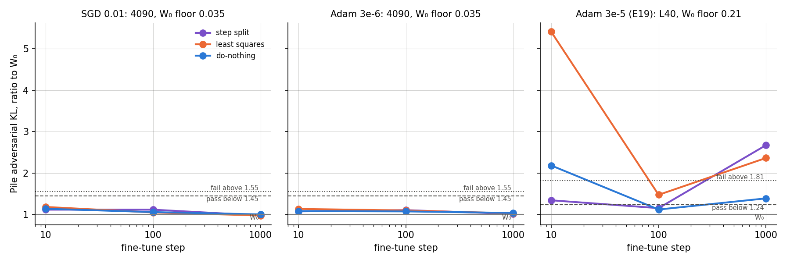
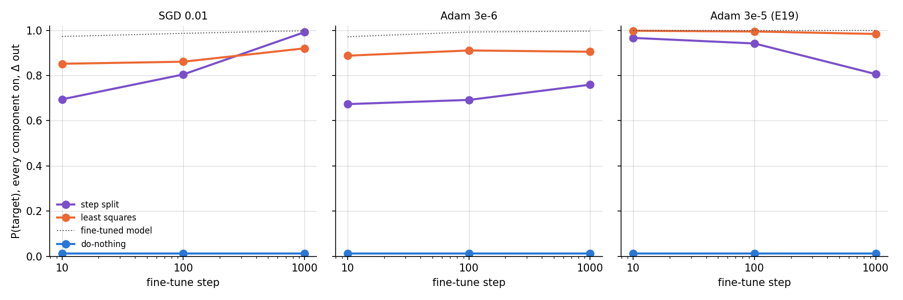
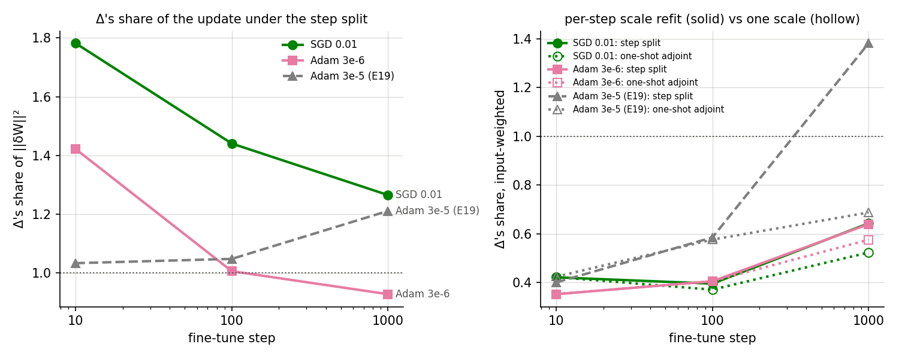

# Analysis: does the step split behave the same along a small fine-tune as along the large one? (E25, `experiments/step_split_small`)

*2026-10-22, E25 agent. Plan: `reports/2026-10-22_plan_small-update-reruns.md`, section "E25 step_split_small" and its
Agent notes. Parent: E19, `reports/2026-10-21_analysis_step-split.md`. Vocabulary: `GOALS.md` → Terms. No notebook:
this report carries the explanation and the record.*

**In plain words.** We split two small fine-tunes into the decomposition one optimizer step at a time, as the earlier
experiment did for a large fine-tune. On the small updates the split model stayed as faithful as the original under the
adversary at every point checked, where the large one failed at the end. For `GOALS.md` this narrows the earlier
failure to the large update. The step split still left more of the behaviour outside the subcomponents than the
least-squares split did, in most readings.

## The answer

Along two small emoticon fine-tunes, one trained with SGD and one with Adam at a low rate, the step split passed the
adversarial check at every step read. At the last step the large fine-tune had failed it at nearly three times the
original's damage. So that failure belongs to the large update. The step split still left more of the behaviour
outside the subcomponents than the least-squares split did, except on SGD at the last step. Something unexpected
happened: the filed guess that SGD's residual would hold less of the update came out reversed at every step.

## What was run

The released VPD decomposition of the 67M model writes each decomposed matrix as $W = U V^\top + \Delta$. The columns
of $U$ and $V$ are the alive subcomponents' write and read vectors, and Δ is the residual. Γ, which sets the causal
importances, stays frozen.

Two fine-tunes were run, both on the emoticon task with seed 0, batch 32 and all 24 decomposed matrices, for 1000 steps:

- **SGD at rate 0.01**, plain, no momentum;
- **Adam at rate 3e-6**, trained to the same size of change at step 10 as the SGD one.

These are the matched pair of the SGD-versus-Adam study, E21. The reference is E19's large fine-tune, Adam at 3e-5,
which is about 4.7 times larger at step 10.

Three ways of writing each fine-tune into the decomposition were compared at steps 10, 100 and 1000:

- **Step split.** After every optimizer step, per matrix, the step $S_t = W_t - W_{t-1}$ is split. The subcomponents
  get $dU = c_t S_t V$ and $dV = c_t S_t^\top U$ against the current $U$ and $V$. The scale $c_t$ is refit each step
  as the input-weighted best match. Δ takes the rest, so the weights equal the fine-tuned ones at every step.
- **Least-squares split** of the finished update: the least-norm change of $U$ and $V$, with Δ taking what they cannot
  express.
- **Do-nothing**: the whole update goes into Δ.

Beside the step split ran its twin with $U$ and $V$ held at W₀'s, which isolates what moving the vectors does. It
was read for energy shares only.

Each state was read on three things:

- **Pile adversarial ratio.** The adversarial-mask KL on 256 Pile rows over the same at W₀, in the same job. W₀ reads
  1. Its spread over two adversary seeds was 0.035 on this card, so a ratio up to 1.45 passes and one of 1.55 or more
  fails.
- **Behaviour in the subcomponents.** The held-out probability of the target token with every subcomponent on and Δ
  removed. Do-nothing reads 0.012, the original model's value. The fine-tuned model reads 0.97 to 1.00.
- **Δ's share of the update.** The squared size of Δ's change over that of the whole update. Do-nothing reads 1.
  An input-weighted version counts each direction by how much the task's inputs use it.

## What we expected, and why

- **SGD's residual holds less.** An SGD step is a clipped gradient. SGD component training reproduced the adjoint
  split of its fine-tune closely in E21, so each SGD step should be close to what the subcomponents can take. Adam
  rescales each coordinate and spreads its step. So Δ's share should be lower for SGD at every step.
- **The verdict at step 1000.** No direction was filed. The small do-nothing states passed at step 10, but on the large
  path the step split's residual outgrew the update by step 1000 and failed.
- **Behaviour in the subcomponents.** No direction was filed. On the large path the step split kept less than least
  squares, and the gap widened along training.

## What we observed

### 1. Is the step-split model faithful under the adversary on a small path? (`figures/pile_pgd.png`)

**Reading it.** Yes, at every step, for both small fine-tunes. All eighteen small-path states sit between 0.98 and 1.18,
inside the pass line of 1.45. At step 1000 the step split reads 0.98 for SGD and 1.02 for Adam. The right panel is E19's
large path, where the same state reads 2.67 and fails. The caveat is the card. This run's floor was 0.035 against the
L40's 0.21, so the lines sit at different heights. No small-path reading comes near either card's fail line.

| path | step | step split | least squares | do-nothing |
|---|---|---|---|---|
| SGD 0.01 | 10 | 1.118 | 1.183 | 1.140 |
| SGD 0.01 | 100 | 1.118 | 1.050 | 1.059 |
| SGD 0.01 | 1000 | 0.979 | 0.977 | 1.004 |
| Adam 3e-6 | 10 | 1.077 | 1.136 | 1.084 |
| Adam 3e-6 | 100 | 1.107 | 1.099 | 1.076 |
| Adam 3e-6 | 1000 | 1.016 | 1.028 | 1.039 |
| Adam 3e-5, E19 | 10 | 1.344 | 5.408 | 2.183 |
| Adam 3e-5, E19 | 100 | 1.155 | 1.476 | 1.121 |
| Adam 3e-5, E19 | 1000 | 2.673 | 2.364 | 1.390 |

The stochastic and CI-masked ratios stayed between 0.996 and 1.009 for every small-path state. The unmasked ratio, with
every subcomponent on and Δ out, is in `results/step_split_small.json`.

### 2. How much of the behaviour do the subcomponents carry? (`figures/pieces.png`)

**Reading it.** Less under the step split than under least squares, in five of six readings. On the Adam path the gap
is 0.15 to 0.22 in probability at every step. On the SGD path it closes along training and reverses at step 1000. There
the step split's subcomponents alone give 0.99, against 0.92 for least squares. On E19's large path the step split also
kept less, and the gap there widened instead. Do-nothing reads 0.012 throughout, the original model's value.

| path | step | step split | least squares | difference | step split, share through Δ | least squares, share through Δ |
|---|---|---|---|---|---|---|
| SGD 0.01 | 10 | 0.694 | 0.852 | −0.157 | 0.410 | 0.278 |
| SGD 0.01 | 100 | 0.805 | 0.861 | −0.056 | 0.360 | 0.303 |
| SGD 0.01 | 1000 | 0.992 | 0.920 | +0.072 | 0.175 | 0.397 |
| Adam 3e-6 | 10 | 0.673 | 0.888 | −0.214 | 0.448 | 0.261 |
| Adam 3e-6 | 100 | 0.692 | 0.911 | −0.219 | 0.470 | 0.280 |
| Adam 3e-6 | 1000 | 0.759 | 0.905 | −0.146 | 0.588 | 0.432 |
| Adam 3e-5, E19 | 10 | 0.966 | 0.998 | −0.032 | 0.310 | 0.090 |
| Adam 3e-5, E19 | 100 | 0.942 | 0.995 | −0.053 | 0.372 | 0.152 |
| Adam 3e-5, E19 | 1000 | 0.806 | 0.984 | −0.178 | 0.614 | 0.312 |

The last two columns are E19's reading: the share of the trigger's gain in log-odds that comes from Δ's change. It
orders the two splits the same way as the probability in every row.

### 3. How much of the update does Δ hold? (`figures/delta_share.png`)

**Reading it.** More on the SGD path than on the Adam path, at every step: the reverse of the filed guess. In plain
squared size, Δ's change is 1.78 times the whole SGD update at step 10 and 1.27 times at step 1000. For Adam it is 1.42
and 0.93. Counted by how much the task's inputs use each direction, the two paths are within 0.07 of each other. Both sit near 0.4 at
steps 10 and 100 and reach 0.64 at step 1000. So the excess lies mostly in directions the inputs barely use.

| path | step | plain | plain, bases held | weighted | weighted, bases held | weighted, one-shot adjoint | largest vector change |
|---|---|---|---|---|---|---|---|
| SGD 0.01 | 10 | 1.782 | 1.781 | 0.421 | 0.421 | 0.422 | 0.010 |
| SGD 0.01 | 100 | 1.441 | 1.440 | 0.395 | 0.395 | 0.371 | 0.018 |
| SGD 0.01 | 1000 | 1.266 | 1.262 | 0.642 | 0.642 | 0.523 | 0.034 |
| Adam 3e-6 | 10 | 1.422 | 1.421 | 0.352 | 0.352 | 0.352 | 0.011 |
| Adam 3e-6 | 100 | 1.007 | 1.006 | 0.405 | 0.405 | 0.405 | 0.019 |
| Adam 3e-6 | 1000 | 0.929 | 0.929 | 0.639 | 0.639 | 0.575 | 0.023 |
| Adam 3e-5, E19 | 10 | 1.034 | 1.034 | 0.400 | 0.400 | 0.424 | 0.037 |
| Adam 3e-5, E19 | 100 | 1.048 | 1.048 | 0.585 | 0.585 | 0.576 | 0.048 |
| Adam 3e-5, E19 | 1000 | 1.211 | 1.213 | 1.381 | 1.390 | 0.687 | 0.127 |

The right panel answers E19's other two findings on the small paths:

- **Moving the vectors changes nothing.** The carried and held versions agree within 0.004 everywhere. The largest
  relative change of any write or read vector is 0.034, a quarter of E19's.
- **Refitting the scale every step sends more into Δ, but only late and by little.** At step 1000 the step split
  holds 0.64. One scale fitted to the finished update holds 0.52 for SGD and 0.58 for Adam. On E19's large path it was 1.38
  against 0.69. At steps 10 and 100 the two agree within 0.025.

The second-order term was negligible: at most 9e-7 of any matrix's step.

## What we learned

E19's adversarial failure of the step split at step 1000 is a property of the large update. On both small paths the
same construction passes at every step, as do-nothing and least squares do. The finding that the step split keeps less
behaviour in the subcomponents than least squares carries over to the small Adam path. It does not carry over to the
small SGD path at step 1000, where it reverses. The bases' rotation stays negligible. The scale refit's push into Δ is
much weaker on small paths. For the weak version in `GOALS.md`, the step split is faithful on small updates.
It still keeps the behaviour in the subcomponents no better than least squares, with one exception.

## How compelling is the evidence

- One task, one fine-tune seed per path, one adversary seed per state, one card.
- The adversarial readings use a 20-step search. On this card W₀'s seed spread was 0.035, six times tighter than the
  L40's, so these passes are firmer than the L40's. The comparison to E19 crosses cards. The do-nothing references
  at step 10 reproduced E21's L40 readings, at 1.14 against 1.12 and 1.08 against 1.08.
- The probability with Δ removed is blind to the Pile and to what Δ's change does when it is left in. The
  adversarial ratio is blind to the trained behaviour. The plain Δ share is blind to whether the inputs use a direction.
- The 0.05 cut that sorts "less", "same" and "more" was set before the run. The SGD reversal at step 1000 is 0.07
  above least squares, near that cut.

## Surprises

- **Something unexpected happened that I cannot explain.** The filed prediction said Δ's share of the update would be
  lower on the SGD path than on the Adam path at every step. It was higher at every step, by 0.34 to 0.43 of the
  update; section 3's table has the values. The input-weighted shares of the two paths are within 0.07, so the excess is in
  directions the task's inputs barely use. At step 10 the held-bases and one-shot weighted shares agree with the
  carried one to 0.001. Whether the one-shot adjoint split's plain share shows the same excess was not measured; the
  updates were not saved.
- On the SGD path the step split's subcomponents alone reach 0.99 at step 1000, above least squares' 0.92.
- On the small paths the plain share falls along training. On the large path it rose.

## What next

Each needs `/design` first.

1. **The plain-versus-weighted gap.** Recompute the one-shot adjoint split's plain Δ share from saved step-10 SGD
   and Adam updates, on the CPU. E22's saved states would do. If it shows the same 1.4 to 1.8, the excess belongs to
   the scaled adjoint split's choice of scale, not to the step split. Then the reversal says nothing about
   the optimisers.
2. **A second fine-tune seed for the SGD reversal at step 1000.** One more 1000-step SGD path with the step split,
   about 20 minutes on a 4090. If the step split again keeps more than least squares, the per-step map has a regime
   where it beats the one-shot map.

## Scorecard

| id | claim in words | rule as filed | read | verdict |
|---|---|---|---|---|
| C0 | the harness at W₀ is at its known values | seed-0 PGD within 10% of 0.69, CI-masked within 2% of 0.348, floor ≤ 0.25 | 0.691; CI-masked as known; floor 0.035 | pass |
| C1 | carried and held bases give the same pieces after step 1 | gap ≤ 1e-6 | 0 and 0 | pass |
| G1 | the fine-tunes are E21's | step-10 largest relative change within 1% of E21's | −0.38% SGD, +0.006% Adam | pass |
| G1 | the do-nothing references reproduce E21's | step-10 ratio within max(f, 0.209) of 1.122 and 1.085 | 1.140, 1.084 | pass |
| G2 | the step-split state is the fine-tuned model | P(target) within 1e-3; route shares sum to 1; Δ share agrees to 1e-3 | all six met, worst 1.1e-6 | pass |
| P1 | SGD's residual holds less of the update than Adam's | plain Δ share, SGD < Adam at steps 10, 100, 1000 | 1.78 vs 1.42; 1.44 vs 1.01; 1.27 vs 0.93 | **fail, reversed at every step** |
| P2 | verdict at step 1000, against E19's fail at 2.67 | two-sided; `faith_score.verdict` | SGD 0.98 pass; Adam 1.02 pass | passes, unlike E19, on both paths |
| P3 | behaviour in the subcomponents, step split against least squares | two-sided; P(target) with Δ out, same if within 0.05 | SGD: less, less, more; Adam: less at all three | less in five of six; more on SGD at step 1000 |

## Not run

- The held-bases twin through the adversarial check or the route split.
- Each matrix's scale per step, and the one-shot adjoint split's plain Δ share. The updates were not saved, so neither
  can be computed now.
- A second fine-tune seed, a second adversary seed per state, another task, and the large path on this card.
- A longer adversary than 20 steps.
- The notebook.

## Provenance

- Results: `experiments/step_split_small/results/step_split_small.json`, sha256
  `27e4e1bf00da381b95393bb0d0a1e37a33631ec1f752cdfb14a33f21d773d65d`, checked on both sides. Per-step series
  `results/large/per_step_{sgd,adam}.json`; run log `results/large/full.log`; pod stdout `results/large/pod_stdout.log`.
- Predictions: `results/predictions.json`, filed 2026-10-22 before the run.
- Code: `experiments/step_split_small/run.py` and the new `src/commute/step_split.py`, tested in
  `tests/test_step_split_readouts.py`. Codex adversarial review before the run: one finding, about resumed records
  mixing two jobs' W₀ denominators, fixed; nothing skipped. The run did not resume.
- RunPod Secure, RTX 4090, machine 01M5HNVBBNABAEG9NN6JH9CN83, pod `commute-step_split_small`; run 2491 s, about
  55 min with set-up; about $0.82. Terminated after the download.
- Figures: `experiments/step_split_small/plot.py`, from the results JSON and E19's
  `experiments/step_split/results/step_split.json`.
