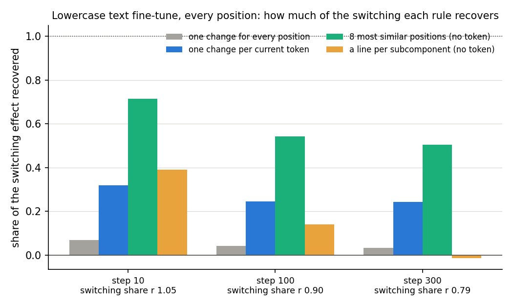
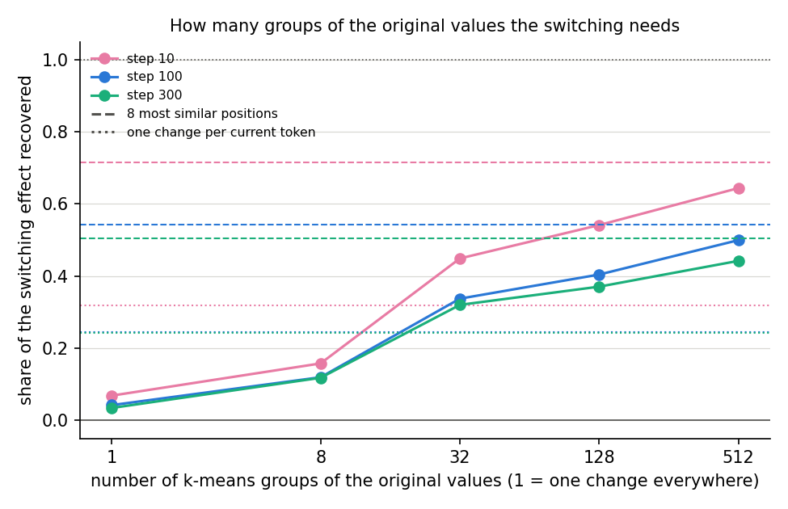

# Does the cue-free form of the fixed-shift hypothesis hold on a fine-tune with no trigger? (E36, analysis)

*2026-10-26, lead agent (overnight). Plan and design check: `reports/2026-10-26_plan_regating-without-cues.md` (E36,
Amendments 1 and 3). Code: `experiments/regating_spread/run.py` and `amend1.py`, shared steps in
`src/commute/spread.py` and `src/commute/cuefree.py`. Follows E35, `reports/2026-10-26_analysis_regating-without-cues.md`.
Exploration, provisional until an independent check. Words as in `GOALS.md` → Terms.*

We fine-tuned the model on text with no trigger and no target token and asked two things: how much of the gain comes
from Γ switching the existing subcomponents, and whether that switching can be predicted at each position from the
original model's importance values there. On lowercased Pile text, switching carried most of the gain, and the change
at each position followed the positions with the most similar original values far better than it followed the
current token. For `GOALS.md` this is the first sign, outside toy tasks, that post-training re-weights existing
subcomponents according to the original model's own importance values.

## The answer

Mostly yes. A fine-tune on lowercased Pile text raised held-out log-probability by 0.07 to 0.13 nats per token, and Γ's
switching carried 0.79 to 1.05 of that gain. Giving each position the mean change of the eight training positions with
the nearest original importance values recovered 0.51 to 0.72 of the switching. One change per current token recovered
0.24 to 0.32, and one change everywhere almost nothing. A fixed line per subcomponent failed as training went on. A first
attempt, on code-like text, did not learn.

## What we were trying to test

**The setup.** A fine-tune of all 24 decomposed matrices on the next-token loss at every position, by Adam at rate
3e-5 with batches of eight 512-token rows, each row used once. In the *do-nothing* state the update goes into Δ and the
subcomponents stay as released; Γ is frozen but reads the fine-tuned model, and Δ is left out of the CI-masked model.
Everything is read at every position of 64 held-out rows:

- the *gain*: the fine-tuned model's mean next-token log-probability minus the original's;
- the *switching share* $r$: how much the CI-masked model's mean log-probability rises when Γ reads the fine-tuned model
  instead of the original, divided by the gain. 1 means switching alone reproduces the gain;
- each rule's *recovery*: the rise its predicted importance values give, as a share of the rise Γ's own values give.
  0 is the original model's values everywhere, 1 is Γ's values on the fine-tuned model.

**The rules.** Each gives every position $x$ its own original values $g_0(x)$ plus a predicted change, clipped to
$[0, 1]$. The change is fitted at 16,384 random positions of the first 64 training rows:

- *one change everywhere*, the mean change: the original fixed-shift hypothesis;
- *one change per current token*, the mean change at fitted positions holding the same token, or the overall mean for
  tokens seen fewer than 20 times: the toy tasks' "cue" carried over to running text;
- *the 8 most similar positions*, the mean change of the eight fitted positions whose original values are nearest
  $x$'s: the cue-free form E35 supported;
- *k-means groups* of the original values, at 8 to 512 groups, with random groups as their null;
- *a line per subcomponent*, $a\,g_0 + b$ fitted per subcomponent.

**The two tasks.** The planned task was code-like text: the 5% of Pile rows richest in code punctuation. That
fine-tune did not learn, so a second was run on a style instead: Pile text decoded, lowercased and re-encoded, so
capitals never come. Its training rows are used once each over 300 steps; it is read at steps 10, 100 and 300.

## What we expected, and why

- **Switching carries at least 0.3 of the gain**, low-medium confidence: on toy tasks the model already does it carried
  0.5 to 1.1, but a fine-tune with no trigger might work differently.
- **One change everywhere carries less than half**, because positions differ as much as copy-task keys did.
- **The 8 most similar positions recover at least 0.6, and beat one change everywhere by 0.2**, medium for the
  code task and low for the lowercase task after the code run's 0.23 to 0.34.
- **They do at least as well as one change per current token**, within 0.1.
- **The line per subcomponent beats one change everywhere by 0.1**, from its 0.96 to 1.02 on E35's few-cue tasks.
- **512 groups come within 0.1 of the 8 most similar positions.**

## What we observed

### Does switching carry the gain of a fine-tune with no trigger?

**Reading it.** Yes. On lowercase text the switching share was 1.05 at step 10, 0.90 at step 100 and 0.79 at step 300,
while the gain grew from 0.07 to 0.13 nats per token. So the fine-tune's improvement is reproduced, almost entirely
early and four-fifths later, by the original subcomponents with Γ reading the fine-tuned model. On the code-like run
the share was also about 0.8, but of a loss rather than a gain, so it says only that switching carries whatever the
update does.

### Does the change follow the original values, the current token, or neither?

**Reading it.** It follows the original values. The 8 most similar positions, green, recover 0.72 at step 10 and about
0.5 later. One change per current token, blue, recovers 0.24 to 0.32, and one change everywhere, grey, 0.03 to 0.07.
Only a third of the 8 nearest positions hold the position's own token, so the rule does not reduce to the token. The
recovery falls with training while the switching share stays high: as the update grows, more of each position's change
depends on something its nearest neighbours do not share.

### How many groups does the switching need?

**Reading it.** Many. Recovery rises steadily with the number of k-means groups, from 0.12 to 0.16 at 8 groups to
0.44 to 0.64 at 512, and stays below the 8 most similar positions at every step. Random groups match one change
everywhere to within 0.002. There is no small set of conditions here: the change varies smoothly with the original
values.

### Is it one fixed line per subcomponent?

**Reading it.** No. The line recovers 0.39 at step 10, 0.14 at step 100 and −0.01 at step 300, against one change
everywhere's 0.03 to 0.07. On the code-like run, whose update was noise, it recovered about half. The slopes barely
move from 1: the median slope among subcomponents whose values vary is 0.94 to 0.96. So the change is not a fixed
function of each subcomponent's own value; it depends on the whole pattern.

## What we learned

On a fine-tune with no trigger and no target token, most of the gain comes from Γ switching the existing
subcomponents, and the change at each position is predicted best by the positions whose original importance values look
most alike. That is the cue-free form of the fixed-shift hypothesis E35 found on toy tasks, now on running text: inputs
the original Γ treats alike get alike changes. It recovers about half to seven-tenths of the switching, twice what the
current token predicts. What it misses grows with training. A fixed shift, a small set of conditions or a fixed rule
per subcomponent all fail here.

## How compelling is the evidence

- **Controls.** At every step a zero change left the masked model's log-probability exactly where it was, and Γ's own
  values on alive subcomponents reproduced the full switching to within 0.000005. Every log-probability was computed in
  float32.
- **Nulls.** Random groups land within 0.002 of one change everywhere at every step.
- **Held-out positions.** Every rule is fitted at positions of training rows and scored on 64 held-out rows, 32,704
  positions.
- **Coverage.** One fine-tune seed, one style, one 67M model. Lowercasing is a style spread over every position but
  synthetic in form; the more natural task, code-like text, did not learn.
- **Blind spots.** The distance weighs every alive subcomponent equally. The nearest rule draws from 16,384 fitted
  positions; more might raise it, and that was not tested. Patterns are written at every position at once, so effects
  passing between positions through attention are included, not separated. No predicted pattern was checked for
  faithfulness under the adversary.

## Surprises

1. **The line per subcomponent collapsed with training.** We predicted it would beat one change everywhere by 0.1. It
   did at step 10, by 0.32, then fell to −0.01 by step 300.
2. **The code-like fine-tune did not learn.** Its training loss stayed between 1.3 and 1.8 and held-out text got
   worse by 0.05 to 0.07 nats per token. The rows chosen were mostly LaTeX and maths. The model is already at its optimum
   on Pile text of this kind, and Adam at this rate with batches of eight adds noise.
3. **The 8 most similar positions missed the filed 0.6 by 0.1 at step 300**, though they beat everything else.

## What next

1. **More fitted positions for the nearest rule.** Cheap. If recovery rises well above 0.5 with 64,000 positions, the
   shortfall is sampling, not the hypothesis.
2. **A domain fine-tune that learns**, with far more rows and a gentler rate, or the larger model's real post-trained
   sibling. A pending-decision card in the log holds this choice.
3. **What the misses are**: whether the positions where the nearest rule fails are where the gain is largest.

## Scorecard

E36 Amendment 1, the lowercase run, filed 2026-10-26 17:39 (`results/predictions_amend1.json`, sha256 `48b37e56…`) before
the run, scored at step 300; steps 10 and 100 read by the same rules.

| id | claim | rule | step 300 | verdict | steps 10, 100 |
|---|---|---|---|---|---|
| C0 | zero change and own values check | as filed | exact | pass | pass, pass |
| G | the fine-tune learned and switching carries some of it | gain ≥ 0.02, r ≥ 0.1 | 0.130, 0.79 | pass | pass, pass |
| P_r | switching carries at least 0.3 of the gain | r ≥ 0.3 | 0.79 | pass | pass, pass |
| P_shared | one change everywhere carries under half | R_shared < 0.5 | 0.034 | pass | pass, pass |
| P_near | the 8 most similar positions recover ≥ 0.6 and beat one change by 0.2 | both | 0.505 | **fail** | pass, **fail** |
| P_token | they come within 0.1 of one change per token or beat it | R_near ≥ R_token − 0.1 | 0.505 vs 0.243 | pass | pass, pass |
| P_fix | the line beats one change by 0.1 | R_fix ≥ R_shared + 0.1 | −0.014 | **fail** | pass, **fail** |
| P_K | 512 groups within 0.1 of the nearest rule | R_clu_512 ≥ R_near − 0.1 | 0.442 vs 0.505 | pass | pass, pass |
| N | random groups match one change | within 0.05 | 0.0007 apart | pass | pass, pass |

E36, the code-like run, filed 2026-10-26 17:20 (`results/predictions.json`, sha256 `f93a0727…`): gate G failed at both
steps, gains −0.052 and −0.065, so every prediction is unscorable and P_r reads fail by its rule. The filed tree read
"G fails at both steps" as "re-gating carries little", which does not apply: switching carried 0.77 to 0.82 of the
change. The lowercase amendment is a decision taken after that run (plan, Amendment 3).

## Full tables

Shares of the switching, at every held-out position. Lowercase run first, code-like run below it.

| run, step | gain | r | one change | per token | 8 nearest | line | 8 groups | 32 | 128 | 512 | random 128 | nearest share same token |
|---|---|---|---|---|---|---|---|---|---|---|---|---|
| lowercase, 10 | 0.070 | 1.05 | 0.068 | 0.318 | 0.715 | 0.391 | 0.158 | 0.449 | 0.541 | 0.644 | 0.068 | 0.33 |
| lowercase, 100 | 0.111 | 0.90 | 0.042 | 0.246 | 0.543 | 0.140 | 0.119 | 0.337 | 0.404 | 0.500 | 0.040 | 0.33 |
| lowercase, 300 | 0.130 | 0.79 | 0.034 | 0.243 | 0.505 | −0.014 | 0.118 | 0.320 | 0.371 | 0.442 | 0.034 | 0.33 |
| code-like, 10 | −0.052 | 0.82 | 0.009 | 0.053 | 0.344 | 0.492 | 0.030 | 0.044 | 0.063 | 0.142 | 0.009 | 0.35 |
| code-like, 100 | −0.065 | 0.77 | 0.003 | 0.032 | 0.231 | 0.501 | 0.020 | 0.031 | 0.045 | 0.086 | 0.004 | 0.35 |

Lowercase: the original model's held-out log-probability −3.146 nats per token, the masked model's −3.445; 90 tokens
had at least 20 fitted positions. 88% of alive subcomponents vary at the fitted positions; the median slope among them
falls from 0.96 to 0.94 with training, and under 1% have a slope below 0.5. The fine-tune's held-out cross-entropy was
3.075, 3.035 and 3.016 at the three steps, its KL from the original model 0.15 to 0.29. Code-like: the selected rows
were the top 5% of 20,480 by the share of tokens with code punctuation, a cut of 0.30, mostly LaTeX and maths; held-out
cross-entropy 1.648 and 1.661, training loss without trend.

## Not run

Seeds beyond 0; more than 16,384 fitted positions or other numbers of neighbours; any distance but Euclidean over all
alive subcomponents; the rules' faithfulness under the adversary; a domain fine-tune that learns; SGD or LoRA updates;
a larger model.

## Provenance

- Code-like run: `experiments/regating_spread/results/regating_spread.json` (sha256 `1b45dcb7…`), log
  `results/large/full.log`; RunPod 4090 pod `01M5WK51FH0VXCAD1HRZKCT61T`, 17:21–17:22, run 77 s, on a pod shared with
  E35 Amendment 1, $0.28 for the pod.
- Lowercase run: `results/regating_spread_amend1.json` (sha256 `dc631b3d…`), log `results/large/amend1.log`; RunPod
  4090 pod `01M5WMD4MVMXKVM315293SSZ3H`, 17:39–17:41, run 90 s, $0.12; GPU memory read 17.4 GB.
- Figures: `experiments/regating_spread/figures/amend1/{arms,clusters}.png` and `figures/{arms,clusters}.png` for the
  code-like run, from `plot.py`.
