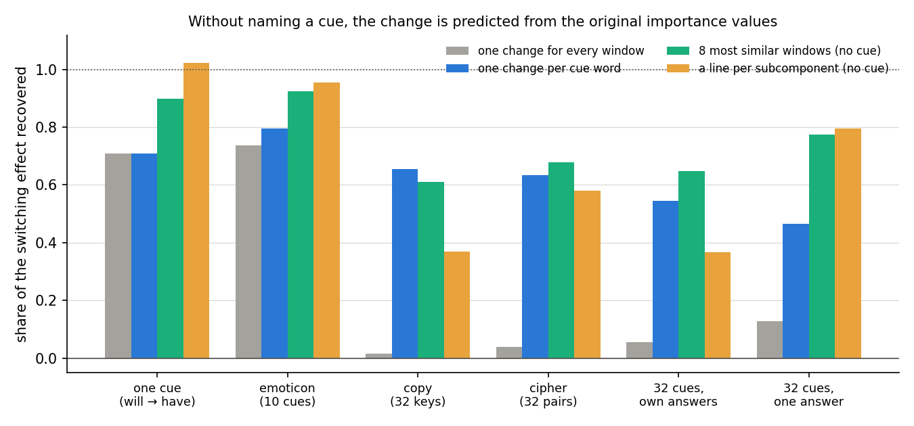
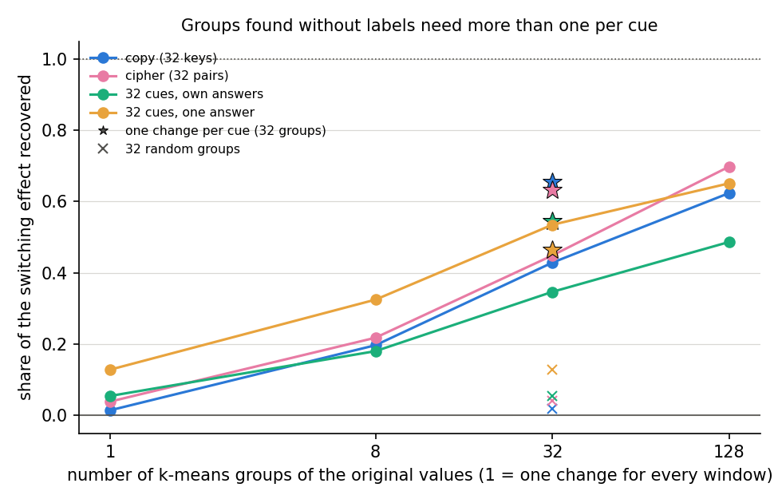

# Can the change in Γ's importance values be predicted without naming a cue? (E35, analysis)

*2026-10-26, lead agent (overnight). Plan and design check: `reports/2026-10-26_plan_regating-without-cues.md`
(E35; Amendment 1 for what it changed in E36, Amendment 2 for the follow-up checks). Code:
`experiments/regating_cuefree/run.py`, shared steps in `src/commute/cuefree.py`. Figures from
`experiments/regating_cuefree/plot.py`. Exploration, provisional. An independent check (a fresh Opus agent,
2026-10-26) found the numbers and verdicts right and the headline worded too strongly; this version takes its points.
Words as in `GOALS.md` → Terms.*

We took the toy fine-tunes where one fixed change per cue word was known to carry Γ's switching, and asked whether the
change can be predicted from the original model's importance values alone, with no cue labels. Giving each input the
average change of the training inputs whose original values look most like its own did as well as one change per cue
word added the same way, though not as well as the averaged per-cue form that first established the hypothesis. For
`GOALS.md` this gives the fixed-shift hypothesis a form that names no token, ready to test on text with no trigger,
with one open question: whether the most similar inputs are simply those with the same cue.

## The answer

Partly yes, on these toy tasks. Each held-out input was given the mean change of the eight training inputs whose
original importance values were nearest. On the four tasks with 32 cue words this recovered 0.61 to 0.78 of the
switching effect, against 0.47 to 0.66 for one change per cue word added the same way and almost nothing for one
change for every input. The averaged per-cue form reads higher, 0.81 to 1.06. Whether the nearest inputs just share the
cue was not counted. Clustering needed four times as many groups as cues.

## What we were trying to test

**The setup.** As in E28 to E33: a ten-step Adam fine-tune at rate 3e-5 of all 24 decomposed matrices, on a toy task
where a trigger token is followed by a target. In the *do-nothing* state the update goes into Δ and the subcomponents
stay as released. Γ is frozen but reads the fine-tuned model's activations, and Δ is left out of the CI-masked model.
The *switching effect* is how much the CI-masked model's log-odds of the target at the trigger rise when Γ reads the
fine-tuned model instead of the original. Every number below is a *recovery*: the share of that effect a predicted
set of importance values gives back, where 0 is the original model's values and 1 is each input's own updated values.
All values are at the trigger only; every other position keeps the original model's values.

**The states.** Six do-nothing states, regenerated from E32 and E33 and reproducing their numbers within 0.0013:

- two with few cue words: " will" followed by " have", one cue; and the emoticon task, ten trigger tokens;
- four with 32 cues: the copy task, where each of 32 key words is followed by itself; a cipher of 32 random word
  pairs; and 32 cue words for " of", fine-tuned either toward their own 32 answers or all toward " of".

The four 32-cue states are two sets of inputs: copy and the cipher share one, and the two " of" states share another.
Each set was fine-tuned toward two targets, so the four results are two independent input sets, not four.

**The rules.** Every rule gives a held-out input $x$ its own original values $g_0(x)$ plus a predicted change $c(x)$,
clipped to $[0, 1]$. The change is fitted on training inputs only, from $d = g_1 - g_0$, the difference between the
fine-tuned and original values. Each rule rules out something:

- *One change for every input*: the mean $d$ over all training inputs. This is the original fixed-shift hypothesis.
- *One change per cue word*: the mean $d$ over training inputs with $x$'s cue word. This is the current hypothesis,
  and the reference.
- *Nearest inputs*: the mean $d$ of the eight training inputs whose original values, over all alive subcomponents,
  are nearest $x$'s. It names no cue. It is not like for like with the per-cue rule: it also lets the change depend
  on each input's own values, which the per-cue rule cannot, so a match does not by itself show that the cue is
  visible in the original values.
- *Clusters*: the mean $d$ of $x$'s group, with groups found by k-means on the training inputs' original values, at 8,
  32 and 128 groups. Random groups of the same sizes are its null.
- *A line per subcomponent*: each subcomponent's new value is $a\,g_0 + b$, with its own $a$ and $b$ fitted by least
  squares over the training inputs. A subcomponent whose original value varies by less than 0.01 there gets $a = 1$.
  It names no cue and uses no other subcomponent.

**One difference from E32 and E33.** Those runs gave every input of a cue the same values and subtracted what that
averaging does to the original values. That form reads higher, 0.81 to 1.06 per cue, but it erases each input's own
values, so it cannot be carried to every position of a text. Here every rule adds a change to the input's own values,
the form E36 needs at every position.

## What we expected, and why

- **The nearest inputs would match the per-cue rule within 0.1**, medium confidence. At the trigger, Γ's values
  should depend mostly on the trigger token, so the nearest inputs should share the cue.
- **Clusters at 32 groups would match it too**, medium-low: we expected k-means to find roughly the cues.
- **A line per subcomponent would match it**, low confidence: it needs the change to depend only on each
  subcomponent's own original value.
- **On the one-cue task, the cue-free rules would neither gain nor lose** more than 0.1 against one change for every
  input: with one cue there seemed to be nothing to group by.

## What we observed

### Does the change follow the original values, with no cue named?

**Reading it.** Yes, against the per-cue rule added the same way. On all four 32-cue tasks the nearest-inputs rule,
green, recovers 0.61 to 0.78. One change per cue word, blue, recovers 0.47 to 0.66, and one change for every input,
grey, 0.01 to 0.13. The nearest-inputs rule falls short of the per-cue rule only on the copy task, by 0.05, and beats
it by 0.31 where all 32 cues lead to " of". Two explanations fit that gain: inputs with different cues sharing
changes, or each input's change depending on its own values, as on the one-cue task below; this run cannot tell them
apart. E32's and E33's per-cue numbers in their averaged form are higher, 0.81 to 1.06, and no rule here reaches them
on the 32-cue tasks.

### Do groups found without labels line up with the cues?

**Reading it.** No, not at the number of cues. At 32 k-means groups the four 32-cue tasks recover 0.35 to 0.53,
below the per-cue rule's 0.47 to 0.66 on three of the four. A group's most common cue covers only 40 to 57% of its
inputs. With 128 groups recovery reaches 0.49 to 0.70, within 0.06 of the per-cue level or above it on all four. Random
groups of 32 sit at the one-change level, within 0.01, so the gain comes from grouping by original values. The
original values carry the cue, but not as 32 tight clusters.

### Is one fixed line per subcomponent enough?

**Reading it.** Only with few cues. The line per subcomponent, orange in the first figure, recovers 1.02 on the
one-cue task and 0.96 on emoticon, against 0.71 and 0.74 for one change for every input. On the 32-cue tasks it
recovers 0.80 where all cues share " of" and 0.58 on the cipher, but only 0.37 on the copy task and with 32 own
answers. So the change is not one fixed rule per subcomponent in general. When the answers differ, a subcomponent's
change depends on more than its own original value.

## What we learned

The change of Γ's importance values at the trigger can be predicted from the original model's importance values by a
rule that names no cue: similar inputs, judged by their original values, get similar changes. It recovers as much as
one change per cue word added the same way, though less than the averaged per-cue form. Whether the rule works
because the most similar inputs share the cue is not yet known; Amendment 1 counts it. The rule applies to any input,
so it can be tested on text with no trigger, which E36 does. The cue structure is not a small set of clusters, though, and a fixed rule per
subcomponent is not enough when many answers compete. Even with one cue, inputs' own original values matter: the
change is not the same amount for every input.

## How compelling is the evidence

- **Controls.** All six states reproduced E32 and E33's switching share and both of their mean-form numbers, within
  0.0013 on every state. Every rule given a zero change recovers exactly 0, and each input's own values recover the
  reference exactly.
- **Nulls.** Random groups land within 0.01 of one change for every input on every state, over five draws whose
  spread is under 0.015.
- **Held-out inputs.** Every rule is fitted on training inputs and scored on 73 to 192 held-out inputs.
- **Coverage.** One fine-tune seed, one 67M model, the trigger position only, six toy tasks.
- **Blind spots.** The distance weighs all alive subcomponents equally, including ones irrelevant to the target.
  Whether the nearest inputs share the cue was not counted. No rule's faithfulness under the adversary was checked.

## Surprises

1. **On the one-cue task the cue-free rules beat one change for every input.** We predicted they would match it
   within 0.1. The nearest inputs gave 0.90 against 0.71, and the line per subcomponent 1.02. So with a single cue the
   change still depends on each input's own original values. One possible reason, not measured, is that inputs whose subcomponents already sit high need less.
   The earlier finding that inputs' own variation adds only a few hundredths was measured in the averaged form, which
   hides this, because it gives every input the same values.
2. **Clusters did not find the cues.** We expected 32 groups to recover about the cues; their purity was 0.40 to 0.57.

## What next

1. **E36, already designed:** the same rules at every position of a code-text fine-tune with no trigger. If the
   nearest-inputs rule recovers most of the switching there, the restated hypothesis carries to text with no cue.
2. **Whether "nearest" is "same token":** count how often the nearest inputs share the input's cue or token. E36
   records this for tokens. A high share would make the cue-free rule a token rule in disguise at the trigger.
3. **The line's slopes:** whether the varying subcomponents have slopes below 1, so that each is pulled toward a set
   value. E36 records this.

## Scorecard

Filed 2026-10-26 16:48 (`experiments/regating_cuefree/results/predictions.json`, sha256 `2e3df9b2…`), before the run.

The filed decision tree had no branch for the nearest-inputs rule holding while the clusters failed, and its "per cue
below 0.5" branch was met on one state, the 32 cues for " of". Making the nearest rule E36's headline test is a
decision taken after the run, recorded in the plan's Amendment 1.

| id | claim | rule | read | verdict |
|---|---|---|---|---|
| G1 | emoticon reproduces E32; zero change recovers 0 | r, net forms, filed arm, zero checks | all differences 0.0 | pass |
| G2 | the other states reproduce E32/E33 | r ±0.05, net forms ±0.02 | largest difference 0.0013 | pass on all five |
| C_one | one cue: per cue equals one change for every input | difference ≤ 0.001 | 0 | pass |
| C | one cue: nearest and 8 clusters within 0.1 of one change | both within 0.1 | 0.90, 0.79 vs 0.71 | **fail, upward** |
| N | random groups within 0.1 of one change | every state | within 0.01 everywhere | pass |
| F | nearest within 0.1 of per cue on each 32-cue state | R_near ≥ R_cue − 0.1 | −0.05, +0.05, +0.10, +0.31 | pass |
| K | 32 clusters within 0.1 of per cue | R_clu_32 ≥ R_cue − 0.1 | −0.23, −0.18, −0.20, +0.07 | **fail** on three of four |
| A | a line per subcomponent matches per cue and beats one change by 0.2 | both | pass on cipher and " of", fail on copy and own answers | **fail** |

## Full tables

All are shares of each held-out input's own updated values' recovery, at the trigger.

| state | switching share r | one change | per cue | nearest | 8 groups | 32 groups | 128 groups | random 32 | line |
|---|---|---|---|---|---|---|---|---|---|
| " will" → " have" | 0.90 | 0.708 | 0.708 | 0.898 | 0.793 | 0.832 | 0.878 | 0.702 | 1.023 |
| emoticon | 0.60 | 0.737 | 0.795 | 0.925 | 0.839 | 0.877 | 0.922 | 0.729 | 0.955 |
| copy, 32 keys | 0.80 | 0.014 | 0.655 | 0.610 | 0.197 | 0.429 | 0.624 | 0.018 | 0.368 |
| cipher, 32 pairs | 0.27 | 0.039 | 0.633 | 0.679 | 0.218 | 0.449 | 0.698 | 0.042 | 0.580 |
| 32 cues, own answers | 0.78 | 0.055 | 0.546 | 0.647 | 0.180 | 0.347 | 0.486 | 0.055 | 0.367 |
| 32 cues, " of" | 1.10 | 0.128 | 0.465 | 0.776 | 0.325 | 0.535 | 0.651 | 0.129 | 0.796 |

| state | per cue, mean form | 32 groups, mean form | one change, mean form | cluster purity at 32 | training / held-out inputs |
|---|---|---|---|---|---|
| " will" → " have" | 0.916 | 0.970 | 0.916 | 1.00 | 401 / 99 |
| emoticon | 0.901 | 0.952 | 0.815 | 0.96 | 365 / 73 |
| copy | 0.842 | 0.487 | 0.067 | 0.57 | 403 / 97 |
| cipher | 0.815 | 0.499 | 0.148 | 0.57 | 403 / 97 |
| 32 cues, own answers | 0.896 | 0.359 | 0.040 | 0.40 | 1524 / 192 |
| 32 cues, " of" | 1.064 | 0.766 | 0.549 | 0.40 | 1524 / 192 |

The mean form gives every input of a group the group's mean updated values and subtracts the same with the mean
original values (E32, E33). In the line arm, the median slope is 1 on every state: most subcomponents' original
values barely vary at the trigger and keep $a = 1$; the share with a slope above 2 is under 0.5%.

## Not run

Seeds beyond 0; positions other than the trigger; whether the nearest inputs share the cue, the nearest inputs
within the same cue as the like-for-like reference, and held-out windows duplicated in training (all three queued as
Amendment 1); the nearest rule in the averaged form; the slopes of the varying subcomponents; any distance other than Euclidean over all alive subcomponents;
faithfulness under the adversary of any rule; SGD or small-update states; a larger model.

## Provenance

- `experiments/regating_cuefree/results/regating_cuefree.json` (sha256 `874675d3…`), log
  `results/large/full.log` (sha256 `ece43666…`); predictions sha256 `2e3df9b2…`.
- RunPod RTX 4090, pod `01M5WHFHRXXYVRJG3AWGPNH330`, 2026-10-26 16:42–16:51; run 58 s; $0.13. A first pod at
  16:34–16:38 ($0.06) failed in set-up: W&B refused the dev node's key for the decomposition files; the second pod
  was sent the cluster's copy instead (`src/commute/vpd_files.py`, commit `bcacd5e`).
- Figures: `experiments/regating_cuefree/figures/{arms,clusters}.png`, from `plot.py` on the E36 pod (no Python on the
  dev node while the cluster's worker is draining).
