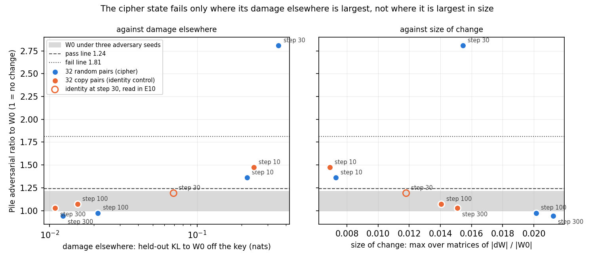

# Analysis: the key → value task (round 6). Inside training learns a behaviour the model lacks; the decomposition stays faithful for one new pair and for the identity control, and breaks on Pile for 32 new pairs

*2026-10-19, coding agent. Plan: `reports/plans/2026-10-19_plan_key-value-task.md`. Predictions: `experiments/kv_task/results/predictions.json`
(filed before the run, scored as filed). Results: `experiments/kv_task/results/{tasks,kv_task}.json`, figures in
`experiments/kv_task/figures/`. Cluster job 22374 (L40, 26 min, $0); smoke job 22366. States on the cluster NFS under
`experiments/kv_task/results/large/`.*

We taught the 67M model a word-level substitution cipher it had never seen: after a marker token, a common word is
followed by a fixed random other word, with one pair, with 32 pairs, and, as a control in the same format, with each word
followed by itself. Training the decomposition's own pieces instead of the weights learned all three within 30 steps,
and the result still passed VPD's own checks on ordinary text for the one-pair task and the identity control, but for the
32-pair task an adversary over the masks did 2.8 times the damage it does on the original decomposition, over the 1.5 line.
For the goal this says that post-training inside the decomposition is not limited to behaviours the model already has,
that the faithfulness limit sits between one and 32 new associations at this update size, and that the new
associations are carried by subcomponents the importance function does not switch on, while the identity task rides on
pieces it does; it also found that one of VPD's five checks, the sparsity loss, cannot tell maps apart while Γ is frozen.

## Terms

- **Pull-back:** the same fine-tune run on the alive (U, V) with Γ and Δ frozen (`GOALS.md`). **Lift:** the finished
  fine-tune's δW written as the smallest first-order change of the alive pieces, the obstruction left in Δ.
  **Do-nothing:** δW placed in Δ, pieces unchanged.
- **Retained (CI-masked):** the share of the target model's held-out log-odds gain at the key that the model keeps when
  every subcomponent is masked by its own causal importance g and Δ is excluded (`local_faith.retained`).
- **Route split** (d, r, i, e_gate, e_Δ): which of five routes carries that gain; mechanism only
  (`reports/decisions/2026-10-19_decision_success-criterion.md`). r = the frozen Γ switching subcomponents on differently for the new
  activations; e_gate = carried by subcomponents Γ does not switch on.
- **Pile ratios:** the authors' stochastic-mask and adversarial-mask (PGD) reconstruction KLs on 256 Pile val rows, as a
  ratio to W₀'s (round 2's harness; one seed here; the 3-seed W₀ PGD floor from lora_commute is 1.11).
- **Sparsity ratio:** VPD's importance-minimality loss at the released run's end-of-training setting (p 0.4, β 0.5,
  ε 1e-12 on the upper-leaky CI values), on the same rows, as a ratio to W₀'s.

## The tasks (`tasks.json`)

Marker `' \+'` (0 occurrences in 32 768 Pile train rows). Keys: word-like tokens at frequency ranks 100–131
(`' different'`, `' both'`, `' same'`, `' value'`, …); values from ranks 1000–3000 under the gate P(value | M key) < 1e-4
(max 9.5e-5 for rand1, 6.5e-5 for rand32). Example pairs: `' different' → ' copy'`, `' both' → ' statistically'`,
`' same' → ' applications'`. 403 train / 97 held-out windows per task, the same Pile contexts for every task (seed 0), every
key present in the held-out set. **Identity control baseline P(x | M x) ≤ 0.002.** The plan called the identity task "a
behaviour the model partly has"; by the trigger it is not (the model does not repeat the word after the marker). It is a
format the model's existing copying machinery can implement, which is what the route split below shows.

## Score, as filed

| Prediction | Filed | Result |
|---|---|---|
| G1 fine-tune learns (P ≥ 0.5 within 300 steps) | pass ×3 | **pass ×3**, all at step 10 |
| P1 pull-back learns ident32 | pass | **pass** (step 30; P 0.39 at 10, 0.97 at 30) |
| P2 pull-back learns rand32 | pass | **pass** (step 30; P 0.001 at 10, 0.85 at 30, 0.97 at 100) |
| P3 pull-back Pile PGD ≤ 1.5 with lift > 1.5 | pass ×3 (rand32 least sure) | **pass** rand1 (1.20 vs lift 1.73), **pass** ident32 (1.19 vs 9.4), **FAIL rand32 (2.81 vs 38.9)** |
| P4 sparsity ≤ 1.10 and within 3× block spread | pass ×3 | **FAIL ×3** on the second clause; ≤ 1.10 everywhere (0.997, 0.992, 1.025) |
| P5 retained(rand32) ≥ 0.8 × retained(ident32) | FAIL | **FAIL as filed** (0.24 vs 0.77) |

G3 route identities held on every state. Every arm learned: the pull-back took 3× the steps of the fine-tune on the K = 32
tasks (30 vs 10) and the same on rand1 (10 vs 10, P 0.98 at step 5).

## The numbers (per task; held fixed: Γ, Δ₀, the released alive set, the windows; varied: the map and the task)

| Task | Arm | Scored step | ‖δW‖/‖W₀‖ max | Pile PGD | Pile stoch | Sparsity Pile / windows | Retained CI-masked | d | r | e_gate | e_Δ |
|---|---|---|---|---|---|---|---|---|---|---|---|
| rand1 | do-nothing | 10 | 0.0115 | 1.06 | 0.98 | 0.996 / 1.007 | 0.12 | 0 | 0.12 | −0.12 | 1.00 |
| | lift | 10 | 0.0115 | **1.73** | 0.98 | 0.996 / 1.007 | 0.14 | 0.02 | 0.12 | 0.73 | 0.13 |
| | pull-back | 10 | 0.0058 | **1.20** | 1.03 | 0.997 / 1.026 | 0.13 | 0.02 | 0.11 | 0.86 | 0.01 |
| rand32 | do-nothing | 10 | 0.0151 | 4.73 | 1.58 | 1.068 / 1.127 | 0.27 | 0 | 0.27 | −0.27 | 1.00 |
| | lift | 10 | 0.0151 | **38.9** | 1.56 | 1.068 / 1.127 | 0.30 | 0.02 | 0.27 | 0.52 | 0.18 |
| | pull-back | 30 | 0.0154 | **2.81** | 1.24 | 1.025 / 1.061 | 0.24 | 0.02 | 0.22 | 0.75 | 0.01 |
| ident32 | do-nothing | 10 | 0.0137 | 8.12 | 1.04 | 0.997 / 1.023 | 0.80 | 0 | 0.80 | −0.80 | 1.00 |
| | lift | 10 | 0.0137 | **9.41** | 1.04 | 0.997 / 1.023 | 0.81 | 0.01 | 0.80 | 0.06 | 0.13 |
| | pull-back | 30 | 0.0118 | **1.19** | 1.01 | 0.992 / 1.023 | 0.77 | 0.01 | 0.76 | 0.22 | 0.01 |

Off-target KL on the held-out windows (other 40 positions) at the scored step: pull-back 0.069 (rand1), 0.355 (rand32),
0.069 (ident32); fine-tune 0.040, 0.696, 0.189.

## What the results bear on

**The weak version (reading A), on the "new capabilities" branch.** The pull-back learns a behaviour the model lacks
(P2) and, for one new association and for the identity control, the resulting decomposition passes the Pile checks
about as well as the released one does on W₀ (PGD 1.20 and 1.19 against a seed floor of 1.11, stochastic 1.01–1.03),
while the lift of the same fine-tune does not (1.73 and 9.4). For 32 new associations it does not: PGD 2.81, stochastic
1.24 (the lift 38.9, do-nothing 4.73). So inside training is not confined to strengthening existing behaviour, and its
limit on this task family sits between K = 1 and K = 32 at this update size. **P3's filed pass on rand32 was wrong.**
I predicted it because every pull-back scored so far had PGD ≤ 1.5 except one at 1.53; those were 10-step states with
‖δW‖/‖W₀‖ ≤ 0.007, and rand32's is a 30-step state at 0.0154. The comparison I framed during the run, "ident32 passes, so it
is the new behaviour and not the size", is not matched: ident32's pull-back at its scored step is smaller (0.0118 vs
0.0154) and does a fifth of the off-target damage in the windows (0.069 vs 0.355 nats), and rand1 has the same route
signature as rand32 (e_gate 0.86 vs 0.75) yet passes at 1.20. Candidate causes, not separated by this run: (a) update
size; (b) off-target damage from forcing 32 arbitrary pairs through the KL penalty; (c) the number of new associations
as such; (d) the scored step (30 vs 10). **The separating measurement is cheap and the states are saved:** the Pile
harness on ident32's pull-back at steps 100 and 300 (‖δW‖/‖W₀‖ 0.0141, 0.0151, matching rand32's) and on rand32's at
100 and 300. One cluster job, ~10 min.

**The sparsity check is blind to the map while Γ is frozen (P4).** Do-nothing and the lift print identical sparsity
values on every task (to 1e-16): the importance-minimality loss reads Γ on the target model's activations, so it is a
function of (W′, Γ) alone and does not see how W′ is split into subcomponents and Δ. The lift is therefore no positive
control for it, and the fifth of VPD's checks named in the success-criterion decision cannot discriminate maps at the
same weights until Γ is updated. The filed rule failed independently of this: its "within 3× the block spread" clause
treated the spread of a deterministic quantity across Pile blocks (0.0007–0.0016 in ratio) as a noise floor for a
systematic shift (0.003–0.025), and the absolute 1.10 clause passed everywhere. What the metric does show: the random
32-pair fine-tune moves Γ's inputs on generic text (+6.8% Pile, +12.7% windows) and the pull-back's weights move them
less (+2.5%, +6.1%); rand1 and ident32 are flat (±0.8%). The shift tracks the PGD failure. Proposed, not made: note in
`decisions.md` that under frozen Γ reading A has four discriminating checks, not five.

**Reveal and create, read off the route split for the first time (mechanism, not the criterion).** The identity task is
carried by Γ switching existing subcomponents on for the new activations (r 0.76–0.80 under every map, e_gate ≤ 0.22);
the random maps are carried by subcomponents Γ does not switch on (e_gate 0.75–0.86 for the pull-back, r 0.11–0.22).
Under `GOALS.md`'s hypotheses that is "reveal" for the identity and "create" for the cipher, with Δ held fixed. The
split is a property of the task, not of the map: pull-back minus do-nothing is −0.03 on both K = 32 tasks (the ladder's
finding again), and d ≤ 0.02 everywhere. **P5 failed as filed**, but the filed reason ("the ladder's rung 2 fell") was a
pattern, not a mechanism; what the data add is where the gain goes (e_gate), not why Γ does not switch those
subcomponents on. One standing claim is qualified: the recruit test's "r is not target-specific" held for different
targets at one trigger on a behaviour the model had; here r runs 0.12–0.80 across tasks of the same format.

**Blind to.** The Pile ratios see the account of the old model, not the trained behaviour (~0 marker positions in
Pile). The task-local PGD has no power (`reports/reviews/2026-10-19_review_pgd-local.md`; retained_pgd −2.4 and −1.3 on the random
tasks, reported only). One adversary seed per state in this run. The identity control's power on P3 is high (lift 9.4),
rand1's marginal (lift 1.73 against the 1.5 line).

## What this changes

- The "new capabilities" branch of `GOALS.md` has a first answer: inside training learns new associations, and the
  decomposition's validity on ordinary text is lost somewhere between 1 and 32 of them at ‖δW‖/‖W₀‖ ≈ 0.015. The next
  measurement is the matched-size check above, then K between 1 and 32 if size is not the cause.
- The sparsity loss is not a check on Φ under frozen Γ. It becomes one only when Γ is updated (`backlog.md`).
- "Create" vs "reveal" now has a measured example of each in one format; the backlog's definition entry has its data.

## Not run

- Pile checks on the pull-back states at steps other than the scored one (saved at 10, 30, 100, 300 on the cluster NFS);
  in particular ident32 at matched ‖δW‖ and rand32 at 100/300.
- Adversary seeds 1, 2 on the scored states; optimiser seeds.
- K between 1 and 32; a second random bijection (seed) at K = 32.
- Per-entry held-out P(value) at the scored step (is the 32-pair map learned uniformly?).
- Where rand32's off-target KL falls (at the marker, the key, or elsewhere in the window).
- The Pile adversary read at the marker (the open `/design` item from the ladder).
- The LoRA arm on these tasks (the lift of a LoRA; `GOALS.md`'s canonical update).

## Amendment 1: was the cipher failure about size, damage elsewhere, the number of pairs, or the step read? (2026-10-23)

*Plan and design check: `reports/plans/2026-10-23_plan_kv-task-amend1.md`. Code `experiments/kv_task/amend1.py`.
Predictions `experiments/kv_task/results/predictions_amend1.json`, filed before any run. Results
`results/kv_task_amend1.json` and its two shards `results/kv_task_amend1_shard{0,1}.json`. Figure from
`experiments/kv_task/plot_amend1.py`. Nothing was trained: every state is one E10 saved.*

We re-checked the decomposition on ordinary text for saved cipher and copy-control states, at steps before and after
the one first scored. The cipher run that failed passes later in training, once its damage to other predictions has
faded, although its weights have moved further. So the failure came from the step it was read at, not from the number
of new associations or the update's size, and needs no sweep over pair counts.

### What was tested

Above, component training taught the model a word cipher it lacks. After a marker that never occurs in ordinary text,
a common word is followed by a fixed random other word. Component training updates the released subcomponents' vectors
with Adam at a rate of 1e-5 while Γ and Δ stay frozen. With 32 such pairs, the decomposition failed the adversarial
check on the Pile at step 30, the first step where the task was learned. The copy control, where each word is followed
by itself, passed at its own step 30. That comparison was not matched. The failing cipher state was larger than the
passing ones and did five times the copy control's damage elsewhere. It was also read later than the one-pair state.

This amendment reads the saved states at steps 10, 100 and 300 for both tasks, where the candidate causes come apart.
Three quantities describe each state:

- **adversarial ratio**: the KL of the target model against the masked model on 256 Pile rows, with the masks picked
  by a 20-step adversary. It is divided by the same at W₀ in the same job, so it reads 1 when nothing changed. W₀
  under three adversary seeds spans 1.00 to 1.21. That spread puts the pass line at 1.24 and the fail line at 1.81.
- **damage elsewhere**: the held-out KL between the trained model and W₀ at every window position except the key, in
  nats. It reads 0 at W₀.
- **size of change**: $\max_W \|\delta W\| / \|W_0\|$ over the 24 matrices, 0 at W₀.

The comparisons the states allow:

| states | matched on | differs in |
|---|---|---|
| copy at steps 100 and 300 vs cipher at step 30 | size, 0.014 and 0.015 vs 0.0154 | content; damage 25 to 30 times lower; step |
| cipher at steps 100 and 300 vs copy at the same steps | step; damage, 0.021 and 0.012 vs 0.015 and 0.011 | content; the cipher about 40% larger |
| cipher and copy at step 10 | step, size about 0.007, damage 0.22 to 0.24 | content; neither has learned its task yet |
| cipher at steps 30, 100, 300 | task | size grows from 0.015 to 0.021 while damage falls from 0.36 to 0.01 |

The cipher at step 30 ran first, alone, as the positive control: the harness had to find its failure again.

### What we expected, and why

We expected all four late states to pass. An earlier SGD-versus-Adam study found that Adam component training failed
only while its damage elsewhere was at least 0.2 nats. By steps 100 and 300 both tasks' damage is below 0.025 nats. The
cipher's late states were the least sure: at 0.020 and 0.021 they are larger than any Adam state that had passed.

We expected neither step-10 state to pass. Both carry damage near 0.23 nats, above that study's cut. That cut was chosen
after looking at three failures, so this was its first test on states filed before they were read.

The filed outcome rule reads the four late states. All four passing means the step and its damage were the cause.
Copy passing and cipher failing means the content, read jointly with size. All four failing means size alone.

### Does the failure follow damage elsewhere or size?

**Reading it.** It follows damage elsewhere. In the left panel the adversarial ratio rises with the damage the state
does to the model's other predictions. The four late states, at 0.011 to 0.021 nats, sit inside the band W₀ spans under
its own adversary seeds. The two step-10 states, both near 0.23 nats, sit between the pass and fail lines. Only the
cipher at step 30, at 0.36 nats, crosses the fail line, at 2.81. The right panel has no such order. The two largest
states are the cipher's late ones, and they read 0.98 and 0.94, the lowest of all. The control reproduced its earlier
reading of 2.808 to the last digit, so the harness could still see the failure.

| state | held-out P(target) | damage elsewhere | size | adversarial ratio | stochastic ratio | verdict |
|---|---|---|---|---|---|---|
| cipher, step 10 | 0.001 | 0.217 | 0.0073 | 1.36 | 1.01 | inconclusive |
| **cipher, step 30, control** | 0.846 | 0.355 | 0.0154 | **2.81** | 1.24 | **fail** |
| cipher, step 100 | 0.967 | 0.021 | 0.0202 | 0.975 | 0.967 | pass |
| cipher, step 300 | 0.959 | 0.012 | 0.0212 | 0.944 | 0.979 | pass |
| copy, step 10 | 0.396 | 0.242 | 0.0069 | 1.47 | 1.01 | inconclusive |
| copy, step 30, from E10 | 0.971 | 0.069 | 0.0118 | 1.19 | 1.01 | pass |
| copy, step 100 | 0.998 | 0.015 | 0.0141 | 1.07 | 0.985 | pass |
| copy, step 300 | 0.994 | 0.011 | 0.0151 | 1.03 | 0.979 | pass |

The adversarial lines come from W₀'s seed floor of 0.209. The stochastic floor is 0.002, so its lines sit near 1.50.
Every state matched E10's recorded curve within 0.01 on held-out P and on damage, and within 1% on size.

### What we learned

The 32-pair cipher does not break the decomposition on ordinary text. The same training run passes at steps 100 and 300
with a larger update than the failing one. What failed at step 30 was a state mid-way through learning, whose damage to
the model's other predictions was at its peak. For the "new capabilities" branch of `GOALS.md`, component training
learns 32 new associations and keeps the decomposition faithful once training settles. The earlier sentence that
faithfulness is lost somewhere between one and 32 associations is withdrawn.

### How compelling is the evidence

One adversary seed per state, one batch order, one cipher bijection and the 67M model. The 20-step adversary is far
from converged, so the ratios are a fixed-budget probe; damage it does not find is not seen. The Pile checks never see
the trained behaviour, since the marker does not occur there. The copy task has no saved state above size 0.0151, so
content and size cannot be separated for it above that size. That gap no longer matters to the reading, because the
cipher itself passes at 0.020. The step-10 states have not learned their tasks, so they test the decomposition under
damage, not under a learned cipher.

### Surprises

None reversed. The damage cut held only in its weaker form. Both states near 0.23 nats read inconclusive, not fail, as
the earlier Adam copy-task states at that damage did. Only the state at 0.36 nats failed.

### What next

The question closes with no new run. Two items would change the reading if they were run. Three adversary seeds on the
two step-10 states would say whether damage near 0.2 nats is a failure line or a grey zone. The copy task trained past
size 0.0151 would add the missing matched-size control at 0.020.

### Scorecard

| id | claim | rule | read | verdict |
|---|---|---|---|---|
| G0 | W₀ reproduces the harness | seed-0 PGD within 10% of 0.69, CI-masked within 2% of 0.348, floor ≤ 0.25 | 0.692, 0.348, floor 0.209, both shards | pass |
| C1 | the cipher at step 30 fails again | PGD ratio within 25% of 2.81 | 2.808, +0.000 | pass |
| G1 | each state is E10's | held-out P and damage within 0.01, size within 1% | all seven | pass |
| P1 | cipher at steps 100 and 300 pass | both read pass | 0.975, 0.944 | pass, as filed |
| P2 | copy at steps 100 and 300 pass | both read pass | 1.07, 1.03 | pass, as filed |
| P3 | neither step-10 state passes | both read fail or inconclusive | 1.36, 1.47, both inconclusive | pass, as filed |
| outcome | step, content, size or mixed | from P1 and P2's four states | all four pass | step, as filed |

### Not run

- More adversary seeds or a longer adversary on any state.
- A second batch order or optimiser seed.
- The copy task trained past size 0.0151.
- A second random bijection at 32 pairs.
- The pair-count sweep between 1 and 32 pairs, dropped by the outcome rule.
- The one-pair cipher's later states, which already passed at step 10.

### Provenance

MATS cluster L40, debug QoS, $0. Shard 0 ran as job 30513 in 1,007 s; shard 1 as job 30529 in 869 s; both exit 0.
Logs `cluster/logs/commute-kv-amend1-{30513,30529}.out`. An earlier attempt, job 30504, crashed after the control. The
cause was a bookkeeping bug in `amend1.py`: `state_verdict`'s `"pile"` key overwrote the ratios. It was fixed before
the rerun. sha256 `kv_task_amend1.json` 41ff3643…, shard 0 0a3559f4…, shard 1 cecf1c7c….
