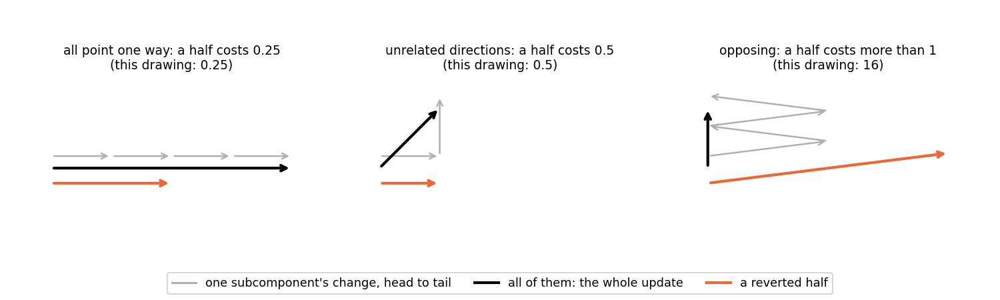
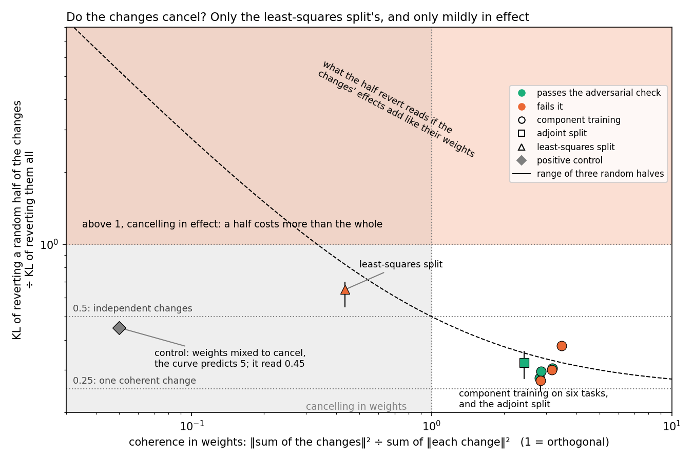
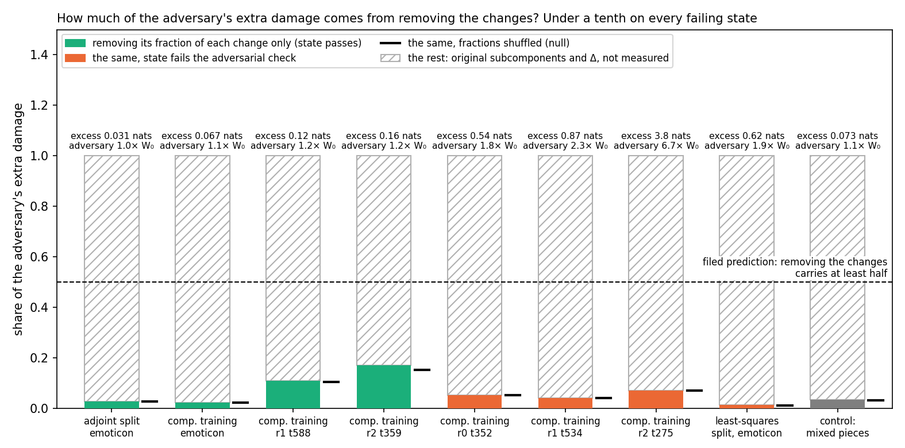

# Analysis: does the adversary break updated decompositions by unbalancing changes that cancel? No (E17)

*2026-10-21, coding agent; restructured for readability the same day, numbers unchanged. Plan:
`reports/plans/2026-10-21_plan_cancellation.md`. Notebook: `notebooks/E17_cancellation.ipynb`. Predictions:
`experiments/cancellation/results/predictions.json`, filed before the run and not edited. Vocabulary: `GOALS.md` →
Terms. Status: run in full on the MATS cluster, both gates passed, the positive control failed, so the three
predictions are unscored as filed and reported as readings.*

## The answer

No. We asked whether VPD's adversarial check fails on updated models because the maps write the update as many opposing
changes that only add up together. They do not. Component training's changes add up coherently on all six tasks, in the
weights and in the output. The least-squares split's cancel only mildly. Removing exactly the part of the changes that
the adversary removes explains under a tenth of its extra damage, no more than a shuffled pattern. The rest must come
from what the adversary does to the original subcomponents. That last step is inferred, not yet measured; a follow-up
that measures it is being built.

*Note 2026-10-21, after E20: measured directly, the inference above is refuted. The original subcomponents carry none of the excess on three of the four failing states and a fifth on r2 t275; most of it sits in the adversary's mask on the dead subcomponents and Δ. See `reports/analyses/2026-10-21_analysis_cancellation-complement.md`.*

## The question

VPD checks a decomposition by masking subcomponents and measuring how far the output moves, as a KL divergence from the
unmasked model. Three of its checks mask gently: at random, at the importance values, or not at all. The fourth is an
adversary. Within the range the importance values allow, it picks the mask that hurts the output most. Every map we have
tried that keeps a fine-tune's behaviour inside the subcomponents passes the gentle checks and fails the adversarial one.

One candidate reason is cancellation. A map writes the update as one change per subcomponent. If those changes are large
and point against each other, their sum can be small while any subset of them is far from it. Mask a few subcomponents
and a large uncancelled leftover appears.

Two earlier readings made this plausible. Turning every maskable subcomponent down together costs about a fiftieth of
what the adversary's chosen mask costs, from `reports/analyses/2026-10-20_analysis_adversarial-vs-stochastic.md`. A uniform
turn-down keeps opposing changes in balance, while a selective mask breaks it. And in E15's first stage, the
subcomponents the adversary turns down were harmless one at a time at both models, yet harmful together. That is a joint effect, which is what cancellation produces.

The answer decides where to look next. If the changes cancel, the fix is to constrain how a map places the update. If
they do not, the problem lies in what the adversary does to the rest of the decomposition.

## What we did

Nine states, each an updated model with its decomposition, all rebuilt from E11's saved files. Every state was read on
the first 128 rows of Pile validation text, the harness's first block, the same rows as the original model.

- **Component training** at step 10 on six tasks. Three pass the adversarial check in E11: emoticon, r1 t588 and
  r2 t359. Three fail it: r0 t352, r1 t534 and r2 t275.
- **The least-squares split** of the emoticon fine-tune, which fails the check in E2, E14 and E16.
- **The scaled adjoint split** of the same fine-tune, which passes it in E14 and E16. Its changes are aligned by
  construction, so it is the reference for changes that do not cancel.
- **A positive control** built to cancel. Component training's emoticon changes, with the subcomponents mixed per
  matrix: $U' \leftarrow U' A$, $V' \leftarrow V' A^{-\top}$, $A = I + \varepsilon E$. The weight change is unchanged
  exactly, while each subcomponent's change gains parts that others lose. The mixing was scaled until the changes' total
  energy was 64 times the original.

Symbols used below:

- $d_c = u'_c v'^\top_c - u_c v_c^\top$, subcomponent $c$'s change.
- $\kappa = \|\sum_c d_c\|^2 / \sum_c \|d_c\|^2$, pooled over matrices: the coherence in the weights.
- $h$: the KL of reverting a random half of the changes divided by the KL of reverting them all.
- $X$: the adversary's KL at the state minus at the original model, on the same rows.

Two gates ran first on every state. At zero weight the hook reproduces the state's logits exactly. At full weight it
reproduces the model with the changes reverted in the weights, within 1e-4 nats. The coherence's sign-flip null reads 1
within 0.1. Both passed.

## What we expected, and why

- **Coherence below 1** on the failing states was the hypothesis's weight-space claim. We filed it as expected to fail.
  Adam's steps are sign-like and a ten-step gradient on a narrow task is low-rank, so the changes share a direction.
- **The half revert above 1** on the failing states and at most 0.5 on the adjoint state. We filed this as expected to
  pass, with low confidence. The reason was the selective-mask reading above.
- **The adversary's revert accounts for its excess.** Removing the adversary's fractions of the changes should carry at
  least half of $X$. It should also carry three times what a shuffled pattern carries.
- **The control** reads as cancelling on both coherence and the half revert.

## What we observed

### 1. Do the changes cancel, in the weights or in their effect?

Coherence asks the weights. Unrelated changes read about 1, aligned changes more than 1, cancelling changes below 1. The
half revert asks the model. A forward hook removes the changes of a random half of the subcomponents, keeping the
original subcomponents whole. The KL to the state is divided by the KL of removing every change. Three halves per
state.

The half revert's reference values come from KL being quadratic in a small change of the output. Picture each change's
effect as an arrow and the update as their sum.

If every change points one way, a half moves the output half as far and costs a quarter. If the changes point in
unrelated directions, a half costs a half. If they oppose each other around a short sum, a half costs more than the
whole. In general a random half costs about $\tfrac14(1 + 1/c)$ of the whole, $c$ the coherence of the arrows. If the
changes' effects line up the way their weights do, $c = \kappa$ and $h$ falls on the curve $\tfrac14(1 + 1/\kappa)$,
which is the dashed line below. The formula assumes small changes and many subcomponents.

**Reading it.** The changes add up; only the least-squares split's cancel, and in effect only mildly. Component training
sits at a coherence of about 3 on all six tasks, passing and failing alike, with the sign-flip null at 1. Its half revert
reads 0.27 to 0.38, on the dashed curve. So its changes' effects line up the way their weights do, and the adjoint state
sits with them. The least-squares split is the only map whose changes cancel in the weights, at 0.44. In effect it reads
0.65: above independent changes, well below the line at 1. Nothing here separates the failing states from the passing
ones.

| state | adversarial check | coherence κ | sign-flip null, 3 draws | dashed curve | h |
|---|---|---|---|---|---|
| adjoint split, emoticon | passes | 2.42 | 1.02 | 0.35 | 0.32 |
| component training, emoticon | passes | 3.18 | 1.00 | 0.33 | 0.31 |
| component training, r1 t588 | passes | 2.81 | 0.99 | 0.34 | 0.28 |
| component training, r2 t359 | passes | 2.86 | 1.01 | 0.34 | 0.30 |
| component training, r0 t352 | fails | 3.16 | 1.00 | 0.33 | 0.30 |
| component training, r1 t534 | fails | 2.84 | 1.00 | 0.34 | 0.27 |
| component training, r2 t275 | fails | 3.48 | 1.01 | 0.32 | 0.38 |
| least-squares split, emoticon | fails | 0.44 | 0.96 | 0.82 | 0.65 |
| control, mixed changes | — | 0.050 | 1.00 | 5.25 | 0.45 |

The least-squares split's coherence per matrix runs from 0.14 to 0.96.

| state | KL to W₀ | full revert | half revert, mean (range) | h |
|---|---|---|---|---|
| adjoint split, emoticon | 0.0075 | 0.0075 | 0.0024 (0.0021 to 0.0027) | 0.32 |
| component training, emoticon | 0.0068 | 0.0068 | 0.0021 (0.0020 to 0.0021) | 0.31 |
| component training, r1 t588 | 0.069 | 0.069 | 0.019 (0.019 to 0.020) | 0.28 |
| component training, r2 t359 | 0.119 | 0.119 | 0.035 (0.035 to 0.035) | 0.30 |
| component training, r0 t352 | 0.161 | 0.161 | 0.048 (0.046 to 0.050) | 0.30 |
| component training, r1 t534 | 0.224 | 0.224 | 0.061 (0.055 to 0.065) | 0.27 |
| component training, r2 t275 | 1.111 | 1.111 | 0.420 (0.415 to 0.430) | 0.38 |
| least-squares split, emoticon | 0.0212 | 0.0148 | 0.0096 (0.0081 to 0.0103) | 0.65 |
| control, mixed changes | 0.0068 | 0.0068 | 0.0031 (0.0030 to 0.0031) | 0.45 |

The full revert equals the KL to W₀ for component training and the adjoint state, as it must. For the least-squares
split the full revert leaves the outside remainder in Δ, so it is smaller than the KL to W₀.

### 2. Why the control failed, and what that costs

The control is the grey diamond. Its weight coherence is 0.05, so if its effects followed its weights the half revert
would read about 5. It read 0.45, up from 0.31 before mixing. The parts the mixing added are large in the weights but move
the output little on Pile text, and roughly in unrelated directions. The control injected cancellation the model does not
feel, and its filed rule needed a half revert above 1, so it failed.

**What this undermines.** The half revert has no demonstrated case of catching cancellation, so the three predictions
are unscored. Read against the dashed curve, though, the control is not evidence that the half revert is blind. Its
point sits where it should if the mixed parts barely reach the output.

**What it does not undermine.** The control cannot rescue the cancellation hypothesis. Test 3 does not use the half
revert. It reads the adversary's own mask directly, and its only apparatus is the hook, which passed its gate.

### 3. Does removing the changes explain the adversary's extra damage?

At an input $x$ the adversary keeps $g_c(x) + (1 - g_c(x))\,a_c$ of subcomponent $c$, with $g_c$ the importance and
$a_c$ in $[0, 1]$ its choice. So it removes the fraction $(1 - g_c(x))(1 - a_c)$ of the subcomponent, including that
fraction of its change. The hook removes exactly that fraction of each change and nothing of the original
subcomponents. Its null shuffles the adversary's choices among the alive subcomponents of each matrix, three draws. A
second comparison uses the original model's adversary's choices. If the damage were the uncancelled leftover of the
changes, this revert would carry most of $X$.

**Reading it.** No, on every state. On every failing state, removing just the changes carries under a tenth of the
adversary's extra damage. That is a few percent for component training and one percent for the least-squares split. The
shuffled pattern costs the same within a fifth on every state, and within 2 percent on eight of them. The original
model's adversary's pattern costs the same again. So the adversary is not singling out the changes.

| state | adversary's KL | ÷ W₀'s 0.661 | extra damage X | changes only, adversary's fractions | shuffled, mean (range) | original model's adversary | ÷ X | ÷ shuffled |
|---|---|---|---|---|---|---|---|---|
| adjoint split, emoticon | 0.692 | 1.05 | 0.031 | 0.0008 | 0.0008 (0.0008 to 0.0009) | 0.0008 | 0.03 | 0.97 |
| component training, emoticon | 0.729 | 1.10 | 0.067 | 0.0015 | 0.0015 (0.0015 to 0.0015) | 0.0016 | 0.02 | 0.98 |
| component training, r1 t588 | 0.782 | 1.18 | 0.121 | 0.0130 | 0.0124 (0.0120 to 0.0131) | 0.0132 | 0.11 | 1.05 |
| component training, r2 t359 | 0.818 | 1.24 | 0.156 | 0.0265 | 0.0236 (0.0224 to 0.0247) | 0.0241 | 0.17 | 1.12 |
| component training, r0 t352 | 1.201 | 1.82 | 0.540 | 0.0274 | 0.0278 (0.0267 to 0.0291) | 0.0337 | 0.05 | 0.98 |
| component training, r1 t534 | 1.528 | 2.31 | 0.867 | 0.0343 | 0.0337 (0.0324 to 0.0343) | 0.0394 | 0.04 | 1.02 |
| component training, r2 t275 | 4.446 | 6.72 | 3.785 | 0.260 | 0.260 (0.257 to 0.267) | 0.314 | 0.07 | 1.00 |
| least-squares split, emoticon | 1.277 | 1.93 | 0.616 | 0.0083 | 0.0069 (0.0064 to 0.0074) | 0.0059 | 0.01 | 1.20 |
| control, mixed changes | 0.734 | 1.11 | 0.073 | 0.0024 | 0.0023 (0.0022 to 0.0024) | 0.0024 | 0.03 | 1.04 |

The adversary's ratios on these rows reproduce E11's ordering. The passing states read at most 1.24 times the original
model, the failing ones 1.8 to 6.7 times.

### 4. What that leaves

The hatched part of each bar is the adversary's mask acting on the original subcomponents and on Δ. It also holds how
those removals interact with the changes. This run did not measure it. It is $X$ minus what was measured, and KL does not
add exactly, so it is an estimate.

Our reading is that after the update, the output leans more on original subcomponents that Γ rates unimportant on Pile
text. The adversary is free to remove those. That is an inference from the remainder, not a measurement. A follow-up in
the same hook framework, being built now, removes the adversary's fractions of the original subcomponents while keeping
the changes whole. If most of $X$ appears there, the reading becomes a measurement. If little does, the damage lies in
how the two halves interact.

*Note 2026-10-21, after E20: measured directly, the inference above is refuted. The original subcomponents carry none of the excess on three of the four failing states and a fifth on r2 t275; most of it sits in the adversary's mask on the dead subcomponents and Δ. See `reports/analyses/2026-10-21_analysis_cancellation-complement.md`.*

## What we learned

Cancellation among the changes is not why the maps fail the adversarial check. Component training writes one coherent
change, spread over the subcomponents but adding up, and the adversary gains almost nothing by removing parts of it. The
least-squares split's changes cancel in the weights and mildly in effect, and the adversary ignores them too. If the
follow-up confirms the remainder, the brittleness question moves back onto Γ in a new form. The problem would not be
stale importance values on the changed subcomponents. E15's first stage ruled that out one at a time, and this run
rules it out together. It would be a stale allowed range around the original subcomponents, which the updated model now
uses. The research log's claim that the failure is cancellation is refuted.

## How compelling is the evidence

One update seed per state and one adversary seed. Against that, nine states on six tasks, each read on the same 128
rows as the original model, with every number beside its null. The hook reproduced the weight edit to 1e-9 nats on
every state, after a bug in the gate itself was fixed. The adversary's excess reproduces E11's ordering on these rows.
The coherence null reads 0.96 to 1.02 everywhere.

The positive control failed, so the half revert's readings are unscored. Test 3 does not depend on that control. Blind
spots: everything reads Pile rows, never the trigger. The weight coherence is blind to the output. Random halves are
blind to one specific cancelling subset, which test 3 covers. The hook keeps the original subcomponents whole, so their
share of the damage is inferred as the remainder, not measured.

## Surprises

**Something unexpected happened.** Two filed predictions reversed. The half revert was predicted above 1 on the failing
states. It read about 0.3 on every component-training state and 0.65 on the least-squares split. The adversary's revert,
predicted to carry at least half of its excess, carried a few percent and matched its shuffled null. The explanation
in section 4 is a reading of the remainder, not a measurement of it, and the follow-up measures it.

Three smaller ones. The least-squares split's coherence read 0.44 where the plan expected above 1: the least-norm
change over subcomponents that already overlap is not an aligned one. The control's 64-fold mixing barely moved the
half revert, so weight-space and output cancellation come apart. And the first smoke failed its own hook gate at
0.0085 nats, because the gate's reference forward ran with the hooks live and reverted twice. The gate worked as
designed and cost a 36-minute queue wait.

## What next

- **Measure the remainder**, being built: the same hook framework with the roles swapped. Remove the adversary's
  fractions of the original subcomponents while keeping the changes whole, at the state and at W₀. Most of the excess
  there makes section 4 a measurement; little there puts the damage in the interaction.
- **Which original subcomponents.** Bin the adversary's mask by layer and by importance at the state and at W₀. The
  question: which low-importance subcomponents does the updated model lean on?
- **E18, mechanism or leak**, planned in `reports/plans/2026-10-21_plan_regating-leak.md`, sharpened by this result: are the
  subcomponents the adversary removes the ones Γ switches on at the trigger?

## Scorecard (as filed)

| id | claim | rule | read | verdict |
|---|---|---|---|---|
| G1 | the hook reproduces the weight edit | KL 0 at weight 0; ≤ 1e-4 nats at weight 1 | 0 and 1e-9 to 2e-9 on every state | pass |
| G2 | the coherence null reads 1 | within 0.1 on every state | 0.96 to 1.02 | pass |
| C1 | the mixed pieces read as cancelling | κ ≤ κ_ct ÷ 5 and h > 1 | κ ratio 0.016; h 0.45 | **fail** (h): P1 to P3 unscored |
| P1 | coherence below 1 on the four scored states | κ < 1 on each | 3.16, 2.84, 3.48; least-squares 0.44 | unscored; reads fail (as predicted) |
| P2 | half revert above 1 on the scored states, ≤ 0.5 on the adjoint | h > 1; h ≤ 0.5 | 0.30, 0.27, 0.38, 0.65; adjoint 0.32 | unscored; reads fail (predicted pass) |
| P3 | the adversary removes the cancelling part | F_adv ≥ 3 F_perm and ≥ 0.5 X | ratios to F_perm 0.98 to 1.20; to X 0.01 to 0.07 | unscored; reads fail (predicted pass) |

F_adv is the "changes only, adversary's fractions" column above and F_perm the "shuffled" column.

## Not run

- The complement of the adversary's revert: its fractions of the original subcomponents with the changes kept. Being
  built as an E17 follow-up.
- The least-squares and adjoint states of the ladder tasks; a second update seed; a second adversary seed.
- The revert restricted to low-importance subcomponents; the trigger windows.
- A positive control that cancels in the output. The filed one injected weight-space cancellation only.

## Provenance

Results `experiments/cancellation/results/cancellation.json`, sha256 `3e54f538ef8f3ea5…`. Smoke
`cancellation_smoke.json`; logs `results/large/{full,full_smoke}.log`, timestamps in UTC. MATS cluster, one L40,
`debug` QoS, $0. Jobs: GPU smoke 28085, old gate, stopped on G1 after a 36-minute queue wait; CPU smoke 28107, 370 s,
no GPU and no wait; scored 28110, 557 s after a 2-minute wait, 2026-10-21 14:51 to 15:01 BST. Code
`src/commute/cancel.py` and `experiments/cancellation/run.py`; the G1 reference-forward fix was made between the two
smokes and changed no measurement. Figures by `experiments/cancellation/plot.py`: `half_revert_toy.png`,
`half_revert.png` and `adversary_revert.png`; the earlier `coherence.png` was folded into `half_revert.png`'s x-axis.
Predictions were filed on 2026-10-21 before any run, and re-filed once before any run when the control's construction
changed from a write-side zero-sum perturbation, which cannot exist with independent read vectors, to the gauge mixing.

## Hand-off

Next, through `/design`: the complement revert and the mask binned by layer and importance, both in the E17 hook
framework on the same saved states. Then E18 from its plan. The research log's claim that the failure is cancellation
is refuted, queued in `docs/research_log/PENDING.md`.
