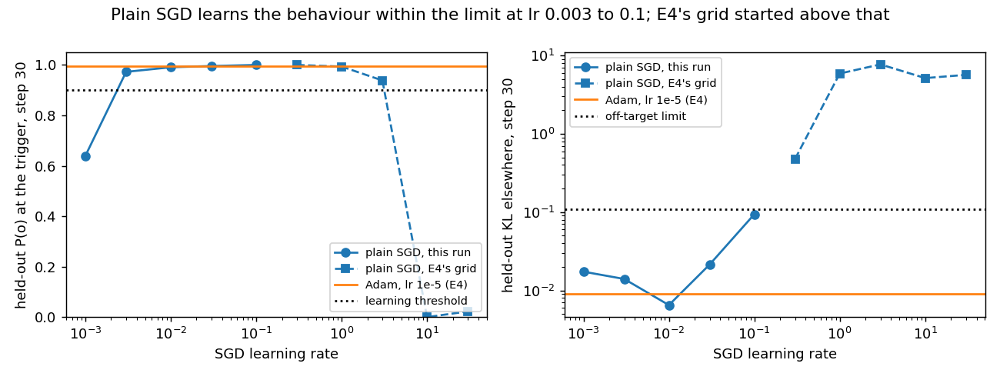
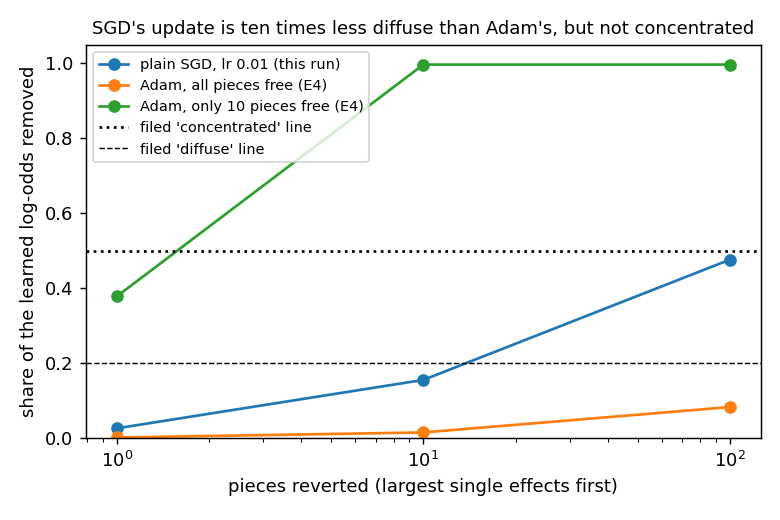

# Can plain SGD on the pieces' vectors learn the emoticon behaviour without damage elsewhere?

**The answer.** Yes. Component training with plain SGD learns the emoticon behaviour cleanly over a thirty-fold range
of learning rates, and at a rate of 0.01 it does less damage elsewhere than Adam. The earlier claim that no rate worked
came from a grid that started too high: its smallest rate already overshot on the first step. SGD's update is also
about ten times less spread out than Adam's. It is still not concentrated in a handful of pieces, so "Adam causes
the diffuseness" holds only in part.

*2026-10-21, coding agent. Plan `reports/plans/2026-10-21_plan_sgd-grid.md`; predictions
`experiments/sgd_grid/results/predictions.json` (filed before the run); results `results/sgd_grid.json`. MATS
cluster L40, debug jobs 28102 (smoke) and 28106 (scored, about 3 min), $0.*

## What we were trying to test

E4 trained the vectors of every live piece of the decomposition on the emoticon task. Γ and Δ were frozen and the
recipe was 30 steps at batch 32. With Adam this worked, but the change was spread over thousands of pieces. E4 asked
whether plain SGD would concentrate it. Its SGD arm tried learning rates of 0.3 to 30. None of them learned without
large damage elsewhere, so the question was left unscored. The research log then stated that no learning rate
works.

This run repeats E4's SGD arm at rates of 0.001 to 0.1. Everything else is held fixed: data, seed, batches, gradient
clipping and E4's rule for picking a rate. The rule asks for held-out probability of the target token at least 0.9
at step 30, and KL elsewhere at most 0.110. Among the rates that pass, it takes the one with the least KL. At the chosen
rate we measured E4's concentration number: the share of the learned log-odds removed when the 10 pieces with the
largest single effects are reverted together. A value of 1 means the update lives in those ten pieces, and 0 means it
lies elsewhere.

**Control, run first.** Rate 0.3 for two steps had to reproduce E4's numbers on the new card and the shared training
loop. It did, to within 0.1% on the KL elsewhere at both steps, with the same collapse of the target probability on
step 2.

## What we expected, and why

- Filed to pass: some rate in the new grid learns within the limit. E4's smallest rate overshot on step 1, so a step
  ten to a hundred times smaller should land.
- Filed to fail: SGD's update is concentrated, meaning the top ten pieces remove at least half the gain; the null is
  below 0.2.
  An SGD step moves every piece in proportion to how much it overlaps the gradient, so it should still be spread out.

## Does plain SGD learn within the limit at some rate?

**Reading it.** Yes, at rates of 0.003 to 0.1. The left panel shows the target probability above the 0.9 line from
0.003 upwards. The right panel shows the KL elsewhere below the limit for every new rate. At 0.01 the KL is 0.0065,
under Adam's 0.009. E4's grid, the squares, begins at 0.3, already above the limit. The rate of 0.001 is simply too slow,
reaching 0.64 by step 30. At 0.1 the first step overshoots, with KL elsewhere 0.43, and training recovers below the
limit only by step 30.

## Is SGD's update concentrated in a few pieces?

**Reading it.** No, though it is far less spread than Adam's. Reverting the top ten pieces removes 0.16 of SGD's gain,
inside the filed "diffuse" band, against Adam's 0.016. The top hundred remove 0.48 against Adam's 0.08. The green
line is E4's Adam arm with only ten pieces free, which reads 1.0. It shows the measure can read high when the update
really lives in a few pieces.

## What we learned

The research log's line that no SGD rate learned without large damage elsewhere is wrong. It reported a grid that never contained a working rate. SGD works as well as Adam on this task and is ten times
less diffuse at the top-ten and top-hundred cut-offs. So Adam's per-coordinate scaling explains part of the
diffuseness, but not all of it. The "unused contrast" on the re-gating card no longer has to argue around SGD: plain
SGD component training is now a working arm on emoticon.

## How compelling is the evidence

One task, emoticon, with one seed and 30 steps. The concentration number has no noise floor and is blind to redundancy
beyond the greedy top ten. The comparison to Adam pairs this run's rate of 0.01 with E4's Adam at 1e-5. They are not
matched for size of change: SGD's largest relative change per matrix is 0.0026 against Adam's 0.0066. Pile
faithfulness and the trigger-local masked checks were not measured for the SGD state.

## Scores (as filed)

| Prediction | Rule | Result | Verdict |
|---|---|---|---|
| S1: some rate learns | E4's rate rule finds a rate | rate 0.01 (0.003, 0.03, 0.1 also pass) | pass, as predicted |
| S2: SGD concentrates | top 10 remove ≥ 0.5; null < 0.2 | 0.156 | fail (null band), as predicted |

| SGD rate | P(o) step 30 | KL elsewhere step 30 | largest relative change | passes rule |
|---|---|---|---|---|
| 0.001 | 0.640 | 0.0174 | 0.0018 | no (too slow) |
| 0.003 | 0.973 | 0.0140 | 0.0022 | yes |
| 0.01 | 0.991 | 0.0065 | 0.0026 | yes (selected) |
| 0.03 | 0.996 | 0.0214 | 0.0040 | yes |
| 0.1 | 1.000 | 0.0939 | 0.0118 | yes |
| Adam 1e-5 (E4) | 0.996 | 0.0091 | 0.0066 | yes |

Fraction of the gain removed, top 1 / 10 / 100: SGD 0.026 / 0.156 / 0.476; Adam all (E4) 0.002 / 0.016 / 0.083.

## Not run

- Pile faithfulness (stochastic, adversarial, masked ratios) and the trigger-local masked checks on the SGD state.
- SGD and Adam matched for size of change, more seeds, and a noise floor for the concentration number.
- SGD component training on the ladder tasks, and at 1000 steps (E16's horizon).
- SGD with momentum.
