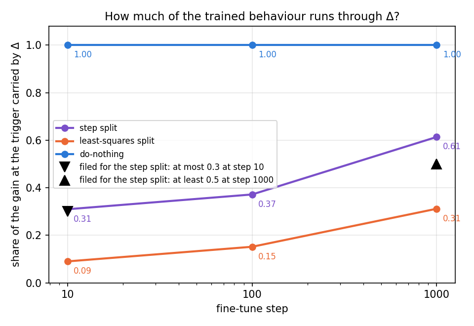
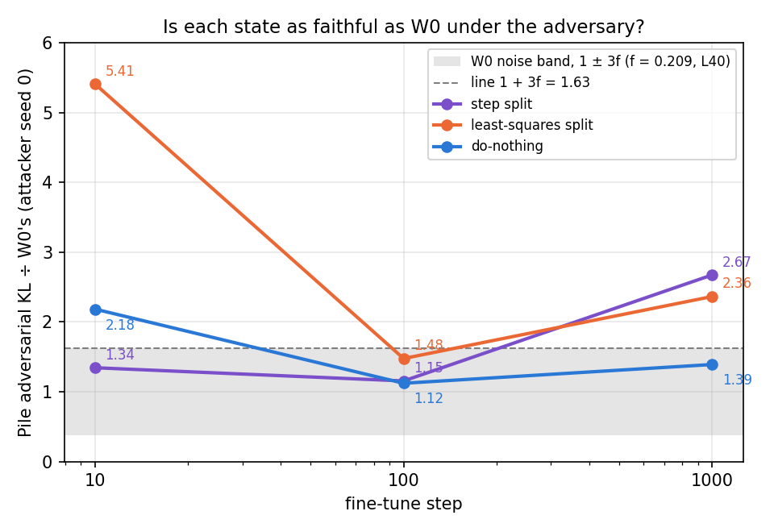
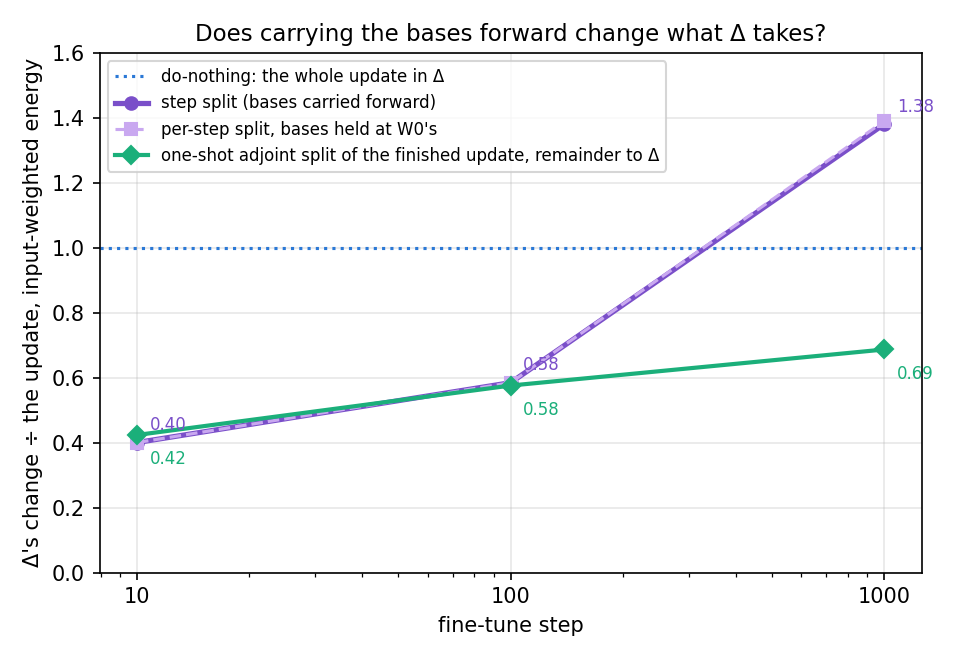

# Analysis: does splitting the fine-tune step by step keep its behaviour in the subcomponents? (E19, `experiments/step_split`)

*2026-10-21, coding agent. Plan: `reports/plans/2026-10-21_plan_step-split.md`, with its Amendment 1. Vocabulary: `GOALS.md`
→ Terms. No notebook yet: this report carries the explanation and the record.*

We followed the emoticon fine-tune one optimizer step at a time and gave the subcomponents, after every step, the part
of that step they reproduce best, putting the rest into the residual so the weights always match the fine-tuned model.
More of the trained behaviour ended up in the residual than under the least-squares split, at every point checked.
By the end the residual held more energy than the whole update. So this map keeps the model exact but does not bring
the behaviour into the decomposition, and letting the decomposition's vectors move changed nothing.

## The answer

Splitting every step of the fine-tune does not keep the behaviour inside the subcomponents. The share of the trigger's
gain that runs through the residual grows from about a third early on to over a half at the end. That is two to three
times what the least-squares split leaves there. Letting the subcomponents' vectors move with the steps made no
measurable difference. The surprise: by the end the residual's change is larger than the whole update. The
subcomponents and the residual partly cancel each other.

## What was run

The released VPD decomposition of the 67M model writes each decomposed matrix as $W = U V^\top + \Delta$. The columns
of $U$ and $V$ are the alive subcomponents' write and read vectors, and Δ is the residual. Γ, which sets the causal
importances, stays frozen throughout.

The update is the emoticon fine-tune of E14 and E16: Adam at learning rate 3e-5, batch 32, seed 0, 1000 steps, all 24
decomposed matrices. It ran once, on a MATS cluster L40, with three splits read off it:

- **Step split.** After every optimizer step, per matrix, take that step's weight change $S_t = W_t - W_{t-1}$. The
  subcomponents get the scaled adjoint split of it, $dU = c_t S_t V$ and $dV = c_t S_t^\top U$, against the current
  $U$ and $V$. The scale $c_t$ is refit every step: the input-weighted best match of the step. Δ takes the rest,
  including the second-order term $dU\,dV^\top$, so the weights equal the fine-tuned ones at every step. $U$ and $V$
  carry forward, so the next step is split against the moved vectors.
- **Per-step split with the bases held at W₀'s.** The same, but every step is split against the original $U$ and $V$.
  With one fixed scale this equals the one-shot adjoint split of the finished update plus its remainder; a CPU test
  confirms that. It isolates what moving the vectors does. It is not run through the faithfulness checks.
- **References, same card and same fine-tune.** Do-nothing puts the whole update into Δ. The least-squares split of
  the finished update gives the subcomponents the least-norm change and Δ the rest.

Each state is read at steps 10, 100 and 1000 on three things:

- **Share of the behaviour through Δ.** The gain at the trigger is split into routes; this is the share that comes
  from Δ's change. Do-nothing reads 1 by construction, and a map that put everything into the subcomponents would
  read 0.
- **Pile adversarial ratio.** The adversarial KL of the decomposition on 256 Pile rows, as a ratio to W₀'s. W₀ reads
  1; its spread over three attacker seeds gives the floor $f = 0.209$ on this card, and the pass line is
  $1 + 3f = 1.63$.
- **Δ's share of the update.** The energy of Δ's change over the update's, either plain or weighted by the task's
  inputs. Do-nothing reads 1. The one-shot adjoint split plus remainder reads one minus its reproduced share, about
  0.4 to 0.7 here.

## What we expected, and why

- The step split should follow the one-shot adjoint split closely. Moving the vectors by a few percent over many small
  steps should barely change what they reproduce. So Δ's weighted share should sit within 0.05 of both the
  fixed-bases variant and the one-shot adjoint split.
- The behaviour in Δ should start small and rise. In E16 the one-shot adjoint split kept most of the behaviour at
  step 10 and little by step 1000. The step split is roughly that state plus a remainder in Δ.
  So the remainder should carry under a third of the behaviour early and over half late. It should always carry more
  than the least-squares split leaves in Δ.
- The second-order term should be tiny, at most one part in ten thousand of each step.
- Under the adversary the step split should land between do-nothing and the least-squares split.

## What we observed

### 1. How much of the behaviour runs through Δ? (`figures/behaviour_in_delta.png`)

**Reading it.** More of the behaviour runs through Δ under the step split than under the least-squares split, at all
three steps. The purple line is the step split and rises from 0.31 to 0.61. The orange line, the least-squares split,
stays two to three times lower. Do-nothing sits at 1 by construction. The rise late in training was predicted. The
early value missed its filed ceiling of 0.3 by 0.01, so the behaviour is not mostly in the subcomponents even after 10
steps.

| step | step split | least-squares | do-nothing | step split: direct share | step split: re-switching share |
|---|---|---|---|---|---|
| 10 | 0.310 | 0.090 | 1.0 | 0.063 | 0.597 |
| 100 | 0.372 | 0.152 | 1.0 | 0.064 | 0.530 |
| 1000 | 0.614 | 0.312 | 1.0 | 0.038 | 0.493 |

The re-switching share is set by Γ on the fine-tuned model and is the same for all three states. The step split's
remaining route, through subcomponents Γ does not switch on, is 0.039, 0.022 and −0.142. The held-out probability of the
target token is the fine-tune's own at every step, 0.999, as the construction requires.

### 2. Is the step-split state faithful under the adversary? (`figures/pile_pgd.png`)

**Reading it.** It is faithful early and not at the end. At steps 10 and 100 the step split sits inside the W₀ band,
at 1.34 and 1.15. At step 10 that is better than both references, which is why it fell outside the filed band between
them. At step 1000 it reads 2.67, above the line and the worst of the three states. The caveat is the card: on the L40
the floor is 0.21, so the band is wide and a pass inside it says little.

| step | step split | least-squares | do-nothing | line $1 + 3f$ |
|---|---|---|---|---|
| 10 | 1.344 | 5.408 | 2.183 | 1.626 |
| 100 | 1.155 | 1.476 | 1.121 | 1.626 |
| 1000 | 2.673 | 2.364 | 1.390 | 1.626 |

The other Pile ratios are reported and not scored.

| step | state | stochastic | CI-masked | unmasked |
|---|---|---|---|---|
| 10 | step split | 1.001 | 0.996 | 1.82 |
| 10 | least-squares | 1.001 | 0.996 | 1.20 |
| 10 | do-nothing | 1.001 | 0.997 | 2.84 |
| 100 | step split | 0.972 | 1.004 | 1.96 |
| 100 | least-squares | 0.972 | 1.001 | 1.08 |
| 100 | do-nothing | 0.970 | 1.003 | 2.74 |
| 1000 | step split | 0.929 | 1.015 | 5.41 |
| 1000 | least-squares | 0.925 | 0.998 | 1.21 |
| 1000 | do-nothing | 0.920 | 0.993 | 5.75 |

At step 1000 the step split's unmasked ratio is close to do-nothing's and four times the least-squares split's, in
line with how much of the update its Δ holds.

### 3. Does moving the vectors change what Δ takes? (`figures/delta_share.png`)

**Reading it.** No: moving the vectors changed nothing measurable. The step split and the fixed-bases variant overlay
each other at all three steps, within 0.01 of the input-weighted share. Both agree with the one-shot adjoint split at
steps 10 and 100. At step 1000 both reach 1.38, twice the one-shot value of 0.69 and above the whole update's energy.
Since the two per-step lines agree, that jump is not caused by the moving vectors; section 4 takes it up.

| step | step split, weighted | bases held, weighted | one-shot adjoint, weighted | step split, plain | bases held, plain | largest vector change, step split | the same, bases held |
|---|---|---|---|---|---|---|---|
| 10 | 0.400 | 0.400 | 0.424 | 1.034 | 1.034 | 0.037 | 0.037 |
| 100 | 0.585 | 0.585 | 0.576 | 1.048 | 1.048 | 0.048 | 0.048 |
| 1000 | 1.381 | 1.390 | 0.687 | 1.211 | 1.213 | 0.127 | 0.128 |

The largest relative change of any write or read vector reached 0.127 by step 1000, above the filed 0.1. The
fixed-bases variant's vectors moved by the same amount, so this is the pieces adding up, not the bases turning.

Bookkeeping checks, all as expected:

- The second-order term is negligible. Its largest pooled share of a step was 7.6e-8, and 1.4e-6 in the worst
  matrix. Its accumulated share of Δ's change is 5.1e-8 at most.
- No matrix-step had a step with no first-order image.
- The outside-both energy of Δ's change equals the update's within 0.2%, at 1.0002, 1.0000 and 0.9989. The
  subcomponents' first-order changes cannot reach that block, so this confirms the books balance.
- Outside-both share over its random null, reported and not scored:

| step | Δ's change | the update |
|---|---|---|
| 10 | 0.46 | 0.22 |
| 100 | 0.52 | 0.33 |
| 1000 | 0.35 | 0.42 |

### 4. Why is Δ's change larger than the update?

This was not predicted and its cause is not established. What the data show:

- **No single step puts most of itself into Δ.** At every step the subcomponents reproduce 0.51 to 0.65 of that step's
  input-weighted energy, pooled over matrices. So each step hands Δ between 0.35 and 0.49 of itself, never more.
- **The excess comes from how the per-step pieces add up.** Δ's accumulated change exceeds the update. So the
  subcomponents' accumulated change and Δ's point partly against each other. The plain energies show the same
  excess from step 10 onwards, at 1.03, 1.05 and 1.21.
- **The refit scale separates the per-step split from the one-shot one.** With the bases held and one scale per
  matrix, the per-step split equals the one-shot adjoint split; a CPU test confirms it. The fixed-bases variant reads
  1.39, like the step split. So the gap to 0.69 comes from refitting the scale every step.
- **The pieces differ from the one-shot pieces from the start.** In the worst matrix, the fixed-bases variant's pieces
  differ from the one-shot ones by 2.1 times their size at step 10. By step 1000 the gap is 4.2 times. The weighted Δ
  share hid this until step 1000.
- **The scale spreads widely across matrices.** At each step the smallest scale over the 24 matrices was 0.03 to 0.16.
  The largest was 1.45 to 2.23. It was never zero or negative.

How each matrix's scale moves from step to step was not saved. So we cannot say which matrices carry the
cancellation, or whether noisy Adam steps with step-specific scales drive it.

## What we learned

The step split gets the weights exactly right by construction. It still leaves more of the behaviour in Δ than the
least-squares split, at every step checked. By step 1000 it also fails the adversary. So for the weak version in
`GOALS.md` it does worse than the least-squares split, not better. The question of a per-step split with moving bases,
from section 3.3 of `reports/reviews/2026-10-19_review_lora-failure-and-fixes.md`, is answered for the adjoint form. Over 1000
steps of this fine-tune the bases' movement is negligible. What changes the result is refitting the scale every step,
and that change sends energy into Δ rather than into the subcomponents.

## How compelling is the evidence

- One task, one fine-tune seed, one card. The route shares and Δ shares are deterministic given the state; the
  fine-tune itself differs slightly between cards, as E16 found.
- The Pile ratio is read at one attacker seed against an L40 floor of 0.21. The step-10 and step-100 passes are inside
  a wide band. The step-1000 reading of 2.67 is well above the line.
- The route share is blind to the Pile; the Pile ratios are blind to the trained behaviour.
- The Δ shares are blind to which subcomponents take what. Section 4 shows the pieces already differ from the one-shot
  ones at step 10 while the share agrees. Agreement on the share is weak evidence of agreement on the pieces.
- The fixed-bases variant was not run through the harness. Its agreement with the step split is on the energy
  shares and vector sizes only.

## Surprises

- **Δ's change is larger than the update at step 1000.** Its input-weighted share is 1.38, against the predicted 0.69.
  The plain share is above 1 at every step. The subcomponents and Δ partly cancel, and the refit scale is the only
  ingredient that separates this from the one-shot split. Why it cancels is not established.
- At step 10 the step-split state is more faithful under the adversary than do-nothing and the least-squares split.
- The share of the behaviour in Δ at step 10 missed its ceiling narrowly, 0.310 against 0.3.

## What next

Each needs `/design` first.

1. **Save each matrix's scale and the accumulated pieces at every step.** This means a rerun of the fine-tune, about
   3 minutes on an L40, and no Pile states. It would show whether a few matrices with a small or swinging scale carry
   the cancellation. If they do, read a step split with one scale per matrix fit to the running total. With
   negligible rotation that is the one-shot adjoint split plus remainder, which is already measured.
2. **Drop the per-step form as a candidate map for now.** The rotation question is closed for the adjoint form, and
   the refit scale only hurts. Revisit only if item 1 shows the cancellation comes from a fixable choice of scale.

## Scorecard

| id | claim in words | rule as filed | read | verdict |
|---|---|---|---|---|
| C0 | the harness at W₀ is stable | floor $f \le 0.25$ on the L40, Amendment 1 | 0.209 | pass |
| C1 | the books balance: Δ keeps the update's outside-both energy | ratio within 0.01 of 1 at each step | 1.0002, 1.0000, 0.9989 | pass |
| G2 | the step-split state is the fine-tuned model | P(target) within 1e-3 of the fine-tune's; shares sum to 1 within 1e-6; harness Δ share within 1e-3 of the split's | all nine conditions met | pass |
| G1 | the references reproduce E16 | do-nothing and least-squares PGD within 0.63 of E16's | least-squares at step 10: 5.41 vs E16's 6.96; the other five met | fail |
| P1 | the second-order term is negligible | pooled per step ≤ 1e-4; accumulated ≤ 1e-3 of Δ's change | 7.6e-8; at most 5.1e-8 | pass |
| P2 | moving the bases and refitting the scale change little | largest vector change ≤ 0.1 at step 1000; weighted Δ share within 0.05 of the fixed-bases and the one-shot values at each step | vector change 0.127; fixed-bases gaps ≤ 0.009; one-shot gaps 0.023, 0.009, 0.694 | fail |
| P3 | the behaviour in Δ rises | ≤ 0.3 at step 10; ≥ 0.5 at step 1000; ≥ least-squares at each step | 0.310; 0.614; above least-squares at all three | fail |
| P4 | the step split lies between the references under the adversary | within the band from min − 3f to max + 3f of do-nothing and least-squares | step 10: 1.34 below 1.56; steps 100 and 1000 inside | fail |

Causes of the misses, where the data allow:

- **G1.** The step-10 least-squares state read 5.41 on this L40, which is E8's L40 value; E16 and E15 read 6.96 on
  H100s. The card is the only known difference and was not tested.
- **P2, vector size.** Not from moving bases: the fixed-bases variant's vectors moved by the same 0.128. The filed
  bound was low confidence and depends on the gauge of $U$ and $V$.
- **P2, one-shot gap.** From refitting the scale every step, by construction and the fixed-bases reading; why that
  produces cancellation is not established.
- **P3.** A narrow miss at step 10; its cause is not established.
- **P4.** The step split was more faithful than both references at step 10; its cause is not established.

## Not run

- The fixed-bases variant through the Pile harness or the route split.
- Each matrix's scale per step, and the cross term between the accumulated pieces and Δ. These are needed for the
  cause of the cancellation.
- Pile ratios at attacker seeds 1 and 2 for the scored states; only W₀ ran at three seeds.
- A second fine-tune seed, another task, the LoRA, or an H100 rerun to compare with E16's references.
- A step split with one scale per matrix for the whole run.
- The notebook `notebooks/E19_step_split.ipynb`.

## Provenance

- Results: `experiments/step_split/results/step_split.json`; per-step log `results/large/per_step.json`; run log
  `results/large/full.log`, which also holds the smoke run and the stopped job 28108.
- Predictions: `results/predictions.json`, filed 2026-10-21; `results/predictions_amend1.json`, filed before the rerun.
- MATS cluster L40, Slurm job 28117, 1877 s, $0. Figures: `experiments/step_split/plot.py`.
