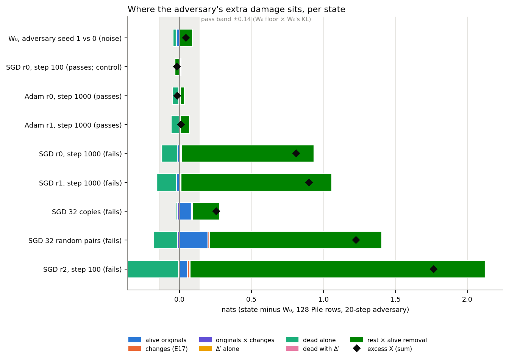
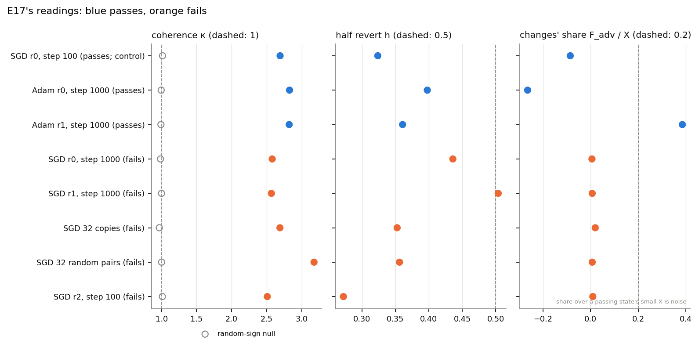
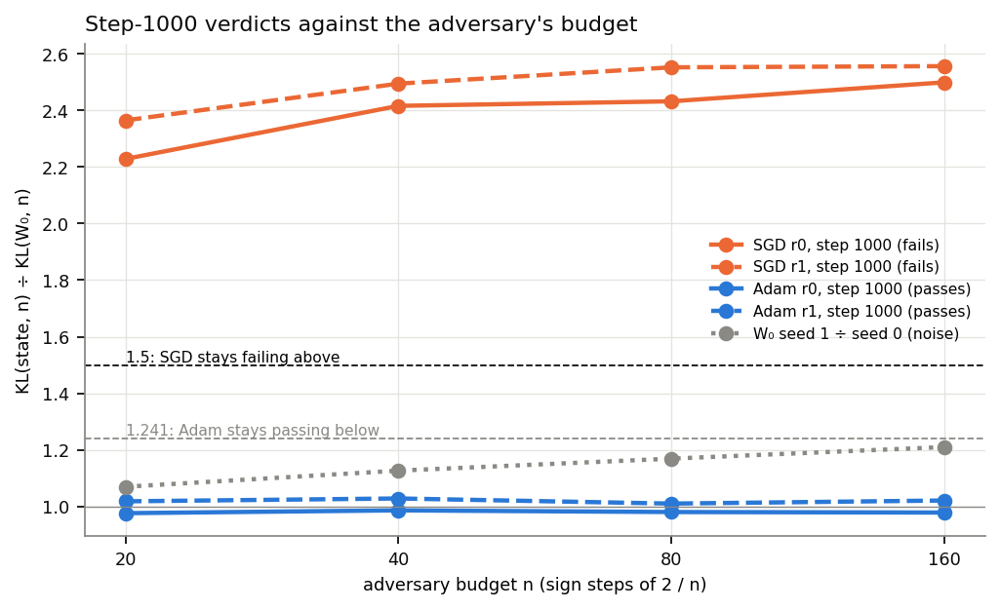

# Analysis: do the SGD failures break the decomposition the same way the Adam ones did? Yes (E23)

*2026-10-22, writing agent. Plan: `reports/plans/2026-10-22_plan_small-update-reruns.md` → E23 and its agent notes.
Predictions: `experiments/cancellation_sgd/results/predictions.json`, filed 2026-10-22 12:28 before the run and not
edited. Results: `experiments/cancellation_sgd/results/cancellation_sgd.json` from `run.py score`, JSON only. Figures:
`experiments/cancellation_sgd/figures/{parts,e17,budget}.png` from `plot.py`. Parents: E17
`reports/analyses/2026-10-21_analysis_cancellation.md`, E20 `reports/analyses/2026-10-21_analysis_cancellation-complement.md` with
Amendments 1 and 3, E21 `reports/analyses/2026-10-22_analysis_sgd-vs-adam.md`. Vocabulary: `GOALS.md` → Terms. Status: run in
full on the MATS cluster; every check and the control passed*.

We took the component-training states that still fail VPD's adversarial check after the SGD runs, and asked where the
adversary's extra damage comes from and whether a longer search changes the verdicts. On all five failing states the
damage appears only when the adversary removes the alive and the dead subcomponents together, as on the earlier Adam
failures. So the late SGD failures are the same kind of break, and they are not an artefact of a short search.

## The answer

The failures that survive the switch to plain SGD fail for the same reason as the early Adam ones. The adversary's
extra damage is not in the changed subcomponents, not in Δ, and not from changes cancelling each other. It shows up
only when the adversary's mask removes the alive and the dead subcomponents together. The step-1000 contrast also
holds under an eight times longer search: SGD stays at about two and a half times the original model, Adam at the
original model's level.

## What we were trying to test

**The setup.** VPD writes each weight matrix of the 67M target model as a sum of rank-one subcomponents plus Δ, the
part they leave over. About 9,900 subcomponents are alive, meaning Γ rates them important somewhere on the original
model's text; the rest are dead. Component training keeps Γ fixed and updates the alive subcomponents so that the
model learns a task. VPD's adversarial check then searches for a mask that keeps at least each subcomponent's causal
importance and hurts the output as much as possible. Its damage is the KL from the unmasked to the masked model on
Pile text. A state fails when that damage is clearly above the original model's.

**The question.** Two earlier experiments explained the failures of Adam component training at step 10. The first
found that the changes to the subcomponents do not cancel each other and carry under a tenth of the extra damage. The
second found that the extra damage sits in how the adversary's removal of the dead subcomponents combines with its
removal of the alive ones. At the original model those two removals largely offset; at the failing states the offset
is gone. After E21, the failures that remain are different states. They are plain SGD at step 1000 on two ladder tasks, SGD
on two key-to-value tasks, and SGD at a high rate on a third ladder task. Does the same account hold for them?

**The states.** Eight saved states, rebuilt from their saved offsets on the cluster, beside the original model W₀:

- **Five failing states:** SGD at step 1000 on ladder tasks r0 and r1; SGD on the key-to-value tasks with 32 random
  pairs and with 32 copies; SGD at rate 0.1 at step 100 on ladder task r2.
- **Two passing twins:** Adam at step 1000 on r0 and r1. They have the same size of change as the SGD states and pass,
  so they show what a passing state of that size reads.
- **The control:** SGD on r0 at step 100, which passes. It is the same task and optimiser as a failure, so if it shows
  an excess, the decomposition is reading something other than the verdict.

**The measurement.** On 128 Pile rows, each model gets its own 20-step adversary. The excess $X$ is the adversary's
damage at the state minus at W₀, in nats; 0 means no extra damage. It splits exactly into parts, each the state minus
W₀:

- $O$: removing the adversary's share of the alive subcomponents as they were at W₀.
- $F_{adv}$ and the interaction $I$: removing its share of the changes, and how that combines with $O$.
- $D$: removing its share of Δ alone. $K$: of the dead subcomponents alone. $P$: how those two combine.
- $J$: how the dead block and Δ, removed together, combine with the alive removal.

$R = D + K + P + J$ is the rest. Three readings from the first experiment were taken too. Coherence $\kappa$ is
$\lVert \sum_c d_c \rVert^2 / \sum_c \lVert d_c \rVert^2$ over the changes $d_c$: 1 when they are unrelated, above 1 when
they add up, below 1 when they cancel. The half revert $h$ is the damage of undoing a random half of the changes over
the damage of undoing all of them: about 0.5 when the changes act independently, above when they cancel.

**The budget sweep.** The adversary was rerun for 20, 40, 80 and 160 steps on W₀ and the four step-1000 states, with
the step size shrunk as $2/n$, the VPD paper's rule. The ratio is the state's damage over W₀'s at the same budget.

**Noise.** The pass band for a part is the W₀ check's floor times W₀'s damage: $0.209 \times 0.660 = 0.14$ nats. The
noise of the parts themselves is W₀ under a second adversary seed, decomposed against the first.

## What we expected, and why

- The control would show no excess, since it passes with a ratio of 0.92.
- The account of the earlier failures was asked as an open question, leaning towards "holds" because it held on every
  state measured before, passing ones included.
- The changes would add up rather than cancel. SGD's component training is close to its adjoint split, whose
  coherence was 2.4 in the first experiment.
- The SGD step-1000 states would keep failing at every budget and the Adam twins would keep passing, as on the older
  failures in the earlier sweep.

## What we observed

### Where is the extra damage on the SGD failures?

**Reading it.** On every failing state, almost all of the extra damage is the combination of the dead and alive
removals. The dark green bar is that term, and the black diamond is the total excess. On the two step-1000 states and on r2 the
green bar alone reaches past the diamond. There the dead block on its own costs a little less than at W₀, and the
combination term makes up the difference. Removing Δ alone moves the damage by under 0.003 nats on every state.
The control and both Adam twins sit inside the grey pass band, with excess within 0.02 nats of zero. The top row shows
the parts' own noise: W₀ under a second seed reads an excess of 0.05 nats, most of it in the same green term.

One part behaves differently on the key-to-value tasks. There, removing the alive subcomponents at their W₀ values
costs more than at W₀: a sixth of the excess for 32 random pairs and a third for 32 copies. On the ladder tasks it is
under a twentieth. The 32-copies state is also the smallest failure, with an excess of 0.26 nats, under twice the band.

| state | E21 ratio | excess $X$ | $O$ | $F_{adv}+I$ | $D$ | $K$ | $J$ | $R/X$ |
|---|---|---|---|---|---|---|---|---|
| W₀, seed 1 vs 0 | 1 | 0.046 | −0.021 | 0 | −0.001 | −0.021 | 0.088 | 1.47 |
| SGD r0 @100, control | 0.92 | −0.018 | 0.003 | 0.001 | 0.001 | 0.007 | −0.029 | — |
| Adam r0 @1000 | 1.07 | −0.016 | 0.004 | −0.001 | −0.000 | −0.045 | 0.025 | — |
| Adam r1 @1000 | 0.95 | 0.012 | 0.001 | 0.002 | −0.001 | −0.055 | 0.063 | — |
| SGD r0 @1000 | 2.82 | 0.811 | −0.015 | 0.010 | 0.003 | −0.107 | 0.923 | 1.01 |
| SGD r1 @1000 | 3.00 | 0.901 | −0.020 | 0.009 | 0.001 | −0.137 | 1.049 | 1.01 |
| SGD 32 copies | 2.37 | 0.256 | 0.083 | −0.008 | 0.001 | −0.009 | 0.187 | 0.71 |
| SGD 32 random pairs | 4.16 | 1.228 | 0.197 | −0.006 | −0.002 | −0.164 | 1.199 | 0.84 |
| SGD r2 @100 | 5.20 | 1.766 | 0.055 | 0.012 | −0.003 | −0.352 | 2.051 | 0.96 |

All parts in nats on 128 Pile rows; $P$ is under 0.004 in magnitude everywhere and is left out. The E21 ratio is the
adversarial ratio on 256 rows that decided each state's verdict.

### Do the changes cancel each other?

**Reading it.** No: on every state the changes add up rather than cancel. Coherence reads 2.5 to 3.2 on every state,
against 0.97 to 1.01 for the same changes with random signs. Undoing half of the changes does less than half the damage
of undoing all of them on four of the five failures. On SGD r1 at step 1000 it reads 0.504, just over the 0.5 line,
which misses the filed rule by a hair. The changes themselves account for at most 2% of the excess on any failing
state. The passing states read the same coherence and half revert, so these readings do not separate passing from
failing.

| state | $\kappa$ | null | $h$ | $F_{adv}/X$ |
|---|---|---|---|---|
| SGD r0 @100, control | 2.69 | 1.01 | 0.32 | — |
| Adam r0 @1000 | 2.83 | 1.00 | 0.40 | — |
| Adam r1 @1000 | 2.82 | 0.99 | 0.36 | — |
| SGD r0 @1000 | 2.58 | 0.99 | 0.44 | 0.006 |
| SGD r1 @1000 | 2.57 | 1.00 | 0.50 | 0.007 |
| SGD 32 copies | 2.69 | 0.97 | 0.35 | 0.019 |
| SGD 32 random pairs | 3.18 | 1.00 | 0.36 | 0.007 |
| SGD r2 @100 | 2.51 | 1.01 | 0.27 | 0.009 |

### Does a longer search change the step-1000 verdicts?

**Reading it.** No. The two SGD states read 2.2 to 2.6 times W₀ at every budget, far above the 1.5 line. The two Adam
twins read between 0.98 and 1.03 at every budget, at W₀'s level. Across the eightfold range of budgets, no state's
ratio moves by more than 12%. The SGD ratios creep up by about a tenth from 20 to 40 steps and then level off. The
grey dotted line is the noise: W₀ under a second seed drifts from 1.07 to 1.21 times seed 0. Divided by that second
seed instead, the SGD states at 160 steps still read 2.1 and the Adam twins 0.8.

| model | 20 | 40 | 80 | 160 |
|---|---|---|---|---|
| W₀ seed 0, nats | 0.660 | 0.682 | 0.701 | 0.709 |
| W₀ seed 1, nats | 0.706 | 0.768 | 0.820 | 0.857 |
| SGD r0 @1000, ratio | 2.23 | 2.42 | 2.43 | 2.50 |
| SGD r1 @1000, ratio | 2.37 | 2.50 | 2.55 | 2.56 |
| Adam r0 @1000, ratio | 0.98 | 0.99 | 0.98 | 0.98 |
| Adam r1 @1000, ratio | 1.02 | 1.03 | 1.01 | 1.02 |

The 20-step ratios here are on 128 rows and read lower than E21's 256-row ratios of 2.82 and 3.00; both sit well
above 1.5.

## What we learned

The adversary's extra damage has the same shape on every failing state measured so far. That now covers Adam early in
training, SGD late in training, high-rate SGD, and the key-to-value tasks. It comes from the joint removal of the dead
and the alive subcomponents, not from the changes or Δ. That narrows the question of why a decomposition breaks. A failing and a passing update of the same size differ in
how they shift the interplay between the alive subcomponents and the dead ones, which the update never touched. The late SGD-versus-Adam contrast from E21 is real under the
paper's own search recipe, so it is a property of the updates, not of the check.

## How compelling is the evidence

- Five failing states on four tasks, two passing twins and one passing control; one adversary seed per state.
- The split into parts is exact by construction; the closure check held to 3e-9 nats. What it cannot say is why a term
  is large: it locates the damage, it does not explain it.
- Pile rows only; the trigger rows were never looked at.
- One adversary family: sign steps with one level per subcomponent shared over all rows, up to 160 steps. A different
  search could find more damage.
- The noise of the parts, from one second-seed draw at W₀, is 0.05 nats in total and 0.09 in the combination term.
  Every failing state's combination term is at least twice that.

## Surprises

- On the key-to-value tasks, removing the alive subcomponents at their W₀ values carries a sixth and a third of the
  excess. On the ladder tasks it carries under a twentieth. The earlier experiment saw a fifth on one Adam state only.
  The filed account still holds on these states, because the combination term carries most of the rest.
- One narrow miss: the half revert on SGD r1 at step 1000 read 0.504 against a 0.5 line.

No filed prediction was reversed.

## What next

1. **Ask why the alive–dead offset is lost for SGD and kept for Adam at the same size.** Measure how far each
   state's changes point along the dead subcomponents' write directions, per matrix. If SGD's changes overlap the dead
   block much more than Adam's, that is the mechanism; if not, look at what the adversary's mask does differently.
2. **A second adversary seed on the two SGD step-1000 states and their Adam twins.** Only worth doing if a claim
   comes to rest on the exact size of the ratio rather than on the 2.5 against 1.0 contrast.

## Scorecard

Checks:

| id | rule | read | verdict |
|---|---|---|---|
| W0_pile | W₀ check within its bounds, per stage-A job | floor 0.209, seed-0 0.692, both jobs | pass |
| G0 | W₀ reproduces E20 Amendment 1 within 1e-3 | rel 0.0 on all five numbers, both jobs | pass |
| G1 | closure ≤ 1e-4 nats, per model | ≤ 2.6e-9 on all nine models | pass |
| C1 | each state's ratio gives E21's verdict, within 25% | all 8 states, rel 0.001 to 0.044 | pass |
| C3 | 20 steps reproduce stage A within 1e-3 | rel 0.0 on all six | pass |

Predictions:

| id | claim | rule | read | verdict |
|---|---|---|---|---|
| P0 | the passing control shows no excess | $\lvert X\rvert, \lvert R\rvert, \lvert J\rvert$ ≤ band 0.138 | −0.018, −0.022, −0.029 | pass |
| P1 | E20's account holds on the SGD failures | per state: $X$ > band, $R$ ≥ 0.5 $X$, reading 4, $\lvert D\rvert$ ≤ 0.05 $X$; holds on ≥ 4 of 5 | 5 of 5 | holds |
| P2 | E17's readings hold | per state: $\kappa$ ≥ 1 with null within 0.1 of 1, $h$ ≤ 0.5, $F_{adv}$ ≤ 0.2 $X$; holds on ≥ 4 of 5 | 4 of 5; SGD r1 @1000 misses on $h$ 0.504 | holds |
| P3 | SGD @1000 stays failing | ratio ≥ 1.5 at 40, 80, 160 on both | 2.42 to 2.56 | pass |
| P4 | Adam @1000 stays passing | ratio ≤ 1.241 at 40, 80, 160 on both | 0.98 to 1.03 | pass |
| P5 | ratios stable over budget | max ÷ min ≤ 1.5 on ≥ 3 of 4 | 1.12, 1.08, 1.01, 1.02 | pass |

## Not run

- A second adversary seed per state; budgets past 160; other adversary families such as per-row masks or restarts.
- The budget sweep on the key-to-value states, the r2 state and the control; only the four step-1000 states had it.
- The trigger rows; importance or layer bins of the parts; E20's permuted-originals arm.
- A notebook: the brief asked for the report only.
- Why the alive–dead offset is lost: no overlap or mechanism measurement was made.

## Provenance

- MATS cluster, `debug` QoS, one L40 per job, account `c11`, $0.
- Job 29344: `revert --shard 0`, control and step-1000 states, 1570 s of run. Job 29496: `revert --shard 1`,
  key-to-value and r2 states, 1108 s. Job 29497: `budget --shard 0`, W₀ seed 0 and SGD @1000, 25 min wall.
  Job 29498: `budget --shard 1`, W₀ seeds 0 and 1 and Adam @1000, 26 min wall. All submitted 2026-10-22; logs in
  `cluster/logs/commute-cancel-sgd-<job>.out`.
- `results/revert_shard0.json` sha256 9196ab8e…, `revert_shard1.json` 81a68910…, `budget_shard0.json` fa083917…,
  `budget_shard1.json` 78d84854…; adversary sources and stage logs in `results/large/` on the cluster only.
- Code: `experiments/cancellation_sgd/run.py`, `src/commute/excess.py`, `saved_states.offsets_state`; run.py sha256
  100e4626… on both sides.
