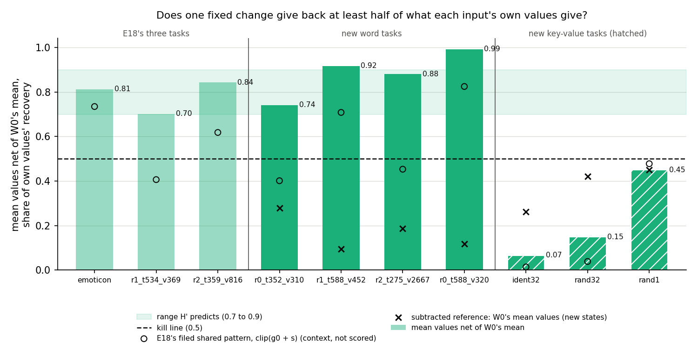
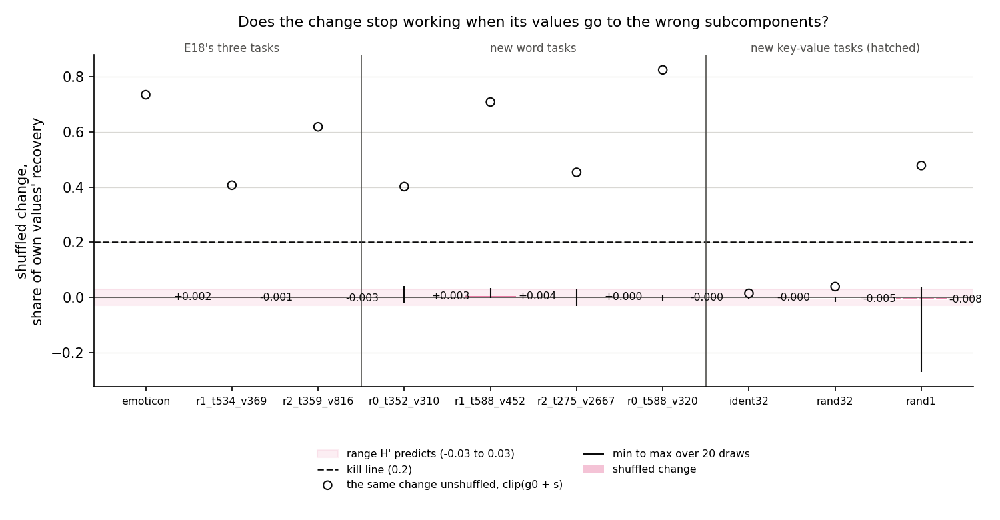
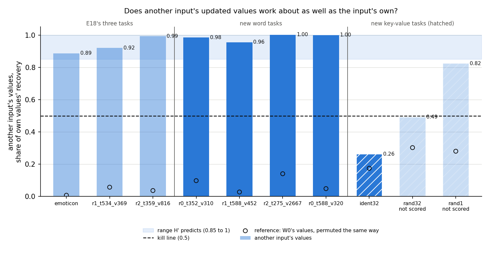

# Does one fixed change of importance values carry the switching on tasks it was never read on? (E28, analysis)

*2026-10-22, writing agent. Plan and design check: `reports/plans/2026-10-22_plan_regating-tasks.md`. The working
hypothesis and its kill conditions: `reports/decisions/2026-10-22_decision_working-hypothesis-and-two-lines.md`. Definitions:
E18, `reports/analyses/2026-10-21_analysis_regating-leak.md` Amendments 1 to 4. Code: `experiments/regating_tasks/run.py`,
shared steps in `src/commute/regating.py`, figures from `plot.py`. Explanation: `notebooks/E28_regating_tasks.ipynb`.
Words as in `GOALS.md` → Terms.*

We tested the working hypothesis on four more word tasks the model already does and three key-value tasks it lacks.
It held on every word task and failed on every key-value task, reversing our filed lean on the copy task. For
`GOALS.md`, one fixed change explains Γ's switching on the seven tasks the model already does and on none it lacks.
Restating the hypothesis with that scope is the user's decision.

## The answer

Partly. On the four new word tasks every test the working hypothesis could fail was passed. One fixed change of Γ's
importance values, the same for every input, gave back three quarters or more of what each input's own values give.
It worked only on the subcomponents it was aimed at, and another input's values did as well as the input's own. On the
three key-value tasks the fixed change gave back less than half. We had leaned the other way on the copy task, where
borrowing another input's values also failed.

## What we were trying to test

**The setup.** A fine-tune changes the weights by δW. In the *do-nothing* state δW goes into Δ and the subcomponents stay
as released. The importance function Γ is frozen but reads the updated model's activations. Δ is left out of the
CI-masked model. The *switching effect* is the rise in the CI-masked model's target log-odds at the trigger when Γ
reads the updated model instead of the original. Its share of the fine-tune's whole gain is $r$: 0 means switching does
nothing, 1 means it gives the whole gain.

**The working hypothesis.** The user adopted it on 2026-10-22. After a narrow fine-tune, the switching effect is
carried mostly by one fixed change to Γ's values at the trigger. The change is the same for every input and aimed at
particular subcomponents. The decision report named three results on a new task that would kill it:

- a fixed change gives back under 0.5 of what each input's own updated values give;
- the change, shuffled among the alive subcomponents of each matrix, gives back over 0.2;
- another input's updated values give back under 0.5.

**The symbols.** All values are at the trigger position; every other position keeps the original model's values.

- $g_0(x)$, $g_1(x)$: the original and the updated model's importance values on held-out input $x$.
- $m_0$, $m_1$: their means over the training windows; $s = m_1 - m_0$ is the fixed change.
- $\pi$: a derangement, which hands each window another window's values.

*Recovery* is the share of the switching effect a pattern gives back. Every arm is divided by the recovery of each
input's own updated values $g_1(x)$. So 0 is the original model's values, and 1 is as good as the input's own values.

**The arms.**

- **Fixed change, scored.** The updated mean values $m_1$ for every input, minus the original mean values $m_0$ read
  the same way. The subtraction matters because averaging alone gives something back. E18's first amendment
  introduced this number, and the decision report's "0.70 to 0.86 on three tasks" is it.
- **Fixed change on each input's own values, reported.** $\mathrm{clip}(g_0(x) + s)$, E18's filed pattern. It
  read 0.41 on one of E18's word tasks. Scoring it would have killed the hypothesis on a task the decision counts
  as support.
- **Shuffled change.** $s$ permuted among each matrix's alive subcomponents, added to $g_0(x)$ and clipped, twenty
  draws. It rules out that raising and lowering this many values helps, whichever subcomponents get them.
- **Another input's values.** $g_1(\pi(x))$, five derangements. Its reference is $g_0(\pi(x))$, the original values
  of the same other window. The arm is scored only where that reference is at most 0.2.
- **Different target.** The fixed change of a fine-tune to ` http`, by the same recipe, on each task's background.
  It rules out that any change of this size raises the target.
- **Random set.** The fixed change's values on its strongly switched-on subcomponents moved to a random set of the
  same size per matrix, twenty draws.

**The tasks.** Ten-step Adam fine-tunes at rate 3e-5 of all 24 decomposed matrices, seed 0, regenerated in the job.

- *Control:* emoticon, run first and alone, which must reproduce E18 and its amendments.
- *Four word tasks the model already does:* trigger and target pairs mined from Pile text, rungs 0 to 2 of the task
  ladder. The original model already gives each target some probability.
- *Three key-value tasks it lacks:* after a marker, a word is followed by itself or by a fixed random other word. The
  copy task has 32 keys, the 32-pair cipher 32, the one-pair cipher a single key. The original model gives the target
  under 0.002.

Each state was read on 97 to 103 held-out windows. The apparatus checks passed before any task was scored, as below.

## What we expected, and why

- **Word tasks: all three tests survive.** Medium-high confidence on the rung 0 and 1 tasks, where switching carries
  0.86 to 1.07 of the gain. Medium on the rung-2 task, where it carries 0.53; E18's rung-2 task had passed.
- **Copy task: a lean to "survives", low confidence.** Switching carries 0.80 of its gain, as on the word tasks.
- **The two ciphers: no lean.** With Δ out, the CI-masked model holds no cipher weights, so whatever switching carries
  is generic. A fixed change can carry generic information. But the other window has a different key, so failing
  that test would read "the switching carries the key".
- **Controls:** the wrong-target change and the random set give back at most 0.1.

## What we observed

### Does the apparatus reproduce E18?

Yes, to the third decimal. The regenerated emoticon state read a switching share of 0.596 against E18's 0.597. Its
fixed change read 0.815 against 0.813. Its own-values, filed and mean patterns were each within 0.002. The two
arms moved into the shared code matched E18's later amendments. The shuffled change read 0.0026 against 0.0023, and
another window's values 0.887 against 0.887. The original model's values through the pattern builders gave back
exactly 0. Every new task's switching share matched its on-disk reference within 0.001.

### Does one fixed change give back at least half of what each input's own values give?

**Reading it.** Yes on the four word tasks, no on the three key-value tasks. Each bar is the updated model's mean
values, net of the original model's mean values, as a share of the input's own values. On the word tasks the bars
read 0.74 to 0.99, inside or above the predicted band and well clear of the kill line. On the key-value tasks they
read 0.07 on the copy task and 0.15 on the 32-pair cipher. The one-pair cipher reads 0.45, just under the line. The
crosses are the subtracted reference, and they explain that narrow miss. There the updated mean gives back 0.90, but
the original model's mean already gives 0.45. On the copy task even the updated mean gives back only 0.33.

The open circles are the change added to each input's own original values, the pattern E18 filed. On two word tasks
they read 0.40 and 0.45, where the mean pattern reads 0.74 and 0.88. E18 saw the same gap on its first word task. Its
first amendment traced that gap to the original model's input-to-input variation plus the clip; it was not
re-measured here.

### Does the change stop working when its values go to the wrong subcomponents?

**Reading it.** Yes on every task, but the test only has power on five of the seven. Shuffled, the change gives back
within 0.01 of zero on every task, against a kill line at 0.2. The open circles are the same change unshuffled. On
the word tasks and the one-pair cipher it gives back 0.40 to 0.82, so shuffling destroys a real effect. On the copy
task and the 32-pair cipher the unshuffled change gives back under 0.05. There is nothing for shuffling to destroy,
and survival there says nothing. The one-pair cipher's draws spread widest, from −0.27 to +0.04, around a mean of
−0.01.

### Do another input's updated values work as well as the input's own?

**Reading it.** Yes on the word tasks, no on the copy task, unreadable on the two ciphers. Each bar gives every window
the updated values computed on another window. The open circles are the reference: the original values of that other
window. On the word tasks another window's values give back 0.96 to 1.00, against references of 0.03 to 0.14. On the
copy task they give back 0.26 against a reference of 0.17. So on the copy task the updated values at the key carry
something specific to the input. The natural reading is the key's identity, which the copy task must reproduce; that
is a reading, not a measurement. On the two ciphers the reference itself is 0.30 and 0.28, above the 0.2 the rule
allows. Their 0.49 and 0.82 are reported, not scored. The one-pair cipher has a single key, so this test could not
read key identity there.

### Do the controls separate patterns?

Yes, on all eight states. The wrong-target change gives back −0.24 to +0.06, and each wrong-target fine-tune learned
its own target. The random set gives back −0.008 to 0.000 on average. Neither can be read on the copy task or the
32-pair cipher as a contrast, since the change itself gives back nothing there.

### Full tables

Per state. $\rho$ is recovery as a share of the switching effect, not yet divided by the own values. Gain and gap in
nats; gap is the CI-masked model's switching effect. Held-out P is the fine-tune's probability of the target on
held-out windows.

| state | r | gain | gap | held-out P | null P | switched-on | by layer 0/1/2/3 |
|---|---|---|---|---|---|---|---|
| emoticon | 0.596 | 13.50 | 8.05 | 0.999 | 0.998 | 210 | 35/5/43/127 |
| r0_t352_v310 | 0.857 | 7.63 | 6.54 | 0.968 | 0.988 | 33 | 8/0/7/18 |
| r1_t588_v452 | 0.904 | 8.05 | 7.27 | 0.977 | 0.982 | 41 | 5/1/16/19 |
| r2_t275_v2667 | 0.533 | 16.85 | 8.97 | 0.966 | 0.909 | 85 | 8/1/27/49 |
| r0_t588_v320 | 1.074 | 6.69 | 7.18 | 0.982 | 0.982 | 10 | 0/1/2/7 |
| ident32 | 0.802 | 14.00 | 11.22 | 0.959 | 0.978 | 118 | 5/20/59/34 |
| rand32 | 0.274 | 13.73 | 3.76 | 0.586 | 0.978 | 37 | 1/2/6/28 |
| rand1 | 0.121 | 17.90 | 2.17 | 0.998 | 0.999 | 158 | 54/17/21/66 |

| state | ρ own | ρ filed | ρ mean | ρ mean, original | ρ wrong target | random mean / max |
|---|---|---|---|---|---|---|
| emoticon | 0.973 | 0.717 | 0.897 | 0.105 | −0.174 | −0.0084 / 0.0044 |
| r0_t352_v310 | 0.983 | 0.395 | 1.003 | 0.274 | −0.147 | −0.0008 / 0.0017 |
| r1_t588_v452 | 0.990 | 0.701 | 1.000 | 0.093 | −0.137 | −0.0001 / 0.0040 |
| r2_t275_v2667 | 0.942 | 0.427 | 1.006 | 0.176 | +0.064 | −0.0023 / 0.0021 |
| r0_t588_v320 | 0.996 | 0.821 | 1.106 | 0.118 | −0.240 | −0.0003 / 0.0007 |
| ident32 | 0.943 | 0.014 | 0.310 | 0.247 | +0.005 | −0.0006 / 0.0011 |
| rand32 | 0.924 | 0.036 | 0.526 | 0.389 | −0.170 | −0.0022 / 0.0012 |
| rand1 | 1.032 | 0.493 | 0.929 | 0.465 | −0.198 | −0.0050 / 0.0367 |

Shares of the own values' recovery; standard deviations over draws.

| state | fixed, net | filed | original mean ÷ own | shuffled ± sd | shuffled min / max | other ± sd | its reference ± sd |
|---|---|---|---|---|---|---|---|
| emoticon | 0.815 | 0.737 | 0.108 | +0.003 ± 0.021 | −0.063 / +0.026 | 0.887 ± 0.010 | 0.008 ± 0.003 |
| r0_t352_v310 | 0.742 | 0.402 | 0.278 | +0.003 ± 0.015 | −0.023 / +0.042 | 0.985 ± 0.001 | 0.098 ± 0.004 |
| r1_t588_v452 | 0.916 | 0.708 | 0.094 | +0.004 ± 0.008 | −0.002 / +0.034 | 0.955 ± 0.003 | 0.028 ± 0.003 |
| r2_t275_v2667 | 0.880 | 0.453 | 0.187 | +0.000 ± 0.013 | −0.032 / +0.028 | 1.002 ± 0.006 | 0.141 ± 0.005 |
| r0_t588_v320 | 0.992 | 0.825 | 0.119 | −0.000 ± 0.007 | −0.013 / +0.010 | 1.000 ± 0.001 | 0.049 ± 0.002 |
| ident32 | 0.067 | 0.014 | 0.262 | −0.000 ± 0.002 | −0.004 / +0.003 | 0.263 ± 0.010 | 0.175 ± 0.012 |
| rand32 | 0.148 | 0.039 | 0.421 | −0.005 ± 0.005 | −0.016 / +0.001 | 0.492 ± 0.016 | 0.303 ± 0.014 |
| rand1 | 0.450 | 0.478 | 0.450 | −0.008 ± 0.065 | −0.270 / +0.039 | 0.823 ± 0.008 | 0.280 ± 0.028 |

The readings against the kill conditions:

| state | fixed | shuffled | other |
|---|---|---|---|
| r0_t352_v310 | survives | survives | survives |
| r1_t588_v452 | survives | survives | survives |
| r2_t275_v2667 | survives | survives | survives |
| r0_t588_v320 | survives | survives | survives |
| ident32 | kill | survives, no power | kill |
| rand32 | kill | survives, no power | unscorable, reported |
| rand1 | kill | survives | unscorable, reported |

E18's seed-0 readings, plotted beside these, from the run's references:

| E18 task | fixed, net | filed | shuffled | other | its reference |
|---|---|---|---|---|---|
| emoticon | 0.813 | 0.735 | +0.002 | 0.887 | 0.007 |
| r1_t534_v369 | 0.702 | 0.407 | −0.001 | 0.921 | 0.057 |
| r2_t359_v816 | 0.843 | 0.618 | −0.003 | 0.993 | 0.037 |

## What we learned

The working hypothesis survived every test it could fail on four tasks it had never been read on. With E18's three, it
now holds on seven tasks the model already does: emoticon and six word tasks across rungs 0 to 2. On the three tasks
the model lacks, a single fixed change does not carry the switching. On the two ciphers that lines up with E12. There
switching carries only 0.12 and 0.27 of the gain; the rest runs through subcomponents Γ keeps off. The copy task is
the new case. Switching carries 0.80 of its gain, as on the word tasks. Yet a fixed change gives back almost
none of it, and another input's values fail too. So on the copy task the switching depends on the input. Whether the
hypothesis is restated as "on tasks the model already does" is the user's decision.

## How compelling is the evidence

Strong for the word tasks, narrower than it looks for the key-value tasks.

- One fine-tune seed per task, one 67M model, the trigger position only, 97 to 103 held-out windows per state.
- The readings are deterministic given the state: the control matched E18 within 0.002, and E18's two seeds agreed
  within 0.02.
- The shuffle test has no power on the copy task and the 32-pair cipher, since the unshuffled change gives back under
  0.05 there.
- The fixed change is one change per task. On the 32-key tasks it averages over 32 keys. A change per key was not
  tried, so the copy task's failure does not yet separate "input-specific" from "key-specific".
- On the key-value tasks the original model's mean values already give back 0.26 to 0.45 of the own values' recovery.
  On the word tasks they give 0.09 to 0.28. The net fixed change on the one-pair cipher fails by 0.05 only because
  that reference is high.
- The one-pair cipher's switching effect is small: switching carries 0.12 of its gain, a gap of 2.2 nats. Its own
  values give back 1.03, more than the whole switching effect.
- The 32-pair cipher's fine-tune reached a held-out target probability of only 0.59 at step 10. It met the scoring
  rule, which asks for a 1-nat gain.
- All rules absolute; the clip at 0 and 1 hides negative values on switched-off subcomponents.

## Surprises

- **A filed lean reversed on the copy task.** We leaned "survives" at low confidence, because switching carries 0.80
  of its gain. It failed two of the three conditions. The fixed change gave back 0.07, against a kill line at 0.5.
  Another input's values gave back 0.26 against a reference of 0.17. What the input-specific part is, we cannot say
  from these arms; the key's identity is the natural reading, not a measurement.
- **The filed pattern sat far below the mean pattern on two new word tasks.** It read 0.40 and 0.45 there. The net
  mean pattern read 0.74 and 0.88. E18 saw the same gap on its first word task, and its first amendment traced it to the
  original model's input-to-input variation plus the clip. Not re-measured here.
- **Not predicted: the original model's mean values give back more on the key-value tasks.** They read 0.26 to 0.45
  of the own values there. On the word tasks they read 0.09 to 0.28. On the one-pair cipher the own values give
  back 1.03 of the switching effect.

## What next

1. **A fixed change per key on the copy task and the 32-pair cipher.** Average the updated values only over windows
   with the same key. If that gives back 0.7 or more, the hypothesis holds per key and the kill was about averaging
   over keys. If it stays under 0.5, the switching there depends on the input beyond its key.
2. **The user's call on scope.** If the hypothesis is restated as "on tasks the model already does", E29 and
   the larger model go ahead. If not, the copy task is where to look next.
3. **A second seed on the copy task**, only if the per-key test leaves its failure as the hypothesis's main exception.

## Scorecard (as filed)

| id | claim in words | rule | read | verdict |
|---|---|---|---|---|
| G1 | emoticon reproduces E18 and its amendments | r within 0.05; own, filed, mean within 0.02; shuffled, other and its reference within 0.02; original values give back ≤ 1e-6 | diffs −0.0007, −0.0007, +0.0019, +0.0011, +0.0003, +0.0001, +0.0002; 0 exactly | pass |
| G2 | each new state reproduces its on-disk r | within 0.1 | diffs ≤ 0.001 on all seven | pass |
| K_r0_t352_v310 | survives all three | fixed < 0.5, shuffled > 0.2, other < 0.5 with reference ≤ 0.2 kill | 0.742; +0.003; 0.985, reference 0.098 | survives |
| K_r1_t588_v452 | survives all three | as above | 0.916; +0.004; 0.955, reference 0.028 | survives |
| K_r2_t275_v2667 | survives all three | as above | 0.880; +0.000; 1.002, reference 0.141 | survives |
| K_r0_t588_v320 | survives all three | as above | 0.992; −0.000; 1.000, reference 0.049 | survives |
| K_ident32 | lean survives, low | as above, two-sided | 0.067; −0.000; 0.263, reference 0.175 | **kill on fixed and other; lean reversed** |
| K_rand32 | two-sided, no lean | as above | 0.148; −0.005; 0.492, reference 0.303 | kill on fixed; other unscorable |
| K_rand1 | two-sided, no lean | as above | 0.450; −0.008; 0.823, reference 0.280 | kill on fixed; other unscorable |
| C_cross | wrong-target change ≤ 0.1 where its null learned | every scorable state | −0.240 to +0.064; nulls' P 0.91 to 1.00 | pass |
| C_random | random set ≤ 0.1 | every scorable state | means −0.008 to −0.000 | pass |
| pass rule | no kill on any ladder state | | none | pass; branch "all ladder survive, a kv kill" |

The plan's branch for this outcome: the hypothesis scoped to tasks the model already does; tell the user.

## Not run

- Seeds beyond 0.
- The donor correlation of E18's third amendment: whose gain a window follows under another window's values.
- The turned-up and turned-down halves of the change.
- SGD and other small-update states on the new tasks.
- What the switched subcomponents do: the overlap with the model's own Pile machinery for the token, and the Pile stage.
- Positions other than the trigger.
- A fixed change computed per key on the key-value tasks rather than per task.
- Faithfulness of these do-nothing states under the adversary.

## Provenance

- Results: `experiments/regating_tasks/results/regating_tasks.json`, sha256
  `252041db098c952910e4a28bb62d1152b18a11de29c8ad6baa5a08b8157154a1`. Log: `results/large/full.log`, sha256
  `492acb96bd5a060930a67b30997b5b01d0ee3fd51cae96bf7680d266f609b9e2`. Saved fixed changes:
  `results/large/<task>_shift.pt`, eight files.
- Predictions: `results/predictions.json`, filed at 13:19 BST. The run started at 13:41 BST.
  The pod's log clock reads UTC.
- Compute: RunPod RTX 4090 Secure at $0.89/h, machine 01M5HSJZ32NQ3GAV8EM4A5BR4A; the run took 142 s, about $0.16 in
  all. MATS cluster debug job 29378 waited 10.5 min without starting and was cancelled.
- Figures: `experiments/regating_tasks/figures/{fixed,shuffled,other}.png` from `plot.py`, JSON only. This write-up
  changed `plot.py`. The word and key-value tasks are grouped and labelled, with key-value bars hatched. The fixed
  figure adds the subtracted reference as crosses. The shuffled figure adds the unshuffled change as circles. The
  legend moved below the axes.

*Hand-off: a fresh session reads this report, `notebooks/E28_regating_tasks.ipynb` and the decision report. The
next step is the user's call on the hypothesis's scope; the per-key test is the cheap follow-up.*
