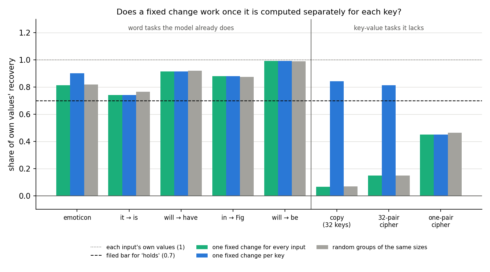
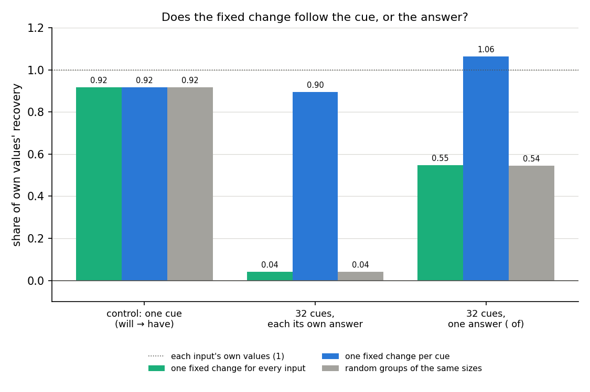
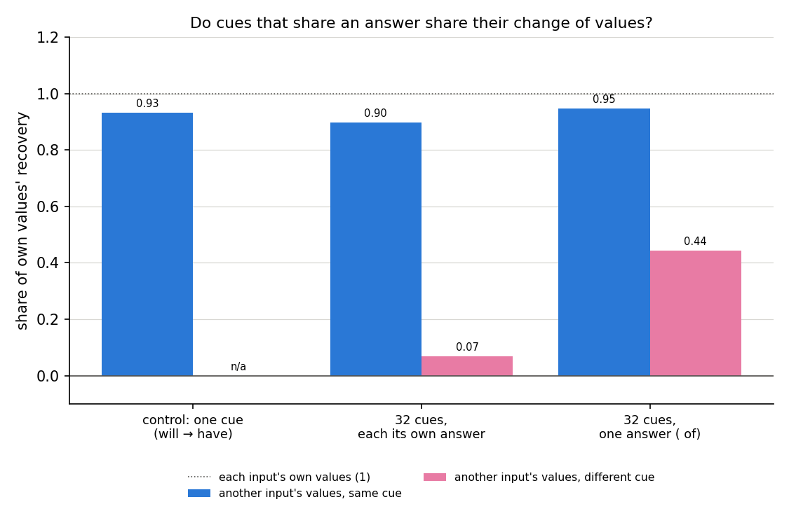
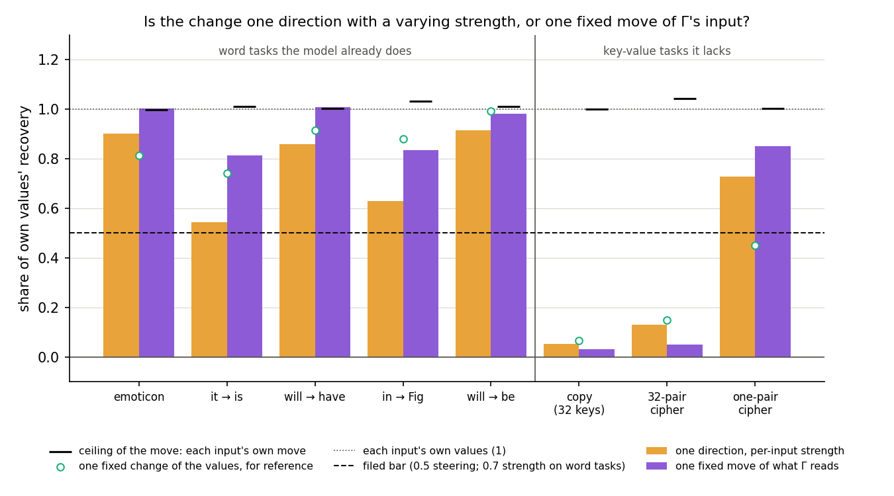
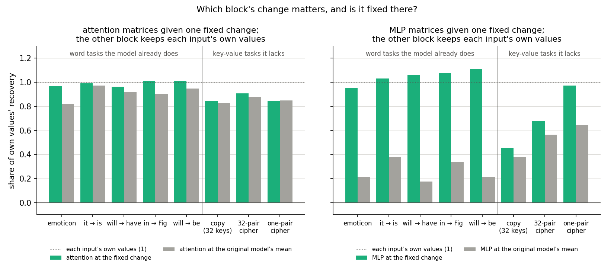

# Is the fixed change of importance values one change per cue? (E32 and E33, analysis)

*2026-10-22, writing agent. Plans and design checks: `reports/plans/2026-10-22_plan_shift-anatomy.md` (E32) and
`reports/plans/2026-10-22_plan_many-cues.md` (E33). Follows E28, `reports/analyses/2026-10-22_analysis_regating-tasks.md`. Code:
`experiments/shift_anatomy/run.py`, `experiments/many_cues/run.py`, shared steps in `src/commute/shift_anatomy.py`,
`src/commute/many_cues.py` and `src/commute/regating.py`. Figures from each experiment's `plot.py`. Words as in
`GOALS.md` → Terms.*

We asked why one fixed change of Γ's importance values failed on the copy task, and whether it follows the cue word or
the answer. A separate fixed change for each cue word gave back most of the switching on every task, the copy task
included. For `GOALS.md`, the fixed-shift hypothesis survives as "one fixed change per cue", with a partly shared change
when cues share an answer, which is the option the pending scope decision now recommends.

## The answer

Yes, per cue. On the copy task one change for every input gave back almost nothing, but one change for each of its 32
keys gave back most of what each input's own values give. Random groups of inputs of the same size gave back nothing,
so the key is what matters. When 32 different cue words were all trained toward one answer, one change per cue still
worked, and one shared change gave back about half. We had leaned toward a single shared change there. What the
per-cue change is made of is still open: three simple guesses all failed.

## What we were trying to test

**The setup, as in E28.** A ten-step Adam fine-tune at rate 3e-5 of all 24 decomposed matrices changes the weights by
δW. In the *do-nothing* state δW goes into Δ, and the subcomponents stay as released. The importance function Γ is frozen
but reads the updated model's activations, and Δ is left out of the CI-masked model. The *switching effect* is the rise
in the CI-masked model's target log-odds at the trigger when Γ reads the updated model instead of the original. Its share
of the fine-tune's whole gain is $r$.

**The working hypothesis.** The fixed-shift hypothesis says the switching effect is carried mostly by one fixed change of
Γ's values at the trigger, the same for every input. E28 found it held on five word tasks the model already partly does,
and failed on three key-value tasks it lacks. On the copy task, where each of 32 key words is followed by itself, the
failure was sharp. Switching carried 0.80 of the gain, yet one fixed change gave back only 0.07 of it.

**The symbols.** All values are at the trigger; every other position keeps the original model's values.

- $g_0(x)$, $g_1(x)$: the original and the updated model's importance values on held-out input $x$.
- $m_0$, $m_1$: their means over training windows; $s = m_1 - m_0$ is the fixed change.
- $m_{0k}$, $m_{1k}$: the same means over only the training windows whose trigger holds cue word $k$.

*Recovery* is the share of the switching effect a set of values gives back. Every number below is divided by the
recovery of each input's own updated values $g_1(x)$. So 0 means the original model's values, and 1 means as good as
the input's own values. A *net* number subtracts the same arm run with the original model's values, because averaging
alone gives something back. E28's 0.07 on the copy task is such a net number.

**E32, what the fixed change is made of.** E28's eight do-nothing states were regenerated exactly. Each state was read
by four arms:

- *One change per key.* $m_{1k}$ given to every held-out input with key $k$, net of $m_{0k}$. On the word tasks
  there is one key, so this equals the shared change. Its null is *random groups*: the training windows split into
  groups of the same sizes at random, five draws. That separates "the key matters" from "averaging fewer windows
  helps".
- *One direction, per-input strength.* Working on Γ's values before its clip to $[0, 1]$, each input moves along the
  mean change by its own amount. If inputs differ only in how far they move, this gives back everything.
- *Attention against MLP.* One block of matrices gets the fixed change while the other block keeps each input's own
  values. The block's reference gives it the original mean instead, to show whether its change matters at all.
- *One fixed move of what Γ reads.* Γ is re-run on the original model's activations, with each matrix's input at the
  trigger moved by the mean change of that input. Its ceiling moves each input by its own change.

On the copy task only, a fifth test asked whether each key's change matches the subcomponents that word itself switches
on in ordinary Pile text. Its positive control matches the original model's per-key values instead.

**E33, does the change follow the cue or the answer?** Every word task so far had one cue and one answer, and the copy
task has 32 of each, so cue and answer could not be told apart. From the task ladder's Pile rows we mined a target
with many cues the model already uses: " of", with 32 cue words such as " number", " part" and " because". After each,
the original model already gives " of" between 0.08 and 0.64 of its probability, at least five times its usual rate.
Three states were built:

- *Many answers.* The 32 cues, each fine-tuned toward its own other target with a similar starting probability. This
  is the null: one shared change should fail here.
- *One answer.* The same 32 cues and windows, all fine-tuned toward " of". This is the question.
- *Control.* " will" → " have", one cue and one answer, E28's state. Here one change per cue must equal the shared one.

Each state gets the shared change, one change per cue, and random groups. Two further numbers ask how much the cues'
changes overlap. One hands each held-out input another input's updated values, from the same cue or from a different
cue. The other is the cosine between different cues' changes, divided by the cosine between two halves of one cue's
windows: 1 when all cues move alike, 0 when unrelated.

## What we expected, and why

- **Per key on the copy task**, low-medium confidence: one change per key would give back at least 0.7 and beat random
  groups by 0.2. E28 had shown another input's values failed there, and the key was the obvious thing they differ in.
- **On the 32-pair cipher** we filed no lean.
- **Strength**: on word tasks the per-input strength arm would give back 0.7 or more, and on the copy task under 0.5.
- **Attention against MLP**, low: the working story was a fixed "when" part, spotting the cue, in attention, and an
  input-dependent "what" part in the MLPs. So on the copy task attention's fixed change should matter and the MLP's
  should not suffice.
- **Moving Γ's input**, low: works on word tasks, fails on the copy task.
- **Pile match**, low: each key's change would match the subcomponents that word switches on in ordinary text.
- **E33**, low: the change follows the answer. With many answers, one change per cue and no shared change; with one
  answer, a single shared change within 0.2 of the per-cue one.

## What we observed

### Does a fixed change work once it is computed separately for each key?

**Reading it.** Yes, on both 32-key tasks. On the copy task one change per key gives back 0.84, against 0.07 for one
change for every input. Random groups of the same sizes give back the same 0.07, so the gain comes from grouping by key,
not from averaging fewer windows. The 32-pair cipher reads the same way, 0.82 against 0.15. On the word tasks there is
one key, and the per-key change equals the shared one exactly, as it must. Each key's change rests on only 9 to 15
training windows, and it still works on inputs it never saw. The one-pair cipher stays at 0.45: one pair, one key, and
no grouping to gain from.

### Does the change follow the cue, or the answer?

**Reading it.** The cue. With 32 cues trained toward their own 32 answers, one change per cue gives back 0.90 and one
shared change gives back 0.04. With the same cues all trained toward " of", one change per cue gives back 1.06 and the
shared change 0.55. So even one shared answer does not make one change enough. By the filed rule both states read "per
cue only", and the combined reading is "follows the cue". The shared change's 0.55 is not noise, though. It is fourteen
times the many-answers state's 0.04, so cues that share an answer share part of their change. Random groups match the
shared change on both states, within 0.01, so the per-cue gain is again the cue and not the group size.

### Do cues that share an answer share their change?

**Reading it.** Partly. Another input's updated values from the same cue give back 0.90 to 0.95 on both states. From a
different cue they give back 0.07 when the answers differ and 0.44 when the answer is shared. The cosine overlap tells
the same story: different cues' changes overlap 0.46 of the within-cue ceiling with a shared answer, against 0.16
without. One caveat: the many-answers fine-tune was weaker, reaching a held-out target probability of 0.56 against 0.81,
because 32 different targets compete in ten steps.

### Is the per-key change a simple form: one direction, or one fixed move of Γ's input?

**Reading it.** Neither, on the 32-key tasks. On the copy task, letting each input move along the mean change by its
own amount gives back 0.05. Moving Γ's input by one fixed amount gives back 0.03, while each input's own move gives back
1.00. The 32-pair cipher reads 0.13 and 0.05. On the word tasks moving Γ's input works, 0.81 to 1.01, so that arm has
power. The strength arm is weaker than planned on two word tasks, 0.54 on " it" → " is" and 0.63 on " in" → " Fig".
There, working before the clip loses more than the per-input strength regains; the surprises section says why that
matters. The third guess failed as well. Each copy key's change does not match the subcomponents that word switches on
in Pile text: the match reads −0.02 against a null of 0.00, while the positive control reads 0.73.

### Which block of matrices carries the change?

**Reading it.** The MLP matrices, on every task, and attention's change barely matters. With the MLP keeping each
input's own values, attention given the original mean instead of its fixed change loses at most 0.15, and on the copy
task 0.02. With attention keeping its own values, the MLP given the original mean falls to 0.18 to 0.38 on word tasks.
Given the fixed change instead, the MLP gives back 0.95 to 1.11 there. On the copy task the MLP's fixed change gives
back only 0.46, near its 0.38 reference. So on the copy task the input-specific part sits in the MLP matrices. The filed
story put a fixed "spot the cue" part in attention; attention carries no such part on any task.

## What we learned

One fixed change of Γ's values per cue word carries most of the switching effect on every task tested, including the
copy task and the 32-pair cipher. E28's failure on those tasks came from averaging over 32 cues, not from the model
lacking the behaviour. So "tasks the model already does" is the wrong scope for the fixed-shift hypothesis: the
32-pair cipher is new to the model and still works per key, and the 32-cue " of" task is old and still needs one change
per cue. Cues that share an answer share about half their change, so the change has a part tied to the answer as well.
The per-cue change lives in the MLP matrices' subcomponents, and it is neither one direction nor one move of Γ's input.

## How compelling is the evidence

- **Controls.** Both jobs first rebuilt E28's emoticon state, and both matched E28's numbers to within 0.002. On
  every one-cue state, one change per cue equals the shared change exactly.
- **Nulls.** Random groups of the same sizes, five draws, spread under 0.02 and land within 0.03 of the shared
  change on every state. On the four 32-cue and 32-key states, the per-cue change sits 0.52 to 0.85 above them.
- **Held-out inputs.** Each per-key or per-cue change is scored only on inputs it was not averaged over. That is 1 to
  7 inputs per key on the copy task and 6 per cue in E33, about 100 to 190 per state.
- **Coverage.** One fine-tune seed, one 67M model, the trigger position only. Five word tasks, three key-value tasks,
  and one mined 32-cue task with one target, " of". The cues are frequent words.
- **Blind spots.** Every change is a mean, blind to what varies within a cue. The overlap numbers weigh all alive
  subcomponents equally, including ones that do not matter for the target. Nothing here checks faithfulness under the
  adversary.

## Surprises

1. **The single shared change did not suffice with one answer.** We leaned, at low confidence, that 32 cues trained
   toward " of" would share one change. It gave back 0.55, so the state reads "per cue only" and the combined reading
   "follows the cue", against our "follows the answer". Why cues that share an answer still need their own change, we
   cannot yet say. The shared half is real: it is fourteen times the many-answers null.
2. **Attention's change hardly matters anywhere.** We expected a fixed "spot the cue" part in attention on the copy
   task. Instead attention at the original mean does nearly as well as attention at the fixed change on every task.
3. **The strength arm's control failed on two word tasks**, 0.54 and 0.63 against a filed 0.7. Moving every value
   before the clip by the mean change gives back less there than the plain fixed change after it, 0.74 and 0.88. So
   the fixed-shift hypothesis holds in Γ's output values, not in its pre-clip values. The plan said to stop and tell the
   user if this arm's control failed; the run had already finished, so it is flagged here instead. The copy task's 0.05
   on this arm is therefore read only as "far below the word tasks", not as a clean test.
4. **The copy keys' changes do not match their Pile signatures.** We leaned that they would. The match read −0.02,
   while its control read 0.73.
5. **What the fixed change misses does not track how likely the target already was.** We leaned that inputs where the
   target started unlikely would need more. The correlation passed 0.3 on only one word task, and with the other sign.
6. On the copy task, one previous-token subcomponent in the second layer's attention queries rises by 0.30. Its rise
   ranges from 0.14 to 0.44 across keys. On the word tasks it moves 0.17 or less. Reported only.

## What next

1. **The user's scope decision**, now option (c) on the pending card: restate the fixed-shift hypothesis as "one fixed
   change per cue, partly shared across cues with one answer". If accepted, write-ups change the claim's wording and
   the line asks what the per-cue change is.
2. **What the per-cue change is, in the MLP subcomponents.** Compare each key's change on the copy task with the MLP
   subcomponents the original model uses to predict that same word. A match would make the change "switch on the
   answer's own output subcomponents", a first mechanism; a miss leaves it a lookup table.
3. **The shared half with one answer.** Split the one-answer state's per-cue changes into their common mean and the
   cue-specific rest, and score each. If the common mean sits on the MLP subcomponents that write " of", the shared part
   is the answer's part.

## Scorecard

E32 (`experiments/shift_anatomy/results/predictions.json`, filed 2026-10-22 17:43:55).

| id | claim | rule | read | verdict |
|---|---|---|---|---|
| C_key | per-key code with one key equals the shared change | \|R_key − R_mean\| ≤ 0.001 on every one-key state | 0 on all six | pass |
| C_size | random groups lose little on word tasks | R_group ≥ R_mean − 0.1 on every word task | −0.004 to +0.025 | pass |
| K_ident32 | per key holds on copy, the key matters | R_key ≥ 0.7 and R_key − R_group ≥ 0.2 | 0.84, 0.07 | holds, as predicted |
| K_rand32 | no lean | same | 0.82, 0.15 | holds per key, the key matters |
| S_word | strength works on word tasks | R_strength ≥ 0.7 on every word task | 0.54, 0.63, 0.86, 0.90, 0.92 | **fail** |
| S_ident32 | strength fails on copy | < 0.5 "not" | 0.05 | not, as predicted; its control failed |
| Rem_word | remainder tracks the original log-prob, negatively | \|corr\| ≥ 0.3 on 3 of 4 word tasks | −0.01, 0.48, 0.21, 0.29 | **does not** |
| M_word | both mixed arms work on word tasks | attn and MLP fixed ≥ 0.7 on every word task | 0.96–1.01, 1.03–1.11 | pass |
| M_ident32 | attention fixed matters, MLP fixed fails on copy | attn fixed ≥ 0.7, MLP fixed < 0.5, attn − ref ≥ 0.2 | 0.84, 0.46, 0.02 | **partial** |
| B_word | moving Γ's input works on word tasks | R_steer ≥ 0.5 on 3 of 4 | 0.81, 0.98, 1.01, 0.83 | pass |
| B_ident32 | moving Γ's input fails on copy | readable; holds if R_steer ≥ 0.5 | 0.03, ceiling 1.00 | fails, as predicted |
| P_control | Pile match control passes | own − null mean ≥ 0.05 and own > null max | 0.73 vs −0.03, max 0.01 | pass |
| P_ident32 | copy keys' changes match Pile signatures | same | −0.02 vs 0.00, max 0.02 | **not** |

E33 (`experiments/many_cues/results/predictions.json`, filed 2026-10-22 18:04:03).

| id | claim | rule | read | verdict |
|---|---|---|---|---|
| C_one | one cue: per-cue equals shared | \|R_cue − R_shared\| ≤ 0.001 | 0.000 | pass |
| C_size | random groups match the shared change | \|R_group − R_shared\| ≤ 0.1 on each 32-cue state | 0.002, 0.004 | pass |
| A_many | many answers: per cue only | R_cue ≥ 0.7, R_cue − R_shared ≥ 0.2 | 0.90, 0.04 | per cue only, as predicted |
| A_one | one answer: shared | R_shared ≥ 0.7, lead < 0.2 | 0.55, 1.06 | **per cue only** |
| Q | follows the answer | from A_one, A_many | | **follows the cue** |

## Full tables

E32, per state (all shares of own values' recovery; word tasks first).

| state | r | net fixed | per key | random groups | strength | pre-clip shift | move Γ input | its ceiling |
|---|---|---|---|---|---|---|---|---|
| emoticon | 0.60 | 0.815 | 0.901 | 0.818 | 0.901 | 0.927 | 1.003 | 0.998 |
| it → is | 0.86 | 0.742 | 0.742 | 0.767 | 0.544 | 0.537 | 0.813 | 1.010 |
| will → have | 0.90 | 0.916 | 0.916 | 0.921 | 0.860 | 0.880 | 1.009 | 1.004 |
| in → Fig | 0.53 | 0.880 | 0.880 | 0.876 | 0.630 | 0.676 | 0.834 | 1.034 |
| will → be | 1.07 | 0.992 | 0.992 | 0.990 | 0.916 | 0.943 | 0.983 | 1.012 |
| copy | 0.80 | 0.067 | 0.842 | 0.069 | 0.052 | 0.054 | 0.032 | 1.002 |
| 32-pair cipher | 0.27 | 0.148 | 0.815 | 0.148 | 0.130 | 0.125 | 0.050 | 1.043 |
| one-pair cipher | 0.12 | 0.450 | 0.450 | 0.465 | 0.728 | 0.696 | 0.852 | 1.003 |

| state | attn fixed | attn ref | MLP fixed | MLP ref | variance along the mean | corr remainder, log-prob |
|---|---|---|---|---|---|---|
| emoticon | 0.969 | 0.819 | 0.951 | 0.211 | 0.108 | −0.30 |
| it → is | 0.991 | 0.973 | 1.032 | 0.379 | 0.073 | −0.01 |
| will → have | 0.963 | 0.916 | 1.058 | 0.176 | 0.151 | 0.21 |
| in → Fig | 1.014 | 0.900 | 1.079 | 0.335 | 0.266 | 0.29 |
| will → be | 1.014 | 0.948 | 1.112 | 0.211 | 0.091 | 0.48 |
| copy | 0.844 | 0.826 | 0.455 | 0.378 | 0.018 | −0.07 |
| 32-pair cipher | 0.907 | 0.877 | 0.676 | 0.563 | 0.032 | −0.06 |
| one-pair cipher | 0.844 | 0.848 | 0.974 | 0.645 | 0.045 | 0.37 |

Pile match on the 32-key tasks: copy own −0.023, derangement null mean 0.001, max 0.017; 32-pair cipher own 0.002,
null mean 0.001, max 0.024; control with the original per-key values 0.726, null mean −0.027, max 0.015.
Previous-token subcomponents: `h.1.attn.q_proj:316` change 0.30 on copy, per-key 0.14 to 0.44, sd 0.07; 0.27 on the
32-pair cipher; −0.06 to 0.17 elsewhere. `h.1.attn.k_proj:329` 0.08 or less in absolute value on every state.

E33, per state.

| state | r | shared | per cue | random groups | same-cue donor | other-cue donor | overlap | held-out P(target) |
|---|---|---|---|---|---|---|---|---|
| control, will → have | 0.90 | 0.916 | 0.916 | 0.916 | 0.932 | n/a | n/a | 0.98 |
| 32 cues, own answers | 0.78 | 0.040 | 0.895 | 0.042 | 0.898 | 0.068 | 0.155 | 0.56 |
| 32 cues, " of" | 1.10 | 0.548 | 1.063 | 0.544 | 0.946 | 0.442 | 0.463 | 0.81 |

Overlap is the across-cue cosine over the within-cue split-half cosine: 0.142 ÷ 0.917 and 0.411 ÷ 0.888. Mining: 137
of the 600 pool words qualify as cues for " of"; the 32 used have 42 to 54 training and 6 held-out windows each.
G1 on emoticon read r 0.597 and a net fixed change of 0.813, against E28's 0.596 and 0.815.

## Not run

Seeds beyond 0; positions other than the trigger; a second many-cue target; E32's strength, block and steering arms on
E33's states; per-key strength or block arms; Pile matches for word tasks; steering at positions other than the
trigger; any of these states' faithfulness under the adversary; small-update or SGD states; a larger model.

## Provenance

- E32: `experiments/shift_anatomy/results/shift_anatomy.json` (sha256 0afad63a…a4b5), log
  `results/large/full.log`; RunPod RTX 4090, 118 s, $0.21; cluster debug job 29618 did not start in 10 min and was
  cancelled. Predictions sha256 `1dc6755e…f5c5904b…`.
- E33: `experiments/many_cues/results/many_cues.json` (sha256 1ac2e9cd…2c1e), log and per-cue changes in
  `results/large/`; MATS cluster debug job 29625, L40, 197 s, $0. Predictions sha256 `1d778e7a…`.
- Figures: `experiments/shift_anatomy/figures/{per_key,guesses,blocks}.png`,
  `experiments/many_cues/figures/{cue_vs_answer,donors}.png`.
