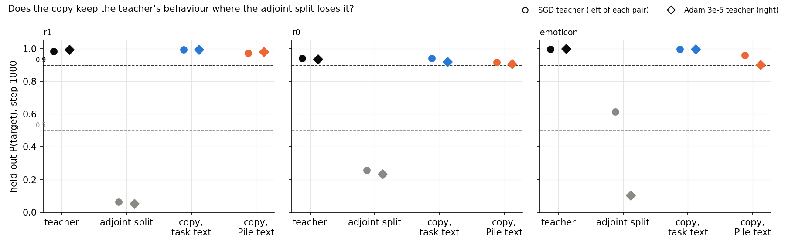
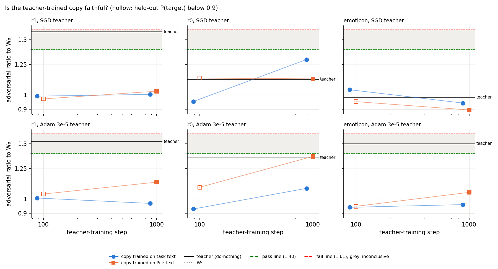
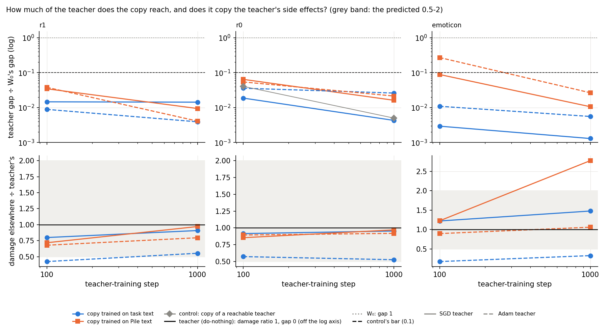
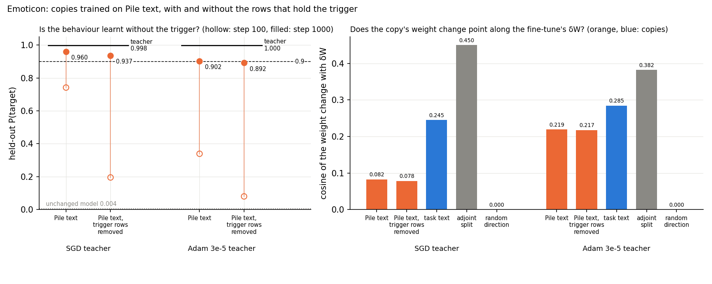
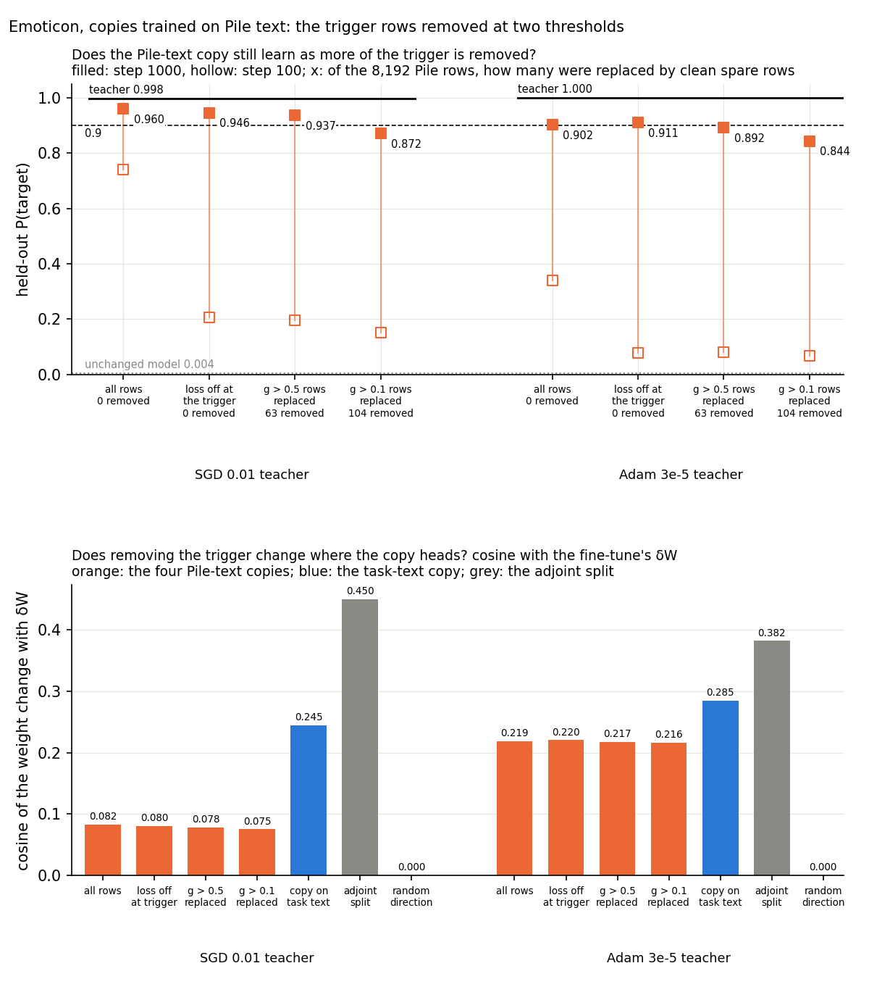
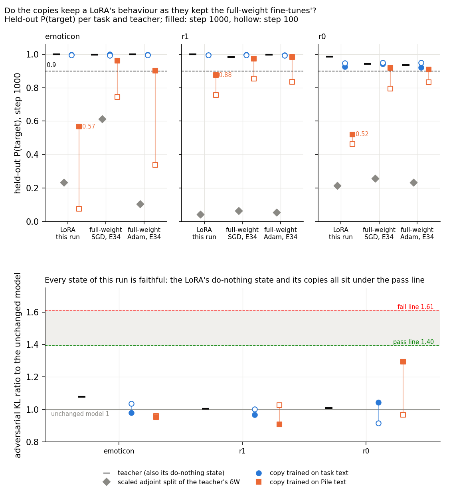
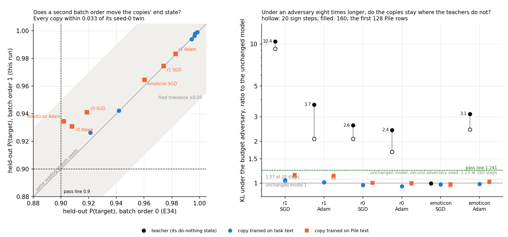
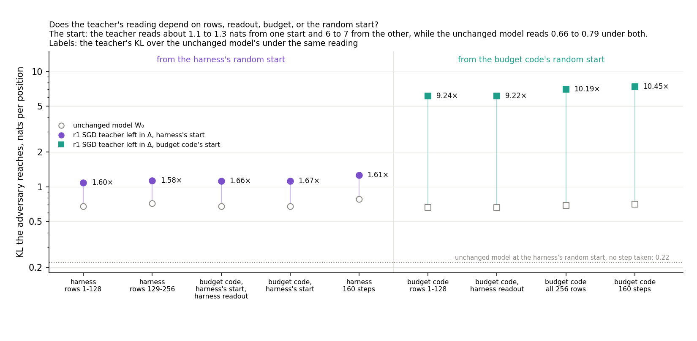
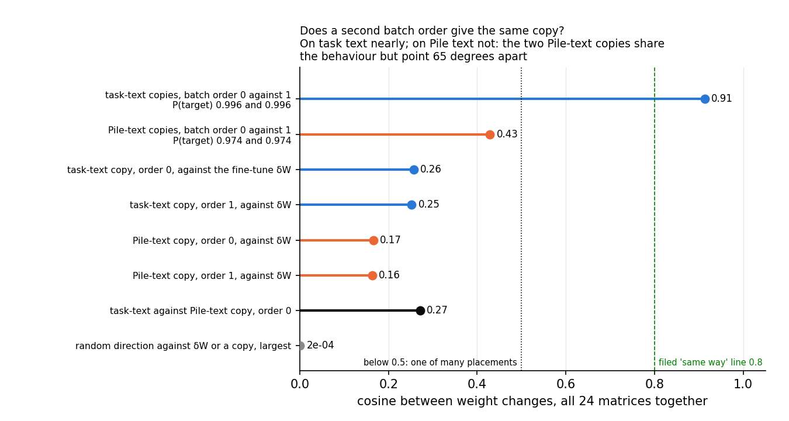

# Analysis: can the subcomponents copy a finished fine-tune from the fine-tuned model alone? Yes, on three tasks (E34)

*2026-10-23, analysis agent for the lead. Plan: `reports/plans/2026-10-23_plan_teacher-training.md` with its "Lead's
decisions". Experiment `experiments/teacher_training`. Every number below is read from
`results/teacher_training_{controls,r1_t534_v369,r0_t352_v310,emoticon}.json`; the figures and `results/scorecard.json`
come from `plot.py`, which reads only those files and `predictions.json`. Vocabulary: `GOALS.md` → Terms.*

**In plain words.** We trained the existing subcomponents to copy six fine-tuned models' predictions, with no task
labels. Every copy kept the fine-tune's behaviour and stayed faithful, even when trained on ordinary web text alone.
For `GOALS.md` this is the first map of a finished update that keeps behaviour, faithfulness and Δ together on three
tasks; Amendment 1 adds that the copy learns the emoticon behaviour with every trigger removed from its text, by a
weight change that is not the fine-tune's. Amendment 2 adds that removing also the rows where the trigger is only
partly on lowers both copies' end state to 0.87 and 0.84, a fall we cannot yet tell from noise. Amendment 3 adds that a
rank-8 LoRA is copied as well from the task's text, but only partly from ordinary text alone. Amendment 4 adds that a
second batch order moves a copy's end state by at most 0.03, which makes Amendment 2's falls real, and that every copy
stays at the unchanged model's level under an adversary eight times longer while five of the six fine-tunes do not.
Amendment 5 adds that the two adversaries' six-fold disagreement on one fine-tune comes from their random starting
points, so a one-start verdict on a fine-tune can be lenient, and that two Pile-text copies at two batch orders behave
alike but point well apart.

> **Something unexpected happened.** We predicted that a student trained only on ordinary Pile text would not learn
> the emoticon behaviour, because its trigger is so rare there. It learnt it anyway: the held-out probability of the
> target reached 0.96 and 0.90 for the two emoticon teachers, against 0.004 for the unchanged model. Amendment 1, at
> the end, settled the first question this raised: the few trigger positions in the text are not what teaches it.
> With every row holding a trigger replaced, the copies still reach 0.94 and 0.89. It did not settle how the copy gets
> there: its weight change lines up with the fine-tune's less well than the adjoint split's does, so it seems to find
> a different weight change with the same behaviour.

## The answer

Teacher training works on all three tasks we tried. The subcomponents' read and write vectors were trained to match a
fine-tuned model's predictions, with Γ and Δ frozen. Trained on the task's own text, every copy kept the behaviour and
passed the faithfulness check at both checkpoints, including where the adjoint split had lost the behaviour. Trained on
ordinary text alone, every copy also got there by the last checkpoint. That includes the emoticon task, where we had
predicted failure. Plain SGD in place of Adam made the copy unfaithful on two tasks, as it does in ordinary component
training.

## What we were trying to test

The model is the released 67M Pile model with its VPD decomposition. Each matrix is $W = UV^\top + \Delta$. The
columns of $U$ and $V$ are the alive subcomponents' write and read vectors. Γ, which sets each subcomponent's causal
importance, and Δ are frozen throughout.

**Teacher training** is component training with a different loss. The alive $(U, V)$ get trainable offsets
$(dU, dV)$ that start at zero. The loss is $\mathrm{KL}(\text{teacher} \,\|\, \text{student})$, the KL from a frozen
teacher's next-token distribution to the student's. The teacher is the fine-tuned model $W_0 + \delta W$, with all 24
decomposed matrices changed. So the map consumes only $W_0$, $W_0 + \delta W$ and some text: no target token and no
task loss. Ordinary component training needs the task's labels.

**Teachers.** Six fine-tunes, regenerated in the job with E31's recipe at seed 0 and read at step 1000. On each of three
tasks one teacher was trained with plain SGD and one with Adam at 3e-5. The tasks are emoticon, where an emoticon
predicts the letter `o`, and the two ladder tasks r0 and r1, where a common word predicts a fixed next token. The
regenerated teachers matched E31's within 0.013 in P(target) and 0.007 nats in damage elsewhere.

**Arms**, each trained for 1000 steps and scored at steps 100 and 1000:

- **Task windows, Adam 1e-5.** The fine-tune's own 41-token training windows. The KL at the trigger weighs as much as
  the mean KL over the other 40 positions, as in E21's component training. This asks whether a finished update can be
  copied at all when the student sees the cue.
- **Pile only, Adam 1e-5.** Batches of eight 512-token Pile rows, from rows the task windows were not mined from, with
  a plain mean KL over every position. No task text and no knowledge of the trigger. This is the version that would
  apply to a model someone else post-trained.
- **Task windows, plain SGD** at E21's component-training rate, on the three SGD teachers only. This asks whether
  SGD's late failure in component training belongs to the optimiser or to the training targets.

**References on the same card.** Each teacher's do-nothing state puts all of $\delta W$ into Δ; it is the teacher
itself. Its scaled adjoint split writes $\delta W$ onto the subcomponents in one linear step.

**Per state we read:**

- **Held-out P(target)**, the target's probability at the trigger on held-out windows. Teachers read 0.94 to 1.0.
  The unchanged model reads 0.004 on emoticon, and 0.15 and 0.04 on r0 and r1.
- **Adversarial ratio**: the KL a 20-step mask adversary reaches on 256 Pile rows at the state, over what it reaches
  at $W_0$ in the same job. It reads 1 if nothing changed. The floor $f$, the spread of $W_0$'s own reading across three
  adversary seeds, was 0.075. A state passes at or below $1.5/(1+f) = 1.40$ and fails at or above
  $1.5(1+f) = 1.61$, provided P(target) is at least 0.9.
- **Teacher gap**: held-out $\mathrm{KL}(\text{teacher} \,\|\, \text{state})$ on the task windows, with the trigger
  weighting above. The teacher reads 0; $W_0$ reads the teacher's whole effect, 3.2 to 5.6 nats. We report it as a
  share of $W_0$'s gap.
- **Damage elsewhere**: held-out $\mathrm{KL}(W_0 \,\|\, \text{state})$ over the 40 non-trigger positions. $W_0$ reads
  0; the teachers read 0.008 to 0.076.
- **Δ's share** of the update's energy. It reads 1 for do-nothing and below $10^{-4}$ for every student and adjoint
  state. Δ is frozen, so this checks the measurement; it is not a finding.

**Controls, run first and alone.** The unchanged model through the harness had to read its known values. A teacher
equal to $W_0$ had to leave every offset exactly zero after 100 steps. Then a reachable teacher: E26's saved
component-training state on r0, which is itself a point the student can reach. The student had to close at least 90%
of that teacher's gap and land within 0.05 of its P(target). It also tests the optimiser, loss and batch order that
differ from how that state was made.

## What we expected, and why

- **On the task windows the copies pass**, for both teachers on all three tasks. Adam component training passes at
  steps 100 and 1000 on these tasks, and this is the same training with soft targets.
- **Where the adjoint split lost the behaviour, the copy keeps it.** On r0 and r1 the adjoint split of the SGD teacher
  kept P(target) 0.26 and 0.06. We predicted the copy would keep at least 0.9, at least 0.5 above the split.
- **On Pile text alone, emoticon is not learnt.** The emoticon trigger occurs about three times in 131 thousand Pile
  positions, so we predicted P(target) below 0.5 for both emoticon teachers.
- **On Pile text alone, r0 and r1 probably are learnt.** Their triggers are common words, about ten per batch, so we
  leaned towards learnt and faithful.
- **Plain SGD passes early and fails late on r0 and r1**, as SGD component training did, and passes throughout on
  emoticon. A late pass would have said the soft targets, not the optimiser, decide SGD's failure.
- **The copies of the Adam teachers pass where the teachers themselves do not.** Those teachers read inconclusive or
  fail on the L40, and their damage elsewhere is about three times component training's.
- **The copy inherits its teacher's damage elsewhere**, between half and twice it, because the loss asks it to copy
  the teacher everywhere.

## What we observed

### 1. Does the copy keep the behaviour that the adjoint split loses?

**Reading it.** Yes, on every task and teacher. Each panel is one task; circles are the SGD teacher and diamonds the
Adam teacher. The black points are the teachers, all above the dashed 0.9 line, and the grey points are their adjoint
splits. On r1 and r0 the adjoint split falls to 0.05 to 0.26, and on emoticon the Adam teacher's split falls to 0.10.
The blue points, the copies trained on task windows, sit with the teachers at 0.92 to 1.0 in every case. The orange
points, the copies trained on Pile text only, also clear 0.9 everywhere at step 1000. The lowest are 0.91 for the r0
Adam teacher and 0.90 for the emoticon Adam teacher. Plain SGD on task windows, in the table only, keeps the
behaviour too, at 0.96 or more.

| task | teacher | teacher P | adjoint P | task windows P | Pile only P | SGD on windows P |
|---|---|---|---|---|---|---|
| r1 | SGD 0.03 | 0.983 | 0.063 | 0.996 | 0.974 | 0.986 |
| r1 | Adam 3e-5 | 0.996 | 0.053 | 0.994 | 0.983 | — |
| r0 | SGD 0.03 | 0.942 | 0.257 | 0.942 | 0.919 | 0.962 |
| r0 | Adam 3e-5 | 0.936 | 0.235 | 0.921 | 0.908 | — |
| emoticon | SGD 0.01 | 0.998 | 0.613 | 0.999 | 0.960 | 0.998 |
| emoticon | Adam 3e-5 | 1.000 | 0.104 | 0.997 | 0.902 | — |

All at step 1000. At step 100 the task-window copies already read 0.95 to 0.99. The Pile-only copies read 0.80 to 0.85
on r0 and r1, and 0.74 and 0.34 on emoticon, so they were still learning.

### 2. Is the copy a faithful decomposition, where its teacher may not be?

**Reading it.** With Adam, yes: every copy passes at step 1000, on both kinds of text. With plain SGD, no on r0 and
r1. Each panel is one teacher; the black line is the teacher itself through the same check, and the grey band is the
inconclusive zone. The blue task-window copies sit at 0.93 to 1.30 at both steps. Three teachers sit in or near the
inconclusive band: r1 SGD at 1.59, r1 Adam at 1.52 and emoticon Adam at 1.50. Their copies read 1.00, 0.97 and 0.96.
The orange Pile-only copies pass at step 1000, at 0.90 to 1.37. The highest is the r0 Adam teacher's copy, close to
the pass line and level with its teacher's 1.35. The plain-SGD copies, in the table only, keep the behaviour but read
3.14 on r1 and 3.39 on r0 at step 1000, twice the fail line. On r0 SGD had already failed at step 100, at 1.89. On emoticon SGD passes
at both steps, at 1.11.

The positive control planned for this ratio did not fire. The r0 Adam teacher read 1.97, a fail, on the L40 in E21 and
E31, but 1.35, a pass, on this H100. The SGD copies' fails at 3.1 to 3.4 show the check can still read a fail in this
job. The card moved other teachers' readings too, in both directions: r1 SGD went from 1.13 to 1.59 and r0 SGD from
1.27 to 1.12.

| task | teacher | arm | step 100 | step 1000 | verdict at 1000 |
|---|---|---|---|---|---|
| r1 | SGD | teacher itself | — | 1.588 | inconclusive |
| r1 | SGD | task windows | 0.991 | 1.004 | pass |
| r1 | SGD | Pile only | 0.971 | 1.028 | pass |
| r1 | SGD | SGD on windows | 1.000 | 3.137 | fail |
| r1 | Adam | teacher itself | — | 1.523 | inconclusive |
| r1 | Adam | task windows | 1.007 | 0.968 | pass |
| r1 | Adam | Pile only | 1.036 | 1.131 | pass |
| r0 | SGD | teacher itself | — | 1.121 | pass |
| r0 | SGD | task windows | 0.953 | 1.296 | pass |
| r0 | SGD | Pile only | 1.131 | 1.125 | pass |
| r0 | SGD | SGD on windows | 1.888 | 3.385 | fail |
| r0 | Adam | teacher itself | — | 1.353 | pass |
| r0 | Adam | task windows | 0.929 | 1.081 | pass |
| r0 | Adam | Pile only | 1.089 | 1.366 | pass |
| emoticon | SGD | teacher itself | — | 0.984 | pass |
| emoticon | SGD | task windows | 1.039 | 0.942 | pass |
| emoticon | SGD | Pile only | 0.952 | 0.895 | pass |
| emoticon | SGD | SGD on windows | 1.112 | 1.111 | pass |
| emoticon | Adam | teacher itself | — | 1.499 | inconclusive |
| emoticon | Adam | task windows | 0.940 | 0.959 | pass |
| emoticon | Adam | Pile only | 0.947 | 1.049 | pass |

Adversarial ratio to $W_0$, seed-0 adversary. The step-100 Pile-only states read "below P 0.9" on P(target), not on
this ratio. Every stochastic ratio is 0.87 to 1.02.

### 3. How much of the teacher does the copy reach, and does it copy the teacher's side effects?

**Reading it.** The copies reach almost all of the teacher, and most copy its side effects, but two Adam copies drop
much of them. The top row is the teacher gap as a share of $W_0$'s, on a log axis; the dashed line is the 10% bar the
reachable-teacher control had to clear. Every task-window copy is under 4% at step 100 and under 3% at step 1000. The
Pile-only copies close more slowly; the emoticon Adam teacher's copy is at 27% at step 100 and 2.7% at step 1000. The
bottom row is damage elsewhere over the teacher's; the grey band is the half-to-double range we predicted. Four of
six task-window copies land at 0.53 to 1.48 of their teacher. The Adam copies on r1 and r0 sit at 0.55 and 0.53, just
inside. The emoticon Adam copy sits at 0.33. It keeps the behaviour and passes, with a third of its teacher's
damage elsewhere. Outside the prediction, the emoticon SGD copy trained on Pile text has 2.8 times its teacher's
damage. That teacher's own damage is tiny, 0.008 nats, so the copy's 0.022 is still small.

| task | teacher | teacher's gap at $W_0$ | copy's gap at 1000, task windows | share | teacher's damage | copy's damage | ratio |
|---|---|---|---|---|---|---|---|
| r1 | SGD | 5.49 | 0.079 | 1.4% | 0.056 | 0.051 | 0.91 |
| r1 | Adam | 5.62 | 0.022 | 0.4% | 0.076 | 0.042 | 0.55 |
| r0 | SGD | 3.18 | 0.014 | 0.4% | 0.047 | 0.045 | 0.95 |
| r0 | Adam | 3.17 | 0.083 | 2.6% | 0.059 | 0.031 | 0.53 |
| emoticon | SGD | 5.01 | 0.007 | 0.1% | 0.008 | 0.012 | 1.48 |
| emoticon | Adam | 5.09 | 0.028 | 0.6% | 0.055 | 0.018 | 0.33 |

For comparison, the adjoint split leaves 76% to 82% of the gap on r0 and r1, 55% for the emoticon Adam teacher and
15% for the emoticon SGD teacher.

### 4. Did the controls behave?

All three passed. The unchanged model read its known values, with an adversarial floor of 0.075. With the teacher equal
to $W_0$ the first loss and every offset after 100 steps were exactly zero. On the reachable teacher, the copy closed
all but 0.5% of the teacher's 2.99-nat gap. Its P(target) was 0.931 against the teacher's 0.921, and its adversarial
ratio 1.01 against the teacher's 1.13. Its offsets recovered 76% of the teacher's: the measure is one minus the squared
distance between the two offset sets over the teacher's squared offsets. So teacher training finds a nearby
decomposition with the same function, not the identical one.

## What we learned

On all three tasks we tried, teacher training maps a finished fine-tune onto the subcomponents with the behaviour
kept, the faithfulness check passed and Δ untouched. On r0 and r1 it keeps behaviour that the adjoint split loses. So
the split's losses there come from its linear one-step rewrite; the subcomponents can reach the behaviour. It needs no labels: ordinary Pile text was enough on every task by step 1000. That is the
condition under which the map would apply to a model post-trained by someone else. Copies of teachers that read inconclusive themselves pass. So a copy can be more faithful than the
same update left in Δ. Plain SGD on the same targets fails late on r0 and r1, as in component training. So that failure
belongs to SGD on these offsets, not to the training targets.

## How compelling is the evidence

- **One adversary budget.** Every verdict is a fixed-budget reading of a 20-step adversary, which E20 showed is far
  from converged. A pass means "no worse than $W_0$ under this budget", not "faithful under any attack".
- **One seed.** One training batch order and one adversary seed per state; one fine-tune seed per teacher.
- **Three tasks, one model.** Emoticon, r0 and r1, all a trigger followed by a fixed target, on the 67M model. Nothing
  here covers a fine-tune without a single trigger, or a larger model.
- **Δ is frozen by construction.** The students cannot put anything into Δ, so Δ's share of zero is not evidence.
- **Card.** The H100's floor of 0.075 sets the pass and fail lines at 1.40 and 1.61. The planned positive control for
  the ratio, the r0 Adam teacher, passed on this card. The SGD copies' fails stand in for it.
- **The copy differs from its teacher.** The reachable-teacher control recovered the function but only 76% of the
  offsets. A pass says the copy's own decomposition is faithful, not that the teacher's update has been decomposed
  exactly.
- **Damage elsewhere is read on the task windows only.** Pile damage enters only through the adversarial ratio.

## Surprises

**The emoticon behaviour was learnt from Pile text alone.** We filed that it would not be: P(target) below 0.5 for both
emoticon teachers. It reached 0.96 for the SGD teacher and 0.90 for the Adam teacher at step 1000, and both copies
passed the faithfulness check. At step 100 they read 0.74 and 0.34, so the behaviour arrived during training, not at the
start. Two causes were open, and this run could not separate them; Amendment 1, below, ruled out the first for the end state:

1. **The trigger is rare, not absent.** Arm B drew 8,000 rows, about 4.1 million positions. The rate at which emoticon
   windows were mined predicts about 107 trigger positions among them. A count of emoticon token pairs that also occur
   in the training windows finds 112. These are proxies: the trigger is defined by one subcomponent's causal
   importance, which needs the model. Each such position weighs 1/4096 of a batch's loss. That may be enough, since the
   teacher's prediction there differs from the unchanged model's by several nats.
2. **The teacher's changes on ordinary text carry the update.** A fine-tune of all 24 matrices also changes the
   predictions at non-trigger positions. Those changes may pin down enough of $\delta W$ that copying them reproduces the
   update, the trigger behaviour included.

The emoticon Adam copy's damage ratio of 0.33 is a narrow miss on one of six copies. Plain SGD failing r0 already at
step 100 was also not filed: we predicted a pass there, as SGD component training had.

## What next

1. **Separate the two causes of the Pile-only surprise.** Ran as Amendment 1, below. Rerun the Pile-only arm on emoticon with the trigger
   positions removed from the loss, or the rows holding them removed. Read the cosine between the student's weight
   change and $\delta W$, and the reproduced share. If the behaviour survives without the trigger positions and the
   change aligns with $\delta W$, the off-trigger fingerprint carries the update. Then teacher training could recover
   behaviours that the copying text never shows. If it does not survive, a handful of trigger positions is what it needs.
2. **Test the passes under a stronger adversary and more seeds.** Rerun the step-1000 copies and their teachers
   under a longer adversary, with a second batch order. If the copies still sit at $W_0$'s level where the teachers do
   not, teacher training is the commute line's working map.
3. **A fine-tune without a single trigger, then the larger model.** Both are on the backlog. Teacher training is the
   map to carry to them if the first two hold.

## Scorecard

| id | claim | rule | read | verdict |
|---|---|---|---|---|
| C1 | the unchanged model reads its known values | `faith_score.w0_check` | floor 0.0748, seed-0 PGD within 1.3%, CI-masked within 0.05% | pass |
| C2 | a teacher equal to $W_0$ leaves the student at $W_0$ | step-1 loss and every offset exactly 0 | 0.0 and 0.0 | pass |
| C3 | a reachable teacher is recovered | gap at 1000 ≤ 10% of $W_0$'s; \|P − teacher's\| ≤ 0.05 | 0.5%; 0.931 vs 0.921; adversarial 1.01 vs 1.13; offset recovery 0.76 | pass |
| P1 | task-window copies of the SGD teachers pass at 100 and 1000 | `state_verdict` per task | r1 0.99, 1.00; r0 0.95, 1.30; emoticon 1.04, 0.94 | holds: all three |
| P2 | on r0 and r1 the copy keeps P ≥ 0.9 and ≥ the adjoint's + 0.5 | SGD teacher, step 1000 | r0 0.942 vs 0.257; r1 0.996 vs 0.063 | holds |
| P3a | Pile-only copies do not learn emoticon | P < 0.5, both teachers, step 1000 | 0.960, 0.902 | **reversed** |
| P3b | Pile-only copies learn r0 and r1, faithfully (lean) | SGD teacher, step 1000: P and verdict | r0 0.919 pass; r1 0.974 pass | holds: learnt and faithful |
| P4 | SGD copies pass at 100, fail at 1000 on r0, r1; pass both on emoticon | `state_verdict` | r1 1.00 pass, 3.14 fail; r0 1.89 fail, 3.39 fail; emoticon 1.11, 1.11 pass | misses as filed: r0 failed at 100; the step-1000 fails and emoticon as predicted |
| P5 | Adam-teacher copies pass where the teacher reads fail or inconclusive | step 1000 | r1 0.97 vs teacher 1.52; emoticon 0.96 vs 1.50; r0 teacher passed here, 1.35, so not tested | holds on the two tasks it applies to |
| P6 | every task-window copy's damage is 0.5 to 2 times its teacher's | step 1000, relative | 0.91, 0.55, 0.95, 0.53, 1.48, 0.33 | misses: emoticon Adam 0.33 |

Order of P6's reads: r1 SGD, r1 Adam, r0 SGD, r0 Adam, emoticon SGD, emoticon Adam. `results/scorecard.json` holds the
same verdicts by the filed rules; it scores P4 "fail" because the r0 step-100 reading differs.

**Corrections to the lead's reading.** The task-window copies' teacher gap is at most 3.6% of $W_0$'s gap, at r0 Adam
step 100, and at most 2.6% at step 1000. The lead's "≤ 0.11" matches the largest gap in nats, 0.114, not the share.
Everything else in the lead's reading matches the JSONs.

## Full readings

Teacher reproduction against E31, step 1000: P(target), damage elsewhere, size of change.

| task | teacher | this job | E31, L40 |
|---|---|---|---|
| r1 | SGD 0.03 | 0.983, 0.056, 0.0287 | 0.991, 0.049, 0.0286 |
| r1 | Adam 3e-5 | 0.996, 0.076, 0.0333 | 0.995, 0.078, 0.0342 |
| r0 | SGD 0.03 | 0.942, 0.047, 0.0300 | 0.944, 0.047, 0.0300 |
| r0 | Adam 3e-5 | 0.936, 0.059, 0.0341 | 0.949, 0.065, 0.0352 |
| emoticon | SGD 0.01 | 0.998, 0.008, 0.0122 | 0.998, 0.007, 0.0122 |
| emoticon | Adam 3e-5 | 1.000, 0.055, 0.0321 | 0.999, 0.055, 0.0315 |

Every student state, task by teacher by arm by step: adversarial and stochastic ratio, P(target), teacher gap in
nats, damage elsewhere, size of change.

| task | teacher | arm | step | adv | stoch | P | gap | damage | size |
|---|---|---|---|---|---|---|---|---|---|
| r1 | SGD | windows | 100 | 0.991 | 0.981 | 0.995 | 0.080 | 0.045 | 0.0129 |
| r1 | SGD | windows | 1000 | 1.004 | 0.957 | 0.996 | 0.079 | 0.051 | 0.0172 |
| r1 | SGD | Pile | 100 | 0.971 | 0.967 | 0.854 | 0.189 | 0.040 | 0.0122 |
| r1 | SGD | Pile | 1000 | 1.028 | 0.982 | 0.974 | 0.052 | 0.054 | 0.0218 |
| r1 | SGD | SGD | 100 | 1.000 | 0.952 | 0.986 | 0.083 | 0.064 | 0.0079 |
| r1 | SGD | SGD | 1000 | 3.137 | 0.969 | 0.986 | 0.031 | 0.068 | 0.0213 |
| r1 | Adam | windows | 100 | 1.007 | 0.966 | 0.993 | 0.050 | 0.032 | 0.0133 |
| r1 | Adam | windows | 1000 | 0.968 | 0.929 | 0.994 | 0.022 | 0.042 | 0.0209 |
| r1 | Adam | Pile | 100 | 1.036 | 0.872 | 0.834 | 0.214 | 0.052 | 0.0122 |
| r1 | Adam | Pile | 1000 | 1.131 | 0.882 | 0.983 | 0.023 | 0.061 | 0.0216 |
| r0 | SGD | windows | 100 | 0.953 | 0.973 | 0.950 | 0.060 | 0.043 | 0.0121 |
| r0 | SGD | windows | 1000 | 1.296 | 0.948 | 0.942 | 0.014 | 0.045 | 0.0177 |
| r0 | SGD | Pile | 100 | 1.131 | 0.957 | 0.795 | 0.205 | 0.040 | 0.0103 |
| r0 | SGD | Pile | 1000 | 1.125 | 0.967 | 0.919 | 0.052 | 0.046 | 0.0210 |
| r0 | SGD | SGD | 100 | 1.888 | 0.993 | 0.973 | 0.245 | 0.072 | 0.0091 |
| r0 | SGD | SGD | 1000 | 3.385 | 0.987 | 0.962 | 0.074 | 0.059 | 0.0202 |
| r0 | Adam | windows | 100 | 0.929 | 0.977 | 0.949 | 0.114 | 0.034 | 0.0124 |
| r0 | Adam | windows | 1000 | 1.081 | 0.928 | 0.921 | 0.083 | 0.031 | 0.0204 |
| r0 | Adam | Pile | 100 | 1.089 | 0.874 | 0.833 | 0.172 | 0.053 | 0.0114 |
| r0 | Adam | Pile | 1000 | 1.366 | 0.878 | 0.908 | 0.068 | 0.054 | 0.0206 |
| emoticon | SGD | windows | 100 | 1.039 | 0.996 | 0.993 | 0.015 | 0.010 | 0.0085 |
| emoticon | SGD | windows | 1000 | 0.942 | 0.987 | 0.999 | 0.007 | 0.012 | 0.0126 |
| emoticon | SGD | Pile | 100 | 0.952 | 1.001 | 0.743 | 0.443 | 0.010 | 0.0084 |
| emoticon | SGD | Pile | 1000 | 0.895 | 1.009 | 0.960 | 0.053 | 0.022 | 0.0159 |
| emoticon | SGD | SGD | 100 | 1.112 | 1.018 | 0.994 | 0.009 | 0.010 | 0.0037 |
| emoticon | SGD | SGD | 1000 | 1.111 | 0.998 | 0.998 | 0.008 | 0.013 | 0.0089 |
| emoticon | Adam | windows | 100 | 0.940 | 0.988 | 0.994 | 0.056 | 0.010 | 0.0090 |
| emoticon | Adam | windows | 1000 | 0.959 | 0.953 | 0.997 | 0.028 | 0.018 | 0.0184 |
| emoticon | Adam | Pile | 100 | 0.947 | 0.902 | 0.339 | 1.376 | 0.049 | 0.0106 |
| emoticon | Adam | Pile | 1000 | 1.049 | 0.904 | 0.902 | 0.136 | 0.058 | 0.0201 |

Teachers and adjoint states: adversarial ratio and verdict of the teacher, its gap at $W_0$, and the adjoint state's
P(target), gap, damage and size.

| task | teacher | teacher adv | verdict | gap at $W_0$ | adjoint P | adjoint gap | adjoint damage | adjoint size |
|---|---|---|---|---|---|---|---|---|
| r1 | SGD | 1.588 | inconclusive | 5.486 | 0.063 | 4.467 | 0.021 | 0.0211 |
| r1 | Adam | 1.523 | inconclusive | 5.622 | 0.053 | 4.612 | 0.042 | 0.0263 |
| r0 | SGD | 1.121 | pass | 3.182 | 0.257 | 2.419 | 0.022 | 0.0210 |
| r0 | Adam | 1.353 | pass | 3.172 | 0.235 | 2.480 | 0.041 | 0.0266 |
| emoticon | SGD | 0.984 | pass | 5.012 | 0.613 | 0.736 | 0.005 | 0.0085 |
| emoticon | Adam | 1.499 | inconclusive | 5.090 | 0.104 | 2.815 | 0.072 | 0.0240 |

Reachable-teacher control on r0: the teacher state read adversarial 1.133, P 0.921, damage 0.023, size 0.0174.
At steps 100 and 1000 the student's adversarial ratio read 0.939 and 1.013. Its P read 0.949 and 0.931. Its gap read
0.121 and 0.015 nats. The hook-path floor,
the gap with the student's offsets set to the teacher's, was 0.0007 nats.

Trigger count for the Pile-only arm, computed on CPU from the cached rows without the model. The arm's sampler drew
8,000 rows from Pile train rows 32,768 to 40,959; 5,083 were distinct. Emoticon token pairs that also occur in the
training windows: 112 positions. Any emoticon-like pair: 267, which includes non-emoticon uses of colons and
brackets. Mining-rate expectation: 107.

## Not run

- The Pile-only arm with trigger positions removed, and the cosine of the student's change against $\delta W$: ran
  as Amendment 1. The reproduced share was not run.
- A longer adversary than 20 steps on any state; more than one batch order, adversary seed or fine-tune seed.
- r2_t275_v2667: no scored teacher exists, and component training does not pass cleanly there.
- A mixed arm of task windows and Pile; the uniform-weight loss on task windows.
- SGD on Pile text; SGD on the Adam teachers.
- Teachers at steps 10 and 100; LoRA teachers.
- Γ trained alongside $(U, V)$.
- A fine-tune without a single trigger; a model post-trained by someone else; the larger model.
- Damage elsewhere on Pile text as its own number.

## Provenance

- RunPod H100 80GB HBM3, pod 01M5M9KV8G5C485ZTGC5Q8HWEC, run 67 min (12:15 to 13:22 pod time), $6.13. Files
  downloaded per task and checked by sha256 on both sides.
- Results: `experiments/teacher_training/results/teacher_training_controls.json` (sha256 `66588c84…`),
  `teacher_training_r1_t534_v369.json` (`49067d84…`), `teacher_training_r0_t352_v310.json` (`d6fde75c…`),
  `teacher_training_emoticon.json` (`158591c8…`), `results/large/run.log` (`41ca0440…`).
- Saved states: `results/large/<task>/A_{sgd,adam}_step1000.pt` and `results/large/r0_t352_v310/C3_student_step1000.pt`,
  bf16 offsets, about 60 MB each.
- Predictions: `results/predictions.json`, filed 2026-10-23 12:42:41, unedited (`25c1ca6e…`).
- Figures and scorecard: `experiments/teacher_training/figures/{behaviour,faithful,gap_damage}.png`,
  `results/scorecard.json`, from `plot.py`. The teacher-gap row of `gap_damage.png` was moved to a log axis at analysis. On 2026-10-23 (user) the figures were
  relabelled by training text (task text, Pile text) and the plain-SGD arm and the masked version of Amendment 1 were
  left out of them; their readings stay in the tables.
- Code: `experiments/teacher_training/run.py`, `src/commute/teacher.py`, `component_training.train(loss_fn=...)`.

**Hand-off.** A new session starts from this report, its Amendment 1 section, `reports/plans/2026-10-23_plan_teacher-training.md`
and `backlog.md`. "What next" item 1 ran as Amendment 1. Its first decision is the order of Amendment 1's "What next":
close the partly-on loophole, a LoRA teacher, a second seed and a longer adversary, then the larger model. The LoRA
teacher ran as Amendment 3, at the end of this report: its "What next" asks for longer Pile-text copies of the LoRA
and a direct reading of the teacher's change on the Pile rows. Amendment 2, between them, dropped the partly-on rows: both copies fell,
by 0.065 and 0.049, and its reading waits on Amendment 4's noise floor. Amendment 4, last in this report, supplied that
floor: 0.032 across the Pile-text copies and 0.005 across the task-text copies, so both falls stand above it; it also
read every copy at the unchanged model's level under a 160-step adversary where five of the six fine-tunes read 2.4
to 10.4. Its open item is why that adversary reads the fine-tunes so far above the 20-step harness.

## Amendment 1 (2026-10-23): is the Pile-only result the trigger's occurrences or the teacher's fingerprint?

*Design and filed predictions: `reports/plans/2026-10-23_plan_teacher-training.md` → "Amendment 1";
`experiments/teacher_training/results/predictions_amend1.json`, unedited. Every number below is read from
`results/teacher_training_amend1.json`; the figure and `results/scorecard_amend1.json` come from
`plot.py --amend1`.*

**In plain words.** We retrained the Pile-only copies of the two emoticon fine-tunes after taking every emoticon
trigger out of their training text, either by ignoring the loss there or by swapping out the rows that held one. The
copies still learnt the emoticon behaviour almost as well as before, only more slowly at first, but their weight
changes point along the fine-tune's no better than before and less well than the adjoint split's. For `GOALS.md`
this says teacher training on ordinary text recovers what the update does without seeing where it acts, and that it
reaches that behaviour by a different weight change from the fine-tune's.

### The answer

The rare trigger positions in the Pile text are not what taught the copy the emoticon behaviour. With every row that
held a trigger replaced by a clean one, the copy of the SGD fine-tune still reached a target probability of 0.94, and
the copy of the Adam fine-tune 0.89. Both sit within about 0.02 of the copies that saw the triggers. What the triggers
did was speed up the first hundred steps. The copies do not reproduce the fine-tune's weight change: they find another
one with the same behaviour.

### What we were trying to test

E34's Pile-only copy, here called arm B, learnt the emoticon behaviour though we had predicted it would not. Two
explanations were open. Either the roughly one hundred trigger positions in its 8,000 Pile rows carried the behaviour,
or the teacher's changed predictions on ordinary text were enough to pin it down.

**The trigger.** A position counts as a trigger when subcomponent `h.2.mlp.down_proj:2359` has causal importance $g$
above 0.5 at $W_0$. This is the same rule that mined the task's training windows, and at such a position the model's
next token is the target. It was computed in the job from Γ, not from token ids: the emoticon tokens occur about 94,000
times in these rows, almost always with that subcomponent off. The trigger occurs at 90 positions in 63 of the 8,192
Pile rows. The 8,000 rows drawn during training hold 88 of them, in 58 draws.

**Three versions of arm B**, each trained for 1,000 steps from each of the two emoticon teachers with E34's recipe:

- **B**, exactly as in E34. For the SGD teacher this is also the reproduction check.
- **B with the trigger masked.** The same batches, with the loss weight set to zero at every trigger position. Rows
  where later positions can attend to the trigger stay in.
- **B with the trigger rows dropped.** Every row holding a trigger is replaced, at the same index, by the next clean
  row from 1,024 spare Pile rows. The student never sees a trigger above 0.5.

The teachers are E34's two emoticon fine-tunes, regenerated in the job. They matched E31's within 0.001 in target
probability and 0.0006 in size of change.

**What we read**, per state at step 1000 unless said otherwise:

- **Held-out P(target)**, the target's probability at the trigger on held-out task windows. The unchanged model reads
  0.004; the teachers read 0.998 and 1.000. We also read it at step 100, from the training loop's free held-out
  reading rather than the full harness.
- **The adversarial check**, as in E34. The ratio of the KL a 20-step mask adversary reaches at the state to what it
  reaches at $W_0$; 1 means no change. Pass at or below 1.40 provided P(target) is at least 0.9.
- **The cosine of the student's weight change with $\delta W$.** The student's change in each matrix is
  $(U + dU)(V + dV)^\top - UV^\top$. The cosine is taken over all 24 matrices' entries at once: 1 means the same
  direction as the fine-tune's $\delta W$, 0 means unrelated. Three references per teacher: E34's task-window copy at
  step 1000, the positive control, trained where the trigger is; the adjoint split of the same $\delta W$, a linear
  fit to it inside the subcomponents' span; and a random direction of the same shapes, the null, which should read
  about 0.

**Controls, run first.** The unchanged model through the harness had to read its known values. Then the SGD teacher's
plain arm B, retrained here, had to reproduce E34's reading before any new version ran.

### What we expected, and why

- **The copies with the triggers removed still learn**, for both teachers, with P(target) at least 0.9 and a pass.
  We leaned this way because 88 positions out of four million seemed too few to teach a behaviour, while a fine-tune
  of all 24 matrices changes predictions everywhere.
- **Masking the loss and dropping the rows give the same reading.** A difference would say that rows where later
  positions attend to the trigger carry the behaviour.
- **The copy without triggers points along $\delta W$**: a cosine at least half of the task-window copy's, and above
  0.2. If the copy learns the behaviour by copying the update's effects on ordinary text, its weight change should
  move towards the update itself.

### What we observed

#### 1. Is the behaviour learnt with every trigger removed?

**Reading it.** Yes, nearly as well as with the triggers. The left panel shows held-out P(target) for arm B with
and without the trigger rows, step 100 hollow and step 1000 filled, beside each teacher's own reading; the masked
version is in the table only. With the SGD teacher all
three end above the 0.9 line, at 0.96, 0.95 and 0.94. With the Adam teacher they end at 0.90, 0.91 and 0.89, so the
version with the rows dropped sits 0.008 under the line. All three Adam copies pass the adversarial ratio itself, at
1.05 to 1.20. The triggers matter early: at step 100 the plain copies read 0.74 and 0.34, the trigger-free ones
about 0.20 and 0.08. So the triggers speed up learning but are not needed for the end state.

#### 2. Does the student's weight change point along the fine-tune's?

**Reading it.** No more than it did with the triggers, and less than the adjoint split. The right panel of the same
figure plots each state's cosine with $\delta W$. Removing the triggers barely moves it, by 0.005 at most.
It stays near 0.08 for the SGD teacher and 0.22 for the Adam teacher. The task-window copy reads 0.245 and 0.285, and the adjoint split 0.450
and 0.382. The random direction reads 0.0002, so every cosine is far above chance. Yet the adjoint split, which points
along $\delta W$ best, keeps the least behaviour: in E34 it kept P(target) 0.61 and 0.10 on these teachers. The copies
keep 0.89 to 0.96 with cosines a fifth to a half as large. Per matrix, no trigger-free copy's cosine exceeds 0.37.

| teacher | version | P at 100 | P at 1000 | adversarial | stochastic | verdict | teacher gap | damage | cosine with δW |
|---|---|---|---|---|---|---|---|---|---|
| SGD 0.01 | B | 0.742 | 0.960 | 0.895 | 1.009 | pass | 0.053 | 0.022 | 0.083 |
| SGD 0.01 | B, trigger masked | 0.207 | 0.946 | 0.952 | 1.010 | pass | 0.074 | 0.022 | 0.080 |
| SGD 0.01 | B, trigger rows dropped | 0.195 | 0.937 | 1.011 | 1.008 | pass | 0.091 | 0.025 | 0.078 |
| Adam 3e-5 | B | 0.339 | 0.902 | 1.049 | 0.904 | pass | 0.135 | 0.058 | 0.219 |
| Adam 3e-5 | B, trigger masked | 0.078 | 0.911 | 1.199 | 0.903 | pass | 0.133 | 0.061 | 0.220 |
| Adam 3e-5 | B, trigger rows dropped | 0.080 | 0.892 | 1.152 | 0.904 | below P 0.9 | 0.153 | 0.056 | 0.218 |

Teacher gap and damage elsewhere in nats; the teachers' gaps at $W_0$ are 5.01 and 5.09. Size of change 0.016 for
every SGD-teacher copy and 0.020 for every Adam-teacher copy. Δ's share below $10^{-8}$ throughout.

| teacher | arm A cosine | adjoint cosine | random cosine | half of arm A | B-dropped cosine |
|---|---|---|---|---|---|
| SGD 0.01 | 0.245 | 0.450 | 0.0002 | 0.122 | 0.078 |
| Adam 3e-5 | 0.285 | 0.382 | 0.0002 | 0.142 | 0.218 |

#### 3. Did the controls behave?

Both passed. The unchanged model read its known values with an adversarial floor of 0.0748, the same as in E34. The
SGD teacher's plain arm B, retrained here, read an adversarial ratio of 0.8954 and P(target) of 0.9603, identical to
E34's to four places.

### What we learned

Cause one, the roughly ninety trigger positions in the Pile rows, is ruled out for the end state. Removing every
trigger row leaves P(target) within 0.01 to 0.02 of the copy that saw them, for both teachers. Cause two stands in a
narrower form: ordinary text carries enough of the teacher's changed predictions for the copy to learn the trigger
behaviour. But the copy does not rebuild $\delta W$. Its weight change lines up with $\delta W$ less than the adjoint
split's does, and the adjoint split keeps far less of the behaviour. So teacher training on ordinary text finds a
different weight change with the same function. We read this as a first answer to the
user's question of 2026-10-21: does component training find the fine-tune's solution? It is part b of `backlog.md`'s
"One rerun, two questions". It is a
reading, not a claim, until the cosine has the reference that entry asks for.

### How compelling is the evidence

- **A loophole in the dropped rows.** The threshold removed every full trigger. But 45
  positions with the trigger subcomponent partly on remain, with $g$ between 0.1 and 0.5. The largest left is 0.48. Those
  positions might still carry some of the behaviour.
- **No noise floor for P(target).** The Adam teacher's trigger-free copy is 0.008 under the 0.9 line and 0.010 under
  the plain copy. We have no seed-to-seed spread for this reading, so we cannot say whether that gap is real.
- **The cosine weighs every weight entry alike.** It counts directions that do nothing on the data as much as ones
  that do. And we have no reference for two fine-tunes of the same task: two fine-tune seeds might also read well
  below 1 against each other.
- **One seed, one adversary budget, one task.** One batch order and one 20-step adversary per state; emoticon only,
  whose trigger is rare on the Pile. On r0 and r1 the triggers are common words, so removing them would take out much
  of the text.

### Surprises

- **Masking and dropping split for the Adam teacher by the filed rule.** The masked copy read 0.911 and passed; the
  dropped copy read 0.892, under the line. The difference is 0.019 and has no noise floor; for the SGD teacher both
  versions sit in the same place.
- **The more faithful copy points along $\delta W$ less.** The SGD teacher's copies keep more behaviour than the
  Adam teacher's and pass more easily. Yet their cosine with $\delta W$ is a third as large. We have no explanation for
  this.

### What next

1. **Close the loophole.** Drop every row with $g$ above 0.1, not 0.5, and rerun the Adam and SGD teachers. If the
   copies still reach about 0.9, the trigger is not needed in any form; if they fall, the partly-on positions carried
   it.
2. **A LoRA teacher, a second seed and a longer adversary.** Run the same test on a LoRA fine-tune. Rerun the
   step-1000 copies with a second batch order and a longer adversary. If the copies still pass where their teachers do not,
   teacher training is the commute line's working map.
3. **Then the larger model.** Teacher training is the map to carry there if the first two hold.

### Scorecard, Amendment 1

| id | claim | rule | read | verdict |
|---|---|---|---|---|
| C1 | the unchanged model reads its known values | `faith_score.w0_check` | floor 0.0748, as in E34 | pass |
| G1 | the SGD teacher's arm B reproduces E34 | ratio within 25% of 0.8954, P within 0.05 of 0.9603 | 0.8954, 0.9603 | pass |
| P1, SGD teacher | B-dropped learns without the trigger | P ≥ 0.9 and pass, step 1000 | 0.937, pass | learnt |
| P1, Adam teacher | B-dropped learns without the trigger | P ≥ 0.9 and pass, step 1000 | 0.892, below P 0.9; ratio 1.15 | between |
| P1, overall | both teachers learn | "both", "neither" or "between" | learnt, between | **between** |
| P2 | B-masked falls in B-dropped's category, each teacher | same P1 category | SGD learnt and learnt; Adam learnt, 0.911, and between, 0.892 | **fails as filed**: one of two |
| P3 | B-dropped's cosine with δW ≥ half arm A's and > 0.2, both teachers | cosine over 24 matrices | SGD 0.078 vs 0.122 and 0.2; Adam 0.218 vs 0.142 and 0.2; adjoint 0.450, 0.382 | **fails**: one of two, Adam passes |

`results/scorecard_amend1.json` holds the same verdicts by the filed rules.

**Corrections to the lead's reading.** P2: the lead read "B-masked reads like B-dropped for both teachers". By the
filed rule it does not for the Adam teacher: the masked copy is "learnt" at 0.911 and the dropped copy "between" at
0.892. Every number in the lead's reading matches the JSON.

### Not run, Amendment 1

- Dropping rows with the trigger subcomponent partly on, $g$ above 0.1: 45 such positions remain.
- A second batch order; a longer adversary; step-100 harness readings.
- r0 and r1, whose triggers are common words, so the test is weaker there.
- The same test on a LoRA teacher.
- The reproduced share of the student's change; an input-weighted cosine; the cosine between two fine-tune seeds.
- Pile rows holding the trigger's tokens with the subcomponent off; they stay in both versions.

### Provenance, Amendment 1

- RunPod H100 80GB HBM3, pod 01M5MQS6KRTCPHD83KXFQWWTTG, run 19.6 min, $3.26. Files checked by sha256 on both sides.
- Results: `experiments/teacher_training/results/teacher_training_amend1.json` (`55b73144…`), log
  `results/large/run_amend1.log` (`3a017002…`).
- Predictions: `results/predictions_amend1.json`, unedited (`896d58e8…`).
- Saved students: `results/large/emoticon/{B,Bmasked,Bdropped}_{sgd,adam}_step1000.pt`, bf16 offsets, about 60 MB
  each.
- Figure and scorecard: `figures/amend1.png`, `results/scorecard_amend1.json`, from `plot.py --amend1`.
- Code: `experiments/teacher_training/run.py --amend1`, `data.subcomponent_g`, `data.replace_rows`,
  `finetune.cosines`.

## Amendment 2 (2026-10-26): dropping the rows where the trigger is partly on

*Design and filed predictions: `reports/plans/2026-10-23_plan_teacher-training.md` → "Amendment 2";
`experiments/teacher_training/results/predictions_amend2.json`, unedited. Every number below is read from
`results/teacher_training_amend2.json`, with Amendment 1's three versions from `results/teacher_training_amend1.json`;
the figure and `results/scorecard_amend2.json` come from `plot_amend2.py`. Amendment 3, which follows this section,
was written first because its run finished first.*

**In plain words.** Amendment 1 had taken every full emoticon trigger out of the Pile text and found the copies still
learnt the behaviour, but it left in the rows where the trigger subcomponent was only partly on. Here we took those
rows out too and retrained the copies of both emoticon fine-tunes. Both copies ended lower, by about a twentieth of
the probability scale, while still heading for the same weight change as before. For `GOALS.md` this says the
Pile-only copy may need some weak form of the trigger in its text after all; whether the fall is real waits on a
noise floor we do not yet have.

### The answer

Removing the partly-on rows lowered the copies' end state for both teachers, but not by enough to say the behaviour
was carried by them. The copy of the SGD fine-tune ended at a target probability of 0.87, where the copy that kept
those rows had ended at 0.94. The copy of the Adam fine-tune ended at 0.84 against 0.89. Both falls, of 0.065 and
0.049, sit in the filed rule's middle band: larger than the 0.03 we would have called unchanged, smaller than the
0.10 that would have said the rows carried the behaviour. Both copies still pass the adversarial check itself and
their weight changes point along the fine-tune's exactly as before. So the copies head for the same weight change
and get less far along it. Each removal of trigger-bearing text has moved the end state down by a few hundredths.
Without a seed-to-seed spread for this reading, filed as the next amendment's job, the falls are provisional.

**Read against Amendment 4's floor (added 2026-10-26, after Amendment 4 came home).** Amendment 4 retrained these
two copies at a second batch order and their end states moved by 0.004 for the SGD fine-tune's copy and 0.032 for the
Adam fine-tune's, both upward. Item 1 below asked for a spread under about 0.03 to call the falls real. The SGD fall
of 0.065 is sixteen times its own copy's spread and twice the larger one, so it is real. The Adam fall of 0.049 is
0.017 above the 0.032 spread, from one seed pair, so it is probably real but less firm. Item 2 is therefore the next
step on this question, and the research log's card now says the Pile-only copy may need the trigger weakly present.

### What we were trying to test

Amendment 1's copies with the trigger rows dropped had never seen a position where the trigger subcomponent's causal
importance $g$ was above 0.5. But 45 positions with $g$ between 0.1 and 0.5 stayed in their text, the largest at
0.48. The question was whether those partly-on positions were what still taught the copies the behaviour.

**One new version of the Pile-text copy**, trained for 1,000 steps from each emoticon teacher with E34's recipe. Every
row with any position where $g$ is above 0.1 is replaced, at the same index, by the next spare Pile row that is
itself clean at 0.1. The sampler draws the same indices as before, so the batches differ only in the replaced rows.
Of the 8,192 rows, 104 held such a position, 142 positions in all. Sixty-three of those rows held a full trigger.
The training draws touched 91 of them. Thirty of the 2,048 spare rows were themselves above 0.1 and were skipped.
The largest $g$ left in the text is 0.098.

**What stays the same.** The teachers are E34's two emoticon fine-tunes, regenerated in the job. The three versions of
Amendment 1 are the comparison and were read from its results file, not retrained. The readings are Amendment 1's:

- held-out P(target) at step 1000 through the harness, and at step 100 from the free reading;
- the adversarial and stochastic ratios with their verdict, the teacher gap, damage elsewhere and the size of the change;
- the cosine of the student's weight change with $\delta W$ over all 24 matrices, beside the task-text copy's, the
  adjoint split's and a random direction's.

**Controls, run first.** The unchanged model through the harness had to read its known values. Then each regenerated
teacher had to match Amendment 1's reproduction reading, in target probability within 0.01 and in size within 0.002,
before its copy trained.

### What we expected, and why

- **The partly-on rows did not carry the behaviour**, filed as a lean: each copy's end state within 0.03 of Amendment
  1's dropped version. Removing the 90 full triggers had moved the end state by only 0.01 to 0.02 and slowed the
  first hundred steps; 45 weaker positions should move it less. A fall of more than 0.10 would have said a weak form
  of the trigger suffices, and anything in between was to be reported and left to the noise floor.
- **The cosine with $\delta W$ is unchanged**, within 0.02 of Amendment 1's dropped version for each teacher. The
  copies had found the same weight change with and without the full triggers, so the partly-on rows should not move
  it either.

### What we observed

#### 1. Does the copy still learn as more of the trigger is removed?

**Reading it.** It learns less each time, and this step took both copies under the 0.9 line. The top panel plots
held-out P(target) at step 1000 for the four versions of the Pile-text copy, in order of how much trigger text is
removed, with step 100 hollow. For the SGD teacher the four end at 0.960, 0.946, 0.937 and 0.872; for the Adam
teacher at 0.902, 0.911, 0.892 and 0.844. The last step down is the largest for both: 0.065 and 0.049, against 0.023
and 0.010 for removing the full triggers. Both new copies still pass the adversarial ratio itself, at 0.95 and 1.11,
so the verdict "below P 0.9" is about behaviour, not faithfulness. At step 100 they read 0.152 and 0.066, a little
under the 0.195 and 0.080 of the version that kept the partly-on rows. The teacher gap widened to 0.19 and 0.22 nats
from 0.09 and 0.15.

#### 2. Does the copy still head for the same weight change?

**Reading it.** Yes. The bottom panel plots each version's cosine with $\delta W$. For the SGD teacher the four
read 0.082, 0.080, 0.078 and 0.075; for the Adam teacher 0.219, 0.220, 0.217 and 0.216. The new copies sit within
0.003 of Amendment 1's dropped version, far inside the filed 0.02. The task-text copies read 0.245 and 0.285, the
adjoint split 0.450 and 0.382, the random direction 0.0002. Per matrix the largest cosine is 0.36 for both teachers,
in the third layer's key matrix, as in Amendment 1. So the copies without the partly-on rows head where the other
versions headed and stop short of them.

| teacher | version | rows replaced | P at 100 | P at 1000 | adversarial | stochastic | verdict | teacher gap | damage | cosine with δW |
|---|---|---|---|---|---|---|---|---|---|---|
| SGD 0.01 | B | 0 | 0.742 | 0.960 | 0.895 | 1.009 | pass | 0.053 | 0.022 | 0.083 |
| SGD 0.01 | B, trigger masked | 0 | 0.207 | 0.946 | 0.952 | 1.010 | pass | 0.074 | 0.022 | 0.080 |
| SGD 0.01 | B, rows with g > 0.5 dropped | 63 | 0.195 | 0.937 | 1.011 | 1.008 | pass | 0.091 | 0.025 | 0.078 |
| SGD 0.01 | B, rows with g > 0.1 dropped | 104 | 0.152 | 0.872 | 0.945 | 1.011 | below P 0.9 | 0.190 | 0.024 | 0.075 |
| Adam 3e-5 | B | 0 | 0.339 | 0.902 | 1.049 | 0.904 | pass | 0.135 | 0.058 | 0.219 |
| Adam 3e-5 | B, trigger masked | 0 | 0.078 | 0.911 | 1.199 | 0.903 | pass | 0.133 | 0.061 | 0.220 |
| Adam 3e-5 | B, rows with g > 0.5 dropped | 63 | 0.080 | 0.892 | 1.152 | 0.904 | below P 0.9 | 0.153 | 0.056 | 0.218 |
| Adam 3e-5 | B, rows with g > 0.1 dropped | 104 | 0.066 | 0.844 | 1.113 | 0.903 | below P 0.9 | 0.224 | 0.056 | 0.216 |

The first three rows per teacher are Amendment 1's, copied. Teacher gap and damage elsewhere in nats; the teachers'
gaps at $W_0$ are 5.01 and 5.09. Size of change 0.016 for the SGD teacher's new copy and 0.020 for the Adam teacher's,
as for every earlier version. Δ's share below $10^{-8}$.

| threshold on g | positions | rows of 8,192 | rows drawn in training |
|---|---|---|---|
| above 0.5, Amendment 1's | 90 | 63 | 58 |
| above 0.1, this amendment's | 142 | 104 | 91 |

#### 3. Did the controls behave?

All passed. The unchanged model read its known values with an adversarial floor of 0.0748, as in E34 and the other
amendments. Both regenerated teachers matched Amendment 1's reproduction readings exactly, to every printed digit, in
target probability and size: same seed, code path and card. Their gaps at $W_0$ were 5.01 and 5.09, as in E34.

### What we learned

The partly-on rows do something. Each removal of trigger-bearing text has brought the copy's end state down. The full
triggers cost 0.01 to 0.02 in Amendment 1; the partly-on rows cost 0.05 to 0.07 here. The copies still head for the
same weight change, by the cosine, so what changes is how far they get in 1,000 steps, not where they go. Amendment
1's claim that the Pile-only copy needs no form of the trigger is weaker than it was. If these falls hold up against a
noise floor, the copying text needs the trigger weakly present, at the level of a subcomponent a tenth on. That would
move the Pile-only claim from "no trigger needed" to "rare, weak occurrences suffice". Nothing here changes the arm
that trains on task text, which is the map `GOALS.md` asks for.

### How compelling is the evidence

- **No noise floor for P(target).** This is the main gap. The falls are 0.065 and 0.049 at one batch order per copy.
  Amendment 4, running now, retrains E34's copies at a second batch order and will give the first seed-to-seed spread
  of this reading. A floor of 0.05 or more would make "between" indistinguishable from "not carried"; a floor of 0.02
  would make both falls real.
- **Both teachers moved the same way**, with their cosines unchanged. They share one batch-order seed, though, so the
  two falls are not independent draws.
- **The replaced rows are not random rows.** The 41 rows added at this threshold were chosen by the trigger
  subcomponent's importance, and their replacements come from a fixed spare pool. Some of the fall could be the loss
  of whatever else those rows carried.
- **The cosine weighs every weight entry alike**, as before, and has no two-fine-tune reference.
- **One task, one adversary budget.** Emoticon only, whose trigger is rare on the Pile; a 20-step adversary.

### Surprises

- **The filed lean was wrong for both teachers.** We leaned to "not carried", a fall within 0.03. Forty-five weaker
  positions had seemed less than the 90 full triggers, whose removal had cost 0.01 to 0.02. The falls were 0.065 and
  0.049, two to six times the full triggers' cost. One difference in the design: this step replaced 41 more rows,
  not only the positions, so more text changed than in Amendment 1.
- **The SGD teacher's copy lost its pass.** Amendment 1's three SGD versions all ended above 0.9; this one ends at
  0.872 with the adversarial ratio at 0.95. The copies of the two teachers are now in the same category.

### What next

1. **Read Amendment 4's noise floor first.** It retrains E34's copies at a second batch order. If the spread in
   P(target) is below about 0.03, both falls here are real and item 2 runs. If it is 0.05 or more, this amendment
   reads "no change detectable" and the Pile-only claim stands as Amendment 1 left it.
2. **If the falls are real, remove the trigger further.** Either drop rows at a lower threshold, 0.02 say, or take out
   every Pile position whose token is one of the trigger's tokens, with the subcomponent on or off. If the copy keeps
   falling, the Pile-only claim is withdrawn to "rare, weak occurrences suffice"; if it stops at about 0.85, the
   partly-on rows were the last of the trigger and ordinary text carries the rest.
3. **Mark the Pile-only claim as open** in the research log's card until item 1 is read: the copying text may need
   some weak form of the trigger.

### Scorecard, Amendment 2

| id | claim | rule | read | verdict |
|---|---|---|---|---|
| C1 | the unchanged model reads its known values | `faith_score.w0_check` | floor 0.0748, as in E34 | pass |
| G1, SGD teacher | the regenerated teacher reads Amendment 1's reproduction | P within 0.01, size within 0.002 | 0.99800 and 0.01219, both identical | pass |
| G1, Adam teacher | the regenerated teacher reads Amendment 1's reproduction | P within 0.01, size within 0.002 | 0.99961 and 0.03209, both identical | pass |
| P1, SGD teacher | the partly-on rows carried the Pile-only result, lean "not carried" | P at step 1000 against 0.937: within 0.03 "not carried", a fall over 0.10 "carried in part", else "between" | 0.872, a fall of 0.065; below P 0.9, ratio 0.95 | **between**, lean missed |
| P1, Adam teacher | the partly-on rows carried the Pile-only result, lean "not carried" | the same against 0.892 | 0.844, a fall of 0.049; below P 0.9, ratio 1.11 | **between**, lean missed |
| P2, SGD teacher | the cosine with δW is unchanged | within 0.02 of 0.078 | 0.075 | pass |
| P2, Adam teacher | the cosine with δW is unchanged | within 0.02 of 0.218 | 0.216 | pass |

`results/scorecard_amend2.json` holds the same verdicts by the filed rules, through `amend2.py`'s `score`.

**Corrections to the lead's reading.** Every number in the lead's reading matches the JSON. Two roundings. The
full triggers' removal in Amendment 1 cost 0.023 for the SGD teacher and 0.010 for the Adam teacher, not about 0.02
for both. The partly-on rows cost 0.065 and 0.049, so "0.05 to 0.07" slightly overstates the Adam fall.

### Not run, Amendment 2

- A noise floor for P(target) across batch orders: Amendment 4's job.
- A masked version at 0.1; thresholds below 0.1; Pile rows holding the trigger's tokens with the subcomponent off.
- Random replacement of 41 rows, to separate the partly-on rows from the loss of any 41 rows.
- A longer adversary; the step-100 harness reading; r0 and r1; a LoRA teacher, which ran as Amendment 3.
- An input-weighted cosine; the cosine between two fine-tune seeds.

### Provenance, Amendment 2

- Two pods. First, RunPod H100 80GB HBM3, pod 01M5VXYRSW4R9725YXMH6EWSRY, started 11:01, run from 11:09. It ran
  the unchanged-model control, the trigger pass and the SGD teacher's copy, whose state was written at 11:16:50. At
  about 11:18, during the Adam teacher's copy, the pod was deleted at the provider; the probable cause is another
  runner's config edit followed by a start. About $2. Second, pod 01M5W2GD0ZRM90Z3N1S9P373AB, H100, 12:21 to 12:36,
  $1.05. It resumed from the partial results file on the same unchanged-model floor and ran the Adam teacher's copy,
  exit 0. Every file checked by sha256 on both sides.
- Results: `experiments/teacher_training/results/teacher_training_amend2.json` (`1d6ea958…`), log
  `results/large/run_amend2.log` (`404a23c8…`, the second pod's half; the first half's lines are in the plan's
  Amendment 2 paragraph and the kernel notebook).
- Predictions: `results/predictions_amend2.json`, filed 10:49:07, unedited.
- Saved students: `results/large/emoticon/Bdropped01_{sgd,adam}_step1000.pt`, bf16 offsets (`0ae2c3f5…`,
  `63b0e1bc…`).
- Figure and scorecard: `figures/amend2.png`, `results/scorecard_amend2.json`, from `plot_amend2.py`.
- Code: `experiments/teacher_training/amend2.py`, `data.subcomponent_g`, `data.replace_rows`, `finetune.cosines`.

## Amendment 3 (2026-10-26): a LoRA teacher

*Design and filed predictions: `reports/plans/2026-10-23_plan_teacher-training.md` → "Amendment 3" and its paragraph on
the first run's stop; `experiments/teacher_training/results/predictions_amend3.json`, unedited. Every number below is
read from `results/teacher_training_amend3.json`; the full-weight comparison values from E34's
`results/teacher_training_{emoticon,r1_t534_v369,r0_t352_v310}.json`. The figure and `results/scorecard_amend3.json`
come from `plot_amend3.py`.*

**In plain words.** We replaced the full-weight fine-tunes with a rank-8 LoRA on each of the three tasks and asked the
subcomponents to copy it. Trained on the task's own text, the copies kept the LoRA's behaviour and stayed faithful, as
they had for the full-weight fine-tunes. Trained on ordinary text alone, they got only part of the way, where the
full-weight copies had got all the way. For `GOALS.md` this says the user's canonical update, a LoRA, has a map that
keeps behaviour and faithfulness together when the task text is available. The text-only version of the map is not
yet established for it.

### The answer

Teacher training copies a LoRA from the task's text as well as it copied a full-weight fine-tune. On every task the
copy trained on task windows keeps a target probability of 0.93 to 1.00, where the LoRA's adjoint split keeps 0.04
to 0.23. Every copy passes the adversarial check at both checkpoints. The copy trained on Pile text alone does not
get there by the last checkpoint: it reaches 0.57 on emoticon, 0.88 on r1 and 0.52 on r0. The same recipe had
reached 0.90 to 0.98 on the six full-weight fine-tunes. The Pile-only copies are faithful, but they have not reached the behaviour: on r1 the copy was still climbing at the last checkpoint, on r0 it barely moved between the two.

### What we were trying to test

E34 and Amendment 1 copied full-weight fine-tunes. The user's canonical update is a LoRA, and E14 had shown that the
adjoint split of E9's LoRA keeps almost none of its behaviour. So the question was whether teacher training works on
a LoRA teacher, and whether ordinary text still carries enough of it.

**The teacher.** E9's LoRA, regenerated in the job on each task: rank 8 on all 24 matrices, Adam at a rate of
one in a thousand, seed 0. It trains for 1,000 steps on the task's training windows, and its weight change is
$\delta W = BA$ per matrix. On emoticon this is the recipe E27 regenerated on the same card, which gave the
reproduction check its reference. On r1 and r0 no LoRA had been trained before. A gate read each teacher's own
target probability and would have skipped a teacher under 0.9.

**Two copies per task**, each 1,000 steps from $W_0$ with E34's recipe, the read and write vectors trained, Γ and Δ
frozen:

- **Arm A, task text.** The task's training windows with the trigger weighting, batch 32.
- **Arm B, Pile text.** 8,192 Pile rows and nothing else, batch 8 of 512 tokens, plain mean KL to the teacher.

**What we read**, per state at steps 100 and 1000 through E34's harness:

- held-out P(target), the target's probability at the trigger on held-out task windows;
- the adversarial and stochastic ratios to the unchanged model, with their verdict;
- the teacher gap in nats, damage elsewhere, the size of the weight change and Δ's share of it;
- for the step-1000 copies, the cosine of the weight change with $\delta W$ over all 24 matrices.

Two references per task: the LoRA placed in Δ untouched, the do-nothing state, and the scaled adjoint split of the
same $\delta W$. The cosine has two more: the adjoint split's and a random direction's.

**Controls, run first.** The unchanged model through the harness had to read its known values. Then the emoticon LoRA
had to reproduce E27's target probability, damage elsewhere and size within 0.001 each.

### What we expected, and why

- **The task-text copies pass** with P(target) at least 0.9 at both steps on every task whose teacher learnt. E34's
  task-text copies had passed on all six full-weight teachers.
- **On emoticon the task-text copy keeps at least 0.5 more P(target) than the LoRA's adjoint split.** In E34 every
  copy sat within 0.08 of its teacher. The split had lost most of the behaviour.
- **The Pile-text copies learn every task**, P(target) at least 0.9 and a pass at step 1000, filed as a lean. Every
  Pile-text copy of a full-weight fine-tune had got there, emoticon included.

### What we observed

#### 1. Does the copy keep a LoRA's behaviour as it kept the full-weight fine-tunes'?

**Reading it.** From task text, yes; from Pile text, only in part. The top row plots held-out P(target) at step 1000
per task, the LoRA beside E34's two full-weight teachers of the same task, with the copies' step-100 readings hollow.
The blue task-text copies sit on their LoRA teachers at 0.998, 0.995 and 0.925, already there at step 100. The grey
adjoint splits of the same updates sit at 0.23, 0.04 and 0.21. The orange Pile-text copies of the LoRA end at 0.57,
0.88 and 0.52. The Pile-text copies of the full-weight teachers, in the next two columns, all end above the 0.9
line. On r1 the LoRA copy is a near miss; on emoticon and r0 it is about halfway. All three were still rising
between the checkpoints: emoticon from 0.08, r1 from 0.76, r0 from 0.46.

#### 2. Is every state faithful?

**Reading it.** Yes. The bottom panel plots the adversarial ratio of every state of this run against the pass line at
1.40 and the fail line at 1.61. The LoRA's do-nothing state reads 1.08 on emoticon and about 1.00 on r1 and r0: a LoRA
left in Δ does not disturb the decomposition, as E14 found on the L40. Every copy sits between 0.91 and 1.04, except
r0's Pile-text copy at step 1000, which reads 1.30, under the pass line but the highest of the run. So the Pile-text
copies' verdict is "below P 0.9" on behaviour, not a faithfulness failure.

| task | state | P at 100 | P at 1000 | adversarial at 100 | adversarial at 1000 | verdict | teacher gap | damage | size | cosine with δW |
|---|---|---|---|---|---|---|---|---|---|---|
| emoticon | LoRA teacher, do-nothing | 1.000 | 1.000 | — | 1.077 | pass | 0 | 0.016 | 0.120 | 1 |
| emoticon | adjoint split | — | 0.234 | — | — | — | 2.00 | 0.003 | 0.047 | 0.379 |
| emoticon | A, task text | 0.994 | 0.998 | 1.037 | 0.980 | pass | 0.020 | 0.010 | 0.018 | 0.053 |
| emoticon | B, Pile text | 0.076 | 0.567 | 0.960 | 0.953 | below P 0.9 | 0.686 | 0.022 | 0.020 | 0.109 |
| r1 | LoRA teacher, do-nothing | 0.990 | 0.999 | — | 1.003 | pass | 0 | 0.015 | 0.107 | 1 |
| r1 | adjoint split | — | 0.043 | — | — | — | 5.16 | 0.001 | 0.014 | 0.320 |
| r1 | A, task text | 0.995 | 0.995 | 1.002 | 0.967 | pass | 0.016 | 0.031 | 0.018 | 0.055 |
| r1 | B, Pile text | 0.756 | 0.875 | 1.027 | 0.908 | below P 0.9 | 0.163 | 0.015 | 0.016 | 0.058 |
| r0 | LoRA teacher, do-nothing | 0.999 | 0.985 | — | 1.009 | pass | 0 | 0.004 | 0.084 | 1 |
| r0 | adjoint split | — | 0.214 | — | — | — | 3.17 | 0.001 | 0.016 | 0.346 |
| r0 | A, task text | 0.947 | 0.925 | 0.914 | 1.043 | pass | 0.131 | 0.020 | 0.018 | 0.054 |
| r0 | B, Pile text | 0.462 | 0.521 | 0.968 | 1.296 | below P 0.9 | 0.883 | 0.007 | 0.016 | 0.068 |

Teacher gap and damage elsewhere in nats at step 1000; the teachers' gaps at $W_0$ are 5.05, 5.58 and 3.55. The
teacher's P at 100 is the LoRA's own at its step 100. Every copy's verdict at step 100 is the same as at step 1000.
Stochastic ratios 0.97 to 1.01 throughout. Δ's share below $10^{-8}$ for every copy and below $10^{-4}$ for the
adjoint states. The random direction's cosine reads 0.0002 or less on every task.

The full-weight teachers' Pile-text copies from E34, the comparison the figure makes, at step 1000:

| task | SGD teacher's copy | Adam teacher's copy | verdicts |
|---|---|---|---|
| emoticon | 0.960 | 0.902 | pass, pass |
| r1 | 0.974 | 0.983 | pass, pass |
| r0 | 0.919 | 0.908 | pass, pass |

#### 3. Did the controls behave?

Both passed, after a false start. The unchanged model read its known values with an adversarial floor of 0.0748, as
in E34 and Amendment 1. The first run stopped at the reproduction check because its reference was E9's factors from
an L40S, which read a damage elsewhere of 0.005 and a size of 0.090. The regenerated LoRA read 0.016 and 0.120, the
numbers E27 had got from the same recipe on an H100. The check was refiled against E27's readings before any student
ran, and the second run matched them to within 0.00001 on all three. The first filing is kept beside the refiled one.
All three LoRA teachers learnt, at 1.000, 0.999 and 0.985, so no task was skipped.

### What we learned

Teacher training from task text is not specific to full-weight updates. On a rank-8 LoRA it keeps the behaviour within
0.002 of the teacher on emoticon and r1, and within 0.06 on r0, with every copy faithful. The adjoint split of the same
LoRA keeps 0.04 to 0.23. So the gap between a trained map and a linear rewrite is as wide for a LoRA as it was for the
fine-tunes. The text-only map, which copied every full-weight fine-tune, copies a LoRA only in part at 1,000 steps.
That is the one place where the LoRA behaves differently from the fine-tunes. It bears on the hope that a
monitoring map could be fitted from ordinary text alone. The copies' weight changes again line up with $\delta W$ far
less than the adjoint split's, at 0.05 to 0.11 against 0.32 to 0.38. They keep far more of the behaviour: a second
reading of Amendment 1's "different weight change, same function".

### How compelling is the evidence

- **One seed, one adversary budget, one LoRA recipe.** One batch order per copy, a 20-step adversary, rank 8 at one
  rate; three trigger tasks.
- **The Pile-text result is a snapshot of a run still moving.** P(target) rose between the checkpoints on all three
  tasks, by 0.49 on emoticon and 0.06 on r0. The step-1000 reading is a lower bound, not the recipe's limit.
- **No noise floor for P(target).** r1's Pile-text copy is 0.025 under the line; one seed cannot say whether that is
  real.
- **The r0 and r1 LoRAs have no reference.** Their recipe is emoticon's; we know they learnt, not whether they are
  typical LoRAs of those tasks.
- **The cosine weighs every weight entry alike** and has no two-fine-tune reference, as in Amendment 1.

### Surprises

- **The filed lean was wrong: the Pile-only map copies a LoRA's behaviour only partly.** We predicted every Pile-text
  copy would read at least 0.9 and pass; they read 0.57, 0.88 and 0.52. Two explanations are open and this run cannot
  tell them apart. A rank-8 update may change the teacher's predictions on ordinary text less than a full-weight one,
  so the Pile text carries less of it. The run has no direct reading of the teacher's change on Pile rows. Damage
  elsewhere is read on task windows, and there the emoticon LoRA's 0.016 is above the SGD fine-tune's 0.008. Or
  1,000 steps is too few here: the gap was still closing on emoticon and r1, though on r0 it moved little between
  the checkpoints.
- **The copies of a LoRA line up with its $\delta W$ less than the copies of the fine-tunes did.** The task-text
  copies read 0.05 against the LoRA's $\delta W$. Amendment 1's task-text copies read 0.25 and 0.29 against the
  fine-tunes'. The Pile-text copy on emoticon reads 0.11, twice the task-text copy's.
- **The same LoRA recipe gives a bigger LoRA on the H100.** The regenerated LoRA's damage elsewhere is three times
  E9's. Its adjoint split keeps 0.234 where E14 read 0.063 on E9's factors. The target probability is the same.

### What next

1. **Run the Pile-text copies of the LoRA longer**, to 3,000 or 10,000 steps, emoticon and r0 first. If they reach
   0.9, the text-only map holds for LoRAs and only needs more steps. If they plateau, ordinary text does not pin a
   LoRA down and the task text is needed.
2. **Read the teacher's change on the Pile rows directly**: the mean KL between teacher and unchanged model on the
   8,192 rows, for the LoRA and for E34's fine-tunes. A LoRA well below the fine-tunes would support the first
   explanation; one at their level would rule it out.
3. **A second batch order on the task-text copies**, with Amendment 4's longer adversary, before the larger model.

### Scorecard, Amendment 3

| id | claim | rule | read | verdict |
|---|---|---|---|---|
| C1 | the unchanged model reads its known values | `faith_score.w0_check` | floor 0.0748, as in E34 | pass |
| G1 | the emoticon LoRA reproduces E27's H100 regeneration | P, damage, size each within 0.001 of 0.99992, 0.01625, 0.11968 | 0.99992, 0.01625, 0.11968; adjoint P 0.234 reported beside E14's 0.063 | pass |
| task gate | each LoRA teacher learnt | P(target) ≥ 0.9 at step 1000, else its arms skipped | 1.000, 0.999, 0.985 | all three run |
| P1 | the task-text copy passes on every learnt task | 'pass' and P ≥ 0.9 at steps 100 and 1000 | emoticon 0.994, 0.998; r1 0.995, 0.995; r0 0.947, 0.925; all pass | **holds** |
| P2 | emoticon task-text copy above the adjoint split | P at step 1000 minus the adjoint state's ≥ 0.5 | 0.998 − 0.234 = 0.764 | **holds** |
| P3 | the Pile-text copy learns every task, lean "learnt" | per task: learnt (P ≥ 0.9 and pass), neither (P < 0.5), else between | emoticon 0.567, r1 0.875, r0 0.521, every one between | **between**, lean missed |

`results/scorecard_amend3.json` holds the same verdicts by the filed rules, through `amend3.py`'s `score`.

**Corrections to the lead's reading.** Every number in the lead's reading matches the JSON. Two wordings. r0's
Pile-text copy at 1.30 is not "at the adversarial floor": it is 30% above the unchanged model and the highest ratio
of the run, under the pass line. The LoRA teachers' damage elsewhere is below the full-weight teachers' on r1 and r0.
On emoticon it sits between the SGD fine-tune's 0.008 and the Adam fine-tune's 0.055.

### Not run, Amendment 3

- Other LoRA ranks, rates or seeds; a LoRA on fewer than the 24 matrices.
- Pile-text copies past 1,000 steps; a second batch order; a longer adversary.
- The teacher's change on the Pile rows, which would separate the two explanations above.
- Plain SGD on a LoRA teacher; a mixed arm; r2_t275_v2667.
- An input-weighted cosine; the cosine between two LoRA seeds.

### Provenance, Amendment 3

- First run: RunPod H100, pod 01M5VXZ7WPBDG2CRN1X1P59MWV, 13.5 min, $0.90, stopped at the reproduction check at
  11:13; its file is `results/large/teacher_training_amend3_g1-e9-stop.json` (`c69ff9fc…`). Second run: RunPod H100
  80GB HBM3, pod 01M5VYWXKJNK7E5YMJ9CE7SGZJ, 11:48 to 12:17, 28.2 min, about $2.20, exit 0. Every file checked by
  sha256 on both sides.
- Results: `experiments/teacher_training/results/teacher_training_amend3.json` (`64ec28be…`), log
  `results/large/run_amend3.log` (`3d627e70…`).
- Predictions: `results/predictions_amend3.json`, refiled 11:16:50, unedited since (`304fd554…`); the first filing
  `results/predictions_amend3_filed-1050_g1-e9.json` (`48b6e6f6…`).
- Saved states: `results/large/<task>/lora_{A,B}_step1000.pt`, bf16 offsets, 60 MB each (emoticon `9621c31e…`,
  `a4c08748…`; r1 `abde5bcb…`, `a3c1cc37…`; r0 `6cf11a75…`, `98282974…`); the LoRA factors
  `results/large/<task>/lora_teacher_factors.pt`, 1.8 MB each (emoticon `761582eb…`, r1 `96657a96…`, r0
  `1d2b78c5…`).
- Figure and scorecard: `figures/amend3.png`, `results/scorecard_amend3.json`, from `plot_amend3.py`.
- Code: `experiments/teacher_training/amend3.py`, `finetune.finetune_lora_arm_a`, `split.adjoint_state`,
  `finetune.cosines`.

## Amendment 4 (2026-10-26): a second batch order, read under a longer adversary

*Design and filed predictions: `reports/plans/2026-10-23_plan_teacher-training.md` → "Amendment 4";
`experiments/teacher_training/results/predictions_amend4.json`, unedited. Every number below is read from
`results/teacher_training_amend4.json`; the seed-0 references are E34's step-1000 readings, held in that predictions
file and in `amend4.py`. The figure and `results/scorecard_amend4.json` come from `plot_amend4.py`.*

**In plain words.** We retrained all twelve copies of E34's six fine-tunes with the training batches in a different
order. That tells us how far a copy's end state moves when nothing else changes. Then we read every copy, and every
fine-tune left in Δ, under an adversary that searches eight times longer. The new batch order moved no copy's end
state by more than three hundredths. Under the longer adversary every copy stayed at the unchanged model's level,
while five of the six fine-tunes sat two to ten times above it. For `GOALS.md` this says E34's passes are not an
artefact of one seed or one adversary budget, and that Amendment 2's falls are larger than the batch-order noise.

### The answer

A second batch order changes the copies very little, and the longer adversary does not touch them. All twelve copies
at the new batch order kept a target probability of at least 0.93 and passed the faithfulness check, as E34's had.
The largest move in target probability was 0.032, on the emoticon Adam teacher's Pile-text copy; no task-text copy
moved by more than 0.005. Under 160 adversary steps instead of 20, every copy read between 0.95 and 1.15 times the
unchanged model, inside the unchanged model's own spread across adversary seeds of 1.23. The three teachers E34 had
read inconclusive read 3.1 to 10.4 under the same adversary. The two r0 teachers that the 20-step check had passed
read 2.4 and 2.6. So the batch-order floor for a Pile-text copy's end state is 0.032, and Amendment 2's falls of 0.065
and 0.049 are both above it.

### What we were trying to test

E34's passes rested on one batch order per copy and one 20-step adversary per state. Two questions followed. How far
does a copy's end state move when only the batch order changes? That number is the noise floor Amendment 2 needs. And
do the passes survive an adversary that searches much longer, since E20 had shown the 20-step reading is far from
converged?

**The copies.** E34's six teachers were regenerated in the job. On each of emoticon, r0 and r1 there is one fine-tune
with plain SGD and one with Adam, both at seed 0 and read at step 1000. From each teacher two copies were trained for 1,000 steps with
E34's recipe. The task-text copy trains on the fine-tune's own windows with the trigger weighting; the Pile-text copy
trains on 8,192 Pile rows with a plain mean KL. The only change from E34 is the batch-order seed, 1 instead of 0. The
offsets start at zero whatever the seed, so the batch order is the only thing that differs between a copy and its E34
twin.

**The seed floor.** For each copy we take the difference between its held-out P(target) at step 1000 and its E34
twin's. We also take the relative difference between their adversarial ratios under E34's 20-step harness. The
largest of these differences is the seed floor: a smaller change in the reading cannot be told from a change of
batch order.

**The longer adversary.** E20 Amendment 3's budget sweep. On the first 128 Pile validation rows, in batches of 8, the
mask adversary takes $n$ sign steps of size $2/n$ from a random start, for $n$ of 20 and of 160. The KL from the
state to its masked forward under the masks found is read. The ratio is that KL over the unchanged model's at the
same $n$ under the same adversary seed, so 1 means no worse than the unchanged model. The pass line is 1.241, E20
Amendment 3's. The noise of this measure is the unchanged model under a second adversary seed over the first: 1.070
at 20 steps and 1.231 at 160. At 20 steps it shares the harness's step size of 0.1. It differs in rows, 128 against
the harness's 256, and in reading the KL under the found masks in its own forward pass rather than from the
adversary's objective.

**References.** Each teacher's do-nothing state, the fine-tune left in Δ, under the same sweep. The three teachers
E34 read inconclusive are the positive control: they should sit above the line. The unchanged model under adversary
seeds 0 and 1 was read first.

**Controls, run first.** The unchanged model through the harness had to read its known values. Then the r1 SGD
teacher had to reproduce E34's reading, in target probability within 0.01 and in size within 0.002, before any copy
trained.

### What we expected, and why

- **Every copy at the new batch order passes** with P(target) at least 0.9, as all twelve had at seed 0.
- **Each copy reads within 0.05 in P(target) and within 25% in adversarial ratio of its E34 twin.** We had no
  seed-to-seed spread for a trained copy, only the harness's own adversary-seed floor of 0.075, and filed a generous
  band.
- **Every copy sits at or below 1.241 under the 160-step adversary.** In E20 Amendment 3 and E31 the passing states
  stayed where they were between 20 and 160 steps, at 1.05 and 1.00.
- **The three teachers E34 read inconclusive sit above both of their copies at both budgets.** Under the 20-step
  harness they read 1.50 to 1.59 against their copies' 0.96 to 1.13.

### What we observed

#### 1. How far does a copy move when only the batch order changes?

**Reading it.** By at most 0.032 in target probability, and every copy still passes. The left panel plots each copy's
held-out P(target) at the new batch order against its E34 twin's, with the filed band of 0.05 shaded. The blue
task-text copies sit on the diagonal: the largest move is 0.005, on the r0 Adam teacher's copy. The orange Pile-text
copies all sit above the diagonal, by 0.0001 to 0.032: every one read higher at the new batch order. The largest move
is the emoticon Adam teacher's Pile-text copy, from 0.902 to 0.934; the emoticon SGD teacher's moved by 0.004. The
adversarial ratio under the 20-step harness moved more. The Pile-text copies moved by up to 25% and the task-text
copies by up to 11%. The largest move was the r0 Adam teacher's Pile-text copy, from 1.37 to 1.03. The step-100
readings of the emoticon Pile-text copies swung far more than their end states, by 0.20 for the SGD teacher's copy
and 0.19 for the Adam teacher's; the table below has them.

**The seed floor Amendment 2 needs.** For the emoticon Pile-text copies, the batch-order spread in P(target) at step
1000 is 0.004 for the SGD teacher's copy and 0.032 for the Adam teacher's. For the task-text copies it is 0.005 at
most, on any task. Amendment 2's falls, 0.065 for the SGD teacher and 0.049 for the Adam teacher, both exceed the
larger spread of 0.032. The SGD fall is twice the floor. The Adam fall is 0.017 above it, from one seed pair, so it is
the less firm of the two. Both falls also run against the batch-order move, which raised every Pile-text copy.
Amendment 2's step-100 differences, under 0.05, sit inside that swing of 0.2 and say nothing.

#### 2. Do the copies stay at the unchanged model's level under a longer adversary, where the teachers do not?

**Reading it.** Yes, every one, and the teachers sit far above them. The right panel plots the budget adversary's
ratio to the unchanged model for each teacher's do-nothing state and its two copies, at 20 steps hollow and 160 steps
filled, on a log axis. The twelve copies read 0.95 to 1.15 at both budgets. All sit under the pass line at 1.241 and
under the unchanged model's own second-seed reading of 1.23 at 160 steps. The highest are the two r1 Pile-text
copies, at 1.13 and 1.15. Going from 20 to 160 steps moved no copy by more than 3%. The three teachers E34 had read
inconclusive read 2.1 to 9.2 at 20 steps and 3.1 to 10.4 at 160. The two r0 teachers, which E34's harness had passed,
read 1.7 to 2.6 under this adversary: above the line at both budgets. Only the emoticon SGD teacher, the smallest
update at a size of 0.012, sits at 1.00 with its copies. The longer adversary widens the gap: the teachers rose by
13% to 76% between the budgets, the copies by 3% at most.

Every copy at step 1000, seed 0 from E34 beside seed 1 from this run. P(target) is held out; the adversarial ratio is
the 20-step harness's; the budget columns are the budget adversary's ratio for the seed-1 copy.

| task | teacher | copy | P at 1000, seed 0 | seed 1 | P at 100, seed 0 | seed 1 | adversarial, seed 0 | seed 1 | budget 20 | budget 160 |
|---|---|---|---|---|---|---|---|---|---|---|
| r1 | SGD | task text | 0.996 | 0.996 | 0.995 | 0.995 | 1.004 | 0.976 | 1.035 | 1.053 |
| r1 | SGD | Pile text | 0.974 | 0.974 | 0.854 | 0.871 | 1.028 | 1.016 | 1.123 | 1.148 |
| r1 | Adam | task text | 0.994 | 0.994 | 0.993 | 0.995 | 0.968 | 1.024 | 1.016 | 1.015 |
| r1 | Adam | Pile text | 0.983 | 0.983 | 0.834 | 0.848 | 1.131 | 1.065 | 1.106 | 1.133 |
| r0 | SGD | task text | 0.942 | 0.942 | 0.950 | 0.948 | 1.296 | 1.322 | 0.970 | 0.970 |
| r0 | SGD | Pile text | 0.919 | 0.941 | 0.795 | 0.829 | 1.125 | 1.019 | 1.008 | 1.006 |
| r0 | Adam | task text | 0.921 | 0.926 | 0.949 | 0.950 | 1.081 | 1.201 | 0.951 | 0.953 |
| r0 | Adam | Pile text | 0.908 | 0.931 | 0.833 | 0.853 | 1.366 | 1.030 | 1.003 | 0.998 |
| emoticon | SGD | task text | 0.999 | 0.999 | 0.993 | 0.988 | 0.942 | 0.943 | 0.977 | 0.982 |
| emoticon | SGD | Pile text | 0.960 | 0.964 | 0.743 | 0.540 | 0.895 | 1.072 | 0.972 | 0.982 |
| emoticon | Adam | task text | 0.997 | 0.998 | 0.994 | 0.991 | 0.959 | 0.990 | 0.986 | 0.989 |
| emoticon | Adam | Pile text | 0.902 | 0.934 | 0.339 | 0.152 | 1.049 | 1.030 | 1.022 | 1.024 |

Every seed-1 copy's verdict is "pass". Between the seeds the teacher gap moved by at most 0.03 nats, damage elsewhere
by at most 0.009 nats and the size of the change by at most 0.001. The stochastic ratios read 0.88 to 1.01. Δ's share
is below $10^{-8}$ throughout.

The six teachers' do-nothing states: the size of the fine-tune, its adversarial ratio and verdict under E34's
20-step harness, identical to E34's, and its ratio under the budget adversary at 20 and 160 steps.

| task | teacher | size | harness ratio | verdict | budget 20 | budget 160 | rise, 20 to 160 |
|---|---|---|---|---|---|---|---|
| r1 | SGD | 0.029 | 1.588 | inconclusive | 9.24 | 10.45 | 13% |
| r1 | Adam | 0.033 | 1.522 | inconclusive | 2.08 | 3.67 | 76% |
| r0 | SGD | 0.030 | 1.121 | pass | 2.09 | 2.61 | 25% |
| r0 | Adam | 0.034 | 1.353 | pass | 1.68 | 2.41 | 43% |
| emoticon | SGD | 0.012 | 0.984 | pass | 1.00 | 1.00 | 0% |
| emoticon | Adam | 0.032 | 1.499 | inconclusive | 2.43 | 3.15 | 30% |

The unchanged model under the budget adversary, KL in nats, beside E20 Amendment 3's L40 readings of the same thing:

| adversary seed | 20 steps | 160 steps | E20 Amendment 3, 20 | 160 |
|---|---|---|---|---|
| 0 | 0.663 | 0.708 | 0.660 | 0.709 |
| 1 | 0.710 | 0.871 | 0.706 | 0.857 |
| seed 1 over seed 0 | 1.070 | 1.231 | 1.070 | 1.209 |

#### 3. Did the controls behave?

All passed. The unchanged model read its known values with an adversarial floor of 0.0748, as in E34 and the other
amendments. The r1 SGD teacher read a target probability of 0.9834 and a size of 0.02875 against E34's 0.983 and
0.0287. All six teachers matched E34's target probability, damage elsewhere and size to every printed digit, and
their do-nothing states' harness ratios matched E34's within 0.001. So the differences between the seed-1 copies and
E34's are the batch order's alone. The unchanged model under the budget adversary matched E20 Amendment 3's L40
readings within 0.015 nats at every budget and seed.

### What we learned

E34's passes are not a one-seed or one-budget artefact. A copy's end state moves by at most 0.005 on task text and
0.032 on Pile text when the batch order changes, and every copy passes at both orders. Under an adversary eight times
longer every copy stays within the unchanged model's own seed spread, while five of the six fine-tunes it copies sit
2.4 to 10.4 times above the unchanged model. So a copy made by teacher training is more faithful than the same
update left in Δ, under both adversary budgets and on five of six teachers. That is the condition the shared design
check set for carrying teacher training to the larger model as the map, for full-weight updates. The text-only map
for a LoRA stays open from Amendment 3. For Amendment 2, the floor of 0.032 makes its falls of 0.065 and 0.049 real
rather than provisional. What that does to the Pile-only claim is the business of its item 2. One more number for
the project: the harness ratio of a trained copy moves by up to 25% between batch orders, three times the unchanged
model's adversary-seed floor. So a difference under 25% between two copies' harness ratios is not a finding.

### How compelling is the evidence

- **One seed pair per copy.** A floor from two batch orders is a lower bound on the spread; a third order could widen
  it. Both of Amendment 2's falls are at least 1.5 times it, and in the opposite direction to the whole seed move.
- **One adversary family and one adversary seed per state.** Sign steps to 160, from one random start; only the
  unchanged model was read under a second seed.
- **The budget measure's own noise is 23% at 160 steps**, nearly the pass line's 24% margin. A state at 1.2 could be
  noise. Every copy sits under 1.15 and every teacher but one above 2.4, so the verdicts do not depend on it.
- **The budget sweep and the harness disagree on the teachers**, by up to six times at the same 20 steps; see
  Surprises. They agree on the copies.
- **The seed-0 copies were not read under the longer adversary.** The comparison is seed-1 copies against seed-0
  teachers, both under adversary seed 0.
- **Three trigger tasks, one model.** Emoticon, r0 and r1 on the 67M model, full-weight teachers only.

### Surprises

- **The budget adversary reads the teachers far above the 20-step harness, at the same 20 steps.** The r1 SGD
  teacher reads 9.2 here against 1.59 under E34's harness. The two r0 teachers, which the harness passed, read 1.7 and
  2.1, above the 1.241 line at 20 steps already. The two measures share the step size and agree on the unchanged
  model within 0.04 nats, so the difference is in what the adversary finds on these states. They differ in rows, 128
  against 256, and in how the KL under the found masks is read. We have no cause. No prediction turns on it, since
  the copies read the same under both, but the harness's "inconclusive" and "pass" on these fine-tunes look lenient.
- **Every Pile-text copy read higher at the new batch order**, six of six, by 0.0001 to 0.032; the task-text copies
  split four up and two down, none by more than 0.005. Seed 0 may be the unlucky order for the Pile text.
- **The emoticon Pile-text copies' step-100 readings swung by 0.2** between batch orders while their end states moved
  by 0.03 or less. The early part of a Pile-text copy's learning depends on which rows come first; the end state
  hardly does. Amendment 1's and Amendment 2's step-100 comparisons sit inside this swing.
- **The r0 Adam teacher's Pile-text copy moved from 1.37 to 1.03** in the harness ratio, a 25% move at the edge of the
  filed tolerance. The harness ratio is a noisier reading of a trained copy than of the unchanged model.

### What next

1. **Locate the disagreement between the budget adversary and the harness on the teachers.** Read the r1 SGD teacher
   under the budget sweep on 256 rows, then under the harness's adversary at 160 steps. If the rows carry it, the pass
   line of 1.241 needs re-deriving on 256 rows before the budget measure is used again. If the KL readout carries it,
   one of the two measures misreads the teachers and every "inconclusive" verdict in the project needs re-reading.
2. **Amendment 2's item 2.** Its falls are real by this floor, so a lower threshold, or every trigger token removed,
   decides whether the Pile-only claim is withdrawn to "rare, weak occurrences suffice".
3. **The larger model**, with teacher training as the map. The task-text copies have now passed at two batch orders
   and two adversary budgets on all six fine-tunes, and at one of each on three LoRAs.

### Scorecard, Amendment 4

| id | claim | rule | read | verdict |
|---|---|---|---|---|
| C1 | the unchanged model reads its known values | `faith_score.w0_check` | floor 0.0748, as in E34 | pass |
| C1b | the budget measure's noise floor | the unchanged model, adversary seed 1 over seed 0, per budget; reported | 1.070 at 20 steps, 1.231 at 160 | reported |
| G1 | the r1 SGD teacher reproduces E34 | P within 0.01 of 0.983, size within 0.002 of 0.0287 | 0.9834, 0.02875 | pass |
| P1 | every seed-1 copy passes with P ≥ 0.9 | `state_verdict` 'pass' and P ≥ 0.9 at step 1000, twelve copies | 12 of 12; P 0.926 to 0.999, harness ratios 0.94 to 1.32 | **holds** |
| P2 | each copy within 0.05 in P and 25% in ratio of its seed-0 twin | two-sided, per copy | 12 of 12; largest P gap 0.032, emoticon Adam teacher's Pile-text copy; largest ratio gap 24.6%, r0 Adam teacher's Pile-text copy | **holds** |
| P3a | every copy at or below 1.241 at 160 steps | budget ratio at 160 steps | 12 of 12; 0.953 to 1.148 | **holds** |
| P3b | the three inconclusive teachers above both their copies at 20 and 160 steps | per teacher, both budgets | r1 SGD 9.24 and 10.45, r1 Adam 2.08 and 3.67, emoticon Adam 2.43 and 3.15, against copies at or below 1.15 | **holds** |

`results/scorecard_amend4.json` holds the same verdicts by the filed rules, through `amend4.py`'s `score`.

**Corrections to the lead's reading.** Every number in the lead's reading matches the JSON. One rounding: the largest
task-text move in P(target) is 0.00501, which "at most 0.005" rounds down.

### Not run, Amendment 4

- The seed-0 copies under the longer adversary: the Pile-text ones were not saved. A third batch order; a second
  fine-tune seed; a second adversary seed on any state but the unchanged model.
- Budgets past 160; other adversary families; the budget sweep on 256 rows and the harness's adversary at 160 steps,
  which would locate the disagreement on the teachers.
- Harness reads at steps 10 and 100; P(target) at 100 is the training loop's free reading.
- The plain-SGD copies at a second batch order; the LoRA teachers of Amendment 3 and the trigger-free Pile arms of
  Amendments 1 and 2 at a second batch order or under the longer adversary.

### Provenance, Amendment 4

- Three pods, each a RunPod H100 80GB HBM3; the run resumed from its results file on the same unchanged-model floor
  each time. The first, from 11:02, ran the unchanged-model control, the budget sweep at the unchanged model under
  both adversary seeds and the r1 SGD reproduction check, and was lost at about 11:12. The second, from 12:20, re-read
  those from the file and ran both r1 teachers with their four copies, the last written at 12:50, and was lost. The
  third ran from 13:45 to 14:46, r0 and emoticon and the scoring, exit 0; its log is the one kept. The third pod was
  machine 01M5W7AE3YYX5ZCW7N09ZQX55D, about $4.1; the first two cost about $5 between them, and all three were
  lost or ended within the session's $40 budget (spend at the end of the run $21.17). The kernel records are
  `remote-kernels/20261026-{110234,122055,134553}_amend4_*.ipynb`. The two losses were session disconnects, which
  terminate the pod under the project's cleanup setting; the rules written from them are in `CLAUDE.md`. Every
  file checked by sha256 on both sides.
- Results: `experiments/teacher_training/results/teacher_training_amend4.json` (`90f9c674…`), log
  `results/large/run_amend4.log` (`77bcd5d8…`, the third pod).
- Predictions: `results/predictions_amend4.json`, filed 10:51:33, unedited (`594e59eb…`).
- Saved students: `results/large/<task>/{A,B}_{sgd,adam}_seed1_step1000.pt`, bf16 offsets, 60 MB each (r1
  `5b9d32f9…`, `faaaee6e…`, `9a98ef85…`, `d5e30aea…`; r0 `0d6b15a2…`, `6ebf4ca2…`, `ed7a0567…`, `31689e8a…`; emoticon
  `88ce6c03…`, `886bb580…`, `8f9c1b98…`, `4e1f9497…`; order SGD task text, SGD Pile text, Adam task text, Adam Pile
  text).
- Figure and scorecard: `figures/amend4.png`, `results/scorecard_amend4.json`, from `plot_amend4.py`.
- Code: `experiments/teacher_training/amend4.py`, `gamma.pgd_sources`, `cancel.masked_kl`,
  `component_training.train`.

## Amendment 5 (2026-10-26): why the two adversaries disagree, and is a copy unique?

*Design and filed predictions: `reports/plans/2026-10-23_plan_teacher-training.md` → "Amendment 5";
`experiments/teacher_training/results/predictions_amend5.json`, filed 20:03:20, unedited. Every number below is read
from `results/teacher_training_amend5.json` and its log `results/large/run_amend5.log`; the scoring is the run's own,
`amend5.score`, stored in that file under "score". The figures come from `plot_amend5.py`.*

**In plain words.** We traced why two versions of the same adversarial check read one fine-tune six times apart, by
changing one difference between them at a time, and we retrained two copies of that fine-tune at a second batch
order. The whole gap followed the adversary's random starting point, while the rows, the arithmetic precision and an
eight times longer search changed little, and the unchanged model read nearly the same from either start. For
`GOALS.md` this means a faithfulness verdict from one adversary start is a lower bound on the worst case and may be
lenient, and that a copy trained on ordinary text is one of several weight changes with the same behaviour rather than
a unique map.

### The answer

The two adversaries disagree because they start from different random points. Rows, readout precision and step budget
change little. On the r1 SGD fine-tune left in Δ, the budget code reads about 9 times the unchanged model from its own
start. Started where the harness starts, it reads about 1.7, as the harness does. The unchanged model reads nearly the
same from either start. So a one-start verdict on a fine-tune can understate the worst case several-fold.
Separately, two Pile-text copies at two batch orders behave alike, but their weight changes point well apart.

### What we were trying to test

Amendment 4 found two readings of one state six times apart. E34's harness read the r1 SGD teacher's do-nothing state,
the fine-tune $\delta W$ left in Δ, at 1.59 times the unchanged model $W_0$. E20 Amendment 3's budget sweep read the
same state at 9.24, with the same 20 steps of the same size. This amendment asks where that gap comes from. It also
asks a question Amendment 4 left open: when a copy is retrained with only the batch order changed, is it the same
weight change?

**The two adversaries.** Both search for masks that make the masked model's predictions differ most from the state's
own. Each subcomponent of each matrix gets a source $a \in [0, 1]$, and its mask is $g + (1 - g)\,a$, where $g$ is its
causal importance from Γ. Δ's mask is one more source alone. One set of sources is shared by every row. The search
starts from sources drawn uniformly at random and takes sign steps of the gradient of the mean KL. The reading is the
KL in nats per position under the final masks, and the ratio is that KL over $W_0$'s under the same reading. A ratio
of 1 means the state is no easier to break than the unchanged model.

- **The harness** is the authors' search, run on 256 Pile validation rows as two blocks of 128 with one search per
  block. It takes 20 steps of 0.1 under bf16 autocast and returns its own last objective; the reading is the mean of
  the blocks.
- **The budget code** is the same search written in our code, on the first 128 rows only, with $n$ steps of $2/n$. It
  reads the KL afterwards in a separate full-precision forward.

The code's docstring, `amend5.py`, lists every difference between the two paths with file and line. Four could change
the number. The rows: 256 against 128, two searches against one. The readout: the search's own bf16 objective against
a separate fp32 forward. The budget: the harness fixes its step at 0.1. And the start: both draw their random sources
after the same seed, but the harness assigns the draws to the matrices in the model's module order and the budget code
in sorted order. So the two start from different random numbers, equally random. The masks, Δ's place, the
importance values and the loss's reduction are the same in both, by reading the code.

**The readings.** Each changes one difference, at $W_0$ and at the teacher's do-nothing state, adversary seed 0:

- the harness on each block alone, and the budget code on all 256 rows in one search, for the rows;
- the budget code's sources read through the search's own bf16 objective, for the readout;
- the budget code started from the harness's random draw, for the start;
- both at 160 steps of $2/160$, for the budget, since Amendment 4 read the budget code at 160 steps already.

An identity check rebuilds the harness from our code: the budget code from the harness's start, read through the
harness's readout, should equal the harness on the same rows. At zero steps the two must agree exactly, since both
then read the KL at the same random start.

**Is a copy unique?** From the same teacher, E34's two copies were retrained at batch-order seeds 0 and 1, 1,000 steps
each. The task-text copy trains on the fine-tune's own windows; the Pile-text copy on 8,192 ordinary Pile rows. For
each pair we read the cosine between the two weight changes, all 24 matrices taken together. A cosine of 1 is the
same direction and 0 is unrelated; a random direction reads about 0.0002. Each copy's cosine with $\delta W$ and the
two arms' cosine are reported beside it.

**Controls, run first.** $W_0$ through the harness had to read its known adversary-seed floor of 0.075 within 5%. Then
the regenerated teacher had to reproduce E34's target probability, size and harness ratio, and Amendment 4's budget
ratio, before any variant was read.

### What we expected, and why

- **The rows do not carry the gap.** Adding the second 128 rows to the budget code's search, or reading the harness's
  first block alone, should move the teacher's ratio by under 25%, the copies' batch-order spread.
- **One difference in the code path carries it**, the readout or the start, at medium confidence. We filed no guess
  on which; Amendment 4's report had suspected the rows or the readout.
- **At $W_0$ every variant reads within 10% of its default**, at high confidence, because the two measures agreed on
  $W_0$ within 0.04 nats in Amendment 4.
- **The two copies at two batch orders point the same way**, cosine at least 0.8 for both arms, at medium confidence.
  Their target probabilities moved by under 0.005 in Amendment 4, though nothing had read the weights. Below 0.5 on
  either arm, by the filed rule, a copy is one of many weight changes with the same behaviour.

### What we observed

#### 1. Is the gap in the rows, the readout, the budget, or the start?

**Reading it.** The start carries all of it. The figure plots the KL each reading reaches on one log axis, hollow at
the unchanged model and filled at the teacher, grouped by the random start the search took. From the harness's start,
every reading puts the teacher at 1.08 to 1.27 nats, 1.58 to 1.67 times the unchanged model. That holds whichever code
runs the search, which rows it sees, which readout is used and how many steps it takes. From the budget code's start,
every reading puts the teacher at 6.1 to 7.4 nats, 9.2 to 10.4 times. The readout moved the teacher's ratio by 0.2%.
Adding the second 128 rows to one search moved it by 10%, and reading the harness's blocks apart moved it by under 1%.
Eight times as many steps raised each start's teacher reading by about a fifth and left the gap at about six times.
The caveat: these are two random starts on one state at one seed, so we cannot say which reading is the typical one.

The identity check passed, so the two codes are one search apart from the start. Started from the harness's draw and
read the harness's way, the budget code read the harness's number within 0.4% at $W_0$ and within 4% at the teacher.
At zero steps the two agreed to $4 \times 10^{-8}$. Every reading, in nats:

| reading | start | rows | steps | readout | $W_0$ | teacher | ratio |
|---|---|---|---|---|---|---|---|
| harness, both blocks | harness | 256 | 20 | bf16 | 0.699 | 1.110 | 1.588 |
| harness, block 1 | harness | 1-128 | 20 | bf16 | 0.679 | 1.084 | 1.595 |
| harness, block 2 | harness | 129-256 | 20 | bf16 | 0.718 | 1.136 | 1.582 |
| budget code from the harness's start | harness | 1-128 | 20 | fp32 | 0.676 | 1.128 | 1.667 |
| the same, harness readout | harness | 1-128 | 20 | bf16 | 0.677 | 1.127 | 1.665 |
| harness, 160 steps of 2/160 | harness | 1-128 | 160 | bf16 | 0.786 | 1.269 | 1.615 |
| budget code | budget | 1-128 | 20 | fp32 | 0.663 | 6.130 | 9.240 |
| budget code, harness readout | budget | 1-128 | 20 | bf16 | 0.664 | 6.124 | 9.219 |
| budget code, all rows in one search | budget | 256 | 20 | fp32 | 0.691 | 7.040 | 10.189 |
| the same, harness readout | budget | 256 | 20 | bf16 | 0.692 | 7.036 | 10.166 |
| budget code, 160 steps | budget | 1-128 | 160 | fp32 | 0.708 | 7.391 | 10.446 |
| the same, harness readout | budget | 1-128 | 160 | bf16 | 0.709 | 7.385 | 10.424 |

Block 1 here is rows 1 to 128, the budget code's rows. The harness's "both blocks" teacher KL is the mean of its two
blocks; its ratio, 1.588, is that mean over $W_0$'s mean.

#### 2. Does the start matter at the unchanged model?

**Reading it.** Hardly at 20 steps, somewhat at 160, and far less than at the teacher. In the same figure the hollow
points sit in a narrow band. At 20 steps on rows 1 to 128, $W_0$ reads 0.663 to 0.679 nats from either start, a
spread of 2.4%. At the teacher the two starts differ by a factor of 5.4. Seven of the eight filed comparisons at $W_0$ agree
within 4.3%. The one miss is at 160 steps, where the harness's start reads 0.786 nats and the budget code's 0.708.
That is 11% apart, against the filed 10%. Those two readings differ only in the start. Amendment 4 had measured the
budget code's spread between two adversary seeds at 160 steps as 23%, so this miss sits inside known noise. At the
teacher the same pair differs by a factor of 5.8.

#### 3. Does a second batch order give the same copy?

**Reading it.** Nearly, for the task-text copy; not for the Pile-text copy. The figure plots each cosine as a
lollipop against the filed lines at 0.8 and 0.5. The two task-text copies have a cosine of 0.91, about 24 degrees
apart. The two Pile-text copies have a cosine of 0.43, about 65 degrees apart, below the filed 0.5. By the filed rule
a Pile-text copy is one of many weight changes with the same behaviour. Their behaviour is the same: held-out target
probability 0.974 at both batch orders, and 0.996 for both task-text copies. Each Pile-text copy lines up with
$\delta W$ to the same degree, 0.17 and 0.16, and each task-text copy 0.26 and 0.25. The task-text and Pile-text
copies at batch order 0 have a cosine of 0.27. A random direction reads at most 0.0002 against any of them. The
caveat: the cosine is on the total weight change, so two copies that spread the same change differently over the
subcomponents would read 1. That blind spot can hide a difference, not create one, so 0.43 is an upper bound on how
alike the two Pile-text placements are.

| copy | batch order | P(target) at 100 | at 1000 | cosine with $\delta W$ |
|---|---|---|---|---|
| task text | 0 | 0.994 | 0.996 | 0.257 |
| task text | 1 | 0.995 | 0.996 | 0.252 |
| Pile text | 0 | 0.853 | 0.974 | 0.166 |
| Pile text | 1 | 0.871 | 0.974 | 0.163 |

The batch-order-1 copies reproduce Amendment 4's twins in target probability at both steps to the printed digit.

#### 4. Did the controls behave?

All passed. The unchanged model read an adversary-seed floor of 0.0748 against 0.075. The regenerated teacher read a
target probability of 0.9834 and a size of 0.02875. Its harness ratio was 1.5884, against E34's 1.588, and its budget
ratio 9.240, against Amendment 4's 9.24. The harness rebuilt per block reproduced the job's own $W_0$ reading exactly.

### What we learned

The disagreement Amendment 4 found is not between two measures but between two random starts of one measure. On this
fine-tune left in Δ, one start finds masks that raise the KL to 6.1 nats and the other stops near 1.1. An eight times
longer search did not close that gap. Both are valid searches, so each reading is only a lower bound on the worst
masks. A verdict from one start can therefore be lenient: the higher reading, 9.2, is far above every line, where the
harness read it inconclusive at 1.59. The unchanged model barely noticed the start, so the
sensitivity belongs to this state, not to the search alone. Which other verdicts it touches was not
tested here. In E37 the two starts agreed on a broad fine-tune's do-nothing state, 3.91 against 3.92. The copies in
Amendment 4 passed from both starts. For the larger model, a Pile-text copy is one of several weight changes
with the same behaviour. Any claim about where such a copy puts the update needs two batch orders behind it. The
task-text copy is close to unique.

### How compelling is the evidence

- **Two random starts, one adversary seed, one state.** The start explains the whole gap on the r1 SGD teacher; how
  readings spread over many starts, and on which states, is unmeasured.
- **The identity check closes the code path.** At zero steps the two codes agreed to $4 \times 10^{-8}$, and after
  20 steps from one start to within 4%. So no other difference in code is hiding.
- **Noise.** The harness's adversary-seed floor at $W_0$ is 0.075; the budget code's two-seed spread at $W_0$ is 7% at
  20 steps and 23% at 160. A five- to six-fold gap at the teacher is far outside both.
- **One teacher and one task for the copies**, one pair of batch orders per arm. E37's lowercase copies, trained on
  the teacher's own 2,400 rows rather than ordinary Pile text, read 0.93 between batch orders.
- **What the cosine is blind to.** It cannot see two copies that spread the same total change differently over the
  subcomponents, so it can only overstate how alike two copies are.

### Surprises

- **Reversed: the Pile-text copies at two batch orders point 65 degrees apart.** We predicted, at medium confidence, a
  cosine of at least 0.8 on both arms. The Pile-text pair read 0.43, below the 0.5 that the filed rule reads as "one of
  many"; the task-text pair read 0.91. Their target probabilities agree to 0.0004, and each lines up with the
  fine-tune equally. Why the Pile-text copies differ was not tested.
- **Missed narrowly: at $W_0$ the harness at 160 steps read 11% above the budget code at 160 steps**, against the filed
  10%. The two differ only in the start; Amendment 4's seed spread at 160 steps was 23%.
- **The random start, not the rows or the readout, carries a six-fold gap.** Amendment 4's report had suspected the
  rows or the readout. The same search reads one state at 1.6 or 9.2, depending on the random numbers each matrix
  starts from. A longer search did not bring the lower start up.
- **The task-text copies line up with $\delta W$ at 0.25 and 0.26**, a little above the plan's expected 0.08 to 0.22.

### What next

1. **For the user's decision: read every adversarial verdict as the maximum over several random starts.** The harness's
   verdicts so far, every "pass" and "inconclusive" since round 2, rest on one start. Each further start costs one more
   search, about 25 s per block on an H100. If the states that pass still pass under the maximum, those passes stand;
   if they move, they are re-read before the larger-model run uses the harness.
2. **How many starts are needed.** Read $W_0$ and the r1 SGD teacher from about eight starts, to see whether 1.6 or 9.2
   is the typical reading. A wide spread at the teacher and a narrow one at $W_0$ would set the number of restarts.
3. **The larger-model write-up states that a Pile-text copy is not unique.** A third batch order, or a per-matrix
   cosine, would say whether the two copies differ everywhere or in a few matrices.

### Scorecard, Amendment 5

| id | claim | rule | read | verdict |
|---|---|---|---|---|
| C1 | the unchanged model reads its known values | `faith_score.w0_check`, floor 0.075 within 5% | 0.0748 | pass |
| G1 | the regenerated teacher reproduces E34 and Amendment 4 | P within 0.01 of 0.983, size within 0.002 of 0.0287, harness ratio within 0.01 of 1.588, budget ratio within 5% of 9.24 | 0.9834, 0.02875, 1.5884, 9.240 | pass |
| P1 | the rows do not carry the gap | on the teacher, rows256 within 25% of budget and harness_b0 within 25% of harness | 10.19 against 9.24, +10%; 1.595 against 1.588, +0.4% | **holds** |
| P2 | one difference in the code path carries it | budget.bf16 or start within 25% of the harness's or the budget's ratio | start 1.667, 5% from the harness's 1.588; budget.bf16 9.219, 0.2% from the budget's 9.240; both implicate the start | **holds** |
| P3 | at $W_0$ every variant within 10% of its default | eight pairs, relative | seven within 4.3%; harness160_b0 0.786 against budget160 0.708, +11.1% | **fails**, narrowly |
| P4 | the copies at two batch orders point the same way | cosine ≥ 0.8 on both arms; < 0.5 on either reads "one of many" | task text 0.913, Pile text 0.429 | **fails**: "one of many" |

Reported, not scored:

| reading | value |
|---|---|
| identity, start.bf16 over harness_b0, at $W_0$ and the teacher | 0.996, 1.040; tolerance 0.07, added after filing |
| zero-step check, relative difference | $-4 \times 10^{-8}$ |
| harness_b1's ratio | 1.582 |
| the teacher at 160 steps: budget160, harness160_b0 | 10.446 against Amendment 4's 10.45; 1.615 |
| cosines with $\delta W$ and between the arms | section 3 |

**Corrections to the lead's reading.** P3's failing pair is the harness at 160 steps against the budget code at 160
steps, 0.786 against 0.708 nats, not against the harness's 20-step 0.679. "$W_0$ reads 0.66 to 0.72 under every start"
holds at 20 steps; at 160 steps the two starts read 0.708 and 0.786. Every other number in the lead's reading matches
the JSON.

### Not run, Amendment 5

- More than two random starts on any state; adversary seeds past 0; other adversary families.
- The harness at 160 steps on block 2; the budget code from the harness's start at 160 steps; the harness from the
  budget code's start, since the authors' function takes no initial sources.
- Any other teacher or state under both starts, including the r0 teachers the harness passed and Amendment 4's budget
  code read at 1.7 to 2.6.
- Harness or budget readings of the four copies; damage elsewhere and teacher gap of the copies.
- A third batch order; per-matrix cosines; the Pile-text copies' cosine at step 100.

### Provenance, Amendment 5

- RunPod H100 80GB HBM3, pod 01M5WYADKPDN6TRMBFYD0KRBV3, run 20:28 to 20:52, exit 0. The pod then sat idle until
  21:34 while its runner waited at a permission prompt, and was terminated by the lead after sha256 checks of every
  file on both sides. Session spend $5.82 for E37 and this amendment together. Kernel record
  `remote-kernels/20261026-202752_amend5_5bbc820a_4e71b9f9.ipynb`.
- Results: `experiments/teacher_training/results/teacher_training_amend5.json` (`1454bfb4…`), log
  `results/large/run_amend5.log` (`f18a527f…`).
- Predictions: `results/predictions_amend5.json`, filed 20:03:20, unedited (`f447e43f…`). The identity tolerance of
  0.07 and the zero-step check were added to the code after filing, as reported-only readings, in commit `ad8486c`.
- Saved copies: `results/large/r1_t534_v369/amend5_{A,B}_sgd_seed{0,1}_step1000.pt`, bf16 offsets, 60 MB each (A0
  `13f4f3e4…`, A1 `d3907561…`, B0 `21f0497a…`, B1 `7ec3dc0e…`).
- Figures: `figures/amend5.png`, `figures/amend5_cos.png`, from `plot_amend5.py`.
- Code: `experiments/teacher_training/amend5.py` (commits `a16d366`, `ad8486c`), `faithfulness.harness_pgd`,
  `gamma.pgd_sources`, `gamma.harness_start`, `cancel.masked_kl`.
