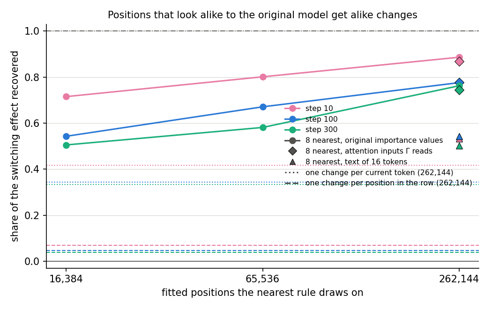
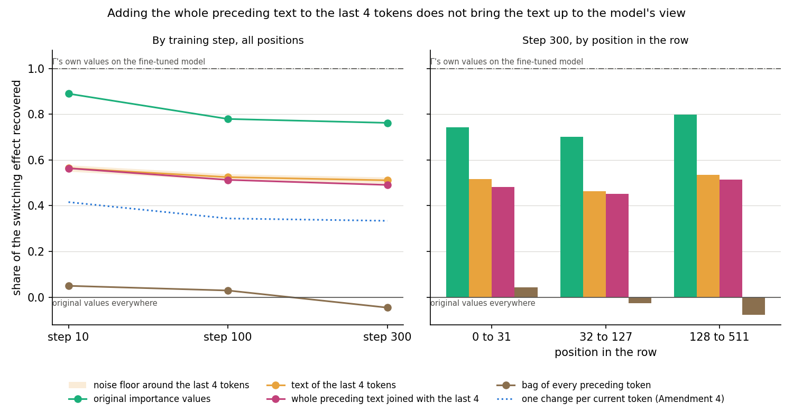
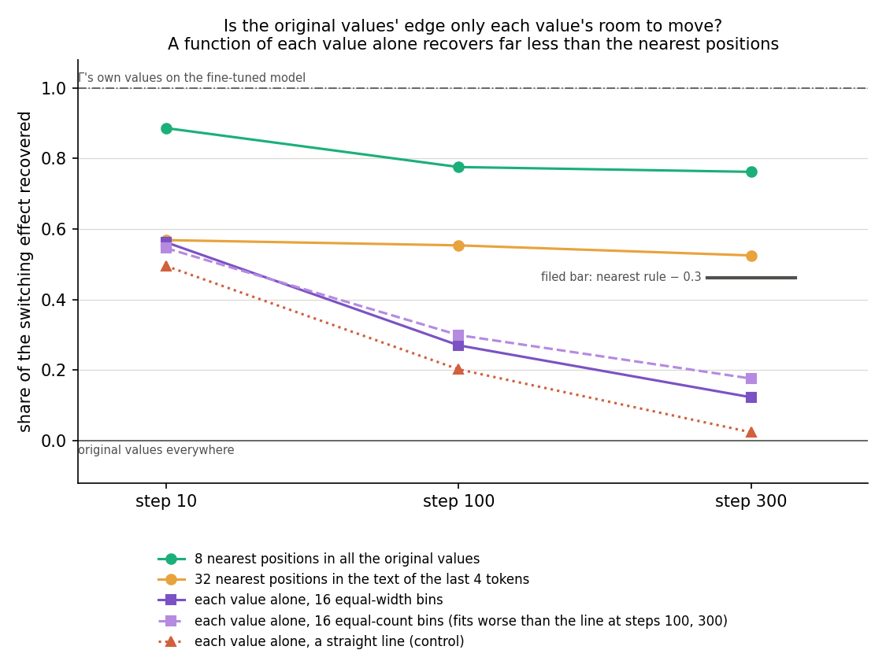

# Does the cue-free form of the fixed-shift hypothesis hold on a fine-tune with no trigger? (E36, analysis)

*2026-10-26, lead agent (overnight). Plan and design check: `reports/plans/2026-10-26_plan_regating-without-cues.md` (E36,
Amendments 1 and 3 to 9). Code: `experiments/regating_spread/run.py` and `amend1.py` to `amend7.py`, shared steps in
`src/commute/spread.py` and `src/commute/cuefree.py`. Follows E35, `reports/analyses/2026-10-26_analysis_regating-without-cues.md`.
Exploration, provisional. Independent checks (fresh Opus agents, 2026-10-26) of the first run and of Amendment 3 found the
numbers and scoring right and the headlines too strong each time; this version takes their points. Words as in `GOALS.md` → Terms.*

We fine-tuned the model on text with no trigger and no target token and asked whether Γ's switching at each position
can be predicted from the original model's importance values there. On lowercased Pile text, the positions with the most
similar original values predicted it better than every other rule. With the planned sample of fitted positions it fell
below the filed bar after the first ten steps; with sixteen times as many it recovered three-quarters or more at every
step. The same rule on the original model's attention inputs, which Γ itself
reads, does about as well. A summary of the last few tokens alone, which the model did not produce, does about a quarter
worse, and adding a bag of every earlier token in the row did not help. That bag scored like rules that use no context
at all, so whether a better summary of the whole preceding text would close the gap is still open. Predicting each
subcomponent's change from its own original value alone, which sets how far it can move before it is clipped, did far
worse than the nearest rule, so its success needs the values taken together. A rule joining the text with each value's
room to move was not run, so whether the original values beat the text for reasons beyond that room is open. For
`GOALS.md` this supports, with those two caveats, the form "positions the original model treats alike get alike
changes, more than positions that share their last few tokens" on one synthetic style of running text.

## The answer

Yes, once enough positions are compared. On a fine-tune of lowercased Pile text, each position was given the mean
change of the eight training positions with the nearest original importance values. Fitted on 16,384 positions this
recovered 0.72 of Γ's switching at step 10, then 0.54 and 0.51, under the filed 0.6. Fitted on all 262,144 it recovered
0.89, 0.78 and 0.76, and the same rule on the attention inputs Γ reads about as much. At the same sample size the current token
recovers about a third, a summary of the last few tokens about a half, and position in the row almost nothing. Adding
the whole preceding text, as a bag of tokens, left the text summary at about a half; the bag alone recovered nothing.
Each subcomponent's own original value alone recovers 0.18 at most by step 300, so room to move is not the whole story.

## What we were trying to test

**The setup.** A fine-tune of all 24 decomposed matrices on the next-token loss at every position, by Adam at rate
3e-5 with batches of eight 512-token rows, each row used once. In the *do-nothing* state the update goes into Δ and the
subcomponents stay as released; Γ is frozen but reads the fine-tuned model, and Δ is left out of the CI-masked model.
Everything is read at every position of 64 held-out rows:

- the *gain*: the fine-tuned model's mean next-token log-probability minus the original's;
- the *switching share* $r$: how much the CI-masked model's mean log-probability rises when Γ reads the fine-tuned model
  instead of the original, divided by the gain. 1 means switching alone reproduces the gain;
- each rule's *recovery*: the rise its predicted importance values give, as a share of the rise Γ's own values give.
  0 is the original model's values everywhere, 1 is Γ's values on the fine-tuned model.

**The rules.** Each gives every position $x$ its own original values $g_0(x)$ plus a predicted change, clipped to
$[0, 1]$. The change is fitted at 16,384 random positions of the first 64 training rows:

- *one change everywhere*, the mean change: the original fixed-shift hypothesis;
- *one change per current token*, the mean change at fitted positions holding the same token, or the overall mean for
  tokens seen fewer than 20 times: the toy tasks' "cue" carried over to running text;
- *the 8 most similar positions*, the mean change of the eight fitted positions whose original values are nearest
  $x$'s: the cue-free form E35 supported;
- *k-means groups* of the original values, at 8 to 512 groups, with random groups as their null;
- *a line per subcomponent*, $a\,g_0 + b$ fitted per subcomponent.

**The two tasks.** The planned task was code-like text: the 5% of Pile rows richest in code punctuation. That
fine-tune did not learn, so a second was run on a style instead: Pile text decoded, lowercased and re-encoded, so
capitals never come. Its training rows are used once each over 300 steps; it is read at steps 10, 100 and 300.

## What we expected, and why

- **Switching carries at least 0.3 of the gain**, low-medium confidence: on toy tasks the model already does it carried
  0.5 to 1.1, but a fine-tune with no trigger might work differently.
- **One change everywhere carries less than half**, because positions differ as much as copy-task keys did.
- **The 8 most similar positions recover at least 0.6, and beat one change everywhere by 0.2**, medium for the
  code task and low for the lowercase task after the code run's 0.23 to 0.34.
- **They do at least as well as one change per current token**, within 0.1.
- **The line per subcomponent beats one change everywhere by 0.1**, from its 0.96 to 1.02 on E35's few-cue tasks.
- **512 groups come within 0.1 of the 8 most similar positions.**

## What we observed

### How much of the gain does switching carry, and what does that show?

**Reading it.** Most of it, but that alone shows little. On lowercase text the switching share was 1.05 at step 10, 0.90
at step 100 and 0.79 at step 300, while the gain grew from 0.07 to 0.13 nats per token. The code-like fine-tune, which
learned nothing and made held-out text worse, gave a share of about 0.8 as well. So a share near 0.8 is what any small
update of these kinds gives here; it does not by itself show that the fine-tune re-weighted subcomponents to learn.

### Does the change follow the original values, the current token, or neither?

**Reading it.** The original values predict it best, though only about half of it after step 10. The 8 most similar
positions, green, recover 0.72 at step 10, then 0.54 and 0.51, below the filed 0.6 at both later steps. One change per
current token, blue, recovers 0.24 to 0.32, and one change everywhere, grey, 0.03 to 0.07. The token rule is a weak
baseline: only 90 tokens had enough fitted positions, and every other position got the overall change. A third of the
8 nearest positions hold the position's own token, far above the few percent expected by chance, so the nearest
positions are strongly but not wholly the same token.

### How many groups does the switching need?

**Reading it.** Many. Recovery rises with the number of k-means groups, from 0.12 to 0.16 at 8 groups to 0.44 to
0.64 at 512, and stays below the 8 most similar positions at every step. Already at 32 groups the original values beat
the 90 token groups, 0.32 to 0.45 against 0.24 to 0.32, the fairer comparison of the two. Random groups match one
change everywhere to within 0.002. There is no small set of conditions here.

### Is it one fixed line per subcomponent?

**Reading it.** No. The line recovers 0.39 at step 10, 0.14 at step 100 and −0.01 at step 300, against one change
everywhere's 0.03 to 0.07. On the code-like run it recovered about half of a switching that carried no learning. The
slopes barely move from 1: the median among subcomponents whose values vary is 0.94 to 0.96.

## What we learned

In the scored run, with 16,384 fitted positions, the cue-free form held at step 10 and failed at steps 100 and 300 by
the filed rule. Amendments 2 and 3 showed that miss was sampling: with all 262,144 positions the rule recovers 0.76 to
0.89 of the switching at every step. So on running text with no trigger, values predicted from the positions with the most similar original
importance values recover most of the switching effect. Amendment 4 found them predicted about as well, within 0.02, from the
original model's attention inputs, which Γ reads, so Γ's original values are one sufficient summary of the context, not
a privileged one. A summary of the last few tokens, which the model did not produce, recovers about a half, 0.23 to
0.35 less (Amendment 5). So the original model's view of the position predicts the change better than its recent
text. Amendment 6 tried a bag of every preceding token as the whole preceding text. It carried no usable signal, so
whether a better whole-prefix summary would close the gap is still open. At the first 32 positions of a row, where the
bag does hold the whole prefix, the text recovers 0.48 against the original values' 0.74. Amendment 7 predicted each
subcomponent's change from its own original value alone, which bounds how far it can move. That recovered 0.18 at most
at step 300, against 0.76, so the nearest rule needs how the values sit together, not just each value's room to move.
Whether text neighbours kept within each value's room would match the original values was not tested. At the same sample size the current token recovers about a third and
position in the row almost nothing; at 16,384 positions the original values also beat a few groups and a fixed rule per
subcomponent. A tenth to a quarter of the switching remains unexplained, more of it later in training. A high switching share is not evidence of learned re-weighting
on its own, since an update that learned nothing gave the same share.

## How compelling is the evidence

- **Controls.** At every step a zero change left the masked model's log-probability exactly where it was, and Γ's own
  values on alive subcomponents reproduced the full switching to within 0.000005. The masked model's log-probabilities
  were computed in float32; the target model's and Γ's values come from bf16, which does not matter at these gains.
- **Nulls.** Random groups land within 0.002 of one change everywhere at every step.
- **Held-out positions.** The scored rules are fitted at positions of the first 64 training rows, which the fine-tune
  saw in its first eight steps; Amendment 3's 512 rows include 432 it had not seen at step 10. Every rule is scored on
  64 held-out rows from another split, 32,704 positions. No held-out position lies inside a 16-token span that also
  occurs in the 512 fitted rows (Amendment 4).
- **Coverage.** One fine-tune seed, one style, one 67M model. Lowercasing is a style spread over every position but
  synthetic in form; the more natural task, code-like text, did not learn.
- **Blind spots.** The distance weighs every alive subcomponent equally. The nearest rule rises with every fourfold
  increase in fitted positions and had not flattened at 262,144, so its endpoint is not known. Recovery is similar
  across the row, 0.70 to 0.90 in each part (Amendment 4). The token rule covers 38% of held-out positions at 16,384
  fitted positions and 71% at 262,144. Patterns are written at every position at once, so effects passing between
  positions through attention are included, not separated. No predicted pattern was checked for faithfulness under the
  adversary.

## Surprises

1. **The cue-free form held only early.** We predicted the nearest rule would recover at least 0.6. It recovered 0.72 at
   step 10, then 0.54 and 0.51, missing at steps 100 and 300.
2. **The line per subcomponent collapsed with training.** We predicted it would beat one change everywhere by 0.1. It
   did at step 10, by 0.32; it missed by 0.002 at step 100 and fell to −0.01 by step 300.
3. **The code-like fine-tune did not learn.** Its training loss showed no trend and held-out text got worse by 0.05 to
   0.07 nats per token. The rows chosen were mostly LaTeX and maths. Why is untested: the same recipe learned lowercase
   text.
4. **With all positions the rule cleared the bar** (Amendment 3). We predicted it would stay under 0.7 at step 300;
   it recovered 0.76, so the first surprise above was a sampling shortfall.
5. **The whole preceding text added nothing to the last four tokens** (Amendment 6). We predicted, at medium
   confidence, that it would add more than the noise floor; it fell 0.02 below them, and the bag alone recovered nothing.
6. **The equal-count bins collapsed to two for most subcomponents** (Amendment 7). For at least half the subcomponents,
   fifteen sixteenths of fitted positions hold a value of exactly 0. That two-level rule still recovered more than 16
   equal-width bins at steps 100 and 300, while fitting the training positions slightly worse than the line.

## Amendment 2: is the shortfall sampling, and does the token add anything?

*Plan: Amendment 4 of the plan. `experiments/regating_spread/amend2.py`, predictions filed 2026-10-26 18:05
(`results/predictions_amend2.json`, sha256 `eab5cad2…`) before the run; results `results/regating_spread_amend2.json`.
RunPod 4090, 58 s, $0.09.*

The lowercase fine-tune was regenerated, and the 16,384-position nearest rule reproduced Amendment 1 exactly at every
step. Two questions came from the independent check. Does the nearest rule miss because it drew on too few positions?
And does restricting the neighbours to the same token help, as restricting to the cue did on one toy state?

**Reading it.** Partly sampling, and the token adds nothing. With four times as many fitted positions, 65,536, the
nearest rule recovers 0.80, 0.67 and 0.58 at steps 10, 100 and 300, against 0.72, 0.54 and 0.51. That clears the filed
0.6 at step 100 but not at step 300, where the gain was 0.08 against the filed 0.1, so the sampling prediction fails as
filed while the rule keeps improving with more data. Drawing the eight neighbours only from positions with the same
token changes recovery by 0.02 or less at every step. The token rule itself covers only 38% of held-out positions; the
rest fell back on one change everywhere.

| step | nearest, 16,384 positions | nearest, 65,536 | nearest within token, 16,384 |
|---|---|---|---|
| 10 | 0.715 | 0.801 | 0.699 |
| 100 | 0.543 | 0.671 | 0.534 |
| 300 | 0.505 | 0.581 | 0.507 |

| id | claim | rule | read | verdict |
|---|---|---|---|---|
| A0 | the 16,384-position rule reproduces Amendment 1 | within 0.02 at every step | exact | pass |
| S | more positions add at least 0.1 at step 300 | R_near65 ≥ R_near16 + 0.1 | +0.076 | fail, as predicted |
| W | restricting to the token adds at most 0.05 | R_near16 ≥ R_near16_tok − 0.05 | −0.002 | pass, as predicted |

So the filed "all fail" at step 300 is in part a sampling shortfall, and the token carries nothing the original values
do not. Whether more positions still would close the gap is not known: the curve had not flattened.

## Amendment 3: where does the sampling curve end?

*Plan: Amendment 5 of the plan. `experiments/regating_spread/amend3.py`, predictions filed 2026-10-26 18:14
(`results/predictions_amend3.json`, sha256 `af874f67…`) before the run; results `results/regating_spread_amend3.json`.
RunPod H100, 85 s, $0.30.*

The lowercase fine-tune was regenerated on an H100, and the 16,384- and 65,536-position rules reproduced Amendment 2
within 0.008 at every step. The same nearest rule was then fitted on all 262,144 positions of 512 training rows.

**Reading it.** Something unexpected, in the hypothesis's favour: the curve kept rising, and with the full sample the
rule recovers most of the switching at every step. With 262,144 positions it recovers 0.89, 0.78 and 0.76 at steps
10, 100 and 300, and 0.90, 0.79 and 0.78 with 32 neighbours. We predicted it would still be under 0.7 at step 300.
Each fourfold increase in positions added about 0.08 to 0.18, so the filed "all fail" at step 300 was a sampling
shortfall, which is how the filed tree reads it. The curve had not flattened, and a nearest rule on any rich summary of
the context might improve the same way; that comparison is Amendment 4. A tenth to a quarter of
the switching remains unexplained, more of it later in training.

| step | 16,384 positions | 65,536 | 262,144 | 262,144, 32 neighbours |
|---|---|---|---|---|
| 10 | 0.719 | 0.808 | 0.886 | 0.902 |
| 100 | 0.542 | 0.673 | 0.776 | 0.789 |
| 300 | 0.508 | 0.584 | 0.762 | 0.776 |

| id | claim | rule | read | verdict |
|---|---|---|---|---|
| A0 | the smaller samples reproduce Amendment 2 | within 0.02 at every step | within 0.008 | pass |
| M | still rising at step 300 | R_near262 ≥ R_near65 + 0.03 | +0.178 | pass, as predicted |
| B | the rule recovers at least 0.7 at every step | R_near262 ≥ 0.7 | 0.886, 0.776, 0.762 | **pass, reversing the filed lean** |

By the filed decision tree, "B holds" reads: with enough fitted positions the rule recovers most of the switching on
running text, and the filed miss at step 300 was sampling; evidence for restating the hypothesis without cues.

## Amendment 4: is Γ's original-value space special?

*Plan: Amendment 6 of the plan. `experiments/regating_spread/amend4.py`, predictions filed 2026-10-26 18:38
(`results/predictions_amend4.json`, sha256 `a3ad2c4a…`) before the run; results `results/regating_spread_amend4.json`.
RunPod H100 NVL, 98 s, $0.44.*

Amendment 3's check asked whether the original importance values matter, or whether a nearest rule on any rich summary
of the context would do as well with 262,144 positions. So the same rule was fitted, on the same positions, in a second
space: each layer's attention input under the original model, the values Γ itself reads for the
query, key and value matrices. The token rule and a rule per position in the row were refitted on the full sample.

**Reading it.** The two spaces do about equally well, the token stays far behind, and position carries nothing. The
attention inputs recover 0.87, 0.78 and 0.74 at steps 10, 100 and 300, against 0.89, 0.78 and 0.76 for the original importance
values. With the full sample the token rule covers 71% of positions and recovers 0.33 to 0.42, and the rule per
position in the row 0.04 to 0.07. The nearest rule recovers 0.70 to 0.90 in every part of the row, early positions
included, so it does not rest on the starts of rows; the ends of rows, which Γ also sees as edges, are pooled into the
last part. No held-out position lies inside a 16-token span
that also occurs in the fitted rows. So Γ's original values predict the change no better than Γ's own input from the
original model: one sufficient summary of the context, not a privileged one. The gaps, 0.02, are the size of the gain
from 8 to 32 neighbours, and one seed and one set of held-out rows cannot separate them further.

| step | nearest, original values | nearest, attention inputs | token | position in row |
|---|---|---|---|---|
| 10 | 0.886 | 0.869 | 0.416 | 0.069 |
| 100 | 0.776 | 0.777 | 0.344 | 0.046 |
| 300 | 0.762 | 0.744 | 0.334 | 0.038 |

The nearest rule on the original values, by position in the row (each part normalised by its own share of the
switching): 0.86, 0.87 and 0.90 at step 10 for positions 0 to 31, 32 to 127 and 128 on; 0.71, 0.71 and 0.83 at step 100;
0.74, 0.70 and 0.80 at step 300. Positions 128 on carry 57 to 62% of the switching.

| id | claim | rule | read | verdict |
|---|---|---|---|---|
| A0 | the nearest rule on the original values reproduces Amendment 3 | within 0.02 at every step | exact | pass |
| R1 | the attention inputs Γ reads do as well | R_near_resid ≥ R_near_g0 − 0.05 at step 300 | −0.018 | pass, as predicted |
| R2 | position alone carries little | R_position < 0.3 at every step | 0.04 to 0.07 | pass, as predicted |
| R3 | the token stays at least 0.2 behind | R_token ≤ R_near_g0 − 0.2 at every step | 0.43 to 0.47 behind | pass, as predicted |
| D | no near-duplicate text | ≤ 2% of held-out positions | 0 | pass, as predicted |

By the filed decision tree, "R1 holds" reads: similar contexts get similar changes, so the restatement says "inputs the
original model treats alike", with Γ's values one sufficient summary. The independent check added that both spaces come
from the original model, so a summary it did not produce is the test that would separate "how the model represents the
context" from "similar text"; that is Amendment 5. The token rule left 29% of positions on the overall mean, so its
deficit mixes too little information with too little coverage.

## Amendment 5: does the model's view of the context matter, or only the text?

*Plan: Amendment 7 of the plan. `experiments/regating_spread/amend5.py`, predictions filed 2026-10-26 19:06
(`results/predictions_amend5.json`, sha256 `aa96a068…`) before the run; results `results/regating_spread_amend5.json`.
RunPod H100, 80 s, $0.85.*

Amendment 4's check pointed out that Γ's values and the attention inputs both come from the original model, so they
cannot tell "positions the original model treats alike" from "positions with similar text". This run fits the same
nearest rule, on the same 262,144 positions, on a summary of the text the model did not produce: each of the current
and 15 preceding tokens, or 3, hashed with its offset to one of 4,096 signed coordinates, weighted towards recent
tokens. As a floor, the 4-token summary had to do at least as well as the current-token rule, which it did at every
step; that shows the text space carries the current token's information, not that it could reach the original values
if the text were enough.

**Reading it.** The model's view predicts more than the last few tokens do. The text summaries recover 0.53, 0.54 and 0.50 of the switching with 16
tokens, and 0.56, 0.52 and 0.49 with 4, at steps 10, 100 and 300. The original importance values recover 0.88, 0.77
and 0.76, 0.23 to 0.35 more at every step. The text rules beat the current token, 0.33 to 0.42, so they carry real
information, and about 69% of their neighbours hold the same token. So positions that end in similar text get partly
alike changes, and positions the original model treats alike get much more alike ones. With the weighting used, 83% of
the 16-token summary rests on its last 4 tokens, so the two windows are nearly the same summary, while the model's
view is computed from the whole preceding row.

| step | nearest, original values | nearest, text of 16 tokens | nearest, text of 4 tokens | token rule (Amendment 4) |
|---|---|---|---|---|
| 10 | 0.881 | 0.534 | 0.563 | 0.416 |
| 100 | 0.774 | 0.542 | 0.522 | 0.344 |
| 300 | 0.761 | 0.503 | 0.491 | 0.334 |

| id | claim | rule | read | verdict |
|---|---|---|---|---|
| A0 | the nearest rule on the original values reproduces Amendment 4 | within 0.02 at every step | within 0.005 | pass |
| C_text | the 4-token text summary is at least as good as the token rule (a floor) | ≥ token − 0.05 at every step | +0.15 to +0.18 | pass |
| T1 | the text summary predicts the change worse than the original values | text16 ≤ g0 − 0.1 at step 300 | −0.26 | pass, as predicted |
| T2 | more preceding text helps | text16 ≥ text4 at step 300 | +0.011, −0.030 at step 10 | pass by the rule, below the 0.014 noise floor |

By the filed decision tree, "T1 holds" reads: the original model's view of the context predicts the change better than
the text, so the restatement "positions the original model treats alike get alike changes" is about the model, not the
text. The independent check narrowed that: the text summary saw in effect about four tokens and the model the whole
prefix, so what is shown is "more than positions sharing their last few tokens". A summary of the whole preceding text
is the fairer null; that is Amendment 6.

## Amendment 6: does a summary of the whole preceding text close the gap?

*Plan: Amendment 8 of the plan. `experiments/regating_spread/amend6.py`, predictions filed 2026-10-26 19:31
(`results/predictions_amend6.json`, sha256 `f9b54f7d…`, commit `11eb4fd`) before the run; results
`results/regating_spread_amend6.json`. RunPod H100 PCIe, run 123 s. Independent check (fresh Opus agent, read-only):
`reports/reviews/2026-10-26_review_regating-spread-amend6.md`.*

We asked whether a summary of everything earlier in the row predicts the change as well as the original model's view
does. It does not, and the whole preceding text added nothing to the last four tokens, against our prediction. But the
summary we built carried no usable signal of its own, so this run says little about whether more context would close
the gap. Only the start of rows, where the summary does hold the whole prefix, bears on that.

Amendment 5's text summary rested in effect on the last four tokens, while the model sees the whole row up to the
position. So this run fits the same nearest rule, on the same 262,144 positions, in three text spaces the model did not
produce. The first is the 4-token summary again. The second is a bag of every token from the row's start to the
position, each weighted by how rare it is in the fitted rows. The bag is hashed to 4,096 signed coordinates and scaled
to unit length. The third joins the bag with the 4-token summary, each half given equal length. The original importance
values were refitted as the reference. As a positive control, the joined space had to stay within 0.05 of the 4-token
summary at every step, since it holds that summary as half its length; it did. Both reference spaces reproduced
Amendment 5 within the 0.02 allowed: the original values within 0.009, the 4-token summary within 0.0196.

**Reading it.** The whole preceding text, as a bag, neither brings the text up to the model's view nor adds to the last
four tokens. At step 300 the joined space recovers 0.49 of the switching, against 0.76 for the original values. The
4-token summary alone recovers 0.51. We predicted the joined space would beat it by more than the noise floor of 0.014;
it fell 0.020 below it, a miss. The bag alone recovers 0.05 at step 10 and −0.05 at step 300. That is the level of rules
that use no context at all: random groups read 0.03 to 0.07, and one change per position in the row about the same. So the bag
never stood in for the whole preceding text, and the joined space is in effect the 4-token summary again. The gap to the
original values therefore repeats Amendment 5's finding rather than testing how much context the text needs.

**The start of rows.** At positions 0 to 31 the bag does hold the whole prefix the model sees, so this part bears most on
context length. There the joined space recovers 0.48 and the original values 0.74, a gap about as wide as elsewhere in
the row. Even there the bag ignores order beyond the last four tokens and weights tokens by rarity, so it is a weak
summary of a short prefix.

**The miss, read narrowly.** "The whole preceding text adds nothing to the last four tokens" is supported. "It makes them
worse" is not: the drop of 0.020 is the size of the 4-token summary's own shift between this run and Amendment 5,
0.0196. So the filed noise floor understates how much the text spaces move between runs. Possible causes of the miss,
none measured:

- the bag drowns the current token. At unit length the current token holds about one over the square root of the
  number of distinct tokens in the bag. Yet the current token alone recovers about a third, and 69% of the 4-token
  summary's neighbours share it;
- a bag changes little between adjacent positions, so a held-out position's 8 bag neighbours may be neighbouring
  positions of one fitted row, fewer independent contexts than 8;
- rows are cut from a stream of documents, so a row's start is not a document's start and the bag mixes the end of one
  document with the next;
- in the joined space the bag's spread of distances reorders the 4-token summary's near-ties;
- hash collisions with opposite signs.

| step | original values | 4-token text | bag of the whole prefix | bag joined with 4-token text |
|---|---|---|---|---|
| 10 | 0.890 | 0.564 | 0.050 | 0.564 |
| 100 | 0.779 | 0.525 | 0.029 | 0.513 |
| 300 | 0.762 | 0.511 | −0.046 | 0.491 |

At step 300 by position in the row, each part normalised by its own share of the switching:

| positions | original values | 4-token text | bag of the whole prefix | bag joined with 4-token text |
|---|---|---|---|---|
| 0 to 31 | 0.744 | 0.517 | 0.042 | 0.483 |
| 32 to 127 | 0.702 | 0.464 | −0.026 | 0.451 |
| 128 to 511 | 0.798 | 0.534 | −0.077 | 0.514 |

| id | claim | rule | read | verdict |
|---|---|---|---|---|
| A0 | original values and 4-token text reproduce Amendment 5 | each within 0.02 at every step | within 0.009 and 0.0196 | pass |
| C_full | the joined space keeps the 4-token summary's recovery (positive control) | ≥ text4 − 0.05 at every step | 0.000, −0.012, −0.020 | pass |
| T3 | even the whole preceding text predicts worse than the original values | text_full ≤ g0 − 0.1 at step 300 | −0.271 | pass, as predicted |
| T4 | the whole preceding text adds to the last four tokens | text_full ≥ text4 + 0.014 at step 300 | −0.020 | **fail**, predicted pass |

By the filed decision tree, the branch where even the whole preceding text falls 0.1 short of the original values reads:
the restatement "positions the original model treats alike get alike changes" stands as worded. The independent check
narrowed that. The prediction held, but against a bag that carries no signal, so it repeats Amendment 5's comparison and
says nothing about context length. The only evidence here on context length is the start of rows. The check also
raised open threats to the restatement, not measured and listed under "Not run". The original values may have an edge
in the clip; text neighbours are cut to 8 where hundreds tie; and no order-keeping summary of the whole prefix was tried.

## Amendment 7: is the original values' edge only each value's room to move?

*Plan: Amendment 9 of the plan. `experiments/regating_spread/amend7.py`, predictions filed 2026-10-27 10:54
(`results/predictions_amend7.json`, sha256 `f8fb7f2a…`, commit `51b9aa2`) before the run; results
`results/regating_spread_amend7.json`. RunPod H100 80GB HBM3, run 94 s, $0.33. Code review before filing:
`reports/reviews/2026-10-27_review_amend7-code.md`. Independent check of the result (fresh Opus agent, read-only):
`reports/reviews/2026-10-27_review_regating-spread-amend7.md`; it found the scoring right and narrowed the reading.*

We asked whether the nearest rule on the original values wins only because each value can move just so far before it
is clipped. Predicting each subcomponent's change from its own original value alone recovered at most a fifth of the
switching by the last step, against three quarters for the nearest rule. So "values move towards where they have room"
is not the whole story, but this run did not test whether text neighbours kept within each value's room would do as
well as the original values, so the restatement goes to the user with that caveat open.

**The threat.** Every rule adds its predicted change to the position's own original values $g_0$ and clips the result
to $[0, 1]$, so a value's change is bounded by $[-g_0, 1 - g_0]$. A value at 0 can only rise and a value at 1 can only
fall. Positions with similar original values share those bounds, while positions with similar text need not. If that
were the whole of the edge, a rule that knows each value on its own would do as well as the nearest rule. Amendment 1's
straight line per subcomponent, $\mathrm{clip}(a\,g_0 + b)$, already fell to nothing by step 300, but a curve might not.

**The rules.** A *value-bin rule* treats each alive subcomponent on its own. It sorts the fitted positions by that
subcomponent's original value into 16 bins. A held-out position's change for that subcomponent is the mean change of
the fitted positions in the bin its own value falls in. It uses no other subcomponent's value and no text. Two binnings
were run, after the code review: 16 equal-width bins on $[0, 1]$, and 16 bins holding equal numbers of fitted positions.
All rules were refitted on the same 262,144 positions as Amendment 6:

- the nearest rule on the original values, the reference, gated to reproduce Amendment 6 within 0.02;
- the two value-bin rules;
- the straight line per subcomponent, as the bin rules' positive control;
- the 4-token text summary with 32 neighbours instead of 8, reported only, to size the cost of keeping 8 neighbours where
  many text neighbours tie.

**The controls.** Inside each bin a bin rule has slope 1. The fitted lines have slopes near 1, median 0.94 to 0.96, so
a bin rule can follow each line closely and should do at least as well. Two checks
hold it to that at every step. Its recovery must be no more than 0.05 below the line's. Its mean squared error of
the change, on the fitted positions, must be at most the line's. The second check matters at step 300, where the line
recovers about nothing and the first would pass a broken bin rule. The prediction is read when at least one bin rule
passes both checks at every step. It then reads the better recovery of the two, so a failing rule can only make the
prediction harder to pass.

**Reading it.** No: each value's room to move, on its own, explains little of the nearest rule's success. At step 300 the better bin rule recovers
0.18 of the switching and the nearest rule 0.76. We predicted the bin rules would sit at least 0.3 below the
nearest rule, under 0.46; the better one sits 0.59 below. The bin rules start near the straight line at step 10 and fall
with it, staying 0.05 to 0.15 above it. So a curve per subcomponent adds a little to a line, and most of the switching
is left to how the values sit together, or to context. The equal-width rule, the one that passed both controls,
recovers 0.12 at step 300, further still below.

**What the bin rules are blind to.**

- *Joint structure, by design.* Each subcomponent's change depends on its own original value only. Anything that
  depends on two subcomponents' values together, or on the text, is out of reach. That is the null.
- *Variation inside a bin.* The change is one number per bin. Equal-width bins cannot follow a change that varies
  within a sixteenth of the value range.
- *Most of the range, for equal-count bins.* The median top edge of the equal-count bins over subcomponents is exactly 0.
  So for at least half the subcomponents, at least fifteen sixteenths of fitted positions hold a value of exactly 0.
  Their 16 equal-count bins collapse to two, "exactly 0" and "above 0", and every active value shares one change. The
  code review predicted this; it is stronger than predicted.
- *Spread at one value.* A bin rule gives the mean change at a value. Where a value rises at some positions and falls at
  others, the rule predicts about no change. That spread is what joint structure or context would have to explain.
- *Why text loses.* The text rule's prediction is clipped at the held-out position. Its neighbours' changes were never
  limited to that position's room to move. So this run does not say how much of the gap between text and original
  values is bounds. The independent check calls this the main limit; see "What this does not settle" below.
- *An exact-zero bin with fine bins above it.* Equal-count bins separate exactly 0 but lump every positive value
  together. Equal-width bins resolve the positive range but put 0 in one bin with values up to a sixteenth. No rule run
  has both.
- *Keeping the change sparse.* Each bin predicts its mean change, which switches every zero-valued position on a
  little. The nearest rule averages eight real change vectors and leaves most entries at zero. A per-value rule that
  keeps zeros at zero, such as the bin median, was not run.

**The equal-count rule's failed fit check.** At steps 100 and 300 the two-level equal-count rule fitted the training
positions slightly worse than the line, by 0.2% and 0.6% in mean squared error. The equal-width rule fitted them 3 to 5%
better at every step. Yet on held-out positions the equal-count rule recovered more than the equal-width rule at both
of those steps, by 0.03 and 0.05. The two scores weigh errors differently: one is squared error of the
change, the other is the gain in log-probability. One difference that could matter is that equal-count bins separate
exactly 0 from small values, while equal-width bins put both in the bottom bin. That was not tested.

**More positions help the line too.** Refitted on sixteen times as many positions, the straight line recovers 0.50 at
step 10 and 0.02 at step 300. Amendment 1's smaller fit gave 0.39 and −0.01.

**Text with 32 neighbours.** The 4-token text summary with 32 neighbours recovers 0.57 at step 10 and 0.53 at step 300.
Amendment 6's 8-neighbour version read 0.56 and 0.51; more neighbours add at most 0.03 at any step. The text spaces moved by up to 0.02
between runs with the same code, so the cap of 8 neighbours costs at most about 0.03. The gap from text to the original
values at step 300 is 0.24, so the cap does not explain it.

| step | nearest, original values | equal-width bins | equal-count bins | straight line | 4-token text, 32 neighbours |
|---|---|---|---|---|---|
| 10 | 0.886 | 0.562 | 0.546 | 0.495 | 0.569 |
| 100 | 0.776 | 0.270 | 0.299 | 0.202 | 0.554 |
| 300 | 0.762 | 0.123 | 0.176 | 0.024 | 0.525 |

Mean squared error of the change on the fitted positions, as each rule applies it, $\mathrm{clip}(g_0 + c) - g_0$:

| step | equal-width bins | equal-count bins | straight line |
|---|---|---|---|
| 10 | 0.001128 | 0.001167 | 0.001186 |
| 100 | 0.001573 | 0.001631 | 0.001628 |
| 300 | 0.001654 | 0.001718 | 0.001707 |

| id | claim | rule | read | verdict |
|---|---|---|---|---|
| A0 | the nearest rule on the original values reproduces Amendment 6 | within 0.02 at every step | within 0.004 | pass |
| C_bin | each bin rule recovers at least the line's share (positive control) | ≥ R_fix − 0.05 at every step | +0.05 to +0.15 | pass, both rules |
| C_fit | each bin rule fits the fitted positions at least as well as the line (positive control) | mse ≤ mse_fix at every step | equal-width 3 to 5% lower; equal-count 0.2% and 0.6% higher at steps 100, 300 | equal-width pass; equal-count **fail** |
| B1 | each value alone recovers far less than the nearest rule | max(R_bin16q, R_bin16w) ≤ R_near_g0 − 0.3 at step 300 | 0.176 against a bar of 0.462 | pass, as predicted; readable, since the equal-width rule passed both controls |

**What this does not settle.** The independent check found the scoring right and no unfair edge in the code, but
narrowed the reading. The threat Amendment 6's check named was about the gap between the original values and the text
summary: text neighbours may lose only because their changes ignore the held-out position's bounds. This run asked a
weaker question, whether each value's room with no context at all can match the original values. It cannot. But the bin
rules know the bounds and no context, while the text rule knows context and not the bounds, and no rule used both. Two
such rules were named and not run. One adds the bin rule's change to the text neighbours' change left over after their
own bin means. The other averages, per subcomponent, only text neighbours whose value falls in the held-out position's
bin. The two recoveries, 0.18 and 0.53, sum to about the original values' 0.76, though recovery need not add. So a
rival reading survives: "similar text gets similar changes, within each value's room to move". This run does not tell
it apart from "positions the original model treats alike get alike changes".

By the filed decision tree, "B1 holds" reads: the original values' edge is not each value's room to move. Narrowed by
the check, what B1 supports is that the nearest rule's success needs the values of many subcomponents together, and
that "values move towards where they have room" is not the whole story. The restatement goes to the user with two
caveats, not as established. First, Amendment 6's caveat on context length: the text null it beats is a summary of the
last four tokens, and no working summary of the whole preceding text was built. Second, the rule joining text with each
value's room was not run. The B1 reading does not rest on the rule that failed its fit check: without it the best bin
rule is 0.12.

Not run, for this amendment: a rule joining text neighbours with each value's room to move, in either form above; a
per-value rule with an exact-zero bin and fine bins above it, or one that keeps the change sparse at zero values; bins
finer than a sixteenth, or a smooth curve per subcomponent; a rule on the values of one matrix or one layer jointly,
without context; a rule from each value plus a count of how many subcomponents are on at the position; recovery scored
only on subcomponents far from 0 and 1; the 8-neighbour text rule in the same run as the 32-neighbour one; why
equal-count bins recover more than equal-width bins while fitting worse; a planted per-value change as a control of
the bin code in recovery; a second seed or held-out set.

## What next

1. **Done as Amendment 3:** with all 262,144 positions the rule reaches 0.76 to 0.89 at every step. Next on this: what
   the remaining tenth to quarter depends on, and whether the curve flattens with yet more positions.
2. **Done as Amendments 4 and 5:** Γ's own input from the original model does as well as its values, and a summary of
   the text alone does a quarter worse. What the remaining tenth to quarter depends on, and a richer text summary as a
   harder null, are new designs and go to the user through the pending card.
3. **Tried as Amendment 6:** a bag of the whole preceding text carried no usable signal. A summary of the whole prefix
   that keeps order and the current token is still the harder null. If it closes most of the gap, the restatement
   becomes "similar contexts get similar changes".
4. **Done as Amendment 7:** each value's room to move, as any function of each value on its own, recovers 0.18 at most
   at step 300 against the nearest rule's 0.76. The restatement goes to the user with two caveats: context length, and
   the untested rule joining text neighbours with each value's room to move. If that joined rule matched the original
   values, the restatement would become "similar text gets similar changes, within each value's room".
5. **A fine-tune of a real behaviour that learns**, or the larger model's post-trained sibling, before any restatement
   is adopted. A pending-decision card in the log holds this choice.

## Scorecard

E36 Amendment 1, the lowercase run, filed 2026-10-26 17:39 (`results/predictions_amend1.json`, sha256 `48b37e56…`) before
the run, scored at step 300; steps 10 and 100 read by the same rules.

| id | claim | rule | step 300 | verdict | steps 10, 100 |
|---|---|---|---|---|---|
| C0 | zero change and own values check | as filed | exact | pass | pass, pass |
| G | the fine-tune learned and switching carries some of it | gain ≥ 0.02, r ≥ 0.1 | 0.130, 0.79 | pass | pass, pass |
| P_r | switching carries at least 0.3 of the gain | r ≥ 0.3 | 0.79 | pass | pass, pass |
| P_shared | one change everywhere carries under half | R_shared < 0.5 | 0.034 | pass | pass, pass |
| P_near | the 8 most similar positions recover ≥ 0.6 and beat one change by 0.2 | both | 0.505 | **fail** | pass, **fail** |
| P_token | they come within 0.1 of one change per token or beat it | R_near ≥ R_token − 0.1 | 0.505 vs 0.243 | pass | pass, pass |
| P_fix | the line beats one change by 0.1 | R_fix ≥ R_shared + 0.1 | −0.014 | **fail** | pass, **fail** |
| P_K | 512 groups within 0.1 of the nearest rule | R_clu_512 ≥ R_near − 0.1 | 0.442 vs 0.505 | pass | pass, pass |
| N | random groups match one change | within 0.05 | 0.0007 apart | pass | pass, pass |

By the filed decision tree, step 300 falls in the branch "all fail": the nearest rule under 0.6, the token rule under
0.6 and the line under its bar, read as "the change at a position depends on more than its own original values; next
space: Γ's input". The ordering of the rules is a secondary reading.
E36, the code-like run, filed 2026-10-26 17:20 (`results/predictions.json`, sha256 `f93a0727…`): gate G failed at both
steps, gains −0.052 and −0.065, so every prediction is unscorable and P_r reads fail by its rule. The filed tree read
"G fails at both steps" as "re-gating carries little", which does not apply: switching carried 0.77 to 0.82 of the
change. The lowercase amendment is a decision taken after that run (plan, Amendment 3).

## Full tables

Shares of the switching, at every held-out position. Lowercase run first, code-like run below it.

| run, step | gain | r | one change | per token | 8 nearest | line | 8 groups | 32 | 128 | 512 | random 128 | nearest share same token |
|---|---|---|---|---|---|---|---|---|---|---|---|---|
| lowercase, 10 | 0.070 | 1.05 | 0.068 | 0.318 | 0.715 | 0.391 | 0.158 | 0.449 | 0.541 | 0.644 | 0.068 | 0.33 |
| lowercase, 100 | 0.111 | 0.90 | 0.042 | 0.246 | 0.543 | 0.140 | 0.119 | 0.337 | 0.404 | 0.500 | 0.040 | 0.33 |
| lowercase, 300 | 0.130 | 0.79 | 0.034 | 0.243 | 0.505 | −0.014 | 0.118 | 0.320 | 0.371 | 0.442 | 0.034 | 0.33 |
| code-like, 10 | −0.052 | 0.82 | 0.009 | 0.053 | 0.344 | 0.492 | 0.030 | 0.044 | 0.063 | 0.142 | 0.009 | 0.35 |
| code-like, 100 | −0.065 | 0.77 | 0.003 | 0.032 | 0.231 | 0.501 | 0.020 | 0.031 | 0.045 | 0.086 | 0.004 | 0.35 |

Lowercase: the original model's held-out log-probability −3.146 nats per token, the masked model's −3.445; 90 tokens
had at least 20 fitted positions. The share of nearest positions holding the same token depends only on the original
model's values, so it is the same at every step. 88% of alive subcomponents vary at the fitted positions; the median slope among them
falls from 0.96 to 0.94 with training, and under 1% have a slope below 0.5. The fine-tune's held-out cross-entropy was
3.075, 3.035 and 3.016 at the three steps, its KL from the original model 0.15 to 0.29. Code-like: the selected rows
were the top 5% of 20,480 by the share of tokens with code punctuation, a cut of 0.30, mostly LaTeX and maths; held-out
cross-entropy 1.648 and 1.661, training loss without trend.

## Not run

Seeds beyond 0, and any second set of held-out rows; more than 262,144 fitted positions; numbers of neighbours other
than 8 and 32; groups and the line refitted on 262,144 positions; text summaries other than one hashing with windows of 4 and 16 tokens; residual summaries other than the attention
inputs; any distance but Euclidean; the rules' faithfulness under the adversary; a domain fine-tune that learns; SGD or LoRA
updates; a larger model.

From Amendment 6 and its independent check, none measured:

- a summary of the whole prefix that keeps order and the current token: the bag weighted like the 4-token summary's
  current token, longer windows without decay, or another model's embedding;
- a positive control showing a whole-prefix summary can carry long-range context at all;
- a check of the clip's edge for the original values. The predicted values are clipped to $[0, 1]$, so a position's
  change is bounded by $[-g_0, 1 - g_0]$; neighbours with similar $g_0$ have changes that respect the query's bounds,
  text neighbours do not. Amendment 7 ran one half: a function of each value alone does far worse. The other half,
  text neighbours limited to the query's bounds, or scoring only subcomponents far from 0 and 1, is still not run;
- ties in the text spaces: a held-out position may have hundreds of exactly tied text neighbours, of which 8 are kept
  arbitrarily. Neither the tie counts, nor whether the bag's 8 neighbours come from one fitted row, were measured;
- a replicate of the text spaces, whose run-to-run shift of 0.02 exceeds the filed noise floor;
- other hashings and other weights for the two halves of the joined space.

From Amendment 7 and its independent check: a rule joining text neighbours with each value's room to move; a per-value
rule with an exact-zero bin and fine bins, or one that keeps the change sparse; a smooth curve per subcomponent; a rule
on one matrix's or one layer's values jointly, without context; each value plus a count of active subcomponents; the
8-neighbour text rule in the same run as the 32-neighbour one; why equal-count bins recover more while fitting worse.

## Provenance

- Code-like run: `experiments/regating_spread/results/regating_spread.json` (sha256 `1b45dcb7…`), log
  `results/large/full.log`; RunPod 4090 pod `01M5WK51FH0VXCAD1HRZKCT61T`, 17:21–17:22, run 77 s, on a pod shared with
  E35 Amendment 1, $0.28 for the pod.
- Lowercase run: `results/regating_spread_amend1.json` (sha256 `dc631b3d…`), log `results/large/amend1.log`; RunPod
  4090 pod `01M5WMD4MVMXKVM315293SSZ3H`, 17:39–17:41, run 90 s, $0.12; GPU memory read 17.4 GB.
- Figures: `experiments/regating_spread/figures/amend1/{arms,clusters}.png` and `figures/{arms,clusters}.png` for the
  code-like run, from `plot.py`.
- Amendments 2 to 5: `results/regating_spread_amend{2,3,4,5}.json` (sha256 `b902b33e…`, `b095be7b…`, `1e543800…`,
  `39983bc6…`), logs `results/large/amend{2,3,4,5}.log`; RunPod RTX 4090 (58 s, $0.09), H100 80GB HBM3 (85 s, $0.30),
  H100 NVL (98 s, $0.44, after three refused starts of the HBM3), H100 80GB HBM3 (80 s, $0.85).
- Figure `experiments/regating_spread/figures/sampling.png` from `plot_sampling.py`.
- Amendment 6: `results/regating_spread_amend6.json` (sha256 `27583c8f…`), predictions `results/predictions_amend6.json`
  (sha256 `f9b54f7d…`); RunPod H100 PCIe, run 123 s, 19:32–19:34. Log downloaded as `results/amend6_dl/amend6.log`;
  pod id and cost are in the runner's hand-back, not this file. Figure `figures/amend6.png` from `plot_amend6.py`. Independent
  check `reports/reviews/2026-10-26_review_regating-spread-amend6.md`.
- Amendment 7: `results/regating_spread_amend7.json` (sha256 `5bca7fce…`), predictions `results/predictions_amend7.json`
  (sha256 `f8fb7f2a…`, filed 2026-10-27 10:54, commit `51b9aa2`), log `results/large/amend7.log`; RunPod H100 80GB HBM3,
  run 94 s, 10:58–11:00, $0.33. Figure `figures/amend7.png` from `plot_amend7.py`. Code review before filing
  `reports/reviews/2026-10-27_review_amend7-code.md`; independent check `reports/reviews/2026-10-27_review_regating-spread-amend7.md`.
