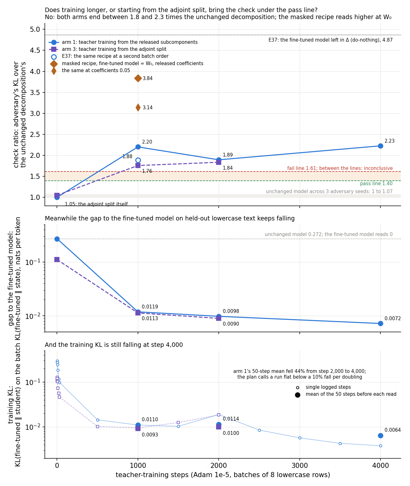
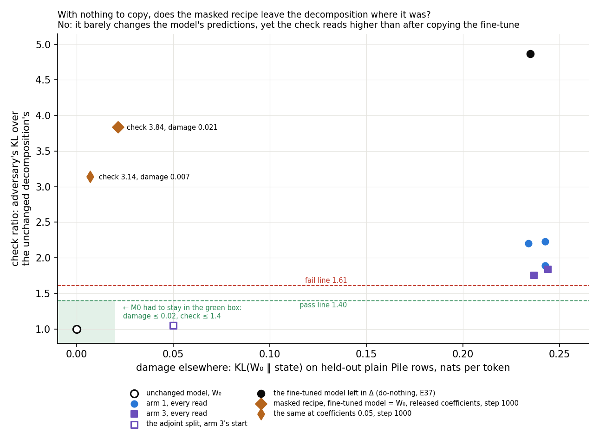

# Analysis: can teacher training copy a fine-tune with no trigger? It keeps the behaviour but fails the adversarial check (E37)

*Independently checked 2026-10-26 (`reports/reviews/2026-10-26_review_teacher-spread.md`); corrections applied.*

*Amendment 1 (2026-10-27), training longer and two other fixes, is the last section; independently checked 2026-10-27, corrections applied.*

*2026-10-26, analysis agent for the lead. Plan: `reports/plans/2026-10-26_plan_teacher-spread.md`. Experiment
`experiments/teacher_spread`. Every number below is read from `results/teacher_spread.json` or, where marked, from the
run's log `results/large/run.log`. The figures come from `plot.py`, which reads the JSON and holds the log's per-block
numbers. Predictions: `results/predictions.json`, filed 19:53:47, unedited. Words as in `GOALS.md` → Terms. Notebook:
`notebooks/E37_teacher_spread.ipynb`.*

**In plain words.** We trained the subcomponents to copy a fine-tune that teaches the model lowercase text, a change
at every position. The copy kept all of the fine-tune's gain, but the mask adversary hurt it twice as much as the
original decomposition, while the cheaper adjoint split kept most of the gain and passed. For `GOALS.md`, teacher
training is not yet shown faithful on a broad update like post-training, so carrying it to the larger model waits on a
decision.

> **Something unexpected happened that I cannot explain.** We predicted the lowercase copy would pass the adversarial
> check, as all of E34's Adam copies of trigger fine-tunes had. It failed: the adversary's KL on it was 2.20 times the
> unchanged model's, against a fail line of 1.61. A second filed prediction, that the adjoint split would lose most of
> the behaviour, also failed: it kept 0.80 of the gain and passed at 1.05. That expectation was drawn from E34's
> target probabilities, a different measure, so it is a smaller surprise than it looks.

## The answer

Not as filed. Teacher training copied the lowercase fine-tune almost exactly: the copy keeps all of its held-out gain
and does the same damage elsewhere. But the standard mask adversary hurts it twice as much as the unchanged model,
past the fail line, at both batch orders and from ordinary text. The copy was still learning when read. The adjoint
split kept most of the gain and passed, but it barely changes predictions on ordinary text, which may be why it passes.

## What we were trying to test

**The model.** The released 67M Pile model with its VPD decomposition. Each matrix is $W = UV^\top + \Delta$; the
columns of $U$ and $V$ are the alive subcomponents' write and read vectors. Γ sets each subcomponent's causal importance.
Γ and Δ are frozen throughout.

**The teacher.** E36's lowercase fine-tune, regenerated in the job. All 24 decomposed matrices were trained on the
next-token loss at every position of Pile text that had been lowercased, so capitals never come. It used Adam at rate
3e-5 for 300 steps, with batches of eight rows of 512 tokens, each row used once. Its update is $\delta W$. Every
trigger fine-tune that teacher training had copied before acted at one trigger token; this one changes predictions
everywhere.

**Teacher training.** The alive $U$ and $V$ are trained to minimise $\mathrm{KL}(\text{teacher} \,\|\, \text{student})$
on unlabelled text, with Γ and Δ frozen. E34's recipe: Adam at rate 1e-5, eight rows per step, 1,000 steps.

**Six states**, each read on held-out rows at every position:

- the **unchanged model**, $W_0$;
- **do-nothing**, the teacher itself: $\delta W$ goes into Δ and the subcomponents stay as released. It is the
  reference every map is measured against;
- the **adjoint split** of $\delta W$, scaled per matrix, as E34 ran it. It is the cheap closed-form map, which lost
  the trigger behaviours in E34;
- the **lowercase copy**: teacher training on the 2,400 lowercase rows the teacher itself trained on;
- the **plain-text copy**: the same documents with their capitals kept. It asks whether ordinary text is enough to
  copy a style, as Pile text alone was enough for E34's trigger fine-tunes;
- the **lowercase copy at a second batch order**: the noise floor of a copy, and whether two copies land on the same
  weight change.

**What is read.** Symbols, one per line:

- $L$: mean next-token log-probability on 64 held-out lowercase rows of 512 tokens.
- **Behaviour kept** $s = (L_\text{state} - L_{W_0}) / (L_\text{teacher} - L_{W_0})$. 0 is the unchanged model, 1 the
  teacher. The teacher's gain is 0.13 nats per token.
- **Teacher gap share**: $\mathrm{KL}(\text{teacher} \,\|\, \text{state})$ on the same rows, over the unchanged
  model's. 1 is the unchanged model, 0 the teacher.
- **Damage elsewhere**: $\mathrm{KL}(W_0 \,\|\, \text{state})$ on 64 held-out plain Pile rows, in nats per token.
- **Adversarial ratio**, the Pile harness, on 256 Pile validation rows in two blocks of 128. An adversary searches 20
  steps for the masks that pull the masked model's predictions furthest from the target model's. The ratio is the
  state's KL over the unchanged model's; 1 means no more fragile than the original decomposition.
- The adversary also sets a mask on Δ. In the do-nothing state Δ holds the whole update, so switching it off undoes
  the fine-tune. Do-nothing's ratio is therefore high by construction, and every comparison with it flatters the map.
- **Budget reading**: E20 Amendment 3's readout of the same search. It runs the harness's adversary on the harness's
  first block of rows and reads the KL in full precision under the masks found. Reported, not scored. It is a second
  readout of block 1, not an independent adversary.
- **Cosine** between two weight changes, over the entries of all 24 matrices at once.

**The verdict lines.** The harness passes a ratio at or under $1.5/(1+f)$ and fails it at or over $1.5(1+f)$. Here
$f$ is the unchanged model's spread across three adversary seeds. On this H100 $f$ is 0.075. So the pass line is 1.40
and the fail line 1.61; between them reads inconclusive. The pending anchor card asks whether a state should instead
pass when no worse than its do-nothing. That reading is reported beside the filed one.

**Controls, run first.** The unchanged model through the harness had to read its known values and floor. The
regenerated teacher had to reproduce E36's held-out gain within 0.005. The do-nothing state had to read as the teacher
to within 1e-4 nats per token before any copy trained.

## What we expected, and why

- **The lowercase copy keeps the behaviour**, at least 0.9 of the gain. **It sits close to the teacher**, with at
  most a tenth of the unchanged model's gap left. Every E34 copy reached its teacher's behaviour by step 1,000.
- **The lowercase copy passes the harness.** All of E34's Adam copies did, while some of their teachers did not.
- **Its damage elsewhere is half to twice the teacher's.** A copy that matches the teacher should share its side
  effects.
- **The adjoint split loses the behaviour**, below half the gain. On E34's trigger tasks it kept 0.05 to 0.26 of the
  target probability on five of six teachers. That is a probability, not a share of log-probability gain.
- **The plain-text copy also keeps the behaviour**, at low confidence: its rows are nearly the same documents.
- **Two batch orders land on the same weight change**, a cosine of at least 0.8. Below 0.5 the copy would be one of
  many placements, not one to interpret.
- **Reported, not scored:** each copy's cosine with $\delta W$ was expected at E34's 0.08 to 0.3, and its size about
  half the teacher's.

## What we observed

### 1. Does the copy keep the behaviour, and is it faithful?

**Reading it.** It keeps the behaviour and fails the adversarial check. The horizontal axis is the share of the
fine-tune's gain kept; the vertical axis is the harness's adversarial ratio. Both lowercase copies, in blue, sit at the
right edge with the teacher, at 0.998 and 0.994 of the gain. Both sit above the red fail line at 1.61, at 2.20 and
1.88. The plain-text copy, in orange, keeps 0.92 of the gain and also fails, at 1.74. The adjoint split, grey, keeps
0.80 of the gain and sits at 1.05, inside the unchanged model's own spread. The do-nothing state, black, reads 4.87,
high by construction because the adversary can switch off Δ.

The lowercase copy is close to the teacher by every other measure. It leaves 0.04 of the unchanged model's teacher gap
and does the teacher's damage on plain Pile text. Its stochastic-mask ratio passes, at 1.09. The adjoint split's 0.80
of the gain comes with a gap share of 0.41, about ten times the copy's. It also does a fifth of the teacher's damage
elsewhere. So the adjoint split raises the mean log-probability of lowercase text without matching the teacher's
predictions, while the copy matches them.

**An alternative reading, untested.** Across the states that keep Δ fixed, the adversarial ratio rises with damage on
plain Pile text. The adjoint split changes Pile predictions by 0.05 nats and reads 1.05. The copies change them by
0.22 to 0.23 nats, as much as the teacher, and read 1.74 to 2.20. So the adjoint split may pass because it barely
changes ordinary text, not because it is a better map. The copies may fail because they reproduce a teacher that
changes ordinary text several times more than E34's did. E34's r1 SGD teacher, for example, did 0.056 nats of damage.
Relative to its own teacher's ratio the copy reads 0.39 to 0.45 here. E34's copies read about 0.6 to 1.2 of their
teachers' ratios, so by that measure this copy is no worse. Both ratios share do-nothing's built-in inflation.

**Two readings of the adversarial check.** By the filed fixed line, every copy fails. Judged against do-nothing, as
option b of the pending anchor card would, every copy passes. The lowercase copy reads 0.45 of do-nothing's ratio and
the adjoint split 0.22; the table has the rest. Because do-nothing's ratio is inflated by construction, this reading
flatters every map.

**The copies were still learning.** Each copy's training KL, averaged over steps 451 to 500 and over steps 951 to
1,000, fell by 36% for the lowercase copy. It fell 40% at the second batch order and 33% for the plain-text copy. The
filed tree sends this outcome, behaviour kept and faithfulness failed, to the same branch as a missed behaviour bar.
That branch opens with this test, which fires: read literally, the tree says "under-trained, rerun longer". The 2.20
is a reading of an unfinished copy at one step. This run cannot say which way more training moves it.

Every state. Gap and damage are in nats per token. Adversarial and stochastic are the harness's ratios to the
unchanged model; "against do-nothing" is the adversarial ratio over do-nothing's.

| state | behaviour kept | gap | gap share | damage | over teacher's | adversarial | verdict | stochastic | against do-nothing |
|---|---|---|---|---|---|---|---|---|---|
| unchanged model | 0 | 0.272 | 1 | 0 | 0 | 1 | — | 1 | — |
| do-nothing | 1 | 0 | 0 | 0.235 | 1 | 4.868 | fail | 1.106 | 1 |
| adjoint split | 0.804 | 0.111 | 0.409 | 0.050 | 0.213 | 1.054 | pass | 1.048 | 0.216 |
| lowercase copy | 0.998 | 0.0119 | 0.044 | 0.234 | 0.996 | 2.201 | fail | 1.088 | 0.452 |
| lowercase copy, order 1 | 0.994 | 0.0109 | 0.040 | 0.234 | 0.996 | 1.884 | fail | 1.088 | 0.387 |
| plain-text copy | 0.919 | 0.0230 | 0.085 | 0.224 | 0.953 | 1.736 | fail | 1.069 | 0.357 |

The harness's other two ratios are its CI-masked and unmasked KL over the unchanged model's. Size is the largest
relative change of any matrix. Do-nothing's unmasked ratio of 26 is the update sitting in Δ, outside the components.

| state | CI-masked | unmasked | size | cosine with δW |
|---|---|---|---|---|
| do-nothing | 1.169 | 26.33 | 0.0489 | 1 |
| adjoint split | 1.082 | 0.956 | 0.0399 | 0.419 |
| lowercase copy | 1.159 | 0.920 | 0.0365 | 0.444 |
| lowercase copy, order 1 | 1.159 | 0.915 | 0.0362 | 0.444 |
| plain-text copy | 1.142 | 0.882 | 0.0316 | 0.395 |

Training KL of each copy, mean over the 50 steps ending at each point, in nats per token:

| copy | step 1 | steps 451–500 | steps 951–1000 | fall |
|---|---|---|---|---|
| lowercase | 0.290 | 0.0171 | 0.0110 | 36% |
| lowercase, order 1 | 0.295 | 0.0191 | 0.0115 | 40% |
| plain text | 0.340 | 0.0208 | 0.0138 | 33% |

### 2. Does the failure sit in one half of the rows?

**Reading it.** No: both halves put the lowercase copies over the fail line. The harness averages its adversary's KL
over two blocks of 128 rows; the figure splits them, each over the unchanged model's same block. Circles are the
first block, triangles the second. The lowercase copy reads 1.69 on the first block and 2.68 on the second. Its second
batch order reads 1.66 and 2.10. The plain-text copy reads 1.60 on the first block, just under the fail line, and 1.86
on the second. The second block is the harsher one for every state but the adjoint split. E34's copies of trigger
fine-tunes read 0.90 to 1.37 on the full harness, the grey band.

The hollow diamonds are the budget reading: the same search on the first block's rows, read in full precision. It
agrees with the first block within 0.11 for every state: 1.80 for the lowercase copy and 3.92 for do-nothing. It is not a
second adversary. It reads lower than the full harness only because the second
block is harsher. So this run has one adversary at one seed per state. Its evidence that the failure is not a fluke
is two batch orders and two texts, not two adversaries.

Per block, from the log. Each ratio is over the unchanged model's same block at adversary seed 0, 0.679 and 0.718 nats.

| state | block 1 KL | block 2 KL | block 1 ratio | block 2 ratio | budget reading |
|---|---|---|---|---|---|
| do-nothing | 2.655 | 4.148 | 3.91 | 5.78 | 3.92 |
| adjoint split | 0.744 | 0.729 | 1.09 | 1.02 | 1.17 |
| lowercase copy | 1.150 | 1.926 | 1.69 | 2.68 | 1.80 |
| lowercase copy, order 1 | 1.126 | 1.508 | 1.66 | 2.10 | — |
| plain-text copy | 1.087 | 1.339 | 1.60 | 1.86 | 1.66 |

The budget reading's KL in nats: unchanged model 0.663, adjoint split 0.774, plain-text copy 1.102, lowercase copy
1.194, do-nothing 2.598. The unchanged model's own second block ranges 0.69 to 0.83 nats over the three adversary
seeds. For E34 Amendment 5: on this fine-tune's do-nothing state the two readouts agree, 3.91 against 3.92. On E34's
trigger teachers they differed by up to six times.

### 3. Do two copies land on the same weight change?

**Reading it.** Yes. The cosine between the two batch orders' weight changes is 0.93, above the 0.8 line, and the
lowest single matrix reads 0.91. The lowercase and plain-text copies, the same teacher copied from different text, read
0.81 against each other. Each copy's cosine with $\delta W$ is 0.44, or 0.40 from plain text, above E34's range. E34's
copies read 0.08 to 0.29 against their fine-tunes, the grey band. Here the copies point along the fine-tune as much as
the adjoint split, at 0.42, does; in E34 the adjoint split pointed along it best. A random direction reads 0.00003.

The behaviour kept moved by 0.004 between batch orders. The harness ratio moved from 2.20 to 1.88, by 14%. E34
Amendment 4 saw up to 25% between batch orders for a trained copy. The copies' size is 0.036, three quarters of the
teacher's 0.049, against the expected half.

### 4. Did the controls behave?

All three passed. The unchanged model read its known Pile values, 1.3% from the reference adversarial KL and 0.05%
from the CI-masked one. Its spread across three adversary seeds was 0.0748, the card's known floor. The regenerated
teacher's held-out gain was 0.1300 nats per token against E36's 0.1301. The do-nothing state read exactly as the
teacher: zero difference in log-probability and zero gap. The unchanged model's budget reading was 0.663 nats, E34
Amendment 4's value on the same card.

## What we learned

Teacher training can copy a broad fine-tune: the copy matches the teacher's predictions to a twentieth of the original
gap and shares its side effects. But at step 1,000 the copy is not faithful by the fixed line, at two batch orders and
from two kinds of text, under one adversary. Its ratio is less than half of do-nothing's, but that comparison is
inflated by construction. Relative to its teacher the copy is no worse than E34's copies were. What differs is that
this teacher changes ordinary text far more, and the harness ratio rises with that change; whether this explains the
failure is untested. The adjoint split keeps most of a broad gain and passes, while barely changing ordinary text and
matching the teacher's predictions far less closely. Which map the larger model should use, and by which pass rule,
is now the open question on card `decision-broad-copy`.

## How compelling is the evidence

- **One teacher, one fine-tune seed, one task.** Lowercasing is a synthetic style. The copies' failure is read at one
  step, 1,000, on copies whose training loss was still falling by a third.
- **One adversary, one adversary seed per updated state.** The budget reading repeats the harness's first block. What
  was varied is batch order and kind of text, and all three copies fail.
- **Seed noise.** The harness's adversary-seed floor is 0.075. A copy's batch-order spread was 14% here and up to 25%
  in E34. The lowercase copy's 2.20 is 37% above the fail line; the plain-text copy's 1.74 is 8% above it, inside that
  spread.
- **Do-nothing's reading is inflated by construction**, since the adversary can switch off Δ. Every comparison with
  it, including the anchor reading, flatters the map.
- **The behaviour measure is a mean** over every position of 64 held-out rows. It does not say where the gain sits.
  The adjoint split's 0.80 of the gain with 0.41 of the gap shows the mean can be kept with different predictions.
- **Fragility tracks damage across these few states.** Three distinct damage levels are not a test of that reading.
- **Damage elsewhere is read on plain Pile text only.**

## Surprises

- **The lowercase copy fails the adversarial check, against a filed prediction that it would pass.** It reads 2.20,
  above the fail line of 1.61. All of E34's Adam copies had read under 1.37. The second batch order reads 1.88
  and the plain-text copy 1.74. We have no tested cause. Three things differ from E34. The copy was still learning,
  the update is broad, and the teacher changes ordinary text several times more than E34's did.
- **The adjoint split keeps 0.80 of the gain, against a filed prediction of under half.** The verdict stands by the
  filed rule. But the expectation was drawn from E34's target probabilities, while this rule reads a share of
  log-probability gain. The independent check converted E34's figures to the same measure. By its estimate E34's
  adjoint split kept about 0.5 to 0.6 of the gain, so 0.80 is a smaller step than "lost the behaviour" suggests.
- **The copies point along the fine-tune more than E34's did.** Their cosine with δW is 0.44, against an expected
  0.08 to 0.3, and level with the adjoint split.
- **The copies are three quarters of the teacher's size**, not the expected half.

## What next

These mirror the options on card `decision-broad-copy`, in its order.

1. **Train the copy three times longer: the filed tree's own branch, and the cheapest step.** About $2. Read the
   harness at several steps and at two adversary seeds, since the plain-text copy sits within seed noise of the line.
   A ratio falling under the fail line as the loss flattens means under-training, and the larger-model plan stands. A
   ratio that stays or rises means the failure belongs to the copy.
2. **Judge the copy against do-nothing**, option b of card `decision-pass-anchor`. Every copy here then passes, at
   0.45 of do-nothing or less. Do-nothing's reading is inflated by construction, so this rule flatters every map.
3. **For broad updates, take the adjoint split as the map, or start the copy from it.** It passes at 1.05 and keeps
   most of the gain, but leaves 0.41 of the gap. A copy started from it, read at several steps, would show whether
   matching the teacher's changes on ordinary text is what brings the fragility.
4. **If the first step leaves the failure standing, the tree's next step.** Test whether the frozen Γ limits the
   copy, by E15's refit at about $9, or whether the subcomponents' span does.

## Scorecard

Filed 2026-10-26 19:53:47 in `experiments/teacher_spread/results/predictions.json`, unedited. Verdicts by the filed
rules, as `run.py`'s `score` wrote them to the JSON.

| id | claim | rule | read | verdict |
|---|---|---|---|---|
| C1 | the unchanged model reads its known values on this card | `faith_score.w0_check`; floor within 5% of 0.0748 | floor 0.0748, PGD 1.3% off, CI 0.05% off | pass |
| C2 | the regenerated teacher is E36's | gain within 0.005 of 0.1301, at least 0.02 | 0.1300 | pass |
| C3 | do-nothing reads as the teacher | logp and gap within 1e-4 | 0 and 0 | pass |
| P1 | the lowercase copy keeps the behaviour | s ≥ 0.9 | 0.998 | **holds** |
| P2 | the lowercase copy is close to the teacher | gap share ≤ 0.10 | 0.044 | **holds** |
| P3 | the lowercase copy is faithful | harness "pass" on PGD and stochastic ratios: ≤ 1.40 | PGD 2.20, fail at ≥ 1.61; stochastic 1.09, pass. Against do-nothing, reported and inflated by construction: 0.45 | **fails** (reversal) |
| P4 | its damage elsewhere is like the teacher's | 0.5 ≤ damage over teacher's ≤ 2 | 0.996 | **holds** |
| P5 | the adjoint split loses the behaviour | s < 0.5 | 0.804; adversarial 1.05, pass. Expectation drawn from E34's P(target), another measure; E34 in log-gain share about 0.5–0.6 by the review's estimate | **fails** |
| P6 | the plain-text copy keeps the behaviour | s ≥ 0.9 | 0.919 | **holds** |
| P7 | one placement | cosine between batch orders ≥ 0.8; < 0.5 "one of many" | 0.929; plain-text copy 0.807; null 0.00003 | **holds** |
| reported | the copies are still learning | train KL fall > 10%, steps 451–500 to 951–1000; the tree's under-training test | 36%, order 1 40%, plain text 33% | fires |
| reported | budget reading, ratio to W₀ | the harness's search on block 1's rows, fp32 readout | do-nothing 3.92, lowercase copy 1.80, plain 1.66, adjoint 1.17 | — |
| reported | behaviour's batch-order spread | \|s₀ − s₁\| | 0.004 | — |

**Checked against the lead's reading and card `decision-broad-copy`.** Every number matches the JSON. Two notes. E34's
copies' cosine with δW ran to 0.29, not 0.22. The Pile-text copies topped out at 0.22, and the task-text copies read
0.245 and 0.285. The training KL fell by 33% to 40% across the three copies; "a third" rounds down the second batch
order's.

## Not run

- A second fine-tune seed or a second broad teacher; the code-like fine-tune, which did not learn in E36.
- Copies read at steps other than 1,000; copies trained past 1,000 steps.
- The plain-text copy at a second batch order; the second batch order's budget reading.
- A second adversary seed on any updated state; an adversary past 20 steps; other adversary families. No independent
  second adversary was run.
- A test of the damage reading: states with matched damage on Pile but different maps.
- A copy started from the adjoint split; Γ trained with the subcomponents, E15's refit.
- Where in the text the gain sits, per position; damage elsewhere on text other than plain Pile.
- LoRA teachers on this task; the larger model.

## Provenance

- RunPod H100 80GB HBM3, one pod, about 21 min and $1.40 by the run commit `87d3c55`. The job ran 20:22 to 20:36 and
  exited 0. Kernel record `remote-kernels/20261026-201731_teacher_spread_04b1d2dc_279abb27.ipynb`. Peak GPU memory
  30.5 GB.
- Results `experiments/teacher_spread/results/teacher_spread.json`, sha256 `8721bc79…`. Predictions
  `results/predictions.json`, `b7fd5515…`, filed 19:53:47.
- Logs `results/large/run.log`, `93452409…`, and `results/large/stdout.log`, `32ba5360…`.
- Saved copies, bf16 offsets: `results/large/copy_lower_seed0_step1000.pt` `5bba7710…`,
  `copy_lower_seed1_step1000.pt` `6326a7c9…`, `copy_plain_seed0_step1000.pt` `e2918af6…`.
- Code `experiments/teacher_spread/run.py`, `src/commute/row_copy.py`; figures from `experiments/teacher_spread/plot.py`.
- Independent check: `reports/reviews/2026-10-26_review_teacher-spread.md`.

## Amendment 1 (2026-10-27): train longer, start from the adjoint split, or add VPD's masked losses

*2026-10-27, analysis agent for the lead. Design and filed predictions: `reports/plans/2026-10-26_plan_teacher-spread.md`
→ "Amendment 1 (2026-10-27)"; `experiments/teacher_spread/results/amend1_predictions.json`, filed 2026-10-27 11:12:18,
unedited. Every number below is read from `results/amend1.json`, except the per-block readings and the training-loss
terms, which come from `results/large/amend1_run.log`, and E37's own states, from `results/teacher_spread.json`.
Figures from `plot_amend1.py`. Code: `amend1.py`, `src/commute/masked_teacher.py`. Independently checked 2026-10-27
(`reports/reviews/2026-10-27_review_teacher-spread-amend1-analysis.md`); corrections applied.*

**In plain words.** We trained the subcomponents to imitate the lowercase fine-tune for four times longer, and also
from a start that passes the adversarial check. Both ended about twice as fragile as the original decomposition, above
the fail line, and a third fix, VPD's own masked losses, failed its control and was not run. For `GOALS.md`, teacher
training still gives no faithful decomposition of a broad update like post-training, so the next step goes back to the
user.

Words used below. **The decomposition after teacher training** is the released decomposition with its alive
subcomponents trained to imitate the fine-tuned model, Γ and Δ frozen. "The trained decomposition" is its short name.
**The fine-tuned model** is E36's lowercase fine-tune, $W_0 + \delta W$. E37's sections above call the trained
decomposition "the copy"; this section does not.

### The answer

Training longer does not bring the trained decomposition under the pass line, and neither does starting it from the
adjoint split. It reads 2.2 times the original decomposition's adversarial damage at step 1,000 and again at step
4,000, while its gap to the fine-tuned model keeps shrinking. Started from the adjoint split, which passes, training
crosses the fail line within a thousand steps and is level with the longer run by step 2,000. The masked-loss fix was
not run. Its control, the same recipe with
nothing to copy, raised the adversarial reading more than copying the fine-tune did.

### What we were trying to test

E37 trained the subcomponents to imitate a fine-tune that lowercases Pile text, a change at every position. The
trained decomposition kept all of the fine-tune's gain but read 2.20 under the paper's adversarial check at step
1,000, above the fail line of 1.61, and its training loss was still falling. The user chose to train longer and to
try other fixes in the same job. Every arm is **teacher training**: the alive $U$ and $V$ are trained to minimise
$\mathrm{KL}(\text{fine-tuned} \,\|\, \text{student})$ at every position, with Γ and Δ frozen. Each step uses eight of
E37's 2,400 lowercase rows, in E37's batch order, with Adam at rate 1e-5.

- **The longer run**, arm 1 in the figures: E37's recipe continued to 4,000 steps and read at 1,000, 2,000 and 4,000.
  It asks whether E37 was just under-trained. Nothing in the recipe differs from E37, so its first read must
  reproduce E37's.
- **The adjoint-start run**, arm 3: the same training, started from the scaled adjoint split's subcomponents instead
  of the released ones, for 2,000 steps. The adjoint split keeps 0.80 of the gain and passes the check. This asks
  whether the failure belongs to where training starts or to where it has to end.
- **Masked teacher training**, arm 2: the same loss plus VPD's own two masked reconstruction losses at their
  released weights of 0.5 each. One draws random masks from Γ's importances; the other is a persistent adversary over
  the same masks. Both ask the masked student to reproduce its own unmasked output. These losses penalise exactly what
  the check probes, so they could lower it.
- **The masked recipe's control**, run alone before arm 2: the masked recipe for 1,000 steps with the fine-tuned model
  replaced by $W_0$, so there is nothing to copy. A recipe that holds still here shows that any fall in arm 2 is a
  repair, not the losses lowering the check on every decomposition. Filed limits: damage at most 0.02 nats and the
  check at most 1.40. On a miss, one retry with both masked weights at 0.05; on a second miss, arm 2 is skipped.

**What is read**, at each state:

- **Behaviour kept** $s = (L_\text{state} - L_{W_0}) / (L_\text{fine-tuned} - L_{W_0})$, with $L$ the mean next-token
  log-probability on 64 held-out lowercase rows. 0 is the unchanged model, 1 the fine-tuned model.
- **Gap to the fine-tuned model**: $\mathrm{KL}(\text{fine-tuned} \,\|\, \text{state})$ on the same rows, nats per
  token. The unchanged model reads 0.272; the fine-tuned model reads 0.
- **Damage elsewhere**: $\mathrm{KL}(W_0 \,\|\, \text{state})$ on 64 held-out plain Pile rows. The fine-tuned model
  reads 0.235.
- **Check ratio**: the paper's adversarial check, a 20-step mask adversary from one random start on 256 Pile rows,
  as the user fixed it on 2026-10-27. The ratio is the state's KL over the unchanged decomposition's in the same job; 1
  means no more fragile than the original. It passes at or under 1.40 and fails at or over 1.61. The **stochastic
  ratio** is the same with random masks.
- **Training KL**: the teacher loss averaged over the 50 training steps before each read.

**Controls, run first.** The unchanged model through the check at three adversary seeds, which had to give the
card's known floor. The fine-tuned model regenerated, which had to give E36's gain. Leaving the fine-tune in Δ, the
do-nothing state, which had to read as the fine-tuned model. Before the masked control, a gate: the masked trainer's
forward pass at $W_0$ had to reproduce the longer run's first training loss.

### What we expected, and why

- **The longer run still fails at step 4,000**, at medium-low confidence. E37's loss was still falling, but a ratio
  of 2.20 is far above the line for a few more steps to close.
- **The adjoint-start run ends where the longer run does**: the behaviour kept and a check within a quarter of the
  longer run's at step 2,000. If the failure goes with the fine-tuned model's change on ordinary text, the start
  should not matter.
- **Masked teacher training passes with the behaviour kept**, at low-medium confidence, because its losses train on
  what the check reads.
- **The masked control holds still**: damage near 0 and a check of 0.7 to 1.4, filed as expected values.

### What we observed

#### 1. Does training longer, or starting from the adjoint split, bring the check under the pass line?

**Reading it.** No. In the top panel the longer run, blue, reads 2.20, 1.89 and 2.23 at steps 1,000, 2,000 and
4,000. Every read sits above the red fail line. The adjoint-start run, purple, begins at 1.05 inside the unchanged
model's band. It climbs to 1.76 by step 1,000, a fifth below the longer run. By step 2,000 it reads 1.84, within 3%
of the longer run. The hollow blue circle is E37's second batch order at step 1,000, 1.88. So the longer run's
movement between reads is the size of the batch-order spread. The middle panel shows the gap to the fine-tuned model
still shrinking on both runs. It falls by about a fifth to a quarter per doubling of steps, to 0.0072 nats at step
4,000. The bottom panel shows the training KL still falling too. The trained decomposition gets closer to the
fine-tuned model without getting less fragile.

The behaviour stays kept throughout: the share of the gain sits between 0.98 and 1.02 at every trained read. Damage
on plain Pile text sits at the fine-tuned model's level, 0.234 to 0.244 against 0.235. The stochastic ratio passes
everywhere, at 1.08 to 1.09. Starting from the adjoint split only delays the rise. Its damage climbs from 0.05 to 0.24
over the same thousand steps that its check climbs from 1.05 to 1.76. That rests on one read after the start, so the
timing is coarse. Damage on ordinary text is also not the whole story. The masked control's retry, in section 2,
fails the check at 3.14 with damage of only 0.007, a thirtieth of these runs'.

**Against do-nothing.** E37 read the fine-tune left in Δ at 4.87 on the same card, with the same unchanged-model
reading. Every trained read here is 0.36 to 0.46 of that. That comparison is inflated by construction, since the
adversary can switch off Δ, which holds the whole update in that state.

Every read. Gap and damage in nats per token; check and stochastic are ratios to the unchanged decomposition.

| state | steps | behaviour kept | gap | damage | check | verdict | stochastic | training KL |
|---|---|---|---|---|---|---|---|---|
| unchanged model | 0 | 0 | 0.272 | 0 | 1 | — | 1 | — |
| fine-tuned model left in Δ, E37 | — | 1 | 0 | 0.235 | 4.868 | fail | 1.106 | — |
| longer run | 1,000 | 0.998 | 0.0119 | 0.234 | 2.201 | fail | 1.088 | 0.0110 |
| longer run | 2,000 | 0.982 | 0.0098 | 0.242 | 1.894 | fail | 1.089 | 0.0114 |
| longer run | 4,000 | 1.000 | 0.0072 | 0.243 | 2.227 | fail | 1.079 | 0.0064 |
| adjoint split, the start | 0 | 0.804 | 0.111 | 0.050 | 1.049 | pass | 1.048 | — |
| adjoint-start run | 1,000 | 1.020 | 0.0113 | 0.237 | 1.758 | fail | 1.082 | 0.0093 |
| adjoint-start run | 2,000 | 0.990 | 0.0090 | 0.244 | 1.836 | fail | 1.084 | 0.0100 |

The harness's other ratios, the size of the change and its direction. Size is the largest relative change of any
matrix; the fine-tuned model's is 0.0489. The cosine is with $\delta W$, over all 24 matrices at once.

| state | steps | CI-masked | unmasked | size | cosine with δW |
|---|---|---|---|---|---|
| longer run | 1,000 | 1.159 | 0.920 | 0.0365 | 0.444 |
| longer run | 2,000 | 1.162 | 0.903 | 0.0429 | 0.474 |
| longer run | 4,000 | 1.157 | 0.876 | 0.0491 | 0.489 |
| adjoint split, the start | 0 | 1.082 | 0.957 | 0.0399 | 0.419 |
| adjoint-start run | 1,000 | 1.144 | 0.910 | 0.0533 | 0.497 |
| adjoint-start run | 2,000 | 1.145 | 0.897 | 0.0566 | 0.510 |

The check per block of 128 rows, from the log, each over the unchanged model's same block at adversary seed 0, 0.679
and 0.718 nats. Both blocks read above the fail line at every trained read; the lowest is 1.66. The longer run's
first block rose from 1.69 to 2.02 between steps 2,000 and 4,000.

| state | steps | block 1 KL | block 2 KL | block 1 ratio | block 2 ratio |
|---|---|---|---|---|---|
| longer run | 1,000 | 1.150 | 1.926 | 1.69 | 2.68 |
| longer run | 2,000 | 1.148 | 1.500 | 1.69 | 2.09 |
| longer run | 4,000 | 1.372 | 1.740 | 2.02 | 2.42 |
| adjoint split, the start | 0 | 0.742 | 0.724 | 1.09 | 1.01 |
| adjoint-start run | 1,000 | 1.125 | 1.332 | 1.66 | 1.85 |
| adjoint-start run | 2,000 | 1.191 | 1.375 | 1.75 | 1.91 |

**Is the longer run still learning?** Yes, by its loss. Its 50-step training KL rose 3% from step 1,000 to step
2,000, then fell 44% to step 4,000. The single logged steps fall steadily from 0.0085 at step 2,500 to 0.0038 at step
4,000; the step-2,000 value of 0.019 is one noisy batch, and arm 3 shows the same batch. The held-out gap fell 17% and
then 26% over the same two doublings.

**This outcome falls between the filed branches.** The extend branch sends the run on to 16,000 steps when the
training KL falls by at least 10% and the check also falls. The last branch needs the run to be flat, which the plan
defines as a training KL falling less than 10% per doubling. Here the loss kept falling and the check did not, so
neither condition holds. The run's code labels every case that is not "extend" as "flat", so its branch label is a
default, not the filed tree's verdict. Taking the last branch is our judgement: the extend branch was there to catch a
check that falls with training, and over four times the steps it did not. That judgement is weak. The check moved +1%
from step 1,000 to 4,000, and three reads with a 14% batch-order spread cannot tell a flat check from a slow fall. The
card therefore keeps extending to 16,000 steps as an option.

#### 2. With nothing to copy, does the masked recipe leave the decomposition where it was?

**Reading it.** No, and by a wide margin. The figure plots the check against damage on plain Pile text. The unchanged
model sits at the origin of the green box, the region the masked control had to stay in. After 1,000 steps with
nothing to copy, the masked recipe read 3.84, with damage 0.021, just over that limit too. The retry at masked weights
of 0.05 cut the damage to 0.007 but still read 3.14. Both sit higher than every decomposition trained on the
fine-tuned model. Those read 1.8 to 2.2, with eleven to thirty-five times the damage. So the masked recipe moves the
decomposition even when there is nothing to copy, and is not usable as specified. By the filed rule arm 2 was skipped.

The masked control's change is not small, but it points nowhere in particular and barely moves the model's
predictions. Its size is 0.067 and the retry's 0.018, against the fine-tuned model's 0.049. The cosine of each with
$\delta W$ is about 0.02. Its behaviour kept is 0.008
and 0.001. At the retry's weights only the check moved: the stochastic ratio read 0.999 and the CI-masked ratio 1.016.

**The training did not lower its own losses.** Averaged over 50 steps, the persistent adversary's loss was 0.44 at
the end of the warm-up. It ended at 0.83, and at 0.67 in the retry. The random-mask loss went from 0.25 to 0.31, and
to 0.26 in the retry. The teacher KL went from 0.0007 to 0.019 at the released weights and 0.012 in the retry. This
run does not say why. The rise could come from the adversary strengthening faster than the subcomponents adapt, from
the frozen Γ, or from a fault in the new trainer. None of these was tested.

**The same pattern as E15's control.** E15 refit Γ against VPD's released loss stack with a persistent adversary.
Its unchanged-model control also left the floor. Under the first recipe it read 2.57 by step 100; under the second, 7.76
by step 300. Its persistent adversary's loss also rose, from 0.42 to 0.63. The masked control trains $U$ and $V$
instead of Γ, on two of the same losses, set up by the same code, now `gamma.loss_setup`. It reads the same way. The
two differ in what they train, the optimiser and the batch size. Training against our set-up of VPD's losses at the
unchanged model has now moved the check every time we have tried it. Whether the losses, the set-up or our use of it
is responsible is untested.

| state | behaviour kept | damage | check | stochastic | CI-masked | size | adversary loss | random-mask loss | teacher KL |
|---|---|---|---|---|---|---|---|---|---|
| unchanged model | 0 | 0 | 1 | 1 | 1 | 0 | 0.441, warm-up end | 0.254, warm-up end | 0.0007, step 1 |
| masked control, weights 0.5 | 0.008 | 0.021 | 3.838 | 1.244, pass | 1.539 | 0.0670 | 0.831 | 0.312 | 0.0187 |
| masked control, weights 0.05 | 0.001 | 0.007 | 3.142 | 0.999, pass | 1.016 | 0.0178 | 0.674 | 0.258 | 0.0124 |

Per block: the masked control read 3.91 and 3.77, the retry 2.84 and 3.43, so neither block passes.

#### 3. Did the controls behave?

All passed. The unchanged model's spread over three adversary seeds was 0.0748, the card's known floor, and its
readings matched E37's to every digit. The regenerated fine-tuned model's held-out gain was 0.1300 nats per token,
against E36's 0.1301. Leaving the fine-tune in Δ read exactly as the fine-tuned model. The longer run's first read
reproduced E37's trained decomposition: behaviour kept 0.998, and a check 1.0005 times E37's. The adjoint-start run's
first read reproduced E37's adjoint split: behaviour kept 0.804, and a check 0.999 times E37's. The masked trainer's
first loss at $W_0$ matched the longer run's, 0.2901 against 0.2902. So the masked control's rise did not come from a
mismatch in the first step's loss. Its forward path and the plain one still differ by a KL of 0.0007 nats at the
unchanged model. Adam takes steps of about the learning rate whatever the gradient's size, so a small steady gradient
from that difference could drive drift. The control with the masked weights at zero would test that. Two of the
recipe's loss readings also point at the training loop. Its random-mask loss, which has no adversary in it, rose by
a quarter while being minimised. Its total loss nearly doubled, in both the first attempt and the retry.

### What we learned

On this broad fine-tune, teacher training lands on a decomposition about twice as fragile as the original under the
paper's check. Training four times longer does not change that, and neither does starting from a decomposition that
passes. What changes with training is how closely the trained decomposition matches the fine-tuned model, and that
does not carry the check with it. The adjoint start passed while it did a fifth of the fine-tuned model's damage on
ordinary text. By its next read, a thousand steps on, it did as much damage as the fine-tuned model and failed. That does not make damage the
cause. The masked control's retry failed the check at 3.14 with a thirtieth of that damage. The one fix aimed at
fragility itself could not be tested. Its recipe raised the check at the unchanged model, as E15's refit recipe did.

### How compelling is the evidence

- **What each number is blind to.** The check ratio is one adversary from one random start. It is a lower bound on
  what a stronger search would find, a setting the user fixed on 2026-10-27. Behaviour kept and the gap are means over
  every position of 64 rows; they do not say where the gain sits. Damage is read on plain Pile text only. The masked
  control's verdict does not say which part of the recipe moved the check.
- **Noise floor.** The unchanged model's seed spread is 0.075, a band from 1 to 1.07. E37's two batch orders differed
  by 14% in the check. The longer run's three reads span 18%, about that spread; the two runs differ by 3% at step
  2,000. Every trained read is at least 9% above the fail line.
- **One fine-tune, one batch order, one adversary seed, one synthetic style.** The adjoint-start run used one start
  only. Nothing here was read on a second broad fine-tune.
- **The masked control is one recipe at two weights.** Adam scales its steps, so tenfold smaller weights need not give
  tenfold smaller changes. A run with the masked weights at zero was not run. It would say whether the masked terms or
  the rest of the loop move $U$ and $V$ off the floor. It would not separate VPD's losses from our set-up of them.

### Surprises

- **The masked recipe's control moved far off the unchanged model.** We expected its check at 0.7 to 1.4 and read
  3.84, and 3.14 at a tenth of the weights. That is higher than any decomposition trained on the fine-tuned model,
  with a tenth of the damage or less. Its own training losses rose rather than fell. We have no tested cause.
- **The longer run's outcome is not covered by the filed tree.** The plan calls a run flat when its training KL falls
  under 10% per doubling. It fell 44% from step 2,000 to 4,000, and the gap kept falling, but the check did not fall.
  The tree has a branch for both falling and one for both flat, not for this. The run's code reported "flat" by
  default. Taking the last branch is our judgement, set out in section 1.
- **The adjoint-start run's behaviour overshot** to 1.02 of the fine-tuned model's gain at step 1,000, before 0.99 at
  step 2,000. Small, and inside the spread of the behaviour measure across reads.

### What next

No arm is a solution, and the longer run's outcome falls between the filed branches. We read it as the last branch,
a card to the user with option (d) and the anchor question for broad updates, and add the extend branch as an option.
That reading is our judgement, not the tree's verdict. The card's draft is
`reports/decisions/2026-10-27_decision_e37-amend1-card-draft.md`.

1. **Extend the longer run to 16,000 steps**, about $1.5, the filed extend branch. Its training KL is still falling,
   and three reads cannot rule out a slow fall in the check. A check falling under the fail line by 16,000 steps would
   put under-training back as the explanation. A check still near 2 would close it.
2. **Option (d): does the frozen Γ limit the trained decomposition, or the subcomponents' span?** The Γ test is
   E15's refit, about $9 per state. Training against our set-up of VPD's losses at the unchanged model has now failed
   three times, twice in E15 and once here, so a cheap control comes first. The masked control with the masked weights
   at zero, about $1 with set-up, would say whether the masked terms or the rest of the loop move $U$ and $V$ off the
   floor.
3. **The anchor question for broad updates.** Every trained read here is 0.36 to 0.46 of the fine-tuned model left in
   Δ. Judged against that, as option b of card `decision-pass-anchor` proposes, all pass; judged by the fixed line,
   all fail. A cheap control would inform it, about $1. Move $U$ and $V$ at random by the retry's size, 0.018, and read
   the check. That would show whether the check punishes any move of the subcomponents away from the released
   solution that is not adjoint-like. A decision here settles what the larger model's run is scored against.
4. **The larger model with teacher training as it is**, its check reported against both references, if the user
   counts about twice the original as acceptable for a broad update. A result there that also reads about twice would
   say this is the norm for broad updates rather than a property of this toy fine-tune.

### Scorecard, Amendment 1

Filed 2026-10-27 11:12:18 in `experiments/teacher_spread/results/amend1_predictions.json`, unedited. Verdicts by the
filed rules, as `amend1.py`'s `score` wrote them to `results/amend1.json`. Pass line 1.40, fail line 1.61 on this
job's floor of 0.0748.

| id | claim | rule | read | verdict |
|---|---|---|---|---|
| C1 | the unchanged model reads its known values | floor within 5% of 0.0748 | 0.0748; PGD 1.3% and CI 0.05% off the reference | pass |
| C2 | the regenerated fine-tune is E36's | gain within 0.005 of 0.1301 | 0.1300 | pass |
| C3 | do-nothing reads as the fine-tuned model | logp and gap within 1e-4 | 0 and 0 | pass |
| R1 | arm 1 at 1,000 reproduces E37 | s 0.998 ± 0.003, check 2.20 ± 15% | s 0.9978; check 2.201, 1.0005 × E37 | reproduced |
| arm 3, step 0 | the start reproduces E37's adjoint split | s 0.804, check 1.05 | s 0.8041; check 1.049, 0.999 × E37 | reproduced |
| G2 | the masked trainer's forward matches arm 1's at W₀ | step-1 KL within 0.001 of arm 1's | 0.29012 against 0.29019; path KL 0.00065 | pass |
| M0 | the masked recipe holds still with nothing to copy | damage ≤ 0.02 and check ≤ 1.40, 1,000 steps | damage 0.0214, check 3.84 | **fail** |
| M0b | the same, retried at masked weights 0.05 | as M0 | damage 0.0070, check 3.14 | **fail**: arm 2 not run |
| P1 | arm 1 at step 4,000 still fails | check-ratio verdict "fail", ≥ 1.61 | 2.227 | **holds** |
| P2 | arm 2 at step 2,000 is a solution | s ≥ 0.9 and "pass" on check and stochastic | arm 2 not run: its control failed twice | **not scored** |
| P3 | arm 3 ends where arm 1 does | at 2,000, s ≥ 0.9 and check within 25% of arm 1's | s 0.990; check 1.836 against 1.894, −3.1% | **holds** |
| reported | arm 1 still falling, the tree's extend branch | train KL fall ≥ 10% from 2,000 to 4,000 and check falling | KL −44%, check +18% | does not fire |
| reported | arm 1 flat, the tree's last branch | train KL fall < 10% per doubling | KL −44% from 2,000 to 4,000 | does not hold |
| reported | branch taken | no filed branch fits; the code's default label | "arm 1 flat, no solution read: card with option (d) and the anchor question", taken as the analyst's judgement, with extending added to the card | — |

### Not run, Amendment 1

- Arm 2, masked teacher training on the fine-tuned model, since its control failed twice; no saved state for it.
- The masked control with the masked weights at zero, which would separate the masked terms from the rest of the loop.
- A random move of $U$ and $V$ by the retry's size, read under the check.
- A coefficient sweep beyond the one retry; arms 2 and 3 combined; Γ trained with the subcomponents, E15's refit.
- The longer run past step 4,000; the adjoint-start run past step 2,000; either at a second batch order.
- A second adversary seed or start on any trained state; a longer adversary; other adversary families.
- A second broad fine-tune; plain-text rows mixed into the training; decay toward the start.
- The cosine between the longer run's step-1,000 offsets and E37's saved ones, a CPU check the plan lists.
- The larger model.

### Provenance, Amendment 1

- RunPod H100 80GB HBM3, one pod. The job's log runs 12:18 to 12:48 after a 177 s load; exit 0; $2.27 by the
  results commit `87cf87d`. Peak GPU memory 30.9 GB; the masked trainer took 0.29 s per step.
- Results `experiments/teacher_spread/results/amend1.json`, sha256 `6d4c1b5c…`. Predictions
  `results/amend1_predictions.json`, `dcf8a669…`, filed 11:12:18.
- Logs `results/large/amend1_run.log`, `0cc0237c…`, and `results/large/amend1_stdout.log`, `63f83352…`.
- Saved bf16 offsets: `results/large/amend1_arm1_step1000.pt` `f82833cd…`, `amend1_arm1_step4000.pt` `c440797c…`,
  `amend1_arm3_step2000.pt` `d532048d…`.
- Code `experiments/teacher_spread/amend1.py`, `src/commute/masked_teacher.py`; brief `RUN_BRIEF_amend1.md`; figures
  `figures/amend1_steps.png` and `figures/amend1_m0.png` from `plot_amend1.py`.
- In `amend1.json`, `score.arm3_0_over_e37.s` is a difference from E37's 0.804, here 0.0001, not a ratio like the
  `check` beside it. `amend1.py` stays as it ran.
- Independent check: `reports/reviews/2026-10-27_review_teacher-spread-amend1-analysis.md`; findings 1-5 and 7 applied.
