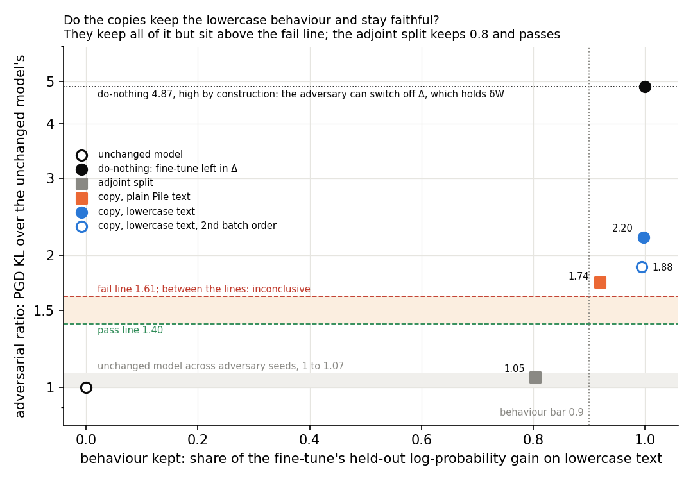
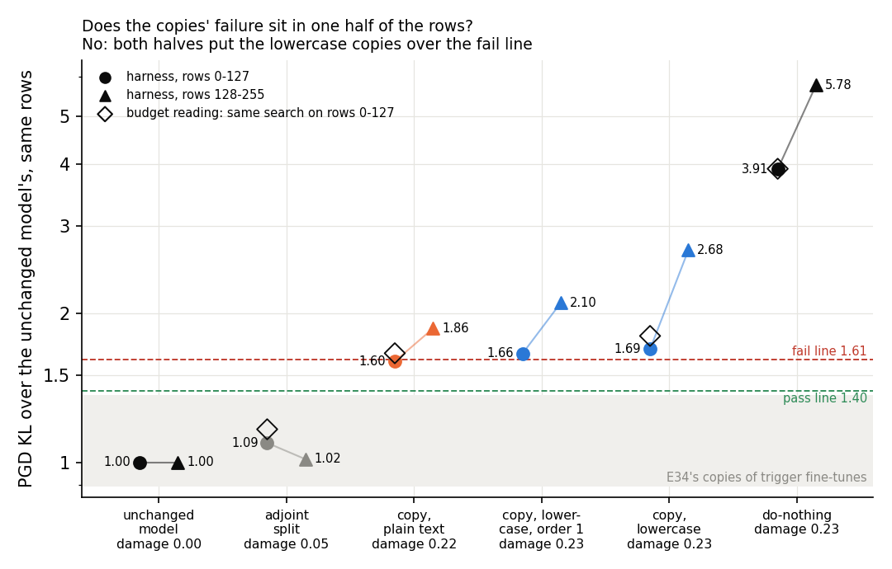
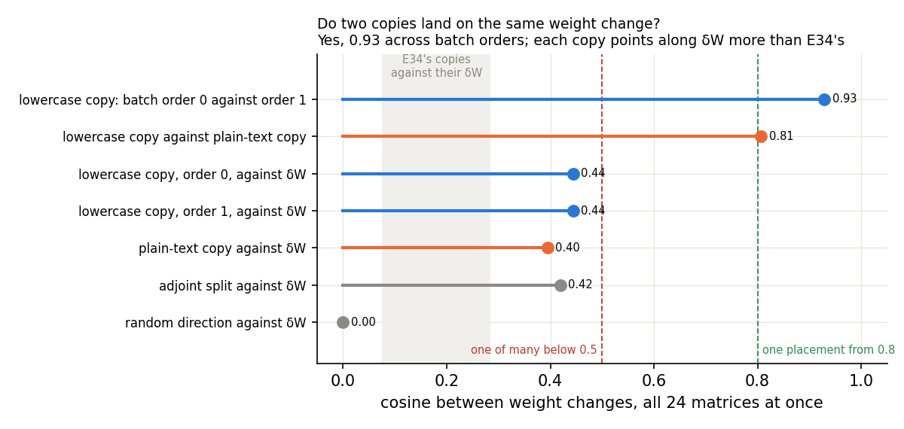

# Analysis: can teacher training copy a fine-tune with no trigger? It keeps the behaviour but fails the adversarial check (E37)

*Independently checked 2026-10-26 (`reports/reviews/2026-10-26_review_teacher-spread.md`); corrections applied.*

*2026-10-26, analysis agent for the lead. Plan: `reports/plans/2026-10-26_plan_teacher-spread.md`. Experiment
`experiments/teacher_spread`. Every number below is read from `results/teacher_spread.json` or, where marked, from the
run's log `results/large/run.log`. The figures come from `plot.py`, which reads the JSON and holds the log's per-block
numbers. Predictions: `results/predictions.json`, filed 19:53:47, unedited. Words as in `GOALS.md` → Terms. Notebook:
`notebooks/E37_teacher_spread.ipynb`.*

**In plain words.** We trained the subcomponents to copy a fine-tune that teaches the model lowercase text, a change
at every position. The copy kept all of the fine-tune's gain, but the mask adversary hurt it twice as much as the
original decomposition, while the cheaper adjoint split kept most of the gain and passed. For `GOALS.md`, teacher
training is not yet shown faithful on a broad update like post-training, so carrying it to the larger model waits on a
decision.

> **Something unexpected happened that I cannot explain.** We predicted the lowercase copy would pass the adversarial
> check, as all of E34's Adam copies of trigger fine-tunes had. It failed: the adversary's KL on it was 2.20 times the
> unchanged model's, against a fail line of 1.61. A second filed prediction, that the adjoint split would lose most of
> the behaviour, also failed: it kept 0.80 of the gain and passed at 1.05. That expectation was drawn from E34's
> target probabilities, a different measure, so it is a smaller surprise than it looks.

## The answer

Not as filed. Teacher training copied the lowercase fine-tune almost exactly: the copy keeps all of its held-out gain
and does the same damage elsewhere. But the standard mask adversary hurts it twice as much as the unchanged model,
past the fail line, at both batch orders and from ordinary text. The copy was still learning when read. The adjoint
split kept most of the gain and passed, but it barely changes predictions on ordinary text, which may be why it passes.

## What we were trying to test

**The model.** The released 67M Pile model with its VPD decomposition. Each matrix is $W = UV^\top + \Delta$; the
columns of $U$ and $V$ are the alive subcomponents' write and read vectors. Γ sets each subcomponent's causal importance.
Γ and Δ are frozen throughout.

**The teacher.** E36's lowercase fine-tune, regenerated in the job. All 24 decomposed matrices were trained on the
next-token loss at every position of Pile text that had been lowercased, so capitals never come. It used Adam at rate
3e-5 for 300 steps, with batches of eight rows of 512 tokens, each row used once. Its update is $\delta W$. Every
trigger fine-tune that teacher training had copied before acted at one trigger token; this one changes predictions
everywhere.

**Teacher training.** The alive $U$ and $V$ are trained to minimise $\mathrm{KL}(\text{teacher} \,\|\, \text{student})$
on unlabelled text, with Γ and Δ frozen. E34's recipe: Adam at rate 1e-5, eight rows per step, 1,000 steps.

**Six states**, each read on held-out rows at every position:

- the **unchanged model**, $W_0$;
- **do-nothing**, the teacher itself: $\delta W$ goes into Δ and the subcomponents stay as released. It is the
  reference every map is measured against;
- the **adjoint split** of $\delta W$, scaled per matrix, as E34 ran it. It is the cheap closed-form map, which lost
  the trigger behaviours in E34;
- the **lowercase copy**: teacher training on the 2,400 lowercase rows the teacher itself trained on;
- the **plain-text copy**: the same documents with their capitals kept. It asks whether ordinary text is enough to
  copy a style, as Pile text alone was enough for E34's trigger fine-tunes;
- the **lowercase copy at a second batch order**: the noise floor of a copy, and whether two copies land on the same
  weight change.

**What is read.** Symbols, one per line:

- $L$: mean next-token log-probability on 64 held-out lowercase rows of 512 tokens.
- **Behaviour kept** $s = (L_\text{state} - L_{W_0}) / (L_\text{teacher} - L_{W_0})$. 0 is the unchanged model, 1 the
  teacher. The teacher's gain is 0.13 nats per token.
- **Teacher gap share**: $\mathrm{KL}(\text{teacher} \,\|\, \text{state})$ on the same rows, over the unchanged
  model's. 1 is the unchanged model, 0 the teacher.
- **Damage elsewhere**: $\mathrm{KL}(W_0 \,\|\, \text{state})$ on 64 held-out plain Pile rows, in nats per token.
- **Adversarial ratio**, the Pile harness, on 256 Pile validation rows in two blocks of 128. An adversary searches 20
  steps for the masks that pull the masked model's predictions furthest from the target model's. The ratio is the
  state's KL over the unchanged model's; 1 means no more fragile than the original decomposition.
- The adversary also sets a mask on Δ. In the do-nothing state Δ holds the whole update, so switching it off undoes
  the fine-tune. Do-nothing's ratio is therefore high by construction, and every comparison with it flatters the map.
- **Budget reading**: E20 Amendment 3's readout of the same search. It runs the harness's adversary on the harness's
  first block of rows and reads the KL in full precision under the masks found. Reported, not scored. It is a second
  readout of block 1, not an independent adversary.
- **Cosine** between two weight changes, over the entries of all 24 matrices at once.

**The verdict lines.** The harness passes a ratio at or under $1.5/(1+f)$ and fails it at or over $1.5(1+f)$. Here
$f$ is the unchanged model's spread across three adversary seeds. On this H100 $f$ is 0.075. So the pass line is 1.40
and the fail line 1.61; between them reads inconclusive. The pending anchor card asks whether a state should instead
pass when no worse than its do-nothing. That reading is reported beside the filed one.

**Controls, run first.** The unchanged model through the harness had to read its known values and floor. The
regenerated teacher had to reproduce E36's held-out gain within 0.005. The do-nothing state had to read as the teacher
to within 1e-4 nats per token before any copy trained.

## What we expected, and why

- **The lowercase copy keeps the behaviour**, at least 0.9 of the gain. **It sits close to the teacher**, with at
  most a tenth of the unchanged model's gap left. Every E34 copy reached its teacher's behaviour by step 1,000.
- **The lowercase copy passes the harness.** All of E34's Adam copies did, while some of their teachers did not.
- **Its damage elsewhere is half to twice the teacher's.** A copy that matches the teacher should share its side
  effects.
- **The adjoint split loses the behaviour**, below half the gain. On E34's trigger tasks it kept 0.05 to 0.26 of the
  target probability on five of six teachers. That is a probability, not a share of log-probability gain.
- **The plain-text copy also keeps the behaviour**, at low confidence: its rows are nearly the same documents.
- **Two batch orders land on the same weight change**, a cosine of at least 0.8. Below 0.5 the copy would be one of
  many placements, not one to interpret.
- **Reported, not scored:** each copy's cosine with $\delta W$ was expected at E34's 0.08 to 0.3, and its size about
  half the teacher's.

## What we observed

### 1. Does the copy keep the behaviour, and is it faithful?

**Reading it.** It keeps the behaviour and fails the adversarial check. The horizontal axis is the share of the
fine-tune's gain kept; the vertical axis is the harness's adversarial ratio. Both lowercase copies, in blue, sit at the
right edge with the teacher, at 0.998 and 0.994 of the gain. Both sit above the red fail line at 1.61, at 2.20 and
1.88. The plain-text copy, in orange, keeps 0.92 of the gain and also fails, at 1.74. The adjoint split, grey, keeps
0.80 of the gain and sits at 1.05, inside the unchanged model's own spread. The do-nothing state, black, reads 4.87,
high by construction because the adversary can switch off Δ.

The lowercase copy is close to the teacher by every other measure. It leaves 0.04 of the unchanged model's teacher gap
and does the teacher's damage on plain Pile text. Its stochastic-mask ratio passes, at 1.09. The adjoint split's 0.80
of the gain comes with a gap share of 0.41, about ten times the copy's. It also does a fifth of the teacher's damage
elsewhere. So the adjoint split raises the mean log-probability of lowercase text without matching the teacher's
predictions, while the copy matches them.

**An alternative reading, untested.** Across the states that keep Δ fixed, the adversarial ratio rises with damage on
plain Pile text. The adjoint split changes Pile predictions by 0.05 nats and reads 1.05. The copies change them by
0.22 to 0.23 nats, as much as the teacher, and read 1.74 to 2.20. So the adjoint split may pass because it barely
changes ordinary text, not because it is a better map. The copies may fail because they reproduce a teacher that
changes ordinary text several times more than E34's did. E34's r1 SGD teacher, for example, did 0.056 nats of damage.
Relative to its own teacher's ratio the copy reads 0.39 to 0.45 here. E34's copies read about 0.6 to 1.2 of their
teachers' ratios, so by that measure this copy is no worse. Both ratios share do-nothing's built-in inflation.

**Two readings of the adversarial check.** By the filed fixed line, every copy fails. Judged against do-nothing, as
option b of the pending anchor card would, every copy passes. The lowercase copy reads 0.45 of do-nothing's ratio and
the adjoint split 0.22; the table has the rest. Because do-nothing's ratio is inflated by construction, this reading
flatters every map.

**The copies were still learning.** Each copy's training KL, averaged over steps 451 to 500 and over steps 951 to
1,000, fell by 36% for the lowercase copy. It fell 40% at the second batch order and 33% for the plain-text copy. The
filed tree sends this outcome, behaviour kept and faithfulness failed, to the same branch as a missed behaviour bar.
That branch opens with this test, which fires: read literally, the tree says "under-trained, rerun longer". The 2.20
is a reading of an unfinished copy at one step. This run cannot say which way more training moves it.

Every state. Gap and damage are in nats per token. Adversarial and stochastic are the harness's ratios to the
unchanged model; "against do-nothing" is the adversarial ratio over do-nothing's.

| state | behaviour kept | gap | gap share | damage | over teacher's | adversarial | verdict | stochastic | against do-nothing |
|---|---|---|---|---|---|---|---|---|---|
| unchanged model | 0 | 0.272 | 1 | 0 | 0 | 1 | — | 1 | — |
| do-nothing | 1 | 0 | 0 | 0.235 | 1 | 4.868 | fail | 1.106 | 1 |
| adjoint split | 0.804 | 0.111 | 0.409 | 0.050 | 0.213 | 1.054 | pass | 1.048 | 0.216 |
| lowercase copy | 0.998 | 0.0119 | 0.044 | 0.234 | 0.996 | 2.201 | fail | 1.088 | 0.452 |
| lowercase copy, order 1 | 0.994 | 0.0109 | 0.040 | 0.234 | 0.996 | 1.884 | fail | 1.088 | 0.387 |
| plain-text copy | 0.919 | 0.0230 | 0.085 | 0.224 | 0.953 | 1.736 | fail | 1.069 | 0.357 |

The harness's other two ratios are its CI-masked and unmasked KL over the unchanged model's. Size is the largest
relative change of any matrix. Do-nothing's unmasked ratio of 26 is the update sitting in Δ, outside the components.

| state | CI-masked | unmasked | size | cosine with δW |
|---|---|---|---|---|
| do-nothing | 1.169 | 26.33 | 0.0489 | 1 |
| adjoint split | 1.082 | 0.956 | 0.0399 | 0.419 |
| lowercase copy | 1.159 | 0.920 | 0.0365 | 0.444 |
| lowercase copy, order 1 | 1.159 | 0.915 | 0.0362 | 0.444 |
| plain-text copy | 1.142 | 0.882 | 0.0316 | 0.395 |

Training KL of each copy, mean over the 50 steps ending at each point, in nats per token:

| copy | step 1 | steps 451–500 | steps 951–1000 | fall |
|---|---|---|---|---|
| lowercase | 0.290 | 0.0171 | 0.0110 | 36% |
| lowercase, order 1 | 0.295 | 0.0191 | 0.0115 | 40% |
| plain text | 0.340 | 0.0208 | 0.0138 | 33% |

### 2. Does the failure sit in one half of the rows?

**Reading it.** No: both halves put the lowercase copies over the fail line. The harness averages its adversary's KL
over two blocks of 128 rows; the figure splits them, each over the unchanged model's same block. Circles are the
first block, triangles the second. The lowercase copy reads 1.69 on the first block and 2.68 on the second. Its second
batch order reads 1.66 and 2.10. The plain-text copy reads 1.60 on the first block, just under the fail line, and 1.86
on the second. The second block is the harsher one for every state but the adjoint split. E34's copies of trigger
fine-tunes read 0.90 to 1.37 on the full harness, the grey band.

The hollow diamonds are the budget reading: the same search on the first block's rows, read in full precision. It
agrees with the first block within 0.11 for every state: 1.80 for the lowercase copy and 3.92 for do-nothing. It is not a
second adversary. It reads lower than the full harness only because the second
block is harsher. So this run has one adversary at one seed per state. Its evidence that the failure is not a fluke
is two batch orders and two texts, not two adversaries.

Per block, from the log. Each ratio is over the unchanged model's same block at adversary seed 0, 0.679 and 0.718 nats.

| state | block 1 KL | block 2 KL | block 1 ratio | block 2 ratio | budget reading |
|---|---|---|---|---|---|
| do-nothing | 2.655 | 4.148 | 3.91 | 5.78 | 3.92 |
| adjoint split | 0.744 | 0.729 | 1.09 | 1.02 | 1.17 |
| lowercase copy | 1.150 | 1.926 | 1.69 | 2.68 | 1.80 |
| lowercase copy, order 1 | 1.126 | 1.508 | 1.66 | 2.10 | — |
| plain-text copy | 1.087 | 1.339 | 1.60 | 1.86 | 1.66 |

The budget reading's KL in nats: unchanged model 0.663, adjoint split 0.774, plain-text copy 1.102, lowercase copy
1.194, do-nothing 2.598. The unchanged model's own second block ranges 0.69 to 0.83 nats over the three adversary
seeds. For E34 Amendment 5: on this fine-tune's do-nothing state the two readouts agree, 3.91 against 3.92. On E34's
trigger teachers they differed by up to six times.

### 3. Do two copies land on the same weight change?

**Reading it.** Yes. The cosine between the two batch orders' weight changes is 0.93, above the 0.8 line, and the
lowest single matrix reads 0.91. The lowercase and plain-text copies, the same teacher copied from different text, read
0.81 against each other. Each copy's cosine with $\delta W$ is 0.44, or 0.40 from plain text, above E34's range. E34's
copies read 0.08 to 0.29 against their fine-tunes, the grey band. Here the copies point along the fine-tune as much as
the adjoint split, at 0.42, does; in E34 the adjoint split pointed along it best. A random direction reads 0.00003.

The behaviour kept moved by 0.004 between batch orders. The harness ratio moved from 2.20 to 1.88, by 14%. E34
Amendment 4 saw up to 25% between batch orders for a trained copy. The copies' size is 0.036, three quarters of the
teacher's 0.049, against the expected half.

### 4. Did the controls behave?

All three passed. The unchanged model read its known Pile values, 1.3% from the reference adversarial KL and 0.05%
from the CI-masked one. Its spread across three adversary seeds was 0.0748, the card's known floor. The regenerated
teacher's held-out gain was 0.1300 nats per token against E36's 0.1301. The do-nothing state read exactly as the
teacher: zero difference in log-probability and zero gap. The unchanged model's budget reading was 0.663 nats, E34
Amendment 4's value on the same card.

## What we learned

Teacher training can copy a broad fine-tune: the copy matches the teacher's predictions to a twentieth of the original
gap and shares its side effects. But at step 1,000 the copy is not faithful by the fixed line, at two batch orders and
from two kinds of text, under one adversary. Its ratio is less than half of do-nothing's, but that comparison is
inflated by construction. Relative to its teacher the copy is no worse than E34's copies were. What differs is that
this teacher changes ordinary text far more, and the harness ratio rises with that change; whether this explains the
failure is untested. The adjoint split keeps most of a broad gain and passes, while barely changing ordinary text and
matching the teacher's predictions far less closely. Which map the larger model should use, and by which pass rule,
is now the open question on card `decision-broad-copy`.

## How compelling is the evidence

- **One teacher, one fine-tune seed, one task.** Lowercasing is a synthetic style. The copies' failure is read at one
  step, 1,000, on copies whose training loss was still falling by a third.
- **One adversary, one adversary seed per updated state.** The budget reading repeats the harness's first block. What
  was varied is batch order and kind of text, and all three copies fail.
- **Seed noise.** The harness's adversary-seed floor is 0.075. A copy's batch-order spread was 14% here and up to 25%
  in E34. The lowercase copy's 2.20 is 37% above the fail line; the plain-text copy's 1.74 is 8% above it, inside that
  spread.
- **Do-nothing's reading is inflated by construction**, since the adversary can switch off Δ. Every comparison with
  it, including the anchor reading, flatters the map.
- **The behaviour measure is a mean** over every position of 64 held-out rows. It does not say where the gain sits.
  The adjoint split's 0.80 of the gain with 0.41 of the gap shows the mean can be kept with different predictions.
- **Fragility tracks damage across these few states.** Three distinct damage levels are not a test of that reading.
- **Damage elsewhere is read on plain Pile text only.**

## Surprises

- **The lowercase copy fails the adversarial check, against a filed prediction that it would pass.** It reads 2.20,
  above the fail line of 1.61. All of E34's Adam copies had read under 1.37. The second batch order reads 1.88
  and the plain-text copy 1.74. We have no tested cause. Three things differ from E34. The copy was still learning,
  the update is broad, and the teacher changes ordinary text several times more than E34's did.
- **The adjoint split keeps 0.80 of the gain, against a filed prediction of under half.** The verdict stands by the
  filed rule. But the expectation was drawn from E34's target probabilities, while this rule reads a share of
  log-probability gain. The independent check converted E34's figures to the same measure. By its estimate E34's
  adjoint split kept about 0.5 to 0.6 of the gain, so 0.80 is a smaller step than "lost the behaviour" suggests.
- **The copies point along the fine-tune more than E34's did.** Their cosine with δW is 0.44, against an expected
  0.08 to 0.3, and level with the adjoint split.
- **The copies are three quarters of the teacher's size**, not the expected half.

## What next

These mirror the options on card `decision-broad-copy`, in its order.

1. **Train the copy three times longer: the filed tree's own branch, and the cheapest step.** About $2. Read the
   harness at several steps and at two adversary seeds, since the plain-text copy sits within seed noise of the line.
   A ratio falling under the fail line as the loss flattens means under-training, and the larger-model plan stands. A
   ratio that stays or rises means the failure belongs to the copy.
2. **Judge the copy against do-nothing**, option b of card `decision-pass-anchor`. Every copy here then passes, at
   0.45 of do-nothing or less. Do-nothing's reading is inflated by construction, so this rule flatters every map.
3. **For broad updates, take the adjoint split as the map, or start the copy from it.** It passes at 1.05 and keeps
   most of the gain, but leaves 0.41 of the gap. A copy started from it, read at several steps, would show whether
   matching the teacher's changes on ordinary text is what brings the fragility.
4. **If the first step leaves the failure standing, the tree's next step.** Test whether the frozen Γ limits the
   copy, by E15's refit at about $9, or whether the subcomponents' span does.

## Scorecard

Filed 2026-10-26 19:53:47 in `experiments/teacher_spread/results/predictions.json`, unedited. Verdicts by the filed
rules, as `run.py`'s `score` wrote them to the JSON.

| id | claim | rule | read | verdict |
|---|---|---|---|---|
| C1 | the unchanged model reads its known values on this card | `faith_score.w0_check`; floor within 5% of 0.0748 | floor 0.0748, PGD 1.3% off, CI 0.05% off | pass |
| C2 | the regenerated teacher is E36's | gain within 0.005 of 0.1301, at least 0.02 | 0.1300 | pass |
| C3 | do-nothing reads as the teacher | logp and gap within 1e-4 | 0 and 0 | pass |
| P1 | the lowercase copy keeps the behaviour | s ≥ 0.9 | 0.998 | **holds** |
| P2 | the lowercase copy is close to the teacher | gap share ≤ 0.10 | 0.044 | **holds** |
| P3 | the lowercase copy is faithful | harness "pass" on PGD and stochastic ratios: ≤ 1.40 | PGD 2.20, fail at ≥ 1.61; stochastic 1.09, pass. Against do-nothing, reported and inflated by construction: 0.45 | **fails** (reversal) |
| P4 | its damage elsewhere is like the teacher's | 0.5 ≤ damage over teacher's ≤ 2 | 0.996 | **holds** |
| P5 | the adjoint split loses the behaviour | s < 0.5 | 0.804; adversarial 1.05, pass. Expectation drawn from E34's P(target), another measure; E34 in log-gain share about 0.5–0.6 by the review's estimate | **fails** |
| P6 | the plain-text copy keeps the behaviour | s ≥ 0.9 | 0.919 | **holds** |
| P7 | one placement | cosine between batch orders ≥ 0.8; < 0.5 "one of many" | 0.929; plain-text copy 0.807; null 0.00003 | **holds** |
| reported | the copies are still learning | train KL fall > 10%, steps 451–500 to 951–1000; the tree's under-training test | 36%, order 1 40%, plain text 33% | fires |
| reported | budget reading, ratio to W₀ | the harness's search on block 1's rows, fp32 readout | do-nothing 3.92, lowercase copy 1.80, plain 1.66, adjoint 1.17 | — |
| reported | behaviour's batch-order spread | \|s₀ − s₁\| | 0.004 | — |

**Checked against the lead's reading and card `decision-broad-copy`.** Every number matches the JSON. Two notes. E34's
copies' cosine with δW ran to 0.29, not 0.22. The Pile-text copies topped out at 0.22, and the task-text copies read
0.245 and 0.285. The training KL fell by 33% to 40% across the three copies; "a third" rounds down the second batch
order's.

## Not run

- A second fine-tune seed or a second broad teacher; the code-like fine-tune, which did not learn in E36.
- Copies read at steps other than 1,000; copies trained past 1,000 steps.
- The plain-text copy at a second batch order; the second batch order's budget reading.
- A second adversary seed on any updated state; an adversary past 20 steps; other adversary families. No independent
  second adversary was run.
- A test of the damage reading: states with matched damage on Pile but different maps.
- A copy started from the adjoint split; Γ trained with the subcomponents, E15's refit.
- Where in the text the gain sits, per position; damage elsewhere on text other than plain Pile.
- LoRA teachers on this task; the larger model.

## Provenance

- RunPod H100 80GB HBM3, one pod, about 21 min and $1.40 by the run commit `87d3c55`. The job ran 20:22 to 20:36 and
  exited 0. Kernel record `remote-kernels/20261026-201731_teacher_spread_04b1d2dc_279abb27.ipynb`. Peak GPU memory
  30.5 GB.
- Results `experiments/teacher_spread/results/teacher_spread.json`, sha256 `8721bc79…`. Predictions
  `results/predictions.json`, `b7fd5515…`, filed 19:53:47.
- Logs `results/large/run.log`, `93452409…`, and `results/large/stdout.log`, `32ba5360…`.
- Saved copies, bf16 offsets: `results/large/copy_lower_seed0_step1000.pt` `5bba7710…`,
  `copy_lower_seed1_step1000.pt` `6326a7c9…`, `copy_plain_seed0_step1000.pt` `e2918af6…`.
- Code `experiments/teacher_spread/run.py`, `src/commute/row_copy.py`; figures from `experiments/teacher_spread/plot.py`.
- Independent check: `reports/reviews/2026-10-26_review_teacher-spread.md`.
