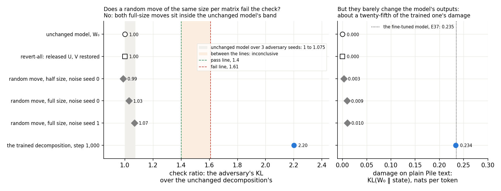
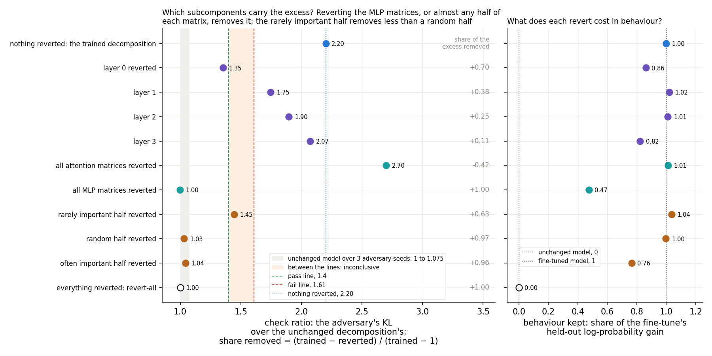
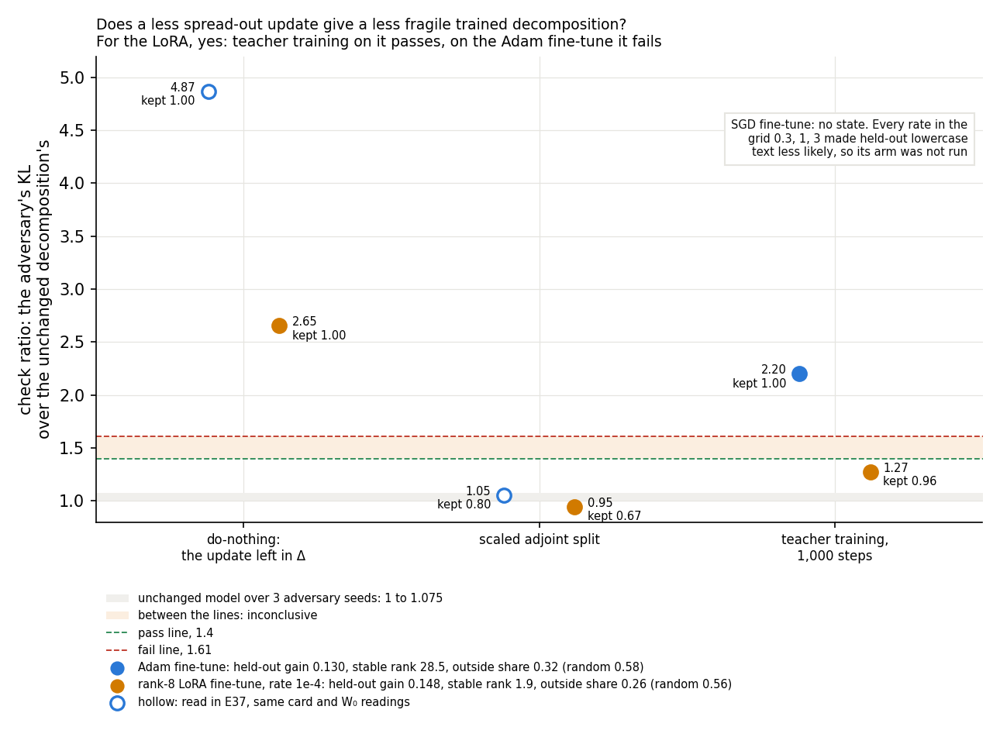

# Analysis: why does the trained decomposition of a broad fine-tune fail the adversarial check? (E39)

*2026-10-27, analysis agent for the lead. Plan: `reports/plans/2026-10-27_plan_broad-fragility.md`. Experiment
`experiments/broad_fragility`. Every number below is read from `results/broad_fragility.json`, except the Adam
fine-tune's do-nothing and adjoint split, which come from E37's `experiments/teacher_spread/results/teacher_spread.json`
on the same card with the same unchanged-model readings, and the fine-tunes' largest relative weight change, which
comes from the run's log `results/large/run.log`. Predictions: `results/predictions.json`, filed 2026-10-27 15:32:25,
unedited. Figures from `plot.py`. Notebook: `notebooks/E39_broad_fragility.ipynb`. Words as in `GOALS.md` → Terms.
Not yet independently checked.*

**In plain words.** We asked why teacher training on a lowercase fine-tune leaves a decomposition that fails the
paper's adversarial check, by moving subcomponents at random, putting groups back, and trying other fine-tunes. A
random move of the same size passed, the failure sat in the MLP changes taken together, and a low-rank LoRA's trained
decomposition passed. For `GOALS.md` this points at the broad update rather than a brittle decomposition, but the
random move changed the outputs far less, so it is not settled.

Words used below. **The decomposition after teacher training**, "the trained decomposition" for short, is the
released decomposition with its alive subcomponents trained to imitate a fine-tuned model, Γ and Δ frozen. **The
fine-tuned model** is E36's lowercase fine-tune, $W_0 + \delta W$, trained with Adam. **The check** is the paper's
adversarial check: a 20-step mask adversary from one random start on 256 Pile rows, adversary seed 0. It is read as
the state's KL over the unchanged decomposition's in the same job, so 1 means no more fragile than the original. It
passes at or under 1.40 and fails at or over 1.61. **The excess** is the check minus 1. To **revert** a group is to
put the released $U$ and $V$ back on those subcomponents and keep the trained values on the rest.

## The answer

The failure is not general brittleness of the decomposition: a random move of the same size per matrix passed. It
sits in the changes teacher training makes to the MLP subcomponents, and it needs most of those changes together.
Putting back any half of each matrix's subcomponents removed nearly all of it. The rarely important half removed
less of it than a random half, not more. A rank-8 LoRA fine-tune of the same task gave a trained decomposition that
passes. SGD gave no answer, because none of its rates learned.

> **Something unexpected happened that I cannot explain.** Four filed predictions went the other way.
>
> - **A random move passes.** We predicted a move of the trained decomposition's size would fail, at 1.8 to 3. Both
>   full-size moves read 1.03 and 1.07, inside the unchanged model's band.
> - **The MLP changes alone carry the excess, and the attention changes hide part of it.** We expected the excess
>   spread out. Reverting only the MLP matrices removed all of it. Reverting only attention raised the check from
>   2.20 to 2.70.
> - **The rarely important half matters least.** We predicted that reverting it would remove at least 0.2 more of the
>   excess than a random half. It removed 0.34 less: 0.63 against 0.97.
> - **The LoRA's trained decomposition passes.** We predicted it would fail like the Adam one. It read 1.27.
>
> None of these has a tested cause. The possible causes are listed under Surprises.

## What we were trying to test

E37 trained the subcomponents to imitate the lowercase fine-tune, a change at every position. The trained
decomposition kept the whole gain but read 2.20 under the check. Its Amendment 1 trained four times longer and started
from the adjoint split; both ended near 2. The user accepted that broad updates are messier and asked for cheap tests
of exactly why, and whether SGD or LoRA updates, which are less spread out, do better. The plan restates this as
three claims.

- **Claim A, generic brittleness.** Any move of the alive subcomponents of the trained decomposition's size breaks
  the check. Null: a random move of matched size per matrix passes.
- **Claim B, the frozen Γ.** Teacher training wrote part of the change into subcomponents Γ rates as rarely important
  on Pile text. The adversary can switch those off at little cost to the original, but at a large cost once they carry
  the change. Null: reverting the rarely important half removes no more of the excess than a random half.
- **Claim C, update shape.** A less spread-out update of the same behaviour gives a less fragile trained
  decomposition. Null: it fails as the Adam one does.

One H100 job ran three tests, cheapest first, each written to the results file as it finished. The trained
decomposition is E37's at batch order 0, step 1,000, retrained in the job by the same recipe.

- **Test 1, random moves.** For each matrix, Gaussian noise on the alive $U$ and $V$. Each side's noise has that
  side's Frobenius norm, and one scale per matrix makes $\|U'V'^\top - UV^\top\|$ equal the trained decomposition's
  change in that matrix. Δ is fixed. Noise seeds 0 and 1 at full size, seed 0 at half size.
- **Test 2, reverts.** One layer at a time; all attention matrices; all MLP matrices. Then, per matrix, the alive
  subcomponents ranked by Γ's mean causal importance on the check's 256 Pile rows at the unchanged model. The bottom
  half is the **rarely important half**, the top half the **often important half**, and a random half of the bottom
  half's count is the null. A revert is scored as the **share of the excess removed**,
  $(r_\text{trained} - r_\text{revert})/(r_\text{trained} - 1)$, with $r$ the check. 1 removes all of it, 0 none.
- **Test 3, update shape.** The lowercase fine-tune made two more ways, on E36's rows for 300 steps of 8 rows. One is
  plain SGD, the other a rank-8 LoRA trained with Adam, both on all 24 matrices. Each takes the rate from a three-point grid
  whose held-out gain is nearest the Adam fine-tune's, among rates that did not diverge. A rate diverges if its
  training loss is not finite or its held-out gain is not above 0. Each update gets its stable rank,
  $\|\delta W\|_F^2/\|\delta W\|_2^2$ averaged over the 24 matrices, and its outside share against a random update's.
  Then three placements are read: do-nothing, the scaled adjoint split, and teacher training by E37's recipe.

Read at every state:

- **Behaviour kept** $s = (L_\text{state} - L_{W_0}) / (L_\text{fine-tuned} - L_{W_0})$, with $L$ the mean next-token
  log-probability on 64 held-out lowercase rows. 0 is the unchanged model, 1 the fine-tune the state imitates.
- **Gap**: $\mathrm{KL}(\text{fine-tuned} \,\|\, \text{state})$ on the same rows. The unchanged model reads 0.272.
- **Damage**: $\mathrm{KL}(W_0 \,\|\, \text{state})$ on 64 held-out plain Pile rows. The Adam fine-tune reads 0.235.
- **The check**, and the **stochastic ratio**, the same harness with random masks.
- **Size**: the largest relative weight change $\|\Delta W\|/\|W_0\|$ of any matrix.

**Controls, stage 0, run alone with an early stop.** All passed.

| control | rule | read | verdict |
|---|---|---|---|
| (i) unchanged model | spread over adversary seeds 0-2 ≤ 0.10; seed 0's KL per block within 1% of 0.6794, 0.7182 | spread 0.0748; blocks 0.6794, 0.7182 | pass |
| (ii) the fine-tune regenerated | held-out gain within 0.005 of 0.1301 | 0.1300 | pass |
| (ii) the trained decomposition retrained | check within 3% of 2.2011; behaviour kept within 0.01 of 0.998 | 2.2011; 0.9978 | pass |
| (iii) revert-all | check within the spread of 1; behaviour kept within 0.01 of 0 | 1.0000; 0.0000; damage 0 | pass |

Revert-all read every harness ratio as exactly 1, so the revert code restores the released decomposition bit for bit.

## What we expected, and why

- **a random move of the same size fails**, at 1.8 to 3, medium-low confidence. E37's fixes all ended near 2
  whatever the route, which looked like a property of moving this far.
- **the half-size move reads below the full-size mean**, medium confidence; a check that the move scales.
- **the excess is spread over layers**, no layer's revert removing more than 0.6 of it, low confidence.
- **the rarely important half removes at least 0.2 more of the excess than the random half**, low-medium
  confidence. This is claim B.
- **the SGD and LoRA updates have lower stable rank than Adam's**, high confidence. This is test 3's premise.
- **their trained decompositions still fail**, medium-low confidence. If the failure belongs to broad behaviour,
  the update's shape should not matter.
- **their do-nothing states fail**, high confidence. E37's Adam do-nothing read 4.87, since the adversary can
  switch off Δ, which holds the whole update.

## What we observed

### 1. Does a random move of the same size fail the check?

**Reading it.** No. Both full-size moves read 1.03 and 1.07, inside the grey band where the unchanged model sits
across adversary seeds. The half-size move reads 0.99. The trained decomposition, moved by the same amount in every
matrix, reads 2.20. So the check does not punish a move of the subcomponents as such, and claim A's null holds. The
right panel is the caveat. The random moves barely change what the model predicts on plain text. Their damage is
0.009 and 0.010, about a twenty-fifth of the trained decomposition's 0.234. Equal size in the weights is not equal
size in the outputs. This rules out "any weight move of this size fails", not "any move that changes the outputs this
much fails". Low damage alone does not guarantee a pass either. In E37's Amendment 1, the masked recipe with nothing to
imitate failed at 3.14 with damage of 0.007.

| state | check | stochastic | behaviour kept | gap | damage | size |
|---|---|---|---|---|---|---|
| unchanged model | 1 | 1 | 0 | 0.272 | 0 | 0 |
| revert-all | 1.000 | 1.000 | 0.000 | 0.272 | 0.000 | 0 |
| random move, half size, seed 0 | 0.988 | 1.003 | −0.013 | 0.273 | 0.003 | 0.0182 |
| random move, full size, seed 0 | 1.029 | 1.010 | −0.060 | 0.278 | 0.009 | 0.0365 |
| random move, full size, seed 1 | 1.069 | 1.007 | −0.070 | 0.278 | 0.010 | 0.0365 |
| the trained decomposition | 2.201 | 1.088 | 0.998 | 0.012 | 0.234 | 0.0365 |

The moves matched their target norms to within $10^{-7}$ per matrix. They carry no lowercase gain, as expected; the
slightly negative behaviour kept means they make lowercase text a little less likely.

### 2. Which subcomponents carry the excess?

**Reading it.** The MLP subcomponents' changes carry it, and only when nearly all of them are present. Reverting every
MLP matrix removes all of the excess, reading 1.00. Reverting every attention matrix instead raises the check from
2.20 to 2.70, so the attention changes were offsetting part of it. By layer, layer 0 removes 0.70 of the excess and
layer 3 only 0.11. The four layer shares add to 1.44, so the effects do not add up. Any half of each matrix's
subcomponents removes nearly all of it: the random half 0.97, the often important half 0.96. The rarely important half
removes the least, 0.63, the opposite of claim B.

The right panel shows the price in behaviour. Reverting the MLP matrices keeps less than half the behaviour, 0.47.
Reverting the random half keeps all of it by mean log-probability, 0.998, and passes at 1.03. That is not a fix as it
stands. Its gap to the fine-tuned model rises from 0.012 to 0.075 nats, where the unchanged model reads 0.272. One
caveat holds for the whole figure. Γ's importance was read at the unchanged model. The rarely important half averages
0.003, the random half 0.015 and the often important half only 0.028. Both halves are off at most positions, so the
ranking may not separate what the adversary can switch off from what it cannot.

Every revert, with the share of the excess removed recomputed from the check ratios. Each share was recomputed by
`plot.py` from the two ratios and matches the run's `score.share_removed` to 12 digits.

| reverted | subcomponents reverted | check | share removed | behaviour kept | gap | damage | size |
|---|---|---|---|---|---|---|---|
| nothing: the trained decomposition | 0 | 2.201 | 0 | 0.998 | 0.012 | 0.234 | 0.0365 |
| layer 0 | 3,625 | 1.355 | 0.705 | 0.862 | 0.082 | 0.168 | 0.0317 |
| layer 1 | 844 | 1.747 | 0.378 | 1.020 | 0.028 | 0.175 | 0.0365 |
| layer 2 | 1,940 | 1.897 | 0.253 | 1.011 | 0.035 | 0.128 | 0.0365 |
| layer 3 | 3,472 | 2.072 | 0.108 | 0.823 | 0.059 | 0.098 | 0.0365 |
| all attention matrices | 3,386 | 2.700 | −0.415 | 1.012 | 0.047 | 0.133 | 0.0328 |
| all MLP matrices | 6,495 | 0.997 | 1.003 | 0.475 | 0.169 | 0.025 | 0.0365 |
| rarely important half | 4,935 | 1.445 | 0.629 | 1.036 | 0.044 | 0.111 | 0.0262 |
| random half | 4,935 | 1.032 | 0.973 | 0.998 | 0.075 | 0.054 | 0.0220 |
| often important half | 4,946 | 1.043 | 0.965 | 0.765 | 0.132 | 0.021 | 0.0187 |
| everything: revert-all | 9,881 | 1.000 | 1.000 | 0.000 | 0.272 | 0.000 | 0 |

Arithmetic, from the trained decomposition's 2.2011: layer 0 removes $(2.2011 - 1.3547)/1.2011 = 0.705$; attention
$(2.2011 - 2.7001)/1.2011 = -0.415$; MLP $(2.2011 - 0.9965)/1.2011 = 1.003$; rare $0.756/1.2011 = 0.629$; random
$1.169/1.2011 = 0.973$. The rare-minus-random margin is $-0.344$. The layer shares sum to $1.444$.

Size is the largest change of any one matrix, so it moves only when that matrix is reverted. Reverting layer 0 or
attention lowers it, which places the most-changed matrix in layer 0's attention. Reverting the rarely important half
leaves the largest change, 0.026, and the often important half the smallest, 0.019. So the rarely important half
carries less of the largest matrix's change than a random half does. Whether that holds over all matrices was not
measured.

### 3. Does a less spread-out update give a less fragile trained decomposition?

**Reading it.** For the LoRA, yes. Teacher training on the LoRA reads 1.27, under the pass line, keeping 0.96 of its
behaviour. On the Adam fine-tune the same recipe reads 2.20. The LoRA's update is far less spread, with a stable rank
of 1.9 against 28.5. Its outside share is a little lower, 0.26 against 0.32, and both sit at about half the random
level. Do-nothing fails for both, as expected. The adjoint split passes for both while keeping less behaviour.

Two caveats bear on reading the pass as an effect of rank. The LoRA's gain is 0.148 nats per token, 14% above the Adam
fine-tune's 0.130, because no rate in its grid came closer. All three LoRA rates gave gains of 0.148 to 0.166, so the
grid did not bracket the target. A larger gain to imitate should make passing harder, not easier, so this mismatch
does not explain the pass. So it does not undermine the LoRA half of the prediction. The second caveat might explain it. The
LoRA fine-tune changes plain text about half as much, damage 0.121 against 0.235, and its largest relative weight
change is 0.028 against 0.049. Its do-nothing state also reads lower, 2.65 against 4.87. So a smaller change away from
the task may be what passes, rather than the low rank. That was not tested. This is one rate, one LoRA seed and one
batch order. Against the Adam trained decomposition's batch-order spread, 1.88 to 2.20, the LoRA's 1.27 sits well below.

**SGD gave no state.** Every rate in the grid made held-out lowercase text less likely: by 0.14 nats per token at 0.3,
2.4 at 1 and 3.6 at 3. Their largest relative weight changes were 0.17, 0.68 and 1.08, against the Adam fine-tune's
0.049. No training loss went non-finite; the gain rule marked all three as diverged. By the filed rule the SGD arm's
three predictions are not scored, and so neither are those predictions as a whole. An amendment with smaller rates
is planned.

| update | state | check | verdict | behaviour kept | gap | damage | stochastic | size |
|---|---|---|---|---|---|---|---|---|
| Adam fine-tune | do-nothing, E37 | 4.868 | fail | 1 | 0 | 0.235 | 1.106 | 0.049 |
| Adam fine-tune | scaled adjoint split, E37 | 1.054 | pass | 0.804 | 0.111 | 0.050 | 1.048 | 0.0399 |
| Adam fine-tune | teacher training, 1,000 steps | 2.201 | fail | 0.998 | 0.012 | 0.234 | 1.088 | 0.0365 |
| rank-8 LoRA, rate 1e-4 | do-nothing | 2.653 | fail | 1 | 0 | 0.121 | 1.067 | 0.0279 |
| rank-8 LoRA, rate 1e-4 | scaled adjoint split | 0.946 | pass | 0.666 | 0.046 | 0.024 | 1.013 | 0.0204 |
| rank-8 LoRA, rate 1e-4 | teacher training, 1,000 steps | 1.273 | pass | 0.964 | 0.009 | 0.124 | 1.040 | 0.0172 |

| update | rate | held-out gain | stable rank, mean of 24 | outside share | random update's |
|---|---|---|---|---|---|
| Adam fine-tune | 3e-5 | 0.130 | 28.5 | 0.322 | 0.581 |
| rank-8 LoRA | 1e-4, chosen | 0.148 | 1.93 | 0.263 | 0.557 |
| rank-8 LoRA | 3e-4 | 0.166 | — | — | — |
| rank-8 LoRA | 1e-3 | 0.156 | — | — | — |
| SGD | 0.3 | −0.140 | — | — | — |
| SGD | 1 | −2.376 | — | — | — |
| SGD | 3 | −3.578 | — | — | — |

Teacher training on the LoRA started from a smaller training KL, 0.154 against 0.290, and ended lower, 0.0071 against
0.0110. Its trained decomposition's size, 0.017, is under half the Adam one's.

## What we learned

On this broad fine-tune, the trained decomposition does not fail because its subcomponents moved this far: random
moves of the same weight size pass. The excess comes from the MLP subcomponents' changes acting together, partly
offset by the attention changes. Subcomponents Γ hardly uses carry less of it than a random half, not more. A rank-8
LoRA fine-tune of the same task gives a trained decomposition that passes. For `GOALS.md`, this points away from "the decomposition is too
brittle" and towards the update. A broad Adam update is hard for teacher training to place, and a low-rank one of the
same behaviour is not. Two things keep this from being settled: the random move was matched in weight size, not in
output change, and the LoRA also changes plain text half as much.

The random-move result also bears on the pending card on the pass anchor. A random move of the subcomponents of this
weight size does not raise the check. So the fixed line does not punish every move away from the released solution.

## How compelling is the evidence

- **What each number is blind to.** The check is one 20-step adversary from one random start, a lower bound on what a
  stronger search would find; every pass here could read higher under a longer search. The random moves are isotropic
  per side and matched in weight norm only; they test neither other directions nor matched output change. A share of
  excess removed is a difference of two check ratios, and reverts are not additive: a share says what removing one
  group does with the rest in place. Importance was read at the unchanged model on the check's Pile rows, not at the
  trained state or on lowercase text. Stable rank is blind to where the update acts in input space. Behaviour kept is
  a mean log-probability; the gap shows where two states with the same mean differ. Test 3's gains were matched by
  held-out log-probability only, and damage was not matched.
- **Noise floor.** The unchanged model's spread over three adversary seeds is 0.0748, a band from 1 to 1.075. The
  random moves, the MLP revert and the random and often important half reverts read 0.99 to 1.07, within 0.02 of
  the band. E37's two batch orders differed by 14% in the check, 1.88 and 2.20. Shares of excess removed
  less than 0.2 apart are not separated. The half-size move's margin, 0.06, is inside the seed spread: it holds by its rule but is not
  separated from noise. The layer-0 miss, 0.705 against the 0.6 cap, is also inside 0.2.
- **Coverage.** One broad task, one batch order of teacher training, one adversary seed. One LoRA rate and seed. No SGD
  state.

## Surprises

- **A random move of the same size passes.** It was predicted to fail at 1.8 to 3, and read 1.03 and 1.07. Untested
  causes: the check may track output change, which random directions barely produce. Or the adversary may exploit the
  particular directions teacher training chose.
- **The MLP changes alone carry all the excess.** Reverting attention raised the check to 2.70. Untested cause: the
  attention changes may compensate for the MLP changes on Pile text, so removing them exposes the MLP excess.
- **The rarely important half removes less of the excess than a random half**, 0.63 against 0.97. Untested causes:
  that half may carry less of the weight change, as the largest matrix's size suggests. Importance at the unchanged
  model may be the wrong ranking, since even the often important half averages 0.028. Or any revert of half the change
  may break the combination the excess needs.
- **The LoRA's trained decomposition passes**, at 1.27. Untested causes: its low rank, its smaller change on plain
  text, or chance at one seed and one rate.
- **Layer 0's revert removed 0.70 of the excess**, a narrow miss of the 0.6 cap, inside the noise of a share.
- **Reverting a random half keeps the behaviour by mean log-probability and passes.** Its gap to the fine-tuned model
  is six times the trained decomposition's, so it is not a fix as it stands.
- **The LoRA's outside share is about half the random level.** E8 and E9 found trigger-task LoRAs near the random
  level. The input weighting differs here, lowercase rows at every position; not examined.

## What next

1. **The SGD amendment with smaller rates**, already planned. It answers the SGD half of the user's question.
2. **A random move matched in output change**, scaled so its damage on plain text equals the trained decomposition's.
   If it fails, the check punishes any change of this functional size, and broad updates are hard for any map. If it
   passes, the fragility is specific to where teacher training puts the change.
3. **The LoRA at a second seed, and at a rate matched on damage rather than gain.** A pass with damage matched points
   to rank. A fail points to the size of the change away from the task.

## Scorecard

Filed 2026-10-27 15:32:25 in `experiments/broad_fragility/results/predictions.json`, unedited. Verdicts by the filed
rules, as `run.py`'s `score` wrote them to `results/broad_fragility.json`; every value was recomputed from the reads.
Pass line 1.40, fail line 1.61, on this job's seed spread of 0.0748.

| id | claim | rule | read | verdict |
|---|---|---|---|---|
| stage 0 | controls | as in the controls table | all three pass | pass |
| P1 | a random move of the trained decomposition's size fails | mean check of the full-size moves, seeds 0 and 1, ≥ 1.61 | 1.029, 1.069; mean 1.049 | **miss**: passes, inside the band |
| P2 | the half-size move reads lower | half size, seed 0, below the full-size mean | 0.988 < 1.049 | holds, within the noise |
| P3 | the excess is spread over layers | no layer's share removed > 0.6 | layer 0: 0.705 | **miss**, narrow |
| P4 | the rarely important half carries it | share, rare half − random half ≥ 0.2 | 0.629 − 0.973 = −0.344 | **miss**, opposite way |
| P5 | SGD and LoRA updates are less spread | stable rank below Adam's 28.5, each | LoRA 1.93; SGD no state | LoRA holds; P5 not scored |
| P6 | their trained decompositions fail like Adam's | check ≥ 1.61, each | LoRA 1.273; SGD no state | LoRA **miss**; P6 not scored |
| P7 | their do-nothing states fail | check ≥ 1.61, each | LoRA 2.653; SGD no state | LoRA holds; P7 not scored |

By the plan's readings: P1 failed, so the fragility is the trained change's own, with the caveat that the moves were
matched in weight size only. P4 failed, so it is not the frozen Γ's rarely important subcomponents. P6 failed for the
LoRA, so update shape matters, with the damage confound beside it.

## Not run

- The SGD arm: no rate in 0.3, 1, 3 learned, so its stable rank, outside share, do-nothing, adjoint split and teacher
  training were not read. An amendment with smaller rates is planned.
- A random move matched in damage or in output change; random moves along directions the inputs use.
- Reverts of single matrices, of each layer's MLP alone, or of the rarely important half within the MLP matrices only.
- The norm of the weight change each importance half carries, over all matrices.
- Importance read at the trained state, or on lowercase text.
- A second adversary seed or a longer adversary on any state.
- A second LoRA seed or rate, a LoRA matched on damage, a LoRA at another rank.
- A second broad task; the larger model.

## Provenance

- One RunPod H100 80GB HBM3. The job's log runs 15:44:47 to 16:07:56, after the model load. Cost not recorded in the
  files read here; the plan estimated about $2.5.
- The remote-kernels plugin lost SSH to the pod right after the job finished. The user copied the final results file
  and the log by hand; results commit `4cc29f6`.
- Results `experiments/broad_fragility/results/broad_fragility.json`, status done, sha256 `77d5da77…`. Predictions
  `results/predictions.json`, `d476ef12…`, filed 15:32:25. Log `results/large/run.log`, `4391fd22…`.
- Saved bf16 offsets: `results/large/trained_step1000.pt`, `d7da3c25…`, a complete archive. The LoRA's teacher-trained
  state `tt_lora_step1000.pt` is not on disk whole: the copies in `results/large/results/` and in the untracked
  `dl_e39/results/` are 1.0 MB and 2.1 MB and have no zip directory. A partial `dl_e39/results/trained_step1000.pt`,
  29 MB, is also truncated. Any CPU follow-up on the LoRA state needs a rerun.
- Code `experiments/broad_fragility/run.py`, `src/commute/fragility.py`, `src/commute/row_copy.py`, whose `read_state` reads every state.
  Figures `figures/{moves,reverts,shape}.png` from `plot.py`.
- `make lint`: ruff passes on `plot.py`; pyright could not start on the worker, since its node environment failed to
  install.
