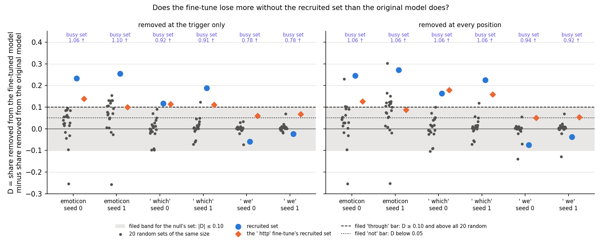
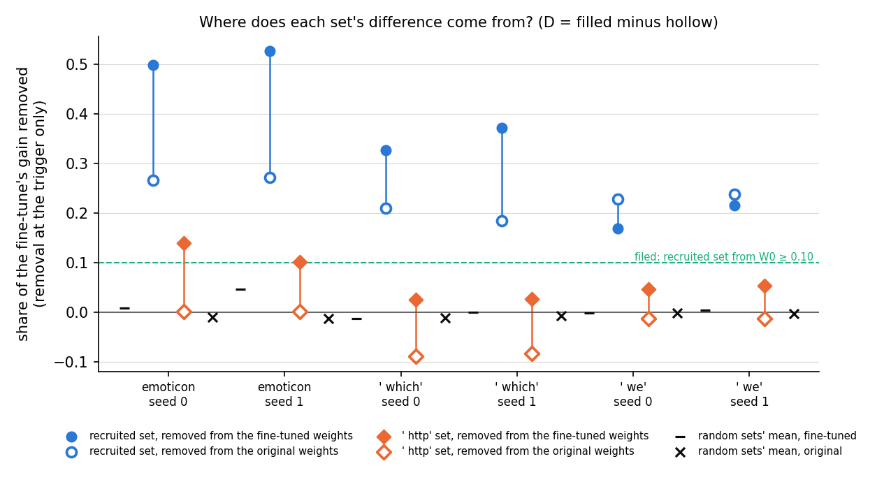
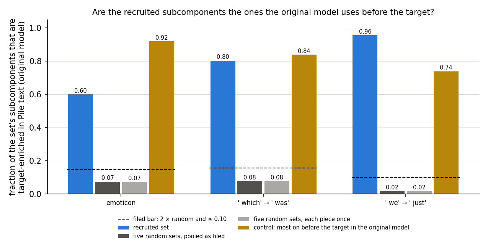

# Does the fine-tune lean on the recruited subcomponents more than the original model already did? (E38 Amendment 2, analysis)

*2026-10-27, writing agent. Plan: `reports/plans/2026-10-27_plan_e38-amend2.md`. Predictions:
`experiments/recruitment_test/results/predictions_amend2.json`, with the census rule re-filed before any run in
`predictions_amend2_p8.json`. Code: `experiments/recruitment_test/amend2.py`, `src/commute/{recruitment,census}.py`;
figures from `experiments/recruitment_test/plot_amend2.py`. Parent: `reports/analyses/2026-10-27_analysis_recruitment-test.md`.
Notebook: `notebooks/E38_recruitment_test.ipynb`, section "Amendment 2". Words as in `GOALS.md` → Terms. An independent
check, `reports/reviews/2026-10-27_review_e38-amend2-check.md`, recomputed every verdict and agrees with each; its
reading of them is folded in below.*

We took the subcomponents that the frozen importance function switches on at the trigger after a narrow fine-tune
out of both the fine-tuned and the original model, at the trigger position only, and compared how much of the
fine-tune's gain each model lost. The fine-tuned model loses more on two of three tasks, far more than for random sets,
but a set switched on by a fine-tune to an unrelated token shows a smaller extra loss too, so the extra loss is not yet
shown to belong to these subcomponents. For `GOALS.md` this leans toward post-training strengthening machinery the
original model already has, since most of these subcomponents already predict the target in ordinary text, but whether
the fine-tune works through them specifically is still open.

## The answer

Yes by the filed rule, but the controls leave it open. Without the recruited set, the fine-tuned model loses a tenth to a
quarter more of its gain than the original model does, on two of three tasks. No random set comes close. But the set
switched on by a fine-tune to an unrelated token shows an extra loss about half as large, and equal on one seed. So the
fine-tune may simply amplify whatever is active at the trigger. Most recruited subcomponents already predict the target
in the original model.

## What we were trying to test

**Where E38 left off.** After a 10-step fine-tune, Γ stays frozen and switches on a set of the original model's
subcomponents at the trigger position. This is the *recruited set* S: the alive subcomponents whose mean causal
importance at the trigger rises by more than 0.3. E38 subtracted S's rank-1 matrices $u_c v_c^\top$ from the weights at
every position. From the fine-tuned weights that took a third to a half of the gain on two tasks. From the original
weights $W_0$, where we had expected nothing, it already took a sixth to a quarter. So E38 could not say how much of
the fine-tune itself runs through S. This amendment adds the two missing controls and the census counters.

**The states.** E38's nine states, regenerated in the job: three tasks, two seeds each, plus a 10-step fine-tune to
` http` at the same triggers as the null. The tasks are emoticon, where a `:)`-style trigger is followed by `o`;
` which` followed by ` was`; and ` we` followed by ` just`.

**The measurement.** We read the target's mean log-odds at the trigger on 73 to 106 held-out windows: $T_0$ in the
original model, $T_1$ after the fine-tune, gain $G = T_1 - T_0$. Removing a set X now has two forms. *Removal at the
trigger only* subtracts X's rank-1 outputs at the trigger position alone; every other position runs unchanged.
*Removal everywhere* is E38's. For each set, two shares of the same state's gain:

- $\rho_{ft}(X) = (T_1 - T_1^{\setminus X}) / G$, the share lost when X is removed from the fine-tuned weights;
- $\rho_0(X) = (T_0 - T_0^{\setminus X}) / G$, the share lost when X is removed from the original weights;
- $D(X) = \rho_{ft}(X) - \rho_0(X)$, the *difference*.

D is 0 when X matters to the target exactly as much after the fine-tune as before. D is 1 when the fine-tune's whole
gain needs X present. As the independent check puts it, $D = 1 - $ the gain that survives removing X from both models,
over G. It reads how much of the gain needs X present, not whether the gain flows through X's own output.

**The sets, and what each rules out.**

- **Twenty random sets**, alive subcomponents with the same size per matrix as S and disjoint from it, removed from
  both models. They rule out that removing that many subcomponents costs the fine-tuned model more whichever they are.
- **The null's recruited set**, the set Γ switches on after the ` http` fine-tune, whole, removed from this task's two
  models. It rules out that any set a fine-tune at this trigger switches on would show the same difference. Its size is
  not matched to S: 130 against 210 on emoticon, 225 against 56 on ` which`, 165 against 21 to 23 on ` we`.
- **The busy set**, as many alive subcomponents as S holds, the most important at the trigger in the original model. It
  checks that removal at the trigger only bites.

**The census.** Over 2,000 Pile rows, about a million positions, the original model's Γ says where each subcomponent is
on, with importance above 0.5. A subcomponent is *target-enriched* when it is on at 50 or more positions, at least 5
of them are followed by the task's target, and the target follows its on-positions at three or more times the base
rate. We read the fraction of S that is target-enriched against five random sets. The positive control is the set of
the same size most on before the target in the original model, chosen on the same Pile rows.

## What we expected, and why

- **The fine-tune leans on S beyond its existing push, medium-low confidence.** On emoticon and ` which`, D would reach
  0.10 to 0.35 and beat all twenty random sets; on ` we` it would not. E38's everywhere-removal difference read about
  +0.25, +0.2 and −0.05 without the random reference.
- **The same under removal everywhere**, medium-low confidence.
- **The null's set shows no difference**, medium confidence: within ±0.10 on every state.
- **S pushes toward the target at the trigger in the original model**, medium confidence: $\rho_0(S) \ge 0.10$ at the
  trigger alone, since E38 read 0.13 to 0.27 everywhere.
- **Removing S at the trigger only spares the other positions**, medium-low confidence.
- **S is enriched for the target in ordinary text**, medium-low confidence, on emoticon and ` which`.
- **Reported:** 30 to 90% of S would have importance below 0.1 at the trigger in the original model, low confidence.

## What we observed

### Does the apparatus hold? (stage 0, run first and alone)

Yes, on every check. Removal by the new hook at every position reproduces E38's weight removal exactly, a difference of
0.0 in log-odds on all twelve readings. Removal at the trigger only leaves every earlier position's logits identical,
to 0.0, while it moves the trigger's logits by 7.5 to 15.9. Removing nothing changes nothing. Removing the busy set at
the trigger only moves the original model's trigger distribution by 10.6 to 11.2 nats of KL, against a bar of 1.

**The regenerated states differ from E38's, and it does not matter.** E38 ran on a RunPod RTX 4090, this amendment on
a cluster L40. All nine state hashes differ. On emoticon seed 0 the fine-tuned log-odds read 8.4070 here against
8.4757 in E38. Here they match E18's references to four decimals on four of the six fine-tuned states, and within
0.04 on the other two. Emoticon seed 1's recruited set has 213 members here, as in E18, where E38 had 211. So the
fine-tune moves by a few hundredths of a nat with the card, and both runs pass E38's filed tolerance. Every share is
over the state's own gain, and the everywhere-removal shares agree with E38's within 0.006.

| task, seed | T1 here / E38 / E18 | \|S\| here / E38 | D everywhere, here / E38 |
|---|---|---|---|
| emoticon s0 | 8.407 / 8.476 / 8.407 | 210 / 210 | +0.246 / +0.245 |
| emoticon s1 | 8.668 / 8.544 / 8.668 | 213 / 211 | +0.272 / +0.275 |
| ` which` s0 | 4.744 / 4.769 / 4.781 | 56 / 56 | +0.162 / +0.163 |
| ` which` s1 | 5.323 / 5.275 / 5.323 | 62 / 62 | +0.225 / +0.225 |
| ` we` s0 | 5.624 / 5.592 / 5.615 | 23 / 23 | −0.075 / −0.074 |
| ` we` s1 | 5.283 / 5.278 / 5.283 | 21 / 21 | −0.038 / −0.038 |

The ` which` s0 and ` we` s0 rows sit 0.04 and 0.01 from E18, inside the 2%-of-gain tolerance that E38 filed.

### Does the fine-tuned model lose more without S than the original model does?

**Reading it.** Yes on emoticon and ` which`, by more than any random set, and no on ` we`. The blue dots are D for the
recruited set. In the left panel, removal at the trigger only, they read 0.23 and 0.25 on emoticon and 0.12 and 0.19
on ` which`. Every one is above the dashed bar and above all twenty grey random dots. On ` we` they read −0.06 and
−0.02: the original model loses more without S than the fine-tuned one. The filed rule therefore reads "through".

But the orange diamonds, the ` http` fine-tune's set, are not inside the grey band where we expected them. They read
0.10 to 0.14 on emoticon and ` which`, and 0.06 to 0.07 on ` we`, positive on all six states. On ` which` seed 0 the
null's set reads 0.113 against S's 0.116. The busy set, off the top of the plot, reads 0.78 to 1.10, more than S on
every state. So beating random sets is not unique to S. The right panel, removal everywhere, tells the same story. One
random draw on emoticon seed 1 there reaches 0.30 and leaves that task's seeds disagreeing. On ` which` seed 0 the
null's set, at 0.18, outdoes S's 0.16.

| task, seed | G, nats | D(S) | random D: mean / max | above, of 20 | D(null) | D(S) − D(null) | D(busy) | seed class |
|---|---|---|---|---|---|---|---|---|
| emoticon s0 | 13.43 | +0.232 | +0.018 / +0.095 | 20 | +0.138 | +0.094 | 1.06 | through |
| emoticon s1 | 13.69 | +0.255 | +0.059 / +0.154 | 20 | +0.100 | +0.155 | 1.10 | through |
| ` which` s0 | 10.29 | +0.116 | −0.001 / +0.090 | 20 | +0.113 | +0.003 | 0.92 | through |
| ` which` s1 | 10.87 | +0.188 | +0.007 / +0.123 | 20 | +0.111 | +0.077 | 0.91 | through |
| ` we` s0 | 12.53 | −0.059 | −0.001 / +0.034 | 1 | +0.059 | −0.118 | 0.78 | not |
| ` we` s1 | 12.19 | −0.024 | +0.006 / +0.069 | 0 | +0.067 | −0.090 | 0.78 | not |

Removal at the trigger only. The null's own D sits above 19 or 20 of S's twenty random D on five of six states, and
above 12 on emoticon seed 1. Read by S's rule, the null's set would itself class "through" on emoticon seed 0 and
` which` seed 0.

Removal everywhere:

| task, seed | D(S) | random max | above, of 20 | D(null) | seed class |
|---|---|---|---|---|---|
| emoticon s0 | +0.246 | +0.229 | 20 | +0.126 | through |
| emoticon s1 | +0.272 | +0.303 | 19 | +0.087 | unclear |
| ` which` s0 | +0.162 | +0.099 | 20 | +0.178 | through |
| ` which` s1 | +0.225 | +0.119 | 20 | +0.159 | through |
| ` we` s0 | −0.075 | +0.054 | 1 | +0.050 | not |
| ` we` s1 | −0.038 | +0.069 | 1 | +0.054 | not |

Task classes: emoticon "seeds disagree", ` which` "through", ` we` "not".

### Where does each set's difference come from?

**Reading it.** S already pushes toward the target at the trigger in the original model, and the null's difference
arises differently on each task. The hollow blue circles are S removed from the original weights at the trigger
alone. They read 0.18 to 0.27 on every state, above the green bar of 0.10, so S's push in the original model acts at
the trigger itself. The filled blue dots, removal from the fine-tuned weights, sit higher on emoticon and ` which` and
lower on ` we`.

The null's set does nothing in the original model on emoticon, at 0.002, yet takes 0.10 to 0.14 of the gain from the
fine-tuned model. On ` which` its difference comes mostly from the other side. Removing it from the original model
*raises* the target, by 0.08 to 0.09 of the gain, about 0.9 nats. From the fine-tuned model it takes only 0.03. The
random sets' means sit within 0.05 of zero in both models.

| task, seed | S: from fine-tuned / original | null: from fine-tuned / original | busy: from fine-tuned / original | random means |
|---|---|---|---|---|
| emoticon s0 | 0.499 / 0.267 | 0.140 / 0.002 | 1.65 / 0.58 | +0.008 / −0.010 |
| emoticon s1 | 0.527 / 0.272 | 0.102 / 0.002 | 1.65 / 0.55 | +0.046 / −0.013 |
| ` which` s0 | 0.327 / 0.211 | 0.025 / −0.088 | 2.03 / 1.10 | −0.013 / −0.011 |
| ` which` s1 | 0.372 / 0.184 | 0.027 / −0.083 | 1.88 / 0.97 | +0.001 / −0.006 |
| ` we` s0 | 0.169 / 0.229 | 0.047 / −0.012 | 1.41 / 0.63 | −0.001 / −0.001 |
| ` we` s1 | 0.215 / 0.239 | 0.054 / −0.012 | 1.44 / 0.66 | +0.004 / −0.002 |

In log-odds, removing S at the trigger from the fine-tuned model leaves the target at 1.3 to 3.5, still likely. From
the original model it sends it to −7.6 to −9.8, against $T_0$ of −5.0 to −6.9. The busy set sends both models to
about the same floor, so its D near 1 says only that it wrecks the trigger in both. S's removal is far from that floor.

**Specificity.** Removing S at the trigger only costs the 40 other positions 0.001 to 0.004 nats of KL, against the
fine-tune's own 0.05 to 0.12. The 20 positions before the trigger read 0 by construction, so this is a bound on the
20 after it. Removing S everywhere cost 0.18 to 1.18.

**How important S was in the original model.** The filed range was 30 to 90% of S below 0.1 importance at the
trigger in the original model. On emoticon 83 and 84% are; on ` which` 55 and 57%. On ` we` only 9 and 5% are, outside
the range. There S is mostly subcomponents already on at the trigger, which Γ turns up further. That is also the task
where D is negative.

### Are the recruited subcomponents the original model's machinery for the target?

**Reading it.** Yes, on all three tasks. The blue bars are the fraction of S that is target-enriched in ordinary Pile
text in the original model: 0.60 on emoticon, 0.80 on ` which`, 0.96 on ` we`. The dark grey bars, five random sets,
read 0.02 to 0.08. The dashed lines are the filed bar, twice the random fraction and at least 0.10, and S clears it
everywhere. The gold control clears it too, at 0.74 to 0.92. Half of S on emoticon is among the control's own
subcomponents, but the control's members outside S read 0.64 to 0.85 alone.

The pooled random fraction counts a subcomponent once per random set it is in, as a reviewer noted. Counted once each,
the light grey bars, the fractions are unchanged to two decimals: 0.074 becomes 0.073 on emoticon, from 979 distinct
of 1,050.

Two limits, from the independent check. First, the enrichment is only partly specific to the target. The ` which` set
is also enriched for ` just`, at 0.38, and the ` we` set for ` was`, at 0.48, against random 0.02 to 0.05. The emoticon
set is enriched for neither word, and neither word set for `o`. So the word tasks' sets look like "a verb or adverb
comes next" machinery, as E38's census lists suggested. Second, the census does not separate the tasks where D is
positive from ` we`, whose S is the most enriched and has negative D. It says what S is, not whether the fine-tune
routes through it. It also follows partly from the shares above: subcomponents whose removal lowers the target in the
original model are likely the ones it uses to predict the target.

| task | S | random, pooled / distinct | control / outside S | S for the other word target | random for it |
|---|---|---|---|---|---|
| emoticon | 0.600 | 0.074 / 0.073 | 0.919 / 0.853 | 0.000 / 0.019 | 0.055 / 0.058 |
| ` which` | 0.804 | 0.079 / 0.078 | 0.839 / 0.800 | 0.375, for ` just` | 0.054 |
| ` we` | 0.957 | 0.017 / 0.017 | 0.739 / 0.643 | 0.478, for ` was` | 0.017 |

Emoticon's row gives ` was` / ` just`. Median target ratio, reported only: S 6.2, 7.4, 7.3; random 0.09, 0.17, 0.00;
control 8.0, 11.1, 6.4. Pile positions followed by the target: 600, 2,921, 387 of 1,022,000.

## Which branch of the decision tree

**By the filed rule: "through".** Two tasks, emoticon and ` which`, read "through" on both seeds, and ` we` reads "not".
The plan's branch says the fine-tune routes a measurable share of its gain through S beyond S's existing push. It
writes D into the E38 card and Q5 and raises a card for the next re-gating step.

**The null and busy sets undercut that reading.** The filed null failed, and failed in the direction that matters.
The ` http` set's difference is positive on every state. It matches S's on ` which` seed 0 and is about half of S's on
emoticon. The busy set's difference exceeds S's everywhere. The random sets are mostly off at the trigger, so beating
them shows only that S matters at the trigger. It does not show that the fine-tune's gain runs through S's own outputs.

**The alternative.** The fine-tune changes what happens downstream of the trigger, and that change amplifies whatever
the trigger state feeds it. Then any set active at the trigger costs more in the fine-tuned model than in the original
one: S, the null's set and the busy set alike. On this reading S's excess over the null's set is the only part
specific to S. That excess is 0.09 and 0.16 on emoticon, 0.00 and 0.08 on ` which`, and negative on ` we`. The null's
set is not size-matched to S, so even that comparison is rough.

**What would settle it, proposed and not run.** The independent check's test, on the cached states: at the trigger in
the fine-tuned model, set S's rank-1 outputs back to their values in the original model instead of removing them.
That undoes only S's switch-on and leaves S's existing push in place. Do the same for the null's set minus S. If S's
restored share is at least 0.1 and the null's about 0, the gain runs through S's switch-on. If the two are alike, or
S's is about 0 while its difference stays, the effect is the generic one. This is a forward-pass job of minutes on the
cluster. It goes to a pending card for the user, as the next re-gating step, ahead of asking which upstream change
switches S on.

## What we learned

The recruited subcomponents are the original model's own target machinery: most are on before the target in ordinary
text, and they already push toward it at the trigger. After the fine-tune the model needs them more on two tasks, a
tenth to a quarter of the gain. That fits `GOALS.md`'s "strengthen" reading, where post-training sharpens subcomponents
that already do the job. But a set switched on by an unrelated fine-tune is needed more too, by about half as much.
So we cannot yet say that the fine-tune's gain runs through S's switch-on, rather than the fine-tune amplifying
everything active at the trigger.

## How compelling is the evidence

- **Tasks and seeds.** Three tasks, two seeds, one null per task, one 67M model, held-out windows, the trigger only.
- **The apparatus is exact.** Every stage-0 control read 0.0 where 0 was expected, and the busy control bit by 11 nats.
- **D's reference is weak.** Random sets of S's size are mostly off at the trigger. The null's set is the closer
  reference, and it is neither size-matched nor matched on how active it is at the trigger. No set matched to S on
  importance at the trigger was run.
- **The random spread on emoticon is wide.** One random set reads −0.25 on both seeds, and the spread is 0.08 to 0.09.
  On the word tasks it is 0.02 to 0.05.
- **D is in log-odds at near-certainty.** After removing S the fine-tuned model still rates the target likely; in
  probability the effect is much smaller than the shares suggest.
- **The census is not true by construction.** S is chosen on the task windows, the census reads Pile. It is only partly
  target-specific, and its control is chosen on the same rows, so it shows the measure can register a selected set.
- **States.** The fine-tune differs by card type by up to 0.12 nats of log-odds; that moves E38's shares by at most 0.006.

## Surprises

- **The null's set was expected to show no difference and shows one on every state**, above the filed band on emoticon
  and ` which`. On ` which` seed 0 it equals S's. This is the result that most limits the reading, and it was predicted
  with medium confidence.
- **On ` which`, removing the null's set from the original model raises the target** by about 0.9 nats.
- **On ` we`, S was mostly already important at the trigger in the original model**, 91 to 95% of it, against a filed
  range that put most of S near off. It is also the task with the most target-enriched S and a negative difference.
- **The census passed on ` we` too**, where it was expected only on the other two tasks.
- Removal everywhere put emoticon outside the tree because one random draw read 0.30, the same heavy draw E38 found.

## What next

1. **Restore S's outputs at the trigger to their original-model values in the fine-tuned model**, and the same for the
   null's set minus S. A restored share of 0.1 or more for S and about 0 for the null says the gain runs through S's
   switch-on. Then ask which upstream change switches S on. Alike shares say the effect is generic, and the line has
   little left in S itself.
2. **A reference matched on activity**: random sets drawn from subcomponents as important at the trigger in the
   fine-tuned model as S's members, and random sets of the null's size. If they read D near S's, beating random was
   about activity, not S.
3. **The census against other tokens** of the same grammatical class, to see whether the word tasks' S is "a verb
   comes next" machinery rather than the target's.

## Scorecard

| id | claim | rule | read | verdict |
|---|---|---|---|---|
| C0 | E38's states and stage-0 checks reproduce | E38's tolerances | all nine states ok; T1 within 0.04 of E18 | pass |
| C1 | trigger hook at every position = weight removal | \|Δlo\| ≤ 1e-3 | 0.0 on all 12 | pass |
| C2 | trigger-only removal spares earlier positions | max \|Δlogit\| ≤ 1e-4 | 0.0; at the trigger 7.5-15.9 | pass |
| C3 | trigger-only removal of nothing | \|Δlo\| ≤ 1e-5 | 0.0 | pass |
| C4 | trigger-only busy removal bites | KL ≥ 1 nat on emoticon | 11.19 | pass |
| P5 | the fine-tune leans on S beyond its push, trigger only | seed: D ≥ 0.10 and above 20/20 random; ≥ 2 tasks | emoticon 0.232, 0.255; ` which` 0.116, 0.188; ` we` −0.059, −0.024 | pass: "through", as filed; D in 0.10-0.35 |
| P5_all | same classes under removal everywhere | P5's rule | emoticon s1 above 19/20, "seeds disagree"; tree "outside" | miss |
| P5_null | the null's set shows no difference | \|D(null)\| ≤ 0.10, every state | 0.138, 0.1001, 0.113, 0.111, 0.059, 0.067 | **fail**, four states |
| P6 | S's push in W0 acts at the trigger | ρ0(S) ≥ 0.10, every state | 0.267, 0.272, 0.211, 0.184, 0.229, 0.239 | pass |
| P7 | trigger-only removal of S is specific | kl_other ≤ 3 × fine-tune's, ≥ 2 tasks | ratios 0.011-0.037 | pass |
| P8 | S is target-enriched in Pile, amended rule | fraction ≥ 2 × random and ≥ 0.10, ≥ 2 tasks; control same | S 0.60, 0.80, 0.96; random 0.074, 0.079, 0.017; control 0.92, 0.84, 0.74 | pass, all three tasks |
| reported | S near off in W0 at the trigger | fraction below 0.1 in 0.3-0.9, every task | 0.833, 0.840, 0.554, 0.565, 0.087, 0.048 | miss on ` we` |

## Not run

- Restoring S's trigger outputs to their original-model values in the fine-tuned model; the same for the null's set
  minus S.
- Random sets matched to S on importance at the trigger, or to the null's set in size.
- D of S inside the ` http` state, and the null's set minus S on its own.
- The census against other tokens of the same class.
- Other models, tasks, seeds beyond 0 and 1, positions other than the trigger.

## Provenance

- Predictions: `predictions_amend2.json`, filed 2026-10-27 15:35, before `amend2.py`; `predictions_amend2_p8.json`,
  filed 16:00 before any run. Neither edited.
- Results: `experiments/recruitment_test/results/amend2_stage0.json`, `run_amend2_stage0.log`; `amend2.json`,
  `amend2_census.json`, `run_amend2_stage12.log`.
- Compute: MATS cluster, NVIDIA L40, job 38805 for stage 0 at 15:44, 47 s, and job 38809 for stages 1 and 2 at
  15:46, 83 s. $0.
- State sha256, first 12: emoticon s0 48384de48bc5, s1 52ef1f6be646, null bc0f908abb93; ` which` s0 2c203347ced1, s1
  efacedca186e, null 1dfdee5eea63; ` we` s0 ae3d8fe2467e, s1 af48bbc7a11e, null 934b0cadad9a.
- Code at `2503c9c` and `fb60e82`; results committed in `6a6e1f2`.
