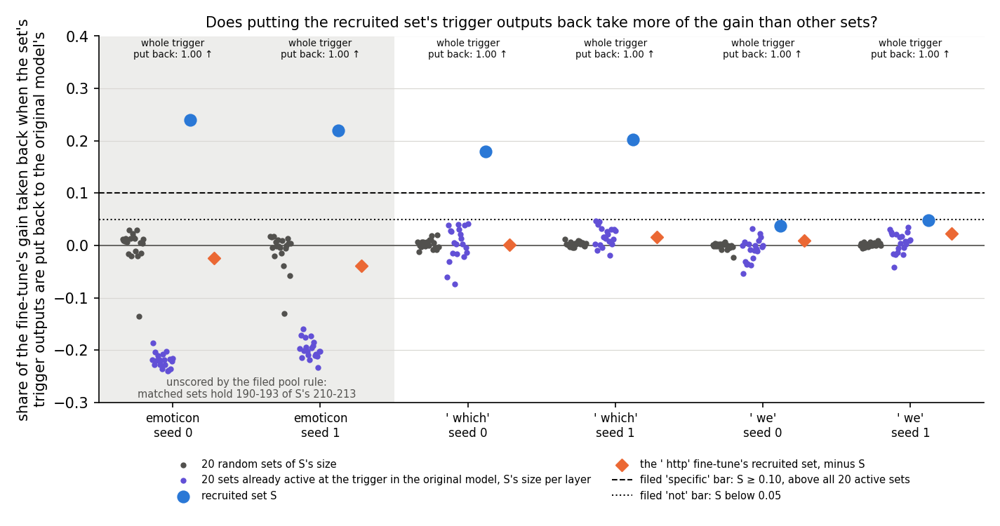
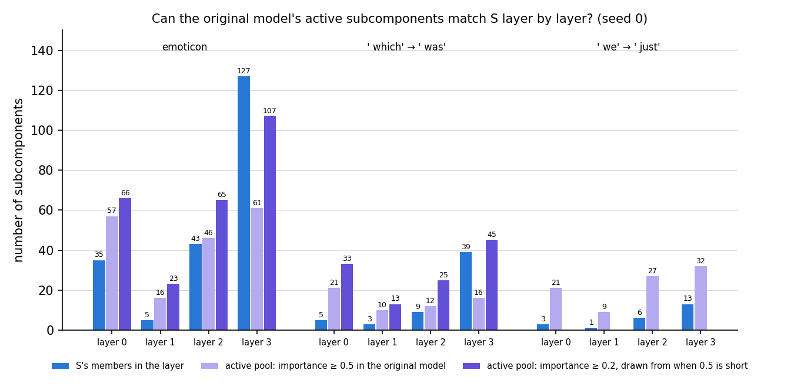
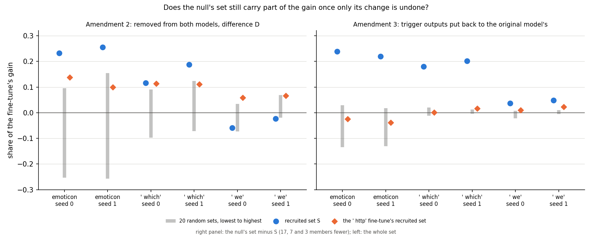

# Does the gain run through the recruited subcomponents' changed outputs, more than through other active ones? (E38 Amendment 3, analysis)

*2026-10-27, writing agent. Plan: `reports/plans/2026-10-27_plan_e38-amend3.md`. Predictions, never edited:
`experiments/recruitment_test/results/predictions_amend3.json`, with the pool rule in `predictions_amend3_pool.json`
and a fifth control in `predictions_amend3_r4.json`, both filed before any run, and that control's tolerance in
`predictions_amend3_r4b.json`, filed after the first run stopped and before any grid number existed. Code:
`experiments/recruitment_test/amend3.py`, `src/commute/recruitment.py`; figures from
`experiments/recruitment_test/plot_amend3.py`. Parent: `reports/analyses/2026-10-27_analysis_e38-amend2.md` and its
check `reports/reviews/2026-10-27_review_e38-amend2-check.md`. An independent check of this run,
`reports/reviews/2026-10-27_review_e38-amend3-check.md`, recomputed every verdict and agrees with each; its reading is
folded in below. Notebook: `notebooks/E38_recruitment_test.ipynb`, section "Amendment 3". Words as in `GOALS.md` →
Terms.*

In a fine-tuned model we put the outputs of several sets of subcomponents at the trigger back to their values in the
original model, and measured how much of the gain on the target went with them. The set that the fine-tune switches
on took back about a fifth of the gain on two of three tasks, and every other set took back about nothing. For
`GOALS.md` this is the first sign that those subcomponents carry part of the change themselves, as strengthening
predicts, though one alternative is open and one task went unscored.

## The answer

Partly yes, against what we predicted. Putting the recruited subcomponents' trigger outputs back to their original
values takes back about a fifth of the gain on emoticon and ` which`, and a twentieth on ` we`. Every other set we
tried takes back about nothing. The set switched on by an unrelated fine-tune, which removal
had said carried a tenth of the gain, carries none. The filed rule reads "outside the tree": ` which` is specific,
` we` too small, emoticon unscored.

## What we were trying to test

**Where Amendment 2 left off.** A 10-step fine-tune teaches the model to follow a trigger with a target token. With Γ
frozen, a set of the original model's subcomponents is switched on at the trigger: the *recruited set* S, the alive
subcomponents whose mean causal importance there rises by more than 0.3. Amendment 2 removed S at the trigger from both
models. The fine-tuned model lost more of its gain than the original model did, on emoticon and ` which`. But the set
switched on by a fine-tune to the unrelated token ` http`, the *null's set*, showed an extra loss about half as large.
The busy set, the subcomponents most important at the trigger in the original model, showed one several times larger.
So removal could not tell whether S carries the fine-tune's change or the fine-tuned model simply leans harder on
whatever is present at the trigger.

**The restore test.** Removal takes out a set's whole output, including what it already did before the fine-tune.
Restoring takes out only the change. A subcomponent $c$ of a matrix is the rank-1 matrix $u_c v_c^\top$; its *output*
at the trigger is $(x \cdot v_c)\, u_c$, with $x$ the matrix's input there. The subcomponent's weights do not change in
the fine-tune, so its output changes only because its input does. *Restoring a set X* in the fine-tuned model
$W_1 = W_0 + \delta W$ means one forward pass in which, at the trigger only, each matrix's output gains
$\sum_{c \in X} ((x_0 - x) \cdot v_c)\, u_c$. Here $x_0$ is the matrix's input at the trigger in the original model's
pass on the same window. Every other position runs the fine-tuned model unchanged, and $\delta W$'s own output stays.

**The measurement.** We read the target's mean log-odds at the trigger on the held-out windows: $T_0$ in the original
model, $T_1$ after the fine-tune, gain $G = T_1 - T_0$, about 10 to 14 nats here. The *restored share* is
$\rho_r(X) = (T_1 - T_1^{X \text{ restored}}) / G$. It reads 0 when the set's changed outputs carry none of the gain,
and 1 when undoing them takes the target back to the original model's value. A negative share means putting the
set's outputs back *raises* the target.

**The sets, and what each rules out.** Per state, three tasks with two seeds each:

- **S itself**: 210 and 213 subcomponents on emoticon, 56 and 62 on ` which`, 23 and 21 on ` we`.
- **Twenty random sets**, alive subcomponents with S's size per matrix and disjoint from it. They rule out that
  restoring any that many subcomponents takes back the gain.
- **The null's set minus S**, from the ` http` fine-tune at the same triggers: 113, 218 and 162 subcomponents. It
  rules out that any set a fine-tune here switches on carries the change, and it tests Amendment 2's confound head on.
- **Twenty active sets**, the new reference: per layer, as many subcomponents as S has there, drawn from the alive
  ones outside S whose mean importance at the trigger in the original model is at least 0.5. Where a layer had too
  few, the whole state drew from those at 0.2 or more. They rule out that any subcomponents busy at the trigger carry
  as much of the change as S.

**The controls**, run first on all nine states, any fail stopping the job. Restoring nothing returns $T_1$. Restoring S
in an original-model pass returns $T_0$. Putting back every decomposed matrix's whole trigger output, the positive
control, returns $T_0$, a share of 1. Restoring S leaves every position before the trigger untouched. A fifth control
checks the correction itself: restoring S with $x_0$ set to zero subtracts S's outputs, which must match Amendment 2's
trigger-only removal.

## What we expected, and why

- **The controls pass**, all of them.
- **S is not specific among active subcomponents**, low confidence. On at least two tasks S's restored share would sit
  inside the active sets' range. The basis was Amendment 2: the busy set's removal cost far more than S's, and the
  null's set cost a tenth of the gain. The census pointed the other way, so confidence was low.
- **S beats random sets**, medium confidence: a restored share of at least 0.10 and above all 20 random sets, on both
  seeds of emoticon and ` which`.
- **Reported, low confidence:** S's restored share between 0.10 and 0.50 on emoticon and ` which` and below 0.10 on
  ` we`; the active pool filled at 0.5 importance on every state.

## What we observed

### Does the apparatus hold?

Yes, on the second run. Restoring nothing, restoring S in the original model, putting back the whole trigger output,
and the earlier positions all read 0.0 exactly on all nine states. At the trigger itself, restoring S moved the logits
by 2.7 to 12.9, so the hook bites. The positive control's share is 1.00 on every state.

**The first run stopped at the fifth control, and we changed its tolerance before any result existed.** Cluster job
38950 compared restoring S with $x_0 = 0$ against Amendment 2's removal path. The two differed by 0.0002 to 0.0195
nats, with mixed signs, against a bar of 0.01 that had been set without measuring the noise. ` we` seed 1 failed at
0.0195, so the job stopped before computing any restored share. The two paths round differently in bf16: one subtracts
inside the weight, the other adds a separate correction. We filed a new bar, at most 0.05 nats and at most 2% of the
removal's own effect, and reran as job 38953. The control numbers were the same to the digit. The largest difference
is 0.7% of a 2.6-nat removal. A flipped sign or a transposed matrix would read about twice the removal's effect, near
5 nats. The bar was loosened after seeing the differences, which the independent check accepts as legitimate since
no conclusion rests on it.

| state | difference, nats | share of the removal's effect | verdict, new bar |
|---|---|---|---|
| emoticon s0 | +0.0047 | 0.0007 | pass |
| emoticon s1 | +0.0002 | 0.0000 | pass |
| ` which` s0 | +0.0061 | 0.0018 | pass |
| ` which` s1 | −0.0074 | 0.0018 | pass |
| ` we` s0 | −0.0072 | 0.0034 | pass |
| ` we` s1 | +0.0195 | 0.0074 | pass; failed the first bar of 0.01 |

### Does putting S's trigger outputs back take more of the gain than other sets?

**Reading it.** Yes on emoticon and ` which`, barely on ` we`. The big blue dots are S. They read 0.24 and 0.22 on
emoticon and 0.18 and 0.20 on ` which`, above the dashed bar. In log-odds that is 3.0 to 3.2 nats on emoticon and 1.8
to 2.2 on ` which`. On ` we` they read 0.04 and 0.05, under the dotted bar. The grey dots, random sets, sit at zero on
every state. One draw per emoticon seed reaches −0.13. The orange diamonds, the null's set minus S, read −0.04 to
+0.02. The violet dots are the active sets. On the word tasks they sit near zero, reaching at most 0.03 to 0.05. On
emoticon they sit near −0.2: putting them back raises the target. Against the positive control, which takes back
the whole gain, S's fifth leaves most of the gain elsewhere.

On ` which`, S sits 0.14 and 0.16 above the highest active set. On ` we`, S is above all twenty active sets too, by
0.006 and 0.014, but its share is under the 0.05 bar. So ` we` reads "not" because S takes back too little to matter,
not because active sets match it. Seed 1 misses the bar by 0.0014.

**The twenty active draws are close to one set.** The independent check found this, and it weakens "above all twenty".
Where a layer's pool is barely larger than S's count there, every draw takes nearly all of it. On ` which` seed 1, the
layer-3 pool at 0.2 holds 44 subcomponents and S has 44 there, so every draw holds the same 44. Two draws share about
50 of 62 members. On emoticon every draw holds the whole 107-member layer-3 pool, and two draws share about 155 of 190.
So on these states S beat about one comparison set with some jitter, not twenty independent ones. On ` we` the pool
at 0.5 was ample and the draws vary.

| state | G, nats | S | null's set minus S | random: mean / max | active: mean / min / max | pool threshold, draw size |
|---|---|---|---|---|---|---|
| emoticon s0 | 13.43 | 0.239 | −0.024 | −0.001 / 0.029 | −0.220 / −0.240 / −0.186 | 0.2, 190 of 210 |
| emoticon s1 | 13.69 | 0.220 | −0.039 | −0.009 / 0.017 | −0.198 / −0.233 / −0.160 | 0.2, 193 of 213 |
| ` which` s0 | 10.29 | 0.179 | 0.001 | 0.003 / 0.021 | 0.003 / −0.074 / 0.041 | 0.2, 56 |
| ` which` s1 | 10.87 | 0.202 | 0.016 | 0.003 / 0.012 | 0.017 / −0.018 / 0.047 | 0.2, 62 |
| ` we` s0 | 12.53 | 0.037 | 0.010 | −0.001 / 0.007 | −0.008 / −0.053 / 0.032 | 0.5, 23 |
| ` we` s1 | 12.19 | 0.049 | 0.022 | 0.002 / 0.009 | 0.006 / −0.042 / 0.034 | 0.5, 21 |

Random minima: −0.135 and −0.130 on emoticon, −0.012 to −0.004 on ` which`, −0.022 and −0.006 on ` we`.

### Why is emoticon unscored, and what would it read?

**Reading it.** The original model does not have enough subcomponents active at the emoticon trigger to match S layer
by layer. The blue bars are S's size per layer, the violet bars the pool of other alive subcomponents with importance of
at least 0.5 or 0.2 there. In layer 3, S has 127 members while the pool holds 61 at 0.5 and 107 at 0.2. So each
active draw holds 190 or 193 subcomponents against S's 210 or 213. The pool rule, filed before any run, leaves such a
state unscored, because smaller comparison sets favour S. On ` which` the pool at 0.5 was short in layer 3 too, 16
against 39 and 44, and filled at 0.2. On ` we` it filled at 0.5.

**Exploratory, outside the filed rule.** If the short draws were scored as they are, emoticon would read "specific" on
both seeds. S at 0.24 and 0.22 is above every active draw, by 0.43 and 0.38, and above the null's set by more than
0.05. The overall reading would then be "specific" on two tasks. For the missing 20 subcomponents to close the gap,
they would have to take back about 0.4 of the gain. They would come from subcomponents below 0.2 importance, and random
sets of 210 such subcomponents take back about nothing. That makes the exploratory class likely right, but it is not a
filed result. Much of the margin also comes from the active sets being negative, not from S. Against zero, S's
margin is the same fifth as on ` which`.

### What do the negative active shares on emoticon mean? (provisional, not filed)

On emoticon, putting back the trigger outputs of the subcomponents the original model already used there *raises* the
target, by 2.7 to 3.0 nats on average over the draws. Their outputs change only because their inputs at the trigger
changed. So after the fine-tune, those changed inputs make the original model's active subcomponents push *against*
` o`, by about as much as S's switch-on pushes for it. The fine-tune reaches its gain despite them.
The independent check rules out a bug: the same hook gives random sets zero and S a
positive share.

We can say little more from the saved numbers, and no prediction was filed on it. Two readings fit. The change in the
trigger's inputs that switches S on may also move the inputs of the subcomponents already in use, as a side effect the
rest of the fine-tune overrides. Or a few subcomponents may carry most of it. Single random draws reach −0.13, so some
subcomponents carry large negative shares alone, and every active draw holds the whole layer-3 pool. If such
subcomponents sit in that pool, every draw reads alike, which would explain the tight spread. Restoring layer 3's pool
alone, or each of its members alone, would separate the two. Restored shares need not add, so S's +0.23 and the
active sets' −0.2 cannot be summed.

### Does the null's set still carry part of the gain once only its change is undone?

**Reading it.** No: the restore test resolves Amendment 2's confound. The left panel is Amendment 2's difference D,
the share of the gain lost when a set is removed from the fine-tuned model minus the share lost when it is removed
from the original one. There the null's set, orange, read 0.10 to 0.14 on emoticon and ` which`, as high as S on
` which` seed 0. The right panel is the restored share. There the null's set minus S reads −0.04 to +0.02 on every
state, inside the random sets' grey range, while S keeps 0.18 to 0.24 on emoticon and ` which`. The null's set did not
change its outputs in a way that carries the gain; the fine-tuned model just depends more on what it already outputs.
The busy set tells the same story: its removal read 0.78 to 1.10, and the active sets, drawn from the same kind of busy
subcomponents, restore zero or less. One caveat: the right panel's null's set lacks the 17, 7 and 3 members it
shares with S.

For S, the two measures agree on emoticon and ` which`, within 0.07, and part on ` we`: D read −0.06 and −0.02, the
restored share +0.04 and +0.05. So on ` we` S's outputs did change toward the target a little, while the fine-tuned
model leans on S's existing push less than the original did.

| state | D(S), Amendment 2 | restored S | D(null's set), Amendment 2 | restored null's set minus S |
|---|---|---|---|---|
| emoticon s0 | +0.232 | +0.239 | +0.138 | −0.024 |
| emoticon s1 | +0.255 | +0.220 | +0.100 | −0.039 |
| ` which` s0 | +0.116 | +0.179 | +0.113 | +0.001 |
| ` which` s1 | +0.188 | +0.202 | +0.111 | +0.016 |
| ` we` s0 | −0.059 | +0.037 | +0.059 | +0.010 |
| ` we` s1 | −0.024 | +0.049 | +0.067 | +0.022 |

## Which branch of the decision tree

**By the filed rule: "outside the tree".** ` which` reads "specific" on both seeds, ` we` "not" on both, and emoticon
is unscored under the pool rule. Neither "specific" nor "not specific" holds on two tasks. The plan's branch for this
case: a pending card with the numbers, and no further runs.

**What the card should carry.** S's changed outputs carry a fifth of the gain on emoticon and ` which`, and no other
tested set carries any. ` we` reads "not" only because S's share is small, under 0.05. Emoticon would read "specific"
if its short draws were scored, which is exploratory. The active sets on ` which` and emoticon are close to one set
each. The strongest remaining alternative, from the independent check, is that S was chosen by a rise in importance,
which tracks how much its outputs changed at the trigger. No comparison set is matched on that change, which is
the plan's own blind spot. Any set whose outputs changed as much might restore as much.

**Proposed options for the card:**

- **(a) Restore the subcomponents whose trigger outputs changed most**, outside S, matched to S per layer, and layer
  3's active pool alone. This runs on the cached states, in minutes on the cluster, for $0. If S still takes back more
  than the change-matched sets on emoticon and ` which`, "specific" holds against the strongest alternative, and the
  next step is the upstream one: what moved the trigger's inputs. If they take back as much, S is just "the
  subcomponents whose outputs moved most", and Γ's switch-on adds nothing. These sets are not limited by the
  importance pool, so emoticon would be scored. Layer 3's pool alone says whether emoticon's negative share sits in
  a few subcomponents.
- **(b) Accept "specific on two tasks, provisional"** and write it into Q5: on emoticon, exploratory, and ` which`,
  the recruited set's changed outputs carry about a fifth of the gain, more than any tested set.
- **(c) Stop the re-gating line on the 67M model**, or carry the restore test to the Qwen line.

Recommended: (a), since it is the cheapest test of the one open alternative and also scores emoticon.

## What we learned

The subcomponents that Γ switches on after a narrow fine-tune carry part of the fine-tune's change themselves: about a
fifth of the gain on two of three tasks, and no other tested set carries any. Amendment 2's worry, that the fine-tuned
model just leans on anything present at the trigger, is real but separate. That leaning shows in removal and vanishes
when only the change is undone. Together with the census, which found S to be mostly the original model's own
target machinery, this fits `GOALS.md`'s "strengthen" reading. The other four fifths of the gain sit elsewhere:
in the weight change's own output, or in subcomponents no tested set holds. Whether S is special, or just the set whose outputs moved
most, is the one question left.

## How compelling is the evidence

- **Tasks and seeds.** Three tasks, two seeds each, one null per task, one 67M model, held-out windows, the trigger
  only. Specific on one task by the filed rule, on two in the exploratory reading.
- **The apparatus is exact.** Four controls read 0.0. The fifth agrees with an independent path to 0.7% of the effect.
  The positive control reads 1.00.
- **The reference sets overlap.** On ` which` and emoticon the twenty active draws are close to one set each, so beating
  all twenty is weaker than twenty independent wins.
- **Matched on activity, not on change.** No comparison set was matched on how much its trigger outputs changed.
- **Noise floor.** Random sets read within ±0.03 of zero on the word tasks. On emoticon they spread to −0.06, with one heavy draw per seed at −0.13.
  S's 0.18 to 0.24 is six or more times the largest positive random share.
- **Shares do not add.** Restoring one set also undoes downstream effects of its change, so S's and the active sets'
  shares cannot be summed or compared to the whole.
- **Log-odds at near-certainty.** The fine-tuned model rates the target very likely, so a fifth of the gain in
  log-odds is a smaller change in probability.

## Surprises

- **Something we did not expect: on ` which`, S is specific among the active subcomponents, reversing the filed
  prediction.** We predicted, with low confidence, that S's restored share would sit inside the active sets' range on
  at least two tasks. On ` which` it sits 0.14 and 0.16 above the highest of them, on both seeds. On emoticon, if
  scored, it would sit 0.38 and 0.43 above. The prediction leaned on Amendment 2's busy and null sets. The restore
  test shows their removal costs came from the fine-tuned model leaning on their unchanged outputs, not from changes.
- **On emoticon, the subcomponents already active in the original model work against the target after the
  fine-tune.** Putting them back raises the target by about a fifth of the gain. Not predicted, not explained.
- **The null's set, which carried a tenth of the gain under removal, carries none under restore.**
- The active pool filled at 0.5 importance only on ` we`, against a filed expectation of every state.
- The fifth control's first tolerance was too tight for bf16 rounding, by a factor of two on one state.

## What next

1. **The change-matched restore**, option (a) above. If change-matched sets take back as much as S, the recruited set
   is not a privileged description, and the line should stop on this model. If S still wins, ask what moved the
   trigger's inputs to switch S on.
2. **Layer 3's active pool alone on emoticon**, bundled with (a). If a few subcomponents carry the −0.2, the negative
   active share is a property of them, not of the original model's active machinery at large.
3. **Restoring every alive subcomponent at once**, to split the gain between the subcomponents' changed outputs and
   $\delta W$'s own output.

## Scorecard

| id | claim | rule | read | verdict |
|---|---|---|---|---|
| R0 | restoring nothing returns the fine-tuned model | \|lo − T1\| ≤ 1e-5 | 0.0 on all nine states | pass |
| R1 | restoring S in an original-model pass returns T0 | \|lo − T0\| ≤ 1e-4 | 0.0 on all nine | pass |
| R2 | putting back every matrix's whole trigger output returns T0 | \|lo − T0\| ≤ 1e-2 | 0.0 on all nine | pass |
| R3 | restoring S spares earlier positions | max \|Δlogit\| ≤ 1e-4 | 0.0; at the trigger 2.7-12.9 | pass |
| R4 | x0 := 0 matches Amendment 2's removal | first bar ≤ 1e-2; amended: ≤ 0.05 nats and ≤ 2% of the removal | 0.0002-0.0195; at most 0.7% | first run **fail** on ` we` s1; pass at the amended bar |
| P9 | S specific among active subcomponents | seed: S ≥ 0.10, above all 20 active, ≥ null's set minus S + 0.05; 'not' if S < 0.05 or above fewer than 18; ≥ 2 tasks | emoticon unscored: pool short; ` which` 0.179, 0.202 vs active max 0.041, 0.047; ` we` 0.037, 0.049 | **"outside the tree"**; filed expectation "not specific" **reversed on ` which`** |
| P10 | S beats random sets | S ≥ 0.10 and above all 20 random, both seeds of emoticon and ` which` | 0.239, 0.220, 0.179, 0.202 vs random max 0.029, 0.017, 0.021, 0.012 | pass |
| reported | S's restored share in range | 0.10-0.50 on emoticon and ` which`, below 0.10 on ` we` | 0.239, 0.220, 0.179, 0.202; 0.037, 0.049 | as expected, all six |
| reported | active pool fills at 0.5 | every state | 0.5 on ` we` only; 0.2 on four states, short at 0.2 on emoticon | miss on four |
| exploratory | emoticon if its short draws were scored | P9's seed rule, pool rule ignored | 0.239, 0.220 vs active max −0.186, −0.160 | would be "specific"; not a filed result |

## Not run

- Comparison sets matched on how much their trigger outputs changed.
- Layer 3's active pool alone, or its members one at a time, on emoticon.
- Restoring S together with an active set, to test whether shares add.
- Restoring every alive subcomponent at once.
- An active pool that fills S's layer-3 count on emoticon by extending below 0.2 importance.
- The fifth control in fp32.
- Other tasks, seeds beyond 0 and 1, positions other than the trigger, the larger model.

## Provenance

- Predictions: `predictions_amend3.json` before `amend3.py`; `predictions_amend3_pool.json` and
  `predictions_amend3_r4.json` before any run; `predictions_amend3_r4b.json` after job 38950, before any grid number.
  None edited.
- Results: `experiments/recruitment_test/results/amend3.json`, `run_amend3.log`, job 38953; the stopped first run in
  `amend3_run1.json` and `run_amend3_run1.log`, job 38950, controls only.
- Compute: MATS cluster, NVIDIA L40, about 40 s each, $0. States: Amendment 2's cached states,
  `results/large/states/`, sha256 checked against `results/amend2_stage0.json`.
- The fifth control's tolerance change: commit `f8fd309`. Results committed in `57c817b`.
