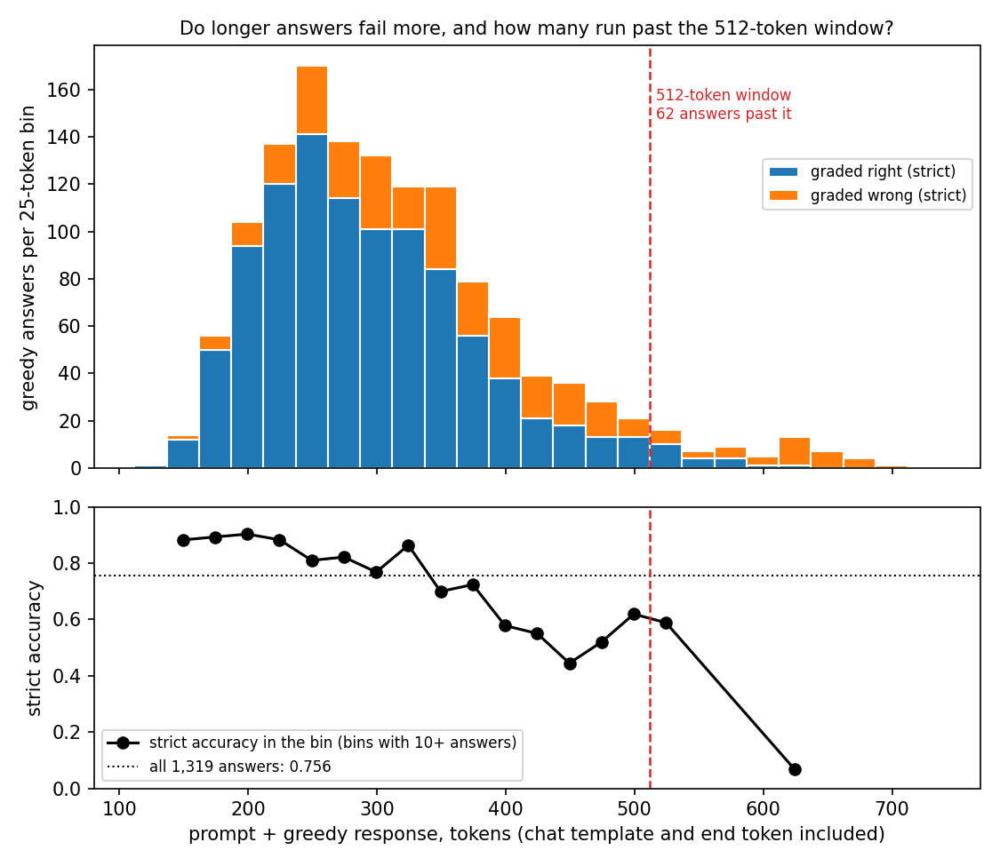
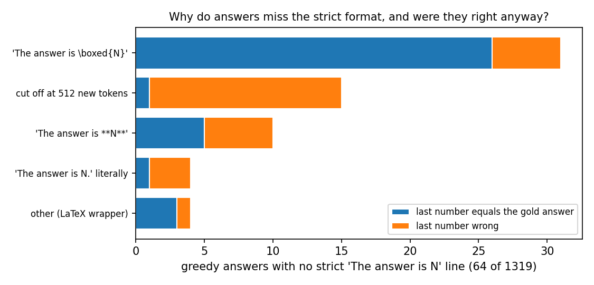
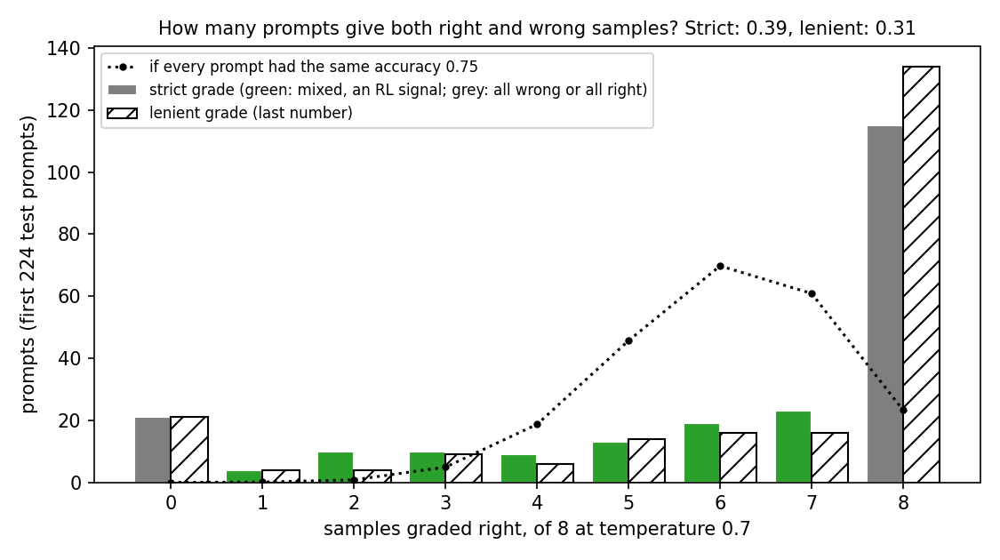

# How well does the unchanged Qwen3-1.7B solve GSM8K, and do its answers fit the 512-token window?

*2026-10-27, writing agent. Plan: `reports/plans/2026-10-27_plan_qwen-port-and-baseline.md`, Part 2. Code:
`experiments/qwen_gsm8k_baseline/run.py`, grader `src/commute/gsm8k.py`, figures from
`experiments/qwen_gsm8k_baseline/plot.py`. Predictions: `experiments/qwen_gsm8k_baseline/results/predictions.json`,
filed before the run and not edited. Words as in `GOALS.md` → Terms.*

We ran the unchanged Qwen3-1.7B on all of GSM8K's test problems with thinking off, and graded each answer by a fixed
rule. It solves three problems in four, nearly all its answers fit the decomposition's window, and sampling gives
mixed right and wrong answers on two prompts in five. So the first Qwen experiment, fine-tuning on human-written
solutions and later reinforcement learning, has room and signal, once we decide how to treat over-long and misformatted
answers.

## The answer

The model gets about three in four test problems right with greedy decoding, just above the range we predicted. That
leaves a quarter of problems wrong for a fine-tune to fix. Nineteen answers in twenty fit inside 512 tokens, but the
ones that do not are mostly wrong, so how the held-out set treats them biases it. Two prompts in five give both right
and wrong samples, enough for reinforcement learning. A few percent of answers miss the requested format, mostly by
wrapping the number in LaTeX.

## What we were trying to test

**The question.** We will fine-tune Qwen3-1.7B and ask whether the update can be written in its decomposition's
subcomponents. First we need to know what the model does on the task. The first experiment fine-tunes on GSM8K's
human-written solutions; later ones may use reinforcement learning. Both need four facts about the unchanged model:
- how often it is right;
- whether the grading is reliable;
- whether its answers fit the 512-token sequences the decomposition was fitted on;
- whether sampling gives a mix of right and wrong answers to learn from.

**The set-up.** Each of the 1,319 test problems went into Qwen's chat template with thinking switched off. One fixed
instruction followed it: solve step by step, then end with the line "The answer is N." The model wrote up to 512 new
tokens. Every problem got one greedy answer. The first 224 problems also got 8 samples each at temperature 0.7. The
plan asked for 256 problems; sampling stopped early on its time budget.

**Grading.** Two rules, both pure functions of the text. The *strict* rule reads the number in the last "The answer
is N" line and compares it with the gold integer. The *lenient* rule reads the last number anywhere in the response.
When the two disagree, the cause is usually format, not arithmetic. The positive control runs the strict rule on the
gold solutions, each rewritten to end "The answer is N." It must read 1.000; anything less is a grader bug.

**Length.** Each answer's length counts the prompt with its chat template plus the response up to its end token.
An answer is *truncated* when no end token came within the 512 new tokens.

There is no do-nothing reference here, because nothing is changed: every number is a reading of the original model.

## What we expected, and why

- The grader reads every gold solution as right, because they are written in exactly the format it looks for.
- Greedy strict accuracy between 0.60 and 0.75. One outside greedy evaluation of the non-thinking mode read 0.653 with
  its own answer extraction.
- The two grading rules within 0.05 of each other. A larger gap would mean the instruction needs work before training.
- At least 95% of answers within 512 tokens, and fewer than 2% truncated. Gold solutions average 92 tokens and prompts
  about 88 on CPU, so the model's longer answers should still fit.
- Between a fifth and a half of prompts giving both right and wrong samples. Reinforcement learning learns only from
  prompts where samples differ.

## What we observed

### Is the grader right on known-correct text?

Yes. The strict and lenient rules both read 1.000 on the 1,319 rewritten gold solutions. The control ran first,
before the model loaded.

### How often is the model right?

The model is right on 0.756 of problems by the strict rule and 0.783 by the lenient rule. The strict figure is 0.006
above the top of the filed range, which is half a binomial standard error of about 0.012. The miss is on the high
side, so it means slightly less headroom than planned, not a weaker model. A quarter of problems remain wrong, and
under sampling 21 of 224 prompts never got a right answer in 8 tries. The model scores ten points above the outside
evaluation, whose prompt and extraction differ from ours; we did not separate the causes.

| quantity | value | reference |
|---|---|---|
| greedy strict accuracy | 0.756 (997 of 1,319) | filed range 0.60–0.75; outside non-thinking eval 0.653 |
| greedy lenient accuracy | 0.783 (1,033) | — |
| strict accuracy, answers ≤ 512 tokens | 0.777 (of 1,257) | — |
| strict accuracy, answers > 512 tokens | 0.323 (of 62) | — |
| strict accuracy on the 224 sampled prompts, greedy | 0.754 | mean sample accuracy 0.753 |
| answers with a strict "The answer is N" line | 0.951 | gold text 1.000 |

### Do longer answers fail more, and how many run past the 512-token window?

**Reading it.** Yes, longer answers fail more, and the answers past the window are mostly wrong. The top panel stacks
right and wrong greedy answers by total length. The red line is the 512-token window, and 62 answers lie past it. The
bottom panel shows strict accuracy falling from about 0.9 for answers under 250 tokens to about 0.5 near 450. Past the
window, strict accuracy is 0.32, against 0.78 for the answers that fit. The cluster past 600 tokens is the 16
truncated answers, none of them right. The median right answer is 279 tokens long and the median wrong one 354.

The share within 512 tokens is 0.953, so the filed floor of 0.95 passes by 0.003, about half a binomial standard
error. Truncation is 0.012, under the 0.02 line. Prompts average 113 tokens with the instruction and chat template,
more than the 88 the scoping report measured.

| percentile of total length | p50 | p90 | p95 | p99 | max |
|---|---|---|---|---|---|
| tokens | 294 | 443 | 505 | 632 | 692 |

| answers past 512 tokens | count |
|---|---|
| all | 62 |
| truncated, no end token | 16, all wrong |
| finished but past 512 | 46, strict accuracy 0.435 |
| no strict answer line | 30 |
| strict line present, wrong number | 12 |
| strict right | 20 |

What do the truncated answers look like? Most loop on guess-and-check, as in `Try $x = 72$: First house: 72, ...`, or
start reinterpreting the problem, as in `### Reinterpreting the second condition`. One was cut just short of a right
answer. It had reached `J_a = 500 - 150 = 350` and stopped at `### Final Answer: The answer`, with gold 350.

### Why do answers miss the strict format, and were they right anyway?

**Reading it.** The format misses are few and mostly cosmetic. 64 greedy answers, 4.9%, have no strict line. Nearly
half of them wrap the number in LaTeX inside the requested line: `The answer is $ \boxed{18} $.` The rule needs a number straight
after "is", so these count as wrong even when the number is right. Bold markup, `The answer is **54**.`, is the
next largest group after truncation. Four answers print the letter N itself. Two of them first decide the problem cannot be solved, as in `we cannot
determine the exact number of boxes needed. The answer is N.` Every disagreement between the two rules lies in this
group. All 36 are right by the last number and wrong by the strict rule; none go the other way. The gap between the rules is 0.027, inside the filed 0.05.

| no strict line, by cause | count | last number right |
|---|---|---|
| `The answer is $ \boxed{N} $` | 31 | 26 |
| truncated | 15 | 1 |
| `The answer is **N**` | 10 | 5 |
| "The answer is N." literally, or "N = 4" | 4 | 1 |
| other LaTeX wrapper, e.g. `\text{The answer is } \boxed{11}` | 4 | 3 |

LaTeX is the model's habit, not an accident: 41% of greedy answers contain a `$$` display block. Answers that
miss the format are long. The boxed group has a median of 416 tokens and the bold group 439, so the format and length
problems overlap. The 16th truncated answer did contain a strict line, which was wrong.

### How many prompts give both right and wrong samples?

**Reading it.** Two prompts in five give a mix, inside the filed range of a fifth to a half. The bars count prompts by
how many of their 8 samples the strict rule grades right. Green bars are the mixed prompts that reinforcement learning
can learn from: 88 of 224, a share of 0.39. Half the prompts, 115, are right in all 8 samples, and 21 are wrong in all
8. The dotted line shows the counts if every prompt had the same accuracy of 0.75. It peaks at 6 right, and it would
make nearly nine prompts in ten mixed. The real counts pile up at the two ends instead: the model
mostly knows a problem or does not. By the lenient rule the mixed share falls to 0.31. So about a fifth of the mixed share
comes from samples that miss the format, and a strict-format reward would partly teach format.

Samples behave like greedy answers. Mean sample accuracy is 0.753, against 0.754 greedy on the same prompts. Prompts
the greedy answer gets right average 0.90 sample accuracy, and prompts it gets wrong 0.29. Of the samples, 6.1% have
no strict line and 5.5% run past 512 tokens, where their strict accuracy is 0.25; truncation is 0.016.

## What we learned

The unchanged model leaves room for a fine-tune: it gets a quarter of greedy answers wrong, and a tenth of sampled
prompts are never solved. Grading is reliable, since the rules agree on the gold text and differ only by format on
the model's answers. The 512-token window holds 95% of answers, but the 5% outside are the hard, mostly wrong ones,
so the window is not neutral with respect to difficulty. The sampled answers are spread enough for reinforcement
learning, with about two prompts in five mixed.

## What this means for designing the first experiment

**Headroom.** About 24% of greedy answers are wrong. The filed decision tree says an accuracy above 0.75 means too
little headroom and calls for changing the task or prompt. By its letter that branch is triggered, by 0.006. Its
concern was a model near ceiling, and a quarter wrong is not near ceiling, so our reading is that the task stands.
This is a decision for the user, not one this report takes.

**Reinforcement learning signal.** 39% of prompts give mixed samples at temperature 0.7, and 31% by the lenient rule.
With 8 samples per prompt, roughly two in five prompts would contribute a gradient. The format share of that signal
argues for a reward that accepts boxed and bold numbers, or a format fix first.

**The 5% past 512 tokens.** The decomposition was fitted on 512-token sequences, so positions past 512 have never been
checked. Qwen's Γ is causal, so the first 512 positions of a longer sequence are still a valid input. Two options for
the held-out set:

- *Drop them.* The held-out set keeps 1,257 of 1,319 prompts. It loses the hardest problems, since two-thirds of the
  dropped answers are wrong. Held-out accuracy rises to 0.777, and the set tilts toward problems the model already
  solves. A fine-tune that mainly helps hard problems would look weaker than it is.
- *Cap them at 512 tokens.* Every prompt stays, but 62 answers lose their ending, and for the 16 truncated ones that
  ending never existed. A score on capped answers reads the reasoning but not the final number, for 5% of the set.

Capping keeps the problem mix and is honest about which tokens are scored; dropping keeps every scored answer complete.
Either choice should be fixed in the plan and the other reported beside it.

**Format.** 4.9% of greedy answers have no strict line, and seven in ten of those that finish are right by the last
number. The fine-tune trains on gold solutions rewritten to end "The answer is N.", so it will teach the format as a
side effect. On the original model's answers, format alone is worth up to 0.027 of strict accuracy. Two fixes: widen the
strict rule to accept `\boxed{N}` and bold, or tighten the instruction against LaTeX and markup. Reporting lenient
accuracy beside strict after every update separates the two either way.

**Held-out set.** The 1,319 greedy responses, with their grades and token counts, are saved in
`results/large/greedy.jsonl`. They become the held-out set for the teacher-forced behaviour score. They are in the
model's own style, long and LaTeX-heavy with a mean response of 198 tokens. The human solutions the fine-tune trains on
average 92, so the score will also register a change of style, not only of correctness.

## How compelling is the evidence

The greedy numbers cover every test problem, with binomial standard errors of about 0.012 on accuracy and 0.006 on the
share within the window. The sampled numbers cover the first 224 problems only, at one temperature and one seed, with
a standard error of about 0.03 on the mixed share. The weights were bf16. No update is read here, so
that does not matter; later scores at the original weights will use fp32 and may move slightly. One instruction wording was tried.
The 512-token generation cap counts 16 unfinished answers as wrong, so accuracy with a longer cap would be up to 0.012
higher. Accuracy is blind to contamination: GSM8K's test set may be in Qwen's training data, which the ten-point gap
over the outside evaluation could partly reflect. The format causes were read from the text by pattern, in
`plot.py`'s `miss_reason`.

## Surprises

- Greedy strict accuracy read 0.756, just over the filed upper bound of 0.75. A narrow miss on the high side.
- The answers past the window are mostly wrong: strict accuracy 0.32 there against 0.78 inside. Not filed, and it is
  what makes the choice between dropping and capping matter.
- The format misses are mostly `\boxed{}` inside the requested line, not missing lines; the model keeps its maths
  habit even when told to write a plain number.
- Sampled correctness is strongly bimodal: half the prompts are right in all 8 samples.

## What next

1. The user decides whether 0.756 counts as enough headroom, given the decision tree's letter. If not, the scoping
   report's harder variants come in before any fine-tune.
2. Fix the format handling before training: widen the strict rule or tighten the instruction. A rerun of the greedy
   stage with a tightened instruction is a 7-minute cluster job; if the gap stays above 0.02, widen the rule instead.
3. Fix drop or cap for the held-out set in the first experiment's plan.

## Scorecard

| id | claim | rule | read | verdict |
|---|---|---|---|---|
| P0 | the grader reads the gold text as right | control_strict == 1.000 | 1.000 | pass |
| P1 | greedy strict accuracy in the expected range | 0.60 ≤ greedy_strict ≤ 0.75 | 0.756 | miss, high side by 0.006 |
| P2 | strict and lenient grades agree | \|lenient − strict\| ≤ 0.05 | 0.027 | pass |
| P3 | answers fit the window | share_total_le_512 ≥ 0.95 | 0.953 | pass, narrowly |
| P4 | few truncated answers | truncation_share < 0.02 | 0.012 | pass |
| P5 | enough mixed prompts for RL | 0.20 ≤ sample_disagreement ≤ 0.50 | 0.393 on 224 prompts | pass |

Gate G0 is the same rule as P0 and passed; the run continued.

## Not run

- Sampling on prompts 225 to 256 of the planned 256: the stage stopped after 14 of 16 batches on its 480-second budget.
- Any temperature other than 0.7, any other seed, and sampling past the first 256 prompts.
- A longer generation cap, to see whether the 16 truncated answers would finish right.
- Any other instruction wording, including one that forbids LaTeX and bold.
- Thinking mode.
- fp32 weights.
- The decomposition on any of this text: its faithfulness on GSM8K sequences is the first stage of the first
  experiment.
- A contamination check of GSM8K test against Qwen's training data.
- The cause of the ten-point gap over the outside evaluation.

## Provenance

- Cluster job 38723, one NVIDIA L40, MATS cluster, about 15 minutes, $0. Log
  `cluster/logs/commute-qwen-gsm8k-baseline-38723.out`. Code at commit `b2abe5b`; results committed in `2463efc`.
- Model `Qwen/Qwen3-1.7B` revision `70d244cc`, bf16; dataset `openai/gsm8k` main test revision `740312ad`.
  torch 2.8.0+cu128, transformers 4.57.3. Peak GPU memory 14.3 GB. Greedy: 11 batches of 128, about 37 s each.
- `experiments/qwen_gsm8k_baseline/results/baseline.json`, sha256 `ca82338f…`.
- `experiments/qwen_gsm8k_baseline/results/large/greedy.jsonl`, 1,319 lines, sha256 `f96bab4c…`.
- `experiments/qwen_gsm8k_baseline/results/large/samples.jsonl`, 1,792 lines, sha256 `8de008e5…`.
- Figures: `experiments/qwen_gsm8k_baseline/figures/{lengths,format,samples}.png`, from `plot.py` on a CPU worker.
