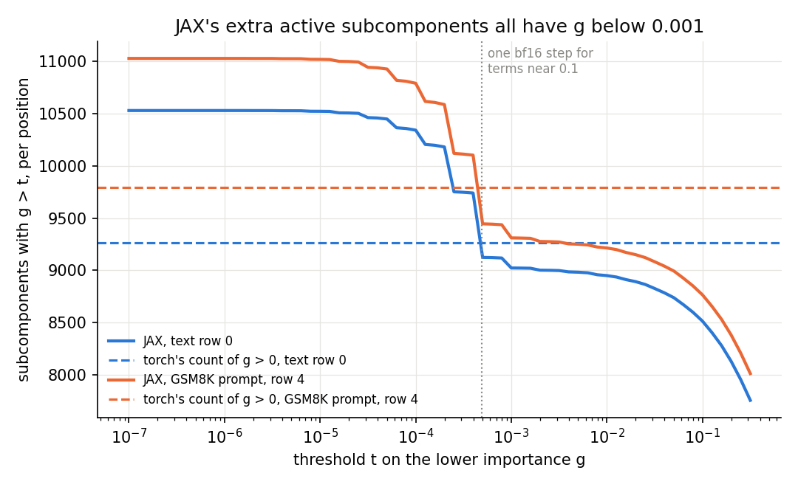

# Does our PyTorch port of the Qwen3-1.7B decomposition reproduce the authors' JAX code?

We ran the authors' JAX code and our PyTorch port of the Qwen3-1.7B decomposition on the same eight token rows, and
compared target outputs, causal importances and masked forwards. The port passed every comparison fixed beforehand,
and the two differences that looked worrying are harmless: rounding leftovers just above zero, and the adversary's
ordinary spread on four rows. The torch port can be used for Qwen measurements, as long as counts of active
subcomponents use a fixed threshold and adversarial readings carry their seed spread.

Apparatus, not a finding. Plan: `reports/plans/2026-10-27_plan_qwen-port-and-baseline.md`, Part 1. Background on what
the checkpoint holds and how Γ is computed: `reports/analyses/2026-10-27_analysis_qwen-loader.md`.

## The answer

The PyTorch port reproduces the JAX decomposition closely. Its target model sits closer to JAX than a bf16 copy of
itself does. Its importance values disagree by more than 0.1 on about two pairs in a hundred thousand, and its masked
forwards land within tolerance. Torch counts about 12% fewer subcomponents with importance above zero. All
of that gap is values below 0.001 in JAX, nearly all of them exact powers of two: bf16 rounding leftovers, not
importances. The adversary's readings range from 7 to 28 nats across six seeds.

## What we were trying to test

The Qwen3-1.7B decomposition ships with a JAX loader, and every measurement we have is in PyTorch. We converted the
checkpoint to fp32 safetensors and wrote `src/commute/qwen_vpd.py`: Γ, the masked forward through hooks on the 196
decomposed `nn.Linear` of Hugging Face's Qwen3, and the paper's 20-step adversary. A port bug would later look like a
research result, so the port had to match the authors' code on fixed inputs before anything is read from it.

The inputs are eight rows. Four are 512-token FineWeb-Edu documents. Four are GSM8K questions in Qwen's
non-thinking chat format, prompt only, of 78 to 117 tokens. `experiments/qwen_port/jax_reference.py` ran the authors' code, in bf16
as they evaluate it, and saved every intermediate. `experiments/qwen_port/torch_check.py` reproduced each one and
scored five comparisons, cheapest first:

- **The target model alone.** The per-position KL from Hugging Face's fp32 logits to JAX's logits, against the KL from
  the same fp32 logits to Hugging Face's own bf16 logits. The second number is the noise floor of running in bf16;
  JAX runs in bf16, so JAX should sit about one floor away.
- **Γ on JAX's inputs.** Γ reads the 29 residual-stream boundaries and each site's subcomponent activations $xV$.
  Feeding JAX's saved boundaries into torch's Γ isolates a Γ error from a target-model difference. The quantity is the
  share of position and subcomponent pairs where torch's lower importance $g$ and JAX's differ by more than 0.1.
  Here $g$ runs from 0, subcomponent not needed, to 1, needed in full.
- **Γ end to end.** The same share, with torch computing its own boundaries.
- **Masked forwards.** The mean KL from clean logits to masked logits, under three settings. Δ is $W - VU$, the
  part of each weight the subcomponents do not cover. The settings are the CI-masked forward $m = g$ with Δ off;
  every mask at 1 with Δ off, which measures what dropping Δ costs; and one fixed random source $m = g + (1-g)\,a$
  with Δ on.
- **The adversary.** The authors' evaluation adversary starts one random source per subcomponent and one Δ value per
  site, shared by every row and position of the block. It then takes 20 sign steps of 0.1 up the KL. It ran on the four text rows
  as one block, three seeds per side. The two random number generators differ, so seeds are not paired.

## What we expected

Each comparison had its rule fixed in the plan before either run. The target model should sit at most twice the bf16
floor from JAX. Importance values should disagree by more than 0.1 on under one pair in a thousand, both on JAX's
inputs and end to end. Each masked KL should land within 5% of JAX's or twice the bf16 floor, whichever is larger,
with torch run in bf16 like JAX. The adversary's three torch readings and three JAX readings should overlap as
ranges. No rule was set for the count of subcomponents above zero; it was reported for the six rows whose full
importance arrays JAX did not save.

## What we observed

### Does the port reproduce the target model, Γ and the masked forwards?

**Reading it.** Yes, with room to spare on each comparison. The fp32 target sits 0.43 bf16 floors from JAX's
logits, closer than its own bf16 copy, and picks the same top token at 99.2% of positions. Torch's Γ on JAX's inputs
disagrees by more than 0.1 on 2.4e-5 of the 433 million pairs, forty times inside the rule. End to end, the share
rises to 5.7e-5 because torch's residual boundaries differ from JAX's by 0.1% to 2% in relative size. Value and
output matrices disagree a little more often than the others, but no kind of matrix comes near the rule. The tightest
masked comparison is the all-ones setting, which used 73% of its allowance.

| comparison | torch | JAX | allowed | reads |
|---|---|---|---|---|
| target KL to HF fp32, mean per position | 3.2e-4 | | ≤ 1.5e-3, twice the floor 7.6e-4 | 0.43 floors |
| top-1 agreement with HF fp32 | | 0.992 | | HF bf16: 0.983 |
| Γ on JAX inputs, share with abs diff > 0.1 | 2.4e-5 | | < 1e-3 | mean abs diff 8.3e-5, max 0.69 |
| Γ end to end, same share | 5.7e-5 | | < 1e-3 | mean abs diff 9.7e-5, max 0.70 |
| CI-masked KL, Δ off, both bf16 | 0.1500 | 0.1487 | ± 0.0074 | diff 0.0013 |
| all masks 1, Δ off, both bf16 | 0.0176 | 0.0165 | ± 0.0015 | diff 0.0011 |
| fixed source, Δ on, both bf16 | 0.0996 | 0.0981 | ± 0.0049 | diff 0.0015 |
| same three, torch in fp32 | 0.1488 / 0.0157 / 0.0983 | | not scored | diffs 1.0e-4 / 7.2e-4 / 1.7e-4 |

Share of pairs with abs diff above 0.1, by kind of matrix:

| kind | q | k | v | o | gate | up | down |
|---|---|---|---|---|---|---|---|
| Γ on JAX inputs | 2.7e-5 | 2.3e-5 | 8.8e-5 | 8.1e-5 | 1.1e-5 | 1.1e-5 | 2.0e-5 |
| end to end | 6.5e-5 | 6.5e-5 | 1.8e-4 | 1.6e-4 | 3.1e-5 | 3.2e-5 | 4.9e-5 |

Torch's residual boundaries match JAX's exactly at the embedding. Their relative error is 0.1% to 1.3% at the
middle boundaries on every row. It is largest at the last boundary, the final layer's output before the norm: 0.9% to
2.1%, highest on the GSM8K rows. Per site, torch's mean $g$ is within 1.5e-4 of JAX's on all eight rows.

Torch in fp32 sits closer to JAX's bf16 masked forwards than torch in bf16 does, on all three settings. This suggests that
JAX's bf16 path keeps more precision than torch's op-by-op bf16. I did not trace which operations cause this.

### Why does torch count fewer active subcomponents?

*Solid: JAX's count of subcomponents with $g > t$ per position, summed over the 196 sites, as the threshold $t$
rises. Dashed: torch's count at $t = 0$. Dotted: one bf16 rounding step, $2^{-11}$, for terms between 0.06 and 0.12; the
largest group of leftovers sits exactly there.*

**Reading it.** The gap is a counting artefact of rounding leftovers just above zero, not a real difference in which
subcomponents Γ switches on. Torch counts 9,262 subcomponents per position with $g > 0$ on the first text row, against
JAX's 10,528, and the gap is 1,180 to 1,300 on all eight rows. The figure shows that JAX's count falls in steps
between thresholds of 1e-5 and 1e-3, then flattens: it is 9,022 at 0.001 and 8,950 at 0.01. Torch's count crosses
JAX's curve inside that steep stretch, so every subcomponent JAX counts and torch does not has $g$ below 0.001.

The steps sit at exact powers of two. Of JAX's 1,506 values per position between 0 and 0.001 on the first text row,
1,404 are exactly $2^{-k}$ for some $k$; on the GSM8K row it is 1,586 of 1,716. The largest groups are $2^{-11}$ with
615 per position and $2^{-12}$ with 425. A preactivation $p$ is a sum of bf16 terms, and $g = \mathrm{clip}(p, 0, 1)$
holds exactly in JAX's saved arrays. When two terms of size near 0.1 almost cancel, the sum comes out as one rounding
step of those terms, which is a power of two. A true importance would spread smoothly across small values. Instead,
values between the powers of two are rare: three rounding steps, $3 \cdot 2^{-11}$, occur about once per position. Torch adds the same terms with its
roundings in a different order, so the leftover lands on zero or below more often. I did not trace which operation
differs.

These values carry almost nothing. On the first text row, values up to 0.001 sum to 0.54 per position, out of 7,352
for all values. That is why the per-site mean $g$ agrees within 1.5e-4 while the count differs by 12%.

| row | JAX, g > 0 | JAX, g > 0.001 | JAX, g > 0.01 | torch, g > 0 | JAX values in (0, 0.001) that are exact powers of two |
|---|---|---|---|---|---|
| text row 0 | 10,528 | 9,022 | 8,950 | 9,262 | 1,404 of 1,506 |
| GSM8K row 4 | 11,027 | 9,310 | 9,214 | 9,795 | 1,586 of 1,716 |

Torch's count at zero exceeds JAX's count above 0.001 by about 240 to 480. Torch keeps some leftovers of its own;
torch's full $g$ arrays were not saved, so torch's count above 0.001 was not measured.

**What this means for later measurements.** Any measurement that counts active subcomponents on Qwen must fix a
threshold above zero, and use the same one on every state it compares. The JAX curve is nearly flat between 0.001 and
0.01, so a threshold of 0.01 sits above every rounding leftover and moves the count by under 1%. A count of $g > 0$
would mix real importance with rounding noise, and the mix would depend on precision and code path. A change of
precision between two states could then read as a change in how many subcomponents are switched on.

### How noisy is the adversary on a block of four rows?

**Reading it.** Very noisy: one torch seed read 7.1 nats while the other five readings, from both sides, ran from 18.5
to 27.7. The ranges overlap, so the rule passed, but the rule had little power. The rule would still have passed
had every torch reading been a third lower, or three times higher. So this
comparison only rules out a gross break of the adversary port, such as readings near zero or an order of magnitude
apart.

| seed | 0 | 1 | 2 |
|---|---|---|---|
| torch, fp32 | 21.7 | 27.7 | 7.1 |
| JAX, bf16 | 18.5 | 20.0 | 24.9 |

The six readings have a mean of 20.0 nats and a standard deviation of 7.1. In the plan's floor measure, the largest
reading over the smallest minus one, torch reads 2.9 and JAX 0.34. Both are above 0.25, the testbed's stop rule for
"read more rows per block". The block here held four rows, while the authors' own evaluation shares one source over
128 rows of 512 tokens. A source shared by four rows can be tailored to those rows, which plausibly explains both the
very high readings and the spread; that was not tested. The sides also differ in precision: torch ran the adversary
in fp32, JAX in bf16.

For later use, `decisions.md` keeps the paper's setting of one random start and 20 steps, with readings reported as
lower bounds. On Qwen, that setting needs its noise attached. At this spread, a single start can read a third of
another start on the same rows. On this evidence, one reading per state cannot separate two states whose readings
differ by less than about a factor of three. A mean over three seeds still carries about 20% standard error; reaching ±10% would take
about thirteen. More rows per block is the other lever, and the plan's floor measurement on many more rows should
settle how much it helps before any state is scored.

### A first look at GSM8K prompts against generic text

**Reading it.** On these four prompts, the CI-masked forward loses less on GSM8K text than on generic text, while
dropping Δ costs more. This is a weak first hint for the faithfulness check on task text. This is four rows of each kind, prompts only, no model
responses; it is not that check. The target model's next-token cross-entropy is 2.6 to 3.5 nats on the text rows and
3.3 to 4.6 on the GSM8K prompts. Question text is hard to predict, so the higher prompt numbers are expected.

| row | kind | tokens | target CE | CI-masked KL | all masks 1, Δ off | fixed source, Δ on |
|---|---|---|---|---|---|---|
| 0 | text | 512 | 3.55 | 0.180 | 0.016 | 0.125 |
| 1 | text | 512 | 3.09 | 0.181 | 0.019 | 0.123 |
| 2 | text | 512 | 2.61 | 0.130 | 0.010 | 0.070 |
| 3 | text | 512 | 2.58 | 0.150 | 0.010 | 0.101 |
| 4 | GSM8K prompt | 117 | 3.92 | 0.107 | 0.035 | 0.070 |
| 5 | GSM8K prompt | 78 | 4.61 | 0.091 | 0.037 | 0.065 |
| 6 | GSM8K prompt | 109 | 3.28 | 0.077 | 0.020 | 0.054 |
| 7 | GSM8K prompt | 87 | 3.65 | 0.080 | 0.031 | 0.060 |

KLs are JAX's, mean per position. The CI-masked KL is lower on every GSM8K prompt than on every text row. The GSM8K
rows are shorter, so position could confound this. On the first 100 positions only, the gap holds: the text rows read
0.117 to 0.213, the GSM8K prompts 0.080 to 0.114. The opposite holds for dropping Δ. With every mask at 1 and Δ
off, the GSM8K prompts read 0.020 to 0.037 against 0.010 to 0.019 on text, about twice as much. So on these prompts the
part of the weights outside the subcomponents matters more than on generic text, though it is still small next to the
CI-masked loss. The four prompts share the chat template's first tokens, so they are less independent than four
documents.

## What we learned

The torch port reproduces the authors' JAX decomposition on the target model, Γ and the masked forwards. It can
carry every Qwen measurement the plan needs, including fp32 reads at $W_0 + \delta W$, which the authors' loader does not offer
because it restores bf16. Two cautions come with it. Counts of active subcomponents need a fixed threshold, because
about one in seven of the subcomponents counted above zero is a bf16 rounding leftover. And the paper's adversary on a small block of rows is noisy enough
that one seed can mislead by a factor of three.

## How compelling is the evidence

- The importance comparison covers two rows, one text and one GSM8K prompt, with 433 million pairs; the other six rows
  are compared only through per-site mean $g$ and the count above zero.
- The rule on importance differences is blind to small systematic offsets below 0.1. The mean absolute difference,
  under 1e-4, covers that.
- Both sides ran Γ in bf16. An fp32 Γ was never compared, and later measurements at $W_0 + \delta W$ may want one.
- The masked-forward rule passed in bf16; torch in fp32 sits even closer to JAX.
- The adversary comparison has little power, as explained above.
- The explanation of the count gap rests on JAX's arrays only; torch's full $g$ arrays were not saved.

## Surprises

- The adversary reads about 20 nats on generic text in both implementations, far above the CI-masked KL of 0.15. A
  block of four rows is much smaller than the authors' 128, so this is not the run's own evaluation figure. I did not
  compare it with the run's logged value. If a full block also reads this high, the paper's adversary breaks the
  unchanged decomposition on generic text, and every adversarial ratio on Qwen starts from there.
- Torch's count of subcomponents above zero is 12% lower than JAX's on every row: explained above as rounding
  leftovers.
- One torch adversary seed read 7.1 against 18.5 to 27.7 for the rest.

## What next

- **Use the port.** The GSM8K faithfulness check on task text can run on it now, counting active subcomponents at a
  fixed threshold such as 0.01. If that threshold moves counts by more than 1% from 0.001 on task text, revisit it.
- **The adversary floor on Qwen.** Several seeds on a block of many more rows, compared with the run's logged
  evaluation value. If the spread stays above the 0.25 stop rule, adversarial readings need more seeds or rows before
  any state is scored.
- **An fp32 Γ against the bf16 one**, once, before Γ is read at $W_0 + \delta W$. If they disagree beyond the bf16
  rule here, fp32 Γ becomes the default for updates.

## Scorecard

| check | claim | rule, fixed before the run | read | verdict |
|---|---|---|---|---|
| 0 | the target model matches | KL(HF fp32 ‖ JAX) ≤ 2 × KL(HF fp32 ‖ HF bf16) | 3.2e-4 vs 2 × 7.6e-4, ratio 0.43 | pass |
| 1 | the Γ port matches on JAX's inputs | share of pairs with abs diff in g > 0.1 below 1e-3 | 2.4e-5 | pass |
| 2 | Γ matches end to end | same rule | 5.7e-5 | pass |
| 3 | masked forwards match, both bf16 | abs diff ≤ max(5% of JAX, 2 × check 0 floor) | 0.0013 / 0.0011 / 0.0015 vs 0.0074 / 0.0015 / 0.0049 | pass |
| 4 | the adversary port matches | ranges of 3 seeds per side overlap | torch 7.1-27.7, JAX 18.5-24.9 | pass, weak test |

## Not run

- Γ in fp32, compared with Γ in bf16.
- Torch's count of active subcomponents above a threshold; torch's full $g$ arrays were not saved.
- Which operation makes torch's bf16 rounding leftovers differ from JAX's.
- Model responses to the GSM8K prompts: only prompts were scored.
- The adversary on the GSM8K rows, on a block of more than four rows, or with more than three seeds per side.
- The adversary's 20 nats compared with the run's own logged evaluation value.
- The masked forward with Δ on and $m = g$; only the fixed random source ran with Δ on.
- The stochastic-mask KL, which `qwen_vpd.stochastic_masks` supports.
- Any proxy corpus other than these four FineWeb-Edu rows.

## Provenance

- Code at commit `8ae1716`: `experiments/qwen_port/jax_reference.py`, `experiments/qwen_port/torch_check.py`,
  `src/commute/qwen_vpd.py`; tokens in `experiments/qwen_port/results/tokens.json`.
- Results: `experiments/qwen_port/results/jax_reference.json`, `torch_check.json`, and `l0_threshold.json` with the
  count curves written by `experiments/qwen_port/plot.py`. Large arrays sit in `experiments/qwen_port/results/large/`,
  gitignored: JAX's $g$ and $p$ on rows 0 and 4, logits, boundaries and masked outputs on all rows.
- Figure: `experiments/qwen_port/figures/l0_threshold.png`, from `plot.py` in a CPU job.
- Machine: MATS cluster, one L40 with 46 GB, `debug` QoS, no cost.
- JAX reference, job 38812, about 8 minutes: loading 43 s, target 18 s, boundaries 3 s, Γ 180 s, masked forwards
  29 s, adversary 195 s. Peak device memory 33.8 GiB, in the masked stage; 28.4 GiB during loading, with the restored
  decomposition at 25.0 GiB, prepared components 9.1 GiB and prepared Γ 15.9 GiB.
- The first attempt, job 38761, ran out of device memory in the authors' preparation step, which needed 53.7 GB in one
  compiled function. Splitting it into two functions that donate the restored arrays fixed it.
- Torch check, job 38829, 326 s in all. Loading the components to host from NFS took 81 s; each adversary seed took
  about 68 s. GPU memory after loading Γ was 31.4 GiB; the peak was not logged.
