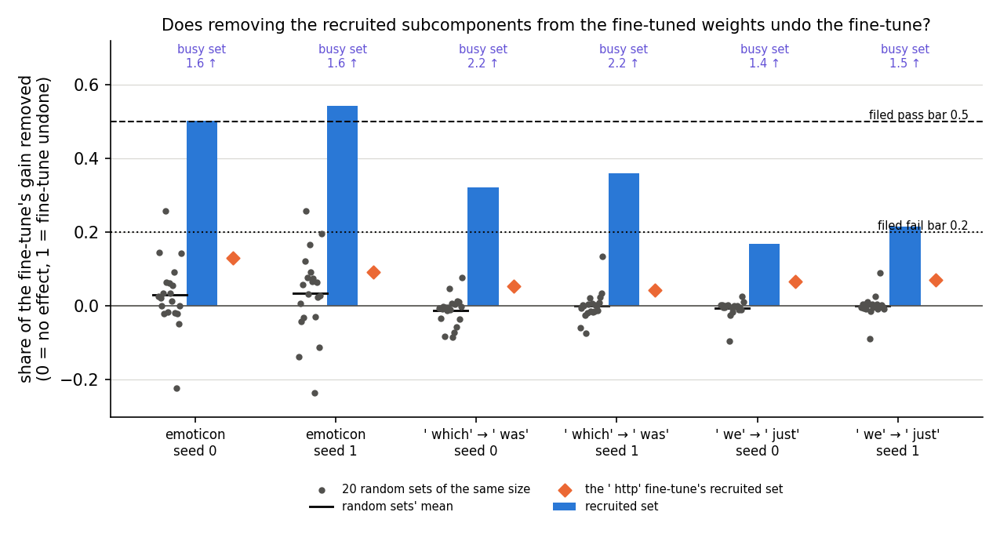
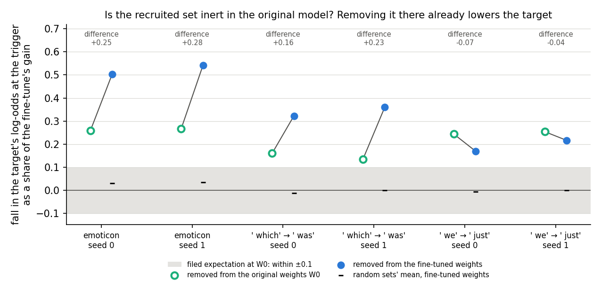
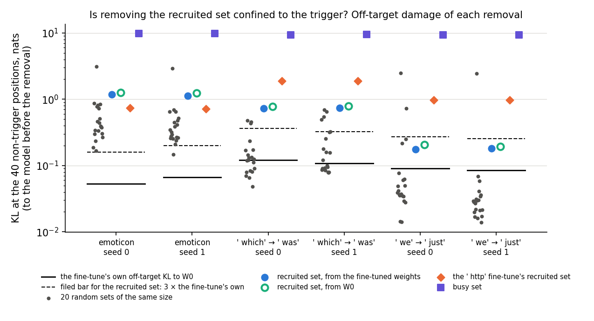
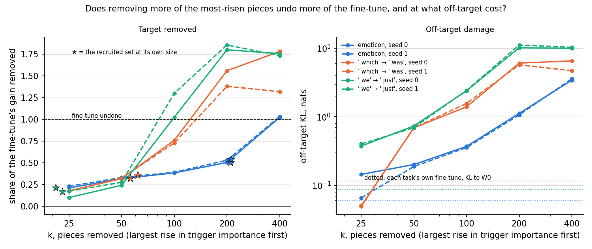
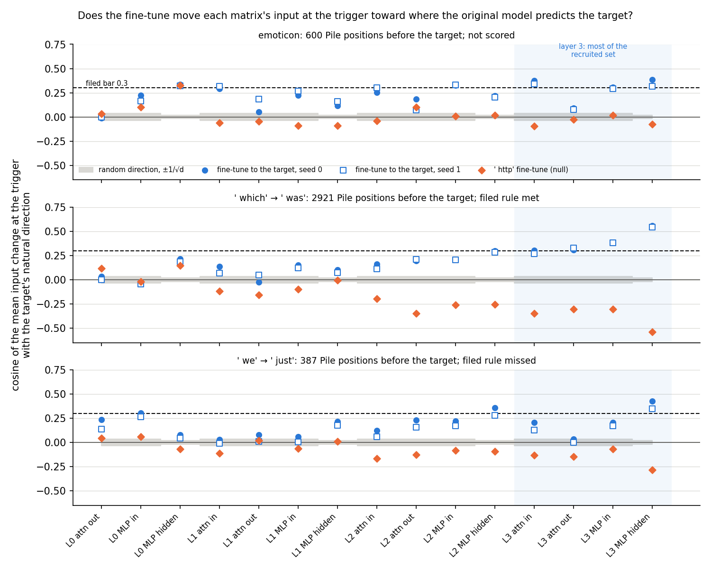
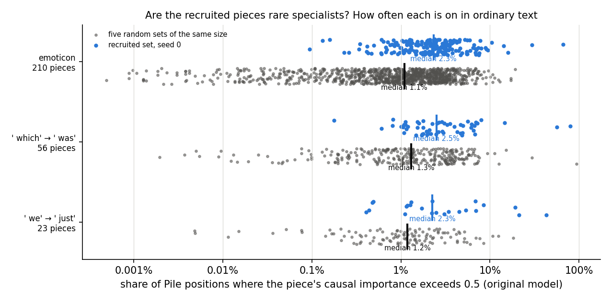

# Does the fine-tuned model itself use the subcomponents Γ switches on at the trigger? (E38, analysis)

*2026-10-27, writing agent. Plan: `reports/plans/2026-10-27_plan_regating-recruitment.md`, set up by
`reports/decisions/2026-10-27_decision_regating-fixed-shift-deprioritised.md`. Notebook:
`notebooks/E38_recruitment_test.ipynb`. Code: `experiments/recruitment_test/run.py`,
`src/commute/{recruitment,routing,census}.py`; figures from `experiments/recruitment_test/plot.py`. Words as in
`GOALS.md` → Terms. An independent check read the same files; its findings are folded in below.*

We removed the subcomponents that the frozen importance function switches on after a narrow fine-tune from the
fine-tuned model's real weights, to see whether the new behaviour goes with them. It partly does, far more than for
random sets, but removing them from the original model, which we predicted would do nothing, already lowers the target
by half as much or more. For `GOALS.md` this means these subcomponents help predict the target before and after the
fine-tune, and how much of the fine-tune itself works through them is still unmeasured.

## The answer

Partly, and not as filed. Removing the subcomponents Γ switches on from the fine-tuned weights takes away a third to a
half of the fine-tune's gain on two of three tasks. That is far more than the average random set of the same size. But
removing them from the original model, which we predicted would do nothing, already takes away a sixth to a quarter.
They push toward the target before any fine-tuning. How much of the fine-tune runs through them is not yet measured.

## What we were trying to test

**The question.** After a narrow fine-tune, Γ stays frozen and reads the fine-tuned model's activations. At the trigger
position it then switches on a set of the original model's subcomponents. We call it the *recruited set* S. It holds
the alive subcomponents whose mean causal importance at the trigger rises by more than 0.3 on the training windows,
E18's definition. Every earlier number about this set was read in the CI-masked model, the original subcomponents under the new
importance values. The fine-tuned model has no Γ. This experiment asks the fine-tuned model directly whether it acts
through S.

**The states.** E18's recipe, regenerated in the job: a fine-tune of all 24 decomposed matrices with Adam at 3e-5, batch
32, 10 steps, on three tasks. The tasks are emoticon, where a `:)`-style trigger is followed by `o`; ` which` followed by
` was`; and ` we` followed by ` just`. Each task has two seeds. A 10-step fine-tune to ` http` at the same triggers,
seed 0, is the null: an update of the same size that teaches a different token. The weight change sits in Δ and Γ is
frozen, so S is exactly E18's set.

**The measurement.** Removing a set means subtracting each of its rank-1 matrices $u_c v_c^\top$ from the weights, at
every position. We read the full model, the target model with its real weights and no masks, on 73 to 106 held-out
windows per task. The quantity is the target's mean log-odds at the trigger: $T_0$ in the original model, $T_1$ after the
fine-tune, gain $G = T_1 - T_0$. Every result is a *removed share*
$\rho = (T_1 - T_1^{\text{without set}}) / G$. A share of 0 means removing the set does nothing; 1 means it undoes the
fine-tune. Off-target damage is the mean KL from the model before the removal to the model after it, at the 40
non-trigger positions of each window.

One caveat belongs here, where the share is defined. The gain is measured in log-odds at a point where the fine-tuned
model is near certain. On emoticon a share of 0.5 is 6.8 nats of log-odds. Yet the mean log-odds after the removal is
still about 1.7, so the target stays the likely next token. Removing S moves the trigger's distribution by under half a
nat of KL, where the fine-tune moved it by 11. In probability, much less than half the fine-tune is undone.

**The arms, and what each rules out.**

- **Random sets.** Twenty alive sets with the same size per matrix as S, disjoint from it. They rule out that removing
  that many subcomponents lowers the target whichever they are.
- **The null's recruited set.** The set Γ switches on after the ` http` fine-tune, removed from this task's fine-tuned
  weights, whole and cut to the size of S. It rules out that any recruited set carries the target.
- **The busy set.** As many alive subcomponents as S holds, the ones most important at the trigger in the original model. It
  is a positive control that removal bites; it is not a calibrated contrast.
- **S removed from the original weights.** The filed expectation was that S is off there, so this should read about 0.
- **The k most-risen subcomponents**, k from 25 to 400, reported to see whether the share keeps rising past the size of S.

Two further stages ran because the first did not fail. The *input trace* asks whether the fine-tune moves each matrix's
input at the trigger toward the inputs the original model has where it predicts the target. It reads the cosine
between the mean input change at the trigger and the *natural direction* $n = \mu_{\text{target}} - \mu_{\text{all}}$:
the mean input at Pile positions whose next token is the target minus the mean input over all positions, over 2,000 Pile
rows. A random direction reads about $1/\sqrt{d}$, 0.036 for a 768-wide input. The *census* lists, for every member of S
on seed 0 and of five random sets, where the original model switches it on in Pile text and which tokens come next there.

## What we expected, and why

- **Recruitment is real, medium-low confidence.** Removing S would take at least half the gain on two of three tasks,
  with random sets and the null's set under 0.15. In the masked model S carried only 40 to 64% of the switching effect
  in E4 and E6, so a share between 0.3 and 0.6 looked likeliest.
- **Removing S is specific, medium confidence.** Its off-target damage would stay within three times the fine-tune's
  own; the busy set's would exceed ten times.
- **S is off in the original model, high confidence.** S is the set whose importance at the trigger rises with the
  fine-tune, so we expected the original model not to use it there. Removing it from the original weights would move
  the target's log-odds by at most a tenth of the gain.
- **The update points at the target's contexts, medium-low confidence.** In the layer holding most of S, at least half
  the matrices would read a cosine of 0.3 or more with the natural direction, and three times the null's.
- **The census check.** The share of S whose top three next tokens include the target would be at least three times the
  random sets' share, as E18's overlap with the target's machinery suggested.

## What we observed

### Does the apparatus reproduce E18? (stage 0)

Yes, on the second run. Every check passed: the original model's log-odds within 0.005 of E18, held-out probabilities
within 0.001, the recruited sets matching the saved ones with a Jaccard overlap of at least 0.98, removing an empty set
changing nothing to machine precision. Removing the busy set from the original model moved the trigger distribution by
9.4 to 12.9 nats.

The first run stopped on the fine-tuned log-odds. On emoticon they sat 0.07 and 0.12 from E18's, against a filed
tolerance of 0.02. That tolerance had come from runs that reloaded E18's saved changes rather than fine-tuning again, and
E18's own two seeds differ by 0.26 there. An amendment, filed before stages 1 to 3, set the tolerance to 2% of E18's
gain, about 0.2 to 0.27 nats. Every later number is a share of the same state's own gain, so an offset of that size does
not enter it. The first run stopped after its first task. Under the old tolerance one ` which` seed and one ` we` seed would also
have missed, by 0.049 and 0.022.

| task, seed | T0 here / E18 | T1 here / E18 | held-out P here / E18 | \|S\| here / saved | Jaccard |
|---|---|---|---|---|---|
| emoticon s0 | −5.022 / −5.023 | 8.476 / 8.407 | 0.9993 / 0.9993 | 210 / 210 | 1.000 |
| emoticon s1 | | 8.544 / 8.668 | 0.9995 / 0.9995 | 211 / 213 | 0.991 |
| emoticon null | | — | 0.9980 / 0.9981 | 128 / 130 | 0.985 |
| ` which` s0 | −5.544 / −5.545 | 4.769 / 4.781 | 0.9892 / 0.9893 | 56 / 56 | 1.000 |
| ` which` s1 | | 5.275 / 5.323 | 0.9932 / 0.9935 | 62 / 62 | 1.000 |
| ` which` null | | — | 0.9942 / 0.9941 | 226 / 225 | 0.996 |
| ` we` s0 | −6.916 / −6.911 | 5.592 / 5.615 | 0.9926 / 0.9927 | 23 / 23 | 1.000 |
| ` we` s1 | | 5.278 / 5.283 | 0.9904 / 0.9905 | 21 / 21 | 1.000 |
| ` we` null | | — | 0.9890 / 0.9885 | 165 / 165 | 1.000 |

Busy set removed from the original model: KL at the trigger 11.68, 12.88, 9.37 nats; off-target KL 9.92, 9.54, 9.07.

### Does removing the recruited set from the fine-tuned weights undo the fine-tune?

**Reading it.** Partly on two tasks, barely on the third, and the filed pass was met nowhere. The blue bars are the
share of the gain removed with S. On emoticon they reach 0.50 and 0.54, at the pass bar. On ` which` they read 0.32 and
0.36, and on ` we` 0.17 and 0.22. The grey dots are the random sets. Their mean is near zero everywhere, so the word
tasks' shares stand well clear of chance, with the seeds within 0.05 of each other. On emoticon the random sets spread
from −0.23 to +0.26. One draw reaches 0.26 on both seeds and also causes off-target damage near 3 nats, so it likely
holds one heavily used subcomponent. That draw puts emoticon outside the filed rule, which scores no task whose random
maximum exceeds 0.15. A maximum over twenty draws is a heavy-tailed bar here. The orange diamonds, the null's recruited
set, remove at most 0.13 of the gain, and no more when cut to the size of S. The busy set removes 1.4 to 2.2 times the
gain and wrecks the model.

The decision tree reads "outside the tree": emoticon is unscored, ` which` is partial on both seeds, and ` we` is a fail
on one seed and partial on the other. Under the filed rule stages 2 and 3 run.

| task, seed | gain, nats | \|S\| | share, S | random mean / max | null set / cut to \|S\| | busy | seed class |
|---|---|---|---|---|---|---|---|
| emoticon s0 | 13.50 | 210 | 0.503 | 0.031 / 0.258 | 0.131 / 0.130 | 1.60 | none |
| emoticon s1 | 13.57 | 211 | 0.543 | 0.034 / 0.258 | 0.091 / 0.096 | 1.61 | none |
| ` which` s0 | 10.31 | 56 | 0.323 | −0.012 / 0.078 | 0.055 / 0.040 | 2.18 | partial |
| ` which` s1 | 10.82 | 62 | 0.361 | 0.001 / 0.134 | 0.043 / 0.039 | 2.18 | partial |
| ` we` s0 | 12.51 | 23 | 0.169 | −0.006 / 0.026 | 0.067 / 0.011 | 1.44 | fail |
| ` we` s1 | 12.19 | 21 | 0.216 | 0.001 / 0.090 | 0.072 / 0.013 | 1.47 | partial |

Task classes: emoticon "unscored: random removal bites"; ` which` "partial"; ` we` "seeds disagree". S's layers
0/1/2/3: emoticon 35/5/43/127 and 37/5/42/127; ` which` 5/3/9/39 and 5/3/10/44; ` we` 3/1/6/13 and 3/0/7/11. Overlap of
S with the busy set 0 to 0.03, with the null's set 0.02 to 0.05.

### Is the recruited set inert in the original model?

**Reading it.** No, and this reverses a prediction filed with high confidence. The hollow green circles are S removed
from the original weights. Every one sits outside the grey band where we expected it, at 0.13 to 0.27 of the gain. In
log-odds that is a fall of 1.5 to 3.6 nats for a token the original model already rated unlikely. On ` we` removing S
from the original model lowers the target more than removing it from the fine-tuned one.

The check found no code fault: the same removal call serves both models, the original weights are restored after every
removal, and stage 0 confirmed both. The miss lies in the design. S is defined by a *rise* in importance at the
trigger, with no bound on how important it already was in the original model. The removal also acts at all 41
positions, while S is defined at the trigger only. Removing S from the original model costs off-target KL of 1.26 on
emoticon, 0.78 on ` which` and 0.21 on ` we`. The census shows a typical member of S is on at 2.3% of ordinary Pile
positions, and a few at 43 to 80%. So "S is off in the original model" was never what this measurement tests. It tests
whether removing S changes the original model's view of the target, and it does.

How important S was at the trigger in the original model was not saved; a rise above 0.3 only bounds it below 0.7.
One untested reading: Γ was trained to keep the output distribution, and lowering an already improbable token's
log-odds by a few nats costs almost no KL.

**An exploratory reading, not filed.** Removing S subtracts the original subcomponents from both models, and the
fine-tune's own weight change stays in place. So the share in the fine-tuned model mixes S's existing push toward the
target with anything the fine-tune adds through S. The difference between the two removals is the share of the gain
lost when S is absent from both models. It reads about 0.25 on emoticon and about 0.2 on ` which`.
On ` we` it is slightly below zero. Read this way, the fine-tune keeps about three quarters or more of its gain without S on every task. Two controls
are missing before this can be read: random and null sets removed from the original weights, and removal at the
trigger position only.

| task, seed | share, from fine-tuned | share, from original | difference | fall at original, nats | off-target KL, from original |
|---|---|---|---|---|---|
| emoticon s0 | 0.503 | 0.258 | +0.245 | 3.48 | 1.26 |
| emoticon s1 | 0.543 | 0.267 | +0.275 | 3.62 | 1.24 |
| ` which` s0 | 0.323 | 0.160 | +0.163 | 1.65 | 0.78 |
| ` which` s1 | 0.361 | 0.135 | +0.225 | 1.46 | 0.79 |
| ` we` s0 | 0.169 | 0.243 | −0.074 | 3.04 | 0.21 |
| ` we` s1 | 0.216 | 0.254 | −0.038 | 3.10 | 0.19 |

### Is removing the recruited set confined to the trigger?

**Reading it.** No, except on ` we`. The black line is the fine-tune's own off-target KL to the original model; the
dashed line is the filed bar at three times that. Removing S, the blue dots, costs 17 to 22 times the
fine-tune's own on emoticon. On ` which` it costs 6 to 7 times. On ` we` it costs twice, under the bar. The filed specificity rule is scored only
where recruitment passes, so it is unscored; read anyway, it would fail on two of three tasks. Removing S from the
original model, the green circles, costs about the same as removing it from the fine-tuned one. The null's set, the
orange diamonds, does more off-target damage than S on the word tasks yet barely touches the target. On ` which` it
costs 1.9 nats off target and removes 0.05 of the gain. S costs 0.72 nats and removes 0.32. So the target effect of S is not
a side effect of general damage.

The random sets' off-target KL is heavy-tailed. On ` we` one draw reaches 2.4 nats while the
median draw costs about 0.03. Against that median, removing S on ` we` costs about five times as much.

| task, seed | fine-tune's own | S | S, from original | random median / max | null set | busy |
|---|---|---|---|---|---|---|
| emoticon s0 | 0.053 | 1.185 | 1.262 | 0.389 / 3.14 | 0.740 | 9.78 |
| emoticon s1 | 0.066 | 1.131 | 1.240 | 0.332 / 2.94 | 0.721 | 9.85 |
| ` which` s0 | 0.121 | 0.723 | 0.777 | 0.123 / 0.48 | 1.889 | 9.39 |
| ` which` s1 | 0.109 | 0.739 | 0.794 | 0.138 / 0.70 | 1.904 | 9.58 |
| ` we` s0 | 0.090 | 0.177 | 0.207 | 0.040 / 2.47 | 0.978 | 9.37 |
| ` we` s1 | 0.085 | 0.181 | 0.193 | 0.029 / 2.43 | 0.975 | 9.31 |

KL at the trigger after removing S: 0.32, 0.50, 0.20, 0.23, 0.03, 0.08 nats, against the fine-tune's own 11.1, 10.7,
7.1, 7.3, 6.5, 6.1.

### Does removing more of the most-risen subcomponents undo more?

**Reading it.** It undoes more, but past the recruited set it is broad damage, not more of the mechanism. On the word
tasks the share passes 1 by k = 100 to 200. By then the off-target KL is 2.4 to 11 nats. Past rank 100 on ` which` and
rank 200 on ` we` the added subcomponents barely rose: by the check's reading their rise is about 0.12 and 0.002. No
random sets matched to each k were run, so the curve cannot separate the most-risen subcomponents from any of that many.
On emoticon the share rises slowly to 0.5 at k = 200, about the size of S. It reaches 1 only at k = 400.

| task, seed | k = 25 | 50 | 100 | 200 | 400 | off-target KL at 100 / 400 |
|---|---|---|---|---|---|---|
| emoticon s0 | 0.21 | 0.32 | 0.39 | 0.50 | 1.02 | 0.37 / 3.42 |
| emoticon s1 | 0.23 | 0.33 | 0.39 | 0.53 | 1.03 | 0.36 / 3.59 |
| ` which` s0 | 0.18 | 0.32 | 0.76 | 1.56 | 1.78 | 1.40 / 6.54 |
| ` which` s1 | 0.17 | 0.33 | 0.73 | 1.38 | 1.32 | 1.57 / 4.70 |
| ` we` s0 | 0.10 | 0.24 | 1.02 | 1.80 | 1.76 | 2.40 / 9.96 |
| ` we` s1 | 0.17 | 0.28 | 1.30 | 1.86 | 1.73 | 2.43 / 10.28 |

### Does the fine-tune move the trigger's inputs toward where the original model predicts the target? (stage 2)

**Reading it.** It moves them in a direction aligned with the target's contexts, but the filed rule held only on
` which`, and the rule's null bar did no work. The blue markers are the cosine between each input's mean change at the
trigger and the target's natural direction. On every task they are positive almost everywhere past layer 0, mostly
0.1 to 0.4, three to ten times the random level. In layer 3, which holds most of S, ` which` reads 0.27 to 0.56 and passes. ` we`
reaches 0.3 only on the MLP hidden input and misses. Emoticon would pass on both seeds but is unscored, because its
stage-1 class was unscored.

Three caveats from the check. First, the null's cosine is negative on every layer-3 input where the rule was scored,
from −0.07 to −0.54, so "three times the null" is met automatically; the rule reduces to a cosine of 0.3. Second, the
query, key and value matrices read one shared input, so three of the six layer-3 "matrices" are one number. Counting
distinct inputs leaves every verdict unchanged. Third, the distance ratios run against the "reveal" picture. The plan
expected the inputs to end nearer the target's mean input and no nearer the overall mean. Instead the ratio to the
target's mean is above 1 almost everywhere, even where the cosine is high. On ` which`, layer 3's MLP hidden input reads
a cosine of 0.56, with the distance to the target's mean up 12% and to the overall mean up 22%. The fine-tune pushes
the trigger's inputs outward, away from both means, partly along the target's direction. The null's strongly negative
cosines suggest the natural direction also holds a component that any narrow fine-tune moves against. No cosine against
other tokens' natural directions was read, and no positive control with the null's own token.

Layer 0's attention input at the trigger is the token embedding, which the fine-tune cannot change, so it reads no
cosine. Pile positions before the target: 600 for emoticon, 2,921 for ` which`, 387 for ` we`, all above the 200 required.

| task, seed | layer-3 inputs: attention in / attention out / MLP in / MLP hidden | null, same order | filed rule |
|---|---|---|---|
| emoticon s0 | 0.374 / 0.093 / 0.307 / 0.386 | −0.097 / −0.024 / 0.016 / −0.076 | would pass; unscored |
| emoticon s1 | 0.341 / 0.079 / 0.293 / 0.317 | | would pass; unscored |
| ` which` s0 | 0.305 / 0.310 / 0.384 / 0.556 | −0.347 / −0.306 / −0.305 / −0.541 | pass, 6 of 6 |
| ` which` s1 | 0.268 / 0.327 / 0.382 / 0.541 | | pass, 3 of 6 |
| ` we` s0 | 0.208 / 0.033 / 0.207 / 0.427 | −0.133 / −0.144 / −0.070 / −0.284 | miss, 1 of 6 |
| ` we` s1 | 0.130 / −0.001 / 0.172 / 0.346 | | miss, 1 of 6 |

Distance ratio to the target's mean / to the overall mean, layer 3, seed 0: emoticon 1.00/1.07, 0.90/0.91, 1.06/1.12,
1.14/1.23; ` which` 0.98/1.04, 0.94/0.98, 1.02/1.10, 1.12/1.22; ` we` 1.07/1.09, 0.99/0.99, 1.12/1.14, 1.26/1.30.

### What are the recruited subcomponents in the original model? (stage 3, provisional)

**Reading it.** The census's one check has no power, so it says nothing about whether S is the target's machinery. The
filed classes need the target among a subcomponent's top three next tokens, ranked by how over-represented a token is
where the subcomponent is on. That ratio is capped at one over the subcomponent's on-rate, and any token seen five
times, all at on-positions, hits the cap. So most top-three lists are ties among rare tokens. On emoticon 193 of 210
members of S have all three top ratios at the cap; on the word tasks about half do. The top-three tokens are seen a
median of 6 to 8 times. A common target reaches the top three only if nearly all its occurrences fall where the
subcomponent is on. So all but at most one member of S on each task, and every member of every random set that is not
rare, reads "neither". The random sets' target share is 0 on every task. Emoticon's "check met" is one subcomponent
against a bar of three times zero.

What the figure does show: members of S are on about twice as often in ordinary text as random alive subcomponents.
The median member of S is on at 2.3 to 2.5% of positions; the median random one at 1.1 to 1.3%. They are common workers, not rare specialists.

What the top-ten lists suggest, read by eye and provisional until the raw counts are re-read:

- **Emoticon.** Two members of S have the target `o` in their top ten next tokens: one in layer 0's MLP output with a
  ratio of 106 from 431 occurrences, and one in layer 2's attention output with 86 from 220. The rest are on mid-word
  or in markup and code, and predict word endings or markup tokens.
- **` which` → ` was`.** Many of the most-risen members are on after a noun phrase and predict a verb next: ` arises`,
  ` refers`, ` arose`, ` persisted`, ` underwent`. One predicts ` was` with a ratio of 25 from 131 occurrences.
- **` we` → ` just`.** Members are on after pronouns or in informal first-person text and predict verbs, contractions
  like `'m` and `'ve`, or adverbs. One is on after ` You`, ` we`, ` That` and is the only "trigger" member.

On this reading S may be grammatical-slot machinery: "a verb comes next" for the word tasks. That is a hypothesis from
eyeballed lists, not a result. The useful number would be the target's own ratio for every subcomponent, but the full
counters were not saved, so it cannot be recomputed from this run.

| task | \|S\| | S: target / trigger / neither | random sets: target share | target in top ten, S / random | median on-rate, S / random |
|---|---|---|---|---|---|
| emoticon | 210 | 1 / 0 / 209 | 0 | 2 / 0 | 2.3% / 1.1% |
| ` which` | 56 | 0 / 0 / 56 | 0 | 1 / 0 | 2.5% / 1.3% |
| ` we` | 23 | 0 / 1 / 22 | 0 | 0 / 0 | 2.3% / 1.2% |

Census over 2,000 Pile rows, 1,022,000 positions, 1,561 distinct subcomponents; "rare" members: none in S, 0 to 7 per
random set.

## What we learned

Removing the subcomponents Γ switches on does lower the fine-tuned model's target, and specifically. On the two word
tasks it removes far more than random sets. It also removes much more than the null's recruited set, which does more
damage elsewhere.
So the switched-on set is not only Γ's reading; the real model uses those subcomponents for the target. But it used
them before the fine-tune too, and removing them is not confined to the trigger. The run therefore cannot separate
"the fine-tune works by switching these on" from "these subcomponents always pushed toward the target, and the
fine-tune works mostly elsewhere". The exploratory difference leans toward the second: without S in either model the
fine-tune keeps about three quarters or more of its gain. For `GOALS.md`'s "reveal" hypothesis, this is weak support at best,
and it needs the original-model controls below before it means anything.

## How compelling is the evidence

- **Tasks and seeds.** Three tasks, two seeds each, one null per task, one 67M model, held-out windows only, the trigger
  position only.
- **The recruited-set share is solid on the word tasks.** Random sets average near 0 with a spread under 0.15, and the
  seeds agree within 0.05. On emoticon one damaging random draw spoils the filed bar.
- **The share is in log-odds at near-certainty.** Half the log-odds gain removed leaves the target likely; in
  probability the effect is much smaller.
- **Removal is all-or-nothing at every position.** A subcomponent the fine-tune uses partly counts fully, and the
  original model's use of S elsewhere enters every number.
- **The input trace's null is uninformative where scored**, and two of its six layer-3 slots repeat a third.
- **The census has no power** for its filed check; its descriptive reading is provisional.
- **The apparatus reproduces E18 tightly**, and the states regenerate deterministically: both stage-0 runs gave the
  same log-odds to four decimals.

## Surprises

**Something unexpected happened that I cannot explain.** We predicted with high confidence that removing the recruited
set from the original model would do nothing, because the set is defined by the fine-tune switching it on. Instead it
lowers the target's log-odds by 0.13 to 0.27 of the fine-tune's gain on all six states, and on ` we` by more than in the
fine-tuned model. The design explains why the prediction could fail: the set is chosen by a rise, not by being off, and
removal acts everywhere. What the set does in the original model at the trigger, and why removing it moves the target
by several nats there, is not tested.

Also unexpected: the fine-tune moves the trigger's inputs away from both the target's mean input and the overall mean,
while the cosine with the target's direction is positive. And the ` http` null's input change points against the
target's direction in layer 3, strongly on the word tasks and weakly on emoticon.

## What next

1. **Remove random and null sets from the original model,** and read their share against S's. If S's difference
   between the two models stays at 0.15 to 0.3 above the random sets' difference, that is the fine-tune's own use of S.
   If random sets show a similar original-model effect, the reversal is generic removal damage. Minutes on saved code.
2. **Remove S at the trigger position only.** If the share in the original model falls to near 0, the reversal came from
   S's use elsewhere in the window. If it stays, S matters at the trigger in the original model too.
3. **Save the census's full counters and read the target's own ratio per subcomponent,** against random sets. That is
   the census's real test of "S is the target's machinery".

## Scorecard

| id | claim | rule | read | verdict |
|---|---|---|---|---|
| stage 0 | the apparatus reproduces E18 | T0 within 0.02; T1 within 2% of E18's gain (amendment 1); P within 0.01; Jaccard ≥ 0.95, size ± 5%; empty removal 1e-5; busy KL ≥ 1 nat on emoticon; paths 1e-3 | all within; busy 11.7 | pass, run 2 |
| P1 | recruitment is real | two of three tasks of class pass | emoticon unscored, random max 0.258; ` which` partial; ` we` seeds disagree | miss; tree "outside" |
| P2_S | removing S is specific | kl_other with S ≤ 3 × the fine-tune's own, on P1 tasks | no P1 task; would read 22×/17×, 6.0×/6.8×, 2.0×/2.1× | unscored; would fail on two tasks |
| P2_busy | busy control bites | busy kl_other ≥ 10 × the fine-tune's own, on P1 tasks | 9.3-9.9 nats, 78-184× | unscored; would pass |
| P3 | S is off in the original model | \|share at W0\| ≤ 0.1, every state | 0.258, 0.267, 0.160, 0.135, 0.243, 0.254 | **reversed**, all six |
| P4 | the update points at the target's contexts | layer of most of S: cos ≥ 0.3 and ≥ 3 × null on half its matrices, both seeds, every scored task | ` which` 6/6, 3/6; ` we` 1/6, 1/6; emoticon unscored | miss; null bar vacuous |
| census check | S is enriched for target subcomponents | target share in S ≥ 3 × random mean | 0.005 vs 0, 0 vs 0, 0 vs 0 | no power |

## What would settle it

Cheapest first; all are forward passes on the nine states, which regenerate in about a minute each.

1. Random same-size sets and the null's set removed from the **original** weights, to give the original-model share a
   reference and make the difference between the two removals readable.
2. Removal at the **trigger position only**, in both models, to separate S's role at the trigger from its use elsewhere.
3. Random sets matched to **each top-k size**, so the top-k curve can be read against chance.
4. The census with the **full counters saved**, reading the target's ratio per subcomponent against the random sets.
5. Cosines against **other tokens' natural directions**, and the ` http` null's change against the ` http` natural
   direction as the input trace's positive control.

## Not run

- Random or null sets removed from the original weights.
- Removal at the trigger position only.
- Size-matched random sets for each top-k.
- The target's own enrichment ratio per subcomponent; the full census counters were not saved.
- The input trace's positive control and other-token directions.
- Which upstream subcomponents' outputs moved the trigger's inputs, the plan's second half of the trace.
- Positions other than the trigger, seeds beyond 0 and 1, other tasks, the larger model, a refit Γ.
- The fine-tuned states were not kept locally; `results/large/states/` is empty, and stage 0 records their sha256.

## Provenance

- Predictions: `experiments/recruitment_test/results/predictions.json`, filed 2026-10-27 13:11 and amended before any run
  after code review; `predictions_amend1.json`, filed 13:52 after stage 0's first run and before stages 1 to 3.
- Results: `results/stage0_run1.json`, `run_stage0_run1.log` (first stage 0, stopped); `stage0.json`, `run_stage0.log`;
  `stage1.json`, `stage2.json`, `stage3.json`, `run_stage123.log`; `results/large/stage3_pieces.json`, `full.log`.
- Compute: RunPod RTX 4090. Stage 0 run 1 at 13:41, $0.17; stage 0 run 2 at 13:47, 28 s; stages 1 to 3 at 13:47-13:48,
  58 s; $0.06 for the second pod session. About $0.23 in all.
- State sha256, first 12: emoticon s0 71b1ff48b7d4, s1 04336f77640d, null 03034256a45e; ` which` s0 23ddab950e4f, s1
  5f94e57ddb67, null 943578c374de; ` we` s0 4ffcb47c658b, s1 4d418d4972b6, null 038883e6120d.
- Code at commits `d28a1b5`, `1c8d766`, `1d9762a`; results committed in `1b4f154`.
