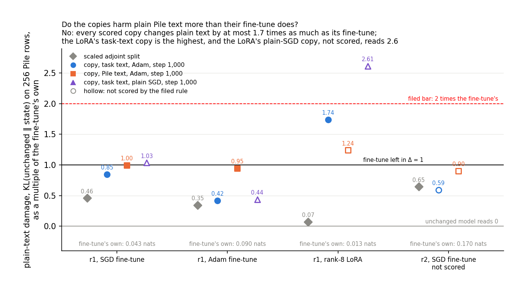
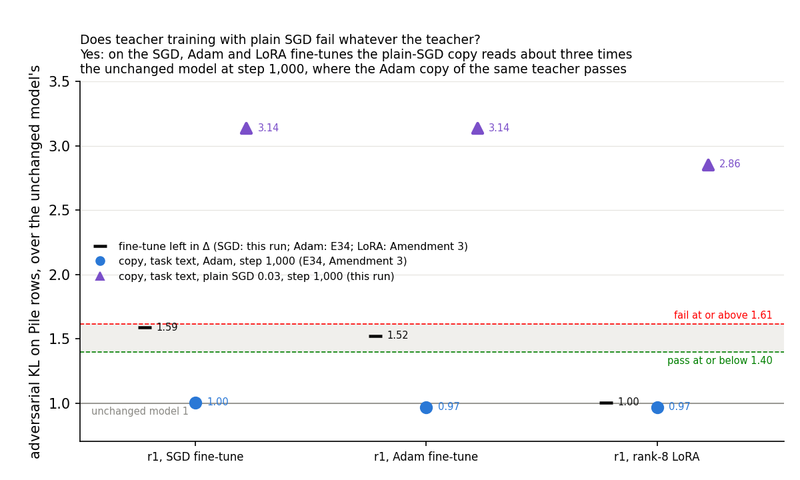
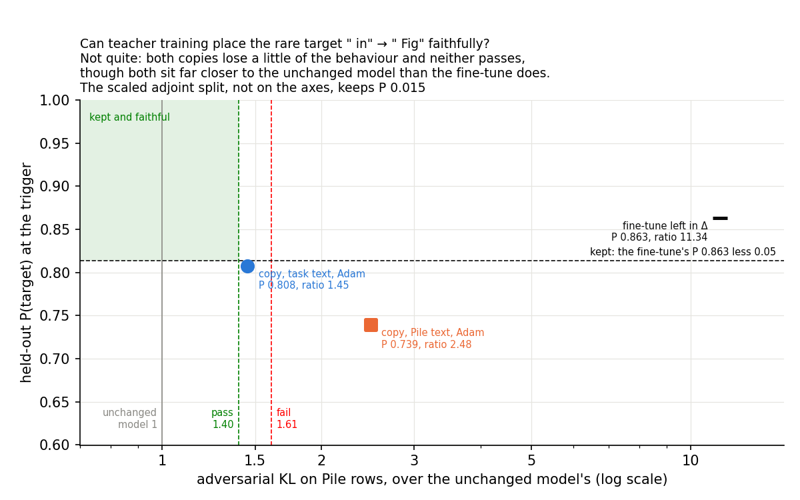
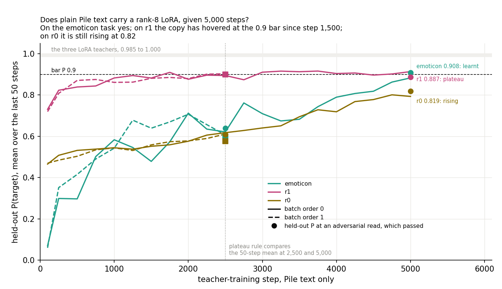
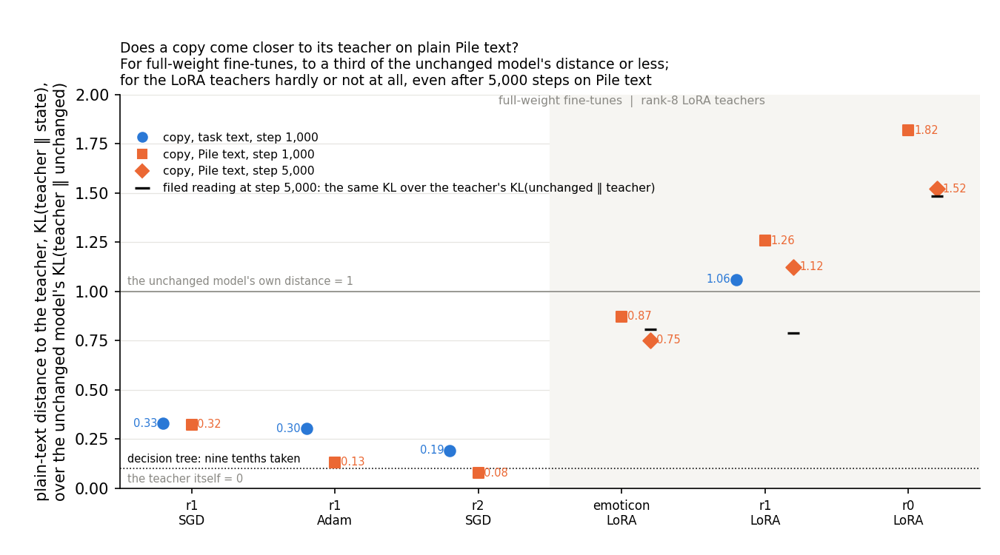

# Analysis: does teacher training hold up on plain text, a rare target, plain SGD, and a LoRA from plain text? Mostly (E34 Amendment 6)

*2026-10-28. Plan `reports/plans/2026-10-23_plan_teacher-training.md` → "Amendment 6", from gaps 10, 7, 6 and 4 of
`reports/reviews/2026-10-28_review_technique-comparison.md`. Code `experiments/teacher_training/amend6.py`, predictions
`results/predictions_amend6.json`, results `results/teacher_training_amend6.json`, log
`results/large/amend6/run_amend6.log`. Notebook `notebooks/E34_teacher_training.ipynb` → "Amendment 6"; figures
`figures/amend6_*.png` from `plot_amend6.py`.*

We read four things about teacher training that the technique comparison had left empty, in one run on the usual
model and tasks. The copies it makes harm ordinary text about as much as the fine-tunes they copy, plain SGD fails as
its optimiser on every kind of fine-tune, the rare target is still placed neither faithfully nor fully, and a LoRA
copied from plain text alone gets to about the bar on two tasks of three. For the goal, teacher training stays the one
map that works, but only with Adam, not yet on a rare target, and only in part for a LoRA without task text.

## The answer

Teacher training mostly held up. Its copies change ordinary Pile text at most 1.7 times as much as the fine-tunes they
copy. With plain SGD in place of Adam as its optimiser, it failed the adversarial check on every fine-tune tried. On
the rare target neither copy both kept the behaviour and passed, though both sat far closer to the unchanged model
than the fine-tune did. Copied from plain text alone, a LoRA reached about the bar on two tasks of three.

## What we were trying to test

Teacher training gives the alive subcomponents' read and write vectors trainable offsets, with Γ and Δ frozen, and
trains them on $\mathrm{KL}(\text{teacher} \,\|\, \text{state})$, the teacher being the fine-tuned model $W_0 + \delta W$.
The *task-text copy* trains on the task's own windows with the trigger weighted up. The *Pile-text copy* trains on
Pile train rows 32,768 to 40,959, eight per batch, with a plain mean KL. Both use Adam at $10^{-5}$. The *plain-SGD
copy* trains on task text with plain SGD at 0.03. Teachers were regenerated in the job: arm-A fine-tunes of all 24
matrices at seed 0, step 1,000, and E9's rank-8 LoRA.

Every state was read on E34's harness: held-out P(target) at the trigger, damage on the task's windows, size, Δ's share,
the teacher gap, and where named, the adversarial and stochastic ratios to $W_0$. Two plain-text readings were new, on
the harness's 256 Pile val rows, as a mean over every position:

- **plain-text damage** $= \mathrm{KL}(W_0 \,\|\, \text{state})$: 0 at $W_0$; the fine-tune's own change for the
  fine-tune left in Δ, the do-nothing state.
- **plain-text gap** $= \mathrm{KL}(\text{teacher} \,\|\, \text{state})$: 0 for the do-nothing state by construction.
  The teacher's gap at $W_0$, $\mathrm{KL}(\text{teacher} \,\|\, W_0)$, was recorded as `pile_gap_w0`.

The verdict rule is E21's `state_verdict` against this job's $W_0$ floor of 0.0748: an adversarial ratio passes at or
below 1.396, fails at or above 1.612, and is inconclusive between. "Faith" is that verdict without the 0.9 bar on
P(target).

| Stage | Teacher | States |
|---|---|---|
| 0 | none | $W_0$ under the harness; $W_0$'s plain-text damage |
| G1 | r1 SGD 0.03 | do-nothing with the adversary; scaled adjoint split |
| a | r1 SGD 0.03, Adam 3e-5, LoRA rank 8 | do-nothing, scaled adjoint split, task-text and Pile-text copies at 1,000; LoRA: task-text only; no adversary |
| c | r1 SGD first, as G3; then r1 Adam, r1 LoRA | plain-SGD copy at 1,000 with the adversary |
| b | r2 t275, " in" → " Fig", SGD 0.1 | do-nothing with the adversary, adjoint, task-text and Pile-text copies at 1,000 with the adversary |
| d | LoRA on emoticon, r1, r0 | Pile-text copy, batch order 0 to 5,000, read at 1,000, 2,500, 5,000; batch order 1 to 2,500; adversary at 2,500 and 5,000 |

## What we expected, and why

- **Harmless on plain text**: each of the five r1 copies at most twice its fine-tune's plain-text damage, or under
  0.002 nats. High confidence on the four full-weight copies, which read 0.55 to 0.97 times on windows in E34; low on
  the LoRA's task-text copy, at 2.1 times on windows in Amendment 3.
- **r2 task-text copy kept and faithful**, medium-low; **r2 Pile-text copy**, two-sided, leaning the same way.
- **Plain SGD as the map fails** on the Adam and LoRA teachers, two-sided, leaning "map", medium.
- **Pile-text LoRA copies learnt by 5,000** on emoticon and r1, medium; r0 not predicted.
- **A second batch order agrees** within 0.05 in P and 25% in ratio on all three tasks, medium.

## What we observed

### 1. Do the copies harm plain text more than their fine-tune does? No

Every scored copy's plain-text damage is between 0.42 and 1.74 times its fine-tune's, inside the filed bar of 2. The
Pile-text copies sit at the fine-tune's level. The LoRA's task-text copy is the only scored state above it, as on the
task's windows. The plain-SGD copy of the LoRA, not scored, reads 2.61. The scaled adjoint states read 0.07 to 0.65,
below their teacher, as expected, since they also lose the behaviour.

| Teacher, its plain-text damage | State | P(target) | Plain-text damage | × the fine-tune's | Window damage, × the fine-tune's |
|---|---|---|---|---|---|
| r1 SGD, 0.04296 | task-text copy | 0.9963 | 0.03630 | **0.845** | 0.91 |
| | Pile-text copy | 0.9742 | 0.04283 | **0.997** | 0.97 |
| | plain-SGD copy | 0.9857 | 0.04445 | 1.035 | 1.21 |
| | scaled adjoint | 0.0632 | 0.01974 | 0.460 | 0.38 |
| r1 Adam, 0.09028 | task-text copy | 0.9944 | 0.03770 | **0.418** | 0.55 |
| | Pile-text copy | 0.9828 | 0.08534 | **0.945** | 0.80 |
| | plain-SGD copy | 0.9874 | 0.03937 | 0.436 | 0.66 |
| | scaled adjoint | 0.0532 | 0.03124 | 0.346 | 0.55 |
| r1 LoRA, 0.01295 | task-text copy | 0.9953 | 0.02252 | **1.739** | 2.12 |
| | Pile-text copy at 1,000 | 0.8753 | 0.01606 | 1.240 | 1.00 |
| | plain-SGD copy | 0.9974 | 0.03384 | 2.613 | 3.46 |
| | scaled adjoint | 0.0431 | 0.00092 | 0.072 | 0.07 |
| r2 SGD, 0.16987 | task-text copy | 0.8079 | 0.10055 | 0.592 | 0.78 |
| | Pile-text copy | 0.7393 | 0.15312 | 0.901 | 0.88 |
| | scaled adjoint | 0.0148 | 0.10965 | 0.645 | 0.75 |
| emoticon LoRA, 0.01809 | Pile-text copy at 5,000 | 0.9083 | 0.02109 | 1.166 | 1.31 |
| r0 LoRA, 0.00650 | Pile-text copy at 5,000 | 0.8193 | 0.01302 | 2.004 | 1.99 |

Bold rows are the five the harmlessness prediction scores. Each teacher's plain-text damage is of the order of its window damage, as the plan expected:
r1 SGD 0.043 against 0.056 on windows, Adam 0.090 against 0.076, LoRA 0.013 against 0.015. The plain-text reading
has no batch-order spread yet.

### 2. Does plain SGD fail whatever the teacher? Yes

With plain SGD at 0.03 on the subcomponents, the copy fails at step 1,000 on all three r1 teachers, while keeping the
behaviour. The Adam task-text copies of the same teachers pass at the unchanged model's level. These are the same
deterministic states E34 and Amendment 3 read on this card, with the same $W_0$ floor. On the LoRA, the plain-SGD copy
is worse than leaving the LoRA in Δ.

| r1 teacher | Do-nothing ratio | Adam task-text copy, ratio | Plain-SGD copy: ratio, stochastic | P at 100 / 1,000 | Size | Verdict, filed reading |
|---|---|---|---|---|---|---|
| SGD 0.03 (G3) | 1.588, this run | 1.004, E34 | **3.137**, 0.968 | 0.986 / 0.986 | 0.0212 | fail |
| Adam 3e-5 | 1.522, E34 | 0.968, E34 | **3.138**, 0.934 | 0.992 / 0.987 | 0.0191 | fail, map |
| LoRA rank 8 | 1.003, A3 | 0.967, A3 | **2.855**, 1.042 | 0.990 / 0.997 | 0.0170 | fail, map |

The plain-SGD copies' sizes, 0.017 to 0.021, are all above the 0.009 above which E21 found SGD component training
fails.

### 3. Can teacher training place the rare target faithfully? Not quite

The r2 fine-tune with SGD at 0.1 reached P 0.863, cleared the 0.5 gate, and is the largest update here at size 0.085.
Left in Δ it fails at 11.3 times the unchanged model. Neither copy is "kept and faithful" by the filed rule, whose
"kept" line is 0.863 − 0.05 = 0.813.

| State | P(target) | Adversarial ratio | Stochastic ratio | Faith | Kept? | Category |
|---|---|---|---|---|---|---|
| fine-tune left in Δ | 0.8634 | 11.34 | 1.079 | fail | n/a | n/a |
| task-text copy at 1,000 | 0.8079 | 1.451 | 1.060 | inconclusive | no, by 0.0055 | neither |
| Pile-text copy at 1,000 | 0.7393 | 2.477 | 1.017 | fail | no | neither |
| scaled adjoint | 0.0148 | not read | not read | n/a | no | n/a |

The task-text copy's two misses, 0.0055 in P and 4% above the pass line, are each inside Amendment 4's batch-order
spread of 0.032 in P and 25% in ratio. Its curve: P 0.871 at step 100, then 0.840, 0.814, 0.806, 0.806 at steps 250
to 1,000. It kept the behaviour early and slid below "kept" as it trained; it was not read by the adversary at step 100.
The Pile-text copy hovered at 0.69 to 0.74 throughout.

### 4. Does plain text carry a LoRA, given 5,000 steps? To about the bar on two tasks of three

Every adversarial read of a Pile-text LoRA copy passed. The categories turn on P alone. The filed rule reads the single
held-out P at step 5,000, and the 50-step mean only for the plateau test.

| Task | Order, step | P(target) | Adversarial, stochastic | Verdict | 50-step mean P | Size |
|---|---|---|---|---|---|---|
| emoticon | 0, 1,000 | 0.5667 | not read | | 0.583 | 0.0200 |
| | 0, 2,500 | 0.6385 | 0.865, 0.987 | below P 0.9; faith pass | 0.621 | 0.0282 |
| | 0, 5,000 | **0.9083** | 0.959, 0.992 | **pass → learnt** | 0.883 | 0.0367 |
| | 1, 2,500 | 0.5969 | 0.880, 0.992 | below P 0.9; faith pass | | 0.0285 |
| r1 | 0, 1,000 | 0.8753 | not read | | 0.882 | 0.0163 |
| | 0, 2,500 | 0.9017 | 0.890, 0.993 | pass | 0.894 | 0.0191 |
| | 0, 5,000 | **0.8870** | 1.071, 1.004 | below P 0.9; faith pass | 0.913 | 0.0225 |
| | 1, 2,500 | 0.8993 | 0.992, 0.999 | below P 0.9; faith pass | | 0.0193 |
| r0 | 0, 1,000 | 0.5210 | not read | | 0.544 | 0.0158 |
| | 0, 2,500 | 0.6078 | 1.009, 1.001 | below P 0.9; faith pass | 0.617 | 0.0191 |
| | 0, 5,000 | **0.8193** | 0.955, 1.003 | below P 0.9; faith pass | 0.793 | 0.0235 |
| | 1, 2,500 | 0.5758 | 1.089, 0.993 | below P 0.9; faith pass | | 0.0194 |

The filed plateau test, the 50-step mean's rise from step 2,500 to 5,000, against 0.03: r1 rose by 0.019, a plateau; r0
by 0.176 and emoticon by 0.262, both rising. Emoticon is "learnt" before the plateau test is reached.

The emoticon and r1 categories sit on opposite sides of the bar by checkpoint noise. Emoticon's single reading is
0.908 with a 50-step mean of 0.883; r1's is 0.887 with a mean of 0.913. The r1 copy's held-out readings from step
1,500 to 5,000 range over 0.852 to 0.933. Emoticon was still climbing at step 5,000.

The seed-0 copies at step 1,000 reproduced Amendment 3's readings to four decimals: 0.5667, 0.8753, 0.5210.

**Second batch order**, at step 2,500, by Amendment 4's rule:

| Task | P, order 0 / 1 | Difference | Ratio, order 0 / 1 | Ratio change | Holds? |
|---|---|---|---|---|---|
| emoticon | 0.6385 / 0.5969 | −0.042 | 0.865 / 0.880 | +1.8% | yes |
| r1 | 0.9017 / 0.8993 | −0.002 | 0.890 / 0.992 | +11.4% | yes |
| r0 | 0.6078 / 0.5758 | −0.032 | 1.009 / 1.089 | +7.9% | yes |

### 5. Does a copy come closer to its teacher on plain text? For full-weight fine-tunes yes; for the LoRA hardly

Not a filed prediction; its gap reading is what the LoRA prediction reports and what the decision tree uses to pick a branch. Below,
the plain-text gap is divided two ways.

- **Matching denominator**: $\mathrm{KL}(\text{teacher} \,\|\, \text{state}) / \mathrm{KL}(\text{teacher} \,\|\, W_0)$,
  the same KL direction on top and below. 1 means no closer to the teacher than $W_0$, 0 means the teacher.
- **Filed**: $\mathrm{KL}(\text{teacher} \,\|\, \text{state}) / \mathrm{KL}(W_0 \,\|\, \text{teacher})$, the plan's
  "plain-text gap at most a tenth of the teacher's plain-text damage". Its numerator and denominator are KLs in
  opposite directions, so it does not read 1 at $W_0$.

| Teacher | $\mathrm{KL}(W_0 \| T)$ | $\mathrm{KL}(T \| W_0)$ | State | Gap | Matching | Filed |
|---|---|---|---|---|---|---|
| r1 SGD | 0.04296 | 0.03784 | task-text copy | 0.01245 | 0.329 | 0.290 |
| | | | Pile-text copy | 0.01223 | 0.323 | 0.285 |
| r1 Adam | 0.09028 | 0.09964 | task-text copy | 0.03024 | 0.304 | 0.335 |
| | | | Pile-text copy | 0.01322 | 0.133 | 0.147 |
| r2 SGD | 0.16987 | 0.23980 | task-text copy | 0.04625 | 0.193 | 0.272 |
| | | | Pile-text copy | 0.01864 | 0.078 | 0.110 |
| r1 LoRA | 0.01295 | 0.00908 | task-text copy | 0.00962 | 1.060 | 0.743 |
| | | | Pile-text, 1,000 | 0.01141 | 1.257 | 0.881 |
| | | | Pile-text, 2,500 | 0.00950 | 1.047 | 0.734 |
| | | | **Pile-text, 5,000** | 0.01020 | **1.123** | **0.787** |
| emoticon LoRA | 0.01809 | 0.01939 | Pile-text, 1,000 | 0.01693 | 0.873 | 0.936 |
| | | | Pile-text, 2,500 | 0.01477 | 0.762 | 0.817 |
| | | | **Pile-text, 5,000** | 0.01459 | **0.753** | **0.807** |
| r0 LoRA | 0.00650 | 0.00633 | Pile-text, 1,000 | 0.01151 | 1.817 | 1.771 |
| | | | Pile-text, 2,500 | 0.00992 | 1.567 | 1.527 |
| | | | **Pile-text, 5,000** | 0.00963 | **1.521** | **1.482** |

The two readings disagree most on r1's LoRA, 1.12 against 0.79, because the LoRA's two KLs differ by 30% there.
Both put every LoRA copy far above the decision tree's 0.1. So the tree's branch is the same under either: r1 is a
plateau with a large gap, and r0 is rising. Both branches send that task's Pile-text copy to 10,000 steps.

On r1 and r0 the LoRA copies move as far from $W_0$ on plain text as the LoRA does, 1.23 and 2.0 times its damage,
without moving towards it. The training loss, a mean over the last 50 steps on the training rows, stayed between
0.0085 and 0.0124 for r1 from step 250 on, with no trend. That is about $W_0$'s own distance to this teacher on the val rows, 0.0091,
though the two are on different rows. Why plain text does not carry the LoRA's plain-text change was not tested.

### 6. Did the controls behave? Yes

| Control | Rule | Read | Pass |
|---|---|---|---|
| C1 | $W_0$ under the harness, seeds 0, 1, 2; floor about 0.075 | floor 0.0748; stochastic floor 0.0011 | yes |
| $W_0$ plain-text damage | at most 1e-4 | 0.0 | yes |
| G1 | r1 SGD teacher P within 0.01 of 0.9834, size within 0.003 of 0.02875, do-nothing ratio within 0.03 of 1.588; plain-text damage above 1e-3 with gap at most 1e-4 | 0.98343, 0.02875, 1.5884; 0.0430 and 0 | yes |
| G3 | plain-SGD copy of the r1 SGD teacher: "fail", P within 0.02 of 0.9857 | fail 3.137, 0.98566 | yes |
| r2 gate | teacher P at least 0.5 | 0.8634 | yes |
| Teachers against same-card references | P within 0.01, damage within 0.005, size within 0.003; reported | r1 Adam 0.99621 / 0.03334; LoRA emoticon 0.99992, r1 0.99919, r0 0.98484, each to the reference's digits | all match |

## What each stage adds to the technique comparison

- **a, harmless on plain text**: teacher training's copies harm plain Pile text 0.42 to 1.74 times as much as the
  fine-tune they copy, inside twice for all five scored; the LoRA's task-text copy is the one above its teacher.
- **c, plain-SGD map, Adam and LoRA cells**: fail, at 3.14 and 2.86, while keeping the behaviour; with the SGD cell,
  plain SGD fails as teacher training's optimiser on every update type tried.
- **b, rare target**: neither copy keeps and passes; the task-text copy misses both bars inside the noise, the
  Pile-text copy fails, and the fine-tune itself fails at 11.3.
- **d, Pile-text LoRA cell**: still partial; at 5,000 steps emoticon is learnt and passes, r1 sits at the bar, and
  r0 is rising at 0.82; none moves towards the LoRA on plain text.
- **d, batch-order robustness of Pile-text copies**: a second batch order agrees within 0.042 in P and 11% in ratio on
  all three LoRA tasks, the first such check on a LoRA teacher.

## What we learned

Teacher training's harm to plain text is about that of the fine-tune it copies, within a factor of two, on the three
r1 teachers read. "Harmless" now holds on plain text as well as on the task's windows. Plain SGD on the subcomponents
fails late whatever the teacher, as it did in component training. For the optimiser subgoal, teacher training works as
a map with Adam at $10^{-5}$ and not with plain SGD at 0.03. The rare target remains out of reach of every map tried
with Γ frozen, though teacher training's task-text copy comes closest, missing inside the noise. Plain text carries a
rank-8 LoRA's trigger behaviour slowly and to about the bar. It does not carry the LoRA's own change to plain text,
so the label-free map covers LoRA only in part.

## How compelling is the evidence

- **One batch order and one adversary start of 20 steps** for every stage except the LoRA's Pile-text copies. Passes
  are lower bounds and may be lenient by Amendment 5.
- **Plain-text readings are deterministic per state but have no batch-order spread.** The factor-of-two bar was wide
  for that reason; four of the five scored copies sit at or below 1.0.
- **Plain SGD**: one learning rate, one batch order, one task, three teachers; the failures are large, about twice
  the fail line.
- **Rare target**: one fine-tune whose own P is 0.863, below the usual 0.9 bar. The task-text copy's misses are inside
  the known spread, so "neither" for it is not separable from "kept, inconclusive" on one batch order.
- **LoRA from plain text**: categories rest on one checkpoint each; emoticon and r1 swap under a 50-step mean.
  Three tasks, two batch orders to 2,500.
- **The plain-text gap**: KL is asymmetric, and the plan's filed ratio mixes directions; the matching-denominator
  reading is given beside it and picks the same branch.

## Surprises

- **The LoRA copies do not move towards the LoRA on plain text**, unlike the copies of full-weight fine-tunes, which
  close two thirds or more of the distance. Not filed; the plan's decision tree treated a large gap as one possible
  branch.
- **The rare-target fine-tune left in Δ reads 11.3**, against 1.0 to 1.6 for the r1 fine-tunes in Δ.
- **The rare target's task-text copy lost behaviour as it trained**, 0.871 at step 100 to 0.806 at 1,000.
- **Missed narrowly**: r1's LoRA copy at 0.887 against 0.9 at step 5,000, after 0.902 at 2,500.
- **Missed**: neither rare-target copy kept and passed, where we predicted the task-text copy would.

No filed prediction reversed. Plain SGD as the map landed on its filed lean; the rare target's Pile-text copy landed
against its lean.

## What next

1. **Decision-tree branch, approved: r1 and r0 Pile-text LoRA copies to 10,000 steps**, about $1.5 each.
   If r0 reaches 0.9 and passes, plain text carries the LoRA's behaviour given time. If it stays below,
   the label-free map needs task text for a LoRA. For r1, already at the bar, a mean over checkpoints decides more than
   steps do.
2. **Decision-tree branch: a pending-decision card for the rare target.** For "neither" the tree says no map with Γ
   frozen places it, which bears on the "Create" reading and on updating Γ. A cheap check first: the task-text copy at
   step 100 under the adversary, where it still kept the behaviour. Then a second batch order of it at step 1,000.
3. **Decision-tree branch for plain SGD reading "map"**: a `decisions.md` row that teacher training uses Adam, and the optimiser
   subgoal's reading in `GOALS.md` terms. For the lead.
4. **Why the LoRA's plain-text change is not copied**: per-matrix norms and cosines of the saved Pile-text copies
   against the LoRA's $BA$, on CPU.

## Scorecard

Filed 2026-10-28 12:04:51 in `experiments/teacher_training/results/predictions_amend6.json`, sha256 `cab3ba1b…`,
committed in `d92eebb` at 12:07, unedited since; run started 12:52. Scored by the run's own `amend6.score`, re-checked
by hand against the states above.

| id | claim | filed rule | read | verdict |
|---|---|---|---|---|
| C1 | $W_0$ at its known values | `w0_check` | floor 0.0748 | pass |
| W0 plain text | $W_0$'s plain-text damage ≈ 0 | ≤ 1e-4 | 0.0 | pass |
| G1 | r1 SGD teacher reproduces E34 | P ±0.01 of 0.9834, size ±0.003 of 0.02875, do-nothing ratio ±0.03 of 1.588 | 0.9834, 0.02875, 1.5884 | pass |
| G3 | plain-SGD copy of it fails as in E34 | "fail", P ±0.02 of 0.9857 | fail 3.137, 0.9857 | pass |
| P1 | copies harmless on plain text | each of r1 SGD task-text and Pile-text, Adam task-text and Pile-text, LoRA task-text at 1,000: plain-text damage ≤ 2 × the do-nothing state's, or ≤ 0.002; all five | 0.845, 0.997, 0.418, 0.945, 1.739 × | **holds** |
| P2 | r2 task-text copy kept and faithful | kept = P ≥ teacher's P − 0.05 = 0.8134; faithful = faith "pass" | 0.8079, not kept; faith inconclusive at 1.451 | **fails**: neither |
| P3 | r2 Pile-text copy, two-sided, lean kept and faithful | as P2 | 0.7393, not kept; faith fail at 2.477 | neither, against the lean |
| P4 | plain SGD as the map, two-sided, lean map | Adam and LoRA plain-SGD copies at 1,000: fail → map; both map → map; needs G3 | fail 3.138, fail 2.855; G3 pass | **map**, on the lean; pass |
| P5 | LoRA Pile-text copy to 5,000 | learnt = P ≥ 0.9 and verdict pass; else plateau if the 50-step mean rose < 0.03 from 2,500 to 5,000, else rising; pass = emoticon and r1 learnt | emoticon 0.908 pass: learnt; r1 0.887, rise 0.019: plateau; r0 0.819, rise 0.176: rising | **fails** on r1 |
| P6 | second batch order agrees | per task at 2,500: \|ΔP\| ≤ 0.05 and \|ratio₁/ratio₀ − 1\| ≤ 0.25; all three | −0.042 / +1.8%; −0.002 / +11.4%; −0.032 / +7.9% | **holds** |

P5's gap readings, reported only and used by the decision tree: filed 0.807, 0.787, 1.482; matching denominator 0.753,
1.123, 1.521 for emoticon, r1 and r0 at step 5,000. Both are far above the tree's 0.1 on every task.

## Not run

- The r2 Adam 3e-5 teacher; a plain-SGD copy on r2.
- Plain SGD at a second batch order, at another learning rate, on emoticon or r0, or read by the adversary at step 100.
- The adversary on stage a's copies, read before in E34 and Amendments 3 and 4; harness reads of the Adam and LoRA
  do-nothing states, read in E34 and Amendment 3.
- Pile-text copies past 5,000 steps or on more than 8,192 rows; the second batch order past 2,500.
- A longer adversary or more starts, by the 2026-10-27 decision.
- A batch-order spread of plain-text damage.
- The rare-target copies under the adversary at step 100; a second batch order of them.
- Any per-matrix reading of the eight saved copies.
- $W_0$'s P(target) on r2 in this job. The plan's 0.0034 is from earlier runs.
- Pyright on `plot_amend6.py`: it could not start on the CPU worker, whose nodeenv install fails. Ruff is clean.

## Provenance

- RunPod "NVIDIA H100 80GB HBM3". Run 12:52:33 to 13:57:13 on 2026-10-28, 65 minutes, exit 0; about $6.9 by the
  results commit `3b918bc`.
- Results `experiments/teacher_training/results/teacher_training_amend6.json`, sha256 `2b6a7338…`, committed in
  `3b918bc`. Log `results/large/amend6/run_amend6.log`, `9068de04…`.
- Saved copies, bf16 offsets of 60 MB each: `results/large/amend6/r2_t275_v2667/amend6_sgd_{A,B}_seed0_step1000.pt`,
  and `results/large/amend6/{emoticon,r1_t534_v369,r0_t352_v310}/amend6_lora_B_seed{0_step5000,1_step2500}.pt`.
- Code `experiments/teacher_training/amend6.py`, `1d1baed5…`, last changed in `c7ff923` before the run.
- Figures `experiments/teacher_training/figures/amend6_{plain,sgd,rare,lora,gap}.png` from `plot_amend6.py`. The
  plain-SGD figure also reads E34's `results/teacher_training_r1_t534_v369.json` and Amendment 3's
  `teacher_training_amend3.json`; the script asserts both share this run's card and $W_0$ floor.
