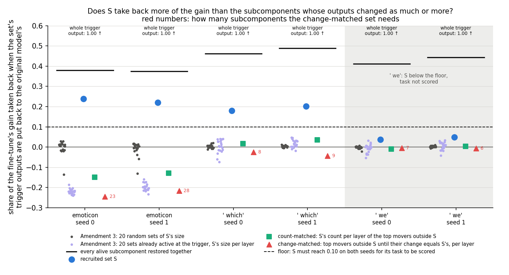
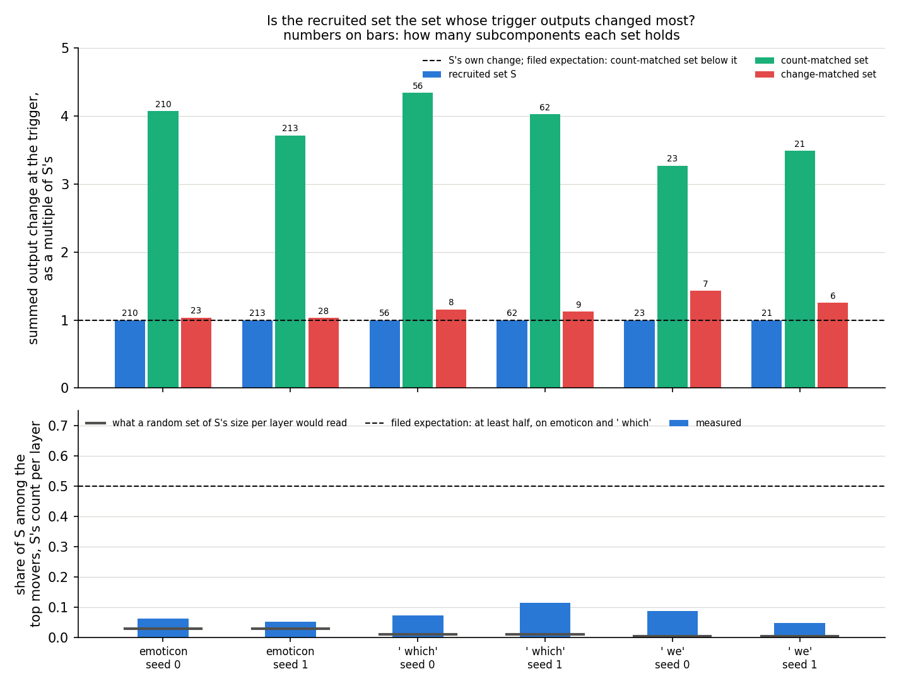
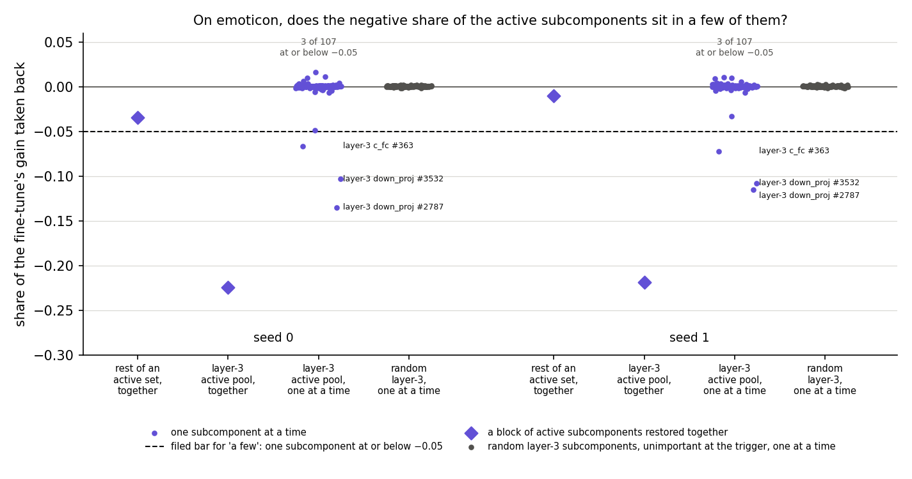

# Is the recruited set special, or just the set whose outputs changed most? (E38 Amendment 4, analysis)

*2026-10-28, writing agent. Plan: `reports/plans/2026-10-28_plan_e38-amend4.md`. Predictions, filed before the code
and never edited: `experiments/recruitment_test/results/predictions_amend4.json`. Code:
`experiments/recruitment_test/amend4.py`, `src/commute/recruitment.py`; figures from
`experiments/recruitment_test/plot_amend4.py`. Parent: `reports/analyses/2026-10-27_analysis_e38-amend3.md` and its
check `reports/reviews/2026-10-27_review_e38-amend3-check.md`. Notebook: `notebooks/E38_recruitment_test.ipynb`,
section "Amendment 4". Words as in `GOALS.md` → Terms.*

*Independent check: `reports/reviews/2026-10-28_review_e38-amend4-check.md` recomputed every verdict from the results
file and read the code that builds and restores the sets. It agrees with each verdict and found nothing that makes a
share or a set wrong. Its reading is folded in below. Emoticon's margin is not a measure of specificity, and ` which`
carries the claim. Direction, not size, is the strongest alternative still open.*

In a fine-tuned model we put back the trigger outputs of the subcomponents whose outputs had changed most there,
matched to the recruited set layer by layer, and measured how much of the gain each set took back. The recruited set
took back about a fifth of the gain on two tasks, while sets that moved as much or more took back nothing or less. For
`GOALS.md`, how far the recruited set's outputs moved does not explain its share, which fits strengthening; whether
the direction they moved in explains it is open.

## The answer

Yes, against this alternative. Putting the recruited set's trigger outputs back takes back about a fifth of the gain
on emoticon and ` which`. The same number of subcomponents whose outputs moved most carry four times the change, yet
take back nothing on ` which` and less than nothing on emoticon. Against what we expected, the recruited set is not
where the outputs moved most. The filed rule reads "specific"; the independent check agrees. Whether the set's changes
merely point toward the target is untested.

## What we were trying to test

**Where Amendment 3 left off.** A 10-step fine-tune teaches the model to follow a trigger with a target token. With Γ
frozen, a set of the original model's subcomponents is switched on at the trigger: the *recruited set* S, the alive
subcomponents whose mean causal importance there rises by more than 0.3. Amendment 3 *restored* sets. A subcomponent
$c$ is the rank-1 matrix $u_c v_c^\top$, and its output at the trigger is $(x \cdot v_c)\, u_c$, with $x$ the matrix's
input there. Its weights do not change in the fine-tune, so its output changes only because its input does. Restoring
a set X in the fine-tuned model adds $\sum_{c \in X} ((x_0 - x) \cdot v_c)\, u_c$ to each matrix's output at the
trigger only, with $x_0$ the input in the original model's pass on the same window. The *restored share* is
$\rho_r(X) = (T_1 - T_1^{X \text{ restored}}) / G$. Here $T_1$ is the target's mean log-odds at the trigger after the
fine-tune and $G$ the gain over the original model, 10 to 14 nats. The share reads 0 when the set's changed outputs
carry none of the gain and 1 when undoing them takes the target back to the original model's value. Restoring S took
back about a fifth of the gain on emoticon and ` which`; random, null and already-active sets took back about nothing.

**The open alternative.** S was picked by a rise in importance. If that rise just tracks how much a subcomponent's
input moved, then S could simply be the set whose outputs changed most. Any set that moved as much might take back as
much, and Γ's switch-on would add nothing to a plain ranking by change.

**The measure of change.** For each alive subcomponent, the *output change* is
$\Delta_c = |(x_1 - x_0) \cdot v_c|\, \lVert u_c \rVert$, averaged over the task's training windows at the trigger. It
is the size of the correction that restoring $c$ adds. It is measured on the windows S was chosen on, so the sets are
built without the held-out windows that score them. It is a size, not a direction: a change that pushes away from the
target counts as much as one that pushes toward it.

**The sets, per task and seed, and what each rules out:**

- **S itself**: 210 and 213 subcomponents on emoticon, 56 and 62 on ` which`, 23 and 21 on ` we`.
- **The count-matched set**: in each layer, as many subcomponents outside S as S has there, those with the largest
  output change. It rules out that any equally many top movers carry as much.
- **The change-matched set**: in each layer, top movers outside S, taken in order until their summed output change
  reaches S's in that layer. It rules out that any set with as much total change carries as much. It never ran short.
- **Every alive subcomponent at once**, S included: how much of the gain the subcomponents' changed outputs carry at
  all. The positive control, every matrix's whole trigger output put back, takes back all of it.
- **On emoticon only**, to explain Amendment 3's negative share there, four more arms:
  - the *layer-3 active pool*: the alive layer-3 subcomponents outside S whose importance at the trigger in the
    original model is at least 0.2, 107 of them;
  - the *rest*: one of Amendment 3's active sets without its layer-3 members;
  - each pool member restored alone;
  - as many random layer-3 subcomponents with importance below 0.2, each restored alone, as the floor for singles.

**The controls**, run first on all nine states, any fail stopping the job: Amendment 3's five unchanged, and a sixth.
The sixth computes the output change with the fine-tuned weights replaced by the original ones; it must read 0.

## What we expected, and why

- **S is specific, low confidence.** On emoticon and ` which`, S would take back at least 0.05 more of the gain than
  both matched sets. The basis: Amendment 3's active sets, whose outputs also moved, took back zero or less. Against
  it: S was chosen by a rise in importance, which should track input change, and the change-matched set might be large.
- **S holds the top movers, low confidence.** The count-matched set would carry less output change than S on all six
  states, and S would make up at least half of the top movers per layer on emoticon and ` which`.
- **Every alive subcomponent together takes back between 0.3 and 0.9 of the gain**, low confidence.
- **On emoticon, the negative share sits in layer 3 and in a few subcomponents**, low confidence. The layer-3 pool
  would read −0.15 or less and the rest within 0.05 of zero. At least one single member would read −0.05 or less, and
  0.02 below every random single. The basis: one random set per emoticon seed read −0.13 in Amendment 3, and every
  active set held the whole layer-3 pool while reading alike.

## What we observed

### Does the apparatus hold?

Yes. Amendment 3's controls reproduced to the digit on all nine states: restoring nothing, restoring S in the original
model, the whole trigger output and the earlier positions all read 0.0. The fifth control again differed from
Amendment 2's removal by at most 0.0195 nats. The new sixth control read exactly 0 on every task. S's restored share
matches Amendment 3's to four decimals on all six states. The sixth control is weak: two identical original-model
passes giving zero change tests only that the passes are deterministic. No control shows that a large output change
makes a large restore. The independent check read the code that computes the change and builds the sets in its place,
and found it matches the filed definitions.

### Does S take back more of the gain than the subcomponents whose outputs changed as much or more?

**Reading it.** Yes, on emoticon and ` which`, the two tasks where S takes back enough to score. The blue dots, S,
read 0.18 to 0.24. The green squares, the count-matched sets, read +0.02 and +0.04 on ` which` and −0.15 and −0.13 on
emoticon. The red triangles, the change-matched sets, read −0.02 to −0.04 on ` which` and −0.24 and −0.22 on
emoticon. The small numbers beside them are their sizes: 8 and 9 subcomponents on ` which`, 23 and 28 on emoticon.
The faint dots are Amendment 3's random and active sets, for scale. On ` we`, S reads 0.04 and 0.05, under the
dashed floor, so the task is not scored. There, too, both matched sets read within 0.01 of zero.

**What the margin rests on: ` which` carries the claim.** On ` which`, S sits 0.16 and 0.17 above the count-matched
set, about as far as S sits above zero. There is no negative block on that task, so the margin owes nothing to
negative sets. On emoticon, S sits 0.35 to 0.48 above the matched sets, and most of that is the sets being negative.
The change-matched set's layer-3 members all sit in the layer-3 active pool on seed 0, 9 of 9, and 7 of 10 on seed 1.
Its share, −0.245 and −0.216, equals the pool's own, −0.225 and −0.219. The count-matched set holds 25 and 26 pool
members. So emoticon's margin measures overlap with that pool, not specificity, and should not be quoted as how far S
beats the top movers. Against zero, S reads 0.24 and 0.22 on emoticon, the same fifth as on ` which`. Emoticon stays
"specific" only if the change-matched set without the pool stays below about 0.17. That is likely, since random sets
read about zero, but it was not measured.

**The black bars, every alive subcomponent at once, read 0.38 to 0.49.** So all the subcomponents' changed outputs at
the trigger take back under half of the gain. The whole trigger output takes back all of it. The larger part sits in
what the weight change writes at the trigger itself, and in what each matrix's remainder outside the alive
subcomponents writes. S alone reads about three fifths of the all-alive share on emoticon and two fifths on ` which`. Restored
shares need not add, so these ratios are a guide, not a split.

| state | G, nats | S | count-matched | change-matched, size | all alive | S − larger matched set |
|---|---|---|---|---|---|---|
| emoticon s0 | 13.43 | 0.239 | −0.149 | −0.245, 23 | 0.380 | 0.388 |
| emoticon s1 | 13.69 | 0.220 | −0.128 | −0.216, 28 | 0.375 | 0.349 |
| ` which` s0 | 10.29 | 0.179 | 0.017 | −0.024, 8 | 0.461 | 0.162 |
| ` which` s1 | 10.87 | 0.202 | 0.036 | −0.044, 9 | 0.489 | 0.166 |
| ` we` s0 | 12.53 | 0.037 | −0.010 | −0.005, 7 | 0.411 | 0.042 |
| ` we` s1 | 12.19 | 0.049 | 0.004 | −0.007, 6 | 0.444 | 0.045 |

In nats, S takes back 3.0 and 3.2 on emoticon and 1.8 and 2.2 on ` which`. The change-matched set on emoticon raises
the target by 2.9 and 3.3. Amendment 3's random sets never exceeded 0.029 on any state.

### Is the recruited set the set whose trigger outputs changed most?

**Reading it.** No, reversing what we expected. In the top panel, each bar is a set's summed output change at the
trigger as a multiple of S's. The green count-matched sets carry 3.3 to 4.3 times S's change with the same number of
subcomponents. The red change-matched sets reach S's change with 6 to 28 subcomponents, against S's 21 to 213. On
emoticon, 23 subcomponents outside S moved as much in total as S's 210. In the bottom panel, S makes up 5% to 11% of
the top movers per layer, far below the filed half. The grey ticks show what a random set of S's size per layer would
read, 0.3% to 3%. So S is over-represented among the top movers, two to eleven times chance, but it is not them.

Taken with the previous figure: the subcomponents whose outputs moved most at the trigger carry none of the gain, or
work against it. S's outputs moved less, yet take back a fifth. How far a subcomponent's output moves does not predict
how much of the gain it carries. The output change is a size, so this does not say whether S's changes point toward
the target and the top movers' do not; no set was matched on direction. A ranking by each subcomponent's first-order
effect on the target logit, with no Γ in it, might find a set that takes back as much as S. That is the strongest
alternative still open.

**A second caveat, from the independent check.** Matching is per layer, so one ranking mixes outputs that live in
different spaces. A large change in a query or key output, put back at the trigger only, moves only the trigger's
attention scores. A large change in the MLP's hidden layer passes a nonlinearity before it reaches the residual. If the
top movers are mostly of one such kind, their small share could be about units, not about S. Which matrices the
matched sets hold was not saved, so the data cannot rule this out.

| state | S's output change | count-matched / S | change-matched / S | S among top movers | random set would read |
|---|---|---|---|---|---|
| emoticon s0 | 89.4 | 4.07 | 1.03 | 0.062 | 0.028 |
| emoticon s1 | 98.7 | 3.71 | 1.03 | 0.052 | 0.028 |
| ` which` s0 | 41.8 | 4.34 | 1.16 | 0.071 | 0.009 |
| ` which` s1 | 43.8 | 4.02 | 1.12 | 0.113 | 0.010 |
| ` we` s0 | 25.6 | 3.27 | 1.43 | 0.087 | 0.003 |
| ` we` s1 | 22.4 | 3.48 | 1.25 | 0.048 | 0.003 |

The "random set would read" column is derived here, not filed: per layer, S's count squared over the layer's alive
count, summed, over S's size.

### On emoticon, does the negative share of the active subcomponents sit in a few of them?

**Reading it.** Yes. The diamonds show the negative share sits in layer 3. The layer-3 active pool restored together
reads −0.22 on both seeds; the rest of an active set reads −0.03 and −0.01. Restored one at a time, almost every
pool member reads within 0.02 of zero. The exceptions are the same three subcomponents on both seeds, all in layer 3's
MLP. Two in its output matrix read −0.10 to −0.135 each, and one in its input matrix about −0.07. The random layer-3
subcomponents, restored alone, all read within 0.003 of zero. So the floor is tight, and the three stand far outside
it.

What "a few" means here. Putting back the changed trigger output of just one of the two output-matrix subcomponents
raises the target by about 1.4 to 1.8 nats. That is a tenth of the gain. Summed, the singles reach −0.30 and −0.29,
more than the block's −0.22.
Restored shares need not add, so this does not say how the block's share divides among them. The run did not record
which subcomponents the matched sets hold, so whether they hold these three is not known. Why these three push
against the target after the fine-tune is not measured.

| seed | layer-3 pool together | rest together | most negative single | singles at or below −0.05 | random singles, lowest |
|---|---|---|---|---|---|
| 0 | −0.225 | −0.034 | −0.135 | 3 of 107 | −0.002 |
| 1 | −0.219 | −0.010 | −0.115 | 3 of 107 | −0.002 |

The three: `h.3.mlp.down_proj` #2787, −0.135 and −0.115; `h.3.mlp.down_proj` #3532, −0.103 and −0.108;
`h.3.mlp.c_fc` #363, −0.067 and −0.072. A fourth, `h.3.mlp.c_fc` #1940, reads −0.049 and −0.033.

## Which branch of the decision tree

**By the filed rule: "specific".** Emoticon and ` which` read "specific" on both seeds. ` we` is "S too small", since S
takes back under 0.10 there. Its seeds read "unclear": S beats the count-matched set by 0.047 and 0.045, just under the
margin of 0.05. Two scored tasks are "specific" and none is "not", which is the plan's "specific" branch.

**What the branch does.** The independent check agrees, so the E38 card and Q5 get a checked claim, in the wording the
check allows:

> On the 67M model after a 10-step fine-tune, putting back the original trigger outputs of the subcomponents Γ
> switched on takes back about a fifth of the gain on emoticon and ` which`. The same number of the subcomponents whose
> trigger outputs changed most carry about four times the change, yet take back about none on ` which` and less than
> none on emoticon. So how much a subcomponent's output moved does not explain the switched-on set's share.

Not claimable: that Γ is needed to find these subcomponents, since no ranking by direction without Γ was tried; that
emoticon's margin measures specificity; anything about ` we`. A new card proposes the upstream step the tree names,
what moved the trigger's inputs so that S switches on, beside the direction-matched test.

## What we learned

The share of the gain the recruited set carries is not explained by how far its outputs moved. The fine-tune moves the
trigger outputs of many other subcomponents more, and those changes carry nothing or work against the target. This
closes the size half of the alternative Amendment 3 left open. With the census, which found S to be the original
model's own target machinery, it fits `GOALS.md`'s "strengthen" reading. Whether Γ is needed to name these
subcomponents, or a ranking by direction of change would find them too, is open. The subcomponents' changed outputs at the trigger, all
together, carry under half of the gain; the larger part sits in what the weight change writes there directly. On
emoticon, three layer-3 MLP subcomponents carry the push against the target that Amendment 3 found.

## How compelling is the evidence

- **Tasks and seeds.** Three tasks, two seeds each, one 67M model, held-out windows, the trigger only. Scored on
  emoticon and ` which`; ` we`'s S takes back too little to score.
- **The apparatus is exact.** Five controls read 0.0, the sixth reads 0, the fifth matches removal to 0.7% of its
  effect, and S's share reproduces Amendment 3's to four decimals. The sixth tests only determinism; no control shows
  that a large change gives a large restore.
- **Independently checked.** Every verdict recomputed from the results file agrees, and the code matches the filed
  definitions.
- **Matched on size of change, not direction.** No set was matched on whether its change points toward the target.
  That is the strongest alternative still open.
- **Matched per layer, not per matrix.** One layer's ranking mixes query, key, MLP hidden and residual outputs. Which
  matrices the matched sets hold was not saved.
- **The emoticon margin is overlap with the layer-3 active pool, not specificity.** ` which` carries the claim, with
  margins of 0.16 or more and no negative block.
- **The matched sets may hold subcomponents switched off by the fine-tune.** Restoring those may push against the
  gain, so the matched sets are a mixed contrast, not a pure "moved but not switched on" set.
- **The matched sets differ in size from S.** The count-matched set has S's count and four times its change; the
  change-matched set has its change and a ninth to a third of its count. S beats both.
- **Noise floor.** Random sets in Amendment 3 stayed within 0.03 of zero on all but one draw per emoticon seed; random
  single subcomponents here within 0.003. One draw of each random reference; one seed for the random singles.
- **Shares do not add.** Restoring one set also undoes downstream effects of its change, so ratios such as S over all
  alive are a guide only.
- **Log-odds at near-certainty.** A fifth of the gain in log-odds is a smaller change in probability.

## Surprises

- **Something we did not expect, reversing two filed expectations: S is not the set whose outputs moved most.** We
  expected, with low confidence, that the count-matched set would carry less output change than S on every state. It
  carries 3.3 to 4.3 times as much, on all six. We expected S to make up at least half of the top movers per layer.
  It makes up 5% to 11%. On emoticon, 23 subcomponents outside S moved as much as S's 210. We cannot say from these
  numbers why S's rise in importance does not track the size of its output change.
- **The top movers outside S carry none of the gain, or push against it.** Both matched sets read within 0.04 of zero
  on ` which` and ` we`. On emoticon they read −0.13 to −0.24, through their overlap with the layer-3 active pool.
  Not predicted in that form.
- **Three single layer-3 MLP subcomponents each carry a tenth of the gain against the target on emoticon**, the same
  three on both seeds. "A few" was filed; one subcomponent carrying 1.5 nats was not foreseen.

## What next

1. **Sets matched on direction, per matrix, beside the upstream step.** Rank subcomponents by each one's first-order
   effect on the target logit at the trigger, with no Γ in it, and match per matrix rather than per layer. If such a
   set takes back as much as S, Γ's switch-on is just "changed toward the target", and Γ is not needed to find it; if
   not, S is special against direction too. Log the matched sets' members by matrix. Cheap: cached states, $0.
2. **The upstream step, the tree's branch.** Ask which earlier changes moved the trigger's inputs so that S switches
   on: by layer, and by position before the trigger. If one layer's change carries most of it, the switch-on has a
   locatable cause; if it is spread, it is a property of the whole update.
3. **The three layer-3 MLP subcomponents.** What they do in the original model, by census, and whether the matched
   sets hold them. If they are the original model's machinery for a competing token, the fine-tune's push on them is
   a side effect it overrides.

## Scorecard

| id | claim | rule, as filed | read | verdict |
|---|---|---|---|---|
| R0-R3 | Amendment 3's controls: restore nothing, S in the original model, whole output, earlier positions | "Amendment 3's, unchanged" | 0.0 on all nine states | pass |
| R4 | restoring with x0 := 0 matches Amendment 2's removal | "at most 0.05 nats and at most 2% of the removal" | 0.0002-0.0195 nats, at most 0.7% | pass |
| R5 | output change is 0 when the fine-tuned weights are the original ones | "max over alive pieces <= 1e-6" | 0.0 on all three tasks | pass |
| expected | S's share equals Amendment 3's | "rho_r(S) equals Amendment 3's to 1e-4" | difference 0.0 on all six | pass |
| P11 | S takes back more than the sets that moved as much | seed: "'specific' if rho_r(S) >= rho_r(C_n) + 0.05 and rho_r(S) >= rho_r(C_m) + 0.05; 'not' if rho_r(C_n) >= rho_r(S) or rho_r(C_m) >= rho_r(S); else 'unclear'"; task scored "only if rho_r(S) >= 0.10 on both seeds"; reading "'specific' if >= 2 scored tasks are 'specific' and none is 'not'" | emoticon 0.239, 0.220 vs −0.149/−0.245, −0.128/−0.216; ` which` 0.179, 0.202 vs 0.017/−0.024, 0.036/−0.044; ` we` S 0.037, 0.049 | **"specific"**, as expected; ` we` "S too small", seeds "unclear" |
| reported | count-matched set carries less change than S | "Delta mass of C_n / Delta mass of S: below 1 on all six" | 3.27-4.34 on all six | **reversed on all six** |
| reported | S holds the top movers | "share of S among the top-\|S\| movers per layer: >= 0.5 on emoticon and ' which'" | 0.062, 0.052, 0.071, 0.113 | **reversed on all four** |
| reported | every alive subcomponent takes back part | "rho_r(all_alive): between 0.3 and 0.9 on emoticon and ' which'" | 0.380, 0.375, 0.461, 0.489 | as expected |
| reported | emoticon's negative share is in layer 3 | "rho_r(L3) <= -0.15 and \|rho_r(rest)\| <= 0.05 on both seeds" | L3 −0.225, −0.219; rest −0.034, −0.010 | as expected |
| P12 | the negative share sits in a few subcomponents | seed: "'few' if the most negative single rho_r in L3 <= -0.05 and <= the most negative random single - 0.02; 'spread' if the most negative single in L3 > -0.02; else 'unclear'"; reading "the two seeds' common class" | most negative single −0.135, −0.115; random −0.002, −0.002 | **"few"**, as expected |
| recorded | change-matched set never short | "the whole layer if never reached (recorded as short)" | no short layer on any state | — |

## Not run

- Sets matched on the direction of their output change: a Γ-free ranking by first-order effect on the target logit.
- Matching per matrix rather than per layer.
- Which subcomponents the matched sets hold, and from which matrices: only their counts inside the layer-3 pool were
  recorded, so whether they hold the three heavy layer-3 subcomponents is unknown.
- The change-matched set's share on emoticon with the layer-3 active pool taken out.
- A control showing that a large output change gives a large restore.
- What the three layer-3 MLP subcomponents do in the original model.
- The upstream step: which earlier changes moved the trigger's inputs.
- Restoring S together with a matched set, to test whether shares add.
- Splitting the half of the gain outside the alive subcomponents between the weight change's own output and the
  uncovered parts of each matrix.
- Single-subcomponent restores outside emoticon's layer 3; more than one draw of random singles.
- Positions other than the trigger, other tasks, seeds beyond 0 and 1, the larger model.

## Provenance

- Plan and predictions: commit `d0c1549`, before the code in `2003443`. `predictions_amend4.json` not edited.
- Code review: a fresh Opus reviewer that had not written the code found nothing material. One suggestion was taken,
  recording how many of the matched sets' members sit in emoticon's layer-3 pool: commit `e64beee`, merged in
  `6494a00`.
- Run: MATS cluster `debug` QoS, job 40041, NVIDIA L40, 63 s, $0. The job was resubmitted twice at lower memory
  requests, 64G, then 48G, then 40G, because the node's free RAM was short; no code or file changed between attempts.
- Results: `experiments/recruitment_test/results/amend4.json` and `run_amend4.log`, commit `e2d0087`.
- States: Amendment 2's cached states, `results/large/states/`, sha256 checked against `results/amend2_stage0.json`.
- Figures: `experiments/recruitment_test/figures/amend4_{restore,change,singles}.png`.
- Independent check: `reports/reviews/2026-10-28_review_e38-amend4-check.md`, commit `d1ab6ff`.
