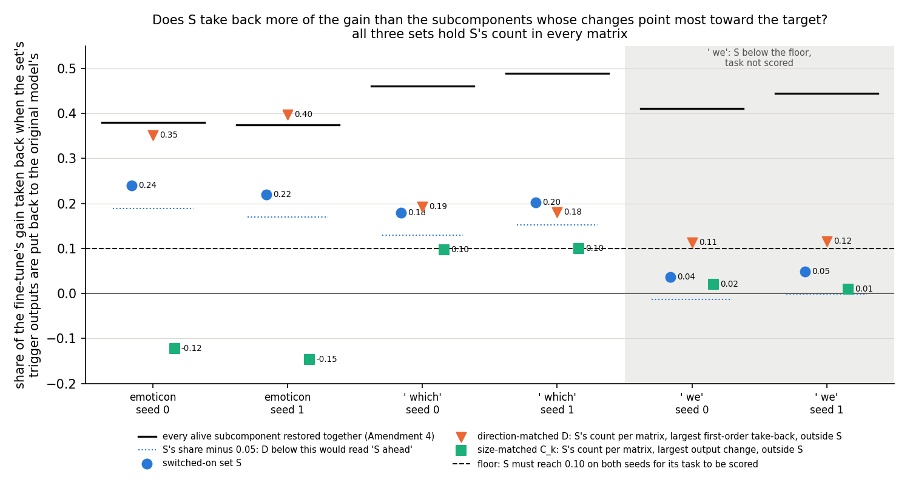
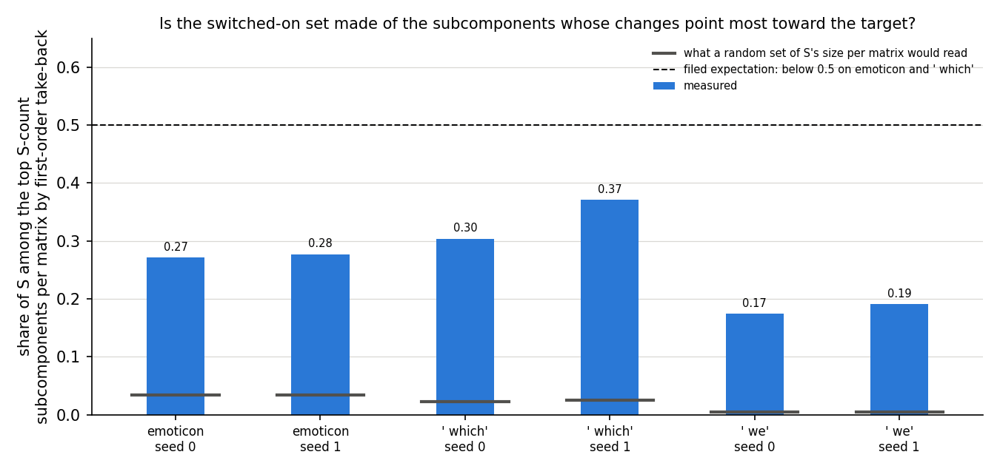
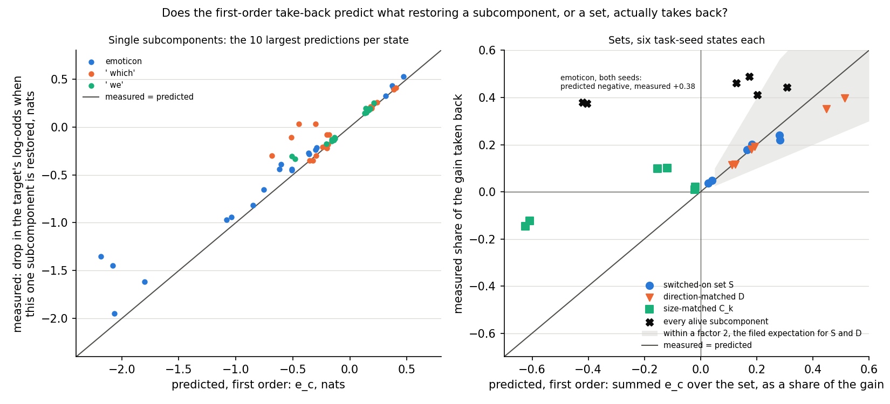

# Does the switched-on set stand out only because its changes point toward the target? (E38 Amendment 5, analysis)

*2026-10-28, writing agent. Plan: `reports/plans/2026-10-28_plan_e38-amend5.md`. Predictions, filed before the code
and never edited: `experiments/recruitment_test/results/predictions_amend5.json`. Code:
`experiments/recruitment_test/amend5.py` and the "E38 Amendment 5" section of `src/commute/recruitment.py`; figures from
`experiments/recruitment_test/plot_amend5.py`. Parent: `reports/analyses/2026-10-28_analysis_e38-amend4.md` and its
check `reports/reviews/2026-10-28_review_e38-amend4-check.md`. Notebook: `notebooks/E38_recruitment_test.ipynb`,
section "Amendment 5". Words as in `GOALS.md` → Terms.*

*Independent check: `reports/reviews/2026-10-28_review_e38-amend5-check.md`, commit `13e09a0`, recomputed every verdict
and read the code. It agrees with each verdict and found nothing that makes a share, a set or a verdict wrong. Folded
in below: ` which` reads as a tie, not a split between seeds; emoticon's gap comes mostly from switched-on
subcomponents that push against the target; the direction-matched set takes its count per matrix from the switched-on
set, so it is not wholly free of Γ; and whether the two sets carry the same part of the gain is the strongest
alternative still open. Claims below use the check's "may state" wording.*

In a fine-tuned model we put back the trigger outputs of the subcomponents whose changes pull hardest on the target,
picked without Γ but using the target, matched in number to the switched-on set in every matrix. That set took back
more of the gain than the switched-on set on emoticon and about the same on ` which`, so the switched-on set never came
out ahead. For `GOALS.md`, Γ's switched-on set carries no more of the change than target-pointing subcomponents do,
though it finds many of them without being told the target.

## The answer

No, the switched-on set does not stand out against subcomponents picked for pointing toward the target. A set picked by
each subcomponent's first-order pull on the target takes back about a third of the gain on emoticon, against a fifth
for the switched-on set. On ` which` the two take back the same fifth, within noise. The filed rule reads "outside the
tree" because ` which` is a tie, not a loss. Our expectation, that direction would suffice, held in substance. The
switched-on set was still found without the target, which a ranking by size alone does not do.

## What we were trying to test

**Where Amendment 4 left off.** A 10-step fine-tune teaches the model to follow a trigger with a target token. With Γ
frozen, a set of the original model's subcomponents is switched on at the trigger: the *switched-on set* S, the alive
subcomponents whose mean causal importance there, over the training windows, rises by more than 0.3. A subcomponent
$c$ is the rank-1 matrix $u_c v_c^\top$; its output at the trigger is $(x \cdot v_c)\, u_c$, with $x$ the matrix's input
there. *Restoring* a set X in the fine-tuned model puts each member's trigger output back to its value in the original
model's pass on the same window. The *restored share* is $\rho_r(X) = (T_1 - T_1^{X \text{ restored}}) / G$. Here $T_1$
is the target's mean log-odds at the trigger after the fine-tune, on held-out windows, and $G$ the gain over the
original model, 10 to 14 nats. It reads 0 when the set's changed outputs carry none of the gain and 1 when undoing them
takes the target back to the original model's value. Restoring S took back about a fifth of the gain on emoticon and
` which`. The same number of the subcomponents whose outputs moved most took back none, or pushed the other way.

**The open alternative.** Amendment 4's ranking was by the size of each change, blind to which way it points. S might
stand out only because its changes point toward the target. Then any subcomponents whose changes point that way would
do as well, and Γ's switch-on would add nothing to a ranking that reads the target directly.

**The measure of direction.** Each alive subcomponent gets a *first-order take-back*
$e_c = \overline{((x_1 - x_0) \cdot v_c)\,(g \cdot u_c)}$, in nats, averaged over windows. Here $x_1$ and $x_0$ are its
matrix's trigger inputs in the fine-tuned and original models. $g$ is the gradient of the window's target log-odds with
respect to that matrix's trigger output, in the fine-tuned model. Positive means restoring $c$ alone lowers the target,
so takes back gain; negative means restoring it would raise the target. It needs the target token; S does not.

**The sets, per task and seed, all holding S's count in every matrix and none overlapping S:**

- **S itself**: 210 and 213 subcomponents on emoticon, 56 and 62 on ` which`, 23 and 21 on ` we`.
- **The direction-matched set D**: the subcomponents with the largest $e_c$ on the training windows. It rules out that
  any equally many subcomponents pointing toward the target carry as much. It takes its count per matrix from S, so it
  is free of Γ in which subcomponents it picks, not in where it looks.
- **The size-matched set**: the subcomponents with the largest output change, Amendment 4's measure, now matched per
  matrix rather than per layer. It rules out that Amendment 4's result came from comparing different kinds of matrix
  output within a layer.

Sets are chosen on the training windows and scored on the held-out windows. S is chosen on the same training windows.
So the two differ in what they read, not in which windows: D reads the target, S reads only Γ.

**Also reported.** S's *top-direction share*: per matrix, how many of S's members are among the top S-count
subcomponents by $e_c$, S included, summed and divided by S's size. And the *predicted share* of a set, its summed
held-out $e_c$ over $G$, against its measured restored share, to see whether first-order effects add up.

**The controls**, run first, any fail stopping the job: Amendment 3's five on all nine states, unchanged, and a new one.
The new control takes the ten alive subcomponents with the largest $|e_c|$ in each state and restores each alone. At
least eight must take back gain of the sign $e_c$ predicts.

## What we expected, and why

- **Direction suffices, low confidence.** On emoticon and ` which`, D would take back at least as much as S. The basis:
  $e_c$ ranks by the quantity the restore measures, to first order, on windows of the same task. S was chosen by a rise
  in importance, blind to the target, and holds only a tenth of the top movers. Against it: restored shares need not
  add, so a first-order top set might cancel within itself.
- **D takes back more than 0.10**, low confidence.
- **The size-matched set stays more than 0.05 below S**, as Amendment 4's did, low confidence.
- **Under half of S is top-direction**, low confidence.
- **Predicted shares of S and D land within a factor 2 of their measured shares**, low confidence.

## What we observed

### Does the apparatus hold?

Yes. Amendment 3's five controls passed on all nine states again, and S's restored share matches Amendment 4's to the
last digit. The new control passed on all six states. On emoticon and ` we`, all ten of the largest predicted singles
took back gain of the predicted sign; on ` which`, nine of ten. The one miss on ` which` is the same subcomponent on both
seeds, an MLP input subcomponent in layer 3. Its predicted take-back is −0.30 and −0.45 nats, yet restoring it alone
takes back about 0.03. The control checks sign only. The largest singles' sizes run from 0.2 to 1.2 times their
first-order value.

### Does S take back more of the gain than the subcomponents whose changes point most toward the target?



**Reading it.** No, on every task. The orange triangles, D, sit above the blue dots, S, on emoticon: 0.35 and 0.40
against 0.24 and 0.22. On ` which` they sit level, 0.19 and 0.18 against 0.18 and 0.20. The dotted blue line is S minus
0.05; D would have to fall below it for S to count as ahead, and it never does. On ` we`, where S is too small to score,
D takes back 0.11 and 0.12 against S's 0.04 and 0.05. The black bars are every alive subcomponent restored together,
0.38 to 0.49, from Amendment 4. On emoticon, D takes back nearly as much as all of them.

**` which` is a tie.** S minus D is −0.013 on seed 0 and +0.022 on seed 1. Both sit inside the filed noise floor: S's
own two seeds differ by up to 0.023, and Amendment 3's random sets never exceeded 0.029. The filed rule calls seed 1
"unclear" and the task "seeds disagree", but read plainly the two sets are level.

**Emoticon's gap is mostly S's own opposing members.** On emoticon, 83 and 84 of S's members have negative $e_c$: their
changes push against the target. Their predicted share sums to −0.14 and −0.18. S's target-pointing members alone
predict 0.42 and 0.46, against D's 0.45 and 0.51. D excludes opposing subcomponents by construction. So the emoticon gap
is largely S carrying subcomponents that work the other way, not D's members pointing harder. That is a first-order
reading; restoring S's target-pointing part alone was not run. On ` which` the opposing members predict only −0.02.

**The size-matched set still trails S.** Matched per matrix, the subcomponents whose outputs moved most read −0.12 and
−0.15 on emoticon and 0.10 on both ` which` seeds. That is 0.08 to 0.37 below S. Amendment 4 matched per layer and read 0.02 and 0.04 on ` which`.
Matching per matrix raises that, so the mix of matrix kinds mattered a little. It does
not change the result: a ranking by size alone does not find S's share.

| state | G, nats | S | D | size-matched | D − S | every alive, Amendment 4 |
|---|---|---|---|---|---|---|
| emoticon s0 | 13.43 | 0.239 | 0.352 | −0.123 | +0.113 | 0.380 |
| emoticon s1 | 13.69 | 0.220 | 0.397 | −0.146 | +0.177 | 0.375 |
| ` which` s0 | 10.29 | 0.179 | 0.193 | 0.097 | +0.013 | 0.461 |
| ` which` s1 | 10.87 | 0.202 | 0.180 | 0.100 | −0.022 | 0.489 |
| ` we` s0 | 12.53 | 0.037 | 0.114 | 0.020 | +0.077 | 0.411 |
| ` we` s1 | 12.19 | 0.049 | 0.116 | 0.010 | +0.068 | 0.444 |

In nats, S takes back 3.2 and 3.0 on emoticon and D 4.7 and 5.4. On ` which`, S takes back 1.8 and 2.2 and D 2.0 and
2.0.

| state | S members with negative $e_c$ | their predicted share | S's other members, predicted | D, predicted |
|---|---|---|---|---|
| emoticon s0 | 83 of 210 | −0.139 | 0.421 | 0.447 |
| emoticon s1 | 84 of 213 | −0.177 | 0.460 | 0.513 |
| ` which` s0 | 16 of 56 | −0.017 | 0.183 | 0.192 |
| ` which` s1 | 15 of 62 | −0.018 | 0.202 | 0.180 |
| ` we` s0 | 9 of 23 | −0.022 | 0.050 | 0.111 |
| ` we` s1 | 8 of 21 | −0.014 | 0.055 | 0.123 |

This table is derived here from `results/large/amend5_scores.pt` and matches the check's; it was not filed.

### Is S made of the subcomponents whose changes point most toward the target?



**Reading it.** Partly: S is strongly enriched for them but is mostly not them. Per matrix, 27% to 37% of S sits among
the top S-count subcomponents by first-order take-back on emoticon and ` which`, 17% and 19% on ` we`. That is below
the filed half, as expected. The grey ticks show what a random set of S's size per matrix would read: 2% to 3% on
emoticon and ` which`, under 1% on ` we`. So S holds about ten times the chance share of the most target-pointing
subcomponents, found by Γ without the target. The chance line is computed here from the alive counts and was not
filed. With Amendment 4, this places S between the two rankings. S is not where the outputs moved most, nor the top of
the direction ranking, but it leans heavily toward the target.

### Does the first-order take-back predict what a restore actually takes back?



**Reading it.** For single subcomponents and for S and D, yes; for large mixed sets, no. In the left panel, the
largest single predictions land near the diagonal, with the largest negative ones overshooting by up to a half. In the
right panel, S and D sit inside the grey factor-2 band on every state, at 0.75 to 1.29 times their measured share. The
size-matched set and every alive subcomponent together miss badly. On emoticon, the summed prediction for every alive
subcomponent is −0.42 and −0.41, while restoring them all takes back +0.38 and +0.37. The prediction has the wrong
sign. The size-matched set is predicted −0.61 and measured −0.12 on emoticon, and on ` which` predicted −0.15 and
measured +0.10. These sets hold the large opposing subcomponents, so their effects interact when restored together.
The filed verdict compares measured shares, not predictions, so this does not touch it. It does mean "first-order effects
explain restores" holds only for sets like S and D that lean one way.

| state | S: predicted / measured | D: predicted / measured | size-matched: predicted, measured | every alive: predicted, measured |
|---|---|---|---|---|
| emoticon s0 | 1.18 | 1.27 | −0.608, −0.123 | −0.420, 0.380 |
| emoticon s1 | 1.28 | 1.29 | −0.624, −0.146 | −0.406, 0.375 |
| ` which` s0 | 0.93 | 1.00 | −0.154, 0.097 | 0.128, 0.461 |
| ` which` s1 | 0.91 | 1.00 | −0.119, 0.100 | 0.173, 0.489 |
| ` we` s0 | 0.75 | 0.98 | −0.020, 0.020 | 0.202, 0.411 |
| ` we` s1 | 0.84 | 1.06 | −0.022, 0.010 | 0.308, 0.444 |

The largest first-order effects on emoticon push against the target. Eight of the ten largest singles there are
negative, led by the same four layer-3 MLP subcomponents Amendment 4 found restored alone. On every one of the six
states, the largest is the same layer-3 MLP output subcomponent, number 3532. Amendment 4's two matched sets hold all
four of those subcomponents on both emoticon seeds, which answers one of its "Not run" items: its emoticon margin came
from them.

## Which branch of the decision tree

**By the filed rule: "outside the tree".** I recounted from `amend5.json`. Every gain is above 1 nat and D is short in
no matrix, so all six states are scorable. Emoticon reads "not ahead" on both seeds, since D is above S. On ` which`,
seed 0 reads "not ahead" and seed 1 "unclear", since S leads by 0.022, under the 0.05 margin. So ` which` is "seeds
disagree". ` we` is "S too small", S under 0.10 on both seeds. Two tasks are scored. One is "not ahead" and none is "S
ahead", short of the two "not ahead" that "direction suffices" needs. That is "outside the tree". This agrees with the
run's own reading and every seed and task class, and with the independent check.

**How far the filed expectation held.** We expected "direction suffices", with low confidence. It held on emoticon,
where D leads by 0.11 and 0.18. It held on ` we` too, which is not scored. On ` which` it missed by the rule only: one
seed's S leads by 0.022, inside the noise floor. In substance the expectation held, and S is never ahead. By the rule
it is not the "direction suffices" branch, and that reading is not claimed.

**What the branch does.** "Outside the tree" means a pending-decision card with the numbers and no further runs. The
draft is at the end of this report. The research log is not edited here.

## What it means for the card's question

The card asked whether S stands out only because its changes point toward the target. The answer the check allows:

> On the 67M model after a 10-step fine-tune, we ranked subcomponents by their first-order pull on the target and took
> the switched-on set's count in each matrix. That set takes back more of the gain than the switched-on set on
> emoticon, and about the same on ` which`. So Γ's switched-on set does not take back more than target-pointing
> subcomponents do. On emoticon the gap comes mostly from switched-on subcomponents that push against the target. The
> switched-on set, found without the target, still holds about ten times the chance share of the most
> target-pointing subcomponents.

What it does not show:

- **That Γ adds nothing.** D reads the target and the fine-tuned model's gradient at the trigger; S reads only Γ's
  importance on the same training windows. A target-blind set ties a target-aware ranking on ` which`. Amendment 4,
  and the size-matched set here, show that a ranking by size alone, also without the target, does not find S's share.
- **That a ranking with no input from Γ matches S.** D borrows S's count in every matrix.
- **That S and D are the same part of the gain.** They are disjoint, and on ` which` each takes back about a fifth. S's
  share sits mostly in layer 3; D spreads more into the earlier layers. Restoring both together would read about 0.4 if
  they carry separate parts and about 0.2 if they carry the same part twice. Not run.
- **That first-order effects add up in general.** They reverse sign for every alive subcomponent together on emoticon.
- **That the emoticon gap measures D's members pointing harder.** It is mostly S's opposing members.
- **Anything about ` we`** beyond "S too small": S takes back about a twentieth and D about a ninth.

A note on the plan's wording: it says D uses the training windows and S uses neither the target nor those windows. S is
chosen on the same training windows; what differs is that D reads the target and S does not.

## What we learned

Pointing toward the target is enough to take back as much of the gain as Γ's switched-on set does, at the same count
per matrix. So the restore test cannot single out Γ's set: on this model, at this count, it is one of several sets
that carry a fifth of the gain. What does single it out is how it was found. With no access to the target, Γ picks a
set ten times richer in target-pointing subcomponents than chance, which a ranking by output size does not. With the
census, S is the original model's own target machinery, which fits `GOALS.md`'s "strengthen" reading. The claim is now
weaker: Γ names part of the machinery the fine-tune strengthens, not the only part. On
emoticon, S also switches on many subcomponents that work against the target.

## How compelling is the evidence

- **Tasks and seeds.** Three tasks, two seeds each, one 67M model, held-out windows, the trigger only. Scored on
  emoticon and ` which`; ` we`'s S takes back too little to score.
- **The apparatus is exact where it can be.** Amendment 3's controls pass, S's share reproduces Amendment 4's to the
  last digit, and the new control's signs agree on 9 or 10 of 10. The new control checks sign, not size.
- **Independently checked.** Every verdict recomputed from the results file agrees, and the code matches the filed
  definitions. Training and held-out take-backs rank-correlate at 0.94 to 0.98 over all alive subcomponents, so D's
  choice is not fitted to its windows.
- **Noise floor.** S's seeds differ by up to 0.023 and random sets stay under 0.029, so ` which`'s differences of 0.013
  and 0.022 are a tie. The emoticon gaps of 0.11 and 0.18 are four to six times that floor.
- **D is best to first order, not best.** A ranking that accounts for interactions could do better still, which would
  only widen D's lead.
- **First order fails for large mixed sets.** The split of S into target-pointing and opposing members is first order.
  First order is reliable for sets that lean one way, as S's two parts do, but the split was not measured by restore.
- **Shares do not add.** Restoring one set also undoes downstream effects of its change.
- **Log-odds at near-certainty.** A fifth of the gain in log-odds is a smaller change in probability.

## Surprises

- **None reverses a filed prediction.** The main expectation missed by the rule on ` which` by a margin inside the noise
  floor; every reported expectation was met.
- **The first-order sum over every alive subcomponent has the wrong sign on emoticon**: −0.42 predicted against +0.38
  measured. No expectation was filed. The large opposing layer-3 subcomponents dominate the sum, but restored together
  with everything else they do not cost what they cost alone.
- **The largest single first-order effect is the same subcomponent on all six states**, layer 3's MLP output number
  3532, and it pushes against the target on each. Why one subcomponent opposes three different targets is not measured.
- **About two fifths of S on emoticon pushes against the target.** Γ switches these on together with the
  target-pointing ones.

## What next

1. **Restore S and D together.** One debug job on the cached states, $0. About 0.4 on ` which` says S holds a part of
   the change that the direction ranking misses at this count; about 0.2 says they are interchangeable. This is the
   strongest alternative still open, and it changes what a closing record would say.
2. **Close the 67M restore line and record the reading**, worded as above. If the user takes this, nothing further runs
   on the 67M restore.
3. **The upstream step or the Qwen line.** What moved the trigger's inputs so that S switches on, or the same restore
   question on the larger model. Either changes the line's scope, not this result.

## Scorecard

| id | claim | rule, as filed | read | verdict |
|---|---|---|---|---|
| R0-R4 | Amendment 3's controls | "Amendment 3's, unchanged" | pass on all nine states; R4 diff at most 0.0195 nats | pass |
| R6 | the first-order ranking predicts single restores in sign | "pass if >= 8 of the 10 have \|e_c\| >= 0.02 nats and a_c with the sign of e_c" | 10, 10, 9, 9, 10, 10 of 10; smallest \|e_c\| 0.13 | pass |
| expected | S's share equals Amendment 4's | "rho_r(S) equals Amendment 4's to 1e-4" | difference 0.0 on all six | pass |
| P13 | S takes back more than the direction-matched set | seed: "'S ahead' if rho_r(S) >= rho_r(D) + 0.05; 'not ahead' if rho_r(D) >= rho_r(S); else 'unclear'"; task scored "only if rho_r(S) >= 0.10 on both seeds"; reading "'direction suffices' if >= 2 are 'not ahead' and none 'S ahead'; else 'outside the tree'" | emoticon S 0.239, 0.220 vs D 0.352, 0.397: not ahead, not ahead; ` which` 0.179, 0.202 vs 0.193, 0.180: not ahead, unclear, so seeds disagree; ` we` S 0.037, 0.049: S too small | **outside the tree**; filed expectation "direction suffices" missed on ` which` only, inside the noise floor; agrees with the run |
| reported | size-matched set below S − 0.05 | "below rho_r(S) - 0.05 on emoticon and ' which'" | −0.123, −0.146, 0.097, 0.100 against bars 0.189, 0.170, 0.129, 0.152 | as expected, agrees |
| reported | S's top-direction share | "below 0.5 on emoticon and ' which'" | 0.271, 0.277, 0.304, 0.371; ` we` 0.174, 0.190 | as expected, agrees |
| reported | predicted against measured, S and D | "within a factor 2 on emoticon and ' which'" | S 1.18, 1.28, 0.93, 0.91; D 1.27, 1.29, 1.00, 1.00 | as expected, agrees |
| reported | D's share | "above 0.10 on emoticon and ' which'" | 0.352, 0.397, 0.193, 0.180 | as expected, agrees |
| reported | predicted share of every alive subcomponent against Amendment 4's measured | "no expectation filed; reported" | emoticon −0.420, −0.406 vs 0.380, 0.375; ` which` 0.128, 0.173 vs 0.461, 0.489; ` we` 0.202, 0.308 vs 0.411, 0.444 | wrong sign on emoticon |
| recorded | D short in any matrix | "short if fewer exist (recorded)" | none on any state | — |

## Not run

- Restoring S and D together, to tell whether they carry the same part of the gain or separate parts.
- Restoring S's target-pointing members alone, or its opposing members alone.
- A ranking free of Γ altogether: the top S-size subcomponents by first-order take-back over the whole model, without
  S's count per matrix.
- A second-order or greedy ranking that accounts for interactions.
- A direction ranking matched per layer.
- A third seed on ` which`.
- What subcomponent 3532 of layer 3's MLP output does in the original model, and why it opposes all three targets.
- A control checking that predicted size, not only sign, matches the restore.
- The upstream step: which earlier changes moved the trigger's inputs so that S switches on.
- Positions other than the trigger, other tasks, seeds beyond 0 and 1, the larger model.

## Provenance

- Plan and predictions: commit `2c4f1ac`, before the run script in `5574529`. `predictions_amend5.json` not edited.
- Run: MATS cluster `debug` QoS, job 40121, NVIDIA L40, 44 s, $0, at 40G as Amendment 4's job 40041.
- Results: `experiments/recruitment_test/results/amend5.json` and `run_amend5.log`, commit `419845a`; per-subcomponent
  take-backs and output changes in `results/large/amend5_scores.pt`, gitignored.
- States: Amendment 2's cached states, `results/large/states/`, sha256 checked against `results/amend2_stage0.json`.
- Derived here, not filed: the chance top-direction share, from `experiments/transport_test/results/large/alive.pt`; the
  split of S by the sign of each member's take-back; whether Amendment 4's matched sets hold the four large layer-3
  subcomponents.
- Figures: `experiments/recruitment_test/figures/amend5_{restore,topdir,linearity}.png`.
- Independent check: `reports/reviews/2026-10-28_review_e38-amend5-check.md`, commit `13e09a0`.

## Draft pending-decision card

For `docs/research_log/parts/sections/decisions.html`, replacing `decision-e38-next`, in its style. Not applied here.

```html
  <div class="card key decision" id="decision-e38-restore-close"><span class="chip open urgency">Soon</span><div class="k">Re-gating line · new 2026-10-28</div><p class="small">Nothing runs until this is decided.</p><h3>Subcomponents picked for pointing toward the target take back as much as the switched-on set: close the 67M restore line, test whether the two sets overlap in what they carry, or move on?</h3>
  <p><strong>What it is about.</strong> After a narrow fine-tune, putting the trigger outputs of the set Γ switched on back to their original values takes back about a fifth of the gain. We asked whether any subcomponents whose changes point toward the target would do as well. We ranked them by each one's first-order pull on the target, which needs the target and no Γ, and took the switched-on set's count in each matrix.</p>
  <p><strong>What the evidence says.</strong> That set takes back more than the switched-on set on emoticon, 0.35 and 0.40 of the gain against 0.24 and 0.22, and the same on ` which`, 0.19 and 0.18 against 0.18 and 0.20, a tie inside the noise floor. So the switched-on set is never ahead. On emoticon the gap comes mostly from switched-on subcomponents that push against the target. Still, the switched-on set, found without the target, holds about ten times the chance share of the most target-pointing subcomponents, and a ranking by size of change does not find its share (<a href="#e38">E38</a>, checked). The filed rule reads "outside the tree" because ` which` is a tie. Not tested: whether the two sets carry the same part of the gain.</p>
  <p><strong>The options.</strong> (a) Close the 67M restore line and record the reading: Γ's set carries no more than target-pointing subcomponents do, and Γ finds many of them without the target. (b) The upstream step: find which earlier changes moved the trigger's inputs so that the set switched on. (c) Carry the question to the Qwen line. (d) First restore both sets together, one cluster debug job on the saved fine-tunes, $0: about 0.4 on ` which` means the switched-on set holds a part the target ranking misses, about 0.2 means they are interchangeable. Recommended: (d), then (a); (d) is free and decides which reading (a) records.</p>
  <p><strong>Why it matters.</strong> It decides what the re-gating line claims about Γ on the 67M model: that it names the subcomponents carrying the change, or only some of them among equals.</p>
  <div class="links"><a href="#q5">Q5</a><a href="#e38">E38</a><a href="#decision-regating-reading">Re-gating reading card</a></div>
  <p class="small"><code>reports/analyses/2026-10-28_analysis_e38-amend5.md</code> · <code>reports/reviews/2026-10-28_review_e38-amend5-check.md</code></p></div>
```
