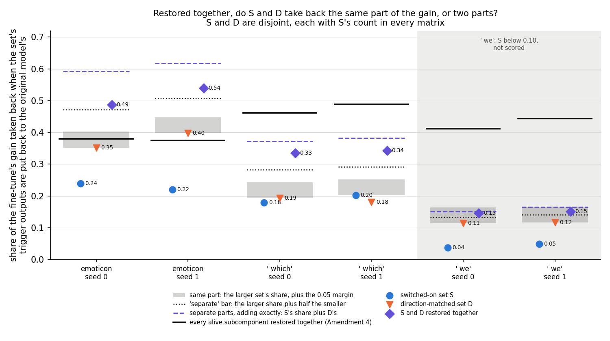
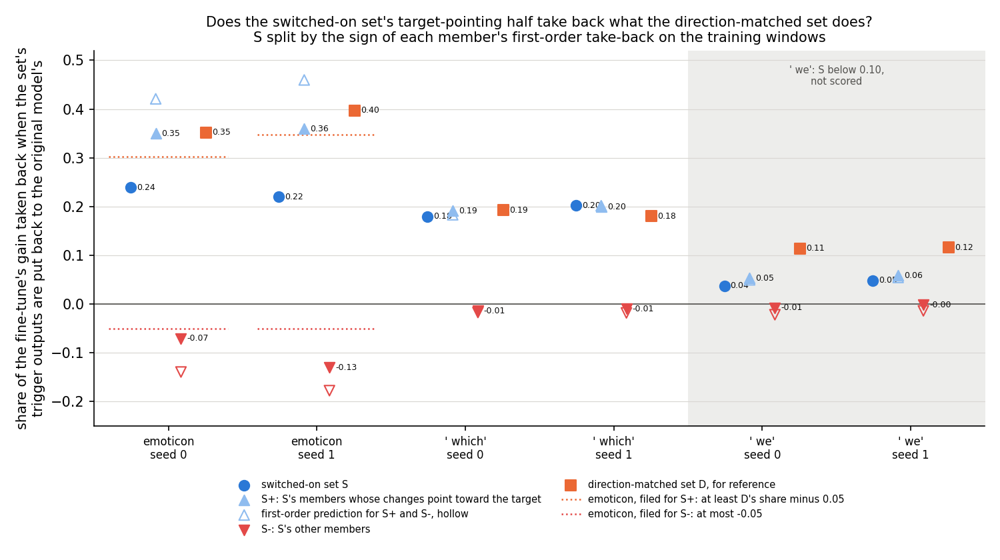

# Do the switched-on set and the direction-matched set carry the same part of the gain? (E38 Amendment 6, analysis)

*2026-10-28, writing agent. Plan: `reports/plans/2026-10-28_plan_e38-amend6.md`. Predictions, filed before the code
and never edited: `experiments/recruitment_test/results/predictions_amend6.json`. Code:
`experiments/recruitment_test/amend6.py` and the "E38 Amendment 6" functions of `src/commute/recruitment.py`; figures
from `experiments/recruitment_test/plot_amend6.py`. Parent: `reports/analyses/2026-10-28_analysis_e38-amend5.md` and its
check `reports/reviews/2026-10-28_review_e38-amend5-check.md`. Follow-up, running: E38 Amendment 7,
`reports/plans/2026-10-28_plan_e38-amend7.md`. Notebook: `notebooks/E38_recruitment_test.ipynb`, section "Amendment 6".
Words as in `GOALS.md` → Terms.*

*Independent check: `reports/reviews/2026-10-28_review_e38-amend6-check.md`, commit `60bf3fd`, recomputed every verdict
and read the code. It agrees with each verdict and found nothing that makes a share, a set or a verdict wrong. Folded in
below, and the claims use its "may state" wording:*

- *The filed expectation, "partial", was missed, and is named as a miss.*
- *Emoticon clears the "separate" bar by only 0.016 and 0.032, inside the noise floor; the claim rests on ` which`,
  which clears it by 0.05.*
- *Restores of disjoint sets add almost linearly here, so "separate" is what any two disjoint target-pointing sets would
  show; it says nothing particular to S.*
- *The plan's saturation premise was wrong: on emoticon the union takes back more than every alive subcomponent
  together.*
- *No claim that S holds a part a target-aware ranking misses: D was barred from S's members, and an unrestricted
  ranking at S's count holds about a third of S.*
- *The settling test is running as Amendment 7; the card lists it as running.*

In a fine-tuned model we put back, together, the trigger outputs of the set Γ switched on and of an equally large,
disjoint set picked for pointing toward the target. Together they took back about a third of the gain on the main task,
close to the sum of the two apart, so the two sets carry different parts of the gain rather than one part twice. For
`GOALS.md`, this is what any two non-overlapping target-pointing sets would show here, so it does not yet single out Γ's
set; a run that tests exactly that is under way.

## The answer

The two sets carry different parts of the gain, not one part twice. On ` which`, each takes back about a fifth on its
own, and the two together about a third, nine tenths of their sum. We had expected about 0.3, a partial overlap; that
expectation missed, because putting back disjoint sets adds almost linearly here. So the result is what any two
non-overlapping target-pointing sets would show. On emoticon, the switched-on set's target-pointing members alone take
back as much as the direction-matched set.

## What we were trying to test

**Where Amendment 5 left off.** A 10-step fine-tune teaches the 67M model to follow a trigger with a target token. With
Γ frozen, a set of the original model's subcomponents is switched on at the trigger: the *switched-on set* S, the alive
subcomponents whose mean causal importance there rises by more than 0.3. *Restoring* a set X in the fine-tuned model
puts each member's trigger output, $(x \cdot v_c)\, u_c$, back to its value in the original model's pass on the same
window. The *restored share* is $\rho_r(X) = (T_1 - T_1^{X \text{ restored}}) / G$. Here $T_1$ is the target's mean
log-odds at the trigger after the fine-tune, on held-out windows, and $G$ the gain over the original model, 10 to 14
nats. It reads 0 when the set's changed outputs carry none of the gain and 1 when undoing them takes the target back to
the original model's value.

Amendment 5 gave each alive subcomponent a *first-order take-back*
$e_c = \overline{((x_1 - x_0) \cdot v_c)\,(g \cdot u_c)}$, in nats, with $x_1, x_0$ its matrix's trigger inputs in the
fine-tuned and original models and $g$ the gradient of the target's log-odds with respect to that matrix's trigger
output. Positive means restoring $c$ alone takes back gain. The *direction-matched set* D holds, in every matrix, as
many subcomponents as S does there: those outside S with the largest $e_c$ on the training windows. On ` which`, S and D
each took back about a fifth of the gain. On emoticon D took back more.

**The question.** S and D share no members. Are they two ways of reaching the same part of the change, so that
restoring both takes back no more than one? Or do they carry two parts, so that both together take back about the sum?

**The sets restored, per task and seed, on Amendment 5's saved fine-tunes and members:**

- **S** and **D** alone, as in Amendment 5, as a check that nothing moved.
- **S and D together**, in one pass: 420 and 426 subcomponents on emoticon, 112 and 124 on ` which`, 46 and 42 on ` we`.
  The overlap is read as $a = \rho_r(S \cup D) - \max(\rho_r(S), \rho_r(D))$: 0 if the second set adds nothing, the
  smaller set's share if the two add exactly.
- **S's target-pointing members alone**, written S+: those with $e_c > 0$ on the training windows, 127 and 129 of S on
  emoticon, 39 and 46 on ` which`. And **S's other members alone**, S−. This tests what Amendment 5's check read from
  first-order sums only: that S's emoticon shortfall against D comes from members whose changes push against the target.
  S+ is cut by $e_c$, which uses the target, so it is not a set Γ alone picks.

**The controls** ran first, and any fail would have stopped the job. Amendment 3's five ran on all nine states, unchanged. A new
one required S and D, restored apart, to reproduce Amendment 5's shares to within 0.0001 on all six fine-tunes.

## What we expected, and why

- **A partial overlap on ` which`, low confidence.** We expected S and D together to take back about 0.3. S and D each
  take back about 0.19 and both lean on layer 3. Restoring every alive subcomponent together takes back only 0.46 to
  0.49, which we read as a ceiling: the union would saturate between "same part", about 0.2, and "separate parts",
  about 0.4.
- **S+ takes back about what D does on emoticon**, at least D's share minus 0.05, low confidence. The check's
  first-order sums put S+ at 0.42 and 0.46, against D's 0.45 and 0.51.
- **S− takes back gain of the wrong sign on emoticon**, at most −0.05, low confidence.

## What we observed

### Does the apparatus hold?

Yes. Amendment 3's five controls passed on all nine states. S and D restored apart reproduced Amendment 5's shares
exactly, a difference of 0.0 on all six fine-tunes. The removal control's largest difference was 0.0195 nats, as before.

### Restored together, do S and D take back the same part of the gain, or two parts?



**Reading it.** Two parts, not one part twice. The purple diamonds, S and D restored together, sit far above the grey
band, where they would sit if the two sets carried the same part. On ` which` the union takes back 0.335 and 0.343,
against 0.372 and 0.382 for the two sets' shares summed, the dashed line. That is nine tenths of the sum, and it clears
the dotted "separate" bar by 0.05 on both seeds. On emoticon the union takes back 0.49 and 0.54, 0.82 and 0.87 of the
sum. It clears the bar there by only 0.016 and 0.032, inside the noise floor of 0.05, so the claim rests on ` which`.
The caveat that matters: restores of disjoint sets add almost linearly on these states, so any two non-overlapping
target-pointing sets would likely read the same. "Separate" shows that D does not duplicate S's share. It does not show
that S's share is one only S carries.

**Against the filed expectation: a miss.** We expected "partial", about 0.3 on ` which`. The union read 0.335 and 0.343,
and the second set added 0.142 and 0.141 against a "separate" bar of 0.090. The expectation rested on a wrong premise
in the plan. It treated every alive subcomponent restored together as a ceiling. On emoticon the union of S and D takes
back more than all of them, 0.49 and 0.54 against the black bar's 0.38 and 0.37. The full set is low because it holds
subcomponents that push against the target and cancel the rest, as Amendment 5's first-order sum of −0.42 already
showed. So the shares did not saturate, and they added.

| state | G, nats | S | D | S and D together | S + D, summed | together / summed | added by the second set | "separate" bar |
|---|---|---|---|---|---|---|---|---|
| emoticon s0 | 13.43 | 0.239 | 0.352 | 0.487 | 0.592 | 0.82 | 0.135 | 0.120 |
| emoticon s1 | 13.69 | 0.220 | 0.397 | 0.539 | 0.617 | 0.87 | 0.142 | 0.110 |
| ` which` s0 | 10.29 | 0.179 | 0.193 | 0.335 | 0.372 | 0.90 | 0.142 | 0.090 |
| ` which` s1 | 10.87 | 0.202 | 0.180 | 0.343 | 0.382 | 0.90 | 0.141 | 0.090 |
| ` we` s0 | 12.53 | 0.037 | 0.114 | 0.146 | 0.151 | 0.97 | 0.032 | not scored |
| ` we` s1 | 12.19 | 0.049 | 0.116 | 0.151 | 0.165 | 0.92 | 0.035 | not scored |

"Added by the second set" is the union minus the larger of the two shares. Every alive subcomponent restored together,
from Amendment 4: 0.380 and 0.375 on emoticon, 0.461 and 0.489 on ` which`, 0.411 and 0.444 on ` we`.

### Does the switched-on set's target-pointing half take back what the direction-matched set does?



**Reading it.** Yes, on emoticon, and on ` which` S+ is S. On emoticon, the light-blue triangles, S+, take back 0.350
and 0.360. D takes back 0.352 and 0.397, so S+ ties it on seed 0 and trails by 0.04 on seed 1, with about 60% of D's
members. The red triangles, S−, take back −0.071 and −0.130: those members' changes push the target up, and restoring
them pushes it further up. That explains Amendment 5's emoticon gap: S trailed D because of its opposing members. On
` which`, S− is small, −0.014 and −0.010, so S's share there is S+'s: 0.192 and 0.200 against 0.179 and 0.202. The
hollow markers are the first-order predictions. They overshoot S+ on emoticon by a fifth to a quarter and land within
4% on ` which`.

S+ and S− are a second disjoint pair, and they add too. Their shares summed are within 0.04 of S's on every scored
state. This is the near-linearity that makes "separate" the expected reading for any disjoint pair.

| state | S+ members | S+ | S− members | S− | S+ and S−, summed | S | D | S+ predicted, first order | S− predicted |
|---|---|---|---|---|---|---|---|---|---|
| emoticon s0 | 127 | 0.350 | 83 | −0.071 | 0.279 | 0.239 | 0.352 | 0.421 | −0.139 |
| emoticon s1 | 129 | 0.360 | 84 | −0.130 | 0.230 | 0.220 | 0.397 | 0.460 | −0.177 |
| ` which` s0 | 39 | 0.192 | 17 | −0.014 | 0.178 | 0.179 | 0.193 | 0.183 | −0.017 |
| ` which` s1 | 46 | 0.200 | 16 | −0.010 | 0.190 | 0.202 | 0.180 | 0.202 | −0.018 |
| ` we` s0 | 14 | 0.053 | 9 | −0.008 | 0.045 | 0.037 | 0.114 | 0.050 | −0.022 |
| ` we` s1 | 13 | 0.058 | 8 | −0.002 | 0.057 | 0.049 | 0.116 | 0.055 | −0.014 |

S− on ` which` holds one member per seed whose training $e_c$ is exactly 0; it is in S− by the filed "≤ 0". That is
why S− counts 17 and 16 here where Amendment 5's table counted 16 and 15 members with negative $e_c$.

## Which branch of the decision tree

**By the filed rule: "separate" on ` which`, the reading task; "separate" on emoticon beside it; ` we` unscored.** I
recounted from `amend6.json`. Every gain is above 1 nat. ` We` is unscored because S takes back 0.037 and 0.049, under
the 0.10 floor. On the four scored fine-tunes, the second set adds 0.135, 0.142, 0.142 and 0.141. The "separate" bar,
half the smaller share, is 0.120, 0.110, 0.090 and 0.090. Each clears it, so each seed reads "separate", checked before
"redundant" as filed. Both seeds agree on each task. This agrees with the run's reading, every seed class and every task
class, and with the independent check.

**What the branch does, and why its card reading is not taken as written.** The plan's "separate" branch gives the
card the reading "S carries a part of the gain the top target-pointing subcomponents miss". It names the upstream step
or the Qwen line next. The check shows that sentence overstates, for two reasons. Restores add almost linearly here, so any
disjoint pair with these shares would read "separate". And D could not contain S's members, so "the top target-pointing
subcomponents" here means the top ones outside S. The card takes the check's wording instead, with the settling test,
Amendment 7, running. The research log is not edited here.

## What it does not show

**That S is special.** The strongest alternative: the gain is spread over many target-pointing subcomponents whose
put-back shares add almost linearly, so any two disjoint target-pointing sets would read "separate". The data fit it.
S+ and S− add to within 0.04 of S. On ` which`, S and D together are predicted at 0.358 and 0.364 by summing their
members' first-order take-backs, and measured at 0.335 and 0.343. Amendment 3's random sets do not help here: they show
S's share is not generic among all subcomponents, not whether a second target-pointing set adds.

**That a target-aware ranking misses S's part.** D was barred from S. A ranking by $e_c$ allowed to take S's members
puts 27% to 37% of S in its top S-count per matrix. The check computes, to first order and not filed, that the
unrestricted top twice-S-count per matrix would take back 0.43 and 0.44 on ` which`, against 0.36 for S and D. There
first order tracks restores within about 10%, so that ranking would likely take back more than S and D together.

**The settling test, running as Amendment 7.** It restores D2, the next S-count per matrix by $e_c$ outside S and D, then
D together with D2, and T2, the top twice-S-count per matrix with S's members allowed. If D with D2 also reads
"separate", the reading is generic. If T2 takes back at least what S with D does, a target-aware ranking at the same
count carries everything the two carry. First-order sums for D2, derived here from the saved scores and not filed:

| state | S, first order | D, first order | D2, first order | D2 members pointing toward the target | D with D2, first order | S with D, measured |
|---|---|---|---|---|---|---|
| emoticon s0 | 0.282 | 0.447 | 0.206 | 210 of 210 | 0.653 | 0.487 |
| emoticon s1 | 0.282 | 0.513 | 0.246 | 213 of 213 | 0.758 | 0.539 |
| ` which` s0 | 0.166 | 0.192 | 0.091 | 55 of 56 | 0.284 | 0.335 |
| ` which` s1 | 0.184 | 0.180 | 0.090 | 61 of 62 | 0.270 | 0.343 |

On ` which`, D2 pulls about half as hard as S, 0.09, just under the 0.10 floor a set needs to be scored, as the check
also notes. So D with D2 would likely take back less than S with D there, explained by D2's weaker pull rather than by
anything in S. T2 is the part of Amendment 7 that does not have this problem.

Also not shown:

- **That emoticon's "separate" is clear.** Its margins sit inside the noise floor.
- **That S+ is a set Γ alone picks.** It is cut by $e_c$, which uses the target.
- **Anything about S+ together with D**, not run, or about ` we` beyond "unscored".

## What we learned

The switched-on set and the direction-matched set carry different parts of the change: undoing one leaves the other's
part in place. So Amendment 5's tie on ` which` does not mean D duplicates S. But at these set sizes, putting back
disjoint target-pointing sets adds almost linearly, so this is what any two such sets would show. On emoticon, Γ
switches on a target-pointing half that takes back as much as the direction-matched set, together with members that
work against the target. For `GOALS.md`'s "strengthen" reading, the restore has not shown that Γ picks out anything a
ranking by pull on the target would not. What still singles out Γ's set is that it was found without the target.

## How compelling is the evidence

- **Tasks and seeds.** Three tasks, two seeds each, one 67M model, held-out windows, the trigger only. Scored on
  ` which` and emoticon; ` we`'s S takes back too little.
- **The apparatus is exact where it can be.** Amendment 3's controls pass and S and D reproduce Amendment 5 exactly.
- **Margins.** On ` which` the second set adds 0.14 against a bar of 0.09, a margin equal to the noise floor of 0.05,
  on both seeds, which agree within 0.001. On emoticon the margins are 0.016 and 0.032, inside the noise floor.
- **Shares add almost linearly.** The union is 0.82 to 0.90 of the sum on the scored tasks. That makes "separate" an
  easy reading to reach for any disjoint pair, which is why it does not single out S.
- **The split of S is by a first-order score on the training windows**, scored by restore on held-out windows; the two
  windows' scores rank-correlate at 0.94 to 0.98, Amendment 5's check.
- **Log-odds at near-certainty.** A third of the gain in log-odds is a smaller change in probability.
- **Independently checked**, every verdict and the code.

## Surprises

- **The filed expectation missed.** We expected a partial overlap, about 0.3 on ` which`; the union read 0.335 and
  0.343, clearly "separate". The cause is a wrong premise in the plan: restoring every alive subcomponent together was
  taken as a ceiling, but it is low because opposing subcomponents cancel the rest.
- **On emoticon, restoring S and D together takes back more than restoring every alive subcomponent**: 0.49 and 0.54,
  against 0.38 and 0.37. No expectation was filed for this.
- **S+ takes back as much as D with about 60% of D's members on emoticon**, and on ` which` with about two thirds.

## What next

1. **Running: Amendment 7**, the settling test, one cluster debug job, $0, planned in
   `reports/plans/2026-10-28_plan_e38-amend7.md`.
   "Generic" with T2 covering S and D means S's share is what target-pointing subcomponents carry, and leans to closing
   the 67M restore line. T2 falling short means S and D carry something one target-aware ranking at the same count
   misses, and leans to the upstream step or the Qwen line.
2. **Then the user's choice on the card**: close the 67M restore line and record the reading, the upstream step, or the
   Qwen line.

## Scorecard

| id | claim | rule, as filed | read | verdict |
|---|---|---|---|---|
| R0-R4 | Amendment 3's controls | "Amendment 3's, unchanged" | pass on all nine states; R4 diff at most 0.0195 nats | pass |
| R7 | S and D restored apart reproduce Amendment 5 | "equal amend5.json's to 1e-4 on all six task-seed states" | difference 0.0 on all six | pass |
| P14 | S and D carry the same part of the gain | seed: "'unscored' if G < 1 or rho_r(S) < 0.10 or rho_r(D) < 0.10; 'separate' if a >= 0.5 * min(rho_r(S), rho_r(D)); 'redundant' if a <= 0.05; else 'partial'"; task: unscored seed makes the task unscored, else the common class; reading: ` which`'s class | ` which` a 0.142, 0.141 vs bars 0.090, 0.090: separate, separate; emoticon a 0.135, 0.142 vs 0.120, 0.110: separate, separate, margins inside the noise floor; ` we` rho_r(S) 0.037, 0.049: unscored | **separate** on ` which`, separate on emoticon, ` we` unscored; filed expectation "partial", low: **missed**; agrees with the run and the check |
| reported | rho_r(S+) on emoticon | ">= rho_r(D) - 0.05 on both seeds" | 0.350, 0.360 vs bars 0.302, 0.347 | as expected, agrees |
| reported | rho_r(S−) on emoticon | "<= -0.05 on both seeds" | −0.071, −0.130 | as expected, agrees |
| reported | rho_r(S+), rho_r(S−) on ` which` | "no expectation filed; reported" | S+ 0.192, 0.200; S− −0.014, −0.010 | S+ about S |

## Not run

- **The control for "any disjoint target-pointing pair reads separate"**: D2 and D with D2. Running as Amendment 7. On
  ` which` D2's first-order pull, 0.09, is under the 0.10 floor, so a set matched to S's pull rather than its count
  would read more cleanly there.
- **The control for "a target-aware ranking misses S's part"**: T2, the top twice-S-count per matrix by $e_c$ with S
  allowed, and the unrestricted top S-count. Running as Amendment 7, T2 only.
- S+ restored together with D; D's own sign split; S, D and the size-matched set restored together.
- A ranking free of Γ altogether, without S's count per matrix; a ranking that accounts for interactions.
- How the two sets' changes interact downstream of the trigger outputs.
- A third seed; positions other than the trigger; other tasks; the upstream step; the larger model.

## Provenance

- Plan and predictions: `predictions_amend6.json` in commit `3545487`, before the code in `3fd96aa`; not edited.
- Run: MATS cluster `debug` QoS, job 40196, NVIDIA L40, 32 s, $0.
- Results: `experiments/recruitment_test/results/amend6.json` and `run_amend6.log`, commit `0bb4428`.
- Inputs: Amendment 2's cached states in `results/large/states/`; S and D members from `results/amend5.json`; training
  and held-out $e_c$ from `results/large/amend5_scores.pt`, gitignored.
- Derived here, not filed: the sums of S and D alone, the ratios, S+ and S− summed, and D2's first-order pull, from
  `amend6.json`, `amend5.json`, `amend5_scores.pt` and `experiments/transport_test/results/large/alive.pt`, printed by
  `plot_amend6.py`. T2's first-order sums are the check's.
- Figures: `experiments/recruitment_test/figures/amend6_{union,split}.png`.
- Independent check: `reports/reviews/2026-10-28_review_e38-amend6-check.md`, commit `60bf3fd`.

## Draft pending-decision card

For `docs/research_log/parts/sections/decisions.html`, the re-read of `decision-e38-direction`, in its style. Not applied
here.

```html
  <div class="card key decision" id="decision-e38-direction"><span class="chip open urgency">Soon</span><div class="k">Re-gating line · new 2026-10-28, re-read after E38 Amendment 6</div><p class="small">Running: E38 Amendment 7, the next-ranked target-pointing set restored with the direction-matched set, and the top target-pointing set of twice the switched-on set's count with its members allowed, one cluster debug job, $0 (<code>reports/plans/2026-10-28_plan_e38-amend7.md</code>). This card is re-read once it is in.</p><h3>The switched-on set and the target-pointing set carry different parts of the gain, but any two such sets might: close the 67M restore line, take the upstream step, or move to Qwen?</h3>
  <p><strong>What it is about.</strong> After a narrow fine-tune, putting the trigger outputs of the set Γ switched on back to their original values takes back about a fifth of the gain. An equally large set picked for pointing toward the target, and sharing no members, takes back as much on ` which` and more on emoticon. We restored both together to see whether they carry the same part of the gain or two parts.</p>
  <p><strong>What the evidence says.</strong> Two parts, not one part twice. On ` which`, together they take back about a third of the gain, nine tenths of the sum of the two apart; on emoticon about half, with a margin inside the noise floor. We had expected a partial overlap, and that missed: the plan took every subcomponent restored together as a ceiling, but on emoticon these two sets take back more than all of them, because the full set holds subcomponents that push against the target. Put-back shares of disjoint sets add almost linearly here, so this is what any two non-overlapping target-pointing sets would show. On emoticon, the switched-on members that point at the target take back as much as the direction-matched set with about 60% of its count; the rest push against the target, which is why the whole set trailed (<a href="#e38">E38</a>, checked). Not shown: that the switched-on set holds a part a ranking by pull on the target misses, since that set was barred from the switched-on set's members; Amendment 7 tests both points.</p>
  <p><strong>The options.</strong> (a) Close the 67M restore line and record the reading: Γ's set carries its own part of the change, not a duplicate of the top target-pointing subcomponents' part, and Γ finds it without the target; whether a target-aware ranking carries the same, as Amendment 7 reads it. (b) The upstream step: find which earlier changes moved the trigger's inputs so that the set switched on. (c) Carry the question to the Qwen line. Recommended: wait for Amendment 7. If any disjoint pair reads "separate" and the top target-pointing set of twice the count takes back as much as the two together, (a); if it falls short, (b) or (c).</p>
  <p><strong>Why it matters.</strong> It decides what the re-gating line claims about Γ on the 67M model: that it names subcomponents carrying a share of the change no target-aware ranking covers, or one target-pointing set among many.</p>
  <div class="links"><a href="#q5">Q5</a><a href="#e38">E38</a><a href="#decision-regating-reading">Re-gating reading card</a></div>
  <p class="small"><code>reports/analyses/2026-10-28_analysis_e38-amend6.md</code> · <code>reports/reviews/2026-10-28_review_e38-amend6-check.md</code> · <code>reports/plans/2026-10-28_plan_e38-amend7.md</code></p></div>
```
