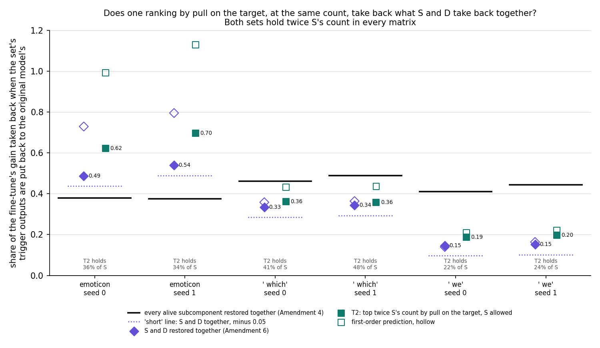
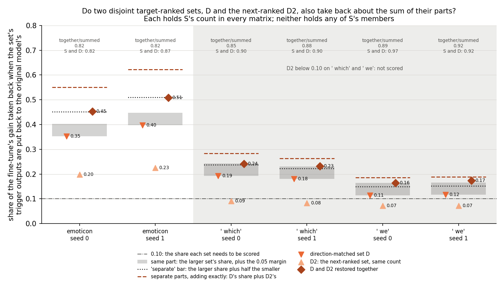
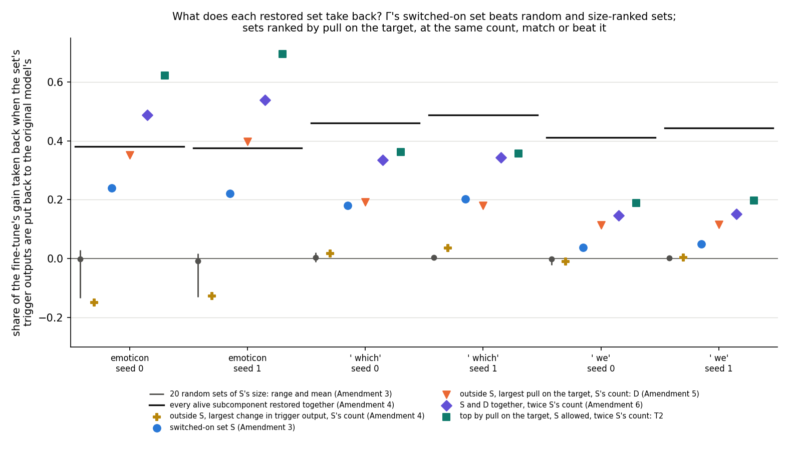

# Does a ranking by pull on the target, at the same count, take back everything the switched-on set adds? (E38 Amendment 7, analysis)

*2026-10-28, writing agent. Plan: `reports/plans/2026-10-28_plan_e38-amend7.md`. Predictions, filed before the code
and never edited: `experiments/recruitment_test/results/predictions_amend7.json`. Code:
`experiments/recruitment_test/amend7.py` and the "E38 Amendment 7" functions of `src/commute/recruitment.py`; figures
from `experiments/recruitment_test/plot_amend7.py`. Parents: `reports/analyses/2026-10-28_analysis_e38-amend6.md` and
its check `reports/reviews/2026-10-28_review_e38-amend6-check.md`; `reports/analyses/2026-10-28_analysis_e38-amend5.md`
and its check `reports/reviews/2026-10-28_review_e38-amend5-check.md`. Notebook: `notebooks/E38_recruitment_test.ipynb`,
section "Amendment 7". Words as in `GOALS.md` → Terms. This is the last amendment of the restore line on the 67M model.*

*Independent check: `reports/reviews/2026-10-28_review_e38-amend7-check.md`, commit `2b6d325`, recomputed every verdict
and read the code. It agrees with each verdict and found nothing that makes a share, a set or a verdict wrong. Folded in
below, and the claims use its "may state" wording and respect its "may not" list:*

- *The tree reached "anything else: card with the numbers; the user picks", not the branch that leans to closing the
  line. Nothing here says it reached that branch.*
- *"Covers" on ` which` means "as much as": its margins, 0.027 and 0.015, are inside the noise floor. "More than" holds
  on emoticon only.*
- *D is always inside T2. T2 is S and D together with S's lower-ranked members, every member of S with training
  $e_c \le 0$ among them, swapped for D2's best. So on emoticon most of T2's lead comes from filtering by the target.*
- *Neither T2 nor D is free of Γ: both take their count in each matrix from S.*
- *Γ's role, as the evidence leaves it: a detector that needs no target and finds a set rich in target-pointing
  subcomponents. No restore has shown that it carries a part a target-aware ranking at the same count misses.*
- *The strongest surviving alternative: on ` which`, S's dropped members may carry more than first order credits; first
  order predicts the swap gains 0.07, the restores show 0.02. Listed under "Not run".*
- *The pair test's split on emoticon is a threshold effect: the seeds sit 0.002 either side of the bar, and the union is 82% of
  the sum on both.*

In a fine-tuned model we put back the trigger outputs of the subcomponents that pull hardest toward the target, as many
as the switched-on and direction-matched sets hold together. They took back as much of the gain as those two sets
together on every fine-tune, clearly more on emoticon and the same within noise on ` which`. For `GOALS.md`, no restore
on the 67M model has shown that Γ's switched-on set carries a part of the change such a ranking misses. Γ's value is
that it finds a set rich in those subcomponents without being told the target.

## The answer

Nothing in the switched-on set has been shown to carry a part of the gain that a ranking by pull on the target misses.
Rank every alive subcomponent by its first-order pull toward the target, and keep twice the switched-on set's count in
each matrix. Putting those back takes back as much as the switched-on and direction-matched sets together on all six
fine-tunes. It takes back clearly more on emoticon, and the same within noise on ` which`. The second test, whether any
two ranked sets add up the same way, did not decide.

## What we were trying to test

**Where Amendment 6 left off.** A 10-step fine-tune teaches the 67M model to follow a trigger with a target token. With
Γ frozen, a set of the original model's subcomponents is switched on at the trigger: the *switched-on set* S, the alive
subcomponents whose mean causal importance there rises by more than 0.3. *Restoring* a set X in the fine-tuned model
puts each member's trigger output, $(x \cdot v_c)\, u_c$, back to its value in the original model's pass on the same
window. The *restored share* is $\rho_r(X) = (T_1 - T_1^{X \text{ restored}}) / G$, with $T_1$ the target's mean
log-odds at the trigger after the fine-tune on held-out windows and $G$ the gain over the original model, 10 to 14
nats. It reads 0 when the set's changed outputs carry none of the gain, and 1 when undoing them takes the target back
to the original model's value.

Each alive subcomponent has a *first-order take-back*
$e_c = \overline{((x_1 - x_0) \cdot v_c)\,(g \cdot u_c)}$ in nats, from Amendment 5. Here $x_1, x_0$ are its matrix's
trigger inputs in the fine-tuned and original models and $g$ the gradient of the target's log-odds with respect to that
matrix's trigger output. Positive means restoring $c$ alone takes back gain. It needs the target, not Γ. The
*direction-matched set* D holds, in every matrix, as many subcomponents as S does there: those outside S with the
largest $e_c$ on the training windows. Its count per matrix comes from S, so it is not wholly free of Γ.

Amendment 6 restored S and D together and found they take back about the sum of their parts, so the two are not one
part counted twice. Its check raised two objections. Restores of disjoint sets add almost linearly on these states, so
any two disjoint target-pointing sets might read the same. And D was barred from S's members, so the result could not
say whether a ranking allowed to take them would miss anything S carries.

**The sets restored, per task and seed, on Amendment 2's saved fine-tunes and Amendment 5's saved members:**

- **S, D, and S and D together**, again, as a check that nothing moved.
- **D2, the next-ranked set**: per matrix, S's count of alive subcomponents outside S and D with the largest training
  $e_c$, that is, the next stretch of D's own list. **D and D2 together**, in one pass. Their overlap is
  $a_2 = \rho_r(D \cup D_2) - \max(\rho_r(D), \rho_r(D_2))$, read as Amendment 6 read S and D. This tests whether any
  two disjoint target-ranked sets also take back about their sum.
- **T2, one ranking at the same count**: per matrix, twice S's count of alive subcomponents with the largest training
  $e_c$, S's members allowed. It holds as many as S and D together. This tests whether a ranking that uses the target
  takes back at least what S and D take back together. Its count per matrix also comes from S.

**The controls** ran first, and any fail would have stopped the job. Amendment 3's five ran on all nine states,
unchanged. A new one required S, D, and S and D together, restored from the saved members, to reproduce Amendment 6's
shares to within 0.0001 on all six fine-tunes.

## What we expected, and why

- **D and D2 read "separate" on emoticon, so the reading is "generic"**, low confidence. The Amendment 6 check found
  that unions of disjoint sets took back 82% to 90% of their sum, and that the two halves of S, split by the sign of
  $e_c$, summed to within 0.04 of S. On ` which` and ` we` we expected D2 to fall under the 0.10 floor a set needs to be
  scored, leaving emoticon as the read.
- **T2 takes back at least what S and D together do, on emoticon and ` which`**, low confidence. The check's
  first-order sums put T2 at 0.43 and 0.44 on ` which` against 0.36 for S and D together, and there first order had
  tracked restores to within about 10%.
- Reported without a rule: D2 below D on every state, and T2 holding about a third of S.

## What we observed

### Does the apparatus hold?

Yes. Amendment 3's five controls passed on all nine states, with the removal control's largest difference 0.0195 nats,
as before. S, D, and S and D together, restored from the saved members, reproduced Amendment 6's shares exactly, a
difference of 0.0 on all six fine-tunes. No set was short in any matrix.

### Does one ranking by pull on the target, at the same count, take back what S and D take back together?



**Reading it.** Yes, on every fine-tune: as much on ` which`, more on emoticon. The teal squares, T2, sit at or above
the purple diamonds, S and D together, on all six. On emoticon T2 takes back 0.62 and 0.70 against 0.49 and 0.54, a
lead of 0.13 and 0.16. On ` which` it takes back 0.362 and 0.358 against 0.335 and 0.343. That lead, 0.027 and 0.015,
is inside the noise floor of 0.05, so on ` which` the two take back the same within noise. The filed rule counts a tie
as "covers". Nowhere does T2 come near the dotted "short" line. The hollow squares, T2's first-order prediction,
overshoot badly on emoticon: 0.99 and 1.13 predicted against 0.62 and 0.70 restored. S and D together are overshot
about as much, so T2 covers despite that error.

**What T2 is made of.** In every state T2 holds all of D, because a matrix with S's count of members of S still has at
least that many of its top twice-count outside S. T2's other half is the best-ranked of S and D2 together. So T2 is S
and D together with S's lower-ranked members swapped for the best of D2. The swap drops every member of S whose training
$e_c$ is zero or below. On emoticon those members push against the target, by 0.07 and 0.13 of the gain in
Amendment 6. So most of emoticon's lead comes from filtering S by the target. This is what the test asked, but it means
T2 compares Γ's set plus a target ranking against the target ranking alone, not Γ against a target-free alternative. On
` which` the swap gains 0.015 and 0.027, where first order predicted 0.07.

| state | G, nats | S and D together | T2 | T2 minus S and D | S and D, first order | T2, first order | T2 holds of S | T2 holds of D2 |
|---|---|---|---|---|---|---|---|---|
| emoticon s0 | 13.43 | 0.487 | 0.622 | +0.134 | 0.729 | 0.991 | 75 of 210, 36% | 135 of 210 |
| emoticon s1 | 13.69 | 0.539 | 0.696 | +0.157 | 0.795 | 1.129 | 72 of 213, 34% | 141 of 213 |
| ` which` s0 | 10.29 | 0.335 | 0.362 | +0.027 | 0.358 | 0.433 | 23 of 56, 41% | 33 of 56 |
| ` which` s1 | 10.87 | 0.343 | 0.358 | +0.015 | 0.364 | 0.436 | 30 of 62, 48% | 32 of 62 |
| ` we` s0 | 12.53 | 0.146 | 0.188 | +0.042 | 0.139 | 0.208 | 5 of 23, 22% | 18 of 23 |
| ` we` s1 | 12.19 | 0.151 | 0.198 | +0.046 | 0.164 | 0.221 | 5 of 21, 24% | 16 of 21 |

T2 also holds all of D on every row, and is never S and D together. Every alive subcomponent restored together
takes back 0.38 and 0.37 on emoticon, from Amendment 4. So T2 takes back far more than all of them there: the
full set holds subcomponents that push against the target.

### Do D and the next-ranked set also take back about the sum of their parts?



**Reading it.** Almost the sum, as S and D did, but the filed bar does not decide it. On emoticon the brown diamonds, D
and D2 together, sit at 0.45 and 0.51. That is 82% of the dashed line, the two shares summed, on both seeds; S and D
together reached 82% and 87%. The dotted "separate" bar runs straight through both diamonds. Seed 0 clears it by 0.002
and seed 1 misses it by 0.001, so the seeds read "separate" and "partial". That split is a threshold effect, not a
difference between the seeds. On ` which` and ` we`, D2 takes back 0.07 to 0.09, under the 0.10 floor, so those tasks
are not scored, as the plan expected. Read without a verdict, those four unions take back 85% to 92% of their sums,
where S and D reached 90% to 97%. So S adds to D a little more cleanly than D2 does, by up to five points of the ratio,
which two adjacent sets in one ranking would be expected to show. In substance the two pairs add almost equally, but the
filed rule reads "outside the tree".

| state | D | D2 | D and D2 together | summed | together / summed | added by the second set | "separate" bar | S and D: together / summed |
|---|---|---|---|---|---|---|---|---|
| emoticon s0 | 0.352 | 0.198 | 0.453 | 0.550 | 0.82 | 0.101 | 0.099 | 0.82 |
| emoticon s1 | 0.397 | 0.225 | 0.509 | 0.623 | 0.82 | 0.112 | 0.113 | 0.87 |
| ` which` s0 | 0.193 | 0.091 | 0.241 | 0.283 | 0.85 | 0.049 | not scored | 0.90 |
| ` which` s1 | 0.180 | 0.084 | 0.232 | 0.264 | 0.88 | 0.052 | not scored | 0.90 |
| ` we` s0 | 0.114 | 0.072 | 0.165 | 0.186 | 0.89 | 0.051 | not scored | 0.97 |
| ` we` s1 | 0.116 | 0.072 | 0.174 | 0.189 | 0.92 | 0.057 | not scored | 0.92 |

"Added by the second set" is $a_2$; the bar is half the smaller share, 0.0991 and 0.1127 on emoticon to four places.
D2 takes back less than D on every state, as expected. The ratios are derived here and were not filed.

## Which branch of the decision tree

**The recount.** I recomputed both rules from `amend7.json` with `jq` and agree with the run, and with the independent
check, on every seed class, task class and reading. Every gain is above 1 nat and no set is short in any matrix.

- *The pair test.* Emoticon seed 0: $a_2$ 0.1011 against a bar of 0.0991, "separate". Seed 1: 0.1118 against 0.1127, not
  "separate"; above 0.05, so "partial". The seeds disagree. ` Which`: D2 takes back 0.0909 and 0.0836, under 0.10,
  unscored. ` We`: D2 takes back 0.0718 and 0.0722, unscored. One scored task, not "separate", so the reading is
  **"outside the tree"**. The filed expectation, "generic", did not hold. It was not reversed: no seed reads
  "redundant".
- *The same-count test.* T2 at or above S and D together on all six states: "covers" everywhere, both seeds agree on each task, and
  the reading on emoticon and ` which` is **"covers"**, as expected.

**What the tree says.** The plan's "Together" tree has three branches. "Generic" with "covers" leans to closing the
67M restore line. "Short" leans to the upstream step or the Qwen line. Anything else gets "card with the numbers; the
user picks". With the pair test "outside the tree" and the same-count test "covers", the tree reached the third branch, not the first. The card
goes to the user with the numbers.

**What the same-count test alone supports.** One target-aware ranking at the same count takes back at least what S and D take back
together. So nothing in S and D together has been shown to carry a part such a ranking misses. That ranking holds 22%
to 48% of S. S remains enriched about tenfold for target-pointing subcomponents: 27% to 37% of S sits in the top
S-count per matrix by $e_c$, against 2% to 3% by chance, from the Amendment 5 check. Three cautions go with it. On
` which` the margin, 0.015 and 0.027, is inside the 0.05 noise floor, so it reads "as much as", not "more than". First
order overestimates T2 by about 60% on emoticon, yet T2 still covers there. And T2 takes its count per matrix from S.

## What Amendments 4 to 7 show about the switched-on set



**Reading it.** This figure puts the line's restores side by side. Restoring S takes back about a fifth of the gain on
emoticon and ` which`, against about zero for twenty random sets of its size, from Amendment 3. Amendment 4 asked
whether S is just the set whose outputs changed most. The subcomponents outside S whose trigger outputs changed most, at
S's count, took back 0.02 and 0.04 on ` which` and pushed the wrong way on emoticon. So a ranking by size of change does
not find S's share.

Amendment 5 ranked by direction instead: each subcomponent's first-order pull toward the target. At S's count and
outside S, that set took back as much as S on ` which` and more on emoticon. S was never ahead beyond the noise floor.
Amendment 6 traced emoticon's gap to S's own members that push against the target, and found that S and D add almost
linearly when restored together. Amendment 7 tested the two gaps that left. Two adjacent target-ranked sets add almost as
linearly, by the unfiled ratios, though the filed rule did not decide. And one ranking by pull, free to take S's
members, takes back at least what S and D take back together.

Read together, in the independent check's words. On this model nothing in Γ's set has been shown to carry a part of the
gain that a target-aware ranking at the same count misses. Γ finds, without the target, a set rich in target-pointing
subcomponents, and its share is what those members carry. S holds about ten times the chance share of the most
target-pointing subcomponents. Its restored share is what those members carry, less what its opposing members push
back. The only target-free comparison is Amendment 3's random sets, and S beats them. So what the line leaves to Γ is
the role of a detector: it needs no target and finds many of the subcomponents that carry a narrow fine-tune's gain.

## What it does not show

- **That "separate" is generic, by the filed rule.** The pair test is outside the tree: emoticon's seeds fall either side of the
  bar, by 0.002 and 0.001. The unfiled ratios point that way: D and D2 together take back 82% of their sum on emoticon,
  as S and D did on seed 0.
- **That T2 takes back more than S and D together on ` which`.** Its lead, 0.015 and 0.027, is inside the noise floor.
  The paired difference's own noise was not measured.
- **That S's members carry nothing beyond first order.** On ` which` the swap realised only a fifth to a third of its
  first-order gain. Either S's dropped members take back more together than their first-order sum of about −0.01, or
  D2's best take back less than theirs. The parts were not restored apart. Even then T2 matches S and D together, so
  this would be an effect beyond first order, not a share a target ranking misses.
- **That T2 or D is free of Γ.** Both take their count per matrix from S. The check computes, to first order only, that
  a single top ranking over all matrices at the same total count would do 0.04 to 0.07 better still.
- **That T2 is the best set of its size.** It is the best to first order, and first order overshoots it by 60% on
  emoticon.
- **Anything about Γ as a monitor, positions other than the trigger, the upstream step or the larger model**, or about
  ` we` beyond the numbers reported.

## What we learned

A ranking by pull on the target, at the same count, takes back as much as the switched-on and direction-matched sets
together: more on emoticon, the same within noise on ` which`. So on this model no restore has shown the switched-on
set holding a share of a narrow fine-tune's gain that target-pointing subcomponents lack. Restores of disjoint
target-ranked sets add almost linearly, which is why Amendment 6's "separate" said little particular about S. For
`GOALS.md`'s question whether a fine-tune works by Γ switching existing subcomponents on, the 67M restore line leaves Γ
as a target-free detector: it points at a set rich in the subcomponents that carry the gain.

## How compelling is the evidence

- **Tasks and seeds.** Three tasks, two seeds each, one 67M model, held-out windows, the trigger only. T2 is read on
  emoticon and ` which`; ` we` reads the same way but S takes back too little there to matter.
- **The apparatus is exact where it can be.** Amendment 3's controls pass and S, D and their union reproduce Amendment 6
  exactly.
- **Margins.** T2's lead is 0.13 and 0.16 on emoticon, about three times the noise floor, and 0.015 and 0.027 on
  ` which`, inside it. The pair test sits within 0.002 of its bar on emoticon.
- **Noise floor**, 0.05 as Amendments 4 to 6: Amendment 3's random sets never took back more than 0.029, and S's two
  seeds differ by at most 0.023.
- **Rankings are by a first-order score on the training windows**, scored by restore on held-out windows. The two
  windows' scores rank-correlate at 0.94 to 0.98, from the Amendment 5 check. Fitting the training windows could only
  lower T2's held-out score, and S is chosen on the same windows.
- **Log-odds at near-certainty.** A share of the gain in log-odds is a smaller change in probability.
- **Independently checked**, every verdict and the code.

## Surprises

- **The pair test landed on its bar.** We expected D and D2 to clear "separate" on emoticon. Seed 0 clears it by 0.002
  and seed 1 misses by 0.001, so the seeds disagree and the filed rule reads "outside the tree". The union as a fraction
  of the sum is 82% on both seeds.
- **First order overestimates T2's lead on ` which` several times over.** It predicted a lead of 0.07; the restores show
  0.015 to 0.027. The filed expectation still held.

## What next

1. **The user's choice on the card** below: close the 67M restore line and record the reading, take the upstream step,
   or carry the question to the Qwen line. No further restore runs are planned on the 67M model.
2. **If the line stays open on 67M**, the cheapest next restore is S's dropped members and D2's taken members apart on
   ` which`, one $0 cluster job. A share for S's dropped members well above their first-order sum would be the first sign
   of something in S beyond first order.

## Scorecard

| id | claim | rule, as filed | read | verdict |
|---|---|---|---|---|
| R0-R4 | Amendment 3's controls | "Amendment 3's, unchanged" | pass on all nine states; R4 diff at most 0.0195 nats | pass |
| R8 | S, D and S ∪ D restored from saved members reproduce Amendment 6 | "equal amend6.json's to 1e-4 on all six task-seed states" | difference 0.0 on all eighteen | pass |
| P15 | any two disjoint target-ranked sets read "separate" | seed: "'unscored' if G < 1, D2 short in any matrix, rho_r(D) < 0.10 or rho_r(D2) < 0.10; else 'separate' if a2 >= 0.5 * min(rho_r(D), rho_r(D2)) (checked first); 'redundant' if a2 <= 0.05; else 'partial'"; task: an unscored seed makes it unscored, else the common class, else "seeds disagree"; reading: "'generic' if >= 1 and all 'separate'; 'not generic' if >= 1 and all 'redundant'; 'unscored' if none; else 'outside the tree'" | emoticon a2 0.1011, 0.1118 vs bars 0.0991, 0.1127: separate, partial; ` which` rho_r(D2) 0.091, 0.084 and ` we` 0.072, 0.072: unscored | **outside the tree**; filed expectation "generic", low: **did not hold**, not reversed; agrees with the run and the check |
| P16 | one target-aware ranking at the same count takes back what S ∪ D does | seed: "'unscored' if G < 1 or T2 short in any matrix; 'covers' if rho_r(T2) >= rho_r(S union D) (ties 'covers'); 'short' if rho_r(T2) < rho_r(S union D) - 0.05; else 'unclear'"; reading on emoticon and ` which` | emoticon 0.622, 0.696 vs 0.487, 0.539; ` which` 0.362, 0.358 vs 0.335, 0.343, margin inside the noise floor; ` we` 0.188, 0.198 vs 0.146, 0.151 | **covers** on all three tasks, "as much as" on ` which`; filed expectation "covers", low: **held**; agrees with the run and the check |
| tree | "Together" | "anything else: card with the numbers; the user picks" | P15 outside, P16 covers | **the user picks** |
| reported | rho_r(D2) below rho_r(D) | "below rho_r(D) on every state" | 0.198 vs 0.352 down to 0.072 vs 0.116 | as expected |
| reported | \|T2 ∩ S\| / \|S\| | "about a third" | 0.36, 0.34; 0.41, 0.48; 0.22, 0.24 | on emoticon; above on ` which`, below on ` we` |
| reported | ê(T2) | "reported beside rho_r(T2), no expectation" | 0.99, 1.13; 0.43, 0.44; 0.21, 0.22 | first order overshoots by 11% to 62% |

## Not run

- **S's members that T2 drops, T2's members of S, and T2's members of D2, each restored alone**, which would place the
  ` which` first-order gap: the strongest surviving alternative, an effect beyond first order in S's dropped members.
- **A noise estimate for the paired difference** between T2 and S and D together, for example over resampled held-out
  windows.
- **A D2 matched to S's first-order pull rather than its count**, which would have let ` which` be scored in the pair
  test.
- **A single top ranking over all matrices restored**, free of S's count per matrix; S's target-pointing members
  restored with D; a target-free ranking other than random sets.
- **A ranking that accounts for interactions**, rather than first order.
- A third seed; positions other than the trigger; other tasks; the upstream step, what switched S on; the larger model.

## Provenance

- Plan and predictions: `predictions_amend7.json` in commit `a1945e0`, before the code in `7dd5319`; not edited.
- Run: MATS cluster `debug` QoS, job 40240, NVIDIA L40, 33 s, $0.
- Results: `experiments/recruitment_test/results/amend7.json` and `run_amend7.log`, commit `4a56ace`.
- Inputs: Amendment 2's cached states in `results/large/states/`; S and D members from `results/amend5.json`; training
  and held-out $e_c$ from `results/large/amend5_scores.pt`, gitignored.
- Derived here, not filed: the unions as a fraction of their sums, $a_2$'s margin over its bar, T2's make-up, and T2's
  lead beside its first-order prediction, from `amend7.json`, `amend6.json` and `amend5.json`, printed by
  `plot_amend7.py`. The line figure also reads `amend3.json` and `amend4.json`. The first-order sums of T2's parts and of
  a single top ranking are the check's.
- Figures: `experiments/recruitment_test/figures/amend7_{cover,pair,line}.png`.
- Independent check: `reports/reviews/2026-10-28_review_e38-amend7-check.md`, commit `2b6d325`.

## Pending-decision card

For `docs/research_log/parts/sections/decisions.html`, the re-read of `decision-e38-direction`, in its style. Not applied
here.

```html
  <div class="card key decision" id="decision-e38-direction"><span class="chip open urgency">Soon</span><div class="k">Re-gating line · new 2026-10-28, re-read after E38 Amendment 7</div><p class="small">Nothing more runs on the 67M restore line; Amendment 7 was its last planned test. Its filed tree reached "card with the numbers; the user picks".</p><h3>A ranking by pull on the target takes back at least what the switched-on set adds: close the 67M restore line, take the upstream step, or move the question to Qwen?</h3>
  <p><strong>What it is about.</strong> After a narrow fine-tune, putting the trigger outputs of the set Γ switched on back to their original values takes back about a fifth of the gain, far more than random sets of its size. Subcomponents ranked by their first-order pull on the target, at the switched-on set's count in each matrix, take back as much or more. We asked whether the switched-on set still carries a part of the gain such a ranking misses.</p>
  <p><strong>What the evidence says.</strong> No restore has shown that it does. The top set by pull on the target, free to take the switched-on set's members and as large as the switched-on and direction-matched sets together, takes back at least what those two take back together on every task and seed: clearly more on emoticon, 0.62 and 0.70 of the gain against 0.49 and 0.54, and the same within noise on ` which`, 0.36 against 0.34. On emoticon most of that lead is the target ranking dropping the switched-on members that push against the target. The earlier steps fit this: a ranking by size of change does not find the switched-on set's share, a ranking by pull at its count matches or beats it, and restoring disjoint sets adds almost linearly. A second check, whether two adjacent ranked sets add up the same way, came out on its bar on emoticon and could not be scored elsewhere, so the filed tree leaves the choice to you. The switched-on set, found without the target, holds about ten times the chance share of the most target-pointing subcomponents, and its share is what those members carry (<a href="#e38">E38</a>, checked). Open: on ` which` the swap gained a third or less of what first order predicted, which could be an effect beyond first order in the switched-on members it drops; the parts were not restored apart.</p>
  <p><strong>The options.</strong> (a) Close the 67M restore line and record the reading: Γ is a detector that needs no target and finds a set rich in the subcomponents that carry a narrow fine-tune's gain; no restore has shown that set carries a part a target-aware ranking at the same count misses. (b) The upstream step: find which earlier changes moved the trigger's inputs so that the set switched on. (c) Carry the question to the Qwen line. Recommended: (a). The tree does not choose; the evidence supports (a)'s reading, and nothing in the restore line argues for (b) or (c), each of which would be chosen for its own question. One $0 restore of the dropped members apart on ` which` would test the open point before closing, if wanted.</p>
  <p><strong>Why it matters.</strong> It fixes what the re-gating line claims about Γ on the 67M model: that Γ finds, without the target, many of the subcomponents that carry the change, not that it names a share of the change a target-aware ranking misses.</p>
  <div class="links"><a href="#q5">Q5</a><a href="#e38">E38</a><a href="#decision-regating-reading">Re-gating reading card</a></div>
  <p class="small"><code>reports/analyses/2026-10-28_analysis_e38-amend7.md</code> · <code>reports/reviews/2026-10-28_review_e38-amend7-check.md</code> · <code>reports/analyses/2026-10-28_analysis_e38-amend6.md</code> · <code>reports/analyses/2026-10-28_analysis_e38-amend5.md</code></p></div>
```
