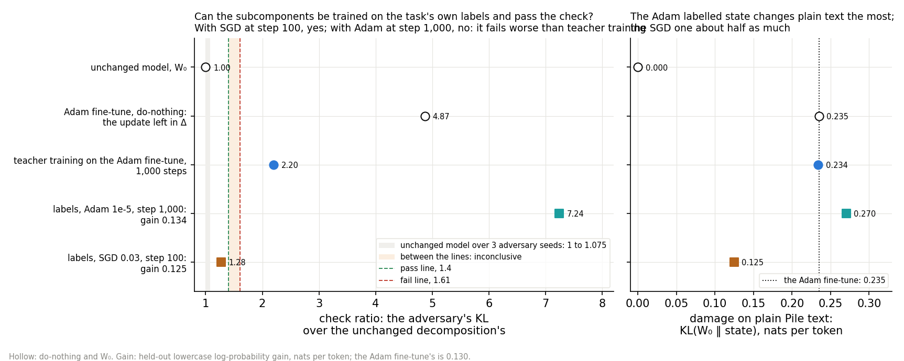
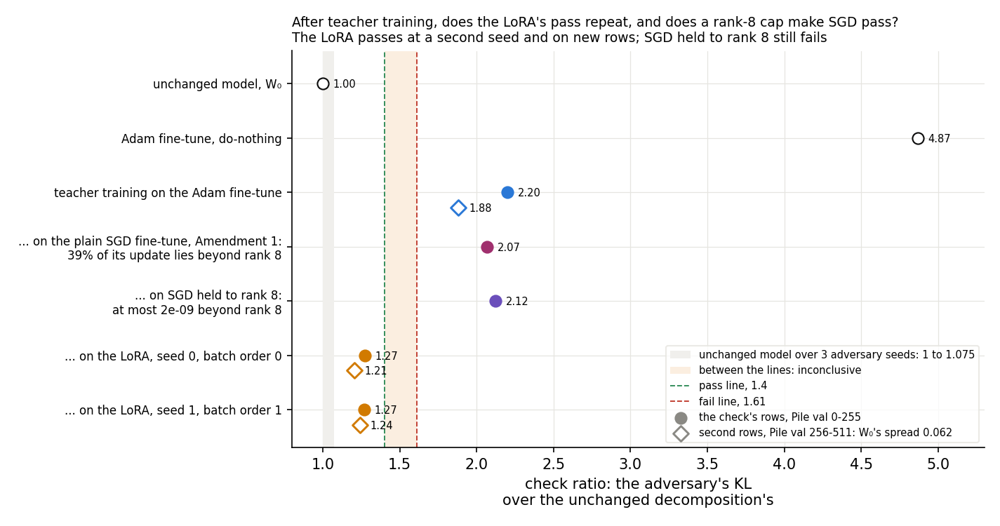
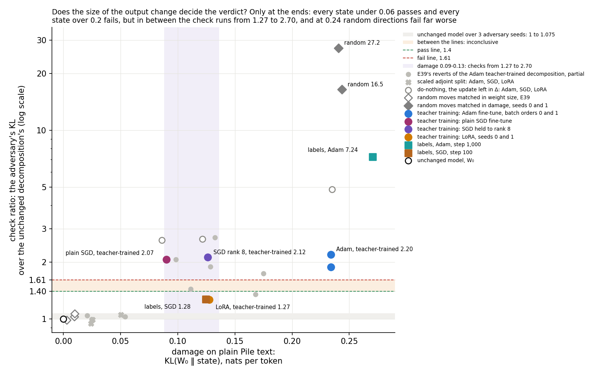

# Analysis: what makes teacher training's decomposition of a broad fine-tune fail the check? (E39 Amendment 2)

*2026-10-28, analysis agent for the lead. Plan: `reports/plans/2026-10-27_plan_broad-fragility.md` → "Amendment 2
(2026-10-28)". Code `experiments/broad_fragility/amend2.py`, which imports `run.py`, and `src/commute/rank_cap.py`.
Every number below is read from `experiments/broad_fragility/results/amend2.json` unless named otherwise. Per-block
check readings come from the log `results/large/amend2.log`. References from earlier runs come from
`results/broad_fragility.json` (E39), `results/amend1.json` (Amendment 1) and E37's
`experiments/teacher_spread/results/teacher_spread.json`, all on the same card with the same unchanged-model readings.
Predictions: `results/predictions_amend2.json`, committed 14:10:49, before the run, unedited. Figures from
`experiments/broad_fragility/plot_amend2.py`. Notebook: `notebooks/E39_broad_fragility.ipynb` → "Amendment 2". E39's
first analysis: `reports/analyses/2026-10-27_analysis_broad-fragility.md`. Words as in `GOALS.md` → Terms. Wording
revised the same day after the independent check `reports/reviews/2026-10-28_review_e39-amend2-check.md`; numbers and
verdicts unchanged.*

**In plain words.** We ran four cheap tests of why teacher training on a broad lowercase fine-tune leaves a
decomposition that fails the paper's adversarial check. The LoRA's pass repeated and a rank-8 cap did not rescue SGD;
labels passed with SGD early but failed with Adam; a random move of the same output change failed far worse. For `GOALS.md`, the broad failure is neither a fixed limit of the
decomposition nor set by how much plain-text outputs move alone. States made in different ways land on both sides of
the lines at the same damage, and which difference between the recipes matters is not tested.

Words used below. **The check** is the paper's adversarial check: a 20-step mask adversary from one random start on
256 Pile rows, adversary seed 0, read as the state's KL over the unchanged decomposition's in the same job. 1 means no
more fragile than the original. It passes at or under 1.40 and fails at or over 1.61. **The excess** is the check
minus 1. **Teacher training** trains the alive subcomponents of the released decomposition to imitate a fine-tuned
model, Γ and Δ frozen; its result is **the teacher-trained decomposition** of that fine-tune. The filed texts quoted
below call it "the copy". **Labelled component training** trains the same subcomponents on the
lowercase task's next-token labels instead, Γ and Δ frozen. **Damage** is $\mathrm{KL}(W_0 \,\|\, \text{state})$ on 64
held-out plain Pile rows, in nats per token: how much a state changes ordinary text. **Gain** is the held-out mean
lowercase log-probability, state minus unchanged model. **Behaviour kept** is a state's gain over the fine-tune's gain.
**Gap** is $\mathrm{KL}(\text{fine-tuned} \,\|\, \text{state})$ on lowercase rows; the unchanged model reads 0.272.

## The answer

The rank-8 LoRA's teacher-trained decomposition passes again, at a second seed and on new rows, so it is a result.
Cutting a plain SGD fine-tune back to rank 8 after every step does not make its teacher-trained decomposition pass. So
a rank-8 cap alone does not explain the LoRA's pass, for this way of capping at one rate and one seed. Trained on the
labels with SGD, a frozen-Γ decomposition reached 96% of the fine-tune's mean gain and passed at step 100. It does not
reproduce the fine-tune's outputs, and with Adam it failed. Random moves matched in damage failed far worse. Damage and
verdict line up only at the ends. In between, states made in different ways pass and fail at the same damage, and
which difference matters is not tested.

> **Something unexpected happened that I cannot explain.** Labelled component training with plain SGD passes. We
> predicted it would fail, at 1.6 to 3. Its gain-matched state, rate 0.03 at step 100, reads 1.28 while keeping 0.96 of
> the Adam fine-tune's gain. The same training with Adam fails at 7.24, worse than the teacher-trained decomposition's 2.20.
>
> Two more things go past what was filed. The damage-matched random moves fail at 16.5 and 27.2, far above the 2 to 5
> expected. And the decision tree's filed reading for that test says the size of the output change can explain the
> broad fail. That survives as a possible account of the Adam fail, since every state read over 0.2 nats fails. It
> fails for the SGD teacher-trained fails: at damage 0.09 to 0.13 the check runs from 1.27 to 2.70. Section 3 sets
> this out.

## What we were trying to test

E39 found that teacher training on E36's lowercase fine-tune leaves a decomposition that fails the check. The Adam
fine-tune's teacher-trained decomposition read 2.20, and Amendment 1's plain SGD fine-tune's teacher-trained decomposition 2.07. A rank-8 LoRA fine-tune's teacher-trained decomposition passed,
at 1.27, on one seed and one set of rows, and nobody knew why. The user approved four cheap tests in one H100 job, on
E39's task, harness and card, to say whether the broad fail belongs to the decomposition or to teacher training.

- **(A) Labels.** Component training on the lowercase task's own labels, starting from the released decomposition,
  for 1,000 steps. Adam ran at two rates and plain SGD at three, with states kept at steps 100, 300 and 1,000. For each
  optimiser, the check reads the one state whose gain is nearest the Adam fine-tune's. It tells "the decomposition
  cannot hold this behaviour" from "teacher training is at fault".
- **(B) Rank cap.** E39's plain SGD fine-tune, with each matrix's change cut to its best rank-8 approximation after
  every step, then teacher-trained. Its rate is picked by E39's gain rule. It tests whether the LoRA passes because its
  update is capped at rank 8 in every matrix.
- **(C) Repeat.** The LoRA fine-tune and its teacher-trained decomposition again at seed 0 and batch order 0, which must reproduce E39. Then
  again at LoRA seed 1 with batch order 1. Both teacher-trained decompositions are also read on a second set of 256 Pile rows, beside the Adam
  teacher-trained decomposition, which must fail there. It tests whether E39's pass was one lucky seed or one lucky set of rows.
- **(D) Damage-matched random move.** E39's random move of the alive $U$ and $V$, scaled by a search until its damage
  is within 5% of the Adam teacher-trained decomposition's, at two noise seeds. E39's random moves were matched in weight size instead, and did
  a twenty-fifth of the damage. It tests whether the check fails any move with this much output change.

**Controls, run first and alone, with an early stop.** All passed, and the LoRA reproduced E39 to four digits.

| control | rule | read | verdict |
|---|---|---|---|
| (i) unchanged model | spread over adversary seeds 0-2 ≤ 0.10; seed 0 per block within 1% of 0.6794, 0.7182 | 0.0748; 0.6794, 0.7182 | pass |
| (ii) Adam fine-tune and its teacher-trained decomposition | gain within 0.005 of 0.1301; check within 3% of 2.2011; kept within 0.01 of 0.998 | 0.1300; 2.2011; 0.9978 | pass |
| (iii) Adam do-nothing, the positive control | check ≥ 1.61 and within 3% of 4.8678 | 4.8678 | pass |
| reproduce E39's LoRA | gain within 0.005 of 0.1479; its teacher-trained check within 3% of 1.2726 | 0.1479; 1.2726 | pass |
| second rows | unchanged model's spread ≤ 0.10; the Adam teacher-trained decomposition fails there | 0.0621; 1.883 | pass |
| the cap held | share of the capped update beyond rank 8 ≤ 1e-4 in every matrix | at most 2.3e-9 | pass |

## What we expected, and why

- **Labels with Adam fail**, at 1.6 to 2.4, low-medium confidence. E37 and E39 found every route to the broad behaviour
  ending near 2, which looked like the decomposition's limit.
- **Labels with SGD fail**, at 1.6 to 3, medium-low confidence. On narrow tasks, SGD component training passed at step
  100 but failed at step 1,000 in E21 and E26, so SGD gave no reason for hope.
- **SGD held to rank 8 fails like plain SGD**, at 1.8 to 2.2, medium-low confidence. Plain SGD's update already has a
  low stable rank, 3.5, so a hard cap was not expected to change much.
- **The LoRA's teacher-trained decomposition passes at seed 1**, at 1.15 to 1.45, medium confidence; and **both LoRA teacher-trained decompositions pass on the second
  rows**, medium-low confidence, since its second block of rows read 1.42 in E39.
- **The damage-matched random move fails**, at 2 to 5, medium confidence. If the check punishes output change as such,
  a random move with the teacher-trained decomposition's damage should fail too.

## What we observed

### 1. Can the subcomponents reach the task's gain and pass when trained on its labels?

**Reading it.** With SGD at step 100, yes; with Adam at step 1,000, no. The SGD state reads 1.28, under the pass line
and close to the LoRA's teacher-trained decomposition. It keeps 0.96 of the Adam fine-tune's gain. The Adam state reads 7.24, far over the Adam
teacher-trained decomposition's 2.20 and over the Adam fine-tune's do-nothing at 4.87. The right panel shows one difference between them. The
Adam state changes plain text more than the fine-tune itself does, 0.270 against 0.235. The SGD state changes it about
half as much, 0.125. So a decomposition with Γ frozen can reach this task's mean gain and pass, in one state at
step 100 and one batch order.

What this does and does not say about "the decomposition's or teacher training's?":

- **It does not show the decomposition's limit.** One frozen-Γ state reaches 96% of the mean gain and passes. So "no
  frozen-Γ state reaches this task's mean gain and passes" is false on this task. It does not show that a state can
  reproduce the fine-tune's outputs.
- **It does not clear teacher training either.** The labelled SGD state does not reproduce the Adam fine-tune. Its gap
  to the fine-tune is 0.135 nats, half the unchanged model's 0.272, where the teacher-trained decompositions sit at 0.01. It learned the task's
  mean gain in its own way. The LoRA's teacher-trained decomposition, which does match its fine-tune, also passes.
- **The SGD pass is at step 100, the step the gain rule chose, not at step 1,000.** In E21 and E26, SGD component
  training on narrow tasks passed at step 100 and failed at step 1,000. At rates 0.01 and 0.03 its later states reach
  gains of 0.15 to 0.17 with damage up to 0.23; at rate 0.1 they lose gain. None was read by the check. Whether this pass survives more training is unknown.
- **The Adam fail sits at the largest damage of any trained state the check read.** Its earlier states had less damage at a similar
  gain: step 100 at rate 1e-5 had gain 0.143 and damage 0.108. The rule chose step 1,000, nearest in gain, and the
  earlier one was not read. E21 found the same: Adam component training failed at its states over 0.2 nats of damage.

So the A test does not hand the fail to the decomposition. It found one passing state at the task's gain, with SGD
at step 100 and one batch order. One task, one adversary start. The labelled Adam state's damage, 0.270, is over the
0.15 to 0.25 filed for it.

| optimiser | rate | step | gain | damage | gap | diverged | read |
|---|---|---|---|---|---|---|---|
| Adam | 1e-5 | 100 | 0.143 | 0.108 | 0.120 | no | — |
| Adam | 1e-5 | 300 | 0.156 | 0.163 | 0.107 | no | — |
| Adam | 1e-5 | 1,000 | 0.134 | 0.270 | 0.132 | no | **chosen: check 7.242, fail** |
| Adam | 3e-5 | 100 | 0.111 | 0.202 | 0.139 | no | — |
| Adam | 3e-5 | 300 | 0.093 | 0.297 | 0.160 | no | — |
| Adam | 3e-5 | 1,000 | −0.033 | 0.503 | 0.298 | yes | — |
| SGD | 0.01 | 100 | 0.122 | 0.069 | 0.141 | no | — |
| SGD | 0.01 | 300 | 0.146 | 0.102 | 0.120 | no | — |
| SGD | 0.01 | 1,000 | 0.166 | 0.153 | 0.097 | no | — |
| SGD | 0.03 | 100 | 0.125 | 0.125 | 0.135 | no | **chosen: check 1.275, pass** |
| SGD | 0.03 | 300 | 0.149 | 0.155 | 0.118 | no | — |
| SGD | 0.03 | 1,000 | 0.154 | 0.229 | 0.105 | no | — |
| SGD | 0.1 | 100 | 0.078 | 0.215 | 0.166 | no | — |
| SGD | 0.1 | 300 | 0.082 | 0.287 | 0.176 | no | — |
| SGD | 0.1 | 1,000 | 0.057 | 0.375 | 0.193 | no | — |

The rule picked correctly: Adam's 0.134 is 0.004 from the fine-tune's 0.130, the nearest of five live states, and
SGD's 0.125 is 0.005 from it, the nearest of nine. The chosen states' stochastic ratios are 1.351 for Adam and 1.084
for SGD. Their largest relative weight change is 0.054 and 0.014, against the Adam teacher-trained decomposition's 0.036.

### 2. Does the LoRA's pass repeat, and does a rank-8 cap explain it?

**Reading it.** The LoRA's pass repeats, and the rank cap does not explain it. The teacher-trained decomposition at seed 0 reads 1.27 again,
and the teacher-trained decomposition at seed 1 with a new batch order reads 1.27 too. On the second 256 Pile rows they read 1.21 and 1.24,
while the Adam teacher-trained decomposition still fails there at 1.88. Holding SGD to rank 8 changed the update a lot: in plain SGD, 39% of
the update's squared size lies beyond rank 8, and the cap left at most 2e-9. Yet its teacher-trained decomposition fails at 2.12, beside plain
SGD's 2.07. The capped SGD's teacher-trained decomposition also does the LoRA's damage, 0.126 against 0.124, and keeps as much of its fine-tune's gain.
So neither this rank cap nor a smaller damage explains the LoRA's pass on its own, at one rate and seed.

What still differs between the capped SGD fine-tune and the LoRA:

- the optimiser, which is Adam for the LoRA;
- the factorisation: the LoRA trains two factors whose product is the change, where capped SGD trains the full matrix
  and cuts it back after each step;
- which rank-8 subspace each one finds;
- the gain, 0.148 for the LoRA against 0.131.

The teacher-trained decompositions fit their fine-tunes about equally well. Teacher training's KL ends at 0.0067 for capped SGD, and at 0.0071
and 0.0097 for the two LoRAs.

The check per block of 128 rows, each block over the unchanged model's same block:

| teacher-trained decomposition of | first rows, block 1 | first rows, block 2 | check | second rows, block 1 | block 2 | check |
|---|---|---|---|---|---|---|
| Adam fine-tune | 1.69 | 2.68 | 2.201 | 1.80 | 1.97 | 1.883 |
| plain SGD, Amendment 1 | 1.16 | 2.93 | 2.067 | — | — | — |
| SGD held to rank 8 | 1.25 | 2.95 | 2.122 | — | — | — |
| LoRA, seed 0, batch order 0 | 1.11 | 1.42 | 1.273 | 1.17 | 1.24 | 1.207 |
| LoRA, seed 1, batch order 1 | 1.09 | 1.44 | 1.269 | 1.22 | 1.26 | 1.243 |

Both SGD teacher-trained decompositions fail on the second block of the first rows alone; their first block reads under 1.40. The SGD teacher-trained decompositions
were not read on the second rows, so whether they fail on new rows is not known. The LoRA teacher-trained decompositions pass every block of
both sets of rows except the first rows' second block, at 1.42 and 1.44, just over the pass line.

| fine-tune | rate | gain | share beyond rank 8, pooled | largest matrix | teacher-trained: check | kept | gap | damage | size |
|---|---|---|---|---|---|---|---|---|---|
| Adam | 3e-5 | 0.130 | — | — | 2.201 | 0.998 | 0.012 | 0.234 | 0.036 |
| plain SGD, Amendment 1 | 0.01 | 0.137 | 0.395 | 0.551 | 2.067 | 0.963 | 0.008 | 0.090 | 0.016 |
| SGD held to rank 8 | 0.03, chosen | 0.131 | 1.0e-10 | 2.3e-9 | 2.122 | 0.960 | 0.007 | 0.126 | 0.020 |
| SGD held to rank 8 | 0.01 | 0.124 | — | — | — | — | — | — | — |
| SGD held to rank 8 | 0.1 | 0.092 | — | — | — | — | — | — | — |
| LoRA, seed 0 | 1e-4 | 0.148 | — | — | 1.273 | 0.964 | 0.009 | 0.124 | 0.017 |
| LoRA, seed 1 | 1e-4 | 0.148 | — | — | 1.269 | 0.972 | 0.007 | 0.127 | 0.018 |

The plain SGD row's shares were read again in this job at rate 0.01, whose gain reproduced Amendment 1's 0.1367. Its
teacher-trained decomposition's numbers are Amendment 1's. Size is the largest relative weight change of any matrix in the teacher-trained decomposition.

### 3. Does the size of the output change explain the broad fail?

**Reading it.** Not in the middle; at the Adam fail it remains possible. The random moves matched to the Adam
teacher-trained decomposition's damage fail, at 16.5 and 27.2, so a change this large in random directions does fail.
The figure puts every state read on the same rows on one axis. Damage and verdict line up only at the ends: every
state read under 0.06 nats passes, and every one over 0.2 fails. In between, in the shaded band of damage 0.09 to
0.13, the check runs from 1.27 to 2.70. There, the LoRA teacher-trained decompositions and the labelled SGD state pass
at damage 0.124 to 0.127. The rank-8 SGD teacher-trained decomposition fails at 0.126, and the plain SGD
teacher-trained decomposition fails at only 0.090. One of E39's partial reverts passes at 0.168. So damage alone does
not set the verdict in the middle band.

The ends are post-hoc groupings across four jobs, not a test. Every state over 0.2 comes from the Adam fine-tune or
from random moves scaled to it, so the high end cannot tell damage from origin. The low end is reverts, adjoint splits
and tiny moves, which remove most of the update or move very little.

At the high end, the size of the check depends on direction. At the same mean damage, the Adam teacher-trained
decomposition reads far below the random moves, 2.20 against 16.5 and 27.2. Those moves needed about five times its
weight change and lost the lowercase gain.

**The filed reading holds only in part.** The tree's text for this test, filed with the predictions, reads:
"A random move with the trained decomposition's damage fails: the check fails any move of the subcomponents that
changes plain-text outputs this much, so the size of the output change, not training's directions, can explain the
broad fail (the LoRA's copy, damage 0.12, then passes by being smaller or better placed)." D's fail branch fired as
filed. Its reading survives as a possible account of the Adam teacher-trained decomposition's fail: every state read
over 0.2 nats fails, though all of them come from the Adam fine-tune or from random moves scaled to it. It fails as an
account of the broad fails in general, because the SGD teacher-trained decompositions fail at damage where three other
states pass. Between 0.121 and 0.128, three states pass and three fail. The random moves' larger excess, 13 and 22
times the trained one's, shows that the check's size depends on direction, not that the verdict at that damage does.
Of the parenthesis, "smaller" fails: the LoRA's state is at 0.124 and the failing rank-8 SGD state at 0.126. "Better
placed" is untested.

The random moves are not like the teacher-trained decomposition in other ways. They lose the lowercase behaviour
outright, keeping −1.86 and −1.88 of it, past the −0.1 to −0.5 filed for them. Their match was on mean damage over 64
rows, not on where the change falls.

| state | damage | check | verdict | source |
|---|---|---|---|---|
| plain SGD teacher-trained decomposition | 0.090 | 2.067 | fail | Amendment 1 |
| E39 revert of layer 3 | 0.098 | 2.072 | fail | E39 |
| E39 revert of the rarely important half | 0.111 | 1.445 | between | E39 |
| LoRA do-nothing | 0.121 | 2.653 | fail | E39 |
| LoRA teacher-trained decomposition, seed 0 | 0.124 | 1.273 | pass | this run, as E39 |
| labelled SGD, step 100 | 0.125 | 1.275 | pass | this run |
| SGD held to rank 8, teacher-trained | 0.126 | 2.122 | fail | this run |
| LoRA teacher-trained decomposition, seed 1 | 0.127 | 1.269 | pass | this run |
| E39 revert of layer 2 | 0.128 | 1.897 | fail | E39 |
| E39 revert of attention | 0.133 | 2.700 | fail | E39 |
| E39 revert of layer 0 | 0.168 | 1.355 | pass | E39 |
| Adam teacher-trained decomposition, batch orders 0 and 1 | 0.234 | 2.201, 1.884 | fail | this run; E37 |
| Adam do-nothing | 0.235 | 4.868 | fail | this run |
| random move matched in damage, seed 1 | 0.241 | 27.241 | fail | this run |
| random move matched in damage, seed 0 | 0.244 | 16.461 | fail | this run |
| labelled Adam, step 1,000 | 0.270 | 7.242 | fail | this run |

The search: seed 0 needed six damage reads and stopped at scale 4.97, damage 0.244, 4.1% over the target. Seed 1
needed four and stopped at 4.76, damage 0.241, 2.9% over. Both are inside the 5% tolerance. Per block, seed 0 reads
17.3 and 15.7 and seed 1 reads 23.3 and 31.0, so neither rests on one block. Stochastic ratios 1.220 and 1.191.

## The decision tree: which branches fire

`amend2.py` wrote the tree's readings under `score.tree`; each was checked here against the scores.

- **Stage 0 and the reproduction of E39's LoRA** passed, so nothing stopped and the C test is read as filed.
- **A, Adam: the fail branch fires.** Filed text: "Component training with labels (Adam) fails too: trained on this
  behaviour by labels or by copying, the subcomponents give a decomposition that fails the check, so the fail is not
  teacher training's alone (GOALS' 'brittle' branch, for this task and these recipes). Read with C." It holds for Adam,
  with the caveat in section 1 that the chosen state has the largest damage of any trained state the check read. No run is attached.
- **A, SGD: the pass branch fires.** Filed text: "SGD component training with labels passes at the gain-matched
  state." The plan's tree named a reading only for Adam passing with SGD failing; the reverse happened, and the tree has
  no branch for it. It qualifies the Adam branch: by labels, the subcomponents can reach the task's mean gain and
  pass, with SGD at step 100.
- **C: stands.** Filed text: "The LoRA's pass replicates at a second seed and on a second set of Pile rows: it is a
  result, and B asks why."
- **A with C: "fail/stands" fires**, read from the Adam half alone. Filed text: "Labels fail, the LoRA's copy passes
  reliably: the decomposition holds a LoRA's broad update but not the full-matrix behaviour under either loss; the
  update's form matters, B says if it is rank." The words "under either loss" hold for Adam only. With SGD, the label
  loss gave a passing state. With labels, SGD at step 100 passed and Adam at step 1,000 failed; optimiser, step and
  damage all differ between the two, so the optimiser is not isolated.
- **B: the fail branch fires, and with C standing it names the next run.** The plan: "*Fail*: the cap does not explain
  it. If C stands, this plan's next branch is a rank-8 LoRA trained with plain SGD on the lowercase task,
  teacher-trained and read, to tell the factorisation from the Adam optimiser: about 15 min, about $1.5, RunPod H100,
  approved with this plan." It is approved as that run and no wider. It has not been started here.
- **D: the fail branch fires.** Its reading survives as a possible account of the Adam fail, but not of the SGD
  teacher-trained fails, as section 3 sets out. No run is attached to it.

## What we learned

The LoRA's pass is a result: two seeds, two batch orders and two sets of rows agree, while the Adam teacher-trained decomposition fails on
both sets. Stable rank, a rank-8 cap and a smaller mean damage each fail to explain the LoRA's pass on their own, at
one rate and seed each, on this task. For `GOALS.md`'s question, update or decomposition, the answer on this task is
neither in its simple form. A frozen-Γ decomposition can reach the task's mean gain and pass, by a LoRA's
teacher-trained decomposition and by labels with SGD at step 100. But teacher-trained decompositions of full-matrix
fine-tunes fail, and labels with Adam fail. At the same mean damage, states made in different ways land on both sides
of the lines, so damage alone does not set the verdict there; which difference between the recipes matters is not
tested. Damage and verdict line up only at the ends.

## How compelling is the evidence

- **What each number is blind to.**
  - The check is one 20-step adversary from one random start, a lower bound on fragility; every pass could read
    higher under a stronger search.
  - The labelled states were each picked from six or nine by gain alone, at one batch order. Their rows are drawn with
    replacement, unlike the fine-tune's. Γ was read at the unchanged model throughout. The SGD pass is at step 100 only.
  - The rank cap is one way of capping, by cutting after each step, at one rate and one seed. The cap removed 39% of
    plain SGD's update by squared size, so it was a real change, not a no-op.
  - The LoRA repeat changes the LoRA's seed and the batch order together, so it cannot say which matters. The second
    rows are one more set of 256.
  - The random moves are isotropic per side and move every alive subcomponent. They were matched in mean damage on 64
    rows, not in where the change falls, and they destroy the lowercase behaviour.
  - Damage is a mean over 64 plain Pile rows; two states with the same mean can differ in where they change the text.
- **Noise floor.** The unchanged model's spread over three adversary seeds is 0.0748 on the first rows and 0.0621 on
  the second. E37's two batch orders of the Adam teacher-trained decomposition read 2.20 and 1.88, a 14% spread. The LoRA teacher-trained decompositions read 1.27 and
  1.27 at two seeds, and 1.21 and 1.24 on the second rows. The labelled SGD state, at 1.28, sits 0.12 under the pass
  line, more than the adversary-seed spread. It was read at one batch order, though, and E37's 14% batch-order spread
  is about 0.18 at 1.28, enough to reach the zone between the lines. The rank-8 SGD teacher-trained decomposition, at 2.12, sits 0.51 over the fail line.
- **Coverage.** One broad task, one card, adversary seed 0. Labels at one batch order. Capped SGD at one rate and one
  seed. The LoRA at two seeds with two batch orders. The SGD teacher-trained decompositions on the first rows only, where their fail rests on
  the second block of 128 rows.

## Surprises

- **Labels with plain SGD pass**, at 1.28, where we predicted a fail at 1.6 to 3. Untested causes, named not asserted:
  - the step-100 state is early, and narrow-task SGD also passed at step 100 in E21 and E26;
  - its damage is half the Adam state's;
  - plain SGD steps may move the subcomponents in directions the adversary cannot exploit.

  Its step-1,000 state was not read.
- **Labels with Adam fail far worse than the teacher-trained decomposition**, 7.24 against 2.20. Most of it sits in the second block of rows,
  which reads 12.2 against 1.95 in the first. The chosen state changes plain text more than the fine-tune itself does.
- **The damage-matched random moves fail far above the range filed**, 16.5 and 27.2 against 2 to 5. At the same mean
  damage, the Adam teacher-trained decomposition reads far below them, 2.20. Those moves needed about five times its
  weight change and lost the lowercase gain, keeping −1.86 and −1.88 of it.
- **The rank-8 cap moved the SGD teacher-trained decomposition's damage up to the LoRA's**, 0.126 against 0.124, and its check did not move,
  2.12 against plain SGD's 2.07. So a smaller damage does not explain the LoRA's pass on its own.
- **The tree's filed reading for D holds only for the Adam fail.** States on the same rows that the D test did not
  include fail it for the SGD teacher-trained fails and the middle band.

## What next

1. **The plan's approved branch: a rank-8 LoRA trained with plain SGD**, teacher-trained and read. About 15 minutes on
   a RunPod H100, about $1.5. A pass would point to the factorisation and a fail to the fine-tune's optimiser, among
   the differences listed in section 2, which also include the subspace and the gain. Not started here; it waits for
   the lead.
2. **The labelled SGD state at step 1,000**, and the Adam state at step 100, read by the check, from the saved
   offsets or a rerun. If SGD fails at step 1,000 and Adam passes at step 100, the A result is E21's pattern on narrow
   tasks again: SGD fails late, Adam fails with damage. The A test's passing state would then be only an early one.
3. **The SGD teacher-trained decompositions on the second rows.** Their fail rests on one block of 128 rows. If they pass on new rows, the
   LoRA-against-SGD contrast weakens to a single block.

## Scorecard

Filed in `experiments/broad_fragility/results/predictions_amend2.json`, committed 14:10:49 before the run, unedited,
sha256 `ff4cce5c…`, as the run brief names. Pass line 1.40, fail line 1.61, both inclusive. Each rule was rechecked
here from the reads; every verdict matches the run's `score`.

| id | claim | rule | read | verdict |
|---|---|---|---|---|
| controls | stage 0, reproduce E39's LoRA, second rows, cap | as in the controls table | all pass | pass |
| P9 | labels with Adam fail | gain-matched state: check ≥ 1.61; gain within 30% of the fine-tune's | check 7.242; gain ratio 1.034 | holds |
| P10 | labels with SGD fail | gain-matched state: check ≥ 1.61; gain within 30% | check 1.275; gain ratio 0.964 | **misses: passes, reversed** |
| P11 | SGD held to rank 8: its teacher-trained decomposition fails | check ≥ 1.61; gain within 30%; every matrix's share beyond rank 8 ≤ 1e-4 | check 2.122; gain ratio 1.011; largest share 2.3e-9 | holds |
| P12 | the LoRA's teacher-trained decomposition at seed 1, batch order 1 passes | check ≤ 1.40; gain within 30% | check 1.269; gain ratio 1.139 | holds |
| P13 | both LoRA teacher-trained decompositions pass on the second rows | each check ≤ 1.40; scored only if the unchanged model's spread there ≤ 0.10 and the Adam teacher-trained decomposition fails there | 1.207 and 1.243; spread 0.062, Adam 1.883 | holds |
| P14 | random moves matched in damage fail | mean check over seeds whose damage is within 5% of the target ≥ 1.61 | seeds 0 and 1 matched, 4.1% and 2.9% off; 16.461 and 27.241, mean 21.851 | holds, far above the filed 2 to 5 |

Gain ratios are each state's held-out gain over this job's Adam fine-tune's, 0.1300. P12's 1.139 is the LoRA's own
gain, 0.1481, over that.

## Not run

- The rank-8 LoRA trained with plain SGD, the plan's approved next branch.
- The check on any labelled state other than the two chosen ones, so neither SGD at step 1,000 nor Adam at step 100.
- A second batch order or seed for labelled training; Γ's importance read at the labelled states.
- A second rate or seed for the capped SGD fine-tune; a LoRA at higher rank.
- The plain and capped SGD teacher-trained decompositions on the second rows; the labelled states on the second rows.
- Per-block readings in the JSON; they are in the log only.
- A third LoRA seed, or the LoRA seed and batch order varied separately.
- Random moves in directions the inputs use, or matched in where the change falls rather than in mean damage.
- Reverts on the LoRA, SGD or labelled states.
- A second broad task; the larger model.

## Provenance

- RunPod H100 80GB HBM3, machine `01M61ENME5T44PXBTWEZVR1C9F`, 2026-10-28. The run went from 14:33:30 to 15:07:58
  UTC, and the log from 14:33:50. The pod was up about 38 minutes in all. Cost $3.65, against the plan's estimate of
  about $4.
- Results `experiments/broad_fragility/results/amend2.json`, status done, sha256 `36a0e864…`. Logs
  `results/large/amend2.log`, `1f80065c…`, and `results/large/amend2_stdout.log`, `270f31a9…`; the latter ends
  "FINISHED (exit 0)".
- Saved bf16 offsets in `results/large/`, each a complete archive of 54 entries: `a2_label_adam.pt` `6ef99675…`,
  `a2_label_sgd.pt` `535adcf2…`, `a2_tt_lora_s0.pt` `20b3d068…`, `a2_tt_lora_s1.pt` `33b793da…`,
  `a2_tt_sgd_r8.pt` `4c9d24df…`. The LoRA's teacher-trained decomposition at seed 0, lost with E39's pod, is now on disk.
- Figures `experiments/broad_fragility/figures/amend2_{labels,lora,size}.png` from `plot_amend2.py`, rendered on the
  cluster's CPU worker. `ruff check` passes on `plot_amend2.py`.
