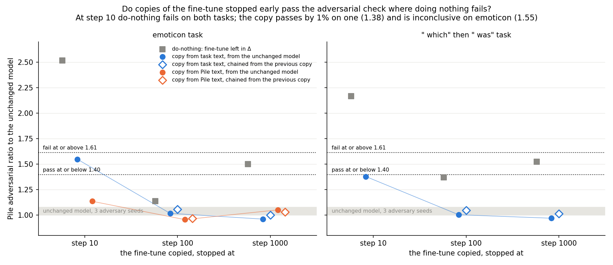
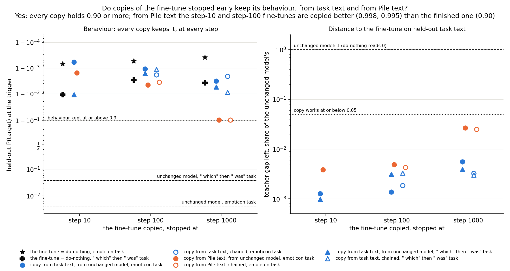
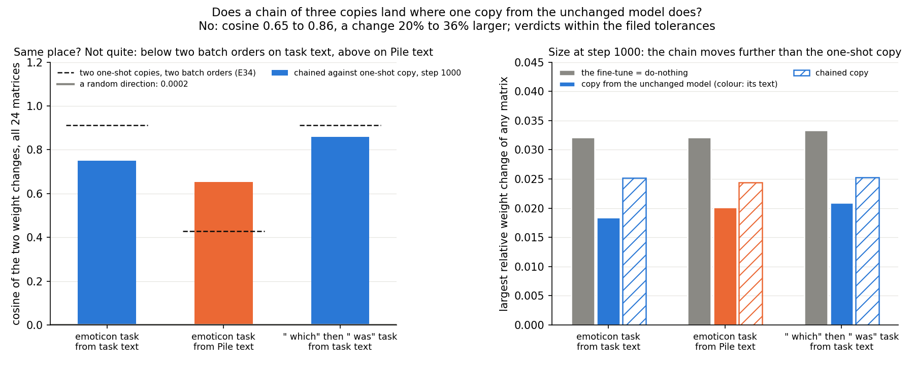
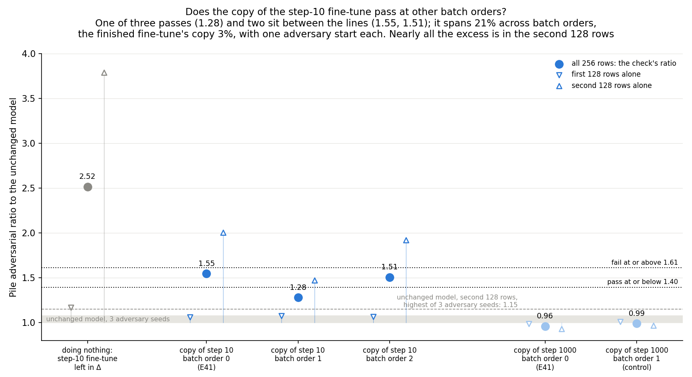
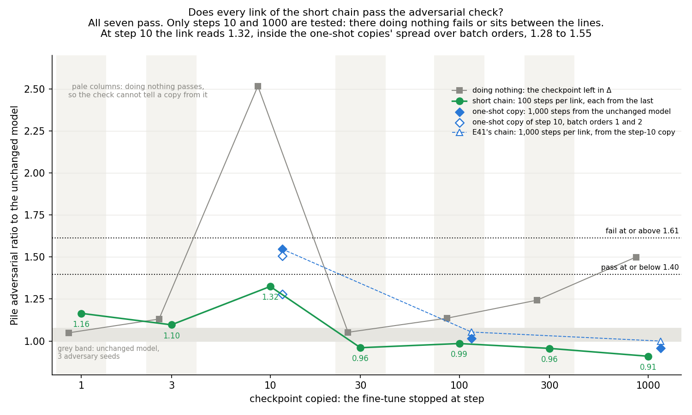
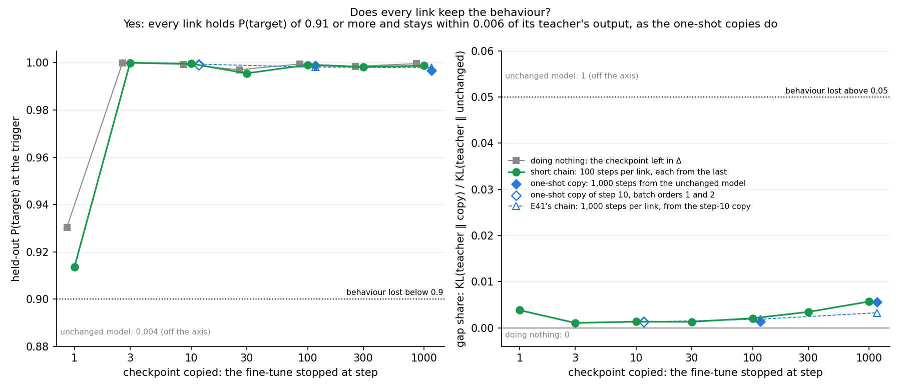
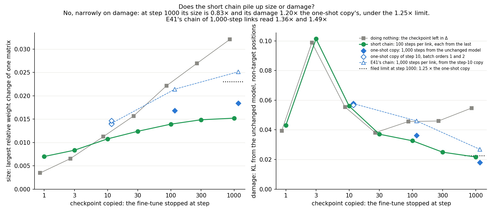

# Analysis: teacher training of early fine-tunes, and applied step after step (E41)

*2026-10-28. Plan `reports/plans/2026-10-28_plan_e41-teacher-path.md`; code `experiments/teacher_training/path.py`;
predictions `experiments/teacher_training/results/predictions_e41.json`, filed 12:02:14, unedited; results
`experiments/teacher_training/results/teacher_training_e41.json`; log `experiments/teacher_training/results/large/run_e41.log`;
notebook `notebooks/E41_teacher_path.ipynb`; figures `experiments/teacher_training/figures/e41_*.png` from
`plot_e41.py`. Gap 3 of `reports/reviews/2026-10-28_review_technique-comparison.md`.*

*Independent check: `reports/reviews/2026-10-28_review_e41-check.md`, corrections applied.*

We stopped one fine-tune early and at its end, and trained the subcomponents to imitate each version, from the
unchanged model and in a chain of three. Every copy kept the behaviour with the residual untouched, but at the one
early step where doing nothing fails the check, one copy passed narrowly and the emoticon copy was inconclusive. So the
earliest update is where teacher training is weakest, and the chain stayed within the filed tolerances while its weight
change grew.

## The answer

Partly. We copied one fine-tune, stopped at three points, into the subcomponents with Δ fixed. Every copy kept the
behaviour. The adversarial check can tell a copy from doing nothing only at step 10, where doing nothing fails. There
one copy passed by about 1% and the emoticon copy was inconclusive, between the lines. A chain of three copies stayed
within the filed tolerances of single copies. Its weight change was larger and its adversarial ratio slightly higher.

*Amendment 1, at the end: at two more batch orders the emoticon step-10 copy passed once and was inconclusive twice, so it sits at the pass line; its reading varied more across orders than finished copies' do, with one adversary start per reading.*

*Amendment 2, at the end: a chain of short copies along the emoticon fine-tune, each from the last, kept the behaviour at all seven checkpoints and passed the check, with size and damage ending within the filed limits; the check sees only two links, and the step-10 one sits at the pass line.*

## What we tested

**Teacher training** is component training of the alive subcomponents' read and write vectors $(U, V)$ with the loss
$\mathrm{KL}(T \,\|\, \text{student})$, where the teacher $T$ is the fine-tuned model; Γ and Δ stay frozen, so Δ cannot
absorb the update. E34's recipe, unchanged: Adam at 1e-5, 1,000 steps, batch-order seed 0. **Task text** is the
fine-tune's own windows with E21's trigger weighting, batch 32. **Pile text** is ordinary Pile training rows from 32,768
onward, batch 8, plain mean KL; run on emoticon only.

**Teachers.** E34's Adam 3e-5 arm-A fine-tune of all 24 matrices, batch 32, seed 0, regenerated in the job. The rate is
constant, so the step-$k$ checkpoint of one 1,000-step run is the fine-tune stopped at $k$: $T_{10}$, $T_{100}$,
$T_{1000}$. Two tasks: emoticon, where an emoticon is followed by `o`, and `r1_t534_v369`, where " which" is followed by
" was".

**States.**
- **One-shot copy** of $T_k$: from $W_0$'s $(U, V)$, 1,000 steps against $T_k$.
- **Chained copy**: from the one-shot copy of $T_{10}$, 1,000 steps against $T_{100}$; from that, 1,000 steps against
  $T_{1000}$. Fresh Adam per link, the same batches as the one-shot copy.
- **Do-nothing** at $T_k$: $\delta W_k$ into Δ, subcomponents and Γ untouched. The reference.

**Numbers per state**, at its last step:
- **Adversarial ratio**: the KL a 20-step mask adversary finds on 256 Pile validation rows, one start, over the same at
  $W_0$ (seed 0). 1 means no change. With this job's $W_0$ floor of 0.0748, pass ≤ 1.396, fail ≥ 1.612, inconclusive
  between. The stochastic-mask ratio is read the same way; `state_verdict` takes the worse of the two, and "below P
  0.9" if the behaviour is lost.
- **Held-out P(target)** at the trigger on held-out windows. $W_0$: 0.004 on emoticon, 0.04 on " which".
- **Gap share**: $\mathrm{KL}(T_k \,\|\, \text{state}) / \mathrm{KL}(T_k \,\|\, W_0)$ on held-out task windows, arm A's
  weighting. $W_0$ reads 1, do-nothing 0.
- **Damage**: the KL from $W_0$ at the held-out windows' non-target positions. **Size**: the largest relative weight
  change of any of the 24 matrices. **Δ's share**: the share of $\|\delta W\|^2$ that Δ carries; ~1e-9 when frozen,
  above 1e-6 is a bug.
- Reported only: **start KL**, the student's loss on its first batch before any update (the same batch for every copy
  of one arm); **P at 100**, held-out P(target) at student step 100; and the **cosine** of the chained and one-shot
  step-1000 weight changes over all 24 matrices.

## Controls

All passed; nothing stopped.

| control | rule | read | verdict |
|---|---|---|---|
| C1, $W_0$ under the Pile harness, adversary seeds 0-2 | `w0_check` passes; floor 0.0748 within 10% | floor 0.07482; PGD 0.699 / 0.751 / 0.707 | pass |
| G1, regenerated $T_{1000}$ | P within 0.005, size within 0.001 of E34 | emoticon 0.99961, 0.03209; " which" 0.99621, 0.03334 | pass ×2, to the digit |
| G3, one-shot task-text copy of $T_{1000}$ | P within 0.005, ratio within 15% of E34 | emoticon 0.99675, 0.9591; " which" 0.99443, 0.9676 | pass ×2, to the digit |
| C2, warm start from the emoticon $T_{10}$ copy, one step at lr 0 against its own weights | step-1 KL ≤ 0.005; δW within 1e-3 | KL 0.0005, δW change 0 | pass |
| Δ untouched, every trained state | Δ's share ≤ 1e-6 | ≤ 2.3e-9 | pass |
| Positive control: do-nothing at emoticon $T_{10}$ | expected 2.52, fail (E22) | 2.516, fail | reproduced |

E22's other two emoticon do-nothing readings also reproduce: 1.136 at $T_{100}$ (E22 1.14) and 1.499 at $T_{1000}$
(1.50); E34's " which" $T_{1000}$ do-nothing 1.522 (1.52).

### The teachers and their do-nothing states

| task | step | P(target) | damage | size | gap at $W_0$, nats | do-nothing ratio | do-nothing stochastic | do-nothing verdict |
|---|---|---|---|---|---|---|---|---|
| emoticon | 10 | 0.9993 | 0.0554 | 0.0113 | 5.078 | 2.516 | 1.003 | fail |
| emoticon | 100 | 0.9995 | 0.0456 | 0.0222 | 5.077 | 1.136 | 0.956 | pass |
| emoticon | 1000 | 0.9996 | 0.0547 | 0.0321 | 5.090 | 1.499 | 0.916 | inconclusive |
| " which" | 10 | 0.9890 | 0.1210 | 0.0133 | 5.616 | 2.164 | 1.009 | fail |
| " which" | 100 | 0.9970 | 0.0635 | 0.0221 | 5.622 | 1.367 | 0.929 | pass |
| " which" | 1000 | 0.9962 | 0.0762 | 0.0333 | 5.622 | 1.522 | 0.892 | inconclusive |

Every teacher holds P ≥ 0.9, so every early teacher stays in the scored predictions. The check sees both step-10 updates and neither step-100
update: at step 100 do-nothing already passes, so the step-100 cells of the first prediction cannot tell teacher training from the trivial
map. Their P and gap-share readings still show the copy learnt the teacher. At step 1,000 do-nothing is only
inconclusive, so only the step-10 cells separate a map from doing nothing on the check.

## Does a copy of an early fine-tune pass where doing nothing fails?

On the " which" task it passes, by 1.4%, well inside the noise; on emoticon it is inconclusive. At step 10 do-nothing
fails on both tasks, at 2.52 and 2.16. The one-shot task-text copy reads 1.376 on " which", 1.4% under the 1.396 line,
against an 11% batch-order spread and a 7.5% adversary-seed floor. On emoticon it reads 1.547: 11% above the pass line
and 4.2% below the 1.612 fail line. At step 100 every copy passes, but so does do-nothing. At step 1,000 every copy
sits at 0.96 to 1.05, where do-nothing is inconclusive on both tasks. The Pile-text copy of emoticon $T_{10}$ passes at
1.13, so the emoticon miss belongs to the task-text copy, not to the teacher alone.

The adjoint split of the same emoticon step-10 update passed at 1.06 with P 0.93 and Δ fixed in E22. At this step the
closed-form map did better on the check than the task-text copy. It loses the behaviour later in the fine-tune: P
0.60 at step 100 and 0.10 at step 1,000, against teacher training's ≥ 0.997 at every step.

### All states

| task | text | teacher | start | P(target) | P at 100 | adversarial | stochastic | verdict | gap share | damage | size | start KL | Δ share |
|---|---|---|---|---|---|---|---|---|---|---|---|---|---|
| emoticon | task | 10 | $W_0$ | 0.9994 | 0.999 | **1.547** | 0.981 | **inconclusive** | 0.0013 | 0.0577 | 0.0141 | 5.427 | 2.3e-09 |
| emoticon | task | 100 | $W_0$ | 0.9989 | 0.997 | 1.016 | 0.947 | pass | 0.0014 | 0.0363 | 0.0168 | 5.331 | 1.5e-09 |
| emoticon | task | 1000 | $W_0$ | 0.9968 | 0.994 | 0.959 | 0.952 | pass | 0.0056 | 0.0180 | 0.0184 | 5.342 | 1.3e-09 |
| emoticon | task | 100 | chain | 0.9982 | 0.997 | 1.054 | 0.942 | pass | 0.0019 | 0.0460 | 0.0214 | 0.130 | 9.8e-10 |
| emoticon | task | 1000 | chain | 0.9979 | 1.000 | 1.000 | 0.938 | pass | 0.0033 | 0.0269 | 0.0251 | 0.065 | 6.7e-10 |
| emoticon | Pile | 10 | $W_0$ | 0.9984 | 0.989 | 1.134 | 0.997 | pass | 0.0038 | 0.0616 | 0.0166 | 0.020 | 2.2e-09 |
| emoticon | Pile | 100 | $W_0$ | 0.9954 | 0.942 | 0.954 | 0.950 | pass | 0.0049 | 0.0552 | 0.0184 | 0.024 | 1.8e-09 |
| emoticon | Pile | 1000 | $W_0$ | 0.9021 | 0.339 | 1.049 | 0.904 | pass | 0.0266 | 0.0580 | 0.0201 | 0.056 | 1.2e-09 |
| emoticon | Pile | 100 | chain | 0.9965 | 0.997 | 0.967 | 0.956 | pass | 0.0043 | 0.0480 | 0.0205 | 0.050 | 1.5e-09 |
| emoticon | Pile | 1000 | chain | 0.9030 | 0.948 | 1.027 | 0.908 | pass | 0.0251 | 0.0609 | 0.0244 | 0.041 | 8.6e-10 |
| " which" | task | 10 | $W_0$ | 0.9892 | 0.991 | 1.376 | 0.975 | pass | 0.0010 | 0.1229 | 0.0142 | 5.023 | 2.1e-09 |
| " which" | task | 100 | $W_0$ | 0.9984 | 0.996 | 1.002 | 0.924 | pass | 0.0031 | 0.0583 | 0.0194 | 4.997 | 1.1e-09 |
| " which" | task | 1000 | $W_0$ | 0.9944 | 0.993 | 0.968 | 0.929 | pass | 0.0039 | 0.0422 | 0.0209 | 4.964 | 1.1e-09 |
| " which" | task | 100 | chain | 0.9988 | 0.997 | 1.044 | 0.916 | pass | 0.0033 | 0.0625 | 0.0215 | 0.171 | 8.9e-10 |
| " which" | task | 1000 | chain | 0.9911 | 0.994 | 1.011 | 0.916 | pass | 0.0030 | 0.0502 | 0.0252 | 0.062 | 6.8e-10 |

The start KL of a Pile-text copy is read on a Pile batch, where $W_0$ is already close to every teacher, so it is not
comparable with the task-text column.

### The one miss, read two ways

The first prediction asked every early task-text copy to pass with gap share ≤ 0.05. The emoticon $T_{10}$ copy has gap share 0.0013
and P 0.9994, but its adversarial ratio is 1.547, inconclusive, so it does not "work" by the filed rule. The score's
`check_sees_the_update` field marks this cell `true`: its do-nothing state reads above the pass band, 2.516, fail.
Of the first prediction's four cells, only the two step-10 cells have power. They read one pass by 1.4% and one
inconclusive. A high-lean prediction failed in the cell where the check had full power.

Both readings hold, and neither is re-scored here.
- **Against the line**: on the smallest and most fragile update we gave it, the map does not reach a pass, on one of
  the two tasks. The other step-10 copy passes by 0.019.
- **Against doing nothing**: the copy removes $(2.516 - 1.547)/(2.516 - 1) = 0.64$ of the excess the adversary finds
  when the same update sits in Δ. The " which" $T_{10}$ copy removes 0.68 of its do-nothing excess. Both step-10
  copies keep the behaviour and sit closer to their teacher than any later copy, gap share 0.0013 and 0.0010.

So for small updates: the emoticon copy is inconclusive at 1.547, 11% above the pass line and 4.2% below the fail
line. It removes about two-thirds of do-nothing's excess over $W_0$, with its behaviour intact. The 4.2% to the fail
line is inside the 7.5% adversary-seed floor, and its excess sits in one 128-row batch, below. A rerun could land in
pass, inconclusive or fail. To pass it would need a 9.8% drop, about the largest batch-order spread of a task-text
copy's ratio seen in E34 Amendment 4, "up to 11%".

Two further readings from the log, not scored:
- The harness reads the 256 rows as two 128-row batches, each with its own adversary. For the emoticon $T_{10}$ copy
  the batches read 0.722 and 1.440 against $W_0$'s 0.679 and 0.718, ratios 1.06 and 2.00. Do-nothing at $T_{10}$
  reads 1.17 and 3.79. The excess sits in the same batch for both. A ratio of 2.00 on that batch alone would read fail;
  $W_0$'s second batch spreads 20% over adversary seeds 0-2, 0.718 / 0.828 / 0.690, far below it. For the " which"
  $T_{10}$ copy the excess is spread over both batches, 1.37 and 1.38.
- Both step-10 task-text copies reproduce their teacher's damage elsewhere in full, 1.04 and 1.02 times it, and are
  larger than the teacher, 1.25 and 1.07 times its size. Copies of $T_{1000}$ do 0.33 and 0.55 of their teacher's
  damage at 0.57 and 0.63 of its size. The emoticon $T_{10}$ Pile-text copy also does 1.11 times the teacher's damage
  and passes at 1.13, so damage alone does not account for the miss.

## Do copies of early fine-tunes keep the behaviour?

Yes, every copy. Every copy holds P ≥ 0.90 at the trigger against 0.004 and 0.04 for $W_0$. Every copy's gap share is
below 0.027, and every early copy's below 0.005. The Pile-text copies did better on early teachers than on the
finished one: P 0.998 and 0.995 at $T_{10}$ and $T_{100}$, against 0.902 at $T_{1000}$, and gap share 0.004 and 0.005
against 0.027. At student step 100 the Pile-text copy of $T_{10}$ already holds 0.989; of $T_{1000}$, 0.339. The
$T_{1000}$ Pile-text copy reproduces E34's: P 0.902, ratio 1.05.

## Does a chain of copies along the fine-tune pile up error?

Not on any scored number, over a chain of three checkpoints, steps 10, 100 and 1,000, with 1,000 student steps per
copy. Every chained copy passes, keeps P ≥ 0.90 and leaves Δ alone, and all six filed comparisons hold. But on task
text the chained adversarial ratio is 4-5% higher in all four cells, and two unfiled quantities grow from the second
link to the third in every group.

| task | text | teacher | chain ratio ÷ one-shot ratio (≤ 1.25) | chain P − one-shot P (≥ −0.01 task, −0.05 Pile) | chain gap share − one-shot (≤ +0.005 task, +0.02 Pile) | both verdicts | chain size ÷ one-shot size | holds |
|---|---|---|---|---|---|---|---|---|
| emoticon | task | 100 | 1.038 | −0.0008 | +0.0005 | pass, pass | 1.27 | yes |
| emoticon | task | 1000 | 1.043 | +0.0011 | −0.0023 | pass, pass | 1.36 | yes |
| " which" | task | 100 | 1.042 | +0.0005 | +0.0002 | pass, pass | 1.11 | yes |
| " which" | task | 1000 | 1.045 | −0.0033 | −0.0009 | pass, pass | 1.20 | yes |
| emoticon | Pile | 100 | 1.013 | +0.0011 | −0.0006 | pass, pass | 1.12 | yes |
| emoticon | Pile | 1000 | 0.979 | +0.0009 | −0.0015 | pass, pass | 1.21 | yes |

- **Same sign on task text.** The chained ratio is 4% to 5% above the one-shot's in all four task-text cells. That is
  inside the 25% tolerance, the 11% batch-order spread and the 7.5% adversary-seed floor, but it is one sign four
  times. On Pile text it is +1% and −2%.
- **Different states.** Cosine of the chained and one-shot step-1000 weight changes: 0.750 and 0.858 from task text,
  0.653 from Pile text, against 0.913 and 0.429 between two batch orders of E34's copies of another teacher, the
  " which" SGD fine-tune (E34 Amendment 5); a random direction 2e-4.
- **Larger, and growing link by link** (not filed). The chained change is 1.20 to 1.36 times the one-shot copy's size
  at step 1000, still below the fine-tune's own 0.032-0.033. Both its size and its damage elsewhere, relative to the
  one-shot copy's, grow from the second link to the third in all three groups:

  | group | size ÷ one-shot, T100 → T1000 | damage ÷ one-shot, T100 → T1000 |
  |---|---|---|
  | emoticon, task text | 1.27 → 1.36 | 1.27 → 1.49 |
  | " which", task text | 1.11 → 1.20 | 1.07 → 1.19 |
  | emoticon, Pile text | 1.12 → 1.21 | 0.87 → 1.05 |

  That is the pattern accumulation would show, in quantities nobody filed; two links cannot tell a trend from noise,
  and it is untested. The short-links branch should file a prediction on it.
- **Gap share at step 1000 is lower for the chain**: 0.0033 against 0.0056 on emoticon, 0.0030 against 0.0039 on
  " which", 0.0251 against 0.0266 on Pile text.
- **Head start.** On task text the first link starts 0.13 and 0.17 nats from $T_{100}$, against 5.3 and 5.0 from
  $W_0$; the second link 0.065 and 0.062 from $T_{1000}$. On Pile text the chain's P at student step 100 against
  $T_{1000}$ is 0.948, against the one-shot copy's 0.339.

## What we learned

Teacher training keeps the behaviour of every early teacher with Δ untouched, from task text on two tasks and from Pile
text on emoticon. On the adversarial check, at the one step where doing nothing fails, one step-10 copy passed by 1.4%
and the other was inconclusive. The step-10 task-text copies read the highest ratios of any trained state, so the small
updates `GOALS.md` asks about are where this map is weakest, on one seed, one batch order and one adversary start.
Along this fine-tune the adjoint split keeps Δ fixed and passes, but loses behaviour after step 10 (E22). At step 10,
though, it passed at 1.06 where the task-text copy was inconclusive. A chain of three copies stayed within the filed
tolerances of single copies on every scored number. Its size and damage elsewhere grew from link to link, which is
what the short-links run must test.

## How compelling is the evidence

- **One draw of everything**: one fine-tune seed, one batch order, one 20-step adversary start on 256 Pile rows. E34
  Amendment 5 showed a second start can read a fine-tune left in Δ six times higher, so every pass is a lower bound
  (`decisions.md`, 2026-10-27: one start kept).
- **Two trigger tasks, one Adam fine-tune each**, both behaviours the model half has. Pile-text copies on emoticon only.
- **Power**: the check sees both step-10 updates (do-nothing fails) and neither step-100 update (do-nothing passes). The
  step-100 cells of the first prediction hold but carry no information about the map.
- **Noise floor** (E34 Amendment 4, a second batch order, H100): ratio up to 11% on task text and 25% on Pile text; P
  0.005 and 0.032; gap share 0.002 and 0.010. $W_0$'s adversary-seed floor here 7.5%.
- **The chain had more training**: 2,000 or 3,000 student steps in total against the one-shot's 1,000. Its adversarial
  ratio was still 4-5% higher on task text, while its gap share at step 1000 was lower. The extra steps also grew its
  change and its damage elsewhere.
- **The cosine references** come from another teacher and count directions that carry no behaviour; they bound how
  alike the total changes are, not where the behaviour sits.

## Surprises

- **The first prediction failed as filed, on one cell, at a high lean.** We expected every early task-text copy to work. The emoticon
  $T_{10}$ copy read 1.547, inconclusive, with its behaviour and gap intact. It failed in the only cell where the check
  had full power, 4.2% under the fail line, inside the adversary-seed floor; a rerun could read pass, inconclusive or
  fail. The plan's decision tree sends it to a batch-order rerun.
- **Early fine-tunes are easier to copy from Pile text than the finished one**: 0.998 and 0.995 against 0.902, where
  the filed lean was low.
- **Step-10 copies are larger than their teachers** and reproduce their damage in full; copies of the finished
  fine-tune are smaller and do a third to a half of it. Not filed.
- **The chained change grows** by 11% to 36% over the one-shot copy's, more at the third link than at the second in all
  three groups, and so does its damage elsewhere. Its task-text ratios sit 4% to 5% above the one-shot's in all four
  cells. Not filed; each within noise, but one sign every time.
- **The adjoint split did better at step 10** on the check: 1.06 with P 0.93 in E22, where the task-text copy of the same
  update read 1.547.

## What next

1. **The emoticon $T_{10}$ task-text copy at batch orders 1 and 2** (E41 Amendment 1; approved branch, Amendment 4's
   recipe, about $1, H100). The plan's branch reads "if its verdict fails with the behaviour kept"; this cell's verdict
   is inconclusive, and the amendment reads "fails" as "not pass", the first prediction's verdict condition. The
   behaviour is kept, so the 3,000-step branch does not apply. Its predictions are filed first and must cover every
   outcome: pass, inconclusive or fail at each batch order, and a mixed result. Either way a Blocking card on early
   updates and the weak version goes to the user, as the plan's tree says.
2. **Short chain links** (approved branch, "Amendment 2 of E41", about $1.5): emoticon, task text, a chain over the
   fine-tune's checkpoints 1, 3, 10, 30, 100, 300, 1000 with 100 student steps per link, read at every link against
   this run's one-shot copies. Predictions filed first, including one on the size and damage growth seen here. If every
   link passes, the map can run alongside training; if the ratio, the size or the damage grows link by link, it needs a
   reset.

## Scorecard

Rules as filed in `predictions_e41.json`; the run's `score` block, checked here by hand against the table above.

| id | claim | rule | read | verdict |
|---|---|---|---|---|
| C1 | $W_0$ reads its known floor | `w0_check`; floor 0.0748 within 10% | 0.07482 | pass |
| G1 | regenerated $T_{1000}$ = E34's | P within 0.005, size within 0.001 | 0.99961 / 0.03209; 0.99621 / 0.03334 | pass ×2 |
| G3 | one-shot $T_{1000}$ task-text copy = E34's | P within 0.005, ratio within 15% | 0.99675 / 0.9591; 0.99443 / 0.9676 | pass ×2 |
| C2 | warm start reproduces its start | step-1 KL ≤ 0.005; δW within 1e-3 | 0.0005; 0 | pass |
| — | Δ untouched in every trained state | Δ's share ≤ 1e-6 | ≤ 2.3e-9 | pass |
| P1 | early teachers copied from task text work | every cell (task × $T_{10}$, $T_{100}$): verdict pass and gap share ≤ 0.05 | emoticon $T_{10}$ 1.547 inconclusive, gap 0.0013; emoticon $T_{100}$ 1.016; " which" $T_{10}$ 1.376; " which" $T_{100}$ 1.002; all gaps ≤ 0.0031. Check sees the update: $T_{10}$ cells yes, $T_{100}$ cells no | **fails as filed** (1 of 4 cells; lean high). Of the two cells with power, one passes by 1.4% and one is inconclusive |
| P2 | early teachers copied from Pile text, emoticon | learnt if works; neither if P < 0.5; else between | $T_{10}$ P 0.9984, 1.134 pass, gap 0.0038; $T_{100}$ P 0.9954, 0.954 pass, gap 0.0049 | **learnt** (lean learnt, low) |
| P3 | chain not worse, task text | at $T_{100}$, $T_{1000}$ per task: pass where one-shot passes; ratio ≤ 1.25×; P ≥ −0.01; gap ≤ +0.005 | 4 of 4 cells, table above | **holds** (lean high) |
| P4 | chain not worse, Pile text, emoticon | as P3 with 1.25×, −0.05, +0.02 | 2 of 2 cells | **holds** (lean medium) |

## Not run

- The emoticon $T_{10}$ task-text copy at batch orders 1 and 2, the approved branch for the first prediction's miss.
- Short chain links and finer chains, the approved branch for the chain predictions holding; a one-shot copy trained 3,000 steps
  to match the chain's total.
- SGD or LoRA teachers; r0 and the cipher tasks; Pile-text copies on the " which" task.
- A second batch order or fine-tune seed; more adversary starts, a longer adversary, the budget adversary.
- The adjoint split of the early teachers (E22 read it); the split of the gain at the trigger into its parts.
- No states were saved; any follow-up regenerates one deterministically in about 3 min.

## Provenance

- RunPod NVIDIA H100 80GB HBM3; job 12:15:12 to 12:58:25 on 2026-10-28, 43.2 min of job, about $3.2 in all. Pod time
  and pod ID are not recorded in the repo. Results committed in a450fde.
- `teacher_training_e41.json` sha256 `aeb17705e38a47409981b4165e7bd8bd17f2a9e0118cf1b64a779414a76747a7`.
- `predictions_e41.json` sha256 `9e442abc41e89b673e1e85d0d345886a520a4fff589cb8b22d28a1cd9d95cf6d`.
- `large/run_e41.log` sha256 `9085946bb2b9ed50ae2201ed539306bf7eb7e8cf9d6216846dd19b4be3024b83`.
- Figures: `uv run python experiments/teacher_training/plot_e41.py`, from the results JSON only.
- Independent check: `reports/reviews/2026-10-28_review_e41-check.md`, corrections applied.

## Amendment 1: the emoticon step-10 copy at two more batch orders

*2026-10-28. Plan `reports/plans/2026-10-28_plan_e41-teacher-path.md` → "Amendment 1"; code
`experiments/teacher_training/path_amend1.py`; predictions `experiments/teacher_training/results/predictions_e41_amend1.json`,
filed 13:23:39, one commit (d95a037), unedited; results `experiments/teacher_training/results/teacher_training_e41_amend1.json`;
log `experiments/teacher_training/results/large/run_e41_amend1.log`; figure `figures/e41_amend1_seeds.png` from
`plot_e41_amend1.py`; notebook `notebooks/E41_teacher_path.ipynb` → "Amendment 1".*

*Independent check: `reports/reviews/2026-10-28_review_e41-amend1-check.md`, corrections applied.*

We trained the subcomponents to imitate the fine-tune stopped at step 10 twice more, changing only the order in which
the training batches arrive. One of the three copies passed the adversarial check and two sat between the pass and fail
lines, so on this step teacher training sits at the pass line. Its reading varied more across batch orders than any
finished copy's has, but each reading used one adversary start, so part of that may be the adversary's.

### The answer

At the line. We retrained the copy of the step-10 emoticon fine-tune at two more batch orders. One of the three copies
passes the adversarial check, at 1.28. The other two sit between the lines, at 1.55 and 1.51. Every copy keeps the
behaviour, and each removes 64% to 82% of the excess that leaving the update in Δ shows on the check. Across three
orders the reading spans a fifth. With one adversary start per reading, how much of that is batch order is untested.

### What we tested

**The update and the copy.** The teacher is E41's emoticon fine-tune stopped at step 10, regenerated in the job. The
copy is teacher training by E34's task-text recipe, exactly as in E41. The alive subcomponents' read and write vectors
are trained for 1,000 steps against the teacher, with Γ and Δ frozen. The one change is the batch-order seed, 1 and 2
against E41's 0. It sets which task windows form each batch and in what order, by Amendment 4's code. Each copy is read
at its last step through the same harness, on the same H100 type, with the same single adversary start.

**The question.** Is E41's inconclusive 1.547 one draw from a spread that mostly passes, mostly fails, or sits in the
band? And does the reading vary more across batch orders than for copies of finished fine-tunes? In E34 Amendment 4, a
second batch order moved those by up to 11.1% on task text. On emoticon it moved them by 3.2% and 0.1%.

**A new reading: the two blocks.** The harness reads its 256 Pile rows as two blocks of 128, each with its own
adversary. A block's ratio is its adversarial KL over the unchanged model's on the same block. The mean of the two is
the check's ratio. E41's step-10 copy had put most of its excess in the second block.

**Reading the ratio.** It is 1 for the unchanged model. With this job's floor of 0.0748, a ratio at or below 1.396
passes and one at or above 1.612 fails. Leaving the step-10 update in Δ reads 2.516. The share of that excess a copy
removes is $(2.516 - r)/(2.516 - 1)$ for a copy reading $r$: 0 is doing nothing, 1 is the unchanged model.

### What we expected

- **The median verdict of the three orders: inconclusive**, at medium confidence. Emoticon's finished copies moved by
  at most 3.2% with batch order, and passing needed a drop of almost 10%.
- **Both new readings within 11.1% of 1.547**, at medium confidence: that is, from 1.375 to 1.718. The named risk was
  the one-block excess, which could make this copy more sensitive to batch order.

### Controls

All passed; nothing stopped. The seed was applied. The strongest sign is that the finished fine-tune's copy at order 1
reproduced Amendment 4's to the digit. Also, each order saw a different first batch: the step-10 copy's loss on it was
4.986 and 4.962 at the new orders, against 5.427 at order 0.

| control | rule | read | verdict |
|---|---|---|---|
| C1, $W_0$ under the Pile harness, adversary seeds 0-2 | `w0_check`; floor 0.0748 within 10% | floor 0.07482; PGD 0.699 / 0.751 / 0.707; seed-0 blocks 0.6794 / 0.7182 | pass, equal to E41's |
| G1, regenerated $T_{10}$ and $T_{1000}$ | P within 0.005, size within 0.001 of E41 | 0.99931 / 0.01125; 0.99961 / 0.03209 | pass, to the digit |
| G2, task-text copy of $T_{1000}$ at batch order 1 | P within 0.005 of 0.99790, ratio within 15% of 0.99007 (Amendment 4) | 0.99790, 0.99007 | pass, to the digit |
| positive control, do-nothing at $T_{10}$ | expected 2.516, fail; blocks 1.17 / 3.79 | 2.516, fail; blocks 1.17 / 3.79 | reproduced |
| Δ untouched, both new copies | Δ's share ≤ 1e-6 | 2.4e-9, 2.2e-9 | pass |

### Does the step-10 copy pass at other batch orders?

At one order of three. Order 1 reads 1.280, a pass by 8.3%. That margin is just outside the unchanged model's 7.5%
spread across adversary starts. Order 2 reads 1.505, inconclusive and 6.6% under the fail line. With E41's 1.547 at
order 0, the median verdict is inconclusive, as leaned. No order fails, and no copy loses the behaviour.

| batch order | adversarial ratio | verdict | blocks 1 / 2 | P(target) | gap share | excess removed | stochastic | size | damage | start KL | P at 100 | Δ share |
|---|---|---|---|---|---|---|---|---|---|---|---|---|
| 0 (E41) | 1.547 | inconclusive | 1.06 / 2.00 | 0.9994 | 0.0013 | 0.64 | 0.981 | 0.0141 | 0.0577 | 5.427 | 0.999 | 2.3e-9 |
| 1 | **1.280** | **pass** | 1.07 / 1.47 | 0.9991 | 0.0014 | 0.82 | 0.979 | 0.0140 | 0.0572 | 4.986 | 0.999 | 2.4e-9 |
| 2 | **1.505** | **inconclusive** | 1.07 / 1.92 | 0.9990 | 0.0013 | 0.67 | 0.979 | 0.0147 | 0.0566 | 4.962 | 0.999 | 2.2e-9 |
| do-nothing | 2.516 | fail | 1.17 / 3.79 | 0.9993 | 0 | 0 | 1.003 | 0.0113 | 0.0554 | — | — | 1 |

Every copy holds P 0.999 at the trigger, against 0.004 for the unchanged model. Every copy keeps its gap share near
0.0013. Each does the teacher's full damage elsewhere, 1.02 to 1.04 times it. Each is 24% to 30% larger than the
teacher. The stochastic ratio passes everywhere, so the verdict is the adversarial ratio's.

### Does the reading vary more across batch orders than for finished copies?

By the filed rule, yes. Order 1 read 17.3% below order 0, outside the 11.1% filed. Order 2 read 2.7% below it. Over
the three orders, the largest reading is 21% above the smallest. In the same job, the finished fine-tune's copy at
order 1 read 0.990, which is 3.2% from E41's reading of it at order 0.

Batch order is one of two noise sources here, not a shown cause. Each reading had one adversary start, and a different
state is a different problem for the adversary. The copies agree on every number the adversary does not touch. Their
stochastic ratios lie between 0.979 and 0.981, their damage between 0.057 and 0.058, and their first-block ratios
between 1.06 and 1.07. They differ only in what the adversary finds on the second 128 rows, 1.47 to 2.00. The finished
copies read near 1, where the unchanged model's spread across starts is 7.5%. On its second block alone the unchanged
model spans 20% across starts. Whether the adversary's own variation grows with the excess is unmeasured. So whether
the copy or the adversary's start moved is untested.

### Where is the excess?

Nearly all of it is in the second block of 128 rows, at every order: 86% to 94% of the excess over 1. The first block
reads 1.06 to 1.07 at all three orders. That is at or just above the unchanged model's own range across adversary
starts there, 0.99 to 1.06. The second block reads 2.00, 1.47 and 1.92. The unchanged model's second block ranges from
0.96 to 1.15 across adversary starts. Doing nothing reads 3.79 there. So every order leaves a real excess on the same
128 rows, and its size varies across orders, from 1.47 to 2.00. Which rows carry it, and why, is untested.

### What we learned

On the step-10 update of this fine-tune, teacher training from task text sits at the pass line. Across three batch
orders it passed once and was inconclusive twice, never failing and always keeping the behaviour. It removed 64% to 82%
of the excess that leaving the update in Δ shows on the check. Its reading varied more across batch orders than any
finished copy's, with the adversary's start not separated. So a single reading of an early copy near the line can land
on either side of it. On both tasks the step-10 copies read closest to the pass line of any copy; emoticon was read at
three orders and " which" at one. At this same step the adjoint split passed at 1.06 in E22 with P(target) 0.93,
against the copies' 0.999. It loses the behaviour later in the fine-tune.

### How compelling is the evidence

- **Three batch orders**, enough to see a spread but not to estimate one. One fine-tune seed, one task, an Adam
  fine-tune, the 67M model.
- **One adversary start per state**, as `decisions.md` keeps it, so a pass is a lower bound. That start cannot be told
  apart from batch order here.
- **The 256 rows are two blocks**, and the excess sits in one. A check on other Pile rows could read this copy
  differently.
- **The references are clean**: the seeded code path reproduced Amendment 4's finished copy to the digit, and doing
  nothing reproduced E41's reading block for block.

### Surprises

- **The spread prediction failed.** We filed that both new readings would lie within 11.1% of 1.547, at medium
  confidence. Order 1 read 1.280, 17% lower. Its reading varied more across orders than any finished copy's measured
  so far, with the adversary's start not separated.
- The median verdict came out inconclusive, as leaned. No order failed, and no copy lost the behaviour.

### What next

The plan's tree sends this outcome, inconclusive with the spread prediction failed, to a Blocking card on early
updates and the weak version, drafted below. No run is proposed before the user decides.

### Scorecard (Amendment 1)

Rules as filed in `predictions_e41_amend1.json`; the run's `score` block, checked here by hand against the results file.

| id | claim | rule | read | verdict |
|---|---|---|---|---|
| C1 | $W_0$ reads its known floor | `w0_check`; floor 0.0748 within 10% | 0.07482 | pass |
| G1 | regenerated $T_{10}$, $T_{1000}$ = E41's | P within 0.005, size within 0.001 | 0.99931 / 0.01125; 0.99961 / 0.03209 | pass ×2 |
| G2 | seeded path = Amendment 4's | $T_{1000}$ copy at order 1: P within 0.005 of 0.99790, ratio within 15% of 0.99007 | 0.99790, 0.99007 | pass |
| — | Δ untouched | Δ's share ≤ 1e-6 | 2.4e-9, 2.2e-9 | pass |
| P1 | median verdict over batch orders 0-2 | behaviour lost if any P < 0.9 or gap share > 0.05; else median of pass < inconclusive < fail | inconclusive / pass / inconclusive; counts 1 pass, 2 inconclusive; not split; near a line: orders 0 and 2 (fail line), order 1 none | **inconclusive** (lean inconclusive, medium) |
| P2 | both new orders within 11.1% of 1.54653, inclusive | 1.3748 ≤ ratio ≤ 1.7182 at orders 1 and 2 | 1.2797 (0.827 × order 0), 1.5054 (0.973 ×); max/min − 1 = 0.209 | **fails** (lean holds, medium) |

### Not run (Amendment 1)

- Adversary seeds 1 and 2 on the step-10 copies, which would separate adversary-start noise from batch order; the
  160-step budget adversary.
- A second set of Pile rows for the check.
- $T_{100}$ copies at other orders, where doing nothing passes, and a $T_{1000}$ copy at order 2.
- The " which" step-10 copy and the Pile-text step-10 copy at other orders.
- A 3,000-step copy, a warm start from the adjoint split, a second fine-tune seed, other tasks.
- Which Pile rows in the second block carry the excess.
- No states were saved; each copy regenerates deterministically in about 2 minutes.

### Provenance (Amendment 1)

- RunPod NVIDIA H100 80GB HBM3; job about 13:37 to 13:47:41 on 2026-10-28, about 11 min of job, about $1.1 in all
  (results commit 3f443e1). Pod time and pod ID are not recorded in the repo.
- `predictions_e41_amend1.json` sha256 `c4a7f6601bc6bca520e82caacbf06e0cfb786cfbd815b8f05a663c9db00b4dd4`.
- `teacher_training_e41_amend1.json` sha256 `c84241bfb8c99ce0465a3a358c9594af4fa43481d2e3a0172902e761c7ef0437`.
- `large/run_e41_amend1.log` sha256 `64d40de46f9dc7e8bcb710e5cd1c7b6339315175502764424a46655dd47d35eb`.
- Order 0's block ratios are from E41's log, `results/large/run_e41.log` lines 164-165 for the step-10 copy and
  149-150 for the finished copy, over $W_0$'s seed-0 blocks; E41 stored none.
- Figure: `uv run python experiments/teacher_training/plot_e41_amend1.py`. It reads the two results files, and
  hard-codes order 0's block values for both teachers from those E41 log lines.

### Card draft: early updates and the weak version

*For `parts/sections/decisions.html`, id `decision-early-updates`. Flag: Blocking, Commute line, new 2026-10-28.
Text as allowed by the independent check, § 4.*
*Run line: Nothing runs until this is decided. The approved short-links run reads the fine-tune at steps 1 to 30; the
choice changes its cost by about three times.*

**On the step-10 emoticon update, teacher training reads at the pass line: accept that, or try to fix it?**

**What it is about.** `GOALS.md` assumes post-training updates are small. Teacher training copies a fine-tune into the
subcomponents with Δ frozen. It passes on the six trigger-task fine-tunes run to the end (E34), though not on the broad
lowercase fine-tune (E37). We asked whether it also works on a fine-tune stopped after 10 steps. That is the one point
where leaving the update in Δ fails the adversarial check (2.52).

**What the evidence says.** On emoticon, three copies trained at different batch orders read 1.55, 1.28 and 1.51.
Passing means 1.40 or less and failing 1.61 or more, so one passes, two are inconclusive and none fails. Every copy
keeps the behaviour. Each removes 64% to 82% of the excess that leaving the update in Δ shows on the check. The copies
agree on every other number; they differ only in what the adversary finds on one block of 128 Pile rows. One new order
read 17% below the first, against at most 11% for finished copies at a second order. Each reading had one adversary
start, so how much of that is batch order is untested. On the second task the step-10 copy passed at 1.38, 1.4% inside
the line, at one order. The adjoint split of the same emoticon update passed at 1.06 with P(target) 0.93, and loses the
behaviour later in the fine-tune (E22).

**The options.**
- (a) Accept "at the line" for the step-10 update on this model, and move on. No cost, but the short-links run then
  reads its early links at one order.
- (b) Read the three copies at adversary seeds 1 and 2 as well, reporting each start and keeping the verdict at seed 0.
  This tells whether the spread is the adversary's or the copy's, and so whether three adversary starts on one copy
  could replace three batch orders. About $2; a departure from the one-start decision, though not a search.
- (c) Train the step-10 copy longer, 3,000 steps at three orders. About $2.5. Against it: the copy already matches its
  teacher closely, and longer training did not lower the check on E37's broad update.
- (d) Start teacher training from the scaled adjoint split, which passes at step 10, for early teachers. Small new
  code, a review and about $1.5. Against it: from that start, E37's broad copy went from 1.05 to 1.76 within 1,000
  steps.
- (e) Read every early-step copy at three batch orders and score the median. About 4 more minutes per cell here. It
  triples the short-links chain's run time, about $1.5 to roughly $4, and costs much more on Qwen.

**Recommendation.** (a) with (e). The three orders agree that the copy keeps the behaviour and removes most of the
excess; they disagree only on which side of the pass line it lands. A median of three is a robust reading whichever
noise causes that. If a cheaper standard matters, for Qwen especially, (b) first tells whether three adversary starts
would do instead. (c) and (d) would test fixes for a shortfall whose cause is untested.

**Why it matters.** Small updates are the case `GOALS.md` cares about. They are also where continuous interpretability
would apply teacher training step after step. A single early reading near the line cannot be read on its own.

*Links: E41, E22, E34, E37. Reports: this analysis → "Amendment 1";
`reports/reviews/2026-10-28_review_e41-amend1-check.md`; `reports/plans/2026-10-28_plan_e41-teacher-path.md` →
"Amendment 1".*

## Amendment 2: short links, a chain of 100-step copies along the emoticon fine-tune

*2026-10-28. Plan `reports/plans/2026-10-28_plan_e41-teacher-path.md` → "Amendment 2", including "Refiled before the
run"; code `experiments/teacher_training/path_amend2.py`; predictions
`experiments/teacher_training/results/predictions_e41_amend2.json`, refiled 14:51:54 before the run (commit fb4aeb8),
unedited since; the first filing is kept as `predictions_e41_amend2_filed-1439.json`; results
`experiments/teacher_training/results/teacher_training_e41_amend2.json`; log
`experiments/teacher_training/results/large/run_e41_amend2.log`; figures `figures/e41_amend2_{faithful,behaviour,pileup}.png`
from `plot_e41_amend2.py`; notebook `notebooks/E41_teacher_path.ipynb` → "Amendment 2".*

We trained the subcomponents to imitate the emoticon fine-tune at seven points along it, each copy starting where the
last one ended. Every copy kept the behaviour and passed the adversarial check, but only two of those passes are
evidence, and the earlier of the two sits near the pass line. The chain ended no worse than a single long copy and
ended within the filed limits for size and damage (damage at 1.2 times a single copy's, just inside), so on this
fine-tune teacher training kept up with training at this rhythm.

### The answer

Yes, within what the check can see. We copied the emoticon fine-tune into the subcomponents at seven checkpoints, 100
training steps each, each copy starting from the last. Every copy kept the behaviour and passed the adversarial check.
Leaving the update in Δ fails or sits between the lines only at steps 10 and 1,000, so only those two passes are
evidence. At step 10 the copy sits near the pass line, as single copies did. The chain ended with a smaller weight
change than a single 1,000-step copy, and damage just inside the limit.

### What we tested

**The update.** E41's emoticon fine-tune: E34's Adam 3e-5 fine-tune of all 24 matrices, arm A's loss, batch 32, seed 0,
regenerated in the job. The rate is constant, so its checkpoint at step $k$ is the fine-tune stopped at $k$. Seven
checkpoints were kept, $k \in \{1, 3, 10, 30, 100, 300, 1000\}$: the teachers $T_k$.

**The chain.** Teacher training is component training of the alive subcomponents' read and write vectors $(U, V)$ with
the loss $\mathrm{KL}(T_k \,\|\, \text{student})$, Γ and Δ frozen, by E34's task-text recipe. The first link starts from
the unchanged model's $(U, V)$ and trains 100 steps against $T_1$. Each later link starts from the previous link's
$(U, V)$ and trains 100 steps against the next checkpoint, with a fresh Adam state and its own batch order. The link
at $T_{1000}$ has had 700 student steps in all.

**The references, all on the same card and harness.**
- **Doing nothing** at each checkpoint: $\delta W_k$ put into Δ, subcomponents and Γ untouched. The check **sees the
  update** at a checkpoint only where this reads fail or between the lines. Where doing nothing passes, a passing copy
  says nothing about the map.
- **One-shot copies**: E41's copies of $T_{10}$, $T_{100}$ and $T_{1000}$, each 1,000 steps from the unchanged model.
  The $T_{10}$ copy also at batch orders 1 and 2, from Amendment 1.
- **E41's long chain**: the one-shot $T_{10}$ copy, then 1,000 steps against $T_{100}$, then 1,000 against $T_{1000}$,
  reusing the same batches at each link.

**Numbers per state**, read at its last step:
- **Adversarial ratio**: the KL a 20-step mask adversary finds on 256 Pile rows, one start, over the same at $W_0$. 1
  means no change. With this job's $W_0$ floor of 0.0748, pass ≤ 1.396, fail ≥ 1.612, **at the line** between. The
  stochastic-mask ratio is read the same way, and the verdict takes the worse of the two.
- **P(target)**: held-out probability of `o` after an emoticon. $W_0$ reads 0.004.
- **Gap share**: $\mathrm{KL}(T_k \,\|\, \text{state}) / \mathrm{KL}(T_k \,\|\, W_0)$ on held-out task windows. $W_0$
  reads 1, doing nothing 0.
- **Size**: the largest relative weight change of any of the 24 matrices. **Damage**: the KL from $W_0$ at the
  held-out windows' non-target positions. Both read 0 at $W_0$; doing nothing reads the teacher's own.
- **Excess removed**: $(r_{\text{nothing}} - r)/(r_{\text{nothing}} - 1)$ for a copy reading $r$. 0 is doing nothing,
  1 is the unchanged model. It is read only where the check sees the update; elsewhere the denominator is near zero.
- **Start KL**: the link's loss on its first batch before any update, its head start.

**What differs from the one-shot reference at each anchor.** The chain has had 300, 500 and 700 student steps at
$T_{10}$, $T_{100}$ and $T_{1000}$, against the one-shot's 1,000. Adam restarts at every link. Link $i$ uses batch order
$i$; E41's long chain reused order 0.

### What we expected

- **Every link at the line or better, leaning "at the line"**, at medium confidence. The one-shot $T_{10}$ copies had
  read one pass and two at the line over three batch orders, and copies of $T_1$ and $T_3$ had never been read.
- **The chain no worse than a single copy** at steps 10, 100 and 1,000, at medium confidence. E41's long chain had held
  with ratios 4% to 5% above the one-shot's. The named risk was step 10, reached after 300 student steps.
- **No pile-up of size or damage at step 1,000**, filed with the lean that it **fails on damage**, at medium confidence.
  E41's long chain had grown to 1.36 times the one-shot copy's size and 1.49 times its damage. Step-10 copies do their
  teacher's full damage, three times the finished copy's, and the last link has only 100 steps to shed it.

### Controls

All passed; nothing stopped. This job's references equal E41's to every printed digit.

| control | rule | read | verdict |
|---|---|---|---|
| C1, $W_0$ under the Pile harness, adversary seeds 0-2 | `w0_check`; floor 0.0748 within 10%; seed-0 PGD KL 0.69882 within 1% | floor 0.07482; PGD 0.6988 / 0.7511 / 0.7067 | pass, equal to E41's |
| G1, regenerated $T_{10}$, $T_{100}$, $T_{1000}$ | P within 0.005, size within 0.001 of E41's | 0.99931 / 0.01125; 0.99946 / 0.02217; 0.99961 / 0.03209 | pass, to the digit |
| PC, do-nothing at $T_{10}$ | 2.5159 within 1%, fail | 2.5159000284, fail; blocks 1.17 / 3.79 | reproduced to 10 digits |
| C2, warm start from the $T_1$ link, one step at lr 0 against its own weights | step-1 KL ≤ 0.005; δW within 1e-3 | KL 0.00057; δW change 0 | pass |
| Δ untouched, every link | Δ's share ≤ 1e-6 | ≤ 1.1e-8 | pass |

Do-nothing at $T_{100}$ and $T_{1000}$ also reproduces E41's 1.136 and 1.499.

### Does every link pass where doing nothing fails?

Every link passes, but only two of the seven passes are evidence. Doing nothing passes at five checkpoints: steps 1, 3,
30, 100 and 300. There the check cannot tell any map from leaving the update in Δ. Doing nothing fails at step 10, at
2.52, and sits at the line at step 1,000, at 1.50. Those are the two links that test the map.

At step 1,000 the link reads 0.91, against 1.50 for doing nothing and 0.96 for the one-shot copy. That is a clear pass.

At step 10 the link reads 1.32. It passes by 5%, inside the unchanged model's 7.5% spread across adversary starts. The
one-shot copies of the same checkpoint read 1.55, 1.28 and 1.51 at three batch orders, and 1.32 lies inside that spread.
It is one batch order and one adversary start. The user's choice on early updates reports a link this close to the line
as **at the line**. So this run does not show that short links fix the step-10 shortfall. As in all three one-shot
copies, the excess sits in the second block of 128 rows. The link reads 1.03 and 1.60 by block; doing nothing reads 1.17
and 3.79. The link removes 79% of doing nothing's excess, where the one-shot copies removed 64% to 82%.

| link | student steps in all | start KL | do-nothing ratio | check sees it | link ratio | stochastic | verdict | P(target) | teacher P | gap share | excess removed | size | damage | Δ share |
|---|---|---|---|---|---|---|---|---|---|---|---|---|---|---|
| $T_1$ | 100 | 4.859 | 1.049 pass | no | 1.165 | 0.964 | pass | 0.9136 | 0.9303 | 0.0038 | — | 0.0070 | 0.0431 | 1.1e-8 |
| $T_3$ | 200 | 0.336 | 1.131 pass | no | 1.097 | 1.013 | pass | 1.0000 | 1.0000 | 0.0011 | — | 0.0083 | 0.1013 | 6.5e-9 |
| $T_{10}$ | 300 | 0.179 | 2.516 fail | **yes** | **1.325** | 0.979 | **pass**, 5% under the line | 0.9996 | 0.9993 | 0.0013 | **0.79** | 0.0108 | 0.0560 | 3.9e-9 |
| $T_{30}$ | 400 | 0.109 | 1.052 pass | no | 0.960 | 0.956 | pass | 0.9955 | 0.9970 | 0.0013 | — | 0.0124 | 0.0370 | 3.0e-9 |
| $T_{100}$ | 500 | 0.059 | 1.136 pass | no | 0.985 | 0.946 | pass | 0.9991 | 0.9995 | 0.0021 | — | 0.0139 | 0.0326 | 2.3e-9 |
| $T_{300}$ | 600 | 0.062 | 1.243 pass | no | 0.956 | 0.963 | pass | 0.9982 | 0.9985 | 0.0035 | — | 0.0149 | 0.0249 | 2.0e-9 |
| $T_{1000}$ | 700 | 0.055 | 1.499 at the line | **yes** | **0.910** | 0.953 | **pass** | 0.9988 | 0.9996 | 0.0057 | **1.18** | 0.0152 | 0.0217 | 1.8e-9 |

The run's `excess_removed` field also prints values at the five links the check cannot see, from −2.35 to 1.76. Their
denominators are small, 0.05 to 0.24, and doing nothing passes there. So these values say nothing about the map and are
left out above. An excess removed above 1 at step 1,000 means the link reads below the unchanged model. E41's finished
copies also read near or below 1.

### Does every link keep the behaviour?

Yes. Every link holds P(target) of 0.91 or more, against 0.004 for the unchanged model. Every link's gap share is below
0.006, so each sits within 0.6% of the way from its teacher back to the unchanged model. From step 3 on, every link
holds 0.995 or more. The one low reading is step 1, where the teacher itself holds only 0.930 and the link 0.914. That
is 0.014 above the "behaviour lost" line, with gap share 0.004. Gap share grows slowly along the chain, from 0.001 at
step 3 to 0.006 at step 1,000. It ends level with the one-shot copy's 0.0056.

No teacher was too close to the unchanged model to read. The smallest gap at $W_0$ was 4.48 nats, at step 1, far above
the refiled floor of 0.005 nats.

### Does the chain pile up size or damage?

No, narrowly on damage. At step 1,000 the link's size is 0.83 times the one-shot copy's and its damage 1.20 times it.
The filed limit is 1.25 times on each. Damage is 3.7% under its limit, about the 3% that damage moves across batch
orders. E41's long chain, with 1,000 steps per link, ended at 1.36 times the size and 1.49 times the damage.

The two chains behave differently. The short chain's size grows at every link but stays below every teacher's from
step 10 on. It reaches 0.015, against the fine-tune's 0.032. Its damage falls at every link after step 3, from 0.10 to
0.022. Its damage falls link by link, while the teachers' damage stays between 0.038 and 0.055 from step 30 on. Relative to its own teacher, the
link's damage falls from 1.01 at step 10 to 0.40 at step 1,000. Its size falls from 0.96 to 0.47 of the teacher's.

| anchor | short chain size ÷ one-shot | short chain damage ÷ one-shot | E41 long chain size ÷ one-shot | E41 long chain damage ÷ one-shot | short chain size ÷ teacher | short chain damage ÷ teacher |
|---|---|---|---|---|---|---|
| step 10 | 0.76 | 0.97 | 1, it is the one-shot copy | 1 | 0.96 | 1.01 |
| step 100 | 0.83 | 0.90 | 1.27 | 1.27 | 0.63 | 0.72 |
| step 1000 | **0.83** | **1.20** | 1.36 | 1.49 | 0.47 | 0.40 |

| link | size ÷ teacher | damage ÷ teacher |
|---|---|---|
| step 1 | 2.02 | 1.10 |
| step 3 | 1.28 | 1.03 |
| step 30 | 0.79 | 0.97 |
| step 300 | 0.55 | 0.54 |

Why the long chain kept more is untested. It differs in three ways at once: 1,000 steps per link, 3,000 student steps
in all against 700, and the same batches at every link.

### Is the chain worse than a single copy?

Not at any anchor, on any of the four filed comparisons. The adversarial ratio is 3% to 14% below the one-shot copy's
at every anchor. P(target) is within 0.002 of the one-shot's at each, and gap share within
0.0007. The step-10 comparison reads inside batch-order noise, as the plan's reading notes say. The anchors at steps
100 and 1,000 are where a pile-up would show, and neither does.

| anchor | verdict, chain vs one-shot | ratio ÷ one-shot (≤ 1.25) | P − one-shot (≥ −0.01) | gap share − one-shot (≤ +0.005) | holds |
|---|---|---|---|---|---|
| step 10 | pass vs at the line | 0.857 | +0.0002 | +0.0001 | yes |
| step 100 | pass vs pass | 0.970 | +0.0002 | +0.0007 | yes |
| step 1000 | pass vs pass | 0.948 | +0.0020 | +0.0001 | yes |

### What we learned

Teacher training applied every 100 steps along this fine-tune kept the behaviour at all seven checkpoints read, from
step 1 to step 1,000, with Δ untouched. On the adversarial check it passed at both checkpoints where doing nothing does not. At
step 1,000 it passed clearly; at step 10 it sat near the pass line, where single copies already sat. The chain ended no
worse than a single 1,000-step copy on every filed comparison. Its size still grew at every link, but its damage fell at
every link after step 3, and it ended below E41's chain of long links on both. `GOALS.md` asks
whether a map applied along training accumulates error. In this first run at a monitor's rhythm, over seven links of
one fine-tune, it did not accumulate error on the filed comparisons: the check, the behaviour, and size and damage
within 1.25 times a single copy's.

### How compelling is the evidence

- **Two links carry the result on the check.** At five of the seven checkpoints doing nothing passes, so those links'
  passes are not evidence about the map. The step-10 link is one batch order and one adversary start, near the line.
- **One fine-tune, one task, one seed**: emoticon, Adam, the 67M model. No " which" chain and no Pile-text chain here.
- **Blind to**, per number:
  - adversarial ratio: one start, so a pass is a lower bound; 256 Pile rows only; a link near a line can land on
    either side at another batch order;
  - P(target): everything but the target token at the trigger;
  - gap share: text outside the task windows;
  - size: everything but the largest relative change of one matrix;
  - damage: everything outside the held-out task windows;
  - Δ's share: everything but a code bug.
- **Noise floor**, same card: the ratio varied by up to 21% across three batch orders at step 10 and 3.2% at step
  1,000 (one adversary start each, so the spread mixes both sources). Batch order moves P
  by 0.005, gap share by 0.002, size by up to 5% and damage by up to 3%. $W_0$'s adversary-seed floor is 7.5%.
- **Unequal training at the anchors**: 300, 500 and 700 student steps against the one-shot's 1,000. A one-shot copy
  trained 700 steps was not run, so how much of the smaller size is fewer steps is untested.
- **The references are clean**: this job's unchanged model, teachers and positive control equal E41's to every printed
  digit, so E41's one-shot copies are valid comparisons.

### Surprises

- **The pile-up lean was reversed.** We filed that the chain would end with too much damage, at medium confidence. It
  ended at 1.20 times the one-shot copy's damage, inside the 1.25 limit, and at 0.83 times its size. Its damage fell
  at every link after step 3. Why it fell, and why E41's long chain ended higher, is untested.
- **Every link passed where we leaned "at the line".** This is not a change of substance. The step-10 link sits inside
  the one-shot copies' spread and is reported at the line.
- **The step-1 copy is twice the size of its update.** It reads 1.17 on the check where doing nothing reads 1.05. Both
  pass, and the check cannot see this update. Not filed.
- **The step-3 checkpoint does the most damage of any**, 0.099, nearly twice step 10's. Yet doing nothing passes the
  check there, at 1.13. Damage on task windows and the Pile check disagree on which early update is worst. Not filed.

### What next

The plan's tree branch that fires, quoted: "**P1 pass, P2 holds.** Teacher training applied every 100 steps keeps every
update along this fine-tune faithful and ends as well as one copy. The comparison's "continuous" cell turns yes on this
model. P3 then says whether it costs extra size or damage. A card asks whether to carry this rhythm to Qwen."

The filed score is pass, so this is the branch, but its wording claims more than the run shows. "Every update" and
"faithful" rest on seven checkpoints 100 student steps apart, of which the check sees two. So the "continuous" cell
turns yes provisionally, for this emoticon fine-tune only: seven checkpoints, two of them seen by the check (step
1,000 a clear pass, step 10 at the line), one batch order and one adversary start each. Read with the user's option (a), the step-10 link is at the line. That
is the neighbouring branch's wording, "P1 at the line, P2 holds", which also proposes no run. The pile-up prediction
held, so no card on damage. The branch costs nothing further; this run cost about $2.10.

1. **A card for the user**: carry teacher training at 100 steps per checkpoint to the Qwen line. The plan gives no
   cost; it would need its own plan. The "continuous" cell should say it rests on two seen links, one at the line.
2. **A one-shot copy trained 700 steps** against the step-1,000 teacher, about a minute of H100 time inside any later
   job. It would say whether the chain's smaller size is the chain or just fewer steps.
3. **Adversary seeds 1 and 2 on the step-10 link** would say whether it is a pass or at the line. Option (a) declined
   this kind of repeat, so it runs only if the user reopens it.

### Scorecard (Amendment 2)

Rules as filed in `predictions_e41_amend2.json` (refiled 14:51:54, sha256 `08e5e05b…3db8`); the run's `score` block,
checked here by hand against the results file.

| id | claim | rule | read | verdict |
|---|---|---|---|---|
| C1 | $W_0$ reads E41's floor and seed-0 KL | `w0_check`; floor 0.0748 within 10%; PGD KL 0.69882 within 1% | 0.07482; 0.69882 | pass |
| G1 | regenerated teachers = E41's | P within 0.005, size within 0.001 at $T_{10}$, $T_{100}$, $T_{1000}$ | to the digit | pass |
| PC | do-nothing at $T_{10}$ = E41's | 2.5159 within 1%, fail | 2.5159000284, fail | pass |
| C2 | warm start reproduces its start | step-1 KL ≤ 0.005; δW within 1e-3 | 0.00057; 0 | pass |
| — | Δ untouched | every link's share ≤ 1e-6 | ≤ 1.1e-8 | pass |
| P1 | every link keeps the behaviour and passes | per link: too close if gap at $W_0$ < 0.005; lost if gap share > 0.05 with teacher gap > 0.005, or teacher P ≥ 0.9 and link P < 0.9; else the check's verdict; outcome the worst read link | none too close, smallest gap at $W_0$ 4.48; largest gap share 0.0057; $T_1$ P 0.914 with teacher 0.930; all seven ratios ≤ 1.325 against the 1.396 line, stochastic ≤ 1.013; check sees the update at $T_{10}$ and $T_{1000}$ only; near a line: $T_{10}$, the pass line | **pass** (lean at the line, medium). Two of seven links carry evidence; the $T_{10}$ link is at the line by option (a) |
| P2 | the chain is not worse than one copy | at $T_{10}$, $T_{100}$, $T_{1000}$: verdict no worse; ratio ≤ 1.25 × one-shot; P ≥ one-shot − 0.01; gap share ≤ one-shot + 0.005 | ratio 0.857 / 0.970 / 0.948 ×; P +0.0002 / +0.0002 / +0.0020; gap +0.0001 / +0.0007 / +0.0001; verdicts pass vs at the line, pass, pass | **holds** (lean holds, medium) |
| P3 | no pile-up | $T_{1000}$ link size ≤ 1.25 × 0.01842 = 0.02303 and damage ≤ 1.25 × 0.01801 = 0.02251 | size 0.01521 (0.826 ×), damage 0.02168 (1.204 ×) | **holds**, damage 3.7% under the limit (**lean fails on damage, medium: reversed**) |

### Not run (Amendment 2)

- Batch-order repeats of any link and adversary seeds 1 and 2, by option (a); the 160-step adversary.
- A one-shot copy trained 700 steps to match the chain's total; carrying Adam's state across links; links shorter
  than 100 steps; a reset to the unchanged model every few links.
- Chains on the " which" task, from Pile text, or of SGD or LoRA teachers; a second fine-tune seed.
- The cosine of the chain's end with the one-shot $T_{1000}$ copy; which Pile rows carry the step-10 excess.
- No states were saved; the chain regenerates in about 8 minutes.

### Provenance (Amendment 2)

- RunPod NVIDIA H100 80GB HBM3, pod 01M61G2E2V3P2QE35168ZR98ET; job 15:08:13 to 15:25:43 on 2026-10-28, about 17.5
  min of job and 32 min of pod, about $2.10.
- `predictions_e41_amend2.json` sha256 `08e5e05bb11029a9df88db04b7dfcfe8f25c4f722e2be7aa5e7394c9d6963db8`; first filing
  `predictions_e41_amend2_filed-1439.json` sha256 `fc52244502a3d735a953fd961bee42ccaef32894fc326979387f52cb1de6ad9a`.
- `teacher_training_e41_amend2.json` sha256 `644f8341f2fd1ee7e26b753e1983ea64ab09c804cac5e6b3dcf7a9346a837dda`.
- `large/run_e41_amend2.log` sha256 `9949fd0eb9c68e45c3530b822f248d59a827e8e9753770e8b978b2674abd4556`, not in git.
- Code `path_amend2.py` sha256 `2c2155c04d7a95b84d1e7f7e8986cd544c942eca06ae56a64f2977dda521631a`, commit fb4aeb8.
- The step-10 link's block ratios are from the log's `[faith]` lines at 15:17:40 and 15:18:06, over $W_0$'s seed-0
  blocks 0.6794 / 0.7182; the results file stores no blocks.
- Figures: `uv run python experiments/teacher_training/plot_e41_amend2.py`, rendered on the CPU worker. It reads E41's
  and both amendments' results files, and the predictions file for the 1.25 limit.
