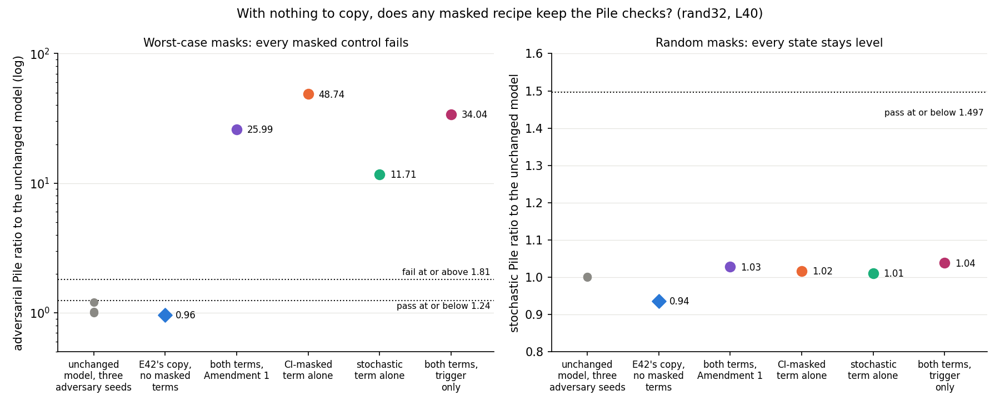
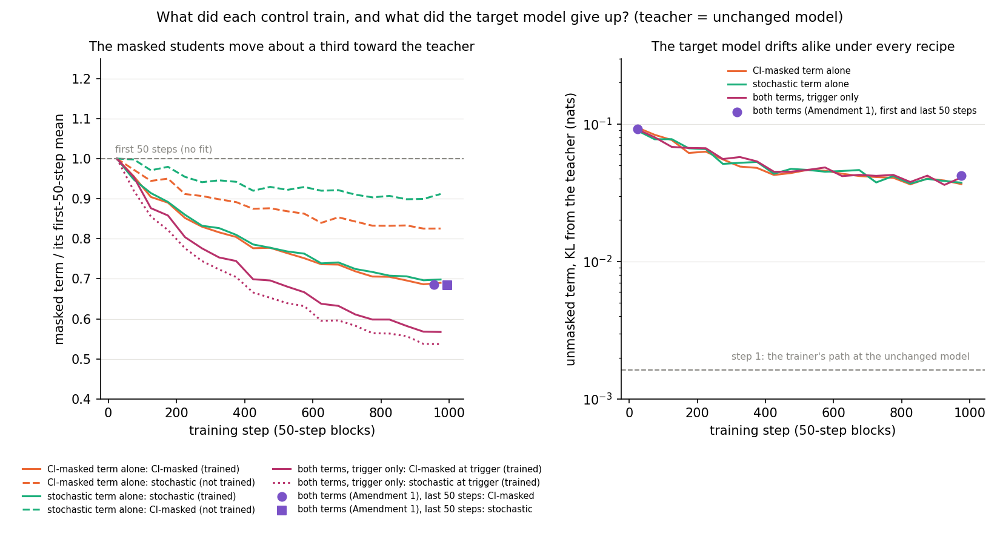

# Analysis: does either masked term, or both at the cue only, hold still when there is nothing to copy? (E42 Amendment 2)

*2026-10-28. Plan `reports/plans/2026-10-28_plan_e42-teacher-new-behaviour.md` → "Amendment 2"; predictions
`experiments/teacher_training/results/predictions_e42_amend2.json`, filed 14:13:50, unedited; result
`experiments/teacher_training/results/teacher_training_e42_amend2_rand32.json`; log
`cluster/logs/commute-teacher-e42a2-40497.out`; figures from `experiments/teacher_training/plot_e42_amend2.py`.
Follows `reports/analyses/2026-10-28_analysis_e42-amend1.md`.*

We tried three simpler versions of masked teacher training on the cipher task, each run first with nothing to copy.
Every version broke the worst-case check on ordinary text while the random-mask check stayed level, so the plan
stopped before any copy was made. So no training of this kind has yet kept a new behaviour in the parts the
decomposition switches on, and the pending choice on the test stands.

## What was tested

E42 found that teacher training copies a fine-tune that teaches the model a word cipher, and passes the Pile checks.
But the CI-masked model at the cipher's trigger keeps almost none of it. The CI-masked model is the model rebuilt from
the subcomponents alone, each scaled by its causal importance $g$ from Γ, with Δ left out. On the 32-key cipher it puts
0.007 on the right word, where the copy puts 0.964.

Amendment 1 added two terms to teacher training's loss to push the cipher into the CI-masked model. The first matches
the CI-masked student to the teacher. The second matches the stochastic-masked student, whose masks are
$g + (1-g)r$ with $r$ uniform on [0, 1] and drawn afresh at every position. Γ and Δ stay frozen; only the
subcomponents' $U, V$ train. Its control, the same recipe with the teacher set to the unchanged model $W_0$, broke the
adversarial check, so the cipher copy never ran.

This amendment asks which term does the damage. It reruns that nothing-to-copy control three ways, each for 1,000
steps on the cipher's 403 training windows, with Amendment 1's batches and mask draws:

- **CI-masked term alone**: weight 0.5 on the CI-masked term, none on the stochastic one.
- **stochastic term alone**: weight 0.5 on the stochastic term, none on the CI-masked one.
- **both terms at the trigger only**, each at 0.5, read only at the trigger position and not at the other 40. This one
  runs only if both single-term controls fail.

The unmasked term, KL(teacher ‖ target model), is in every recipe with E42's weighting. A term with weight 0 is still
computed and logged, without a gradient.

With the teacher at $W_0$ there is nothing to learn, so a usable recipe should leave the decomposition where it was.
Each control is read by the Pile harness: VPD's reconstruction losses on 256 Pile validation rows, each as a ratio to
$W_0$'s. In the stochastic check the masks are random at every position. In the adversarial check each subcomponent
gets one mask value shared by every position of a 128-row block. Twenty steps of gradient ascent choose the values that
pull the masked model's output furthest from the target model's. On this L40 card the adversarial ratio passes at
1.24 or below and fails at 1.81 or above; the stochastic ratio passes at 1.497 or below. If a control held, the cipher
copy would run with its recipe. If all three failed, the plan stops.

## What we expected, and why

- **CI-masked term alone: fail**, medium confidence. It trains only the case where every mask is Γ's value, while the
  unmasked term pins the case where every mask is 1. The switched-off subcomponents can then change to cancel the
  switched-on ones' changes. An adversary that sets masks between those two cases undoes the cancelling.
- **Stochastic term alone: pass**, low confidence. Random masks between $g$ and 1 on every subcomponent should
  penalise exactly that cancelling. Against it, E37 Amendment 1's control trained with VPD's stochastic loss and still
  failed at 3.84, and Amendment 1's analysis expected an average-case term alone to fail.
- **Both at the trigger only: fail**, low confidence. One position of 41 asks less. But the trigger is where the masked
  students start furthest from the teacher, and there is still no worst-case term.

## The apparatus: step 1 reproduces Amendment 1's job

Step 1 of each control has the same state, batch and mask draws as job 40338's step 1, so every logged term must
match it. They do, to every printed digit:

| term at step 1, nats | job 40338, both terms | CI-masked alone | stochastic alone | both at the trigger only |
|---|---|---|---|---|
| unmasked | 0.00163 | 0.00163 | 0.00163 | 0.00163 |
| CI-masked | 1.129 | 1.129 | 1.129 | 0.6884, its trigger term by design |
| stochastic | 0.7389 | 0.7389 | 0.7389 | 0.4363, its trigger term by design |
| unmasked at the trigger | 0.0007714 | 0.0007714 | 0.0007714 | 0.0007714 |
| CI-masked at the trigger | 0.6884 | 0.6884 | 0.6884 | 0.6884 |
| stochastic at the trigger | 0.4363 | 0.4363 | 0.4363 | 0.4363 |
| loss | 0.9355 | 0.566 | 0.3711 | 0.564 |

The trigger-only recipe logs its trigger KL in the CI-masked and stochastic columns, and those match job 40338's
trigger terms. Each loss is the unmasked term plus half of each trained masked term, to rounding. The checks before
training also matched job 40338 to every digit. $W_0$'s adversarial floor across three adversary seeds was 0.20878.
The trainer's unmasked term at $W_0$ was 0.00163 nats, under its stop line of 0.01.

## What was observed

### With nothing to copy, did any masked recipe keep the Pile checks?

**Reading it.** No: all three new controls failed the adversarial check, and so did Amendment 1's. In the left panel
the unchanged model's three adversary seeds sit at 1.0 to 1.21. E42's copy, trained without masked terms on the
same windows, sits at 0.96. Every masked recipe sits between 11.7 and 48.7, six to twenty-seven times the fail line.
The stochastic term alone did the least damage and the CI-masked term alone the most, more than both terms together.
In the right panel every state's random-mask ratio stays between 0.94 and 1.04, far under its line. So each recipe left
the decomposition as good as before on average and broke it in the worst case. The ordering among the four recipes is
one batch order and one adversary start. A control's spread across batch orders is unmeasured, so only "all far past
the line" is established.

| quantity | $W_0$ | E42's copy, no masked terms | both terms, Amendment 1 | CI-masked alone | stochastic alone | both at the trigger only |
|---|---|---|---|---|---|---|
| adversarial Pile ratio, lines 1.24 / 1.81 | 1; seeds 1, 1.21, 1.02 | 0.960 | 25.99 | **48.74** | **11.71** | **34.04** |
| adversarial KL per 128-row block, nats | 0.667, 0.716 | not read here | about 11, 25 | 29.5, 37.9 | 8.33, 7.87 | 22.7, 24.4 |
| stochastic Pile ratio, line 1.497 | 1 | 0.936 | 1.028 | 1.016 | 1.011 | 1.038 |
| CI-masked Pile ratio | 1 | 0.98 | 0.934 | 0.929 | 0.998 | 0.987 |
| unmasked Pile ratio | 1 | not read here | 0.900 | 0.914 | 0.889 | 0.899 |
| held-out P(target) | 1.5e-5 | 0.964 | 1.6e-5 | 1.6e-5 | 1.6e-5 | 1.6e-5 |
| trigger CI-masked P(target) | about $W_0$'s P | 0.007 | 1.4e-5 | 1.5e-5 | 1.8e-5 | 1.4e-5 |
| damage elsewhere, expected under 0.02 | 0 | 0.0243 | 0.0231 | 0.0135 | 0.0195 | 0.0194 |
| size, largest relative change of a matrix | 0 | 0.0262 | 0.0514 | 0.0370 | 0.0414 | 0.0443 |
| teacher gap | 0 | not read here | 0.102 | 0.076 | 0.098 | 0.097 |
| class, filed rule | — | pass | fail | **fail** | **fail** | **fail** |

Nothing was copied, as intended: the target's probability stayed at $W_0$'s in every control. The size of the change
does not order like the damage: the stochastic-only control moved its matrices further than the CI-masked-only one,
yet read a quarter of its adversarial ratio. The route shares in the result file split a gain of almost nothing and are
not read.

### What did each control train, and what did the target model give up?

**Reading it.** Each recipe did what it was built to do, and the target model drifted from the teacher by the same
amount under all of them. In the left panel each trained term fell to about 0.7 of its first-50-step mean on the full
windows, as in Amendment 1. At the trigger only, the two trained terms fell further, to about 0.55. The term left
untrained fell too, by less: the stochastic term by 17% under the CI-masked recipe, the CI-masked term by 9% under the
stochastic one. In the right panel the unmasked term starts at 0.0016 nats, jumps to about 0.09 within 50 steps and
ends near 0.04. The four recipes trace the same curve, while their adversarial ratios range from 12 to 49. So this
drift of the target model away from $W_0$ on the cipher windows does not tell the recipes' damage apart.

| term, mean over 50 steps, nats | CI-masked alone: first → last | stochastic alone | both at the trigger only | both terms, Amendment 1 |
|---|---|---|---|---|
| unmasked | 0.094 → 0.037 | 0.089 → 0.037 | 0.091 → 0.041 | 0.092 → 0.042 |
| CI-masked | **1.131 → 0.780** | 1.160 → 1.057 | trigger only, below | **1.131 → 0.776** |
| stochastic | 0.765 → 0.632 | **0.742 → 0.518** | trigger only, below | **0.740 → 0.506** |
| CI-masked at the trigger | 0.719 → 0.414 | 0.739 → 0.645 | **0.718 → 0.407** | 0.719 → 0.409 |
| stochastic at the trigger | 0.483 → 0.353 | 0.462 → 0.259 | **0.461 → 0.248** | 0.461 → 0.249 |
| training time, s | 185 | 188 | 186 | 195 |

Bold marks the terms each recipe trained.

## The decision tree's branch

The branch that fires is the plan's "Both fail → M0_trig (same job). Holds → the copy with recipe trig. **Fails → stop:
the masked line ends; card `decision-e42-criterion` stays as it is, with masked teacher training marked as tried and
failed.** Report all three controls' ratios, damage and curves." The job stopped itself at 14:55:55 with
`STOP: tree: every masked control failed (CI-masked alone, stochastic alone, both at the trigger only); no copy run`.

The decision it carries out, `decisions.md`'s row on card `decision-e42-masked`, quoted whole:

> | The card `decision-e42-masked` closes with the lead's recommendation (user: "go with whatever you recommend"): E42
> Amendment 2 first runs the masked recipe's nothing-to-copy control with each masked term alone (CI-masked only;
> stochastic only), MATS cluster, $0. If one term alone keeps the adversarial check, the cipher copy runs with that
> term; if both fail, the same control with the masked terms at the trigger only; if that fails too, stop and leave
> `decision-e42-criterion` as it is | 2026-10-28 | `reports/analyses/2026-10-28_analysis_e42-amend1.md` | user,
> 2026-10-28 (chat: "go with whatever you recommend on the masked one") |

So card `decision-e42-criterion` is left as it is. Its option of first training a copy to keep the cipher in the
CI-masked model is now marked as tried and failed. It failed three ways here and once in Amendment 1. Neither
`decisions.md` nor the research log is edited by this report.

## Why: candidate causes, none tested

The run separates the two terms and shows that neither alone, nor both at one position, holds still. It does not test
why. Each candidate below is consistent with the four controls, and no run separates them.

- **No worst-case term in training.** VPD's released decomposition was trained against a persistent adversary at
  every step, and with no CI-masked loss. Every recipe here drops the adversary. Amendment 1's analysis expected the
  stochastic term alone to fail on this account, and it did; that is consistency, not a test. Against it, E37
  Amendment 1 kept VPD's adversary in its loss and its control still failed, at 3.84, on different rows.
- **Fitting the masked students below VPD's settled error on a narrow set of windows.** Every recipe removed about a
  third of the masked error on 403 cipher windows, with Γ frozen and no sparsity loss to push back.
- **Specific to the CI-masked case.** The CI-masked recipe read the highest ratio and the stochastic one the lowest.
  The filed reasoning for the CI-masked lean, switched-off subcomponents changing to cancel the switched-on ones,
  would predict that order. The order rests on one batch order and one adversary start.

## What we learned

No masked teacher training recipe tried on the cipher windows with Γ frozen holds still with nothing to copy. Four
recipes failed the adversarial check, each at least six times past its line. So no frozen-Γ map has been shown able
to keep a new behaviour in the CI-masked model. None has been shown unable to either, since every attempt broke its
own control first. For `GOALS.md`'s fork between a new capability and a brittle decomposition, E42's finding
stands as it was. With Γ frozen, the cipher sits in subcomponents Γ keeps off at the trigger, and whether that is
forced is still untested. The remaining ways to test it change Γ or add an adversarial term to the loss; neither is
in the approved tree.

## How compelling is the evidence

The failures are far outside any noise. The smallest, 11.7, is six times the fail line, and $W_0$'s three adversary
seeds spread by 0.21. Both 128-row blocks failed in every control. The comparison between recipes is weaker: one task,
one batch order, one adversary start of 20 steps on 256 rows, one weight of 0.5. A control's adversarial ratio across
batch orders has never been measured. Amendment 1's two blocks read 11 and 25 nats, so the spread may be large.

What each number is blind to:

- **Adversarial Pile ratio**: one adversary start of 20 steps; E34 Amendment 5 found one-start verdicts can be lenient,
  which here only means the true ratios could be higher. Pile text only, not the cipher windows the recipes trained on.
  Its positive controls hold on this card: Amendment 1's control failed at 25.99 and E42's copy passed at 0.96.
- **Stochastic Pile ratio**: an average over random masks, blind by construction to changes that cancel on average.
  It read level in every state, including the four that failed the adversarial check.
- **Held-out P(target) and trigger CI-masked P(target)**: confirm that nothing was copied; not informative about damage.
- **Damage elsewhere and size**: one number each per state; neither orders like the adversarial ratio here.
- **VPD's sparsity loss**: not read in any state.

## Surprises

**The stochastic term alone failed, reversing the filed lean.** We leaned "pass" at low confidence. We reasoned
that random masks between Γ's value and 1 penalise the cancelling a CI-masked fit allows. It read 11.7, six times the fail
line. It was the mildest of the four recipes, but nowhere near holding. The filed evidence against the lean, E37's
failure with VPD's stochastic loss, turned out the better guide. Why the stochastic term breaks the worst case is not
known; the candidates above are untested.

Smaller: the CI-masked term alone did nearly twice the damage of both terms together, 48.7 against 26.0. This rests on
one batch order and one adversary start, and may be within a control's unmeasured spread.

## What next

The tree stops here: no run follows from this amendment. Items for the lead, none run:

- Card `decision-e42-criterion` stays as it is, with option (c), trying a copy trained to keep the cipher in the
  CI-masked model first, marked as tried and failed. Its recommendation, "Wait for E42 Amendment 2", no longer has
  anything to wait for. If the user chooses (b), the next step would be letting Γ change.
- If the masked line were reopened, option (c) of card `decision-e42-masked` remains: an adversarial term matched to
  the teacher, shaped for 41-token windows. E37's 3.84 suggests it may not be enough; it needs new code and a review.
- At $0, the three saved control states could be re-read with adversary seeds 1 and 2. That would show whether the
  ordering among recipes is real. It would not change the stop, since all three would need to fall under 1.81.

## Scorecard

| id | claim in words | rule | read | verdict |
|---|---|---|---|---|
| C1 | $W_0$ under the Pile harness is its own floor | `w0_check` | floor 0.20878, = job 40338's and E42's | pass |
| G2 | the trainer's unmasked forward is the model's | path KL at $W_0$ ≤ 0.01 nats | 0.00163 | pass |
| step 1 | each control's step 1 matches job 40338's | every term to rounding (brief) | all terms equal to every printed digit | match |
| C_ci | the CI-masked term alone holds still | any Pile ratio NaN or either verdict "fail" → fail; else either "inconclusive" → inconclusive; else pass | adversarial 48.74 fail; stochastic 1.016 pass | **fail**, as leaned (medium) |
| C_st | the stochastic term alone holds still | as C_ci | adversarial 11.71 fail; stochastic 1.011 pass | **fail**, **lean "pass" reversed** (low) |
| C_trig | both terms at the trigger only hold still; run since C_ci and C_st both failed | as C_ci | adversarial 34.04 fail; stochastic 1.038 pass | **fail**, as leaned (low): the tree's stop |
| G1 | E42's teacher reproduces E10 at step 10 | within 0.02 | not run | — |
| P1_copy_masked_model_keeps | the copy's CI-masked model keeps the cipher at the trigger | Amendment 1's P1 rule on the copy that runs | no copy ran | **not scored**: the tree stopped the job |
| P2_copy_faithful | the copy passes the Pile check | `faith_score.state_verdict` on the copy that runs | no copy ran | **not scored**: the tree stopped the job |

Each control's own `state_verdict` reads "below P 0.9", since it checks the target's probability first. The control
class used the two Pile verdicts directly, as filed.

## Not run

- The cipher copy with any masked recipe, so neither copy prediction is scored.
- The teacher regeneration and its check against E10; the reference re-reads of $W_0$'s trigger cells and of E42's saved copy, so E42's
  trigger CI-masked value of 0.007 is still in a log only.
- rand1 and ident32; a second batch order; other weights.
- A second adversary start or seed on any control, though the states are saved.
- The persistent adversary in the loop; the masked terms on Pile rows; updating Γ.
- VPD's sparsity loss, not read.
- The larger model: this amendment, like E42, runs on the 67M model.

## Provenance

MATS cluster, NVIDIA L40, `debug` QoS, job 40497, 2026-10-28, first log line 14:32:56, stop 14:55:55; $0. Each control
trained in 185 to 188 s. Code `src/commute/masked_terms.py`, `experiments/teacher_training/newskill_amend2.py`,
`cluster/teacher_e42_amend2.sbatch`; brief `experiments/teacher_training/RUN_BRIEF_e42_amend2.md`. Saved states, bf16
offsets of about 60 MB each: `experiments/teacher_training/results/large/e42_amend2/rand32/{M0_ci,M0_st,M0_trig}_step1000.pt`.
Step-1 reference: `cluster/logs/commute-teacher-e42a1-40338.out`, line 20. Figures
`experiments/teacher_training/figures/e42_amend2_{controls,curves}.png`.
