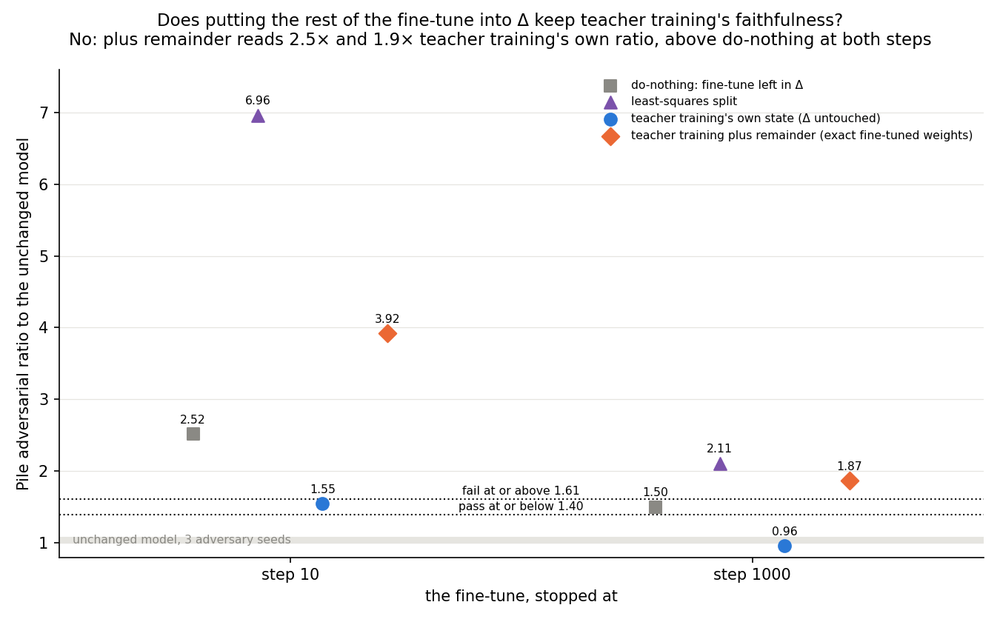
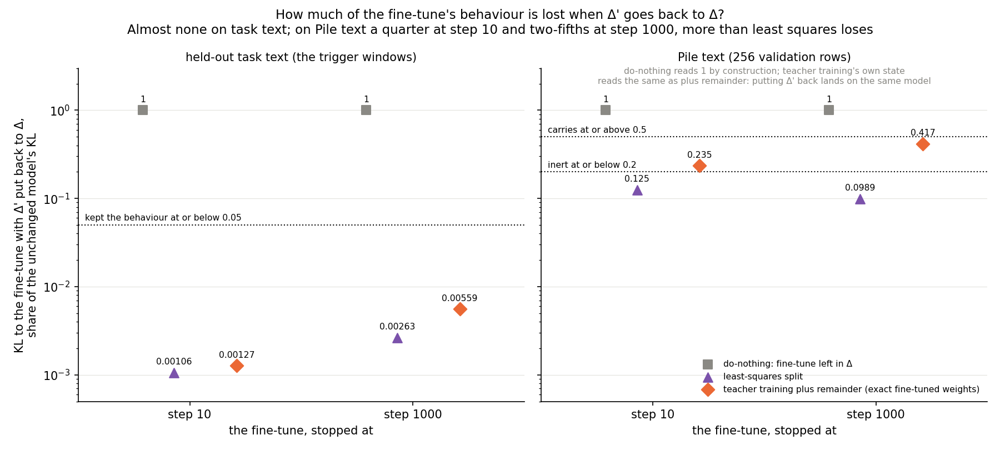
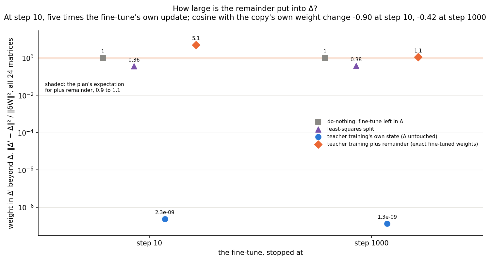

# Analysis: teacher training plus the rest of the fine-tune in Δ (E43)

*2026-10-28. Plan `reports/plans/2026-10-28_plan_e43-teacher-remainder.md`; code `experiments/teacher_training/remainder.py`;
predictions `experiments/teacher_training/results/predictions_e43_v2.json`, filed 15:48:10, sha256 `204c1fbb…`, unedited
(it refiles `predictions_e43.json` before any run; plan → "Refile 2026-10-28"); results
`experiments/teacher_training/results/teacher_training_e43.json`; log `experiments/teacher_training/results/large/run_e43.log`;
notebook `notebooks/E43_teacher_remainder.ipynb`; figures `experiments/teacher_training/figures/e43_*.png` from
`plot_e43.py`. Starts from E41's teacher-trained states (`reports/analyses/2026-10-28_analysis_e41-teacher-path.md`).*

We took the decomposition after teacher training and put the rest of the fine-tune into the residual, so its weights
equal the fine-tuned model's. The adversarial check then failed at both points tried, worse than leaving the whole
fine-tune in the residual. So exact weights cost faithfulness this way, and teacher training's own state stays the map
for the weak version.

## The answer

No. We put the part of the fine-tune that teacher training had not reproduced into Δ, so the weights equal the fine-tuned
model's exactly. The adversarial check then failed at both steps tried. It read about twice teacher training's own ratio,
and worse than leaving the whole fine-tune in Δ. On plain text, putting Δ back removed a quarter to two-fifths of the
fine-tune's behaviour. Teacher training's own state, with Δ untouched, stays the map.

## What we tested

Each weight matrix is $W = U V^\top + \Delta$. **Teacher training** is component training of the alive $(U, V)$ with the
loss $\mathrm{KL}(\text{fine-tuned model} \,\|\, \text{student})$; Γ and Δ frozen. E41's recipe, unchanged: Adam 1e-5,
1,000 steps, batch-order seed 0, task windows with arm A's weighting, batch 32. It gives $(U', V')$ and weights
$W_{\text{tt}}$.

The **remainder** is $R = W_{\text{ft}} - W_{\text{tt}}$ per matrix. **Teacher training plus remainder** keeps
$(U', V')$ and sets the target to $W_0 + \delta W_k$, so $\Delta' = \Delta + R$ and the weights equal the fine-tuned
model's. For E43 only, the user read "Δ does not absorb the update" by behaviour; `decisions.md` records it.

**The fine-tune.** E41's emoticon Adam 3e-5 arm-A fine-tune of all 24 matrices, batch 32, seed 0, regenerated in the
job, stopped at step 10 and step 1,000.

**States per step, on the same rows in one job.**
- **Do-nothing**: $\delta W_k$ into Δ, subcomponents untouched. The positive control.
- **Least-squares split**: `split.split_state(δW_k)`; the outside part goes to Δ; exact weights.
- **Teacher training's own state**: Δ untouched; weights not the fine-tune's.
- **Plus remainder**: as above; exact weights.

**Numbers per state.**
- **Check**: the Pile harness's adversarial ratio, one start, seed 0, 20 steps, 256 rows, over the unchanged model's.
  With this job's floor of 0.0748, pass at or below 1.396, fail at or above 1.612. The stochastic-mask ratio is read
  beside it, and the reported verdict combines both.
- **Removal share on Pile text**: $\mathrm{KL}(\text{fine-tune} \,\|\, \text{state with } \Delta' \to \Delta) /
  \mathrm{KL}(\text{fine-tune} \,\|\, W_0)$ on the harness's 256 Pile rows. 0 means Δ′ carried nothing; do-nothing
  reads 1 by construction. Teacher training's own state removes to itself, $W_{\text{tt}}$, which is also plus
  remainder's removal state, so the two share this value.
- **Removal share on task text**: the same ratio on held-out task windows, arm A's weighting.
- Reported only: **weight in Δ′**, $\|\Delta' - \Delta\|^2 / \|\delta W\|^2$ summed over the 24 matrices; the
  **cosine** of $R$ with the copy's own weight change; **Δ′'s trigger share**, the route split's share of the
  trigger's log-odds lost when Δ′ is set to zero.

**What each is blind to, from the plan.** The removal shares see nothing off their rows and nothing at the trigger alone. Both
remove to $W_{\text{tt}}$, so the Pile share reads the copy's own plain-text fidelity as much as the remainder's. The
check uses one adversary start, so a pass is a lower bound; it runs under bf16 autocast, blind to Δ′ below bf16 rounding.
The weight in Δ′ sees no inputs.

## Controls

All passed; nothing stopped.

| control | must read | read |
|---|---|---|
| C1, unchanged model | floor 0.0748 ± 10%; seed-0 PGD KL 0.69882 ± 1% | 0.07482; 0.69882 |
| G1, the fine-tune | P(target), size 0.99931, 0.01125 / 0.99961, 0.03209 | 0.99931, 0.011254 / 0.99961, 0.032090 |
| PC, do-nothing | ratio 2.5159 / 1.4994; task KL to W₀ 5.0784 / 5.0897 ± 1%; Pile KL ≥ 0.005 | 2.5159 / 1.4994; 5.0784 / 5.0897; 0.0222 / 0.0619 |
| G3, the copy | P 0.99941 / 0.99675 ± 0.005; ratio 1.5465 / 0.9591 ± 5%; Δ share ≤ 1e-6 | 0.99941 / 0.99675; 1.5465 / 0.9591; 2.3e-9 / 1.3e-9 |
| G2, removal lands on the copy | ≤ 1e-3 of the largest entry | 4.1e-5 / 4.3e-5 |

The run reproduced E41's fine-tune, do-nothing and copy to four digits or better on this card.

## Does teacher training plus remainder pass the check as teacher training's own state does?

No, at either step, by far more than the noise. At step 10 plus remainder reads 3.92, 2.54 times teacher training's own
1.55. At step 1,000 it reads 1.87, 1.94 times the copy's 0.96, which passes. Both sit above do-nothing, which reads 2.52
and 1.50. The filed allowance was 1.25 times. The unchanged model's adversary spread is 7.5%, and the copy's batch-order
spread is 21% at step 10 and 3.2% at step 1,000.

| step | state | check | stochastic | verdict | share of do-nothing's excess removed |
|---|---|---|---|---|---|
| 10 | do-nothing | 2.516 | 1.003 | fail | 0 |
| 10 | least squares | 6.957 | 1.003 | fail | — |
| 10 | teacher training | 1.547 | 0.981 | inconclusive | 0.64 |
| 10 | plus remainder | 3.921 | 1.003 | fail | −0.93 |
| 1000 | do-nothing | 1.499 | 0.916 | inconclusive | 0 |
| 1000 | least squares | 2.106 | 0.921 | fail | — |
| 1000 | teacher training | 0.959 | 0.952 | pass | 1.08 |
| 1000 | plus remainder | 1.865 | 0.917 | fail | −0.73 |

The excess share is $(r_{\text{dn}} - r)/(r_{\text{dn}} - 1)$; a negative value means the state reads above do-nothing.
It is defined at both steps because do-nothing reads above the pass line at both.

**Per 128-row block, from the log.** Adversary KL in nats, reported, not filed. The unchanged model reads 0.679 and
0.718 at seed 0.

| step | do-nothing | least squares | teacher training | plus remainder |
|---|---|---|---|---|
| 10 | 0.794, 2.722 | 1.825, 7.899 | 0.722, 1.440 | 0.990, 4.491 |
| 1000 | 1.081, 1.015 | 1.261, 1.682 | 0.670, 0.670 | 1.040, 1.567 |

At step 10 plus remainder's excess sits mostly in the second block, as for do-nothing and the copy (E41 Amendment 1). It
reads above do-nothing in both blocks at step 10 and in the second at step 1,000.

## How much of the fine-tune's behaviour sits in Δ′?

On task text almost none; on Pile text a quarter to two-fifths, between the filed inert and carrying lines. Least squares
leaves less on Pile text.

| step | state | task KL | task share | Pile KL | Pile share |
|---|---|---|---|---|---|
| 10 | do-nothing (denominator) | 5.0784 | 1 | 0.02215 | 1 |
| 10 | least squares | 0.00538 | 0.00106 | 0.00277 | 0.125 |
| 10 | plus remainder = teacher training's own | 0.00644 | 0.00127 | 0.00522 | 0.235 |
| 1000 | do-nothing (denominator) | 5.0897 | 1 | 0.06193 | 1 |
| 1000 | least squares | 0.01341 | 0.00263 | 0.00612 | 0.099 |
| 1000 | plus remainder = teacher training's own | 0.02845 | 0.00559 | 0.02586 | 0.417 |

KL in nats. The task shares match E41's gap shares, 0.0013 and 0.0056. The Pile denominators are small, 0.022 and 0.062
nats, both above the filed 0.005 minimum.

## How large is the remainder?

At step 10 the remainder's squared size is 5.1 times the fine-tune's, against the plan's expected 0.9 to 1.1. Its cosine
with the copy's weight change is −0.90; the plan read below −0.5 as "the remainder mostly undoes the copy". At step 1,000
it is 1.1 times, cosine −0.42. Reported, not filed.

| step | state | weight in Δ′ | cos(R, copy) | Δ′'s trigger share | P(target) |
|---|---|---|---|---|---|
| 10 | do-nothing | 1 | — | 1 | 0.99931 |
| 10 | least squares | 0.359 | — | 0.088 | 0.99931 |
| 10 | teacher training | 2.3e-9 | — | 0.011 | 0.99941 |
| 10 | plus remainder | 5.115 | −0.903 | 0.006 | 0.99931 |
| 1000 | do-nothing | 1 | — | 1 | 0.99961 |
| 1000 | least squares | 0.379 | — | 0.279 | 0.99961 |
| 1000 | teacher training | 1.3e-9 | — | 0.015 | 0.99675 |
| 1000 | plus remainder | 1.121 | −0.425 | 0.088 | 0.99961 |

Setting Δ′ to zero barely moves the trigger for plus remainder, 0.006 and 0.088 of the log-odds. The plan expected
slightly above teacher training's 0.011 and 0.015: below at step 10, above at step 1,000. The copy's size is 0.0141 at
step 10 against the fine-tune's 0.0113, as in E41: the copy is larger than its teacher there.

## What we learned

Keeping the fine-tuned model's exact weights by adding the remainder to Δ costs the faithfulness teacher training had. On
the emoticon fine-tune at steps 10 and 1,000, that state fails the adversarial check and reads worse than doing nothing.
The plan's tree reads this outcome as: the adversary uses Δ′ as it uses do-nothing's Δ, so exact weights cost
faithfulness. It keeps teacher training's own state as the map and runs nothing. The weak version's map stays teacher training's own state, with Δ
untouched.

## How compelling is the evidence

- **Large miss, paired comparison.** 2.54 and 1.94 times teacher training's ratio, against 1.25 filed; same copy, rows
  and adversary seed. Noise: adversary spread 7.5%, batch-order spread 21% and 3.2%.
- **Controls reproduced E41** to four digits or better.
- **One draw.** One task, fine-tune seed, batch order and adversary start. A fail is a lower bound on what the adversary
  finds, so more starts could only raise it.
- **The removal share** sees only the 256 Pile rows and the task windows, and reads the copy's own plain-text fidelity.

## Surprises

- **Adding the remainder to Δ made the check fail, worse than doing nothing.** Predicted: within 1.25 times teacher
  training's own ratio, leaning high at step 1,000. Seen: about twice, and above the fine-tune left whole in Δ at both
  steps. This reverses the plan's claim. The run did not test why; it did not locate which part of Δ′ the
  adversary uses.
- **The step-10 remainder is five times the fine-tune's squared size** and points mostly opposite the copy's weight
  change. Expected about the fine-tune's size.
- Removal on task text reproduced E41 as expected.

## What next

1. **Accept: teacher training's own state stays the map; the exact-weights version is closed in this form.**
   Recommended; it is the tree's branch for this outcome, with no run.
2. **A Pile-text copy, then its remainder.** On r1, E34 Amendment 6 read a plain-text share of 0.13 for a Pile-text copy
   and 0.30 for task text. It would reopen the exact-weights map if its plus-remainder state passed. New plan needed.
3. **Least-squares split of R into the subcomponents first.** The least-squares split of the whole fine-tune reads 6.96
   and 2.11, so little is expected. New plan needed.

A pending-decision card in the research log offers these; it is queued in `docs/research_log/PENDING.md`.

## Scorecard

| id | claim | rule | read (step 10 / 1000) | verdict |
|---|---|---|---|---|
| C1, G1, PC, G3, G2 | controls | as filed | see Controls | pass |
| P1 (unscored) | task text: Δ′ carries almost nothing | b_task ≤ 0.05 and copy P ≥ 0.9 | 0.00127 / 0.00559; 0.99941 / 0.99675 | true / true |
| P2 | plain text | b_pile ≤ 0.2 inert, ≥ 0.5 carries, else between; worst step | 0.235 / 0.417 | between (lean between, medium) |
| P3 | check, paired | plus remainder ≤ 1.25 × teacher training's own, both steps | 3.921 / 1.865 vs 1.547 / 0.959: 2.536× / 1.945× | does not hold (lean holds) |

P3's reported extras: verdicts fail and inconclusive at step 10, fail and pass at step 1,000; excess removed −0.93 and
0.64, −0.73 and 1.08 (plus remainder, then teacher training's own). Pass line 1.3956.

## Not run

- The broad lowercase fine-tune; step 100; other tasks; SGD and LoRA teachers; Pile-text copies; Qwen.
- Batch-order or seed repeats; adversary seeds 1 and 2; the budget adversary.
- The least-squares split of R into the subcomponents; input-weighted shares of R.
- Any test of which part of Δ′ the adversary uses.
- Saving states.

## Provenance

RunPod NVIDIA H100 80GB HBM3; job 16:26:04 to 16:38:11 on 2026-10-28, about 12 minutes. Plan estimate about $2, cap $4.
Results committed in `8056bfc`. Log `experiments/teacher_training/results/large/run_e43.log`, 192 lines.
