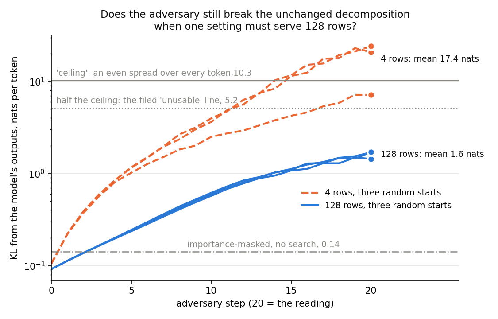

# How far can the paper's adversary push the unchanged Qwen decomposition at the authors' size?

We ran the paper's adversary on the unchanged Qwen decomposition at the authors' size, after repeating the earlier
small reading as a control. At the authors' size the adversary changes the model's outputs about ten times less than
on four rows, and three random starts agree closely. So the decomposition holds up far better than the
small reading suggested, and this adversary can test Qwen decompositions for faithfulness after an update.

Apparatus, not a finding: no E-code. Plan: `reports/plans/2026-10-27_plan_qwen-adversary-128.md`. Rules:
`experiments/qwen_adversary/results/predictions.json`, filed before the run, with an addendum for the first stage.
Earlier four-row reading: `reports/analyses/2026-10-27_analysis_qwen-port.md`.

## The answer

On 128 rows, the paper's adversary moves the unchanged decomposition's outputs by about 1.6 nats per token. That is a
tenth of its four-row reading and about eleven times the decomposition's everyday loss with no search. It is far
below an output spread evenly over every token, so the adversary finds real damage but does not break the model. Three
random starts agree within a fifth, so by the filed rule one start per state is enough. The reading is a lower bound:
the search was still climbing when it stopped.

## What we were trying to test

**What the decomposition claims.** The decomposition covers the model's 196 weight matrices. It writes each as a
sum of rank-one subcomponents plus a leftover Δ. Δ is the part of the weight the subcomponents do not cover. Across the model
there are about 688,000 subcomponents. For each token, Γ gives every subcomponent a causal importance $g$ between 0 and
1. Here 0 means "not needed for this token" and 1 means "needed in full". VPD's claim is that a subcomponent's
unneeded share can be switched on or off freely without changing the output. So can Δ, which should matter little.

**What the adversary does.** It tests that claim by searching for the worst case. It gives every subcomponent a
setting $s$ between 0 and 1, and the subcomponent is used at strength $m = g + (1-g)\,s$. So it can only switch on the
part Γ called unneeded; it never removes what Γ called needed. It also chooses, per matrix, how much of Δ to keep.
It starts from random settings and takes 20 steps of size 0.1. Each step moves every setting in the direction that
most increases the gap between the rebuilt model's outputs and the real model's. Each subcomponent's setting is shared by every
token of every row in the block. The score is the KL from the real model's next-token distribution to the rebuilt
model's, in nats, averaged over every token. Zero means the outputs are identical.

**Why four rows against 128 rows matters.** On four rows the adversary has 688,000 knobs and only 2,048 tokens to
damage. It can tailor its settings to those few texts, the way a model with many parameters overfits a small training
set. On 128 rows the same knobs must hurt 65,536 tokens at once, across many unrelated texts. The authors evaluate
their decomposition at 128 rows, so only that size says whether our reading agrees with the decomposition's own
standard. The four rows used before are the first four of the 128. So the only thing that changes between the two
readings is how many rows share one setting.

**The references.** Three numbers give the reading a scale, all measured on the same 128 rows:

- **Importance-masked, no search:** every subcomponent at exactly its importance, $m = g$, with Δ dropped. This is the
  decomposition's everyday loss, what it costs to run the model on the subcomponents Γ says are needed. A faithful
  decomposition reads small here.
- **An even spread over every token:** the KL to an output that puts the same probability on all 151,936 tokens of the
  vocabulary. The plan calls it the ceiling. It is what pure noise would read. The KL can go past it when the rebuilt
  model is confidently wrong, which the four-row readings did.
- **Half of that:** the filed line above which the adversary would count as unusable. A reading there means the search
  takes the unchanged decomposition halfway to noise, so an update's extra damage could not be read against it.

**The stages, cheapest first.** Stage 0 recomputed the importance-masked KL on the first four rows and compared it
with the earlier port check, value by value. Stage 1, the control, repeated the four-row adversary with three seeds.
Either could stop the job. Stage 2 measured the references on all the rows. Stage 3 ran three starts on all the rows. Everything ran in fp32 except Γ, in bf16 as in the port check, on FineWeb-Edu text.

## What we expected, and why

- **The control** should reproduce the earlier four-row readings: a mean between 10 and 30 nats. The port check read
  18.8 in our code and 21.1 in the authors'.
- **The importance-masked reference** should read 0.05 to 0.3, since it read 0.13 to 0.18 per row on the first four.
- **The even-spread reference** should read 7 to 11: the log of the vocabulary size minus the model's own uncertainty.
- **The block-size prediction:** the 128-row mean should be under a quarter of the four-row mean, about 1 to 5 nats.
  The reasoning was that a setting shared by many texts cannot be tailored. Above a half would mean block size is not
  the main cause of the high four-row reading.
- **The agreement prediction:** the three 128-row starts should agree, the largest over the smallest under 1.25. This
  is the 67M testbed's rule for when a block is big enough.

## What we observed

*Each line is one random start; the KL is plotted before each step's update, and the dot at step 20 is the reading.
Orange dashed: the three starts on four rows, the control. Blue solid: the three starts on 128 rows. Grey lines, from
the top: an output spread evenly over every token, half of that, and the importance-masked KL with no search. Log
scale.*

### Does the high four-row reading survive at the authors' size?

**Reading it.** No: sharing one setting across 128 rows cuts the adversary's reading about elevenfold. The blue
lines end at 1.4 to 1.7 nats, while the orange lines end at 7 to 24. Both sizes start at the same point, about 0.1
nats, and the four-row search climbs much faster from the first step. The 128-row reading sits about eleven times
above the importance-masked loss of 0.14. It sits about a sixth of the way to the even-spread reference of 10.3. So
the adversary does find settings of unneeded subcomponents that change the outputs a lot. It does not come near
breaking the model the way it did on four rows.

### Is one start enough?

**Reading it.** Yes, by the filed rule: the three starts at 128 rows read 1.70, 1.44 and 1.71. The largest is 1.19
times the smallest, under the 1.25 rule. The figure shows why: the three blue lines are nearly on top of each other
until step 12. On four rows the same seeds spread over a factor of 3.4. A single start at 128 rows landed between 11%
below and 6% above the mean of three.

### Is the reading the worst case?

**Reading it.** No, it is a lower bound. At 128 rows the KL was still rising about 8% per step over the last five
steps. A longer search would almost certainly find more damage; how much more was not measured. The four-row lines
also climb to the last step. `decisions.md` keeps the paper's 20 steps and reports readings as lower bounds, on the
user's choice of 2026-10-27. What that means for a pass test is discussed below.

### Full numbers

| quantity | rows | read | expected |
|---|---|---|---|
| importance-masked KL, first four rows, this run vs port check | 4 | 0.1803 / 0.1809 / 0.1296 / 0.1498 vs 0.1804 / 0.1806 / 0.1297 / 0.1499; max diff 2.9e-4 | each diff ≤ 1e-3 |
| adversary, starts 0 / 1 / 2 | 4 | 20.83 / 24.13 / 7.13; mean 17.36 | mean in [10, 30] |
| same, earlier port check, same rows and seeds, L40 | 4 | 21.7 / 27.7 / 7.1; mean 18.8 | |
| importance-masked KL, Δ off | 128 | 0.142; per row 0.095 to 0.193 | 0.05 to 0.3 |
| KL to an even spread over the vocabulary | 128 | 10.31 | 7 to 11 |
| adversary at its random start, before any step | 128 | 0.092 for each start | |
| adversary, starts 0 / 1 / 2 | 128 | 1.702 / 1.437 / 1.714; mean 1.618 | 1 to 5 |
| largest over smallest, minus one | 128 | 0.193 | < 0.25 |
| 128-row mean over four-row mean | | 0.093 | < 0.25 |
| 128-row mean over the even-spread reference | | 0.157 | < 0.5 |
| 128-row mean over the importance-masked KL | | 11.4 | |

## What this means for the Qwen line

**The adversary can be the pass test, with conditions.** The filed reading is "usable with one start". For a
decomposition after a fine-tune, the test would read the same 20-step adversary on the same 128 rows. The verdict
would be a ratio to the unchanged decomposition's 1.6 nats, as on the 67M testbed, where a ratio under 1.5 passes.
Four conditions come with it.

- **Same card, same code, both states.** The control's first two starts read 4% and 13% lower than the port check's,
  on the same rows, seeds and code. The first stage matched the port check to 3e-4, so the inputs agree and the gap
  opens during the search. The runs used different GPUs; the cause was not traced. On the 67M, adversarial ratios are
  already compared only within one card, and the same rule should hold here.
- **Noise near the line.** One start can sit about 11% off the mean of three. A ratio far from 1.5 can be read with
  one start per state. A ratio within about a fifth of the line should get three starts per state. On the 67M,
  "within the floor" means at most 1 plus three floors. If the floor is the largest-over-smallest spread measured here,
  0.19, that band reaches about 1.58. That is above the 1.5 line, the same unanchored situation the 67M has on an L40.
  Which spread measure the floor uses on Qwen should be fixed in the first experiment's plan.
- **Lower bounds on both sides.** Both readings stop while still climbing. So the ratio compares how far one fixed
  search gets on each state, not the true worst cases. An update could make damage easier to find without making it
  larger, or the reverse, and the ratio would mix the two. That is the paper's standard and the user's choice; a
  verdict should still name it.
- **Text, not task.** These rows are generic web text. A fine-tune on GSM8K may change the decomposition's
  faithfulness on task text more than on web text. The pass test may want a block of task rows beside these; none was
  read.

**Cost.** Each 128-row start took 20 minutes on an H100, after about 6 minutes of loading. One start per state on two
states is under an hour of pod time; three starts on two states is about 2 hours 15 minutes. The plan had projected
45 minutes per start.

**The paper's own number for this decomposition is not in the repo.** The run's launch config sets the adversary's
settings. No logged evaluation value or paper table for the Qwen decomposition is stored here, and `../papers/pd/`
does not exist. The nearest number is for the 67M decomposition, on different text. An outside audit quotes 0.83 nats
for the paper's 20-step adversary there; its summary is `lit_review/summaries/lw_KeBccWBGXnNXzZFBp.md`. Our Qwen
reading is about twice that. The model, data and precision all differ, so this gives scale, not a comparison.

## How compelling is the evidence

- Three starts at 128 rows, one decomposition, one kind of text. The agreement rule is the testbed's, and three starts
  cannot show how often a start lands far off.
- The block-size effect is large, elevenfold, with the four-row control rerun in the same job; the rows are nested,
  so nothing else changed. Its size does not depend on the noise.
- Every reading is a lower bound, as above; the four-row readings are too.
- fp32 with Γ in bf16, on FineWeb-Edu. The authors ran bf16 on their own chat-formatted evaluation set. The port
  check showed our adversary agrees with theirs within the four-row spread, which is a weak test.

## Surprises

- None against the filed predictions: every rule held and the reading landed inside its expected range.
- Two of the control's starts read 4% and 13% below the port check's, on the same rows, seeds and code. The third
  matched within 0.5%. The cause was not traced; see "Same card" above.
- The three 128-row starts follow almost the same path for the first twelve steps, even from different random
  settings. At this size the search seems to go to the same place wherever it starts.

## What next

- **Plan the first Qwen experiment with this as its pass test.** The plan should fix the floor's spread measure and
  when three starts are read. If the floor band sits above the 1.5 line, the 67M's unanchored-line problem carries
  over. The plan should then say how verdicts near the line are read.
- **A block of GSM8K rows**, if the first experiment fine-tunes on GSM8K: one start on 128 task rows at W₀. If it reads
  far from 1.6, task rows become part of the pass test.
- **A longer search, once**, say 100 steps on 128 rows at W₀. If the reading keeps climbing well past 1.6, a pass at 20
  steps says less about the worst case than the ratio suggests. Only if the user wants the worst case:
  `decisions.md` keeps 20 steps, because breaking under more pressure than the paper applies is not the concern.

## Scorecard

| id | claim | rule, filed before the run | read | verdict |
|---|---|---|---|---|
| stage 0 | the recomputed importances, clean outputs and masked forward match the port check | every per-row diff on rows 0-3 ≤ 1e-3 | max 2.9e-4 | pass |
| control | the four-row reading is reproduced | four-row mean in [10, 30] | 17.4 | pass |
| reference | importance-masked KL on 128 rows | expected 0.05 to 0.3 | 0.142 | as expected |
| reference | KL to an even spread on 128 rows | expected 7 to 11 | 10.31 | as expected |
| P1 | the four-row reading is high because a setting shared by four rows can be tailored to them | 128-row mean / four-row mean < 0.25; null > 0.5 | 0.093; absolute 1.62, expected about 1 to 5 | holds |
| P2 | three starts on 128 rows agree | largest / smallest − 1 < 0.25 | 0.193 | holds |
| reading | which use the adversary allows | one start if mean < half the even-spread reference and spread < 0.25 | 1.62 < 5.16, 0.193 | usable with one start |

## Not run

- More than 20 adversary steps, or any check of convergence.
- More than three starts at 128 rows.
- The adversary on GSM8K or other task rows, or on the authors' chat-formatted evaluation set.
- bf16, as the authors evaluate; fp32 Γ.
- A comparison with the decomposition run's logged evaluation value or the paper's table for this decomposition:
  neither is in the repo.
- The cause of the control's start-to-start differences from the port check.
- Any updated decomposition.
- Per-row adversarial KL: the run stores only the mean over all rows for each start.

## Provenance

- Code: `experiments/qwen_adversary/run.py` and `pgd_kl_rows` in `src/commute/qwen_vpd.py`. Rows from
  `experiments/qwen_adversary/make_tokens.py`, stored in `results/tokens.json`.
- Results: `experiments/qwen_adversary/results/adversary.json`, `results/run.log` with every step's KL.
- Figure: `experiments/qwen_adversary/figures/climb.png`, from `experiments/qwen_adversary/plot.py` on the CPU worker.
- Machine: RunPod H100, 1 h 14 min, $4.88. Loading took 6.3 minutes; each 128-row step took 59 seconds; the job ran
  70 minutes.
