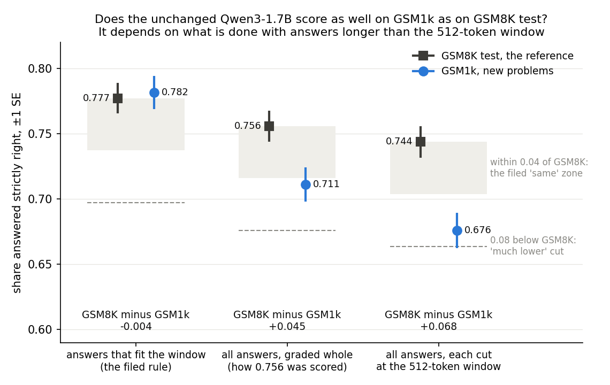

# Does the unchanged Qwen3-1.7B do as well on new grade-school problems as on GSM8K test?

*2026-10-28, writing agent. Apparatus, not a finding: no E-code. Plan: `reports/plans/2026-10-28_plan_qwen-fresh-set.md`.
Predictions: `experiments/qwen_fresh_set/results/predictions.json`, filed before the run, not edited. Code:
`experiments/qwen_fresh_set/run.py`. Result: `experiments/qwen_fresh_set/results/fresh_set.json`, MATS cluster job 39230,
one L40, finished.*

We gave the unchanged Qwen3-1.7B about 1,200 new grade-school word problems, called GSM1k, with the prompt and grading
behind its GSM8K test score. On answers short enough to fit the 512-token window it scored the same on both sets, but on
GSM1k it wrote too-long, mostly wrong answers three times as often, so counting every answer puts GSM1k about four
points lower. GSM8K can stay the first fine-tune's training task, scored on GSM1k too, but the model's GSM8K score is
shown to be ability only under the rule that drops long answers.

## The answer

Among answers that fit the window, the model gets 78% right on GSM8K test and on GSM1k alike. That is the filed rule,
and it reads "same". But GSM1k makes the model write too-long answers nearly three times as often, and those are mostly
wrong on both sets. Counted in, GSM1k sits about four points lower, just past the "same" cut. The decision holds either
way: keep GSM8K for training and score every fine-tune on GSM1k beside GSM8K test. What stays open is whether 0.756
is pure ability.

## What we were trying to test

The unchanged model answers 0.756 of GSM8K test strictly right. GSM8K is old and public, so part of that score could be
memory of the test problems rather than skill. The user asked: "couldnt we check its performance on a similar, but less
likely to be contaminated, dataset? i dont have any particular attachment to gsm8k except for its popularity".

GSM1k is that set. Scale AI had people write 1,205 new problems in 2024 to match GSM8K on difficulty, steps and answer
size. They kept them private until they went up on Hugging Face on 31 March 2025, four weeks before Qwen3 came out. If
Qwen3's last weeks of training saw them, this check would understate any gap. Eight GSM1k problems that share half
their wording with GSM8K questions were left out, so 1,197 were scored.

A second, smaller set repeats an earlier check with its blind spot removed. It holds new-number versions of 100 GSM8K
test problems, generated in 2026, ten per problem, so the model cannot have seen them. Each version is compared with its
own GSM8K original.

Everything else matched the baseline: the chat template with thinking off, greedy decoding, up to 512 new tokens, and
the same two graders. The strict grader needs a final line "The answer is N." with the right N. The lenient one takes
the last number in the answer. GSM8K test ran first and alone as the control. It had to reproduce the saved baseline
before anything else was read.

**The window, and three ways to score long answers.** The decomposition reads at most 512 tokens, prompt and answer
together. An answer "fits" when the prompt plus the whole answer is 512 tokens or fewer. The project decided on
2026-10-27 to drop answers that do not fit from the held-out score. This is the filed rule, and the verdict comes from
it alone. Two readings were filed to be reported beside it. "All answers" grades every answer whole, which is how the
0.756 was scored. "Capped" grades every answer cut off where the window ends.

## What we expected, and why

The plan expected GSM1k to score about 0.73 under the filed rule, against 0.777 for GSM8K test. That is a gap of about
five points, in the zone between the "same" cut at 0.04 and the "much lower" cut at 0.08. Its questions are longer, 59
words against 46, and the GSM1k paper found gaps of a few points for many open models. The predicted verdict was
"ambiguous", leaning towards "same", at low confidence.

The plan named the risk that turned out to matter. GSM1k's prompts are longer, so more of its answers would not fit.
Its filed list of what the gap is blind to says that dropping more long, mostly wrong GSM1k answers shrinks the gap.
That is why the all-answers reading was filed to sit beside it. The plan expected about 92% of GSM1k answers to fit. Its
only guard was a floor of 900 fitting answers, and the decision tree routes on the filed rule alone.

## What we observed

### Is GSM1k lower, and does it depend on the long answers?

**Reading it.** Under the filed rule the two sets score the same, and under both other rules GSM1k is lower. In each
group the square is GSM8K test, the reference, and the circle is GSM1k. The grey box spans the filed "same" zone, from
GSM8K's score down to 0.04 below it. The dashed line is the "much lower" cut, 0.08 below it. On fitting answers GSM1k
reads 0.782 against 0.777, a gap of −0.004 with a standard error of 0.017. On all answers it reads 0.711 against 0.756,
a gap of 0.045 with a standard error of 0.018. That is just past the "same" cut, by about a quarter of a standard error.
Cut at the window, the gap is 0.068, still short of "much lower". The cuts were filed for the first rule only. The
other two groups show where those readings would fall.

The rules differ only in what they do with long answers, so GSM1k must have more of them. It does: 86% of GSM1k answers
fit the window, against 95% for GSM8K test. The plan expected 92%.

### Why are GSM1k's long answers wrong?

*Unfiled: counted from `results/large/{gsm8k,gsm1k}.jsonl` after the run by `plot.py`, which prints these numbers.*

An answer can miss the window in two ways. It can run out of room, reaching the 512 new tokens without finishing. Or it
can finish, but with prompt and answer together longer than 512 tokens. The second kind is graded whole under the
all-answers rule, so a wrong one is wrong with its full working on the page.

| | GSM8K test | GSM1k |
|---|---|---|
| answers | 1,319 | 1,197 |
| did not fit the window | 62 (4.7%) | 167 (14.0%) |
| of those, strictly right | 20 (0.32) | 46 (0.28) |
| ran out of room, no end within 512 new tokens | 16, none right | 39, one right |
| finished and wrong | 26 | 83 |
| finished and wrong, with a final "The answer is N." line | 11 | 65 |
| finished and wrong, no final line | 15 | 18 |
| missed the window by 17 tokens or fewer | 12 | 28 |

**Reading it.** Most of GSM1k's wrong long answers were not cut short: they finished, with room to spare, and gave a
wrong number. Of its 121 wrong long answers, 38 ran out of room. The other 83 finished, and 65 of those ended on a
properly formatted wrong answer. On GSM8K the long answers are wrong at about the same rate, 0.68 against 0.72. GSM1k
simply has three times as many of them.

The longer prompts explain only a small part of this. GSM1k's prompts average 17 tokens more than GSM8K's. Only 28 of
its 167 long answers missed the window by that much or less. The answers themselves run longer: 104 GSM1k answers
exceed 399 tokens, against 50 on GSM8K test.

One more piece of arithmetic, also unfiled. Suppose GSM1k's answers fitted as often as GSM8K's, with fitting and long
answers each scoring as they did. Its all-answers accuracy would then be 0.758, against GSM8K's 0.756. So the
four-point gap on all answers comes entirely from GSM1k having more long answers. Within each group the model scores
about as well on GSM1k as on GSM8K. The records do not say why GSM1k draws longer answers. Its problems are longer and
may need more steps. These records cannot tell that apart from GSM8K answers being shorter for some other reason.

### Do the 2026 new-number versions lose against their originals?

No, within a wide margin. Over the 94 problems whose original answer fits, the originals score 0.809. Their 2026
versions score 0.010 lower, with a standard error of 0.035. That is inside the filed "same" zone for this set, at or
below 0.03. With all 100 problems and answers cut at the window, the loss is 0.015. The standard error is set by the 100
originals, so this set can flag only a large loss. It cannot rule out one of 0.08.

### Does GSM1k lose more points to formatting?

No. The lenient grader adds 0.018 on GSM8K test's fitting answers and 0.014 on GSM1k's. The filed tolerance is 0.02.
Under the lenient grader the two sets' fitting answers score 0.795 each.

## What this means for card `decision-qwen-baseline`

The filed decision tree's "same" branch applies: keep GSM8K, training on its train split. Score every update on GSM8K
test and on GSM1k beside it. The card's headroom half closes on "keep", and the prefix test is no longer needed for this
decision.

How firm is that? The action is firm. Under all three rules the verdict is "same" or "ambiguous", never "much lower".
The filed "ambiguous" branch also keeps GSM8K train for training and scores both sets on every update. It differs only
in which held-out score leads, and that would be a question for the user. GSM1k has no training split, so it could not
replace GSM8K as the training set in any branch.

What is not firm is the reading "the 0.756 is ability, not memory". That holds only under the filed rule. On all
answers the gap sits just past the "same" cut. The long-answer arithmetic says the gap comes from how often the model
writes long answers, not from lower accuracy within either group. It does not say why. The filed rule is the rule every
update will be scored under. But on GSM1k it drops 14% of the answers, mostly wrong ones, and on GSM8K only 5%. That
selection favours GSM1k.

## How compelling is the evidence

- **The control.** The GSM8K arm gave word-for-word the same 1,319 answers as the saved baseline, at 0.756. The graders
  read 1.000 on every gold answer in all three sets.
- **Noise.** The GSM1k gap has a standard error of about 0.018, from about 1,000 to 1,300 answers per set. The 2026
  versions' loss has a standard error of 0.035.
- **No positive control for memory.** No set is known to be memorised by this model, so nothing shows the gap could
  detect memory if it were there.
- **Blind spots.** GSM1k could be harder or easier than GSM8K test, which would read as memory or hide it. Wrong GSM1k
  labels would read as memory; none was checked by hand. GSM1k inside Qwen3's training data would shrink the gap.
- **Scope.** One model, thinking off, greedy decoding, one prompt, one 512-token window.

## Surprises

- The low-confidence prediction that the filed gap would land between the cuts did not hold. It read "same", at
  −0.004, against an expected 0.05. The expected size turned up instead in the all-answers reading, at 0.045.
- Far fewer GSM1k answers fit the window than planned: 86% against an expected 92%. That gap between the rules is the
  main caveat above.

## What next

- **Write GSM1k into the first fine-tune's plan** as the second held-out score, under the dropped rule, with the
  all-answers reading beside it. Report each set's fit share next to its accuracy. A fine-tune that shortens answers
  moves problems into the scored pool, and that would show up as a gain.
- **Only if the user wants the 0.756 settled as ability:** score a reference model on both sets in the same harness. It
  should have about the same GSM8K accuracy and training data known to exclude GSM8K test. If it also loses about four
  points on all answers, GSM1k is harder and the 0.756 is ability. If it loses none, the gap points to a fit to GSM8K.
  One cluster debug job, $0.

## Scorecard: the filed predictions

| id | claim in words | filed rule | value read | predicted | held? |
|---|---|---|---|---|---|
| P0 | the strict grader accepts every gold answer | G0: 1.000 on all three sets | 1.000, 1.000, 1.000 | pass, high | yes |
| P1 | the GSM8K arm reproduces the baseline | G1: all 1,319 answered and strict within 0.012 of 0.756, or every answer identical | strict 0.756, identical share 1.000 | pass, high | yes |
| P2 | enough answers fit for both gaps to be read | G2: ≥ 900 fitting GSM1k answers and ≥ 80 templates | 1,030 answers; 94 templates | pass, high | yes |
| P3 | GSM1k is not much lower | D_1k < 0.08, dropped rule | −0.004 ± 0.017 | pass, medium | yes |
| P4 | GSM1k scores the same | D_1k ≤ 0.04, dropped rule | −0.004 ± 0.017 | fail, into the ambiguous zone, low | no: the rule passed, verdict "same" |
| P5 | the 2026 versions do not lose much against their originals | D_mgs < 0.08, dropped rule | 0.010 ± 0.035 over 94 templates | pass, medium | yes |
| P6 | GSM1k loses no more to formatting than GSM8K | the lenient-minus-strict gaps within 0.02 | 0.014 against 0.018 | pass, medium | yes |
| P7 | the verdict is "same" or "ambiguous" | verdict ∈ {same, ambiguous} | "same" | pass, medium | yes |

The filed cause line reads "not needed", since the verdict was not "much lower". The 2026 versions' zone reads "same".

## Full readings

| set | answers | fitting | fit share | ran out of room | strict, fitting | lenient, fitting | strict, all | strict, capped | lenient, capped |
|---|---|---|---|---|---|---|---|---|---|
| GSM8K test | 1,319 | 1,257 | 0.953 | 0.012 | 0.777 | 0.795 | 0.756 | 0.744 | 0.767 |
| GSM1k | 1,197 | 1,030 | 0.860 | 0.033 | 0.782 | 0.795 | 0.711 | 0.676 | 0.697 |
| 2026 new-number versions | 1,000 | 941 | 0.941 | 0.015 | 0.791 | 0.803 | 0.771 | 0.745 | 0.761 |

| gap | GSM8K | other set | difference | SE | answers or templates |
|---|---|---|---|---|---|
| GSM1k, strict, dropped (filed) | 0.777 | 0.782 | −0.004 | 0.017 | 1,257 and 1,030 |
| GSM1k, strict, all answers | 0.756 | 0.711 | 0.045 | 0.018 | 1,319 and 1,197 |
| GSM1k, strict, capped | 0.744 | 0.676 | 0.068 | 0.018 | 1,319 and 1,197 |
| GSM1k, lenient, dropped | 0.795 | 0.795 | −0.000 | 0.017 | 1,257 and 1,030 |
| 2026 versions against originals, dropped (filed) | 0.809 | | 0.010 | 0.035 | 94 templates |
| 2026 versions against originals, capped | 0.760 | | 0.015 | 0.035 | 100 templates |

## Not run

- A reference model of similar GSM8K accuracy with training data known to exclude GSM8K test, scored on both sets. It
  would separate GSM1k being harder from a fit to GSM8K.
- A longer generation limit, which would show whether the 39 GSM1k answers that ran out of room would be right with
  more.
- A comparison of the two sets matched on question length or solution steps.
- Any hand reading of GSM1k's long answers or of its gold labels.
- A positive control for memory detection: no set is known to be memorised by this model.
- The other ten versions per problem of the 2026 set, and its other languages.
- Thinking mode, sampled decoding, the base model.

## Provenance

- `experiments/qwen_fresh_set/results/fresh_set.json`, status "finished". Per-item answers:
  `experiments/qwen_fresh_set/results/large/{gsm8k,gsm1k,mgs}.jsonl`, 1,319, 1,197 and 1,000 rows. Log:
  `cluster/logs/commute-qwen-fresh-set-39230.out`. The log also prints an interim reading after the GSM1k stage, before
  the 2026 set ran, in which that set reads "underpowered"; the final reading follows it.
- Model `Qwen/Qwen3-1.7B`, revision 70d244c, bf16, greedy, batches of 128. Datasets: `openai/gsm8k` 740312a,
  `ScaleAI/gsm1k` bc09569, `danish-foundation-models/multilingual-gsm-symbolic` English `test_synthetic` 75ce20d.
- Job 39230, debug QoS, NVIDIA L40, torch 2.8.0+cu128, transformers 4.57.3. About 19 minutes of generation over 29
  batches; peak GPU memory 15.6 GB. Cost $0.
- Figure and unfiled counts from `experiments/qwen_fresh_set/plot.py`, run with `~/commute-agents/fleet/cpu-run`; its
  printed counts match the `jq` counts.
