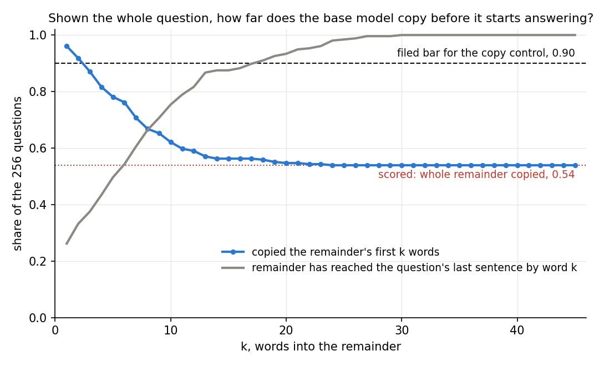

# Can the prefix test on Qwen3-1.7B-Base read whether GSM8K test questions were seen?

*2026-10-28, writing agent. Apparatus, not a finding: no E-code. Plan: `reports/plans/2026-10-28_plan_qwen-prefix-test.md`.
Predictions: `experiments/qwen_prefix_test/results/predictions.json`, filed before the run, not edited. Code:
`experiments/qwen_prefix_test/run.py`. Result: `experiments/qwen_prefix_test/results/prefix.json`, MATS cluster job 39181,
one L40, stopped by its own rule after the first stage.*

We showed the Qwen3-1.7B base model each of 256 GSM8K test questions in full, then the question's first 60% again, and
asked it to write the rest. It copied the rest word for word only about half the time. It usually stopped copying near
the final question and began a worked solution. So this test gave no reading, and the held-out score for the Qwen
line's first update is still to be chosen.

## The answer

The test stopped at its copy control. The model only had to copy text it had just been shown, and it copied the whole
ending in 54% of questions, against a required 90%. Reading the outputs, it copies the story of the problem and then,
at or near the final question, starts solving it. A rule that needs the whole ending word for word therefore reads this
habit, and cannot be read for anything else on this model. GSM8K test is neither cleared nor ruled out.

## Scorecard: the filed predictions

| id | claim in words | filed rule | value read | predicted | held? |
|---|---|---|---|---|---|
| P0 | the model copies a question it was just shown | G1: EM_copy ≥ 0.90 over the first 256 GSM8K test questions | 0.539, binomial SE 0.031, 138 of 256 | pass, high | no: about eleven standard errors under the bar; the job stopped |
| P1 | GSM8K train completes more often than unseen questions | G2: D_train ≥ 0.05 | not run | pass, medium | not scored |
| P2 | the verdict is not "like train" | verdict ≠ "like train" | not run | pass, medium | not scored |
| P3 | the verdict is "rare" | verdict = "rare" | not run | fail, low | not scored |

The decision tree's branch for a failed copy control says: stop, read the copy outputs, fix the apparatus. This report
is that reading.

## What was run

Each question was cut at a word boundary: the prefix is its first 60% of words, the remainder the rest. A match counts
when the model's greedy output starts with the whole remainder. The copy control runs first and alone, and must reach
0.90 before the later stages read GSM8K train, a 2026 synthetic set and GSM8K test.

**Which model, and what prompt.** The checkpoint was the base model, `Qwen/Qwen3-1.7B-Base` at revision ea980cb, as
`prefix.json` records. No chat template and no special tokens were applied. The prompt was plain text: the whole
question, a blank line, then its prefix, tokenised without special tokens and with no instruction. The run imports only
the shared `load_model`, `generate` and `run_batches`, not the chat helper beside them in `commute.qwen_eval`. The
per-item file does not store the prompt; the prompt above is read from the code.

## Where does the copying stop?

*Unfiled: computed from `results/large/copy.jsonl` after the run, with `jq` and `plot.py`.*

**Reading it.** The model copies the start of the remainder almost always and leaves it within a few words. The blue
line counts a question as copied when the output matches the remainder's first k words. It reads 0.96 at the first word
and 0.78 by the fifth. It reads 0.67 by the eighth word, 0.62 by the tenth and 0.56 by the fifteenth. The grey line is
the share of remainders that have reached the question's last sentence by word k. Copying ends where that sentence
begins.

Remainders average 18.8 words, from 7 to 44. Of the 118 failed copies, 92 have a remainder longer than one sentence. In
74 of those, the model copied every word up to the last sentence and then left. In the other 26 failures the remainder
lies inside the last sentence; 24 of these are a question. A typical output is "market daily for $2 per fresh duck egg.
To determine how much she makes every day at the farmers' market, we need to follow these steps". The source sentence
there was "How much in dollars does she make every day at the farmers' market?".

**The apparatus looks sound.** When the model copies, it copies exactly, a typo in the source included. The two batches
of 128 score 73 and 65, so no batch carries the failures.

## What this means for card `decision-qwen-baseline`

The prefix test gave no reading. The fresh-number check, `reports/analyses/2026-10-27_analysis_qwen-fresh-numbers.md`,
stays ambiguous: about four points lower on GSM-Plus, and too imprecise on GSM-Symbolic to settle it. The first
fine-tune's plan still waits on the card.

## Options for the user

None is chosen here.

- **Option c: the cheap accuracy check.** Run the fresh-number harness on the post-trained Qwen3-1.7B with the 2026
  synthetic set. That set holds 2,000 new-number variants of 100 GSM8K test questions, released after Qwen3, so the
  variants cannot have been seen. It does not shrink the earlier error bar, which is set by the 100 originals. *Cost:*
  one cluster debug job of about 10 to 15 minutes, $0, plus a set loader and filed predictions.
- **Option a: fresh sets primary.** Score every update on GSM-Plus and the 2026 synthetic set, with GSM8K test as
  secondary. *Cost:* no run now, $0. Each scored model answers about 3,300 more problems, 15 to 20 minutes of one L40.
- **Option b: a likelihood test, no generation.** Compare how probable the model finds GSM8K test questions against
  GSM8K train and the 2026 synthetic set, by mean log-likelihood per token or Min-K%. *Cost:* a new plan, a design check
  and a short script; the run is a few minutes on the debug queue, $0.

## Surprises

The copy control was predicted with high confidence near 0.98 and read 0.539. The outputs show where the copying stops;
they do not show why.

## Not run

- The three later stages and the verdict.
- The prefix test with another match rule, such as the first k words, or with a copying instruction.
- The post-trained Qwen3-1.7B.
- The three options above.

## Provenance

- `experiments/qwen_prefix_test/results/prefix.json`, status "stopped: copy control below 0.9". Per-item outputs:
  `experiments/qwen_prefix_test/results/large/copy.jsonl`, 256 rows. Log: `cluster/logs/commute-qwen-prefix-test-39181.out`.
- Model `Qwen/Qwen3-1.7B-Base`, revision ea980cb, bf16, greedy, batches of 128. Dataset `openai/gsm8k` 740312a.
- Job 39181, debug QoS, NVIDIA L40, torch 2.8.0+cu128, transformers 4.57.3, started 2026-10-27 at 19:55 UTC. Generation
  took two batches of about four seconds. Cost $0.
- Figure from `experiments/qwen_prefix_test/plot.py`, run with `~/commute-agents/fleet/cpu-run`; its printed values match
  the `jq` counts.
