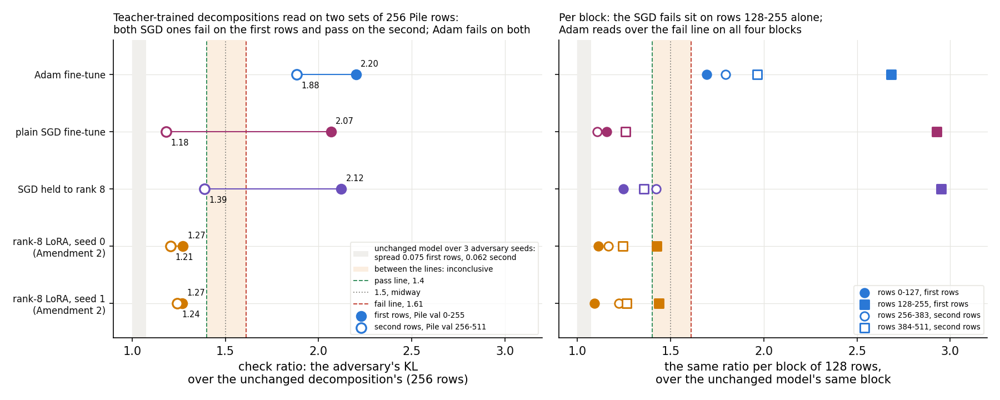

# Analysis: do the SGD teacher-trained decompositions still fail the check on new Pile rows? (E39 Amendment 3)

*2026-10-29, analysis agent for the lead. Plan: `reports/plans/2026-10-27_plan_broad-fragility.md` → "Amendment 3
(2026-10-29)". Code `experiments/broad_fragility/amend3.py`, which imports `run.py`, and `src/commute/harness.py`
(`on_rows`). Every number is read from `experiments/broad_fragility/results/amend3.json` unless named otherwise.
Per-block readings come from the log `results/large/amend3.log` and, for the LoRA, `results/large/amend2.log`.
The LoRA's readings come from `results/amend2.json`, same card, same rows, same unchanged-model readings to four
digits. Predictions `results/predictions_amend3.json`, committed 11:30:49 before the run, unedited. Figure from
`experiments/broad_fragility/plot_amend3.py`. Notebook `notebooks/E39_broad_fragility.ipynb` → "Amendment 3". Words
as in `GOALS.md` → Terms.*

**In plain words.** We read the two SGD teacher-trained decompositions, which had failed the paper's adversarial
check, on a second set of 256 Pile rows. On the new rows both passed, while the Adam one failed on both sets, and the
old SGD fails turn out to rest on one block of 128 rows. For `GOALS.md`, the claim that teacher training cannot place
a broad full-matrix update now holds for the Adam fine-tune only, and the check's verdict near the lines depends on
which rows it reads.

Words used below. **The check** is the paper's adversarial check: a 20-step mask adversary from one random start at adversary
seed 0. One adversary is shared by each block of 128 Pile rows. The check is the state's KL under it over the
unchanged decomposition's KL on the same rows in the same job. 1 means no more fragile than the original. It passes at or under
1.40 and fails at or over 1.61. **The first rows** are Pile val rows 0-255, which every earlier check read; **the
second rows** are val rows 256-511. **Teacher training** trains the alive subcomponents of the released decomposition
to imitate a fine-tuned model, Γ and Δ frozen; the result is **the teacher-trained decomposition** of that fine-tune.
**The plain SGD fine-tune** is Amendment 1's, rate 0.01; **SGD held to rank 8** is Amendment 2's plain SGD fine-tune
cut back to rank 8 in every matrix after every step, rate 0.03.

## The answer

Both SGD teacher-trained decompositions pass on the second rows, at 1.18 and 1.39, where we predicted both would fail.
The same states, regenerated in the same job, still fail on the first rows exactly as before, at 2.07 and 2.12. The
Adam teacher-trained decomposition fails on both sets, at 2.20 and 1.88. Per block of 128 rows, the SGD fails sit on
rows 128-255 alone. Their other three blocks read 1.11 to 1.42, while Adam's four blocks all read 1.69 or more. So
the SGD fail is one block's reading, and on the second rows plain SGD reads as low as the LoRA. The job stopped there,
by the plan's rule.

> **Something unexpected happened that I cannot explain.** We predicted both SGD teacher-trained decompositions would
> fail on the second rows, at 1.6 to 2.2. Both passed. Plain SGD read 1.18, below the whole filed range. SGD held to
> rank 8 read 1.39, under the pass line by 0.01, less than the unchanged model's spread over adversary seeds. Moving
> from the first rows to the second changes the plain SGD state's check by 0.88. That is about twelve times the
> unchanged model's spread over adversary seeds. The rows 128-255 read three times the unchanged model's KL for both
> SGD states. Why that block is so much harder for them is not tested.

## What we were trying to test

E39 found that teacher training on a broad lowercase fine-tune gives a decomposition that fails the check when the
fine-tune is a full-matrix Adam or plain SGD update, and passes when it is a rank-8 LoRA. Amendment 2 confirmed the
LoRA's pass on a second seed and on the second rows. It found that cutting the SGD fine-tune back to rank 8 did not
rescue it. But it never read the SGD states on the second rows, and on the first rows both SGD fails sat on one block.

Amendment 3 was one H100 job with three readings in order, each with its own control. Only the first ran.

1. **The SGD teacher-trained decompositions on the second rows.** Both SGD fine-tunes were regenerated by their filed
   recipes, teacher-trained by E37's recipe, and read on both sets of rows. If both passed on the second rows, the
   plan said to stop: the LoRA-against-SGD contrast would rest on one block, leaving the SGD LoRA little to separate.
2. **The labelled SGD state at step 1,000**, to say whether Amendment 2's labelled pass at step 100 was only an early
   state. Not run.
3. **A rank-8 LoRA trained by plain SGD**, teacher-trained and read, to tell the LoRA form from the Adam optimiser. Not
   run.

**Controls, run first, each with a stop.** All passed.

| control | rule | read | verdict |
|---|---|---|---|
| unchanged model, first rows | spread over adversary seeds 0-2 ≤ 0.10; seed 0 per block within 1% of 0.6794, 0.7182 | 0.0748; 0.6794, 0.7182 | pass |
| Adam fine-tune and its teacher-trained decomposition | gain within 0.005 of 0.1301; check within 3% of 2.2011; behaviour kept within 0.01 of 0.998 | 0.1300; 2.2011; 0.9978 | pass |
| second rows: unchanged model and the Adam teacher-trained decomposition | spread ≤ 0.10; Adam check ≥ 1.61 and within 3% of 1.8826 | 0.0621; 1.8826 | pass |
| regenerated SGD fine-tunes | gains within 0.005 of 0.13671 and 0.13142 | 0.1367; 0.1314 | pass |
| the regenerated SGD teacher-trained decompositions on the first rows | checks within 3% of 2.0675 and 2.1218 | 2.0675; 2.1218 | pass |

The last control matters most here: the states read on the second rows are, to four digits, the ones that failed on
the first rows. The first-rows and second-rows readings of each state come from one job and one trained state.

## What we expected, and why

- **Both SGD teacher-trained decompositions fail on the second rows**, at 1.6 to 2.2, low-medium confidence. On the
  second rows the Adam decomposition's check had dropped from 2.20 to 1.88, so a drop was expected. But both SGD
  states read close to 3 on one block of the first rows, and a fail was the lean.
- The labelled SGD state at step 1,000 was expected to fail, and the SGD LoRA's teacher-trained decomposition to pass.
  Neither was run.

## What we observed

### Do the SGD teacher-trained decompositions fail on new rows, and where do their fails sit?

**Reading it.** They do not fail on the new rows: both pass. In the left panel each state is a filled dot on the first
rows and an open dot on the second. The two SGD states drop from about 2.1 to 1.18 and 1.39, across both lines. The
Adam state drops less, from 2.20 to 1.88, and stays over the fail line. The LoRA states barely move, 1.27 to 1.21 and
1.24. The right panel splits each check into its two blocks of 128 rows per set. Rows 128-255 read 2.93 and 2.95 for
the two SGD states; their other six blocks read 1.11 to 1.42. Adam's blocks all read 1.69 to 2.68. So the SGD fail
was one block, and the Adam fail is on every block. One caveat: each block is one adversary start at one seed.

| teacher-trained decomposition of | first rows | second rows | change | rows 0-127 | rows 128-255 | rows 256-383 | rows 384-511 |
|---|---|---|---|---|---|---|---|
| Adam fine-tune | 2.201 | 1.883 | −0.318 | 1.69 | 2.68 | 1.80 | 1.97 |
| plain SGD fine-tune | 2.067 | 1.183 | −0.884 | 1.16 | 2.93 | 1.11 | 1.26 |
| SGD held to rank 8 | 2.122 | 1.388 | −0.734 | 1.25 | 2.95 | 1.42 | 1.36 |
| rank-8 LoRA, seed 0, Amendment 2 | 1.273 | 1.207 | −0.066 | 1.11 | 1.42 | 1.17 | 1.24 |
| rank-8 LoRA, seed 1, Amendment 2 | 1.269 | 1.243 | −0.026 | 1.09 | 1.44 | 1.22 | 1.26 |

Each block's value is its PGD KL over the unchanged model's on the same block at adversary seed 0: 0.6794 and 0.7182
on the first rows, 0.6185 and 0.6411 on the second. The 256-row check is the mean KL over the mean of the unchanged
model's, not the mean of the two block ratios.

The other readings of these states do not see the block. The stochastic ratio uses random masks instead of the
adversary. It reads the same on both sets for each state: 1.030 and 1.031 for plain SGD, for example, and 1.088 and
1.091 for Adam. The importance-masked KL per block is also flat, 0.365 and 0.372 for plain SGD on the first rows' two
blocks. So rows 128-255 are not rows these decompositions reconstruct badly in general. They are rows where one
adversarial mask, shared over the block, finds a large effect.

### What the data can and cannot say

**It can say:**

- **The SGD fails were real readings, not run-to-run noise.** Each reproduces to four digits between the two jobs on this card
  that read it. They are what the check reads on rows 0-255 at adversary seed 0.
- **They do not carry to a new set of 256 rows.** On the second rows both SGD states pass, plain SGD clearly, at 1.18.
  SGD held to rank 8 passes narrowly: 1.388, 0.012 under the pass line, inside the unchanged model's seed spread of
  0.062. Its rows 256-383 read 1.42, just over the line.
- **The Adam fail does carry over.** Every one of its four blocks reads over the fail line, 1.69 at the lowest.
- **On the second rows, plain SGD reads in the LoRA's range.** Plain SGD reads 1.18, the LoRA 1.21 and 1.24. SGD held
  to rank 8 reads higher, 1.39, but on the same side of the line. The LoRA-against-SGD contrast that Amendments 1 and
  2 set out to explain lives on rows 128-255. There the SGD states read 2.9 and the LoRA 1.4.
- **Rows 128-255 are the harder block for almost every failing state.** E39 and its amendments read 14
  states over 1.40 on the first rows. Of these, 13 read higher on rows 128-255 than on rows 0-127. The exception is one
  of the damage-matched random moves. States near 1, such as the adjoint splits, show no such pattern. Amendment 1 read the SGD do-nothing at 1.34 and 3.83 on the first rows' two blocks. Amendment 2
  read the labelled Adam state at 1.95 and 12.2. The unchanged model itself reads slightly more on it, 0.718 against
  0.679. So the block is harder for nearly every state that fails; the SGD states are unusually exposed to it.

**It cannot say:**

- **Whether the SGD teacher-trained decompositions pass or fail the check "on this task".** Two sets of rows give
  opposite verdicts. Per block, one of four fails. A verdict would need more blocks, read the same way.
- **Why rows 128-255 hit the SGD states so hard.** Nothing in this run tests a cause. Three candidates, named not
  asserted, and what would separate them:
  - *A few rows carry it.* Some rows in the block may be where the SGD update changes the output most, and the shared
    adversary concentrates there. Per-row KL under the block's final adversarial mask would show whether a handful of
    rows carry the excess. The fine-tune's own damage per row on that block, with no adversary, would show whether they
    are rows the fine-tune moves most.
  - *The adversary's start on that block.* With one random start, the adversary may land on a damaging mask for the
    SGD states only at seed 0. The unchanged model's own reading on rows 128-255 ranges from 0.690 to 0.828 over seeds
    0-2, a 19% range, larger than any other block's. Reading the SGD states on that block at seeds 1 and 2 would
    separate this from the row candidates: a start effect should move the ratio, a row effect should not.
  - *The block as a whole.* One mask is shared by 128 rows, so a block's mix may let one setting hurt all its rows
    together. Re-blocking would test it: read the 256 rows of the first set shuffled into new blocks of 128, and read
    more blocks, say val 512-1023. Then count how many blocks fail for each state.
- **Whether other verdicts near the lines move too.** Every check in the project so far reads the first rows. The LoRA and
  Adam states have been read on two sets of rows. Amendment 2's labelled SGD pass, at 1.28, was read on the first rows
  only. Earlier verdicts at 1.4 to 2.2 on other experiments were not re-read.

### Which of E39's statements this changes

Scored predictions stand as filed. Amendment 1's "the SGD teacher-trained decomposition fails" and Amendment 2's
"SGD held to rank 8 fails" held on the first rows, and are not re-scored. What changes is how far they generalise. Quoted text is current.

**Log card, `docs/research_log/parts/experiments/e39.html`:**

1. Headline: "an SGD fine-tune with almost as concentrated an update ... fails (2.07) like Adam's (2.20)". It fails on
   the first rows only; on the second rows it passes at 1.18 while Adam's fails at 1.88.
2. The stable-rank figure's caption: "SGD sits near the LoRA on both axes and fails like Adam." On the second rows it
   also sits near the LoRA in the check.
3. Found, first item: "SGD's fails at 2.07, and cutting the SGD fine-tune back to rank 8 after every step did not make
   it pass (2.12; one rate, one seed), so a rank-8 cap alone does not explain the LoRA's pass." The capped state
   passes on the second rows at 1.39. The pass it was meant to explain shrinks to one block of rows. The cap is no
   longer a test of anything that holds across row sets.
4. Found, second item: "between 0.09 and 0.13 the check runs from 1.27 to 2.70". The range is right for the first
   rows. Two of its fails, the SGD teacher-trained decompositions at 2.07 and 2.12, pass on the second rows. The
   others there, three Adam reverts and the LoRA do-nothing, were never read on the second rows. So "damage alone does
   not set the verdict in the middle band" now rests on first-rows readings whose row dependence is unknown.
5. Moved on: "the LoRA's pass repeated, the rank cap did not explain it" and "Amendment 3 ... running". Amendment 3 is
   done and stopped by its rule; the SGD LoRA and the labelled step-1,000 state were not run.

**First analysis, `reports/analyses/2026-10-27_analysis_broad-fragility.md`:**

6. The answer: "Yet its trained decomposition fails at 2.07, like Adam's 2.20. So stable rank does not decide it". On
   the second rows SGD passes. Whether stable rank goes with the verdict is open again, not refuted.
7. What we learned: "For `GOALS.md`, teacher training does not give a faithful decomposition of a broad full-matrix
   update, Adam or SGD. The one broad update it handled is the LoRA's". It holds for Adam on both sets of rows. For
   SGD it holds on the first rows and fails on the second.
8. Per-block section: "the SGD verdict depends more on which 128 rows the adversary sees than Adam's does". This run
   confirms it on new rows; it was the right warning.

**Amendment 2's analysis, `reports/analyses/2026-10-28_analysis_e39-amend2.md`:**

9. What we learned: "But teacher-trained decompositions of full-matrix fine-tunes fail". Adam's only, on the evidence
   of two row sets.
10. Section 2: "So neither this rank cap nor a smaller damage explains the LoRA's pass on its own". The thing to
    explain is now the LoRA's pass on rows 128-255, where the SGD states fail. On the other three blocks plain SGD
    reads within the LoRA's spread of values.
11. Section 3: "It fails as an account of the broad fails in general, because the SGD teacher-trained decompositions
    fail at damage where three other states pass." That counter-evidence came from the SGD fails on the first rows.
    With them passing on the second rows, the reading that output-change size can explain the broad fail is less
    contradicted; it is not shown either.
12. The decision tree's B branch: "the cap does not explain it ... next branch is a rank-8 LoRA trained with plain
    SGD". It ran as Amendment 3 and stopped before that stage, because the SGD fail it was to explain did not survive
    new rows.

**`experiments/TRIED.md`, rows E39 and E39 Amendment 2:** "Less diffuse is not enough: SGD's update is nearly as low
in stable rank as the LoRA's and does less damage, yet fails like Adam's", and "stable rank, a rank-8 cap ... each fail
to explain it". Both now hold on the first rows only; the new row says so.

**Notebook, `notebooks/E39_broad_fragility.ipynb`:** the answer cell, the "less spread-out" section and "What we
learned" say the SGD fail without the row caveat. The new Amendment 3 section says so; the old cells stay as written.

## The decision tree: which branch fires

`amend3.py` wrote the reading it landed on under `score.tree`, checked here against the reads.

- **Second rows: the "pass" branch fires.** Filed text: "Both SGD teacher-trained decompositions pass on the second
  rows: their fail rests on one block of 128 rows, little is left for the SGD LoRA to separate, and the job stops
  before training it (the plan's stop rule)." The second-rows control and the first-rows reproduction held, so the
  rule applied, and the job stopped at 12:00:52.
- **Labels and the SGD LoRA: "not run (an earlier stop)"**, as filed.

## What we learned

The Adam teacher-trained decomposition's fail is a property of the state. It fails on every block of 512 Pile rows.
The SGD teacher-trained decompositions' fails are a property of one block of 128 rows, rows 128-255, read at one
adversary seed. On the next 256 rows they pass, plain SGD in the LoRA's range. So E39's story, "the LoRA passes and
the full-matrix fine-tunes fail", holds as "the LoRA passes and the Adam fine-tune fails". Whether full-matrix SGD
belongs with the LoRA or with Adam is unresolved. Amendments 1 and 2 built a contrast on one block, and that block is
the harder one for 13 of the 14 states the check has read over 1.40. For `GOALS.md`, teacher training on a broad update now has one
clear fail, Adam's, and the check's verdict on states reading 1.2 to 2.2 depends on which 128 rows each adversary
sees.

## How compelling is the evidence

- **What the check is blind to.** One adversary from one random start, 20 steps: a lower bound on fragility. The
  second rows are one more set of 256, two blocks. The per-block readings are single starts, and the unchanged model's
  reading of a block varies by up to 19% over three seeds.
- **Noise floor.** The unchanged model's spread over adversary seeds 0-2 is 0.0748 on the first rows and 0.0621 on
  the second. The plain SGD state's change between row sets, 0.884, is about twelve times the first-rows spread; the
  capped one's, 0.734, about ten times. Adam's change, 0.318, is about four times. The LoRA's changes, 0.066 and
  0.026, are inside it. E37's batch-order spread of the check was 14%, on the Adam state.
- **Reproduction.** Regenerated fine-tunes matched their filed gains to 0.0001, and their teacher-trained checks on
  the first rows matched Amendments 1 and 2 to four digits.
- **Coverage.** One broad task, one card, one batch order for each teacher training, adversary seed 0, 512 Pile rows
  in four blocks. SGD held to rank 8 passes by 0.012, inside the seed spread; plain SGD passes by 0.22.

## Surprises

- **Both SGD teacher-trained decompositions pass on the second rows**, at 1.18 and 1.39, against a filed fail at 1.6
  to 2.2. Plain SGD reads below the whole filed range. Untested causes are listed above: a few rows, the adversary's
  start on rows 128-255, or the block as a whole.
- **On the second rows plain SGD reads as low as the LoRA**, 1.18 against 1.21 and 1.24, so the contrast E39 turned
  on is absent there.
- **Rows 128-255 read higher than rows 0-127 for 13 of the 14 states read over 1.40 on the first rows.** The unchanged
  model's own reading there also varies most over seeds.

## What next

1. **Find what in rows 128-255 carries the adversary's KL**, for the plain SGD and the LoRA teacher-trained
   decompositions, at no GPU cost beyond a cluster debug job. It needs per-row KL under the block's final mask, seeds
   1 and 2 on the block, and the fine-tune's per-row damage there. If a handful of rows carry it, the check's verdict on
   these states is set by those rows. If seeds 1 and 2 drop it, it is the adversary's start.
2. **Read E39's main states on more blocks**: val 512-1023, four more blocks of 128. That covers the Adam, plain SGD
   and LoRA teacher-trained decompositions and their do-nothing states. If SGD fails on about one block in four and
   Adam on all, the line's claim becomes "Adam fails, SGD passes on most rows". If SGD fails on most new blocks,
   rows 256-511 were the easy set.
3. **The two stages not run**, the labelled SGD state at step 1,000 and the SGD LoRA, about $1.5 on the H100. They
   are worth running only once item 2 says whether full-matrix SGD fails; until then the SGD LoRA has nothing to be
   told apart from.

The draft card below puts items 1 and 2 to the user, since the choice of rows bears on every check in the project.

## Scorecard

Filed in `experiments/broad_fragility/results/predictions_amend3.json`, committed 11:30:49 before the run, unedited,
sha256 `24c1fe6d…`. Pass line 1.40, fail line 1.61, both inclusive. The verdict matches the run's `score`.

| id | claim | rule | read | verdict |
|---|---|---|---|---|
| controls | stage 0, second rows, regenerated gains, first-rows reproduction | as in the controls table | all pass | pass |
| P15 | both SGD teacher-trained decompositions fail on the second rows | each check ≥ 1.61 on val 256-511; scored only if the second-rows control and the first-rows reproduction hold | 1.183 and 1.388, both pass; both gates held | **misses: both pass, reversed** |
| P16 | the labelled SGD state at step 1,000 fails | check ≥ 1.61 | — | not run, the stop rule |
| P17 | the SGD LoRA's teacher-trained decomposition passes | check ≤ 1.40 | — | not run, the stop rule |

## Not run

- The labelled SGD state at rate 0.03, step 1,000; the plan's P16.
- The Adam LoRA regenerated as a reference, the SGD LoRA grid, its do-nothing and its teacher-trained decomposition;
  the plan's P17.
- The SGD do-nothing states on the second rows; the labelled SGD state of Amendment 2 on the second rows.
- Adversary seeds 1 and 2 on any state other than the unchanged model; per-row KL under the adversary.
- Any block beyond val 0-511, or the rows re-blocked.
- The SGD states' importance read on rows 128-255; the fine-tune's per-row damage there.
- A second batch order of teacher training on either SGD fine-tune.
- A second broad task; the larger model.

## Provenance

- RunPod H100 80GB HBM3, 2026-10-29. The log runs 11:42:34 to 12:00:52 UTC, about 18 minutes of run, stopped by the
  filed rule. The pod is terminated. Cost $2.12. The H100 billed $3.99/h, not the plan's $2.7/h. That is about 32
  minutes of pod time, against the plan's estimate of about 43 minutes and $1.9.
- Results `experiments/broad_fragility/results/amend3.json`, status "stopped: rows2: both SGD teacher-trained
  decompositions pass on the second rows (the plan's stop rule)", sha256 `2669f56b…`. Its `done` list is empty
  although stages load, 0 and rows2 finished. Their records are under `stage0`, `rows2`, `shape` and `reads`.
- Logs `results/large/amend3.log`, `90eadbd1…`, and `results/large/amend3_stdout.log`, `996998d6…`. The stdout log
  ends "FINISHED (exit 1)", the stop's exit. No state was saved by the stages that ran.
- Figure `experiments/broad_fragility/figures/amend3_rows.png` from `plot_amend3.py`, rendered on the cluster's CPU
  worker with the logs' folder as argument; `ruff check` passes on it.

## Draft card

*Not added to the log; for the lead. Section `decisions`, flag Soon. Run line: "Nothing runs on the broad line until
this is decided."*

**Question for you · commute · new 2026-10-29.** The paper's adversarial check gave the SGD teacher-trained
decompositions opposite verdicts on two sets of 256 Pile rows. Which rows should the check read for the broad-task
claims, and should we first find out why one block of rows is so much harder?

**What we saw.** On the first 256 rows, the ones every check in the project has read, both SGD teacher-trained
decompositions fail, at 2.07 and 2.12. On the next 256 rows they pass, at 1.18 and 1.39. The fail sits on one block of
128 rows, rows 128-255, where they read about three times the original decomposition's KL. Their other three blocks
read 1.11 to 1.42. The Adam teacher-trained decomposition fails on all four blocks, and the LoRA one passes on all
four. So E39's "full-matrix fine-tunes fail, the LoRA passes" now holds for Adam only, and the run's stop rule ended
the SGD LoRA test. Of 14 states read over 1.40 on the first rows, 13 read higher on rows 128-255 than on rows 0-127. The original decomposition's
own reading there varies most over adversary seeds.

**Options.**

- **(a) Look first, at no cost.** One cluster debug job, about 30 minutes. It reads per-row KL under the adversary on rows
  128-255, adversary seeds 1 and 2 on that block, and the fine-tune's per-row damage there, for the SGD and LoRA
  states. It says whether a handful of rows, the adversary's start or the block as a whole makes the difference. It
  does not change any verdict.
- **(b) Read the broad-task states on more rows**, free on the cluster, or one to two dollars on the H100. Read E39's Adam,
  plain SGD and LoRA teacher-trained decompositions and their do-nothing states on four more blocks, val 512-1023.
  Count the failing blocks. It keeps the paper's per-adversary setting of one start and 128 rows, and adds blocks. It
  would settle whether full-matrix SGD belongs with Adam or with the LoRA.
- **(c) Keep the check on the first 256 rows**, as the paper's setting, and record E39's SGD result as "fails on the
  first rows, passes on the second". The broad line closes with "Adam fails, the LoRA passes, SGD unresolved". The SGD
  LoRA stays unrun.
- **(d) Run Amendment 3's two remaining stages anyway**, about $1.5: the labelled SGD state at step 1,000 and the SGD
  LoRA. They answer their own questions only on the first rows, which this run showed may not generalise.

**Why it matters.** Every check reading in the project, on every experiment, is on rows 0-255. Verdicts between about
1.2 and 2.2 may depend on that one block in the same way. Option (b) answers that for E39's states only. A rule such
as "fail only when most blocks fail" would apply to all of them, and is a separate choice. Lean: (a) then (b), both on
the cluster.

Links: this report; `notebooks/E39_broad_fragility.ipynb` → "Amendment 3"; card E39.
