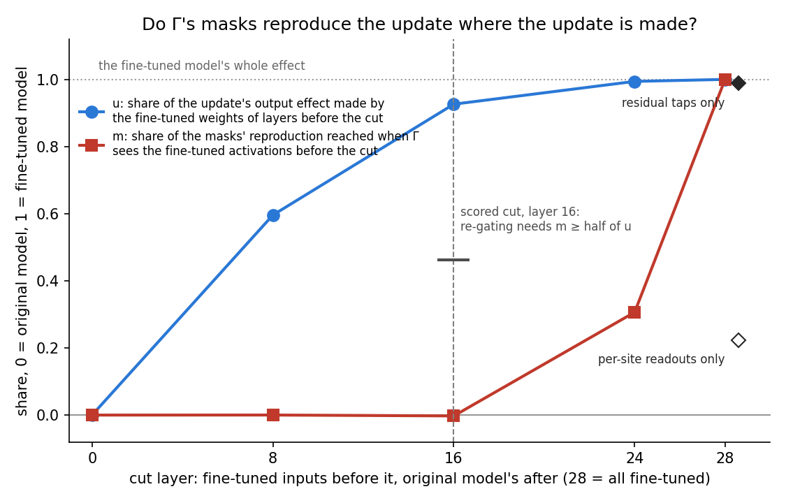

# Analysis: do Γ's masks reproduce E40's update where the update is made, or only from the last layers? (E44 Amendment 1)

*2026-10-29, analysis agent for the lead. Plan: `reports/plans/2026-10-28_plan_qwen-q0q1.md`, section "Amendment
record (2026-10-29, Amendment 1: layer-cut check)". Predictions `experiments/qwen_maps/results/predictions_amend1.json`,
filed before any code and unedited. Code `experiments/qwen_maps/amend1.py`. Results
`experiments/qwen_maps/results/amend1/{amend1_controls,amend1_stage2,amend1_score}.json` and `run.log`. Figure from
`experiments/qwen_maps/plot_amend1.py`. Notebook `notebooks/E44_qwen_maps.ipynb`, section "Amendment 1". Context: the
diagnosis `reports/analyses/2026-10-29_analysis_e44-no-teeth.md` and Fable's advice
`reports/plans/2026-10-29_advice_e44-pass-test-FABLE.md`. Every number below was read from the results files with `jq`.*

**In plain words.** We fed the importance function the fine-tuned model's activations for the first layers only and
the original model's for the rest, then measured how much of the fine-tuned output its masks reproduce.
The first sixteen layers' fine-tuned weights make 93% of the update's effect on the output, yet the masks recover none
of it until they see the fine-tuned model's last layers. For `GOALS.md`, do-nothing's pass on the current test comes
from the importance function copying the fine-tuned model's output, not from it describing the change.

## The answer

The masks follow the fine-tuned model's output, not the layers where the update acts. Given the fine-tuned
activations of the first sixteen layers, Γ's masks move the masked model none of the way toward the fine-tuned one.
Yet those layers' weights alone make 93% of the update's output effect. The masks reproduce the update
only when Γ sees the residual stream at the last few layers. So do-nothing keeps 97% of the update on the current
pass test because Γ copies the fine-tuned output, which weighs on the user's choice of pass test below.

## What we were trying to test

E44 found that the pass test cannot fail do-nothing, the state that leaves the whole fine-tuning update in Δ and
keeps the original subcomponents. The reason is that Γ, the importance function, reads the activations of the model
it is run on. For do-nothing those are the fine-tuned model's activations, and the CI masks Γ computes from them put
the original subcomponents within 0.09 nats of the fine-tuned model. This amendment asks which of two things that
reproduction is.

- **Γ reads the change.** The update alters the early layers' activations, Γ switches on different subcomponents in
  response, and those subcomponents carry the new behaviour. This is route (b) of `GOALS.md`.
- **Γ copies the output.** Γ reads all 29 residual-stream taps at once, and the last taps nearly fix the next token.
  A mask conditioned on them can pick whatever subcomponents reproduce that token without describing the change.

The test splices Γ's inputs at a layer. Γ has two inputs. One is the 29 residual-stream taps: tap $j$ is the input of
decoder layer $j$, and tap 28 is the last layer's output. The other is each decomposed site's readout, its input times
the original $V$. At **cut ℓ**, Γ gets the fine-tuned model's taps 0 to ℓ and its readouts of layers before ℓ, and the
original model's for the rest. Everything else is held fixed. The masked model always runs on the original weights,
with the original subcomponents and Δ off. Each reading is the KL from the fine-tuned model, averaged over every
position. The cut ran at ℓ = 0, 8, 16, 24 and 28. Cut 0 is the original model's masks; cut 28 is do-nothing's.

Two shares are read at each cut, both 0 at the original model and 1 at the fine-tuned one.

- $K(\ell)$ is the masked model's KL from the fine-tuned model at cut ℓ.
- $m(\ell) = [K(0) - K(\ell)] / [K(0) - K(28)]$ is the share of the masks' reproduction reached at cut ℓ.
- $H(\ell)$ is the unmasked model with the fine-tuned weights in layers before ℓ and the original weights after.
- $u(\ell) = [\mathrm{KL}(\text{FT} \| W_0) - \mathrm{KL}(\text{FT} \| H(\ell))] / \mathrm{KL}(\text{FT} \| W_0)$ is the
  share of the update's own output effect made by its first ℓ layers. It is the positive comparator for $m$: if Γ
  reads the change, the masks should keep pace with the layers that made it.

Two more readings split the carrier at cut 28: the fine-tuned taps with the original readouts, read as $s_\text{taps}$,
and the fine-tuned readouts with the original taps, read as $s_\text{reads}$. Both use the same formula as $m$.

The update is E40's no-warm-up fine-tune of Qwen3-1.7B on maths answers after 10 steps. The text is the first 16 maths
rows, each cut to 256 tokens, at batch 1. It ran on one cluster L40, $0.

## What we expected, and why

The plan filed one verdict and one carrier reading, each with a fixed rule. The verdict is read at layer 16 if the
first sixteen layers make at least 30% of the update's effect, else at layer 24. At that layer, $m$ at least half of
$u$ reads as Γ reading the change; less reads as copying. The lean was low, with copying slightly favoured. Fable's
reason was that the late taps nearly fix the next token, and Γ reads all 29 together. Copying also predicted that the
taps, not the readouts, would carry the reproduction. Three controls ran first and alone: the same read twice must
agree, the spliced path at cuts 0 and 28 must equal the unchanged code path, and the effect must be present.

## The controls

All three held, so the cut can be read.

| control | rule | read | verdict |
|---|---|---|---|
| floor: the same original-model read twice on row 0 | relative gap ≤ 1e-3 | 0, bitwise equal; tolerance 1e-6 | holds |
| identity: cut 0 and cut 28 against the unchanged code path | relative gap ≤ 1e-6 | 0 and 0 | holds |
| effect: $K(0) - K(28) \ge 0.25$, $K(28)/K(0) \le 0.2$, $\mathrm{KL}(\text{FT} \| W_0) \ge 0.05$ | all three | 1.393, 0.068, 1.817 | holds |

Beside the effect control, against E44 stage D's 128 rows of 512 tokens: $K(0) = 1.4957$ is 1.057 times stage D's
1.4156, and $K(28) = 0.1024$ is 1.099 times its 0.0932. Different rows and lengths, so no limit applies.

## What we observed

### Does Γ reproduce the update from the layers where the update is made?

**Reading it.** No. The blue line is the share of the update's output effect made by the fine-tuned weights before
each cut: 60% by layer 8, 93% by layer 16 and 99.4% by layer 24. The red line is the share of the masks'
reproduction reached when Γ sees the fine-tuned activations before the same cut. It reads 0.0001 at layer 8 and
−0.0025 at layer 16, far under the 0.46 that half of the blue line asks for. It rises to 0.31 at layer 24 and reaches
1 only at layer 28. So the masks reproduce the update only when Γ sees the last four layers' residual stream. Those
four layers' weights make under 1% of the update's effect. One caveat: a spliced input mixes the two models in a way
Γ never saw in training. A Γ that reads the change only from consistent inputs would also look like this.

| cut ℓ | $K(\ell)$, nats | $m(\ell)$ | $\mathrm{KL}(\text{FT} \| H(\ell))$, nats | $u(\ell)$ |
|---|---|---|---|---|
| 0 | 1.4957 | 0 | 1.8173 | 0 |
| 8 | 1.4955 | 0.0001 | 0.7342 | 0.596 |
| 16 | 1.4991 | −0.0025 | 0.1341 | 0.926 |
| 24 | 1.0688 | 0.306 | 0.0108 | 0.994 |
| 28 | 0.1024 | 1 | 0 by definition | 1 |

Layer 24 is the sharpest contrast. At that cut the fine-tuned residual stream entering layer 24 already holds almost
all of the update's effect. Running the original layers 24 to 27 on top of it leaves only 0.011 nats to the fine-tuned
model. Γ, given that residual stream and every earlier one, still recovers under a third of its reproduction.

### Which of Γ's inputs carries the reproduction?

**Reading it.** The residual taps carry it. The two diamonds at the right of the figure are the split at cut 28.
With every tap from the fine-tuned model and every readout from the original, the masked model reaches 0.989 of the
reproduction, at $K = 0.1180$ nats. With the readouts from the fine-tuned model and the taps from the original, it
reaches 0.223, at $K = 1.1845$. The difference is 0.77, past the filed 0.3 line for "taps". The readouts are each
site's own input, so their 0.22 includes the late sites' inputs, which are late activations too.

## What we learned

On Qwen, the masks that let do-nothing keep 97% of E40's step-10 update come from Γ reading the fine-tuned model's
last few residual taps. They do not come from Γ responding to the early layers where the weights changed. So the
pass test as built rewards any state whose activations end where the fine-tuned model's do. That says nothing about
whether the update was written into the subcomponents.

For the user's choice of pass test, this is an input, not a decision. Fable's option 1, Amendment 2, computes every
state's masks from the original model's activations, which is reading B. Its cost was that it would give up route (b),
Γ switching on different subcomponents for the fine-tuned model. On this update the route (b) that reading A credited
is the copying seen here, so option 1 gives up little that reading A measured as re-gating. The plan's branch for
this verdict also asks whether Γ's inputs should be cut to early layers from now on. This run only shows that a cut at
layer 16 removes the masks' reproduction entirely on this update.

Related evidence from the 67M, E49 in `reports/analyses/2026-10-29_analysis_e49-row-blocks.md`: on new Pile rows, the
adversarial check could not fail plain SGD's do-nothing, while it failed Adam's on every block. There too a test that
passes do-nothing could not credit a split, so its passes carried no weight.

## How compelling is the evidence

The pattern is large and clean. At layer 16 the masks reach none of their reproduction against 93% for the weights,
and every one of the 16 rows reads within 0.02 nats of its cut-0 value there. The floor is exactly 0, and the spliced
path matches the unchanged code to every digit at both ends, so the splice itself adds no drift.

It is one update, E40's large format change at step 10, on 16 maths rows of 256 tokens. It has no random-update
comparator on Qwen. The spliced inputs are a mix Γ never saw in training. A Γ that reads the change only when all its
inputs agree would read as copying here, so "copying" is an upper bound. On the 67M, E46 found Γ's new values gave
real fine-tunes eight times a random update's gain, which is evidence that Γ there responds to something specific
to the update. This run does not contradict that: a Γ can respond to the update's output specifically and still copy.

## Surprises

None that reverse a prediction: the filed lean was copying, and copying was read. Two notes.

- **The non-monotone flag.** $m(8) = 0.0001$ is above $m(16) = -0.0025$, so the score raised the filed flag
  "non-monotone". The filed rule reports it and does not score it; the verdict reads only layer 16. A negative $m$ at
  that layer reads as copying under the filed edge case. The step is 0.0035 nats in $K$, a quarter of a percent of
  the 1.39-nat gap, so both values are zero for this purpose.
- **The update's own effect is larger than the reference.** $\mathrm{KL}(\text{FT} \| W_0)$ read 1.82 nats on these
  rows, against E40's 0.52 for the reverse direction on other rows. No reference existed for this direction and these
  rows, and the rule only asked for at least 0.05.

## What next

- **The user's choice of pass test.** This result goes on the card beside Fable's option 1. If the user takes option
  1, Amendment 2 reruns E44's controls with masks from the original model's activations and a random update matched on
  KL. If the user keeps reading A, every split passes on Qwen and the line moves to describing where δW lands.
- **Whether Γ's inputs are cut to early layers.** This matters only if the user wants route (b) kept in some form.
  This run shows that a cut at layer 16 removes the reproduction on this update. It does not show whether a Γ fed
  only early layers still responds to real changes.

## Scorecard

| id | claim in words | rule | read | verdict |
|---|---|---|---|---|
| control_floor | the same read twice agrees | f ≤ 1e-3 | f = 0 | holds |
| control_identity | the splice at cuts 0 and 28 equals the unchanged path | relative gap ≤ 1e-6 | 0 and 0 | holds |
| control_effect | the reproduction and the update's effect are present | gap ≥ 0.25, ratio ≤ 0.2, KL ≥ 0.05 | 1.393, 0.068, 1.817 | holds |
| verdict | the masks keep pace with the layers that make the change | ℓ* = 16 as u(16) = 0.926 ≥ 0.3; m(16) ≥ 0.5·u(16) = 0.463 → re-gating | m(16) = −0.0025 | **copying**; flag non-monotone, not scored |
| carrier | the taps, not the readouts, carry the reproduction | s_taps − s_reads ≥ 0.3 → taps | 0.989 − 0.223 = 0.766 | **taps** |

## Not run

- Any random-update comparator on Qwen, matched on KL or otherwise.
- Steps 1 and 100, and any update besides E40's.
- The web rows, and maths rows beyond the first 16 or past 256 tokens.
- Stage S, and any split state: only do-nothing's masks were spliced.
- Cuts between 24 and 28, which would place the jump to one layer.
- Amendment 2, the pass test with every state's masks from the original model's activations.

## Run and provenance

- Cluster job 44065, one L40, `debug` QoS, $0, with the code of commit 67d9e4d. Stage 1 ended at 293 s and the job at
  345 s, of which 220 s was loading the decomposition.
- δW: `~/commute-data/results-large/qwen_sft/nowarmup_regen/dW/step_10.safetensors`, sha256 8b8509d2…beb9, matching
  `experiments/qwen_maps/results/regen_SHA256SUMS`.
- Resources: GPU peak 44.7e9 bytes, inside the 44 GiB stop rule; host peak 52.5 GB against `--mem=48G`, not killed.
- Figure: `experiments/qwen_maps/plot_amend1.py`, reading `amend1_score.json` only.
