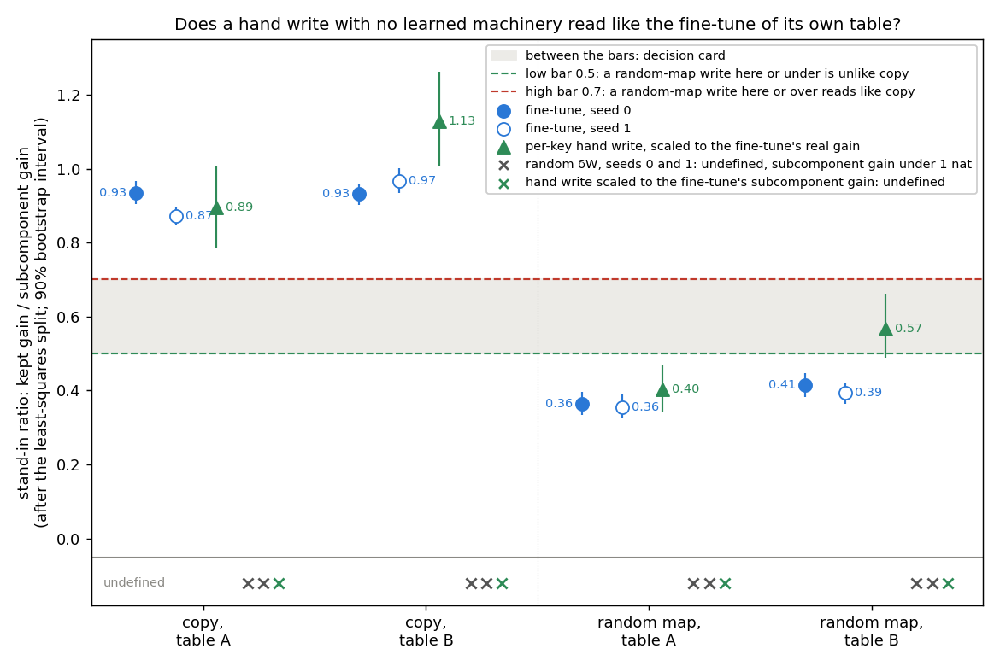

# Does the stand-in ratio read the update's kind, or would a hand-made write read the same? E46 Amendment 3

*E46 Amendment 3, `experiments/regating_table/amend3.py`, written 2026-10-29. Plan:
`reports/plans/2026-10-28_plan_regating-line-reset.md`, section "Amendment 3". Filed rules:
`experiments/regating_table/results/predictions_amend3.json`, filed before the run. Result:
`experiments/regating_table/results/amend3.json`, Slurm 42993 on the MATS cluster's debug QoS, $0. Earlier stage 0
report: `reports/analyses/2026-10-29_analysis_e46-regating-table.md`. Notebook: `notebooks/E46_regating_table.ipynb`,
section "Amendment 3".*

## In plain words

We split updates that learned nothing over the subcomponents, as the fine-tunes had been, and read the number stage 1 would carry to the larger model. A hand-made write read about what its own task's fine-tune read, and random noise gave no reading at all. So the number sorts tasks but does not show whether an update built anything, and whether to carry it to Qwen goes to the user.

## What was asked

Stage 1 of the reset plan would carry one number to Qwen3-1.7B: the stand-in ratio. The open question was whether that number
reads the kind of update, a strengthened old behaviour or a new one. Any update might read the same. Stage 0 had read
Γ's change on these nulls only whole in Δ, where the ratio cannot be computed. So the user chose to split the nulls first
and read the ratio on them, at no cost, before any money is spent on Qwen.

## What was tested

**The model and the tasks.** The 67M model with its frozen VPD decomposition and frozen Γ. Four tables from E12, each 32
keys after a marker word:

| table | the fine-tune teaches | kind, by construction |
|---|---|---|
| copy, table A and B | repeat the key | existing behaviour |
| random map, table A and B | give a fixed random word for each key | new behaviour |

**The number.** Every update δW is given the least-squares split: the least-norm change $(dU, dV)$ to the alive
subcomponents with $dU V^\top + U dV^\top \approx \delta W$, the rest going to Δ, so the full model is exactly
$W_0 + \delta W$. Then, in the stand-in model, which is the model rebuilt from the subcomponents alone with Δ removed:

- the subcomponent gain is how far the split's changed subcomponents raise the answer's log-odds at the key position,
  every mask open, filed as "piece gain";
- the kept gain is the same rise with each subcomponent multiplied by Γ's importance value from the updated model, filed
  as "gated piece gain";
- the stand-in ratio is kept gain over subcomponent gain.

A ratio of 1 means Γ switches on every subcomponent that carries the change, and 0 means it switches on none of them.
The ratio is scored only when the subcomponent gain is at least 1 nat, else the row is "undefined".

**The rows.** Each row is a forward pass on a changed copy of the weights; nothing is trained.

- *The control first*: the split of a zero update, which must read 0 for both gains.
- *The reference*: the eight E12 fine-tunes, four tables by two seeds, split and read by the same code.
- *A per-key hand write*, the scored null. It changes one matrix, the MLP output of block 1. It is the least-norm
  matrix mapping each key's mean input there onto the answer's unembedding row, scaled until the full model's gain on
  the answer matches the seed-0 fine-tune's. It asks whether an update with no learned machinery, only a direct write
  toward the answer, reads like the fine-tune. A second copy of the same write was scaled to match the fine-tune's
  subcomponent gain instead; it was to be scored only if the first was undefined.
- *A random δW*, seeds 0 and 1, reported only. It is a Gaussian update with the fine-tune's per-matrix norms. It is
  scaled so the full model's KL to the original on the other positions equals the fine-tune's, at 6 to 26 times the
  fine-tune's norm.

The copy writes are reported, not scored. The 67M model ties its input and output embeddings, and on a copy table the
answer is the key, so the copy write adds the key's own embedding at block 1. That is a representation the original
model already has.

**What each number should read.** At the zero update both gains are exactly 0. The copy fine-tunes should reproduce
stage 0's 0.87 to 0.97. The random-map fine-tunes should reproduce its 0.36 to 0.41. Splitting a null leaves the full
model unchanged, so each null's full-model gain and gate gain must reproduce stage 0 within 2%. The random rows were expected to be
undefined, since they barely move the answer at all.

## What we expected, and why

The scored prediction was that a hand write on a random-map table reads at or under the low bar of 0.5 on both tables.
The new-behaviour fine-tunes read 0.36 to 0.41, so a write with no machinery was expected near them or a little above.
The lean was medium, because stage 0 had already found that the unsplit write earned half to two thirds of their gate
gain. Above 0.7 on either table would mean the ratio reads a hand write like a copy fine-tune, and stage 1 would need a
different number. Between the bars sends the numbers to the user. The copy writes were expected at or over 0.7, through
the tied embedding.

## The control

The control passed on every table. Splitting a zero update gave exactly 0 for both gains. All eight fine-tunes
reproduced their stage 0 ratios exactly, and every null's full-model gain and gate gain reproduced stage 0 within its
tolerance. The controls took 119 seconds; the whole job took 310.

## Does a hand write with no learned machinery read like the fine-tune of its own table?

**Reading it.** Roughly yes: on each table the hand write lands near the fine-tunes of that table, not near the other
kind. On random map table A the write read 0.40 against the fine-tunes' 0.36, under the low bar. On random map table B
it read 0.57 against 0.39 and 0.41, between the bars. Its 90% interval, 0.49 to 0.66, crosses the low bar. On the
copy tables the writes read 0.89 and 1.13, next to the copy fine-tunes. So the ratio keeps the copy
tables apart from the random-map tables whether the update is a fine-tune or a write. It does not keep a write apart
from a fine-tune of the same table. One caveat: the copy writes carry the key's own embedding, so the copy rows do not
test a write free of existing machinery.

| table | fine-tune, seed 0 | fine-tune, seed 1 | hand write | write's 90% interval |
|---|---|---|---|---|
| copy A | 0.93 | 0.87 | 0.89 | 0.79 to 1.01 |
| copy B | 0.93 | 0.97 | 1.13 | 1.01 to 1.26 |
| random map A | 0.36 | 0.36 | 0.40 | 0.34 to 0.47 |
| random map B | 0.41 | 0.39 | 0.57 | 0.49 to 0.66 |

The fine-tunes' own intervals are 0.03 to 0.07 wide each side; E12 put their seed spread at up to 0.06.

## How much of each update do the split subcomponents carry?

The ratio says nothing about how big its two parts are, so the parts are listed here. This claim shares the figure
above: it explains why the write rows are noisier, not a new comparison.

| table | row | full-model gain, nats | subcomponent gain, nats | kept gain, nats | in-span share |
|---|---|---|---|---|---|
| copy A | fine-tune s0 | 13.99 | 12.20 | 11.40 | 0.80 |
| copy A | hand write | 13.37 | 5.95 | 5.32 | 0.38 |
| copy B | fine-tune s0 | 14.60 | 12.59 | 11.72 | 0.80 |
| copy B | hand write | 15.27 | 5.98 | 6.75 | 0.38 |
| random map A | fine-tune s0 | 13.73 | 11.19 | 4.07 | 0.82 |
| random map A | hand write | 13.10 | 4.88 | 1.97 | 0.39 |
| random map B | fine-tune s0 | 20.74 | 15.75 | 6.52 | 0.81 |
| random map B | hand write | 20.90 | 7.64 | 4.33 | 0.38 |

The in-span share is the part of the update's input-weighted energy that the alive subcomponents can take. It is 1 minus
the outside share, pooled over the changed matrices.

**Reading it.** The split subcomponents carry about half as much of a hand write as of a fine-tune. Their gain is 4.9 to
7.6 nats for the writes against 11.2 to 15.7 for the fine-tunes, at a matched full-model gain. The in-span share is 0.38
for every write and about 0.80 for every fine-tune. The rest of each write stays in Δ.

The write scaled to the fine-tune's subcomponent gain never got there. On the twelve-point scale grid the subcomponent
gain rose to a peak of 5.5 to 6.6 nats near the G-matched scale, then fell and turned negative. At the cap of 1000 it
read −10.7 to −16.5 nats. So those four rows are undefined; under the filed rule they were reported only, because the
G-matched write was defined on every table. The plan named large second-order terms of the split at large scale as a
blind spot for the random rows. That they also bend the write's curve here is a candidate explanation, not tested.

## Does a random update give the ratio a null?

No: the ratio cannot be read on random noise. On all eight random rows, the subcomponent gain was between −0.08 and
+0.50 nats, under the 1-nat floor, so every ratio is undefined. That was the expected reading, since stage 0 found these
updates move the full model's answer by at most half a nat. Their in-span share was 0.61 to 0.64, between the writes'
and the fine-tunes'.

| table | random seed 0: full-model gain, subcomponent gain | random seed 1: full-model gain, subcomponent gain |
|---|---|---|
| copy A | 0.26, 0.20 | 0.23, 0.16 |
| copy B | 0.04, −0.08 | 0.06, 0.19 |
| random map A | 0.40, 0.50 | 0.56, 0.40 |
| random map B | 0.05, 0.01 | 0.14, 0.10 |

The plan requires stage 1 to read its own split random null of the Qwen δW at the Qwen fine-tune's side effects. If the
same happens there, that null will also be undefined. This is a candidate concern from the toys, not a measurement on
Qwen.

## What the tree's branch means

The filed tree ends at branch 5, "card with the numbers". Neither random-map write reached 0.7, so the ratio is not
shown to read a hand write like a copy fine-tune; branch 2 did not fire. Only one of the two reached 0.5 or under, so the
plan's condition for proposing stage 1 with this number did not hold; branch 3 did not fire. Every row was finite and
every scored write was defined, so branches 1 and 4 did not fire.

For carrying the stand-in ratio to Qwen, this means three things:

- It still separates the two task kinds on the 67M, for fine-tunes and writes alike, with no overlap between a copy row
  and a random-map row.
- It is not shown to tell an update that built machinery from one that built none. A hand write with no machinery read
  inside or above the new-behaviour fine-tunes' range, so a Qwen reading near 0.4 to 0.6 could come from either.
- The random δW, the null stage 1 was to carry, gives no ratio on the toys at all.

So the plan's proposal of stage 1 with this number is not made. Whether to carry it, and in what role, is the card in the
last section.

**The method's standing limit.** VPD's unit is the rank-one subcomponent, not the circuit. A new mechanism built from
subcomponents W₀ already has, put together under new importance values, reads as "elicited" to VPD. So "elicits", read
from VPD, means "uses subcomponents W₀ already has", never "uses a circuit W₀ already runs". This holds for the stand-in
ratio, for E50's restore share and for every re-gating claim. It is a property of the unit, not a bug. The only check
that narrows it is a Γ from a second decomposition seed. The limit is kept in `decisions.md`, under "Limit of the
elicitation reading".

## What it means for E50

E50, real-model restore on known-kind anchors, is approved and next. Its plan is
`reports/plans/2026-10-29_plan_restore-anchors.md`.
It reads E38's restore share in the real fine-tuned model on these same four tables, with the stand-in ratio beside it.
This result leaves E50's measurement and its separation rule as they are. Its plan already treated the stand-in ratio as
a number to sit beside the real-model one, and only branch 2 here would have changed that.

It does weaken one of E50's follow-on branches. If E50 does not separate the two kinds, its plan says stage 1 "rests on
the stand-in alone". After this result the stand-in ratio's null reads between the bars on one table. So that
branch should go to the user, not straight to stage 1. That is a recommendation, not a filed
rule.

## What we learned

The stand-in ratio, read on the 67M's tables, follows the table more than the update. A fine-tune and a hand write of
the same mapping read within 0.05 of each other on two tables. On the other two they read 0.15 to 0.2 apart. A hand write
splits with only about 40% of its energy in the subcomponents' span, against 80% for a fine-tune. So what the ratio
compares between a write and a fine-tune is a smaller, noisier split. For `GOALS.md`'s fork, the ratio supports "this
task's answer is carried by subcomponents Γ switches on". It does not, by itself, support "this update strengthened
existing machinery rather than adding new".

## How compelling is the evidence

- One write direction per table, four tables, one model, one decomposition, single-position toys. The copy writes are
  confounded with the key's own embedding.
- The deciding row, random map B, has an interval that crosses the low bar. With one write per table, whether 0.57 is
  typical of hand writes is not known.
- The writes were matched on the full model's gain, not on side effects or on subcomponent gain. The random map B write's
  KL on the other positions is 1.30 against its fine-tune's 0.10, thirteen times higher. Whether that raises its ratio
  is not tested.
- The ratio is blind to what the split subcomponents are. It cannot tell "Γ switched them off" from "they carry
  nothing toward the answer"; only the two gains in nats and the in-span share, reported above, speak to that.
- Trigger log-odds, not the KL form stage 1 would read on Qwen's maths rows.

## Surprises

- **The scored prediction missed on one table.** It said both random-map writes read at or under 0.5; random map B read
  0.57. The plan named this as the likelier miss and routed it to a card.
- **The subcomponent gain of a hand write cannot be raised to a fine-tune's.** It peaked near half the fine-tune's value
  and then fell as the write grew. The plan expected this match to fail only if the cap was too low.

## What next

- E50, approved and next: if the real-model restore share separates the two kinds on these tables, it is the number
  stage 1 carries, with the stand-in ratio beside it.
- The decision card below: the stand-in ratio's role in stage 1.
- If the user wants the write null sized before deciding: more hand-write directions per table, and writes matched on
  side effects. A spread that puts most writes under 0.5 on random map B would favour option 1 below; most over 0.5
  would favour option 3.

## Scorecard

| id | claim | rule | read | verdict |
|---|---|---|---|---|
| C0 | the split of a zero update reads 0 | both gains within 0.001 nats of 0, every table | exactly 0 on all four | pass |
| C1 | the fine-tunes reproduce stage 0 | ratio within 0.01 of stage 0b, P0.2's bars hold | 8 of 8 exact | pass |
| C2 | splitting leaves the full model unchanged | G and g within max(0.02 nats, 2%) of stage 0 | 8 of 8 within | pass |
| A3.1 | the split random-map writes do not read like copy | both writes defined, ratio ≤ 0.5 | 0.40 and 0.57 | fail on random map B |
| copy rule | copy writes read low would mean the ratio discounts writes | both ≤ 0.5 → "discounts" | 0.89 and 1.13 | "no" |
| reported | random rows undefined | subcomponent gain < 1 nat | 8 of 8 undefined | as expected |
| reported | copy writes ≥ 0.7 | none | 0.89 and 1.13 | as expected |
| tree | | first match wins | branch 5 | card with the numbers |

## Decision card (for the log's pending decisions)

**Should the stand-in ratio go to Qwen as stage 1's number?**

*Observation.* Stage 1 was to carry one number to Qwen3-1.7B: the stand-in ratio. It is the share of a split
update's gain, in the model rebuilt from subcomponents, that Γ keeps when it sets the masks. On the 67M it reads about
0.9 for fine-tunes that strengthen copying. It reads about 0.4 for fine-tunes that learn a new random mapping. We split
hand-made writes that learn nothing and read the same number. A write read about what the fine-tune of its own table
read. On the two random-map tables that was 0.40 and 0.57; on the two copy tables, 0.89 and 1.13. Random noise gave no reading at all. So the number sorts the
tasks, but a write with no machinery is not told apart from a new-behaviour fine-tune. The filed rule wanted both
random-map writes at or under 0.5; one read 0.57, between the bars, and the rule sends that here.

*Options.*
1. **Carry it beside E50's real-model number, reported and never scored on its own.** Stage 1 goes ahead only if
   E50's restore share separates the two kinds on these tables, and that number carries the verdict. Cost: none now;
   stage 1 as planned, about $5. Risk: the ratio adds little, and a reader may still lean on it.
2. **One more $0 debug job first: more hand-write directions per table, and writes matched on side effects.** This
   sizes the write null before deciding, about 15 minutes. Most writes under 0.5 on random map B would restore the
   original plan; most over would drop the number. Risk: more toy nulls, while the open question is the real model.
3. **Drop the stand-in ratio from stage 1.** Stage 1 rests on E50's number alone; if E50 does not separate the kinds,
   stage 1 is not proposed. Risk: it gives up a number that does separate the two task kinds on every row.

*Recommendation.* Option 1, decided after E50 reads, since E50 is approved, free and next. If E50 does not separate,
take option 3 rather than resting stage 1 on the stand-in ratio alone.

*Run line.* E46 Amendment 3, Slurm 42993, $0; report `reports/analyses/2026-10-29_analysis_e46-amendment3.md`.

## Not run

- More than one hand-write direction per table, so the write null's spread is unknown.
- Hand writes matched on side effects or on subcomponent gain; the second could not be reached at any scale.
- Writes at other blocks or of other forms.
- A random δW at the fine-tune's own norm, split; the matched scale was 6 to 26 times larger.
- The flipped updates, split; E18's fine-tunes and random rows, split.
- The KL form of the ratio, and anything on Qwen.
- Any Γ from another decomposition seed, or refitted.
- The cosine between the write's and the fine-tune's change to the residual stream after block 1.

## Provenance

- Slurm 42993, MATS cluster debug QoS, 310 s of measurement, $0. Code `experiments/regating_table/amend3.py` at commit
  `df3f572`; code check against stage 0b's commit `910effa`. Log `cluster/logs/commute-regating-table-42993.out`.
- Result `experiments/regating_table/results/amend3.json`; filed rules
  `experiments/regating_table/results/predictions_amend3.json`.
- Figure `experiments/regating_table/figures/amend3.png`, from `experiments/regating_table/plot_amend3.py`, run
  through `fleet/cpu-run`.
