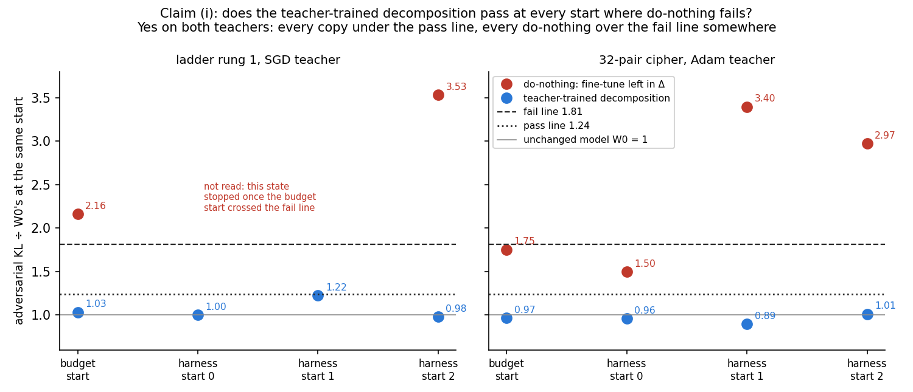
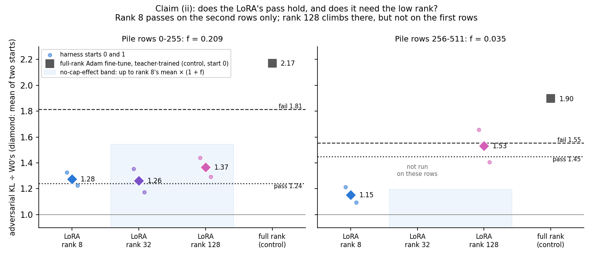
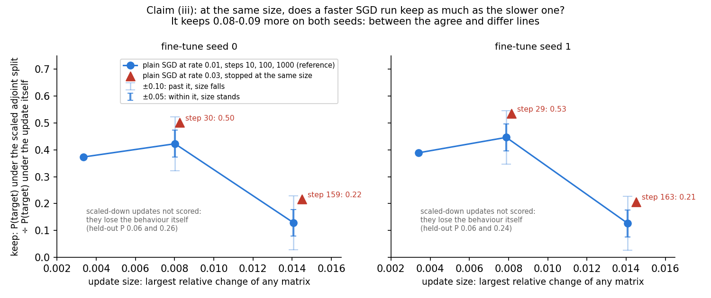
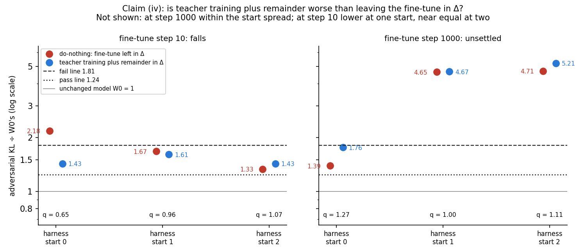
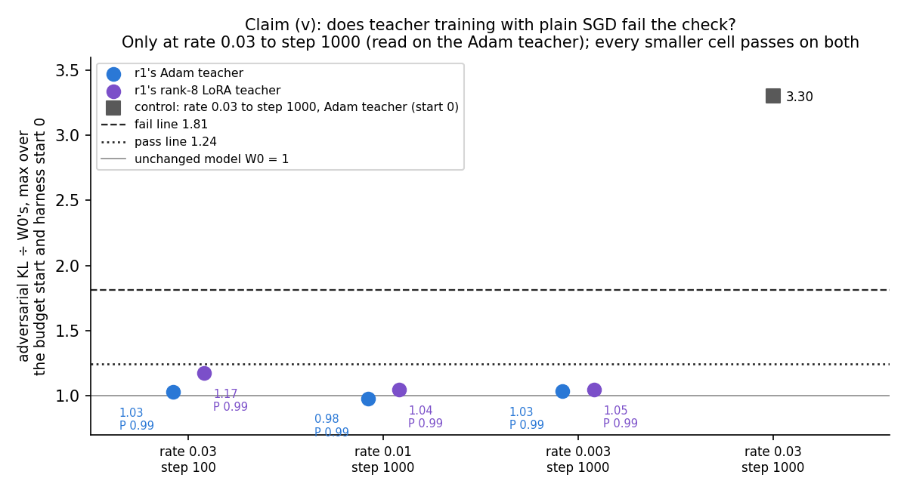

# Analysis: do the five red-teamed claims survive more adversary starts and the missing controls? (E47)

*2026-10-29. Plan `reports/plans/2026-10-28_plan_claim-tests.md` with Amendment 1; the review these tests answer
`reports/reviews/2026-10-29_review_claims-red-team.md`; code `experiments/claim_tests/{run,stages,job,recipes,rules}.py`;
predictions `experiments/claim_tests/results/predictions.json`, filed before any job ran; results
`experiments/claim_tests/results/{t1,t1b,t2,t2b,t2c,t3,t4,t4b,t5,t5b,combined}.json`; stage logs
`experiments/claim_tests/results/large/<stage>.log`; notebook `notebooks/E47_claim_tests.ipynb`; figures
`experiments/claim_tests/figures/e47_*.png` from `experiments/claim_tests/plot.py`. MATS cluster L40, debug QoS, ten jobs, $0.*

We re-ran the five claims the red team weakened, each with several adversary starts and the controls it said were
missing. Teacher training held up on both teachers, plain SGD worked as its optimiser at every smaller setting, and the
remainder was not shown worse than leaving the update in the residual. So teacher training stays the map for the weak
version, the claim that it needs Adam goes, and the remainder claim is open until its step-10 state is re-read.

## The answer

Teacher training keeps the decomposition faithful at every adversary start we tried, on both teachers, where leaving
the update in the residual fails. Plain SGD works as teacher training's optimiser at every setting tried except the
largest rate run longest, so "it needs Adam" falls. Putting the remainder in the residual was not shown worse than
leaving the whole update there: unsettled late in training, and at the earliest step one start read it better. The
LoRA's pass held on one row set only. For the split, a faster run kept a little more at the same size.

| Claim | Red team | After E47 | Filed rule's outcome |
|---|---|---|---|
| (i) teacher training passes where do-nothing fails | weakened | **stands** on both teachers, four starts | T1 combined: stands |
| (ii) the rank-8 LoRA's pass is real, not a rank cap | weakened | **weakened**: passes on rows 256-511 only; rank 128 climbs on those rows only | T2 combined: absolute unsettled, cap unsettled |
| (iii) the scaled adjoint split's keep falls with size, not path | weakened | **weakened**: at matched size the path adds 0.08-0.09; size alone was not isolated | T3: mixed on both seeds |
| (iv) teacher training plus remainder is worse than do-nothing | weakened | **unsettled** (step 1000, the filed claim); the step-10 reading falls by its filed rule, carried by one start; re-read pending (t4c) | T4: unsettled; T4b beside it: falls |
| (v) teacher training needs Adam; plain SGD fails | weakened | **falsified**: plain SGD passes at all six cells | T5 combined: falls |

## What we were trying to test

Each claim was re-read on the same 67M model and decomposition, on the MATS cluster's L40. The faithfulness reading is
the **adversarial check**: an attacker spends 20 steps of gradient ascent on the subcomponents' masks to push the
model's output away from the target model, on 256 Pile validation rows. The **ratio** is that attacker's KL for a state
divided by its KL for the unchanged model W₀, read in the same job, on the same rows, from the same **start**. W₀ reads 1.

A **start** is the attacker's random initialisation. "Harness start k" is the harness's seed k. The "budget start" is the
initialisation from E34 Amendments 4-5, which once took a do-nothing state from 1.6 to 9.2. Every earlier reading in the
five claims used one start. The **floor** $f$ is W₀'s own spread over the harness starts, max/min − 1. It sets the lines:
pass at or under $1.5/(1+f)$, fail at or over $1.5(1+f)$, inconclusive between. On rows 0-255 the L40 gives
$f = 0.209$, so the pass line is 1.241 and the fail line 1.813. No number here is compared with an H100 number.

The states, in the Terms' words:

- **Do-nothing**: the fine-tune's whole weight change δW put in Δ, the part of the weights outside the subcomponents.
  Subcomponents and Γ untouched. The reference.
- **Teacher-trained decomposition**: component training of the alive subcomponents towards the fine-tuned model,
  Γ and Δ frozen. The map under test for the weak version.
- **Teacher training plus remainder**: the teacher-trained subcomponents, with the rest of the fine-tune,
  $W_{\text{ft}} - W_{\text{tt}}$, added to Δ so the weights equal the fine-tuned model's.
- **Keep**: P(target) under the scaled adjoint split of δW, divided by P(target) under $W_0 + \delta W$ itself. 1 means the
  split keeps all of the behaviour, 0 none.

Each job read W₀ first, alone, at every start it used, and stopped if W₀ missed its known value. Each then read a
positive control that must fail before reading anything else.

## What we expected, and why

- **(i)**: stands for the ladder task, low confidence. Its do-nothing state had failed under the budget start before. We
  expected no power on the cipher task: its do-nothing had read 1.50, inconclusive, and the budget start had never been
  tried on it.
- **(ii)**: rank 8 inconclusive under the L40's tighter lines, low confidence. Its H100 reading of 1.27 sits between them.
  Rank 32 and rank 128 near rank 8, no cap effect.
- **(iii)**: size falls, medium confidence. The red team found the faster run keeping more at near-matched size,
  0.25 against 0.13, which pointed at the path.
- **(iv)**: unsettled at step 1000, low confidence, because E43's margin there lay in one block of rows. At step 10 it
  stands, medium confidence: E43's margin there was large, 3.92 against 2.52 on the H100.
- **(v)**: falls, low confidence. Plain SGD as the student had passed on emoticon at a smaller rate, and at step 100 on
  the ladder task's SGD teacher.

## What we observed

### (i) Does the teacher-trained decomposition pass where do-nothing fails? Yes, on both teachers at four starts

**Reading it.** The claim stands on both teachers. Every teacher-trained decomposition sits under the pass line at all
four starts, and every do-nothing state crosses the fail line at one start or more. On the ladder task the do-nothing
state failed at the budget start, at 2.16, and again at harness start 2, at 3.53. On the cipher task do-nothing read
1.50 at harness start 0, which repeats E42's inconclusive reading. Harness starts 1 and 2 then took it to 3.40 and 2.97.
So the power we expected to lack came from the extra harness starts, not from the budget start. The caveat is the ladder
task's worst start: its teacher-trained decomposition read 1.225 at harness start 1, only 1.3% under the pass line.

| state | budget | harness 0 | harness 1 | harness 2 | worst | verdict |
|---|---|---|---|---|---|---|
| ladder rung 1, do-nothing | 2.162 | stopped | stopped | 3.530 | ≥ 3.530 | fail |
| ladder rung 1, teacher-trained | 1.033 | 1.003 | 1.225 | 0.980 | 1.225 | pass |
| cipher, do-nothing | 1.753 | 1.499 | 3.396 | 2.974 | 3.396 | fail |
| cipher, teacher-trained | 0.966 | 0.961 | 0.894 | 1.012 | 1.012 | pass |

The separation rule also holds: each teacher-trained worst times $1+f$ reads 1.48 and 1.22, under its do-nothing's
worst. The ladder task's do-nothing was read with an early stop, so harness starts 0 and 1 were not read in job t1; the
budget start had already failed it. Both teachers were regenerated in-job and passed their reproduction checks: the ladder
task's SGD teacher at P 0.991 and size 0.0286, the cipher teacher at P 0.994.

### (ii) Does the rank-8 LoRA's pass hold, and does it need the low rank? It holds on one row set; the rank question is open

**Reading it.** The claim is still weakened. On rows 0-255 the rank-8 LoRA's teacher-trained decomposition reads a mean
of 1.28 over two starts. That is just over the pass line, so inconclusive. On rows 256-511 it reads 1.15, a pass under
that row set's line of 1.45. The rank question splits the same way. On rows 0-255, rank 32 and rank 128 read 1.26 and
1.37, both inside rank 8's band. On rows 256-511, rank 128 reads 1.53, a third above rank 8 and just under the fail line
of 1.55. Its harness start 0 alone reads 1.66, over that line. The full-rank Adam control failed on both row sets.

One thing makes rows 256-511 stricter. W₀'s two starts there read 0.630 and 0.652, so the floor is only 0.035. The
lines sit close together, and the no-cap band is only 3.5% above rank 8. The review had expected a floor near 0.15.
A third start can only raise the floor, and neither verdict there changes for any floor the job allows: rank 8 passes
up to a floor of 0.30, and rank 128 stays unsettled from 0.022 to 0.33.

The ranks are not matched in size. Rank 128's update moves its largest matrix by 0.077, rank 32's by 0.044. Their
gains on the task are close, 0.167 and 0.165, against rank 8's 0.148. A climb with rank is therefore also a climb with size.

| rows | state | harness 0 | harness 1 | mean | lines | job's verdicts |
|---|---|---|---|---|---|---|
| 0-255 | full-rank Adam, teacher-trained | 2.171 | — | 2.171 | 1.241 / 1.813 | control fails |
| 0-255 | LoRA rank 8, teacher-trained | 1.326 | 1.226 | 1.276 | 1.241 / 1.813 | inconclusive |
| 0-255 | LoRA rank 32, teacher-trained | 1.354 | 1.174 | 1.264 | 1.241 / 1.813 | no cap effect |
| 0-255 | LoRA rank 128, teacher-trained | 1.441 | 1.293 | 1.367 | 1.241 / 1.813 | no cap effect |
| 256-511 | full-rank Adam, teacher-trained | 1.897 | — | 1.897 | 1.450 / 1.552 | control fails |
| 256-511 | LoRA rank 8, teacher-trained | 1.213 | 1.094 | 1.154 | 1.450 / 1.552 | pass |
| 256-511 | LoRA rank 128, teacher-trained | 1.657 | 1.408 | 1.532 | 1.450 / 1.552 | cap unsettled |

The no-cap band is rank 8's mean times $1+f$: 1.543 on rows 0-255, 1.194 on rows 256-511. Rank 8 was re-read in job t2b
and gave the same numbers to every digit. The rank-128 state was trained once, in job t2c, and loaded by job t2 from
`results/large/t2_lora_r128_tt.pt`, so the two row sets read the same weights.

### (iii) At the same size, does a faster SGD run keep as much as a slower one? It keeps somewhat more

**Reading it.** The outcome is mixed on both seeds, against a filed lean of "falls". The run at rate 0.03 reached the
slower run's step-100 size at step 29 or 30, and its step-1000 size at step 159 or 163. At those matched sizes it kept
0.08 to 0.09 more than the rate-0.01 run on every one of the four comparisons. That is more than the 0.05 agree line and
less than the 0.10 differ line. So at matched size the path adds 0.08 to 0.09. Size alone was not isolated. Along each
run keep drops by about 0.3 between the two sizes, but there size and step count rise together. The arm that changes size
alone, below, could not be scored.

The second part, scaling the step-1000 update down to smaller sizes, could not be scored. The scaled-down updates lose
the behaviour itself: their own P(target) is 0.06 at a quarter of the size and 0.24-0.26 at about half. The rule leaves a
cell unscored when that denominator is under 0.5. The rate-0.01 run at its own step 10, the same size, holds P 0.84.
So a scaled-down update and an update trained to that size are not alike in behaviour. That is an observation beside the
filed rule, not a scored result.

The rate-0.01 reference repeated E31 within 0.004 on keep and 0.2% on size at every step.

| seed | matched size | rate 0.01 keep | rate 0.03 keep | rate 0.03 step | difference |
|---|---|---|---|---|---|
| 0 | 0.0080 | 0.423 | 0.502 | 30 | +0.079 |
| 0 | 0.0141 | 0.129 | 0.217 | 159 | +0.088 |
| 1 | 0.0079 | 0.446 | 0.535 | 29 | +0.089 |
| 1 | 0.0141 | 0.126 | 0.207 | 163 | +0.081 |

| seed | α, scaled-down update | its own P(target) | scored? |
|---|---|---|---|
| 0 | 0.238 | 0.060 | no: P under 0.5 |
| 0 | 0.570 | 0.259 | no |
| 1 | 0.242 | 0.060 | no |
| 1 | 0.560 | 0.239 | no |

### (iv) Is teacher training plus remainder worse than do-nothing? Not shown: unsettled at step 1000; at step 10 one start reads it better

**Reading it.** The claim as filed is the step-1000 test, and it stays unsettled, as leaned. Here $q$ is plus
remainder's KL divided by do-nothing's at the same start; above 1 means plus remainder is worse. At step 1000 plus
remainder reads higher at every start, but only by 0.5% at harness start 1. Both states fail outright at harness starts
1 and 2, where each reads above 4.6. At harness start 0 they read 1.76 and 1.39, the same order as E43.

The step-10 reading, reported beside it, falls by its filed rule, carried by one start. At harness start 0 plus
remainder read 1.43 and do-nothing 2.18, so $q = 0.65$. At starts 1 and 2, $q$ is 0.96 and 1.07: within 4-7% of
equal. So at step 10 plus remainder was not worse than do-nothing at every start, which breaks the filed "worse". It
does not show the opposite ordering. The filed lean was "stands", so this is a miss.

Two things weaken the step-10 reading. First, its reproduction checks cannot see what changed. They pin the update's size
and behaviour, but every P is 0.999 or more, so the 0.02 tolerance separates nothing. The step-10 teacher-trained state
without the remainder was never read under the attacker, as E43's own check did. Second, this one state moved far more
between cards than the others. At harness start 0, plus remainder at step 10 reads 64% lower on the L40 than on the H100.
Do-nothing at step 10 and both step-1000 states move by only 6-13%. The two cards' attackers from the same seed are not
the same attack, so this is a pointer, not a comparison of lines. A $0 follow-up, t4c, reads the step-10 teacher-trained
state on the L40; the claims section waits for it.

| step | state | harness 0 | harness 1 | harness 2 |
|---|---|---|---|---|
| 10 | do-nothing | 2.183 | 1.674 | 1.332 |
| 10 | teacher training plus remainder | 1.428 | 1.609 | 1.431 |
| 10 | $q$ | 0.654 | 0.961 | 1.075 |
| 1000 | do-nothing | 1.390 | 4.651 | 4.706 |
| 1000 | teacher training plus remainder | 1.762 | 4.673 | 5.207 |
| 1000 | $q$ | 1.267 | 1.005 | 1.106 |

Reproduction checks: step 10, fine-tune P 0.99928 and size 0.011191 against 0.99931 and 0.01125, a −0.53% size difference; the teacher-trained
state's P 0.99939, Δ share 1.5e-9; step 1000, fine-tune P 0.99910 and size 0.03149 against 0.99961 and 0.03209, the
teacher-trained state's P 0.99685.

### (v) Does teacher training with plain SGD fail the check? Only at the largest rate run longest

**Reading it.** The claim falls, as leaned. With plain SGD as teacher training's optimiser, every one of the three
smaller cells passes on both the ladder task's Adam teacher and its rank-8 LoRA teacher. Those cells are rate 0.03 to step
100, and rates 0.01 and 0.003 to step 1000. Their worst reading over two starts is 0.98 to 1.17, and the behaviour is
kept at P 0.986 or more. Only rate 0.03 run to step 1000, the setting the old claim rested on, fails, at 3.30. E47
read that failing setting on the Adam teacher only; the LoRA teacher's fail there is the earlier H100 reading. So the
right statement is narrower: plain SGD at rate 0.03 for 1000 steps fails, shown here on the Adam teacher, and every
smaller setting tried passes on both teachers.

| teacher | cell | budget | harness 0 | worst | held-out P | verdict |
|---|---|---|---|---|---|---|
| Adam | 0.03, step 100 | 1.027 | 1.012 | 1.027 | 0.994 | pass |
| Adam | 0.01, step 1000 | 0.978 | 0.966 | 0.978 | 0.991 | pass |
| Adam | 0.003, step 1000 | 1.033 | 1.017 | 1.033 | 0.990 | pass |
| LoRA rank 8 | 0.03, step 100 | 0.998 | 1.172 | 1.172 | 0.986 | pass |
| LoRA rank 8 | 0.01, step 1000 | 1.043 | 0.998 | 1.043 | 0.989 | pass |
| LoRA rank 8 | 0.003, step 1000 | 1.046 | 1.010 | 1.046 | 0.988 | pass |
| Adam, control | 0.03, step 1000 | — | 3.300 | 3.300 | — | fail |

## What we learned

Teacher training remains the map for the weak version: on two teachers its decomposition passed at four adversary
starts where do-nothing failed. The optimiser is not what makes it work. Plain SGD passes at every smaller rate and step,
so `decisions.md` row 50 and the E34 card should say only that one large SGD setting fails. Teacher training plus
remainder is no longer known to be worse than do-nothing; at step 10 one start read it better, pending t4c. The rank-8 LoRA's
pass depends on which rows are read, and the rank question has one hint of a climb at rank 128.

## How compelling is the evidence

- One model, one decomposition, one card. Claim (i) has two tasks, (ii) one LoRA seed, (iii) one task and two seeds,
  (iv) one task and one seed, (v) one task and two teachers.
- Two to four adversary starts per state. W₀'s spread over three harness starts on rows 0-255 is 21%, and single
  states moved far more: the cipher's do-nothing went from 1.50 to 3.40 between two starts.
- The floor on rows 256-511 comes from two starts only, 3.5%. Lines that close make that row set's verdicts sensitive.
- Every W₀ reading matched its known value, and every positive control passed its rule. Two did not read near their
  filed expected values. T1's control read 2.16 at the budget start, against about 9 filed from the H100. T1b's ladder
  do-nothing read 3.53 at harness start 2, against 1.5-1.8 expected. Both show the attacker varies widely across cards
  and starts. Results reproduce to every digit where the same state was read twice in two jobs.
- Only the adversarial check was read; the stochastic and CI-masked ratios were not.

## Surprises

1. **Something unexpected happened that I cannot explain.** We predicted that at fine-tune step 10, teacher training plus
   remainder reads worse than do-nothing at every start, with medium confidence. On the L40 it read better at one start,
   $q = 0.65$ at harness start 0, and within 4-7% of equal at the other two. E43 on the H100 had $q$ about 1.56 there.
   The step-10 plus-remainder state alone moved 64% between cards; t4c re-reads its teacher-trained state.
2. Claim (iii) came out mixed, not "falls" as filed: the faster run kept 0.08-0.09 more at matched size, under the 0.10 line.
3. Claim (i) had power on the cipher task after all. Harness starts 1 and 2, not the budget start, took its do-nothing over
   the fail line.
4. W₀'s floor on rows 256-511 came out 0.035, not the review's expected ~0.15; that row set's lines are tight.
5. Two first submissions were cancelled and resubmitted once with no code change. t2's job 42655 logged nothing. t4b's
   job 42668 was slow, not silent: it logged one line after 1723 s and was cancelled a second later. Cause unknown.

## What next

1. **(iv) at step 10.** First t4c, running: the step-10 teacher-trained state alone at harness starts 0-2 on the L40. Then
   the two step-10 states at more starts, the budget start and rows 256-511, $0 on the cluster. If
   $q$ stays under 1 at most starts, E43's step-10 result was one start's reading; if it crosses 1 elsewhere, the claim is
   start-dependent and is dropped.
2. **(ii) the rank question.** Rank 32 and rank 64 on rows 256-511, with three harness starts for the floor. A climb past
   the fail line with rank would make the LoRA's pass a cap effect; a flat line would settle "no cap".
3. **(v) wording.** Rescope `decisions.md` row 50 and the E34 card now, $0: plain SGD at rate 0.03 for 1000 steps fails;
   every smaller setting tried passes on both teachers.

## Scorecard

| id | claim | rule | read | lean | outcome |
|---|---|---|---|---|---|
| T1 | (i) budget, h0, h1 | copies pass on R_max, do-nothing fails, separation by 1+f | r1 copy 1.225, nothing ≥ 2.16; rand32 copy 0.966, nothing 3.40 | stands r1, no power rand32 (low) | **stands** both: miss on rand32 |
| T1b | (i) h2 alone | as T1 at h2 | copies 0.980, 1.012; nothing 3.53, 2.97 | combined as T1; h2 changes no verdict | stands |
| T1 combined | (i) four starts | T1 over budget, h0, h1, h2; f pooled 0.2088 | as above | as T1 | **stands** both teachers: miss on rand32 |
| T2 | (ii) rows 0-255, rank 128 | R_mean; absolute and cap | rank 8 1.276, rank 128 1.367, control 2.171 | absolute unsettled, no cap effect (low) | unsettled; no cap effect: hit |
| T2b | (ii) rank 32 | cap at rank 32 | rank 32 1.264 vs band 1.543 | no cap effect (low) | no cap effect: hit |
| T2c | (ii) rows 256-511 | T2's rule, f 0.0347 | rank 8 1.154, rank 128 1.532 vs band 1.194, fail 1.552 | absolute unsettled or stands; no cap effect (low) | stands: hit; cap unsettled: **miss** |
| T2 combined | (ii) | absolute on both row sets; cap over three jobs | stands + unsettled; no cap ×2 + unsettled | — | absolute unsettled, cap unsettled |
| T3 | (iii) keep vs size | per seed: agree 0.05, differ 0.10, scaled cells | (a) +0.079, +0.088 / +0.089, +0.081; (b) unscored, P 0.06-0.26 | falls (medium) | **mixed** both seeds: miss |
| T4 | (iv) step 1000 | stands: ranges apart and q ≥ 1.1 all; falls: q ≤ 1.0 any | q 1.267, 1.005, 1.106 | unsettled (low) | unsettled: hit |
| T4b | (iv) step 10 | as T4 | q 0.654, 0.961, 1.075 | stands (medium) | **falls** by the rule, carried by one start: miss |
| T5 | (v) two cells | falls if a cell passes on both teachers | four of four pass | falls (low) | falls: hit |
| T5b | (v) rate 0.003 | T5's rule on one cell | two of two pass | combined falls (low) | falls |
| T5 combined | (v) three cells | precedence falls > unsettled > mixed > stands | six of six pass, P ≥ 0.986 | falls (low) | **falls**: hit |

C0 in every job: W₀ at h0 0.69174, h1 0.83616, h2 0.70488 on rows 0-255, CI 0.3482, budget/h0 1.028; rows 256-511 h0
0.63011, h1 0.65199, CI 0.3331. Every positive control failed as required: T1 2.162, T2 2.171, t2c 1.897, T5 3.300.

## Not run

- The stochastic and CI-masked ratios, for every state; only the adversarial check was read.
- Rows 256-511 for claims (i), (iv), (v); rank 32 on rows 256-511; ranks between 32 and 128; any row set beyond 512.
- Harness start h2 and the budget start for claim (ii); harness starts 0 and 1 for the ladder task's do-nothing in job t1,
  stopped early by rule.
- Any check of claim (iv)'s step-10 reading: the step-10 teacher-trained state alone under the attacker (t4c, running),
  the same states on the H100, more starts, other rows.
- The failing plain-SGD setting, rate 0.03 to step 1000, on the LoRA teacher; and that control's P, not recorded.
- Claim (iii)'s scaled-down arm as scored: both α cells fell under the P 0.5 rule on both seeds.
- Do-nothing references for claims (ii) and (v); behaviour of claim (i)'s saved decompositions, taken from E34 and E42.
- From the plan's list: T1's arm-B and seed-1 decompositions, rand1 and ident32; T2's LoRA seed 1, SGD states and budget
  start; T4's other batch orders and budget start; T5's rate 0.03 to step 1000 on the LoRA teacher, starts h1 and h2.
- Other tasks, fine-tune seeds, models and cards; the H100 lines.

## Provenance

Jobs, all `debug` QoS on L40, $0: t3 42651 (201 s), t1 42652 (1332 s), t5 42653 (1446 s), t4 42654 (1233 s), t1b 42666
(808 s), t2b 42667 (1080 s), t5b 42669 (1085 s), t2c 42670 (1075 s), t2 42719 (891 s; first submission 42655 logged
nothing, cancelled), t4b 42772 (1219 s; first submission 42668 logged one line after 1723 s, cancelled). GPU peaks 7.5-28.1 GB. Cluster
logs `cluster/logs/commute-e47-<stage>-<id>.out`. Combined verdicts from `run.py combine`, `results/combined.json`.
