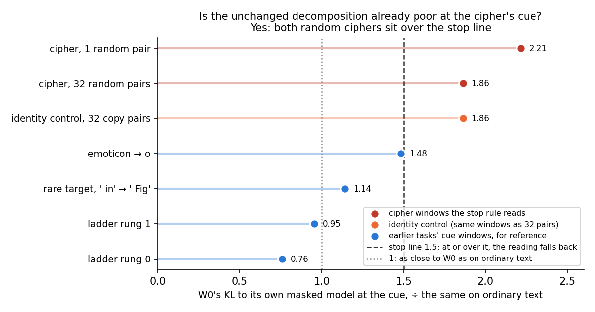
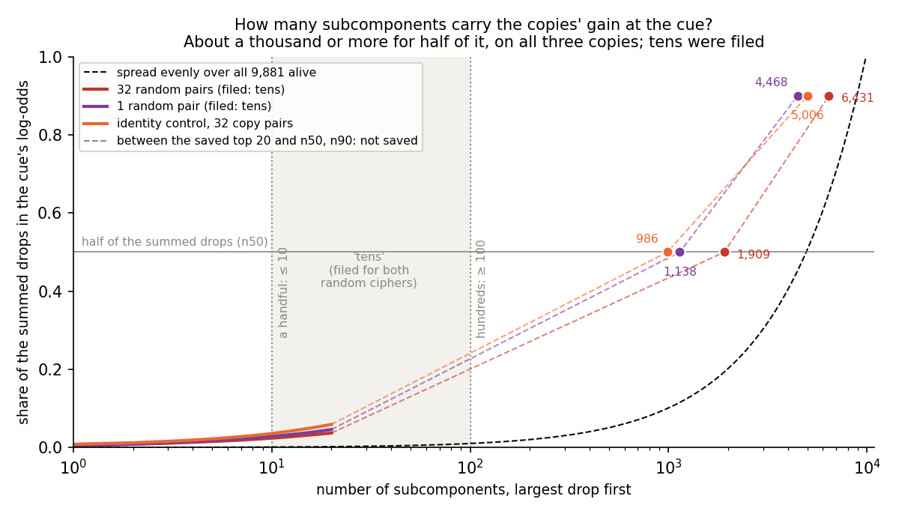

# Analysis: is the unchanged decomposition's masked model already poor at the cipher's cue? Yes, so the pass stays reading A (E48)

*2026-10-29. Plan `reports/plans/2026-10-29_plan_e48-pass-reread.md`; decision `decisions.md`, the two "Card triage"
rows, items (2) and (7). Code `experiments/pass_reread/run.py`, `src/commute/pass_reading.py`; predictions
`experiments/pass_reread/results/predictions.json`; results `experiments/pass_reread/results/saved.json`; log
`cluster/logs/commute-e48-saved-42757.out` in the main clone. Notebook `notebooks/E48_pass_reread.ipynb`; figure
`experiments/pass_reread/figures/e48_s1_fidelity.png` from `experiments/pass_reread/plot.py`.*

Before re-reading any saved copy, we checked whether the unchanged decomposition, rebuilt only from the subcomponents
its causal-importance function marks important, stays close to the original model at the cue of the word-cipher
tasks. It does not: there it sits about twice as far from the original as on ordinary text, over the agreed line of
1.5 on both random ciphers, so the planned new reading would have judged the decomposition rather than the map. Under
the user's decision the pass for the weak version therefore stays the ordinary-text adversarial reading, with the cue
reading printed beside it, and the rare target stays "not placed, narrow miss".

## The answer

The unchanged decomposition is already poor at the cipher's cue. Its masked model, every subcomponent at the value
Γ gives it, is 1.86 times as far from the original model at the cue of the 32-pair cipher as on ordinary text, and 2.21
times as far on the one-pair cipher. Both are over the filed stop line of 1.5. So the run stopped after this control,
as planned, and the pass falls back to the adversarial reading on ordinary text with the cue reading printed beside it.
None of the saved copies was re-read.

## What we were trying to test

E42 found that teacher training copies a word-cipher fine-tune into the decomposition and passes the adversarial
check on ordinary text. But the model rebuilt from the subcomponents that Γ marks important at the cipher's cue keeps
almost none of the cipher. On 2026-10-29 the user chose to add a new part to the pass: the behaviour must also be kept
by the parts Γ switches on, on the task's own text. The same decision said to read the unchanged decomposition first.
If its own masked model is already poor at the cipher's cue, the new reading would fail every map for a reason that
lies in the decomposition, and the pass falls back to reading A.

This run did that first reading and nothing else. The state is W₀, the unchanged model and its decomposition. Its
**masked model** is the forward pass with every subcomponent multiplied by Γ's causal-importance value $g$, Γ reading
W₀'s own activations, and Δ, the part of the weights outside the subcomponents, held at W₀'s value. We measured:

- **K₀ at the cue**: the mean over a task's held-out windows of $\mathrm{KL}(W_0 \,\|\, \text{masked } W_0)$ at the
  one position after the cipher's marker and key, in nats. 0 means the masked model reproduces W₀ there exactly.
- **The same KL on ordinary text**: per position, averaged over the harness's 256 Pile validation rows.
- **F**, the ratio of the two. $F = 1$ means the masked model is as close to W₀ at the cue as on ordinary text.

The stop rule reads F on the two random ciphers, 32 pairs and one pair, each 97 held-out windows. At 1.5 or over on
either, the new reading is not used. Two kinds of reference are printed beside, not scored. One is the identity
control, where each of the same 32 keys maps to itself. The others are the cue windows of four earlier tasks that VPD
is not suspected of losing: emoticon → o, the first two rungs of the task ladder, and the rare target " in" → " Fig".

Two apparatus checks ran before F. The first is that W₀'s masked KL on the Pile rows, with Δ left out as the harness
does, reproduces the harness's 0.348. The second is that, with every mask at 1 and Δ at W₀'s value, the forward pass
reproduces W₀, so Δ really enters the masked forward. One job on a MATS cluster L40, two minutes, $0.

## What we expected, and why

We leaned towards the fallback, with medium-low confidence. With Δ left out, existing numbers already put the masked
model 0.69 nats from W₀ at the cue of the 32-pair cipher's training windows, against 0.35 on ordinary text, a ratio of
about 2. Putting W₀'s Δ back in could lower either number by an amount nobody had measured, so the lean was not firm.

## What we observed

### Is the unchanged decomposition's masked model already poor at the cipher's cue? Yes, on both random ciphers

**Reading it.** Yes. At the cue of the 32-pair cipher the masked model is 0.65 nats from W₀, 1.86 times its distance
on ordinary text. On the one-pair cipher it is 0.77 nats, 2.21 times. Both dots sit right of the dashed stop line at
1.5, so the run stopped after the control. The four earlier tasks' cue windows read 0.76 to 1.48, all under the line,
with emoticon closest to it. So the cipher's cue context is harder for the decomposition than the cues of tasks it was
built to handle, and harder than the line allows.

The identity control reads exactly what the 32-pair cipher reads, 1.86. That is expected from the code. Both tasks are
built from the same windows: the build draws one set of windows for the 32 keys with seed 0, and only the value each
key maps to differs (`experiments/kv_task/run.py`, "same contexts for every task: matched controls"). K₀ compares W₀
with its own masked model, so it never reads the target. Only the probabilities of the target differ between the two
rows. The one-pair cipher has its own windows, with one key, and reads differently.

Putting W₀'s Δ into the masked forward changed almost nothing. With Δ left out the masked model reads within 0.001 nats
of the Δ-in value at the cipher cues and on ordinary text, and within 0.004 at the other cues. So the ratio with Δ left
out is 1.86 and 2.21 too. The plan's
open question about which Δ convention to score did not matter for this decision.

| task windows | role | K₀ at the cue, Δ in | Δ out | KL at other positions | F, Δ in | F, Δ out |
|---|---|---|---|---|---|---|
| rand1, 1 random pair | stop rule | 0.7709 | 0.7701 | 0.4182 | **2.214** | 2.212 |
| rand32, 32 random pairs | stop rule | 0.6482 | 0.6481 | 0.4169 | **1.862** | 1.861 |
| ident32, 32 copy pairs | beside | 0.6482 | 0.6481 | 0.4169 | 1.862 | 1.861 |
| emoticon → o | reference | 0.5161 | 0.5196 | 0.4517 | 1.482 | 1.492 |
| r2 t275, rare target | reference | 0.3973 | 0.3970 | 0.4279 | 1.141 | 1.140 |
| r1 t534, ladder rung 1 | reference | 0.3325 | 0.3322 | 0.4119 | 0.955 | 0.954 |
| r0 t352, ladder rung 0 | reference | 0.2643 | 0.2646 | 0.4011 | 0.759 | 0.760 |
| Pile, 256 val rows, per position | denominator | 0.3482 | 0.3482 | n/a | 1 | 1 |

Probabilities of each task's target, under W₀ and under its masked model with Δ in, as a reference for the cue
reading printed beside future verdicts:

| task windows | P(target), W₀ | masked, Δ in | masked, Δ out |
|---|---|---|---|
| rand1 | 0.000170 | 0.000139 | 0.000138 |
| rand32 | 0.0000154 | 0.0000177 | 0.0000176 |
| ident32 | 0.000174 | 0.000723 | 0.000729 |
| emoticon | 0.0115 | 0.00438 | 0.00441 |
| r2 t275 | 0.00455 | 0.00165 | 0.00160 |
| r1 t534 | 0.0309 | 0.0336 | 0.0338 |
| r0 t352 | 0.157 | 0.192 | 0.194 |

The apparatus checks both passed. W₀'s Δ-out masked KL on the Pile rows read 0.34819 against the harness's 0.348, a
relative difference of 0.05% where 2% was allowed. In fp32 with every mask at 1 and Δ in, the forward reproduced W₀ to
$-1.3 \times 10^{-9}$ nats, rounding, where $10^{-4}$ was allowed; with Δ out the same forward read 0.0107, close to the
expected 0.012. So Δ enters the masked forward, and the masked forward is the harness's.

## What we learned

The unchanged decomposition is about twice as far from W₀ at the cipher's cue as on ordinary text, before any update.
The cue is one position after a marker the model never sees in ordinary text, a context the decomposition was not
trained on. A reading of behaviour kept by the parts Γ switches on at that cue would therefore measure the
decomposition's own gap as much as the map's. For `GOALS.md`'s weak version, this means the pass on new behaviours
stays reading A, the adversarial check on ordinary text. The cue reading is printed beside each verdict and does not
decide it. E42's result, that teacher training passes on all three ciphers while the model rebuilt from the
subcomponents Γ marks important at the cue keeps almost none of a random cipher, stands as it was filed.

## What this means for the cards

- **The E42 criterion.** The user's decision named this fallback, so it is decided: option (c) for the cipher, reading
  A decides and the cue reading is printed beside it. The research log's E42 card and Q4 now say the pass "also asks
  that the parts Γ switches on keep the behaviour on the task's own text", pending this reading. Both change to say it
  does not, because the unchanged decomposition already reads 1.86 and 2.21 times its ordinary-text distance at the
  cue. The card itself, `decision-e42-criterion`, was already removed from the log at version 98, when the triage was
  decided; nothing is left to remove.
- **The rare target.** Decision (7) kept "not placed, narrow miss" until the task-text copy was re-read under the new
  reading. That re-read was not run, because the new reading was not adopted. So the rare target's outcome under
  reading A stands: the closer copy kept P 0.808 against a "kept" line of 0.813 and read 1.45 times the unchanged
  model on the adversarial check, inconclusive (E34 Amendment 6). No rerun follows (decision (7)).

## How compelling is the evidence

Each cipher reading is a mean over 97 held-out windows, on one decomposition and one card. The reading has no
randomness: Γ's values and the masked forward are deterministic, so a rerun on the same card reads the same. Both
are clear of the line, by 0.36 and 0.71. The line itself is the project's fixed 1.5, applied here to W₀ against
itself, a choice filed before the run. The plan said the branch "rests largely on the threshold", and that remains
true. In absolute terms the decomposition's own gap at the cue is about 0.65 nats, while E42's fine-tunes move the cue
by 10 to 13 nats. The new share would have had room to separate copies, but a share measured against a reference that
is itself twice as poor as usual would not have read the map alone. The comparison is between one cue position and
the mean over every ordinary-text position. The four earlier tasks' cue windows, the same position type, read 0.76 to
1.48, so the cipher's excess is not only the position type. Emoticon at 1.48 sits just under the line. Any line
from 1.49 to 2.21 would keep every earlier task under it and still give the fallback on these numbers.

## Surprises

- None reversed a filed prediction: the run landed on its lean.
- Δ at W₀'s value contributes almost nothing under the masks, at most 0.0035 nats at any cue, though with every mask
  at 1 leaving it out costs 0.0107 nats per Pile position. The plan's two Δ conventions read the same here.

## What next

1. Nothing runs on this line by default. Under option (c), the E42 copies' cue readings are already in E42's analysis.
   The E34 copies' cue readings are not printed anywhere yet. The plan's decision tree names a $0, 10-minute rerun of
   stage 2 as "reported beside", no verdicts, if the lead wants them printed. It would change no verdict.
2. If a future decomposition or a masked training fixes the cue gap, so that W₀ reads under 1.5 at the cipher's cue,
   the new reading becomes usable and this run's code reads every saved copy unchanged. This matters for the Qwen
   line, whose plan uses the same share; its own W₀ reading at its task's cue should be checked the same way first.

## Scorecard

| id | claim | rule | read | verdict |
|---|---|---|---|---|
| S1 A1 | the masked forward is the harness's | W₀'s Δ-out Pile K within 2% of 0.348 | 0.348188, +0.05% | pass |
| S1 A2 | Δ enters the masked forward | fp32 KL to W₀ with every mask at 1, Δ in, ≤ 1e-4 | −1.3e-9 | pass |
| S1 | W₀'s masked model already poor at the cipher's cue; lean fallback, medium-low | fallback if F ≥ 1.5 or NaN on rand32 or rand1 | F 1.862 and 2.214 | **fallback**, as leaned |
| P1 | E42 task-text copies: rand32, rand1 not kept; ident32 kept | share ≥ 0.8 | not read | not scored: stage 2 not run, by design |
| P2 | do-nothing controls, the reading's teeth | as P1 | not read | not scored, `P2_teeth` null |
| P3 | rare-target task-text copy not kept | as P1 | not read | not scored |
| P4 | r1 t534 task-text copies kept | as P1 | not read | not scored |
| P5 | E34's regenerated arm-A copies | as P1 | not read | not scored: job 2 not submitted |
| P6 | batch-order spread under 0.05 | max share difference over two seed pairs | not read | not scored, `spread` null |
| P7 | carriers of the E42 gain: "tens" | n50 count | not read | not scored: stage 3 not run |

The control's filed expected values against what it read:

| quantity | expected | read |
|---|---|---|
| Pile KL per position, Δ out | 0.348 | 0.3482 |
| Pile KL per position, Δ in | 0.25 to 0.35 | 0.3482 |
| path check, Δ in | below 1e-6 | −1.3e-9 |
| path check, Δ out | about 0.012 | 0.0107 |
| KL at the cue, Δ in | 0.4 to 0.7 | rand32 0.648, rand1 0.771, just over |
| KL at the cue, Δ out | about 0.69 on rand32's training windows | 0.648 on its held-out windows |
| F, Δ in | 1.4 to 2.4 | 1.86, 2.21 |
| F, Δ out | about 2.0 | 1.86, 2.21 |

## Not run

- Stage 2, the saved copies under the new reading: E42's six copies, the four r1 t534 SGD copies, the two r2 t275 SGD
  copies including the rare target's task-text copy, the six LoRA Pile-text copies, and the eight do-nothing states.
  Not run by design: the stop rule read fallback.
- Stage 3, the subcomponents that carry the E42 copies' gain. Not run by design, for the same reason.
- Job 2, E34's six arm-A copies regenerated on the L40 and read. Not submitted, by the plan's decision tree.
- The rerun of stage 2 as "reported beside", which would print the E34 copies' cue readings without deciding
  anything. Not asked for.
- Everything in the plan's own "Not in this plan" list: E41's copies, E34's six main Pile-text copies, E42 Amendment
  2's and E43's states, any adversarial reading, a second card.

## Provenance

Slurm job 42757, MATS cluster `debug` QoS, NVIDIA L40, about 2 min in all, exit 0, $0. Stage 1 itself took 16 s
after loading. `saved.json` records `decision: fallback`, `stopped: fallback: W0's masked model is already poor on the
cipher windows; option (c), reading A decides`, and `score: {S1: fallback, spread: null, states: {}, P2_teeth: null}`.
Predictions filed 2026-10-29 before the run.

# Amendment 1: how many subcomponents carry the copies' gain at the cipher's cue?

*2026-10-29. Plan `reports/plans/2026-10-29_plan_e48-pass-reread.md` → "Stage 3" and "Amendment 1"; prediction P7 in
`experiments/pass_reread/results/predictions.json`, filed before the first job and unedited; results
`experiments/pass_reread/results/carriers.json`; log `cluster/logs/commute-e48-carriers-42960.out` in the main clone;
figure `experiments/pass_reread/figures/e48_a1_carriers.png` from `experiments/pass_reread/plot_amend1.py`.*

We took the three teacher-trained decompositions from the earlier cipher experiment and, one subcomponent at a time,
undid that subcomponent's training to see how much of the cipher's gain at its cue went with it. On every copy, one
to two thousand subcomponents carry half of the gain, far more than the tens we filed, and the copy of a cipher the
model already half did spreads about as widely as the new ones. So the repair is not a small change to which
subcomponents the importance function switches on, and this count does not tell a new behaviour from an old one.

## The answer

Hundreds, not tens. On each of the three copies, between about one and two thousand of the 9,881 alive subcomponents
are needed to carry half of the gain at the cipher's cue. We filed "tens" for both random ciphers, so that
prediction missed on both. The identity control, a cipher the model already half did, spreads about as widely. So the
count does not separate a new behaviour from an existing one, and it rules out a repair that switches on a few
subcomponents.

## Why it ran

E48's first stage fell back, and that stopped its job before this stage. The task still asked for the subcomponents
that carry the copies' gain. This listing describes where the gain sits in each copy; it is not a pass reading, so the
fallback does not bear on it. Amendment 1 ran this stage alone, in its own job, with the filed prediction and rule
unchanged.

## What we were trying to test

E42 made three copies by teacher training, one per cipher task. Teacher training trains the alive subcomponents'
read and write vectors, starting from the unchanged decomposition, so that the decomposition's model imitates a
fine-tune; Γ and Δ stay fixed. The three tasks:

- **32 random pairs**: each of 32 keys maps to an arbitrary other word. A behaviour the model lacked.
- **1 random pair**: one key and its value. Also new.
- **Identity control**: each of the same 32 keys is followed by itself. The model half did this already; in E10 the
  fine-tune's gain on it came from Γ switching on subcomponents that already copy.

The **gain** of a copy is its mean log-odds of the target at the cue, minus the unchanged model's, over the task's
97 held-out windows. The cue is the position right after the marker and the key. The gains read 20.8, 23.0 and 18.8
nats on the three tasks. They match E42's own readings to within 0.04.

For each alive subcomponent we set its read and write vectors back to their unchanged values, kept every other
subcomponent as the copy had it, and read the gain again. The **drop** is how much the gain fell. A drop of 0 means
that subcomponent's training does nothing at the cue; the drops need not add up to the gain. From the drops, sorted
largest first:

- **n50** is the fewest subcomponents whose drops reach half of the summed positive drops; **n90**, nine tenths.
- **The off share** is the part of the n50 set's summed drop that comes from subcomponents with Γ's value under 0.01
  at the cue, under the copy. These are subcomponents Γ keeps off where the behaviour is used.
- **The joint revert** sets the whole n50 set back at once and reads the fraction of the gain removed. It checks
  whether the separate drops roughly add.

The filed rule sorts n50 into "a handful" at 10 or fewer and "hundreds" at 100 or more, with "tens" between. The
plan reads "a handful" as pointing to a small change to Γ as the repair, and "hundreds" as not.

## What we expected, and why

We filed "tens" for both random ciphers, with low confidence and no reference. Teacher training moves every alive
subcomponent, which argues for a wide spread. But a one-pair cipher should need few directions, which argued for a
narrow one. No lean was filed for the identity control; it is the contrast.

## What we observed

### How many subcomponents carry half of the gain? About a thousand or more, on all three copies

**Reading it.** Hundreds on all three, and the filed "tens" missed on both random ciphers. The figure plots, for each
copy, the share of the summed drops carried by the largest drops against how many are counted. Only the top 20 drops
and n50, n90 were saved, so the curves are exact there and dashed between. The 20 largest drops carry 3.7 to 5.9% of
the total, against 0.2% if the drops were spread evenly. Half of it needs 1,909 subcomponents on 32 random pairs and
1,138 on one pair. Nine tenths needs 6,431 and 4,468, about two thirds and nearly half of all alive subcomponents. The
largest single drop is under 1% of the total on every copy. So the gain is concentrated well beyond an even spread,
but nowhere near a handful.

The identity control reads 986 for half and 5,006 for nine tenths. That sits inside the range the two random ciphers
span: below both at half, between them at nine tenths. On this measure, a copy of a behaviour the model already half
did spreads over as many subcomponents as a copy of a new one.

The off share differs more. On one pair, 64% of the n50 set's summed drop comes from subcomponents Γ keeps off at the
cue. On 32 random pairs it is 42%, and on the identity control 39%. So the one-pair copy leans more on subcomponents Γ
keeps off, but the 32-pair copy does not, and the off share does not split new from existing either.

Setting the n50 set back together removes 66%, 58% and 74% of the gain. Half the summed positive drops, as a fraction
of each gain, is 67%, 60% and 71%. The drops of the n50 set therefore add roughly, and about a third of the gain sits
in the remaining eight to nine thousand subcomponents.

| copy | n50 | n90 | off share of n50 | joint revert of n50, of the gain | gain, nats | summed positive drops | class |
|---|---|---|---|---|---|---|---|
| 32 random pairs | 1,909 | 6,431 | 0.424 | 0.664 | 20.80 | 27.75 | hundreds |
| 1 random pair | 1,138 | 4,468 | 0.635 | 0.576 | 23.05 | 27.53 | hundreds |
| identity control | 986 | 5,006 | 0.389 | 0.744 | 18.82 | 26.84 | hundreds |

Out of 9,881 alive subcomponents in each copy. The summed positive drops exceed the gain by 1.19 to 1.43 times, so
some drops are negative or overlap.

The 20 largest drops, by matrix, for the record. On 32 random pairs, 16 of the 20 sit in layer 1, mostly attention.
On one pair, 15 sit in the MLPs of layers 2 and 3. On the identity control, all 20 sit in layers 1 and 2, 16 of them
in attention.
Few of each top 20 are ones Γ keeps off at the cue: five, two and three. The full lists, with Γ's value under
the copy and under W₀, are in `carriers.json`.

## What we learned

A large part of the decomposition carries a teacher-trained copy's gain at the cipher's cue. Half of it needs about
a thousand subcomponents or more, and nine tenths needs four and a half to six and a half thousand. That points away
from a repair that keeps the copy and has Γ switch on a few more subcomponents at the cue. For `GOALS.md`'s question of whether a new behaviour spreads more than an existing one,
this count gives no sign of it. The identity control, the existing behaviour, spreads as widely as the two new ones.
What the comparison does not show is whether the wide spread belongs to the behaviours or to teacher training itself.
Teacher training moves every alive subcomponent, and no copy of a narrowly placed behaviour was read alongside.

## How compelling is the evidence

The counts are far from the filed line: the smallest n50 is 986, almost ten times the "hundreds" line. The reading is
deterministic, with each drop a mean over 97 held-out windows on one card, so a rerun reads the same. It covers one copy
per task, one seed and one batch order, on the 67M. The measure is blind to interactions: a drop is one subcomponent
undone alone. The joint revert of the n50 set shows the drops add roughly there, but not beyond it. It is also blind to
how the copy's training was spread by the optimiser rather than needed by the behaviour. No copy whose gain is known to
sit in a few subcomponents was read, so "a thousand" is compared only with the even spread and the identity control.

## Surprises

- The filed "tens" missed on both random ciphers, by more than a factor of ten: every copy reads "hundreds", with n50
  at 1,138 and 1,909. Not a reversal of a direction filed with confidence, as the lean was low, but not a narrow miss
  either.
- The identity control spreads about as widely as the new ciphers, where a narrower spread was the natural guess for a
  behaviour Γ already handles.

## What next

1. Nothing by default. "Hundreds" rules out a small Γ change as the repair; the masked-copy line already ended by the
   approved tree in E42 Amendment 2, so no repair is pending on this count.
2. A reference count, if the spread question matters: the same listing on an E34 copy of a behaviour the model
   already half did, regenerated on the L40, at $0 and a few minutes per copy. A count well under a hundred there
   would make the spread a property of these behaviours; about a thousand would make it a property of teacher
   training.

## Scorecard

| id | claim | rule | read | verdict |
|---|---|---|---|---|
| P7 | rand32: the gain's carriers number "tens"; lean low | n50 ≤ 10 a handful, ≥ 100 hundreds, else tens | n50 1,909 | **hundreds**, filed tens: miss |
| P7 | rand1: same | same | n50 1,138 | **hundreds**, filed tens: miss |
| P7, beside | ident32, no filing | same | n50 986 | hundreds |

## Not run

- The full sorted drops: only the top 20, n50 and n90 were saved, so the curve between them is not known.
- A reference count from any other state: a do-nothing state, E42's least-squares split, an E34 copy, or the
  fine-tune itself.
- E42's Pile-text copies, and the E34 copies, under the same listing.
- A joint revert of the n90 set, or of sets chosen by Γ's value rather than by drop size.
- Any change to Γ itself.
- A second seed or batch order; a second card.

## Provenance

Slurm job 42960, MATS cluster `debug` QoS, NVIDIA L40, exit 0, $0. Each copy's listing took 185 to 192 s for 9,881
single-subcomponent reverts. `carriers.json` records `score: {carriers e42/rand32/A: hundreds, carriers e42/rand1/A:
hundreds, carriers e42/ident32/A: hundreds}`, scored by the run's own `score` code from the filed rule. `saved.json`
untouched.
