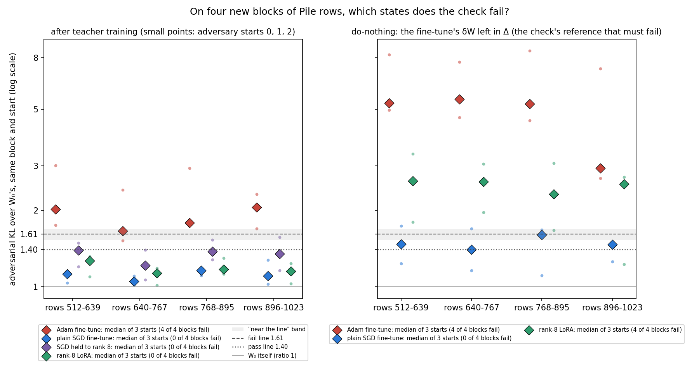
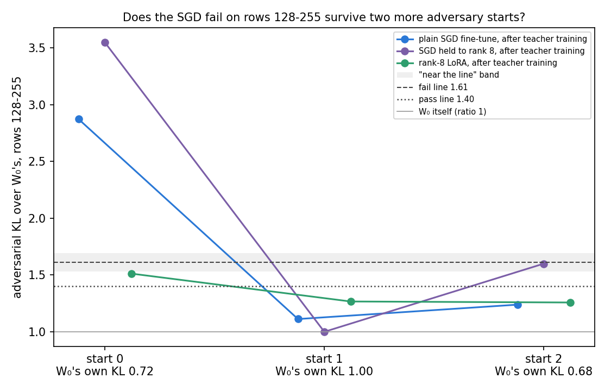

# Analysis: on new Pile rows, does the adversarial check fail SGD's teacher-trained decomposition? (E49)

*2026-10-29, analysis agent for the lead. Plan: `reports/plans/2026-10-29_plan_e49-row-blocks.md`. Code
`experiments/row_blocks/run.py`. Predictions `experiments/row_blocks/results/predictions.json`, filed 13:13:11 before
any job, unedited. Results `experiments/row_blocks/results/{regen,a,b512s0,b512s1,b512s2,b768s0,b768s1,b768s2,score}.json`;
logs `experiments/row_blocks/results/large/<stage>.log` and `cluster/logs/commute-e49-*.out`. Figures from
`experiments/row_blocks/plot.py`. Notebook `notebooks/E49_row_blocks.ipynb`. Words as in `GOALS.md` → Terms. Every
number below was read from the results files with `jq`; an independent check of the scoring agreed on every prediction
and found no bug.*

**In plain words.** We read the paper's adversarial check on four new blocks of Pile text at three adversary starts,
for the decompositions after teacher training on four lowercase fine-tunes. The Adam one fails every new block and the
LoRA one passes every block; the SGD ones pass too, but so does SGD's whole update left in Δ, so the check had no power
on SGD here. For `GOALS.md`, teacher training places a broad LoRA update and not a broad Adam one on eight blocks, while
the SGD case stays open.

Words used below. **The check** is the paper's adversarial check: a 20-step mask adversary from one random start, one
adversary shared by a block of 128 Pile val rows. A **block ratio** is a state's KL under that adversary over the
unchanged decomposition W₀'s KL on the same block at the same start, read in the same job. 1 means no more fragile than
W₀. E39's fixed lines: a ratio passes at or under 1.40 and fails at or over 1.61; between them is neither. A block's
verdict here uses the **median of three starts**, seeds 0, 1 and 2. **Teacher training** trains the alive
subcomponents of the released decomposition to imitate a fine-tuned model, Γ and Δ frozen; the result is the
**teacher-trained decomposition** of that fine-tune. The **do-nothing** state of a fine-tune leaves its whole δW in Δ;
it is the reference the check must fail. The four fine-tunes, all 300 steps on E37's lowercase task: **Adam**,
**plain SGD** at rate 0.01, **SGD held to rank 8** at rate 0.03, and a **rank-8 LoRA** trained by Adam.

## The answer

The Adam teacher-trained decomposition fails all four new blocks and the LoRA's passes all four, as filed. Both SGD
teacher-trained decompositions pass all four. That SGD pass carries almost no weight. The plain SGD fine-tune left in
Δ, which the check should fail, also passes all four blocks: on these rows the check cannot see SGD's update at all.
The Adam and LoRA do-nothings fail every block, so their verdicts stand. On the hard block, rows 128-255, the SGD fail
did not repeat at two more starts, but the filed rule reads "mixed": one SGD state lands just under the fail line.

## What we were trying to test

E39 found that the check fails the decomposition after teacher training on a broad Adam fine-tune and passes it on a
rank-8 LoRA. Its third amendment found that both SGD teacher-trained decompositions fail on Pile rows 0-255 and pass
on rows 256-511, and that their fail sits on one block, rows 128-255, read at one adversary start. Two things could
make one block decide: the adversary's random start, or the rows themselves. And four blocks were too few to say
whether SGD sits with Adam or with the LoRA. The user chose two free cluster readings.

**(a) The hard block at two more starts.** Rows 128-255 at seeds 1 and 2, for W₀, both SGD teacher-trained
decompositions and the LoRA's. If both SGD states fail at both new starts, the fail belongs to the rows; if both pass,
to the start.

**(b) Four new blocks at three starts.** Pile val rows 512-1023, in blocks of 128, at seeds 0-2, for the four
teacher-trained decompositions and three do-nothings. Per state, each block's median ratio and the count of failing
blocks. The plain SGD do-nothing's count is the check's power on SGD's update: where it does not fail, an SGD pass says
nothing.

**What was trained.** Nothing but the three fine-tunes, regenerated on the L40 so their do-nothing states could be
built. The teacher-trained decompositions are E39's saved files, loaded as they were, so the verdicts are about the
same states E39 scored.

**Controls, each first in its job, each with a stop.** W₀ on rows 0-255 must reproduce E47's L40 readings to 1e-4.
The Adam and LoRA teacher-trained decompositions must reproduce E47's L40 mean KL to 0.1%, and Adam must fail. In
every b job W₀ must read in its known band and the Adam do-nothing must fail. Every control passed.

## What we expected, and why

- **The hard block's fail belongs to the rows.** Low-medium lean: that block reads high for 13 of 14 states over 1.40,
  but W₀'s own reading there moves most over starts.
- **Adam fails all four new blocks.** Medium: its four known blocks read 1.69 to 2.68, the lowest near the line.
- **Plain SGD fails at most one.** Medium-low: three of its four known blocks read 1.11 to 1.26, one 2.93.
- **The LoRA fails none.** Medium: its known blocks read 1.11 to 1.42 on the H100.
- **SGD held to rank 8 fails at most one.** Medium-low: its known blocks read 1.25 to 1.42 besides 2.95.

## What we observed

### On four new blocks, which states does the check fail?

**Reading it.** The Adam teacher-trained decomposition fails, the LoRA's passes, and the SGD ones pass on a check that
could not have failed them. In the left panel the red Adam medians sit above the fail line on all four blocks, and the
green LoRA medians sit under the pass line on all four. Both SGD states, blue and purple, sit under the pass line on
all four. In the right panel the Adam and LoRA do-nothings fail every block by a wide margin, so for those two the
check had the power to fail an update on these rows. The plain SGD do-nothing, blue, sits on or under the lines on
every block: its medians read 1.40 to 1.60, and none reaches 1.61. So the check could not fail plain SGD's whole
update left in Δ, and a pass for SGD's teacher-trained decomposition carries almost no weight here.

Per-block medians over seeds 0-2, with failing-block counts:

| state | rows 512-639 | 640-767 | 768-895 | 896-1023 | blocks failed | at seed 0 alone |
|---|---|---|---|---|---|---|
| Adam, teacher-trained | 2.02 | **1.66** near the line | 1.78 | 2.06 | 4 | 4 |
| plain SGD, teacher-trained | 1.12 | 1.05 | 1.16 | 1.10 | 0 | 0 |
| SGD held to rank 8, teacher-trained | 1.39 | 1.21 | 1.38 | 1.35 | 0 | 0 |
| LoRA, teacher-trained | 1.26 | 1.13 | 1.17 | 1.15 | 0 | 0 |
| Adam, do-nothing | 5.30 | 5.49 | 5.26 | 2.93 | 4 | 4 |
| plain SGD, do-nothing | 1.47 | 1.40 | **1.60** near the line | 1.46 | 0 | 0 |
| LoRA, do-nothing | 2.61 | 2.60 | 2.31 | 2.53 | 4 | 4 |

"Near the line" is the plan's mark for a block median in 1.53-1.69: bf16 rounding of the saved states and the card
difference can move a reading by that much. Two medians carry it. Adam's on rows 640-767 reads 1.656 from seeds at
1.66, 1.52 and 2.41; the seed-1 reading is between the lines. The plain SGD do-nothing's on rows 768-895 reads 1.604,
0.006 under the fail line. The plain SGD do-nothing passes outright on rows 640-767, at 1.3985.

Every ratio, seeds 0 / 1 / 2:

| state | rows 512-639 | 640-767 | 768-895 | 896-1023 |
|---|---|---|---|---|
| Adam, teacher-trained | 2.02 / 1.75 / 3.01 | 1.66 / 1.52 / 2.41 | 1.78 / 1.74 / 2.93 | 2.06 / 1.70 / 2.32 |
| plain SGD, teacher-trained | 1.15 / 1.04 / 1.12 | 1.05 / 1.02 / 1.10 | 1.16 / 1.11 / 1.16 | 1.28 / 1.02 / 1.10 |
| SGD rank 8, teacher-trained | 1.39 / 1.20 / 1.49 | 1.21 / 1.06 / 1.40 | 1.38 / 1.28 / 1.53 | 1.57 / 1.16 / 1.35 |
| LoRA, teacher-trained | 1.31 / 1.10 / 1.26 | 1.13 / 1.01 / 1.18 | 1.17 / 1.12 / 1.30 | 1.23 / 1.03 / 1.15 |
| Adam, do-nothing | 5.30 / 4.97 / 8.22 | 4.66 / 5.49 / 7.70 | 4.52 / 5.26 / 8.51 | 2.93 / 2.68 / 7.24 |
| plain SGD, do-nothing | 1.47 / 1.23 / 1.74 | 1.40 / 1.16 / 1.70 | 1.60 / 1.10 / 1.67 | 1.50 / 1.26 / 1.46 |
| LoRA, do-nothing | 2.61 / 1.80 / 3.34 | 2.60 / 1.96 / 3.05 | 2.31 / 1.67 / 3.08 | 2.70 / 1.22 / 2.53 |

W₀'s own KL on these blocks stayed between 0.61 and 0.71 over all twelve block-start pairs. So the large swings across
starts above, such as the Adam do-nothing's 4.5 to 8.5 on one block, come from the states' KLs, not from W₀ moving.

The 256-row form of the check, E39's mean of two neighbouring blocks, gives the same picture. Adam fails all six
block-pair and start combinations at 1.63 to 2.70. The LoRA passes all six at 1.05 to 1.22. Plain SGD passes all six
at 1.03 to 1.22. SGD held to rank 8 reads 1.13 to 1.47: it passes three and sits between the lines on three, at seed 2
on rows 512-767 and at seeds 0 and 2 on rows 768-1023. The plain SGD do-nothing reads 1.18 to 1.72 and fails only one of the six.

### Does the SGD fail on rows 128-255 survive two more adversary starts?

**Reading it.** Not cleanly: the filed rule cannot separate the start from the rows, though the raw numbers lean
towards the start. At seed 0 both SGD states fail the hard block again on this card, at 2.87 and 3.55. At seeds 1 and
2 plain SGD passes at 1.11 and 1.24, so its label is "start". SGD held to rank 8 passes at seed 1, at 1.00, but reads
1.599 at seed 2, 0.011 under the fail line, so its label is "mixed" and the filed reading is "mixed". The LoRA reads
1.51, 1.27 and 1.26: between the lines at seed 0, passing at the other two.

The lean, which is not a finding: the drop is in the SGD state's own KL, not only in W₀'s. W₀'s KL on this block reads
0.72, 1.00 and 0.68 at seeds 0, 1 and 2. Plain SGD's reads 2.06, 1.11 and 0.85. At seed 2, W₀ reads lower than at
seed 0, yet plain SGD's KL fell to less than half. So W₀'s high reading at seed 1 cannot explain the pass at seed 2,
and a start that suits the adversary at seed 0 is the simpler reading. One block and three starts cannot say how often
such a start occurs.

| state | KL, seed 0 / 1 / 2 | ratio, seed 0 / 1 / 2 | label |
|---|---|---|---|
| W₀ | 0.716 / 1.001 / 0.685 | 1 | — |
| plain SGD, teacher-trained | 2.057 / 1.112 / 0.847 | 2.87 / 1.11 / 1.24 | start |
| SGD rank 8, teacher-trained | 2.541 / 1.000 / 1.095 | 3.55 / 1.00 / 1.60 | mixed |
| LoRA, teacher-trained | 1.083 / 1.267 / 0.861 | 1.51 / 1.27 / 1.26 | not scored |

### Does this card reproduce the H100's SGD readings?

Plain SGD yes, SGD held to rank 8 no. On rows 0-255 at seed 0, plain SGD's check read 2.038 here against 2.0675 on the
H100, 1.4% apart, inside the 10% limit. SGD held to rank 8 read 2.451 against 2.122, 15.5% apart, over the limit. The
plan set that gate as reported, with no stop.

What the miss means for reading SGD held to rank 8 on this card. The L40's seed-0 adversary does not attack this state
the way the H100's did, by more than the 0.5-4.2% seen for other saved files between the cards. Its L40 ratios are
still sound against W₀ read on the same card at the same start, which is how every number in this report is formed.
What does not carry over is any one-to-one comparison with an H100 reading of this state, and the lines' fine margins,
which were set from the H100's noise floor. The miss went in the harsh direction: this card read the state as more
fragile than the H100 did. So its passes on the new blocks are not the product of a gentler card. Its medians of 1.21
to 1.39 sit under the pass line by 0.01 to 0.19, which is inside a 15% card difference for the closest of them.

## The decision tree: which branch fires

- **(a): "mixed".** The SGD states disagree, one landing between the lines. Start and rows are not separated on this
  block. The b reading decides where SGD sits, and per-row KL is not run.
- **(b): "SGD passes on most rows", with low power.** Plain SGD fails none of the four new blocks and Adam fails all
  four. By the tree, the line closes "Adam fails, the LoRA passes, SGD passes on most rows". Option (d) is dropped:
  the labelled SGD state at step 1,000 and the SGD-trained LoRA on the H100. The filed reading text says the
  SGD do-nothing fails "at most two" blocks; in fact it fails none. So the check could not fail SGD's update on any of
  the four new blocks, and "SGD passes" is a pass on a check with no power for SGD here. Wherever this reading appears
  it must say so.

## What we learned

The Adam-against-LoRA contrast of E39 now stands on eight blocks of Pile rows: Adam's teacher-trained decomposition
fails every block read, and the LoRA's passes every new block, with both do-nothings failing as they must. The SGD
fails that E39 reported rest on one block at one start; at two more starts and on four new blocks the SGD states pass.
But the check cannot fail plain SGD's whole update even when it is left entirely in Δ, so this check does not tell us
whether teacher training places a broad SGD update. For `GOALS.md`'s weak version under reading A, SGD is outside what
this check can decide on these rows, rather than a pass. A single adversary start can decide a verdict near the lines:
plain SGD's hard block moved from 2.87 to 1.11 between starts.

## How compelling is the evidence

- **The weakest link is the SGD half of the reading.** The plain SGD do-nothing fails no block, so the SGD passes are
  near-empty. SGD held to rank 8 has no do-nothing of its own here; the plain SGD one stands in for it.
- **Next weakest: Adam's block on rows 640-767.** Its median 1.656 is near the line, and its seed-1 reading 1.52 is
  between the lines. With one more start in the other direction the Adam count could read three of four.
- **One card, one batch order, one LoRA seed.** All readings are on the L40; the lines were set from the H100's noise
  floor of 0.075, against the L40's 0.209 on rows 0-255. The rank-8 SGD state reads 15.5% off its H100 reading.
- **Starts move the states much more than W₀.** W₀'s KL on the new blocks stays between 0.61 and 0.71. Between
  starts, a teacher-trained state's ratio moves by up to 1.3, and the Adam do-nothing's by up to 4.6. Seed 2 reads
  highest for both Adam states on every block. A three-start median is a rough summary of that spread.
- **The check is a lower bound on fragility.** A 20-step adversary from one start; more steps or starts could only find
  higher KLs.
- **The do-nothings are L40 fine-tunes**, regenerated here, while the teacher-trained states copied H100 fine-tunes.
  Their held-out gains match the H100's to 0.0005, so they are the same fine-tunes for this purpose.

## Surprises

- **The SGD do-nothing passes the check on every new block.** Not filed as a prediction, but expected to read 1.3 to
  3.8 and possibly pass one block. It failed none, and on the hard block E39 read it at 3.83. On most Pile rows the
  check does not see SGD's update, even whole and left in Δ.
- **The hard block's SGD fail did not repeat for plain SGD.** The filed lean was "rows"; plain SGD read "start". The
  rule's reading is "mixed" because SGD held to rank 8 read 0.011 under the fail line at seed 2. A narrow miss of the
  filed lean, not a reversal: the rule fixed "mixed" as a possible outcome.
- **The rank-8 SGD card gate failed**, 15.5% against a 10% limit, in the harsh direction.

## What next

1. **Decide whether SGD needs a check with power.** The ordinary-text check cannot fail SGD's update on these rows.
   First a reading is needed where the SGD do-nothing fails, such as the lowercase task's own text. Only then can
   SGD's teacher-trained decomposition be called placed or not placed. If none can be
   found at $0, the line closes with SGD named as out of the check's reach.
2. **Multi-start readings near the lines.** Plain SGD's hard block moved 1.76 between starts. Every single-start
   verdict in 1.2-2.2 in the project could flip; the plan's branch 1 listed E41, E42, E43 and E34. Not triggered by this
   tree, since (a) read "mixed", but the data lean that way.
3. **Adam's block 640-767**: two more starts would say whether Adam fails every block or three of four.

## Scorecard

| id | claim | rule | read | verdict |
|---|---|---|---|---|
| P1 | The hard block's SGD fail belongs to the rows | each SGD state at seeds 1, 2 on rows 128-255: "rows" if both ≥ 1.61, "start" if both ≤ 1.40, else "mixed"; holds iff both "rows" | plain SGD 1.11, 1.24: start; rank 8 1.00, 1.599: mixed | misses (reading "mixed") |
| P2 | Adam teacher-trained fails all four new blocks | block median over seeds 0-2 ≥ 1.61 on each of 4 | 2.02, 1.66, 1.78, 2.06: 4 of 4 | holds; 1.66 near the line |
| P3 | Plain SGD teacher-trained fails at most one | same, count ≤ 1 | 1.12, 1.05, 1.16, 1.10: 0 of 4 | holds; low power, the SGD do-nothing fails 0 of 4 |
| P4 | LoRA teacher-trained fails none | same, count 0 | 1.26, 1.13, 1.17, 1.15: 0 of 4 | holds |
| P5 | SGD held to rank 8 fails at most one | same, count ≤ 1 | 1.39, 1.21, 1.38, 1.35: 0 of 4 | holds; low power, no own do-nothing; card gate missed |

Controls: G_w0_a, G_adam_a (1.5018157, check 2.171), G_lora_a (0.9174504, check 1.326), G_gain (Adam 0.12963, plain
SGD 0.13705, LoRA 0.14774), G_w0_b and G_nothing_b in all six b jobs: all passed. G_card: plain SGD passed, rank-8 SGD
missed (reported, no stop).

## Not run

- Per-row KL on the hard block: by the tree, only on a "rows" reading.
- Option (d): the labelled SGD state at step 1,000 and the SGD-trained LoRA on the H100, dropped by branch (b).
- A do-nothing for SGD held to rank 8.
- Any reading where the SGD do-nothing fails, so no check here had power on SGD's update.
- Rows past 1023, a shuffled re-blocking of rows 0-255, a second LoRA seed, a second batch order, other cards.
- The H100: no reading here can be put one-to-one against an H100 line.
- Stochastic and CI-masked ratios of the states, beyond W₀'s CI-masked control.
- More than three adversary starts per block, or more than 20 adversary steps.

## Provenance

- MATS cluster, L40, `debug` QoS, $0. Jobs: regen 42959, a 42963, b512s0 42998, b512s1 42999, b512s2 43000,
  b768s0 43001, b768s1 43002, b768s2 43003. Score on CPU via `fleet/cpu-run`, 14:39.
- Job regen 42959 wrote its results, status "done", at 13:22:56, then hung at exit; it was cancelled at 13:29:12
  (`scancel`). Its results file and three saved fine-tunes are complete and their sha256 match the b jobs' file records.
- Times: regen about 1 min of work; a 13:29-13:49; each b job about 16 min, 13:55-14:39.
- Saved: `experiments/row_blocks/results/large/dW_{adam,sgd,lora}.pt`, fp32, 113 MB each, sha256 `2b1669e1…`,
  `2b2cc903…`, `067152d9…` (see `experiments/SAVED.md`).
- Teacher-trained inputs, sha256 pinned in `run.py`: `trained_step1000.pt` `d7da3c25…`, `tt_sgd_step1000.pt`
  `ced08dea…`, `a2_tt_sgd_r8.pt` `4c9d24df…`, `a2_tt_lora_s0.pt` `20b3d068…`.
- Peak memory: 14.7 GB GPU, 6.1 GB host per job.
